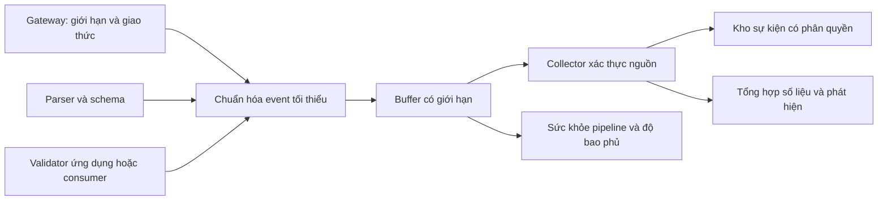

# Input validation failure

## 1. Ghi nhận lỗi validation để phục vụ quyết định bảo mật

Input validation failure là sự kiện đầu vào không đáp ứng một quy tắc mà hệ thống đã xác định: sai định dạng, sai kiểu, vượt giới hạn, thiếu trường hoặc không thỏa quan hệ giữa các giá trị.

Trong chương Logging và audit, câu hỏi chính là hệ thống cần ghi nhận điều gì khi từ chối đầu vào để hỗ trợ điều tra, phát hiện bất thường và kiểm chứng kiểm soát. Một phản hồi 4xx cho client chưa tự tạo ra bằng chứng đủ dùng cho những mục tiêu đó.

Ví dụ, một API liên tục nhận giá trị ngoài enum ở trường chọn kênh thông báo. Nguyên nhân có thể là một client cũ, lỗi triển khai hoặc một người đang thử các đầu vào không được phép. Sự kiện cần giữ được loại quy tắc, endpoint, nguồn quan sát và ngữ cảnh phù hợp; không cần mặc định lưu toàn bộ request.

OWASP đưa input validation failure vào nhóm sự kiện nên được ghi nhận khi có thể, đồng thời lưu ý đầu vào bất thường không tự chứng minh một cuộc tấn công. Xem [OWASP Logging Cheat Sheet — Which events to log](https://cheatsheetseries.owasp.org/cheatsheets/Logging_Cheat_Sheet.html#which-events-to-log).

Mục tiêu của đặc tả là liên kết:

> Rủi ro → loại lỗi cần quan sát → sự kiện tối thiểu → nguồn tin cậy → bảo vệ pipeline → phát hiện và phản ứng → bằng chứng kiểm thử.

Không coi logging là lý do để tiếp tục xử lý dữ liệu không hợp lệ. Việc từ chối request và việc ghi nhận sự kiện là hai trách nhiệm cần được thiết kế cùng nhau.

## 2. Phạm vi lỗi cần quan sát

### 2.1. Validation có thể thất bại trước khi vào handler nghiệp vụ

| Điểm phát sinh | Ví dụ | Nơi có thể cần ghi nhận |
|---|---|---|
| Biên giao thức hoặc gateway | Request vượt giới hạn, encoding không được hỗ trợ | Gateway hoặc thành phần nhận request |
| Parser | JSON sai cú pháp, độ sâu vượt giới hạn | Middleware hoặc lớp đọc nội dung |
| Schema | Thiếu trường, sai kiểu, trường không được chấp nhận | Bộ kiểm tra schema hoặc binding |
| Quy tắc field | Giá trị ngoài enum, chuỗi quá dài, số ngoài miền | Validator của ứng dụng |
| Quy tắc liên trường | Khoảng ngày không hợp lệ | Lớp kiểm tra tương ứng theo contract |
| Consumer hoặc import | Message hoặc dòng dữ liệu ngoài schema | Thành phần nhận dữ liệu tại ranh giới đó |

Một request bị gateway từ chối có thể không tới ứng dụng. Vì vậy, chỉ ghi log trong controller sẽ bỏ sót một phần phạm vi.

OWASP khuyến nghị giới hạn kích thước và parser đủ sớm, trước các kiểm tra sau parse. Điều này cũng ảnh hưởng nơi đặt nguồn sự kiện. Xem [OWASP Input Validation Cheat Sheet — Parse Safely, Then Validate](https://cheatsheetseries.owasp.org/cheatsheets/Input_Validation_Cheat_Sheet.html#parse-safely-then-validate).

### 2.2. Không gộp mọi lỗi thành input validation failure

Lỗi authentication, authorization, business conflict và lỗi dependency cần có phân loại phù hợp. Một database không khả dụng không chứng minh dữ liệu người dùng sai; một ID đúng cú pháp không chứng minh người gọi có quyền truy cập.

Nếu dự án gọi một số quy tắc nghiệp vụ là validation, danh mục cần ghi rõ ý nghĩa. Điều quan trọng là người điều tra và hệ thống phát hiện hiểu cùng một loại sự kiện.

Cũng cần phân biệt đầu vào đã bị từ chối với đầu vào đã được xử lý. Event “validation thất bại” không tự chứng minh mọi tác động đã được ngăn nếu luồng thực thi còn có đường đi khác.

### 2.3. Xác định phạm vi quan sát

Yêu cầu nên nêu endpoint, phương thức, consumer, import và các nguồn cần bao phủ. Với request không xác định được route, dùng mã nguồn hoặc nhóm route an toàn thay vì ghi nguyên URL có query.

Không hứa ghi từng gói tin mạng bị loại nếu contract chỉ bao phủ request được một gateway nhận và phân loại. Cần xác định điểm tiếp nhận, tải được hỗ trợ và cách thể hiện phần vượt khả năng quan sát.

## 3. Mô hình đe dọa đối với chính việc ghi log

| Rủi ro | Tình huống | Mục tiêu yêu cầu |
|---|---|---|
| R1: điểm mù quan sát | Parser từ chối trước controller nên không có event | Bao phủ các lớp từ chối thuộc phạm vi |
| R2: dữ liệu nhạy cảm đi vào log | Validator hoặc exception chứa rejected value | Trích xuất metadata cho phép trước khi phân phối |
| R3: giả mạo log | Input có ký tự xuống dòng hoặc cấu trúc giả | Giữ ranh giới bản ghi và encode đúng nơi sử dụng |
| R4: cạn tài nguyên logging | Kẻ gửi tạo rất nhiều lỗi hoặc tên field khác nhau | Giới hạn kích thước, cardinality, tốc độ và buffer |
| R5: gán sai nguồn | Client tự khai user ID, tenant hoặc IP | Phân biệt danh tính đã xác minh với dữ liệu tự khai |
| R6: phản ứng sai | Một lỗi nhập sai bị coi là tấn công chắc chắn | Kết hợp ngữ cảnh, tần suất và mức tin cậy |
| R7: mất hoặc đếm trùng | Event retry, collector lỗi, nhiều lớp cùng ghi | Định nghĩa đơn vị đếm và cơ chế đối soát |
| R8: lưu giữ hoặc đọc quá rộng | Log chứa dấu vết cá nhân bị giữ vô hạn | Quyền truy cập, retention và vòng đời bản sao |

Một input bị từ chối có thể được thiết kế để tấn công đường logging. Vì vậy, mọi dữ liệu lấy từ request vẫn phải được coi là không đáng tin khi ghi và khi xem lại.

Một chữ ký hoặc cơ chế lưu trữ bất biến không sửa được nội dung đã bị gán sai danh tính từ đầu. Tính đúng của nguồn dữ liệu và tính toàn vẹn sau thu thập là các vấn đề khác nhau.

## 4. Danh mục quy tắc và chính sách ghi nhận

### 4.1. Mã quy tắc cần có nghĩa ổn định

Mỗi nhóm kiểm tra nên có mã từ danh mục kiểm soát, ví dụ:

| Stage minh họa | Rule code | Ý nghĩa |
|---|---|---|
| `TRANSPORT_LIMIT` | `BODY_LIMIT_EXCEEDED` | Nội dung vượt giới hạn được xác định |
| `PARSE` | `MALFORMED_DOCUMENT` | Không parse được theo định dạng đã chấp nhận |
| `PARSE` | `NESTING_LIMIT_EXCEEDED` | Độ sâu vượt cấu hình parser |
| `SCHEMA` | `UNKNOWN_FIELD` | Có trường ngoài schema theo policy |
| `FIELD` | `ENUM_NOT_ALLOWED` | Giá trị ngoài tập lựa chọn cho phép |
| `FIELD` | `OUT_OF_RANGE` | Giá trị ngoài miền |
| `CROSS_FIELD` | `INCONSISTENT_FIELDS` | Các trường không thỏa quan hệ yêu cầu |

Tên stage và code là thiết kế minh họa, không phải bộ mã bắt buộc từ một tiêu chuẩn.

Mã cần đi cùng phiên bản schema hoặc bộ quy tắc. Khi miền giá trị thay đổi, người điều tra phải biết event được đánh giá theo phiên bản nào.

### 4.2. Quy định đơn vị sự kiện

Một request có thể vi phạm nhiều field. Dự án có thể chọn một event tổng cho kết quả từ chối, kèm danh sách rule bị vi phạm có giới hạn, thay vì tạo hàng nghìn event từ một body lớn.

Cần phân biệt:

- Số request bị từ chối.
- Số vi phạm được phát hiện trong request.
- Số event được phát sinh.
- Số lần collector nhận, gồm cả bản gửi lại.
- Số cảnh báo hoặc nhóm sự kiện sau tổng hợp.

Nếu validator dừng sớm hoặc danh sách bị cắt, không được trình bày số lỗi đã quan sát như tổng số lỗi thực sự trong đầu vào. Có thể dùng trường biểu diễn danh sách đã bị giới hạn hoặc tổng chưa biết.

### 4.3. Mức ghi nhận theo nhóm và điều kiện tải

Policy cần xác định nhóm phải có event riêng từng request, nhóm có thể tổng hợp và loại chi tiết tùy chọn. Không tự thay đổi mức này chỉ vì một thư viện logging bắt đầu sampling.

Trong điều kiện tải nằm trong contract, hệ thống phải đáp ứng mức ghi nhận đã cam kết. Khi quá tải, cách giới hạn tiếp nhận, tổng hợp, giữ buffer hoặc bỏ bớt phần tùy chọn phải được phê duyệt và có tín hiệu về độ bao phủ.

Không thể cam kết lưu vô hạn mọi event trước một nguồn đầu vào không giới hạn bằng một buffer hữu hạn. Yêu cầu cần nêu giới hạn tải và hành vi khi chạm giới hạn, thay vì im lặng mất log.

## 5. Schema sự kiện tối thiểu và dữ liệu được phép

### 5.1. Chọn trường để phục vụ điều tra

| Nhóm | Trường minh họa | Quy tắc cần đặt ra |
|---|---|---|
| Định danh | event ID, schema version | Nhận diện một quan sát và cách diễn giải |
| Nguồn | producer, environment, release | Lấy từ cấu hình hoặc ngữ cảnh được quản lý |
| Thời gian | occurredAt, observedAt nếu có | Phân biệt thời gian nguồn và thời gian quan sát |
| Điểm xử lý | route ID hoặc consumer ID, stage | Ưu tiên mã ổn định; không ghi raw URL tùy ý |
| Quy tắc | rule code, rule-set version | Giá trị từ danh mục, có giới hạn |
| Field | field reference đã chuẩn hóa | Không lấy nguyên tên key tùy ý từ input |
| Kết quả | request outcome, HTTP status nếu phù hợp | Phản ánh điều thực sự được biết |
| Danh tính | authentication state, actor reference, tenant reference | Chỉ gắn danh tính đã được xác minh theo nguồn |
| Đối soát | request reference, trace reference nếu hợp lệ | Không sử dụng như credential |
| Chất lượng | violations truncated, trường không xác định, chế độ tổng hợp | Không che giới hạn của bằng chứng |

OpenTelemetry Logs Data Model có khái niệm thời gian sự kiện, thời gian quan sát và trace context. Có thể dùng chúng khi ánh xạ schema vào hệ thống telemetry. Xem [OpenTelemetry — Logs Data Model](https://opentelemetry.io/docs/specs/otel/logs/data-model/).

Schema của ứng dụng không cần ghi mọi trường trong mọi tình huống. Event phát sinh trước xác thực có thể chưa biết actor hoặc tenant; hãy biểu diễn đúng điều đó.

### 5.2. Field reference cũng có thể chứa dữ liệu không đáng tin

Một JSON có thể dùng email hoặc chuỗi dài làm tên key. Nếu logger ghi nguyên đường dẫn lỗi, dữ liệu có thể lọt vào log dù rejected value đã bị bỏ.

Nên ánh xạ sang reference từ schema đã biết. Với trường lạ, có thể ghi `UNKNOWN_FIELD` cùng một reference tổng quát, không ghi lại nguyên tên key.

Với mảng, một reference như `/items/*/quantity` có thể phù hợp cho thống kê hơn từng index cụ thể. Nếu cần chi tiết để đối soát, phải ghi rõ mục đích, giới hạn và quyền xem.

### 5.3. Ví dụ sự kiện giả lập

Giả sử trường notificationChannel chỉ chấp nhận EMAIL hoặc PUSH nhưng nhận giá trị ngoài miền:

```json
{
  "schemaVersion": 1,
  "eventId": "event-example-105",
  "eventType": "INPUT_VALIDATION_FAILED",
  "producerId": "registration-api",
  "environment": "production",
  "release": "release-example-17",
  "occurredAt": "2026-11-27T08:00:00Z",
  "routeId": "REGISTRATION_CREATE",
  "validationStage": "FIELD",
  "ruleSetVersion": "registration-input-example-4",
  "violations": [
    {
      "fieldRef": "/notificationChannel",
      "ruleCode": "ENUM_NOT_ALLOWED"
    }
  ],
  "violationsTruncated": false,
  "authenticationState": "ANONYMOUS",
  "actorRef": null,
  "tenantRef": null,
  "requestRef": "request-example-83",
  "requestOutcome": "REJECTED",
  "httpStatus": 422
}
```

Các giá trị đều giả lập; schema và HTTP mapping thuộc ví dụ. Event không giữ giá trị bị từ chối, token hoặc body.

`ANONYMOUS` ở đây nghĩa là chưa có danh tính xác thực theo luồng, không phải người gửi không thể có dấu vết mạng. `REJECTED` phải phản ánh kết quả thật; nếu chỉ quan sát một phép kiểm tra ở giữa luồng, tên event hoặc trường kết quả cần thể hiện đúng phạm vi.

## 6. Danh tính, địa chỉ mạng và ranh giới tin cậy

### 6.1. Giá trị tự khai không phải danh tính đã xác thực

Một trường username trong request đăng nhập chưa chứng minh ai đang gửi. Gắn nó thành actor đã xác thực có thể khiến điều tra hoặc cơ chế chặn nhắm sai người.

Có thể cần một loại reference cho tài khoản đang được nhắm tới trong một luồng chuyên biệt, nhưng phải tách với người thực hiện đã xác thực và quản lý khả năng liên kết của dữ liệu đó.

Tương tự, tenant ID do client gửi chưa đủ căn cứ gán sự kiện cho tenant. Nguồn phải đối chiếu ngữ cảnh được tin cậy hoặc giữ trạng thái chưa xác định.

### 6.2. Forwarded header cần policy proxy cụ thể

Địa chỉ peer trực tiếp có thể là proxy. Header `Forwarded` hoặc `X-Forwarded-For` có thể bị client tự đặt nếu biên tin cậy không xử lý đúng.

RFC 7239 nêu rằng thông tin Forwarded không tự đáng tin vì có thể bị thay đổi trên đường đi, kể cả bởi client. Xem [RFC 7239, mục 8.1](https://www.rfc-editor.org/rfc/rfc7239.html#section-8.1).

Dự án cần xác định proxy được tin, cách loại bỏ hoặc đặt lại header ở biên, đường truy cập trực tiếp vào backend và cách chọn dữ liệu nguồn. Không mặc định lấy phần tử đầu của một chuỗi header làm danh tính mạng đúng.

IP hoặc network reference cũng có thể liên quan đến cá nhân và nhiều người có thể dùng chung một địa chỉ. Không coi IP là bằng chứng chắc chắn về một người hoặc dùng riêng nó để quy kết hành vi.

### 6.3. Correlation và trace từ nguồn ngoài

Request ID hoặc trace context bên ngoài cần kiểm tra định dạng, độ dài và cách liên kết. Không cho một chuỗi tùy ý trở thành tên event, tên file log hoặc label có số lượng giá trị không giới hạn.

Nếu cần giữ một ID do client khai, có thể tách nó khỏi ID nội bộ theo contract. Quyền mở log hoặc trace vẫn phải kiểm tra độc lập, kể cả người gọi biết đúng ID.

## 7. Không đưa đầu vào bị từ chối thành dữ liệu rò rỉ hoặc giả mạo log

### 7.1. Không mặc định ghi rejected value

Một validator có thể cung cấp tên field, giá trị bị từ chối và message. Chỉ nên trích xuất những phần đã được phê duyệt.

Các dữ liệu thường không cần xuất hiện trong event validation:

- Mật khẩu, token, cookie hoặc credential trong header.
- Body nguyên vẹn, nội dung tài liệu và bản đính kèm.
- Email, số điện thoại hoặc thông tin cá nhân được nhập sai.
- Query string có dữ liệu nhạy cảm.
- Exception message hoặc stack trace chứa đoạn input.
- Tên key hoặc đường dẫn field do người gửi tự tạo.

Một giá trị sai định dạng vẫn có thể là bí mật thật. Không giả định dữ liệu “đã invalid” thì không còn cần bảo vệ.

Nếu cần biết độ lớn hoặc loại dữ liệu, có thể ghi metadata được giới hạn như nhóm độ dài, kiểu nhận được hoặc rule code. Cần đánh giá thông tin đó có thật sự phục vụ mục đích điều tra hay không.

### 7.2. Chống log injection theo định dạng và nơi hiển thị

Nếu một chuỗi chứa CR, LF, delimiter hoặc markup được nối trực tiếp vào log, nó có thể làm bản ghi bị diễn giải sai. CWE-117 mô tả rủi ro không xử lý đúng các phần tử đặc biệt khi ghi dữ liệu ngoài vào log. Xem [CWE-117 — Improper Output Neutralization for Logs](https://cwe.mitre.org/data/definitions/117.html).

Dùng logging có cấu trúc giúp kiểm soát schema, nhưng vẫn cần serializer đúng, giới hạn đầu vào và encode tại nơi hiển thị. Một viewer diễn giải HTML từ field log vẫn có thể tạo vấn đề dù bản lưu ban đầu là JSON hợp lệ.

Không nối input thành một message có cấu trúc giả như “INFO user=admin success=true”. Cần giữ dữ liệu trong field được phép hoặc bỏ nó theo policy, không để nó thay đổi ý nghĩa của event thật.

### 7.3. Làm sạch trước khi dữ liệu rời ranh giới được phép

Pipeline minh họa:

```text
Kết quả kiểm tra
    → ánh xạ stage, rule và field từ danh mục
    → lấy ngữ cảnh đã được xác minh
    → loại bỏ dữ liệu ngoài allowlist
    → kiểm tra schema và kích thước event
    → serialize an toàn
    → chuyển tới các đích được phép
```

Chỉ che dữ liệu ở dashboard không xử lý bản thô đã vào buffer, collector, index, kênh cảnh báo hoặc bên cung cấp dịch vụ.

Cần kiểm tra cả logging tự động của parser, reverse proxy, SDK và handler fallback. Một exception có thể nhúng đoạn JSON gây lỗi; bỏ rejected value trong event chính chưa đủ nếu exception vẫn được ghi nguyên vẹn bên cạnh.

### 7.4. Lỗi khi tạo event cần fallback tối thiểu

Nếu một field ngữ cảnh không hợp lệ, hệ thống có thể bỏ field đó và giữ mã lỗi, nguồn và reference an toàn còn lại theo contract. Không tự dump request để giúp chẩn đoán.

Nếu serializer hoặc emitter lỗi, fallback phải bị giới hạn và không đi vào vòng lặp ghi log cho chính lỗi logging. Cần một tín hiệu độc lập hoặc cơ chế đối soát để biết độ bao phủ đã bị ảnh hưởng.

## 8. Kiến trúc thu thập, trùng lặp và hành vi khi lỗi

### 8.1. Các nguồn cần phối hợp



Mỗi nguồn cần khai báo loại quan sát, route hoặc consumer, policy và mốc thời gian. Collector không nên coi mọi producer có quyền ghi là được tự khai bất kỳ tenant hoặc loại sự kiện nào.

Kho log cần bảo vệ tính bí mật và quyền thay đổi. Dự án phải xác định người được đọc, xuất, đổi retention hoặc tắt nguồn thu thập, cùng dấu vết cho các thao tác đó.

### 8.2. Một request có thể có nhiều quan sát

Gateway, middleware và controller có thể cùng ghi một request. Nếu hệ thống đếm mọi event thành một request bị từ chối, số liệu sẽ sai.

Có thể chọn một nguồn chịu trách nhiệm kết quả từ chối chính và các quan sát bổ sung liên kết qua reference. Với request bị chặn ở gateway, ứng dụng không có event không phải tự động là mất dữ liệu; nó có thể chưa hề nhận request.

Cần có event ID cho nhận diện bản gửi lại, đồng thời giữ cách liên kết các quan sát khác nhau của cùng request. Không gộp hai request thật chỉ vì client cố dùng cùng một ID.

Khi không đủ thông tin để liên kết chính xác, số liệu cần thể hiện phạm vi hoặc giới hạn đó. Không tuyên bố số request duy nhất chỉ từ tổng bản ghi ở nhiều lớp.

### 8.3. Collector lỗi không được làm đầu vào invalid trở thành hợp lệ

Một request đã bị xác định không hợp lệ vẫn phải bị từ chối khi logger hoặc collector không khả dụng. Không cho luồng đi tiếp vì việc ghi sự kiện gặp exception.

Hệ thống có thể dùng buffer có giới hạn, retry và tín hiệu sức khỏe. Phải xác định mốc ghi bền, khả năng tồn tại qua restart và cách xử lý khi đầy.

Nếu yêu cầu ghi riêng từng event là bắt buộc trong một phạm vi, cần cơ chế đáp ứng theo tải đã cam kết hoặc chính sách ngừng tiếp nhận phù hợp. Không âm thầm tổng hợp rồi báo vẫn đáp ứng ghi từng request.

Với chi tiết tùy chọn hoặc nhóm được phép tổng hợp, có thể giảm mức chi tiết theo policy. Phải giữ thông tin về thời gian, nguồn, phạm vi và số lượng bị ảnh hưởng trong khả năng đo được.

### 8.4. Khôi phục và đối soát

Sau khi pipeline phục hồi, cần gửi backlog, nhận diện trùng và xác định khoảng thời gian có thể mất sự kiện. Counter trong bộ nhớ cũng có thể mất khi tiến trình dừng; không báo chúng như số liệu bền vững tuyệt đối nếu thiết kế không bảo đảm.

Cần theo dõi độ trễ, số event bị từ chối schema, số bị giới hạn và trạng thái producer. Không thấy event validation mới có thể là do nguồn thu thập hỏng, không chứng minh đầu vào đã trở nên hợp lệ.

## 9. Severity, metric và phát hiện bất thường

### 9.1. Mức nghi ngờ không đồng nghĩa kết luận tấn công

Một giá trị ngoài enum có thể đáng chú ý, nhất là khi client thông thường chỉ cho chọn từ một danh sách. Nhưng cũng có thể có client cũ, bug chuyển kiểu hoặc rollout không đồng bộ.

Có thể nâng mức theo sự lặp lại, nhiều rule bất thường, chuỗi thao tác, loại endpoint và các tín hiệu khác. Cần ghi rõ điều gì đã quan sát và mức tin cậy của nhận định.

Không dùng một lần validation failure như bằng chứng đủ để quy kết một người. Cũng không tự khóa tài khoản chỉ vì một bên ngoài gửi username của tài khoản đó trong request sai.

### 9.2. Đếm đúng tử số và mẫu số

Giả sử 100 request được đánh giá cùng contract, có 20 request bị validation từ chối và mỗi request đó có 2 vi phạm field.

```text
Request được đánh giá:       100
Request bị từ chối:           20
Vi phạm field được phát hiện: 40
Tỷ lệ request bị từ chối:     20 / 100 = 20%
```

Không lấy 40 vi phạm chia cho 100 request rồi gọi đó là tỷ lệ request lỗi. Cũng không cộng bản event retry thành request mới.

Nếu đo một stage cụ thể, mẫu số cần tương ứng với request thực sự được đánh giá ở stage đó. Request đã bị gateway loại trước parser cần nhóm đo phù hợp, thay vì trộn mẫu số gây hiểu nhầm.

### 9.3. Tránh cardinality do người gửi điều khiển

Metric label nên dùng tập giá trị có kiểm soát như route ID, stage và rule code. Request ID, email, IP, raw URL và tên field tùy ý không phù hợp làm label không giới hạn.

Các giá trị lạ nên được ánh xạ tới một nhóm ổn định theo policy. Nếu cần điều tra chi tiết, dùng reference trong kho log có quyền phù hợp, không mở rộng metric thành một kho định danh.

### 9.4. Điều kiện cảnh báo và phản ứng

Một quy tắc có thể xét tỷ lệ lỗi tăng so với baseline, số lượng tuyệt đối và phiên bản client hoặc release. Số request ít có thể làm tỷ lệ cao nhưng chưa đủ thông tin để gọi người trực.

Khi lỗi tăng sau triển khai, cần xem khả năng contract không tương thích. Khi xuất hiện mẫu dò nhiều field quản trị hoặc nhiều route không liên quan, cần điều tra theo tín hiệu bảo mật và mức tin cậy.

Phản ứng như rate limit, challenge hoặc chặn nguồn phải có phạm vi, thời hạn và cách khôi phục. Cần xét NAT, proxy dùng chung và nguồn danh tính tự khai để tránh làm người khác mất dịch vụ.

## 10. Ví dụ yêu cầu đo được và vòng đời dữ liệu

### 10.1. Giả định của ứng dụng minh họa

Giả sử hệ thống có gateway và API đăng ký, với các lựa chọn:

- Danh mục event bắt buộc bao phủ lỗi body limit, parse, schema và field ở các route đã khai báo.
- Một event tổng cho mỗi quyết định từ chối chính, tối đa 5 vi phạm được liệt kê; có dấu hiệu khi danh sách bị giới hạn.
- Event sau serialize không quá 4 KiB UTF-8, không chứa raw input hoặc rejected value.
- Trong tải bình thường đã kiểm thử tới 100 request được đánh giá mỗi giây trên một producer, event thuộc contract có thể tra cứu trong 60 giây từ mốc ghi bền tại nguồn.
- Buffer có tối đa 10.000 event hoặc 32 MiB, chạm giới hạn nào trước thì áp dụng policy đã định.
- Cảnh báo sức khỏe khi buffer đạt 80% hoặc backlog quá 5 phút.
- Metadata sự kiện giữ 30 ngày; dữ liệu nối định danh hoặc mạng nếu có phải có policy riêng và không được giữ lâu hơn nhu cầu đã phê duyệt.
- Các bản sao, index, export và backup có thời hạn và cơ chế xử lý được khai báo trong thiết kế.

**Các giá trị là giả định của bài, không phải ngưỡng bắt buộc từ OWASP hoặc OpenTelemetry.** Giới hạn tải cần được đo cho cấu hình triển khai cụ thể và phải có contract riêng khi vượt tải bình thường.

Policy cần nói rõ nhóm nào được tổng hợp khi quá tải. Với nhóm cam kết ghi từng request, không được giảm xuống sampling tùy ý; phải ghi nhận giới hạn và có phản ứng theo yêu cầu đã chấp thuận.

### 10.2. Quyền đọc và retention

Event tối thiểu vẫn có thể cho biết một người sử dụng dịch vụ nào hoặc một tenant đang gặp vấn đề gì. API truy vấn, dashboard và chức năng export cần authorization theo phạm vi dữ liệu.

Retention cần có mốc tính đáng tin. Không để client tự đưa timestamp làm dữ liệu bị giữ lâu hơn hoặc hết hạn sớm hơn ngoài policy.

Nếu giữ reference phục vụ đối soát, phải quản lý mapping và khả năng liên kết. Hash định danh không tự chứng minh dữ liệu đã ẩn danh.

Khi hết hạn hoặc có quyết định xử lý dữ liệu, cần xét kho gốc, index, buffer, bản xuất và backup theo trách nhiệm đã xác định. Xóa khỏi màn hình tìm kiếm chưa chứng minh mọi bản sao đã được xử lý.

## 11. Ma trận rủi ro, yêu cầu và bằng chứng nghiệm thu

| Mã | Rủi ro | Yêu cầu cụ thể | Bằng chứng nghiệm thu |
|---|---|---|---|
| IVL-01 | R1 | Bao phủ nguồn từ chối tại gateway, parser, schema và field trong phạm vi | Gửi request sai ở từng lớp; xác định nguồn event đúng ngay cả khi controller không chạy |
| IVL-02 | R2 | Event chỉ trích xuất trường được phép; không có rejected value, token hoặc body | Dữ liệu thử có dấu hiệu nhận biết không xuất hiện raw trong log, buffer, collector, trace lỗi và cảnh báo ngoài quyền |
| IVL-03 | R3 | Encode đúng định dạng và viewer; nội dung không thay đổi ranh giới hay loại event | CR/LF, delimiter và HTML không tạo event giả, field giả hoặc script trong công cụ xem |
| IVL-04 | R4 | Tối đa 5 vi phạm và 4 KiB cho event; field reference được chuẩn hóa | Request có nhiều lỗi hoặc key dài không tạo event vượt hạn; có dấu hiệu giới hạn và không ghi lại key tùy ý |
| IVL-05 | R5 | Actor, tenant và network context có nguồn và mức tin cậy rõ | Sửa username, tenant và forwarded header không biến dữ liệu tự khai thành danh tính đã xác minh |
| IVL-06 | R7 | Đơn vị đếm phân biệt request, vi phạm và lần nhận event | 10 request, mỗi request 2 vi phạm, vẫn có 10 quyết định từ chối chính; gửi lại event không tăng số request thật |
| IVL-07 | R4, R6 | Metric label dùng danh mục có giới hạn; cảnh báo xét ngữ cảnh | Nhiều URL, ID và tên field ngẫu nhiên không làm label tăng không kiểm soát; một lỗi nhập sai không tự khóa chủ thể |
| IVL-08 | R7 | Event tra cứu được trong 60 giây khi tải và hệ thống nằm trong điều kiện đã định | Đo từ mốc ghi bền tới truy vấn được với các stage, tải và cấu hình đã mô tả |
| IVL-09 | R4, R7 | Buffer có giới hạn, cảnh báo ở 80% hoặc backlog 5 phút; xử lý đầy theo policy | Mất collector và tăng lỗi đầu vào không gây buffer vô hạn hoặc giữ request treo ngoài giới hạn |
| IVL-10 | R2, R7 | Lỗi logging không cho request invalid tiếp tục; fallback không dump input | Mô phỏng serializer lỗi, thiếu quyền ghi và đầy kho; request vẫn bị từ chối và không lộ raw exception |
| IVL-11 | R8 | Tra cứu, export và retention được kiểm soát theo phạm vi | Người ngoài tenant không xem event; kiểm tra mốc 30 ngày cùng vòng đời mapping và các bản sao |
| IVL-12 | R6, R7 | Báo cáo thể hiện nguồn, độ trễ, tổng hợp và khoảng thiếu bằng chứng | Dừng producer hoặc làm mất event có kiểm soát; dashboard không diễn giải mất dữ liệu thành không có validation failure |

Mỗi yêu cầu cần có chủ sở hữu, thành phần thực thi, tải áp dụng và phương pháp xác minh. Không kết luận “logging đạt” chỉ từ một dòng xuất hiện trong console ở môi trường phát triển.

### 11.1. Tiêu chí chấp nhận cho chống rò rỉ và injection

```gherkin
Given request thu co secret trong gia tri va ten key khong duoc phep
And input co ky tu CR, LF va markup de kiem tra duong logging
When request bi tu choi boi validator
Then event chi co rule va field reference da duoc chuan hoa
And secret khong xuat hien raw o cac dich logging thuoc pham vi
And khong tao them ban ghi gia hoac field ket qua gia
And viewer khong thuc thi markup tu du lieu dau vao
```

### 11.2. Tiêu chí chấp nhận cho lỗi trước controller

```gherkin
Given gateway co gioi han noi dung da duoc cau hinh
When request vuot gioi han do
Then request khong toi controller
And nguon gateway tao quan sat theo contract da dinh
And bao cao khong cho rang ung dung da nhan va tu choi request
And khong can ghi body de chung minh loi gioi han
```

### 11.3. Tiêu chí chấp nhận cho collector không khả dụng

```gherkin
Given collector tam thoi khong nhan event
When request co dau vao invalid duoc danh gia
Then request van bi tu choi theo contract
And event duoc xu ly qua buffer hoac policy qua tai da phe duyet
And khong co raw body duoc ghi vao fallback
And do tre hoac gioi han bao phu co tin hieu van hanh
```

Các đoạn trên là tiêu chí để xây dựng kiểm thử dự án, không phải thông báo rằng một hệ thống thực tế đã vượt qua các kiểm tra.

## 12. Vận hành và quản lý thay đổi

### 12.1. Kiểm tra cả đường dữ liệu và đường bằng chứng

Kế hoạch cần có dữ liệu biên, lỗi encoding, nesting, enum, số lượng lớn lỗi field, parser exception, field lạ, ID dài và nguồn mạng tự khai.

Đồng thời cần thử retry event, restart nguồn, mất collector, buffer đầy và mất quyền ghi. Sau phục hồi, kiểm tra số liệu trùng, độ trễ và khoảng không thể kết luận.

Dữ liệu thử giả lập có dấu hiệu nhận biết giúp phát hiện rò rỉ. Việc không tìm thấy một chuỗi cụ thể chỉ bao phủ các đích và đường đã kiểm tra; cần kết hợp inventory và cấu hình thu thập.

### 12.2. Lỗi tăng có thể đến từ thay đổi sản phẩm

Khi sửa enum, đổi schema hoặc giới hạn parser, cần cập nhật rule-set version, mapping event và tài liệu cho người điều tra. Client cũ có thể bắt đầu bị từ chối sau rollout.

Dashboard nên hỗ trợ xem theo release hoặc phiên bản nguồn được quản lý, thay vì chỉ quy mọi đợt tăng lỗi cho một IP. Nếu quy tắc phát hiện cần thay, thay đổi phải có người chịu trách nhiệm và bằng chứng đánh giá.

Việc thêm middleware hoặc bật debug cũng cần kiểm tra. Một thành phần mới có thể ghi body trước bước loại bỏ dữ liệu của ứng dụng.

### 12.3. Những câu đặc tả cần viết rõ hơn

| Câu còn mơ hồ | Điều cần bổ sung |
|---|---|
| “Log mọi input sai” | Nguồn, điểm tiếp nhận, đơn vị sự kiện, tải áp dụng và cách xử lý quá tải |
| “Ghi field và user” | Field từ schema hay input, danh tính đã xác minh hay tài khoản tự khai |
| “Ghi giá trị để điều tra” | Mục đích cần thiết, dữ liệu bị cấm và metadata có thể thay thế |
| “Dùng JSON là chống injection” | Serializer, encode ở viewer, dữ liệu ngoài schema và các kênh xuất khác |
| “Đếm số lỗi để cảnh báo” | Request, vi phạm, event hay lần nhận; tử số và mẫu số |
| “Lấy IP từ header” | Proxy được tin, biên đặt lại header, đường đi trực tiếp và mức tin cậy |
| “Collector lỗi thì bỏ qua” | Hành vi request, buffer, tín hiệu mất độ bao phủ và chính sách bắt buộc |
| “Không có log nghĩa là không có lỗi” | Sức khỏe nguồn, độ trễ, sampling, tổng hợp và khoảng mất dữ liệu |

Một đặc tả logging cho input validation failure cần nối được **quy tắc từ chối → nguồn quan sát → metadata tối thiểu → nguồn danh tính → bảo vệ log → giới hạn tải → phát hiện có ngữ cảnh → bằng chứng kiểm thử**. Chuỗi này giúp hệ thống học được điều cần thiết từ đầu vào không hợp lệ mà không tạo thêm rò rỉ, giả mạo hoặc mất khả năng phục vụ.
