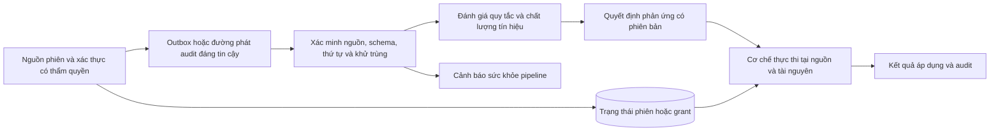

# Session anomaly

## 1. Từ phiên hợp lệ đến hành vi cần đánh giá lại

Session anomaly là dấu hiệu bất thường liên quan một phiên đang được sử dụng hoặc một tập phiên của cùng chủ thể. Ví dụ gồm thay đổi ngữ cảnh khó giải thích, tốc độ thao tác lệch đáng kể, sử dụng lại refresh token đã bị vô hiệu hóa hoặc tiếp tục truy cập sau khi phiên bị thu hồi.

Một request mang credential được chấp nhận chưa chứng minh toàn bộ hoạt động của phiên là an toàn. Cookie hoặc token có thể bị lấy cắp; tài khoản có thể bị dùng ngoài mục đích; một client lỗi cũng có thể tạo ra hành vi giống tấn công.

Trong chương **Logging và audit**, cần biến mục tiêu “phát hiện phiên bất thường” thành yêu cầu cụ thể:

- Dấu hiệu nào được ghi nhận, từ nguồn nào và đáng tin đến mức nào?
- Các sự kiện được liên kết theo phiên, chủ thể, tenant hoặc token family ra sao?
- Điều gì chỉ tạo cảnh báo, điều gì yêu cầu xác thực thêm hoặc thu hồi?
- Phản ứng phải có hiệu lực ở đâu, sau bao lâu và với những thao tác nào?
- Bằng chứng nào chứng minh phát hiện đúng, thực thi đúng và không làm lộ credential?

Bài học dùng nền tảng học trực tuyến nhiều tenant làm ví dụ. Người học có thể dùng máy tính và điện thoại; giảng viên có các thao tác chấm bài hoặc xuất dữ liệu nhạy cảm; hệ thống có phiên trình duyệt cùng luồng OAuth nếu được triển khai. Mã quy tắc và ngưỡng dưới đây là lựa chọn minh họa, không phải mức bắt buộc cho mọi dịch vụ.

## 2. Hiểu giới hạn của tín hiệu và mục tiêu bảo vệ

### 2.1. Bất thường không đồng nghĩa đã xác nhận chiếm phiên

Người dùng chuyển từ Wi-Fi sang mạng di động có thể đổi IP. VPN có thể làm vị trí suy ra từ mạng thay đổi nhanh. Trình duyệt có thể nâng cấp; nhiều tab có thể tạo request gần nhau; người học có thể đăng nhập ở nhiều thiết bị hợp lệ.

Vì vậy, một anomaly là bằng chứng để đánh giá theo chính sách, không tự động là kết luận một cá nhân tấn công. Mức phản ứng phải xét độ tin cậy của tín hiệu, mức nhạy cảm của thao tác và hậu quả của việc chặn nhầm.

NIST mô tả session monitoring là việc tiếp tục đánh giá đặc tính phiên để nhận biết khả năng gian lận, có thể dẫn tới xác thực lại, chấm dứt phiên hoặc thông báo cho người xử lý phù hợp. NIST cũng lưu ý việc thu thập và phân tích các đặc tính này có tác động quyền riêng tư cần được đánh giá. [NIST SP 800-63B-4: Session Monitoring](https://pages.nist.gov/800-63-4/sp800-63b.html)

### 2.2. Không dùng tín hiệu ngữ cảnh thay bằng chứng xác thực

Địa chỉ IP, User-Agent, thiết bị được ghi nhớ hoặc vị trí có thể giúp đánh giá rủi ro. Chúng không phải bằng chứng độc lập rằng người gọi là chủ tài khoản. Một User-Agent giống lần trước không cho phép bỏ xác thực hoặc cấp thêm quyền.

OWASP phân biệt các thuộc tính này như tín hiệu rủi ro, thay vì vật thay thế cho xác thực. Thiết kế cần giữ rõ ranh giới giữa “ngữ cảnh có vẻ quen thuộc” và “phiên đã được chấp nhận theo cơ chế xác thực”. [OWASP: Adaptive or Risk Based Authentication](https://cheatsheetseries.owasp.org/cheatsheets/Authentication_Cheat_Sheet.html#adaptive-or-risk-based-authentication)

Session monitoring cũng không thay thế kiểm soát cookie, bảo vệ token, hết hạn, chống fixation và phân quyền theo đối tượng. Một hệ thống không phát hiện anomaly không được coi là đã chứng minh mọi truy cập hợp lệ.

### 2.3. Chọn đúng đối tượng phản ứng

Cần phân biệt ít nhất:

| Đối tượng | Ý nghĩa | Vì sao cần tách |
|---|---|---|
| Phiên ứng dụng | Trạng thái truy cập tại một dịch vụ | Thu hồi ở đây chưa chắc chấm dứt phiên ở IdP hoặc dịch vụ khác |
| Access token | Bằng chứng dùng để gọi tài nguyên trong phạm vi, thời hạn cụ thể | Ngừng cấp token mới chưa chắc vô hiệu hóa token đã cấp |
| Refresh token hoặc token family | Quyền và chuỗi dùng để lấy access token mới | Phát hiện reuse cần xử lý quan hệ chuỗi theo giao thức |
| Phiên tại IdP | Trạng thái đăng nhập ở nhà cung cấp danh tính | Có thể còn hiệu lực khi phiên ứng dụng đã kết thúc |
| Tài khoản | Chủ thể có thể có nhiều phiên hợp lệ | Khóa toàn tài khoản rộng hơn thu hồi một phiên nghi vấn |

Không hứa “đăng xuất mọi nơi” nếu chỉ xóa cookie ở một trình duyệt hoặc cập nhật một bảng phiên tại một service.

## 3. Mô hình đe dọa và phạm vi phát hiện

| Mã rủi ro | Kịch bản | Hướng yêu cầu |
|---|---|---|
| R-SA-01 | Credential phiên bị sao chép và sử dụng trong ngữ cảnh khác | Theo dõi thay đổi ngữ cảnh có độ tin cậy; phản ứng theo mức rủi ro |
| R-SA-02 | Refresh token đã xoay vòng bị dùng lại | Phát hiện tại nguồn có thẩm quyền và thu hồi phạm vi liên quan theo giao thức |
| R-SA-03 | Một phiên xuất dữ liệu hoặc thao tác hàng loạt khác thường | Quy tắc theo loại thao tác, khối lượng và phạm vi được phép |
| R-SA-04 | Phiên đã thu hồi vẫn được resource server chấp nhận | Đo hiệu lực thu hồi trên mọi điểm thực thi, kể cả cache và token còn hạn |
| R-SA-05 | Log giả, header giả hoặc sự kiện lặp làm tăng điểm rủi ro | Nguồn sự kiện tin cậy, kiểm tra ngữ cảnh và idempotency |
| R-SA-06 | Thay IP, VPN hoặc nhiều thiết bị hợp lệ gây khóa nhầm | Quy tắc phản ứng theo bằng chứng, kiểm thử ngữ cảnh hợp lệ và đường phục hồi |
| R-SA-07 | Pipeline chậm, mất sự kiện hoặc sai thời gian làm bỏ sót | Độ đầy đủ, tuổi sự kiện, đồng hồ và hành vi suy giảm rõ ràng |
| R-SA-08 | Log phiên chứa cookie, token hoặc lịch sử quá chi tiết | Tham chiếu an toàn, tối thiểu hóa và vùng audit có quyền riêng |
| R-SA-09 | Cảnh báo tự động thành công cụ gây gián đoạn hoặc spam MFA | Giới hạn kích hoạt, phạm vi phản ứng và xác minh nguồn tín hiệu |
| R-SA-10 | Sự kiện cũ hoặc restore làm sống lại phiên đã thu hồi | Phiên bản trạng thái, generation và đối soát trước mở luồng |

Mô hình cần ghi phạm vi có thể quan sát. Bearer token bị dùng lại không phải lúc nào cũng tạo dấu hiệu phân biệt chắc chắn với nhiều request hợp lệ. Không thể cam kết phát hiện mọi lần chiếm phiên chỉ từ IP và User-Agent.

## 4. Đặc tả dữ liệu log và audit phục vụ phát hiện

### 4.1. Danh mục sự kiện theo vòng đời

| Sự kiện ví dụ | Mục đích | Thông tin tối thiểu cần xem xét |
|---|---|---|
| `session.created` | Ghi nhận khởi tạo phiên | Chủ thể đã xác minh, tham chiếu phiên, tenant, thời gian, mức xác thực |
| `session.activity` | Quan sát hoạt động cần thiết theo profile | Phiên, nhóm thao tác, kết quả và ngữ cảnh đã được duyệt |
| `session.context_changed` | Nhận diện thay đổi đáng chú ý | Loại thay đổi, chất lượng nguồn và phạm vi liên kết |
| `refresh.reuse_detected` | Phản ánh kết quả của nguồn xác minh token | Token family hoặc grant tham chiếu, generation, chính sách và thời gian |
| `session.risk_decided` | Giải thích kết luận đánh giá | Tín hiệu, quy tắc, phiên bản, độ tin cậy và hành động được chọn |
| `session.challenge_required` | Theo dõi việc yêu cầu step-up | Phạm vi thao tác bị chặn, challenge tham chiếu và hạn |
| `session.revocation_committed` | Xác định mốc thay đổi có thẩm quyền | Đối tượng, phiên bản trạng thái và phạm vi thu hồi |
| `session.enforcement_applied` | Chứng minh điểm thực thi đã cập nhật | Service hoặc instance, phiên bản áp dụng, kết quả và thời gian |
| `session.expired` hoặc `session.closed` | Ghi kết thúc và hỗ trợ đối soát | Lý do hữu hạn, thời điểm và trạng thái liên quan |

Không nhất thiết log mọi request dưới dạng chi tiết. Profile hoạt động cần cân bằng mục tiêu phát hiện, khối lượng, quyền riêng tư và khả năng liên kết. Những sự kiện bắt buộc cho vòng đời hoặc phản ứng không được mất ngẫu nhiên vì áp cùng sampling với trace chẩn đoán thông thường.

### 4.2. Phân biệt tham chiếu với credential

`session_ref` trong audit phải là tham chiếu không cấp quyền truy cập. Không ghi raw cookie phiên, access token, refresh token, mã xác nhận hoặc header Authorization để dễ đối chiếu.

Có thể dùng tham chiếu ngẫu nhiên do server quản lý hoặc cơ chế đối chiếu được phê duyệt. Nếu dùng giá trị dẫn xuất, cần xác định miền liên kết, quản lý khóa nếu có, nguy cơ va chạm và vòng đời. Không gọi dữ liệu là vô danh chỉ vì nó không chứa tên thật.

Chủ thể, tenant và quan hệ phiên phải đến từ nguồn đã xác minh. Session ID hoặc `sub` do client tự khai không được tự trở thành khóa có thẩm quyền để thu hồi phiên của người khác.

### 4.3. Schema sự kiện minh họa

```json
{
  "event_id": "event-test-301",
  "event_type": "session.context_changed",
  "occurred_at": "2026-11-27T03:00:00Z",
  "observed_at": "2026-11-27T03:00:02Z",
  "source": "session-service-test",
  "source_sequence": 184,
  "subject_ref": "learner-test-17",
  "tenant_ref": "tenant-test-a",
  "session_ref": "session-ref-test-42",
  "session_generation": 3,
  "signal_code": "NETWORK_CONTEXT_CHANGED",
  "signal_quality": "partial",
  "policy_version": "session-risk-v4",
  "correlation_id": "corr-test-08"
}
```

Đây là fixture tổng hợp. `source_sequence` chỉ có ý nghĩa trong miền thứ tự đã định; không so sánh tùy tiện sequence của hai nguồn độc lập. Một giá trị `signal_quality = partial` không được ngầm chuyển thành dữ liệu chắc chắn đầy đủ.

`occurred_at` và `observed_at` giúp phân biệt thời điểm xảy ra với thời điểm nhận. Cần xác định nguồn thời gian, sai lệch chấp nhận và cách xử lý clock skew; không dùng thời gian trên client làm thứ tự thu hồi có thẩm quyền.

### 4.4. Nguồn IP và thuộc tính client

Nếu IP đi qua proxy, hệ thống phải biết proxy nào đáng tin cậy và header nào được xử lý theo hợp đồng. Không tin nguyên `X-Forwarded-For` từ nguồn bất kỳ rồi dùng nó để khóa phiên hoặc tạo bằng chứng địa lý.

User-Agent và nhãn thiết bị cũng có thể bị giả hoặc thay đổi hợp lệ. Tách dữ liệu quan sát được khỏi kết luận như “thiết bị mới đã xác nhận”. Một chuỗi mới chưa đủ chứng minh có một thiết bị vật lý khác.

## 5. Thiết kế quy tắc phát hiện có thể giải thích

### 5.1. Mỗi quy tắc cần có hợp đồng

Một quy tắc cần mô tả đầu vào, khóa tương quan, cửa sổ thời gian, nguồn và độ tin cậy, điều kiện loại trừ, ngưỡng, hành động, phiên bản cùng bộ fixture kiểm thử.

Không chỉ viết “phát hiện impossible travel” hoặc “AI đánh giá rủi ro”. Phải cho biết khi thiếu dữ liệu, nhận event trễ hoặc gặp ngữ cảnh hợp lệ thì kết quả thế nào.

| Nhóm tín hiệu | Có thể quan sát | Giới hạn và xử lý cần ghi |
|---|---|---|
| Đổi IP, mạng hoặc vị trí suy ra | Chuyển ngữ cảnh giữa các hoạt động | VPN, NAT, mạng di động, sai số định vị; không tự kết luận chiếm phiên |
| Ngữ cảnh đồng thời khó phù hợp | Hoạt động của cùng phiên ở các nguồn khác nhau | Phân biệt nhiều phiên hợp lệ với cùng một phiên; dữ liệu có thể trễ |
| Khối lượng hoặc tốc độ bất thường | Tăng mạnh tải xuống, xuất dữ liệu, thao tác nhạy cảm | Công việc hợp lệ cũng có thể tạo đột biến; cần baseline đúng nhóm |
| Sử dụng sau thu hồi | Request tới điểm thực thi sau mốc và cửa sổ đã định | Kiểm tra generation, đồng hồ và trạng thái đã áp dụng |
| Refresh token reuse | Nguồn phát hành nhận token đã bị vô hiệu hóa theo rotation | Nguồn có thẩm quyền phải phát hiện; không suy diễn chỉ từ log trùng |

### 5.2. Không biến impossible travel thành phép chia khoảng cách đơn giản

Một quy tắc dựa trên vị trí cần xét chất lượng geolocation, sai số, tuổi dữ liệu và khác biệt giữa vị trí mạng với vị trí người dùng. Hai IP có vị trí suy ra xa nhau trong thời gian ngắn có thể là VPN hoặc hạ tầng trung gian.

Nếu sử dụng điều kiện tốc độ hoặc khoảng cách, phải nêu đơn vị, cách tính khoảng thời gian, giả định và hành vi khi dữ liệu không đủ. Không chia cho khoảng thời gian bằng không hoặc dùng event đến muộn để đưa ra kết luận sai về thứ tự.

Trong ví dụ, đổi vị trí đơn lẻ chỉ góp phần tạo tín hiệu cần xem xét; muốn chặn thao tác nhạy cảm phải có chính sách kết hợp và mức tin cậy được duyệt. Điều kiện này không làm mất hiệu lực các quy tắc mạnh hơn như credential đã bị thu hồi.

### 5.3. Refresh token reuse và sự kiện lặp là hai việc khác nhau

RFC 9700 mô tả rotation như cách phát hiện refresh token đã bị vô hiệu hóa được dùng lại. Trong tình huống token bị cả client hợp lệ và kẻ tấn công sử dụng, nguồn phát hành không thể chỉ từ lần reuse xác định bên nào là kẻ tấn công và cần phản ứng theo cơ chế bảo vệ grant liên quan. [RFC 9700: Refresh token protection](https://www.rfc-editor.org/rfc/rfc9700.html#section-4.14)

Log `refresh.succeeded` bị gửi lại hai lần qua queue không phải bằng chứng refresh token đã được redeem hai lần. Phải khử sự kiện trùng và nhận tín hiệu từ nguồn quản lý trạng thái token có thẩm quyền.

Nhiều tab hoặc retry sau khi mất response cũng cần được xét trong thiết kế client và giao thức. Không tự thêm một cửa sổ chấp nhận token cũ không giới hạn để giảm cảnh báo. Mọi cơ chế xử lý retry hợp lệ phải được xác định, giới hạn và không làm mất thuộc tính phát hiện replay của thiết kế đã chọn.

### 5.4. Ví dụ đặc tả quy tắc

```yaml
rule_id: SA-REFRESH-REUSE-01
rule_version: 3
input_event: refresh.reuse_detected
correlation_scope:
  - tenant_ref
  - grant_ref
  - token_family_ref
preconditions:
  - issuer_event_is_authenticated
  - token_family_reference_is_authoritative
  - rotation_policy_is_known
  - event_is_not_a_duplicate
response_profile: revoke_affected_grant_and_require_new_authorization
```

Đây là ví dụ nội dung quy tắc trong bài học, không phải cấu hình triển khai hoàn chỉnh. Phát hiện và thay đổi trạng thái tại nguồn phát hành không nên phụ thuộc vào việc SIEM kịp xử lý một bản log sau đó; pipeline audit phục vụ bằng chứng và phối hợp thực thi.

Quy tắc phải giải thích phạm vi “affected grant”. Không tự khóa toàn tài khoản hoặc toàn tenant chỉ từ một event tham chiếu chưa được xác minh.

## 6. Chọn phản ứng tương xứng và có thể kiểm chứng

### 6.1. Tách quyết định rủi ro với hành động kiểm soát

| Phản ứng | Khi có thể phù hợp trong thiết kế mẫu | Điều phải kiểm chứng |
|---|---|---|
| Ghi nhận, tiếp tục theo dõi | Tín hiệu yếu hoặc có cách giải thích hợp lệ | Không gắn nhãn an toàn tuyệt đối; vẫn giữ kiểm soát xác thực và phân quyền cơ bản |
| Thông báo người dùng hoặc vận hành | Cần xác nhận hoạt động hay điều tra | Đúng người nhận, giới hạn tần suất và nội dung không lộ dữ liệu |
| Yêu cầu step-up | Thao tác nhạy cảm kết hợp với rủi ro đủ mức | Chặn đúng thao tác trước khi đạt điều kiện xác thực thêm |
| Hạn chế tạm thời | Chưa đủ tin cậy để cho một nhóm thao tác tiếp tục | Phạm vi, thời hạn, cách phục hồi và khả năng tiếp cận chức năng an toàn |
| Thu hồi phiên hoặc grant liên quan | Credential hoặc phiên không còn được chấp nhận theo chính sách | Hiệu lực ở nguồn có thẩm quyền và các resource server liên quan |
| Phản ứng rộng ở tài khoản | Có căn cứ và chính sách cho rủi ro nhiều phiên | Không khóa diện rộng chỉ từ một thuộc tính dễ giả hoặc một event không đáng tin |

Một quyết định đã ghi log không có nghĩa phản ứng đã xảy ra. Cần có sự kiện hoặc kết quả xác nhận thực thi, cùng phép thử request sau đó khi phù hợp.

### 6.2. Ví dụ ma trận tín hiệu và phản ứng

Trong hệ thống mẫu, có thể chọn:

- Đổi mạng đơn lẻ, không có dấu hiệu bổ sung: ghi tín hiệu theo profile, không tự thu hồi mọi phiên.
- Đổi ngữ cảnh cùng hành vi xuất lượng lớn khác thường: yêu cầu step-up trước tác vụ xuất và tạo case điều tra theo quy tắc đã duyệt.
- Request dùng phiên đã bị thu hồi: từ chối theo trạng thái phiên; không chờ tính lại điểm rủi ro.
- Refresh reuse được nguồn phát hành xác định theo rotation: thực hiện phản ứng bảo vệ grant liên quan ở nguồn có thẩm quyền và phát audit.
- Thiếu dữ liệu đánh giá: đánh dấu chất lượng hoặc kết quả chưa xác định, áp dụng chính sách suy giảm; không tự cho điểm rủi ro bằng không.

Đây là ví dụ về cách đặc tả, không phải bộ quy tắc dùng chung. Dự án phải định nghĩa rõ “lượng lớn”, cửa sổ quan sát, nguồn dữ liệu và mức nhạy cảm của tác vụ.

### 6.3. Step-up phải thay đổi khả năng thực hiện thao tác

Khi phiên ở trạng thái cần step-up, hệ thống phải xác định thao tác nào bị chặn, bằng chứng xác thực nào đủ, challenge gắn với ai và có hiệu lực đến khi nào. Chỉ hiển thị một hộp thoại mà API vẫn cho xuất dữ liệu không đáp ứng yêu cầu.

Không coi một lần refresh token hoặc tái sử dụng phiên SSO sẵn có là tự động hoàn thành bước xác thực thêm nếu nó không cung cấp bằng chứng được yêu cầu. Kết quả challenge phải gắn đúng chủ thể, phiên hoặc generation và phạm vi hành động.

Một kết quả step-up đến trễ không được làm sống lại phiên đã bị thu hồi vì nguyên nhân khác. Nếu cần tạo phiên mới sau xác thực, phải theo quy trình tạo mới, không đổi trực tiếp trạng thái `REVOKED` về `ACTIVE` từ một message cũ.

### 6.4. Nhiều phiên đồng thời là quyết định sản phẩm

Một người có thể dùng nhiều thiết bị hợp lệ. OWASP nêu việc cho phép nhiều phiên đồng thời là quyết định thiết kế, đồng thời đề cập khả năng cho người dùng xem và chấm dứt phiên từ xa. Cần chuyển quyết định đó thành chính sách thay vì coi mọi concurrent login là sự cố. [OWASP: Simultaneous Session Logons](https://cheatsheetseries.owasp.org/cheatsheets/Session_Management_Cheat_Sheet.html#simultaneous-session-logons)

Nếu giới hạn số phiên, phải xác định cách đếm, phiên nào được giữ, phạm vi theo tài khoản hay ứng dụng và hành vi khi đăng nhập đồng thời. Không lấy số tab trình duyệt làm số thiết bị vật lý hoặc tự áp cùng giới hạn cho workload dịch vụ.

## 7. Kiến trúc từ sự kiện tới thực thi

### 7.1. Đường điều khiển và đường audit



Các kiểm soát thời gian thực cần được đặt ở đường có khả năng chặn trước tác động. Một dashboard phát hiện sau vài phút không thay thế việc từ chối một credential đã bị vô hiệu hóa ở nguồn xác minh.

Đường audit giúp truy vết việc xảy ra, quyết định đã chọn và hiệu lực thực thi. Nếu trạng thái thay đổi và sự kiện được phát qua hai bước độc lập, cần cơ chế chống mất sự kiện giữa chúng, chẳng hạn outbox trong giao dịch phù hợp.

### 7.2. Tách trạng thái phiên khỏi trạng thái đánh giá

Một phiên có thể vẫn hợp lệ về thời hạn nhưng bị hạn chế thao tác vì cần step-up. Một sự kiện nghi vấn có thể đang chờ điều tra trong khi phiên đã bị thu hồi. Vì vậy, nên tách:

- Trạng thái hiệu lực: đang được chấp nhận, hết hạn, thu hồi hoặc đóng.
- Điều kiện sử dụng: cần challenge, hạn chế tác vụ hoặc điều kiện khác.
- Trạng thái case hoặc đánh giá: mới phát hiện, đang xác minh, đã xử lý hoặc kết luận không phải sự cố.

Đóng một case không tự gia hạn phiên. Hết thời gian hạn chế cũng không tự hủy một quyết định thu hồi độc lập. Mọi chuyển trạng thái phải có điều kiện và nguồn có thẩm quyền rõ ràng.

### 7.3. Sự kiện trùng, đến trễ và generation

Consumer cần định danh sự kiện, khóa tương quan và quy tắc phiên bản. Không dùng thứ tự nhận qua mạng hoặc timestamp client làm thứ tự quyết định duy nhất.

Một session ref có thể được thay bằng generation mới sau xác thực. Event của generation cũ không được thu hồi nhầm phiên mới hoặc khôi phục trạng thái cũ. Nếu chính sách yêu cầu phản ứng rộng hơn một generation, phạm vi đó phải được chỉ rõ và kiểm tra thẩm quyền.

Hành động thu hồi, gửi thông báo và tạo case cần idempotency. At-least-once delivery có thể tạo message lặp; không được biến mỗi bản lặp thành một lần cộng điểm, một push MFA hoặc một quyết định khóa bổ sung.

### 7.4. Pseudocode xử lý tín hiệu audit

```text
function processSessionSignal(envelope):
    event = verifySourceAndApprovedSchema(envelope)
    if not event.accepted:
        recordBoundedPipelineFailure("UNTRUSTED_OR_INVALID_EVENT")
        return

    if eventAlreadyProcessed(event.eventId, event.source):
        return

    target = resolveAuthoritativeTarget(event.sessionRef, event.generation)
    if target is not applicable:
        recordSafeStaleEventOutcome(event)
        return

    context = loadApprovedRiskContext(target, event)
    assessment = evaluateVersionedRule(event, context, context.quality)
    decision = chooseScopedResponse(assessment, target)

    persistDecisionAndDeliveryIntentIdempotently(event, decision)
    dispatchToAuthorizedEnforcementPath(decision)
```

Đây là mô tả kiến trúc, không phải detector hoàn chỉnh. Hàm kiểm tra “đã xử lý” phải được ràng buộc với việc ghi quyết định để chịu được nhiều consumer cạnh tranh; chỉ đọc một cờ rồi ghi sau không tự bảo đảm idempotency.

Pseudocode không thay thế xử lý refresh rotation tại nguồn phát hành. Việc xác định token cũ bị dùng lại và thay đổi trạng thái bảo vệ cần thực hiện theo giao thức và khả năng giao dịch của hệ thống đó.

### 7.5. Hiệu lực thu hồi trên các dịch vụ

Xóa cookie ở client không thu hồi bản cookie bị sao chép. Ngừng refresh không bảo đảm access token đã cấp bị mọi API từ chối ngay. Cần biết cơ chế của từng resource server: trạng thái phiên, introspection, danh sách thu hồi, phiên bản quyền hoặc phương án giới hạn thời gian khác đã được duyệt.

Nếu token tự chứa còn được xác minh offline tới hết hạn, đó là giới hạn thực tế phải ghi trong yêu cầu. Không công bố “đã thu hồi tức thì” khi hệ thống chưa có cơ chế đáp ứng.

Tương tự, chấm dứt phiên ứng dụng không nhất thiết chấm dứt phiên IdP. Quy trình xác thực lại phải bảo đảm đạt điều kiện đã yêu cầu, không vô tình khôi phục quyền chỉ nhờ một assertion được tạo từ phiên IdP cũ chưa đáp ứng độ mới.

## 8. Bộ yêu cầu có tiêu chí nghiệm thu

| ID | Phát biểu yêu cầu mẫu | Tiêu chí chấp nhận và bằng chứng |
|---|---|---|
| REQ-SA-01 | Các sự kiện vòng đời, tín hiệu và phản ứng bắt buộc phải có schema, nguồn, chủ sở hữu và phạm vi được xác định. | Đối chiếu inventory với các dịch vụ phiên, IdP, API và đường thu hồi; nguồn mới không tự được coi là tin cậy. |
| REQ-SA-02 | Log và audit phải dùng tham chiếu không cấp quyền, không chứa raw session cookie, access token hoặc refresh token. | Fixture chứa credential giả không xuất hiện ở payload, metadata, alert hoặc log lỗi ngoài profile. |
| REQ-SA-03 | Mỗi quy tắc phải định nghĩa tín hiệu, cửa sổ, chất lượng, ngoại lệ, phiên bản và phản ứng tương ứng. | Bộ ca dương tính, ngữ cảnh hợp lệ và dữ liệu thiếu cho kết quả có thể giải thích, không chỉ một điểm số không rõ nghĩa. |
| REQ-SA-04 | Tín hiệu client dễ giả hoặc IP đơn lẻ không được tự trở thành bằng chứng xác thực hay căn cứ khóa rộng ngoài chính sách. | Thử header giả, VPN, đổi mạng và User-Agent; không cấp quyền hoặc khóa sai phạm vi. |
| REQ-SA-05 | Refresh reuse phải được xác định tại nguồn quản lý token theo giao thức; log trùng không được tạo kết luận reuse. | Thử token cũ, message lặp, retry client và rotation cạnh tranh; bằng chứng phân biệt được từng trường hợp. |
| REQ-SA-06 | Quyết định step-up hoặc hạn chế phải chặn đúng thao tác tại API trước tác động và chỉ được giải quyết bằng bằng chứng hợp lệ. | Thử bỏ qua UI, challenge sai phiên, hết hạn hoặc kết quả đến sau thu hồi; không thực hiện tác vụ trái điều kiện. |
| REQ-SA-07 | Thu hồi phải có phạm vi và ngưỡng hiệu lực trên các điểm thực thi; không chỉ tạo alert hoặc xóa cookie client. | Gọi lại bằng credential cũ qua từng API, instance và đường tải trong cửa sổ đo; lưu kết quả từ chối thực tế. |
| REQ-SA-08 | Consumer và cơ chế phản ứng phải xử lý event trùng, đến trễ, đảo thứ tự và sai generation một cách an toàn. | Phát lại event; không nhân điểm, spam thông báo, thu hồi nhầm hoặc làm sống lại phiên. |
| REQ-SA-09 | Pipeline phải theo dõi độ trễ, độ đầy đủ và chất lượng thời gian; mất dữ liệu không được báo như không có rủi ro. | Tiêm mất nguồn, queue chậm và clock skew; có trạng thái suy giảm và phản ứng theo profile đã định. |
| REQ-SA-10 | Người dùng và vận hành phải có đường xem, xác minh, phục hồi hoặc chấm dứt phiên theo quyền và chính sách. | Thử người dùng khác, tenant khác và notification; không đọc hoặc chấm dứt phiên ngoài quyền. |
| REQ-SA-11 | Dữ liệu ngữ cảnh, baseline, audit và bản dẫn xuất phải có mục đích, quyền, retention và quy trình xử lý sau restore. | Kiểm tra query, export, alert, cache và snapshot; không thu lại trạng thái đã thu hồi hoặc lưu vô hạn ngoài chính sách. |
| REQ-SA-12 | Quy tắc và mức phản ứng phải được đánh giá cả khả năng phát hiện lẫn chặn nhầm trước khi mở rộng thực thi. | Báo cáo có tập dữ liệu, phạm vi, nhãn đánh giá, độ bao phủ và tác động người dùng; có phương án giảm lỗi mà vẫn giữ kiểm soát cốt lõi. |

“Có cảnh báo” không đủ để nghiệm thu REQ-SA-07. “Không thấy cảnh báo” cũng không đủ để kết luận các phiên đều bình thường nếu nguồn sự kiện đang mất.

## 9. Đo độ trễ và chất lượng phát hiện

### 9.1. Tách các mốc để không che giấu độ trễ

```text
t_event    = thời điểm sự kiện tại nguồn có thẩm quyền
t_ingest   = thời điểm pipeline tiếp nhận được sự kiện
t_decision = thời điểm quyết định phản ứng được ghi bền vững
t_apply    = thời điểm điểm thực thi áp dụng phiên bản cần thiết
```

Độ trễ nhận là `t_ingest - t_event`; độ trễ đánh giá là `t_decision - t_ingest`. Hiệu lực thu hồi cần đo từ mốc thay đổi trạng thái có thẩm quyền tới lúc các quyết định mới bị chặn ở điểm thực thi.

Không chỉ đo từ lúc worker bắt đầu xử lý nếu sự kiện đã nằm trong queue nhiều phút. Không dùng timestamp client làm mốc chuẩn mà chưa có cơ chế tin cậy và giới hạn sai lệch.

### 9.2. Mục tiêu minh họa

Với tải và môi trường tham chiếu được ghi rõ, dự án có thể chọn:

- Sự kiện vòng đời được nhận với p95 không quá 5 giây và p99 không quá 15 giây trong điều kiện đo đã định.
- Cảnh báo đủ điều kiện được chuyển tới kênh trực trong tối đa 60 giây từ quyết định đã commit.
- Sau commit thu hồi tại t0, mọi điểm thực thi thuộc profile phải ngừng cho phép quyết định truy cập mới dựa trên phiên bị thu hồi trong tối đa 30 giây.
- Với thao tác xuất dữ liệu cần step-up, điều kiện phải được kiểm tra trước xuất; không chấp nhận chạy trước rồi chờ batch phát hiện.

Các ngưỡng là ví dụ, không phải bảo đảm mặc định của công cụ. Phải ghi tải, quy mô, phụ thuộc, tỷ lệ lỗi và điểm quan sát; trường hợp outage cần mục tiêu và hành vi riêng.

Một ACK nhận message không tự chứng minh credential bị chặn. Cần kiểm tra phiên bản đã áp dụng và request thử đúng ranh giới. Nếu một điểm thực thi chưa đáp ứng, báo phạm vi chưa đạt thay vì lấy trung bình để che instance chậm.

### 9.3. Đánh giá false positive và false negative

Với tập ca có nhãn đáng tin cậy, có thể tính tỷ lệ tín hiệu được xác nhận liên quan rủi ro hoặc tỷ lệ các ca rủi ro đã biết được phát hiện. Tuy nhiên, việc không có nhãn cho hành vi chưa bị phát hiện làm giới hạn kết luận về false negative trong production.

Cần báo tỷ lệ challenge, người dùng bị gián đoạn, số lần thu hồi được đánh giá là không cần thiết, khả năng hoàn thành bước phục hồi và độ trễ điều tra. Không tối ưu số alert đơn thuần bằng cách tắt nguồn quan trọng hoặc đặt ngưỡng cao tới mức bỏ qua mọi tín hiệu.

Baseline cần phù hợp nhóm công việc và tránh học từ dữ liệu bị nhiễm. Một khối lượng xuất cao đã kéo dài không tự trở thành hợp lệ chỉ vì mô hình đã quen với nó. Quy tắc về credential hết hiệu lực hoặc phiên thu hồi không được bị baseline hành vi ghi đè.

## 10. Thiết kế kiểm thử theo kịch bản và điều kiện lỗi

### 10.1. Dùng dữ liệu tổng hợp có chủ đích

Bộ fixture cần có phiên, generation, tenant, token family và sự kiện có thứ tự đã biết. Ngữ cảnh mạng và vị trí được mô phỏng; credential chỉ thuộc môi trường thử. Không dùng lịch sử di chuyển hoặc token thật của nhân viên làm dữ liệu kiểm tra.

Cần có cả ca được coi là rủi ro theo chính sách, ca hợp lệ dễ gây nhầm và ca thiếu dữ liệu. Nếu bộ kiểm thử chỉ có “đổi IP rồi thu hồi”, nó có thể chứng minh hệ thống khóa người dùng nhưng chưa chứng minh phản ứng đó phù hợp.

### 10.2. Ma trận ca thử

| Ca thử | Thiết lập hoặc thao tác | Kết quả mong đợi |
|---|---|---|
| TC-SA-01 | Người học chuyển từ Wi-Fi sang mạng di động, không có tín hiệu khác | Phản ứng đúng profile tín hiệu yếu; không tự khóa mọi phiên |
| TC-SA-02 | VPN làm vị trí suy ra thay đổi nhanh | Quy tắc xét chất lượng dữ liệu, không kết luận chiếm phiên chỉ từ khoảng cách |
| TC-SA-03 | Hai thiết bị hợp lệ dùng hai phiên trong chính sách cho phép | Không nhầm với cùng một phiên bị sao chép; đếm phiên theo quy tắc |
| TC-SA-04 | Cùng phiên có ngữ cảnh bất thường kết hợp tác vụ xuất nhạy cảm | Quyết định theo quy tắc kết hợp; chặn trước xuất nếu yêu cầu step-up |
| TC-SA-05 | Token cũ được nguồn phát hành nhận lại sau rotation | Phát hiện theo giao thức và phản ứng đúng grant; audit không chứa token |
| TC-SA-06 | Một event refresh thành công được phát lại nhiều lần | Không tạo refresh reuse hoặc cộng điểm, thông báo lặp ngoài chính sách |
| TC-SA-07 | Hai tab refresh cạnh tranh hoặc response xác nhận bị mất | Hành vi phù hợp giao thức và chính sách retry; không tự mở cửa sổ token cũ vô hạn |
| TC-SA-08 | Event đến trễ, đảo thứ tự hoặc dùng generation cũ | Không làm sống lại trạng thái cũ hoặc thu hồi nhầm phiên mới |
| TC-SA-09 | Client gửi IP, User-Agent và session_ref giả | Không tạo bằng chứng có thẩm quyền hoặc tác động phiên người khác |
| TC-SA-10 | Queue chậm, nguồn mất sự kiện hoặc clock skew | Có trạng thái suy giảm, đo đúng độ trễ và không báo im lặng là an toàn |
| TC-SA-11 | Thu hồi trong khi access token còn hạn và nhiều API đang hoạt động | Quyết định mới bị chặn trong ngưỡng của profile; nêu rõ điểm chưa đạt |
| TC-SA-12 | Chỉ xóa cookie trên một trình duyệt nhưng giữ bản sao thử | Không coi đó là thu hồi server; kiểm tra bản sao tại điểm thực thi |
| TC-SA-13 | Bỏ qua UI để gọi API khi cần step-up | Tác vụ bị bảo vệ vẫn bị chặn cho tới khi có bằng chứng hợp lệ |
| TC-SA-14 | Challenge sai phiên, sai chủ thể, hết hạn hoặc hoàn thành sau thu hồi | Không mở quyền hoặc khôi phục phiên ngoài điều kiện |
| TC-SA-15 | Event cùng loại được gửi liên tục để gây notification hoặc MFA spam | Có giới hạn phù hợp, không nhân phản ứng do event trùng hoặc nguồn chưa xác minh |
| TC-SA-16 | Người dùng tenant A xem hoặc chấm dứt phiên của tenant B | Không lộ metadata và không tác động trái quyền |
| TC-SA-17 | Restore snapshot trước mốc thu hồi hoặc thay policy | Đối soát trạng thái hiện hành trước mở truy cập; không sống lại phiên cũ |
| TC-SA-18 | Fixture chứa cookie, token giả và nội dung nhạy cảm trong nhánh lỗi | Không xuất hiện ở log, alert, ticket, exporter hoặc bản sao ngoài profile |
| TC-SA-19 | Đóng case sau khi phiên đã bị thu hồi | Không tự đổi phiên về ACTIVE hoặc bỏ điều kiện xác thực |
| TC-SA-20 | Rule engine hoặc kho trạng thái tạm không khả dụng | Thực hiện chính sách suy giảm; không bypass kiểm soát cốt lõi |

Các ca cần chạy qua những điểm thực thi và đường audit thực tế trong môi trường thử. Một kiểm thử chỉ xác nhận hàm `sendAlert()` được gọi chưa chứng minh cảnh báo tới đúng người hoặc truy cập đã bị chặn.

### 10.3. Tiêu chí Given–When–Then

```gherkin
Scenario: Sự kiện cũ không làm thay đổi phiên generation mới
  Given phiên session-ref-test-42 generation 3 đã bị thu hồi
    And người dùng xác thực lại hợp lệ để tạo generation 4
    And hệ thống chỉ cho phép tác động generation cũ trong quyết định đang thử
  When consumer nhận lại một event rủi ro của generation 3
  Then consumer không khôi phục generation 3
    And không thu hồi generation 4 ngoài phạm vi quyết định
    And không gửi lặp notification cho cùng event
    And audit ghi rõ kết quả xử lý event cũ
```

Cần thêm ca riêng cho chính sách có chủ đích thu hồi rộng hơn một generation. Phạm vi rộng không được suy ra từ một `subject_ref` do nguồn không tin cậy cung cấp.

### 10.4. Đo phản ứng ở điểm cuối

Với thu hồi, kiểm tra các API, instance, download và cơ chế xác minh token còn sử dụng trong hệ thống. Ghi mốc commit, mốc áp dụng và kết quả request sau mốc, không chỉ trạng thái ở session service.

Với step-up, kiểm tra cả khả năng vượt UI, reuse challenge, concurrent request và phạm vi thao tác đã được mở. Với notification, kiểm tra người nhận, nội dung, tần suất, lỗi giao nhận và việc không chứa liên kết hoặc credential nhạy cảm ngoài profile.

Báo cáo phải nêu tải, cấu hình, độ đầy đủ của nguồn, dữ liệu thời gian và giới hạn. Tỷ lệ phát hiện trên một bộ kịch bản không chứng minh khả năng phát hiện mọi kiểu chiếm phiên trong production.

## 11. Quyền riêng tư, vận hành quy tắc và điều tra

### 11.1. Chỉ thu ngữ cảnh cần cho mục đích đã xác định

IP, lịch sử thiết bị, vị trí suy ra và thời điểm hoạt động có thể tạo hồ sơ hành vi nhạy cảm. Không tự thu vị trí GPS, fingerprint sâu hoặc đặc tính sinh trắc hành vi chỉ vì chúng có thể làm tăng điểm phát hiện.

Với từng thuộc tính, cần ghi mục đích, mức chi tiết, nguồn, độ chính xác, người được đọc, thời hạn và hệ thống nhận. Có thể giảm chi tiết ở luồng chung, trong khi một vùng an ninh được cấp quyền giữ dữ liệu cần thiết hơn theo quyết định đã duyệt.

Danh tính giả danh vẫn có khả năng liên kết. Bảng ánh xạ, khóa đối chiếu hoặc baseline của chủ thể phải có mức bảo vệ phù hợp, không đặt cạnh dashboard quyền rộng rồi coi việc bỏ email đã đủ.

### 11.2. Vòng đời phải bao phủ mọi bản dẫn xuất

Một chính sách minh họa có thể tách dữ liệu ngữ cảnh chi tiết, baseline phục vụ cửa sổ phát hiện, quyết định audit và hồ sơ case. Mỗi loại có thời hạn riêng theo mục đích; không kế thừa vô hạn thời hạn của case chỉ vì một event từng liên quan tới điều tra.

Thời hạn giữ baseline cần phù hợp cửa sổ đánh giá và nhu cầu đã xác định. Nếu dữ liệu bị loại bỏ, detector phải biết chất lượng lịch sử thay đổi, không coi thiếu baseline là bằng chứng hoạt động chắc chắn bình thường.

Phạm vi dọn gồm index, cache, export, notification, ticket, kho phân tích và backup có liên quan. Khi restore, áp dụng lại retention cùng trạng thái thu hồi hiện hành trước mở sử dụng.

### 11.3. Người dùng xem và chấm dứt phiên

Trang quản lý phiên cần kiểm tra đúng chủ thể hoặc đại diện được phép, bảo vệ metadata và không dùng session_ref làm credential. Một người không được đổi request ID để xem hoặc đóng phiên của người khác.

Có thể trình bày thông tin thiết bị, thời điểm và mạng ở độ chi tiết phù hợp, kèm giải thích khi vị trí chỉ là suy ra. Không khẳng định chính xác vị trí vật lý nếu dữ liệu không hỗ trợ.

Luồng “đây là tôi” hoặc “tin cậy thiết bị” không được tự xóa rủi ro bằng chính phiên đang bị nghi chiếm dụng mà không đáp ứng điều kiện xác minh. Hành động khôi phục phải theo mức bảo đảm đã chọn.

Thông báo nên dẫn tới kênh chính thức được kiểm soát, không yêu cầu người dùng gửi cookie hoặc mã xác thực cho nhân viên hỗ trợ. Tránh nội dung làm lộ thêm thông tin qua màn hình khóa hoặc hộp thư dùng chung.

### 11.4. Điều chỉnh quy tắc mà không phá kiểm soát cốt lõi

Quy tắc theo ngữ cảnh mới có thể chạy ở chế độ quan sát để đo ảnh hưởng trước khi mở phản ứng tự động. Cần có tập đánh giá, người chịu trách nhiệm, phiên bản, tiêu chí mở và cách rollback.

Giảm false positive không có nghĩa chấp nhận credential đã hết hiệu lực hoặc phiên đã thu hồi. Có thể thay cách kết hợp tín hiệu yếu, giới hạn notification hoặc cải thiện client, nhưng các ranh giới xác thực và phân quyền vẫn phải giữ.

Nếu dùng mô hình thống kê hoặc học máy, cần biết phiên bản, chất lượng đầu vào, phạm vi sử dụng, tiêu chí đánh giá và cách xử lý khi mô hình lỗi. Điểm số không giải thích được không thay thế yêu cầu về hành động an toàn.

### 11.5. Audit của chính hành động phòng vệ

Một case cần liên kết được event nguồn, chất lượng tín hiệu, quy tắc, quyết định, đối tượng bị tác động và kết quả áp dụng. Nếu detector yêu cầu thu hồi nhưng enforcement thất bại, phải nhìn thấy thất bại đó và có đường xử lý tiếp.

Không ghi “chiếm phiên đã xác nhận” khi chỉ có thay đổi IP hoặc một quyết định tự động chưa được điều tra. Các nhãn cần phân biệt quan sát, suy luận, hành động bảo vệ và kết luận điều tra.

Bằng chứng chứa dữ liệu nhạy cảm phải được giữ ở vùng có kiểm soát. Ticket thường chỉ cần tham chiếu và mô tả tối thiểu; không sao chép token hoặc toàn bộ lịch sử hoạt động để chứng minh đã có cảnh báo.

## 12. Truy vết từ rủi ro tới bằng chứng

| Rủi ro | Yêu cầu liên quan | Quyết định kiến trúc | Bằng chứng chính | Chủ sở hữu ví dụ |
|---|---|---|---|---|
| R-SA-01, R-SA-03 | REQ-SA-01, REQ-SA-03, REQ-SA-06 | Hợp đồng tín hiệu, phản ứng theo thao tác và step-up tại API | TC-SA-01 đến TC-SA-04, TC-SA-13, TC-SA-14 | Nhóm danh tính, ứng dụng |
| R-SA-02 | REQ-SA-05 | Phát hiện rotation tại nguồn có thẩm quyền, scope grant rõ | TC-SA-05 đến TC-SA-07 | Nhóm OAuth hoặc nhà cung cấp danh tính |
| R-SA-04 | REQ-SA-07 | Thu hồi có trạng thái, phiên bản và kiểm chứng resource server | TC-SA-11, TC-SA-12 | Nhóm nền tảng, ứng dụng |
| R-SA-05 | REQ-SA-04, REQ-SA-08 | Nguồn tin cậy, khử trùng và generation | TC-SA-06, TC-SA-08, TC-SA-09 | Nhóm pipeline, an toàn thông tin |
| R-SA-06, R-SA-09 | REQ-SA-10, REQ-SA-12 | Ngữ cảnh hợp lệ, giới hạn phản ứng và đường phục hồi | TC-SA-01 đến TC-SA-03, TC-SA-15, TC-SA-16 | Nhóm sản phẩm, an ninh |
| R-SA-07 | REQ-SA-09 | Theo dõi lag, độ đầy đủ và chính sách suy giảm | TC-SA-10, TC-SA-20 | Nhóm logging, vận hành |
| R-SA-08 | REQ-SA-02, REQ-SA-11 | Tham chiếu không cấp quyền, vùng audit và retention riêng | TC-SA-18, kiểm tra quyền và vòng đời | Chủ sở hữu dữ liệu, quyền riêng tư |
| R-SA-10 | REQ-SA-08, REQ-SA-11 | Đối soát trạng thái, generation và restore có kiểm tra | TC-SA-08, TC-SA-17, TC-SA-19 | Nhóm danh tính, vận hành |

Thay IdP, SDK, mô hình token, proxy, geolocation, chính sách concurrency hoặc cơ chế cache đều có thể đổi giả định của detector. Khi thay đổi, cần cập nhật yêu cầu và kiểm thử liên quan, không chỉ chỉnh một ngưỡng trên dashboard.

Truy vết cũng giúp xác định giới hạn: hệ thống có thể chặn credential đã thu hồi nhưng vẫn không nhận ra mọi trường hợp kẻ khác dùng cùng mạng và hành vi giống người hợp lệ. Phần rủi ro còn lại cần được ghi và xử lý bằng các lớp bảo vệ phù hợp.

## 13. Bài tập áp dụng

Một nền tảng học khóa toàn tài khoản mỗi khi IP thay đổi. Log chứa raw cookie để đối chiếu, trong khi refresh reuse chỉ được suy ra từ số dòng log. Queue có thể gửi event trùng và chậm vài phút. Hệ thống báo thu hồi thành công ngay khi xóa cookie, nhưng các API vẫn chấp nhận access token còn hạn. Người dùng không có trang xem phiên hoặc đường xử lý khi bị chặn nhầm.

Hãy lập đặc tả cải tiến:

1. Xác định ít nhất sáu rủi ro và phân biệt dấu hiệu yếu, kết quả có thẩm quyền và lỗi pipeline.
2. Lập danh mục sự kiện cùng schema, nguồn tin cậy, session_ref, token family và generation cần thiết.
3. Viết hai quy tắc có đầu vào, chất lượng, cửa sổ, ngoại lệ, phản ứng và bộ fixture kiểm thử.
4. Định nghĩa khi nào quan sát, thông báo, step-up, hạn chế hoặc thu hồi, với phạm vi tương ứng.
5. Viết ít nhất sáu yêu cầu có mã, hành vi khi lỗi, chủ sở hữu và tiêu chí nghiệm thu.
6. Thiết kế phép đo từ sự kiện tới quyết định và hiệu lực trên từng API; nêu giới hạn của token xác minh offline.
7. Lập ca thử VPN, nhiều thiết bị, refresh cạnh tranh, event đảo thứ tự, step-up đến trễ và restore.
8. Đề xuất vòng đời dữ liệu, cách giảm cảnh báo sai và đường phục hồi không làm yếu kiểm soát cốt lõi.

Một thiết kế đầy đủ phải nối được tín hiệu đáng tin, quyết định có thể giải thích, phản ứng đúng phạm vi và bằng chứng thực thi. Khi các phần này đi cùng giới hạn quyền riêng tư và đo lường chất lượng, session anomaly trở thành yêu cầu logging và audit có thể triển khai, kiểm thử và duy trì trong vòng đời hệ thống.
