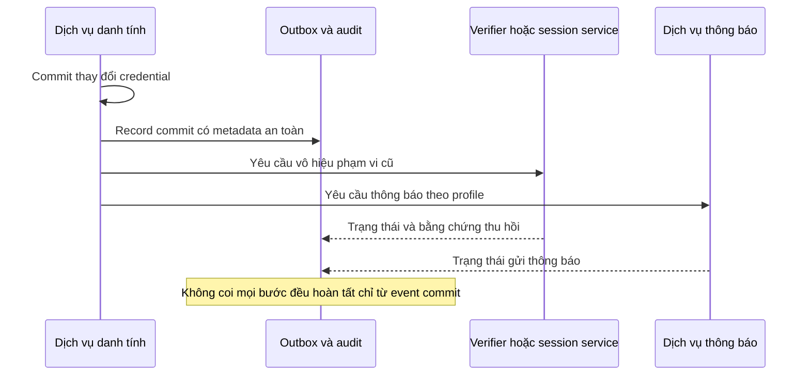

# Credential change

## 1. Vì sao thay đổi credential cần bằng chứng riêng?

**Credential change** trong bài học là các thay đổi ảnh hưởng tới phương tiện hoặc thông tin mà một chủ thể dùng để xác thực: thay mật khẩu, thêm/gỡ authenticator, thay MFA, cấp lại recovery code, xoay vòng API key hoặc client secret, thu hồi credential và những thao tác liên quan.

Trong chương Logging và audit, trọng tâm là **đặc tả bằng chứng cho các thay đổi này**, không phải hướng dẫn lưu mật khẩu hay triển khai từng giao thức xác thực. Một hệ thống cần giải thích được ai đã thay đổi điều gì, cho tài khoản nào, theo quyền và bằng chứng nào, kết quả thực tế ra sao.

Credential change có thể giúp khôi phục an toàn hoặc có thể là bước chiếm tài khoản. Ví dụ, kẻ đã lấy được một phiên đăng nhập thay MFA, đổi kênh khôi phục rồi xuất dữ liệu. Nếu chỉ có log đăng nhập thành công, đội điều tra khó xác định lúc nào quyền kiểm soát tài khoản đã bị chuyển.

[OWASP Logging Vocabulary Cheat Sheet](https://cheatsheetseries.owasp.org/cheatsheets/Logging_Vocabulary_Cheat_Sheet.html) có các sự kiện thay mật khẩu thành công và thất bại. Khi viết yêu cầu cho một hệ thống cụ thể, cần mở rộng theo những loại credential thực tế và quy trình quản lý chúng.

Mục tiêu của bài học là chuyển rủi ro này thành yêu cầu đo được về event catalog, danh tính, tính nhất quán, bảo mật log và bằng chứng kiểm thử. Tên sự kiện, version, ngưỡng và thời hạn dưới đây là ví dụ giả định.

## 2. Xác định phạm vi thay đổi trước khi chọn sự kiện

### 2.1. Không chỉ có thay mật khẩu

| Đối tượng | Thay đổi cần xem xét | Điều cần chứng minh |
|---|---|---|
| Mật khẩu | Đổi tự phục vụ, reset qua recovery, reset bởi quản trị | Luồng nào, ai được phép và version nào đã hiệu lực |
| MFA/OTP authenticator | Thêm, xác nhận binding, thay thiết bị, gỡ, vô hiệu | Yếu tố mới đã được xác minh chưa; yếu tố cũ còn hiệu lực không |
| Passkey hoặc security key | Đăng ký, gỡ, thu hồi một credential đã đăng ký | Binding phía server, chủ thể và quyền quản lý tương ứng |
| Recovery code | Tạo bộ mới, thay thế hoặc thu hồi bộ cũ | Generation nào hiệu lực, không lưu nội dung code vào audit |
| API key/client secret | Tạo, rotation, kích hoạt, hết thời gian chồng lấn, thu hồi | Principal dịch vụ, phạm vi và vòng đời từng version |
| Certificate hoặc khóa xác thực | Thay certificate, binding mới, thu hồi hoặc hết hạn | Danh tính máy, version và kết quả tại điểm xác minh |
| Kênh khôi phục | Thay email/số điện thoại hoặc phương thức recovery | Đây có phải thay đổi đường kiểm soát tài khoản theo profile không? |

Kênh liên hệ không luôn là credential. Tuy nhiên, nếu nó được dùng để khôi phục quyền truy cập hoặc nhận thông báo an toàn, thay đổi đó cần được đưa vào mô hình đe dọa và event catalog tương ứng.

Với passkey, log của server thường phản ánh việc đăng ký/gỡ credential mà server quản lý. Không tự tuyên bố quan sát được mọi bản đồng bộ hoặc bản sao trên thiết bị nếu cơ chế thực tế không cung cấp bằng chứng đó.

### 2.2. Phân biệt các luồng có mức tin cậy khác nhau

Thay tự phục vụ, recovery vì mất authenticator, hỗ trợ bởi nhân viên và rotation tự động là những luồng khác nhau. Không gắn tất cả thành một code `CREDENTIAL_UPDATED` rồi làm mất dấu nguồn thay đổi.

[NIST SP 800-63B-4](https://pages.nist.gov/800-63-4/sp800-63b.html) mô tả quản lý vòng đời authenticator, bao gồm binding và notification. Những yêu cầu cụ thể của một profile áp dụng phải được ánh xạ vào thiết kế; việc viện dẫn tiêu chuẩn không thay thế khai báo nguồn bằng chứng và phạm vi triển khai.

Trong hệ thống dùng nhà cung cấp danh tính bên ngoài, ứng dụng có thể không quản lý mật khẩu gốc. Khi đó cần xác định sự kiện nào do ứng dụng biết trực tiếp, sự kiện nào phải nhận từ nguồn bên ngoài đã xác minh và những thay đổi nào hiện không quan sát được.

## 3. Mô hình đe dọa và câu hỏi điều tra

| Mã | Tình huống | Rủi ro cần kiểm soát bằng yêu cầu |
|---|---|---|
| R1 | Phiên bị chiếm được dùng để thay MFA hoặc recovery | Chuyển quyền kiểm soát tài khoản mà chủ thể không biết |
| R2 | Nhân sự hỗ trợ hoặc workload thay credential ngoài nhiệm vụ | Lạm dụng đặc quyền, khó quy trách nhiệm |
| R3 | Log thiếu hoặc ghi thành công trước commit | Lịch sử không phản ánh trạng thái credential thực tế |
| R4 | Password, OTP, recovery code hoặc key lọt vào log | Kho audit trở thành nguồn lấy credential |
| R5 | Credential mới hiệu lực nhưng phiên/key cũ chưa bị vô hiệu theo policy | Kẻ giữ quyền cũ vẫn tiếp tục truy cập |
| R6 | Notification được gửi nhầm kênh hoặc được coi là đã nhận khi chưa biết | Chủ thể không phát hiện thay đổi trái phép |
| R7 | Retry, cạnh tranh hoặc sự kiện ngoài bị replay | Ghi trùng, thay đổi ngoài dự định hoặc làm lịch sử sai |
| R8 | Bulk tool, script, nhà cung cấp ngoài hoặc luồng khẩn cấp bỏ qua audit | Có đường thay đổi không được giám sát |

Một chuỗi bằng chứng hữu ích phải trả lời:

1. Ai khởi tạo, ai thực thi, ai phê duyệt và tài khoản/principal nào bị thay đổi?
2. Credential nào được thêm, thay, kích hoạt hoặc thu hồi, với tham chiếu không chứa secret?
3. Yêu cầu thuộc luồng nào, policy nào và bằng chứng xác minh nào?
4. Mốc nào mới là intent, mốc nào đã commit, mốc nào là hiệu lực thu hồi thực tế?
5. Notification và các tác vụ phụ đã đi tới trạng thái nào?
6. Có khoảng trống, nguồn không đáng tin hoặc kết quả chưa xác định nào không?

Audit chỉ ghi danh tính gắn với credential/context mà hệ thống đã xác minh. Nó không tự chứng minh một con người cụ thể đã chủ ý thực hiện nếu phiên hoặc credential đó đã bị chiếm.

## 4. Event catalog theo vòng đời thay đổi

### 4.1. Tách ý định, quyết định và hiệu lực

| Sự kiện minh họa | Điều kiện phát sinh |
|---|---|
| `CREDENTIAL_CHANGE_REQUESTED` | Hệ thống đã nhận yêu cầu thuộc luồng được nhận diện |
| `CREDENTIAL_CHANGE_REJECTED` | Bị từ chối vì quyền, verification, policy hoặc điều kiện khác |
| `AUTHENTICATOR_BINDING_VERIFIED` | Bằng chứng binding theo giao thức đã được kiểm tra |
| `CREDENTIAL_CHANGE_COMMITTED` | Trạng thái có thẩm quyền đã xác nhận thay đổi |
| `OLD_CREDENTIAL_REVOCATION_REQUESTED` | Đã bắt đầu yêu cầu thu hồi theo phạm vi cụ thể |
| `CREDENTIAL_REVOCATION_CONFIRMED` | Có bằng chứng xác nhận thu hồi ở phạm vi được nêu |
| `SESSION_INVALIDATION_STATUS_CHANGED` | Tiến trình xử lý phiên cũ có kết quả mới |
| `CREDENTIAL_CHANGE_NOTIFICATION_STATUS` | Đã tạo, gửi, được provider chấp nhận hoặc có lỗi thông báo |
| `CREDENTIAL_CHANGE_RECONCILIATION_REQUIRED` | Chưa xác định hoặc chưa hội tụ trạng thái cần thiết |

Tên event chỉ là minh họa. Điểm quan trọng là catalog không dùng một `SUCCESS` duy nhất thay cho mọi mốc của một workflow nhiều hệ thống.

Một request được phép chưa chắc đã thay credential. Credential mới đã được lưu chưa chắc credential cũ đã bị chặn ở mọi verifier. Provider chấp nhận notification cũng chưa chứng minh chủ thể đã đọc.

### 4.2. Ghi cả đường bị từ chối và đường đặc quyền

Các lần thay thất bại có thể giúp phát hiện thử OTP, recovery abuse hoặc quản trị ngoài phạm vi. Cần ghi reason code phù hợp nhưng không ghi code/secret người gọi đã thử.

Quy trình phải bao phủ UI, API, admin console, bulk API, script vận hành, provisioning và rotation tự động. Không coi service account hoặc quản trị viên là ngoại lệ không cần audit.

Severity cần theo ngữ cảnh. Một lỗi nhập lại mật khẩu không tự là sự cố nghiêm trọng, trong khi việc gỡ MFA bằng quyền hỗ trợ trên tài khoản đặc quyền có thể cần ưu tiên cao hơn.

## 5. Schema: ai thay đổi gì, cho ai và dựa trên bằng chứng nào?

### 5.1. Các nhóm field cần đặc tả

| Nhóm | Nội dung minh họa | Ràng buộc |
|---|---|---|
| Nhận diện | Event ID, type, schema version, operation/workflow ID | ID ổn định khi replay cùng event |
| Thời gian | Occurred time, observed time, mốc hiệu lực liên quan | Nêu nguồn đồng hồ và mức tin cậy |
| Nguồn | Service/workload, deployment, entry point, change flow | Không tin nguyên giá trị client tự khai |
| Người tham gia | Initiator, executor, approver, target principal | Phân biệt vai trò, tenant và quyền thay mặt |
| Credential | Class, credential reference, generation/version | Không phải giá trị credential hoặc verifier bí mật |
| Xác minh | Loại verification, kết quả, thời điểm, evidence reference | Tham chiếu tới bằng chứng được bảo vệ, không kèm proof thô |
| Kết quả | Outcome, reason code, từ version nào sang version nào | Lấy từ trạng thái thật, không từ version client dự kiến |
| Policy | Policy version, scope thu hồi và notification profile | Phiên bản thực sự được áp dụng |

Với request chưa xác minh được target, không ghi một account ID do client khai thành tài khoản đã được xác nhận. Có thể cần tham chiếu yêu cầu an toàn và trạng thái phân giải, theo policy giảm dữ liệu.

### 5.2. Ví dụ event thay mật khẩu đã commit

```json
{
  "eventId": "event-demo-702",
  "eventType": "CREDENTIAL_CHANGE_COMMITTED",
  "schemaVersion": 1,
  "operationId": "credential-change-demo-81",
  "occurredAt": "2026-01-12T09:15:00.123Z",
  "observedAt": "2026-01-12T09:15:00.520Z",
  "sourceService": "identity-service-demo",
  "tenantRef": "tenant-demo-a",
  "changeFlow": "SELF_SERVICE_PASSWORD_CHANGE",
  "initiatorRef": "account-demo-17",
  "executorRef": "identity-workload-demo",
  "targetPrincipalRef": "account-demo-17",
  "credentialClass": "PASSWORD",
  "credentialRef": "credential-demo-71",
  "previousVersion": 4,
  "currentVersion": 5,
  "verificationProfile": "reauth-profile-demo-3",
  "verificationEvidenceRef": "evidence-demo-19",
  "outcome": "SUCCESS",
  "reasonCode": "VERIFIED_SELF_SERVICE_CHANGE",
  "revocationProfile": "session-policy-demo-8",
  "policyVersion": 12,
  "requestId": "request-demo-901"
}
```

Các tham chiếu và thời gian trên là dữ liệu giả. `SUCCESS` chỉ khẳng định mốc thay đổi được event này định nghĩa; nó không tự nói mọi phiên cũ đã bị chấm dứt hoặc notification đã được nhận.

`previousVersion` và `currentVersion` là metadata vòng đời, không phải password hash. Nếu hệ thống dùng nhiều credential đồng thời, phải nêu version thuộc credential record, generation hay một phạm vi khác; không giả định mọi tài khoản chỉ có một credential duy nhất.

### 5.3. Before/after chỉ giữ phần cần thiết

Để điều tra, có thể cần biết `ACTIVE -> REVOKED`, generation `4 -> 5` hoặc “thêm một authenticator loại X”. Không cần lưu giá trị trước/sau của secret.

Đối với API key, vài ký tự cuối có thể hỗ trợ nhận diện trên giao diện nhưng không bảo đảm duy nhất. Audit nên dùng credential reference nội bộ phù hợp; không lấy phần hiển thị ngắn làm bằng chứng duy nhất để nối lịch sử.

## 6. Dữ liệu không được xuất vào audit

Mục tiêu logging không cho phép tạo một bản sao credential. Không ghi trực tiếp:

- Mật khẩu cũ/mới, password hash hoặc verifier có thể hỗ trợ tấn công ngoại tuyến.
- OTP, TOTP seed, QR enrollment chứa secret hoặc output xác thực có thể bị lạm dụng.
- Recovery code, reset token, link có token hoặc challenge bí mật.
- API key, client secret, private key, raw access/refresh token hoặc cookie phiên.
- Header xác thực, toàn bộ request/response hoặc exception có thể chứa các giá trị trên.

[OWASP Logging Cheat Sheet](https://cheatsheetseries.owasp.org/cheatsheets/Logging_Cheat_Sheet.html) phân tích dữ liệu cần loại bỏ hoặc bảo vệ trong log. Với credential change, allowlist phải áp ở cả app logger, reverse proxy, APM, queue lỗi, notification provider và công cụ hỗ trợ.

Public key hoặc attestation metadata không tự là secret giống private key, nhưng vẫn cần đánh giá mục đích và khả năng liên kết danh tính. Không dump toàn bộ vật phẩm giao thức chỉ vì một phần của nó là thông tin công khai.

Email, số điện thoại và evidence xác minh cũng cần giới hạn dữ liệu. Event có thể giữ channel reference hoặc loại kênh, còn thông tin liên hệ đầy đủ và hồ sơ xác minh ở vùng riêng có quyền và retention phù hợp.

Structured logging cần encode đúng, type/length rõ ràng và template được kiểm soát. Không để comment, tên thiết bị hoặc reason do client nhập tạo event giả hoặc điều khiển nội dung audit.

## 7. Điều kiện xác minh và ranh giới tin cậy của bằng chứng

### 7.1. Phiên hiện tại chưa chắc đủ cho thay đổi rủi ro cao

[OWASP Multifactor Authentication Cheat Sheet](https://cheatsheetseries.owasp.org/cheatsheets/Multifactor_Authentication_Cheat_Sheet.html#changing-mfa-factors) lưu ý thay MFA là đường có thể bị lợi dụng để chiếm tài khoản; việc chỉ dựa vào một phiên đang hoạt động có thể không đủ.

Profile cần xác định xác thực lại, bằng chứng yếu tố hiện có hoặc recovery thay thế phù hợp. Audit ghi kết quả, loại bằng chứng và tham chiếu, không ghi secret. Không để backend tự ghi `reauthenticated=true` chỉ vì frontend gửi một flag.

Không yêu cầu một yếu tố đã mất trong mọi trường hợp rồi vô tình làm recovery không thể thực hiện. Recovery là luồng riêng có mức xác minh, quyền hỗ trợ và bằng chứng được đặc tả, không phải một đường bỏ qua âm thầm.

### 7.2. Nguồn danh tính và phạm vi

Initiator, executor, tenant và target phải lấy từ context xác thực/phân quyền hoặc nguồn định danh có thẩm quyền. Workload chạy thay người dùng phải giữ được sự khác biệt giữa hai chủ thể.

Nhân viên hỗ trợ không được chỉ tự khai một target rồi thay credential ngoài scope. Audit cần liên kết với quyền, case/ticket hoặc phê duyệt cần thiết; việc có ticket không tự thay thế xác minh và phân quyền.

Địa chỉ IP hoặc device label là tín hiệu, không phải bằng chứng duy nhất về người thực hiện. Cần xác định nguồn đáng tin cho từng field và xử lý khi metadata không kiểm chứng được.

### 7.3. Sự kiện từ hệ thống danh tính bên ngoài

Nếu nhận webhook hoặc thông điệp credential change, cần xác minh nguồn, tenant, subject mapping, version/event ID và thời điểm. Không tin event chỉ vì payload có đúng tên nhà cung cấp.

Cần xử lý duplicate, replay, sai thứ tự và mất nguồn. Khi chưa có bằng chứng về một thay đổi ở bên ngoài, ứng dụng phải biểu diễn giới hạn quan sát thay vì tạo một audit record thành công giả.

## 8. Tính nhất quán giữa credential và audit

### 8.1. Ghi cùng thay đổi có thẩm quyền

Ghi “đổi mật khẩu thành công” trước commit có thể tạo lịch sử sai nếu commit thất bại. Ghi sau commit bằng một câu logger riêng có thể mất bằng chứng nếu process chết ngay giữa hai bước.

Khi trạng thái credential và outbox cùng nằm trong phạm vi transaction được hỗ trợ, một mẫu thiết kế là:

```text
verify the change request using the approved authentication/recovery flow

begin transaction
    load current credential state with concurrency protection
    check target, authorization conditions and expected version
    consume one-time recovery proof if this flow requires it
    apply the approved credential state transition
    append a non-secret committed-change event to the protected outbox
commit

publish the committed event with its stable Event ID
track revocation and notification as separate workflow outcomes
```

Đây là mã giả về tính nhất quán. Nó không quy định thuật toán lưu credential hoặc tuyên bố transaction bao phủ cả email, verifier ngoài và hệ thống khác.

Audit event chỉ chứa metadata đã được duyệt. Không đặt password, seed hoặc secret mới vào outbox để tiện cho publisher. Nếu cần truyền credential tới đúng thành phần có thẩm quyền, đó là một luồng secret riêng với kiểm soát tương ứng, không phải audit payload.

### 8.2. Cạnh tranh, replay và kết quả chưa xác định

Hai tab hoặc hai nhân sự có thể đồng thời thay cùng một credential. Contract cần xác định version kỳ vọng, điều kiện chuyển và cách xử lý xung đột. Version trong event phải phản ánh thay đổi đã commit, không phải version client dự đoán.

Retry một operation không được tạo nhiều thay đổi ngoài contract. Cùng một event được publish lại phải giữ Event ID; downstream phân biệt replay với một lần thay đổi mới.

Không log hash toàn bộ request chứa secret để làm dấu vết idempotency. Binding của thao tác và thông tin chống trùng lặp phải được thiết kế ở vùng dữ liệu phù hợp, không tạo vật phẩm giúp dò mật khẩu hoặc recovery code trong kho audit.

Nếu mất kết nối sau khi có thể đã commit, giữ trạng thái chưa xác định và đối soát theo operation reference với nguồn có thẩm quyền. Không ghi một event thất bại chắc chắn rồi bỏ qua khả năng credential đã đổi.

### 8.3. Khi logging không khả dụng

| Tình huống | Hành vi minh họa |
|---|---|
| Không tạo được record bền vững bắt buộc cho binding credential mới | Không xác nhận thay đổi thành công; xử lý theo bất biến transaction/profile |
| Collector trung tâm lỗi nhưng record nguồn còn bền vững | Giữ outbox, retry và cảnh báo backlog trong giới hạn đã định |
| Notification lỗi sau khi credential đã commit | Ghi trạng thái thông báo chưa hoàn tất; không tự khẳng định credential chưa đổi |
| Thu hồi khẩn cấp khi credential nghi bị chiếm | Có đường bảo vệ được ủy quyền, bằng chứng dự phòng và đối soát theo profile |

Không áp máy móc “audit lỗi thì không làm gì” cho mọi tình huống. Nó có thể khiến credential nghi bị chiếm tiếp tục có hiệu lực. Thiết kế cần có đường thu hồi khẩn cấp với thẩm quyền, journal hoặc bằng chứng bền vững thích hợp và quy trình khôi phục audit.

Nếu không thực hiện được thu hồi, phải thể hiện tình trạng chưa hoàn tất và kích hoạt biện pháp giảm rủi ro đã đặc tả, thay vì ghi `REVOKED` để đóng case. Đường khẩn cấp cũng không được bỏ xác minh hoặc phân quyền tùy ý.

## 9. Thay credential khác với chấm dứt quyền truy cập cũ

### 9.1. Xác định phạm vi thu hồi theo từng luồng

Đổi mật khẩu không tự đồng nghĩa mọi access token, refresh token, phiên ứng dụng, phiên thiết bị hoặc API key đều hết hiệu lực. Policy phải quyết định rõ đối tượng nào bị ảnh hưởng.

| Luồng minh họa | Vấn đề cần đặc tả và ghi nhận |
|---|---|
| Đổi mật khẩu tự phục vụ | Có giữ phiên hiện tại không, xử lý các phiên khác ra sao? |
| Recovery nghi bị chiếm tài khoản | Những phiên/credential nào phải bị vô hiệu để chặn người giữ quyền cũ? |
| Thay MFA | Yếu tố cũ bị gỡ lúc nào, yếu tố mới đã được xác minh trước đó chưa? |
| Rotation API key | Có thời gian chồng lấn không, version cũ hết hiệu lực khi nào? |
| Thay certificate | Verifier nào cần cập nhật trust/revocation và cache nào liên quan? |
| Tạo recovery code mới | Generation cũ có còn được sử dụng không và làm sao kiểm chứng? |

Thời gian chồng lấn của machine credential có thể phục vụ chuyển đổi không gián đoạn, nhưng cần giới hạn và bằng chứng kết thúc. Việc thấy version cũ trong khoảng còn được cho phép không tự chứng minh xâm phạm.

### 9.2. Không gộp yêu cầu thu hồi với hiệu lực thực tế

Một chuỗi có thể là:



Ví dụ yêu cầu kỹ thuật có thể quy định: sau khi quyết định thu hồi phiên bị ảnh hưởng được ghi bền vững tại T0, mọi request mới thuộc phạm vi đó bị từ chối từ T0 + 60 giây. Con số này là mục tiêu giả định và phải có cơ chế thực thi tương ứng.

Nếu access token chỉ được kiểm chữ ký ngoại tuyến và còn hạn dài hơn, một dòng audit `REVOCATION_REQUESTED` không làm token tự mất hiệu lực trong 60 giây. Cần thiết kế kiểm trạng thái, phiên bản hoặc giới hạn thời gian phù hợp rồi đo trên đường truy cập thật.

Request đang chạy, kết nối dài và thao tác đã hoàn tất cần quy tắc riêng. Ngừng nhận request mới không tự hủy mọi tác động trước đó.

### 9.3. Bằng chứng thu hồi phải có scope

Event xác nhận nên ghi đối tượng/generation, profile, mốc và phạm vi đã được kiểm chứng. Nếu mới xác nhận một session service, không tuyên bố mọi resource server trong toàn hệ thống đã hội tụ.

Có thể dùng đối soát, acknowledgment thích hợp và kiểm thử hành vi để đánh giá hội tụ. Sự im lặng của verifier không phải một xác nhận thành công.

## 10. Notification là một nhánh kiểm soát riêng

### 10.1. Thông báo độc lập với giao dịch thay đổi

Trong profile của [NIST SP 800-63B-4, mục Authenticator Binding và Account Notifications](https://pages.nist.gov/800-63-4/sp800-63b.html), việc binding authenticator mới đi kèm notification qua cơ chế độc lập với giao dịch binding. Mục tiêu là giúp chủ thể phát hiện thay đổi có thể gian lận.

Với hệ thống cụ thể, cần xác định event nào phải thông báo, kênh được phép, người nhận, thời gian và retry. Notification an toàn không phải một bước xác thực bổ sung tự động; gửi email báo thay đổi không chứng minh người thực hiện đã được quyền thay đổi.

Nếu kênh khôi phục cũng vừa bị đổi, chỉ gửi tới kênh mới có thể làm chủ thể thật không nhận biết. Profile cần cách chọn những kênh tin cậy thích hợp, xử lý thay đổi địa chỉ và bảo vệ thông tin của người nhận.

### 10.2. Ghi đúng trạng thái giao nhận

| Mốc | Ý nghĩa |
|---|---|
| `QUEUED` | Hệ thống đã lưu công việc thông báo |
| `SUBMITTED` | Đã gửi yêu cầu tới provider |
| `PROVIDER_ACCEPTED` | Provider chấp nhận theo contract của họ |
| `DELIVERY_CONFIRMED` | Có bằng chứng giao nhận ở mức provider/kênh hỗ trợ |
| `FAILED` hoặc `PENDING_RETRY` | Chưa hoàn tất và cần xử lý tiếp |

Không suy `PROVIDER_ACCEPTED` hoặc một tín hiệu “delivered” thành chủ thể đã đọc và đồng ý với thay đổi. Tên event và dashboard phải phản ánh đúng mức quan sát.

Nội dung thông báo chỉ nên cung cấp thông tin cần nhận biết sự kiện và cách phản hồi qua kênh tin cậy. Không gửi password mới, OTP seed, API secret hoặc nguyên vật phẩm recovery trong thông báo audit.

### 10.3. Đường phản hồi nghi ngờ phải được bảo vệ

Nếu chủ thể báo không thực hiện thay đổi, quy trình cần bảo vệ quyền nhận, ghi case và đánh giá credential/session liên quan. Không tạo một link “hoàn tác” không kiểm quyền có thể bị người khác dùng để chiếm hoặc khóa tài khoản.

Lỗi notification phải có owner và khả năng theo dõi. Không rollback credential đã được thay hợp lệ chỉ vì email provider tạm lỗi, trừ khi toàn bộ workflow đã được đặc tả như vậy và có cơ chế an toàn tương ứng.

## 11. Bảo vệ lịch sử credential change và vòng đời dữ liệu

### 11.1. Audit cũng là tài sản nhạy cảm

Lịch sử thay credential có thể tiết lộ cách tài khoản được bảo vệ, mốc recovery và hoạt động quản trị. Cần phân quyền đọc theo nhiệm vụ, tenant và case; không cho toàn bộ nhân sự hỗ trợ xem bằng chứng xác minh chi tiết.

Producer có thể được phép ghi event của mình nhưng không tùy ý sửa hoặc xóa lịch sử đã lưu. Tách quyền quản trị kho, retention và thao tác export phù hợp. Các lần đọc/xuất dữ liệu nhạy cảm trong audit cũng cần được kiểm soát và ghi nhận.

Nếu có trang “hoạt động bảo mật” cho chủ thể, đó là một projection riêng. Không trả nguyên event nội bộ, actor của nhân sự khác hoặc evidence nhạy cảm; endpoint vẫn phải xác thực và kiểm scope.

### 11.2. Độ bền, toàn vẹn và giới hạn của bằng chứng

Cần quy định truyền/lưu được bảo vệ, chống sửa trái phép và phát hiện thiếu event. Hash hoặc chữ ký có thể hỗ trợ xác minh trong mô hình thích hợp, nhưng không tự chứng minh một event chưa bao giờ được tạo đã bị thiếu.

Record nguồn, publisher, collector và index truy vấn là các chặng khác nhau. Có thể cần Event ID, sequence trong phạm vi nguồn, đối soát và health check. “Không thấy lỗi gửi” chưa chứng minh mọi lần thay đổi đều có audit.

Event đến trễ cần giữ thời điểm nguồn, thời điểm thu nhận và context workflow. Không sửa timestamp nguồn thành hiện tại để làm dashboard có vẻ không còn backlog.

### 11.3. Retention theo loại dữ liệu

Event metadata, hồ sơ xác minh, notification artifact và snapshot có thể có thời hạn khác nhau. Retention phải theo mục tiêu, rủi ro và nghĩa vụ áp dụng, không giữ secret hoặc giấy tờ vô hạn vì “để audit”.

Khi xóa hoặc hết hạn, cần xử lý index, archive, buffer, export và các bản sao theo phạm vi công bố. Việc mất khóa hoặc không đọc được schema cũ cũng phải được xét trong khả năng sử dụng bằng chứng.

Những thay đổi retention, quyền và cấu hình pipeline có thể ảnh hưởng cuộc điều tra nên phải có owner, phiên bản và bằng chứng phù hợp.

## 12. Phát hiện và điều tra thay đổi đáng ngờ

### 12.1. Nối sự kiện theo chuỗi hành vi

Một rule minh họa có thể xem xét tổ hợp:

```text
recovery bất thường
  -> gỡ yếu tố cũ
  -> thêm yếu tố mới
  -> tạo hoặc thay kênh khôi phục
  -> xuất dữ liệu nhạy cảm
```

Không phải mọi chuỗi như vậy đều là tấn công. Rule cần xét chủ thể, tenant, source, luồng được phê duyệt và risk signal phù hợp. Không tự khóa tài khoản chỉ dựa trên một nhãn địa lý hoặc một notification thất bại.

Use case khác gồm số lượng reset quản trị bất thường, credential mới dùng ngay ở scope khác thường hoặc key cũ tiếp tục bị trình sau mốc thu hồi bắt buộc. Cần phân biệt sử dụng trái policy với hoạt động vẫn nằm trong khoảng chồng lấn được phép.

### 12.2. Các chỉ báo vận hành quan trọng

- Số thay đổi đã commit so với event nguồn và event truy vấn được.
- Số workflow chưa xác định kết quả hoặc chưa hội tụ thu hồi.
- Độ trễ commit tới thu nhận, tới cảnh báo và tới trạng thái notification.
- Số thao tác qua đường đặc quyền hoặc recovery thay thế.
- Nguồn bên ngoài bị mất, Event ID trùng hoặc version đảo thứ tự.

Không dùng giá trị credential, email hoặc message lỗi làm metric label. Catalog hữu hạn và tham chiếu an toàn giúp tránh rò rỉ và cardinality không kiểm soát.

### 12.3. Chuyển bằng chứng thành hành động có quyền

Playbook cần owner, cách xác minh báo cáo, phạm vi thu hồi hoặc hạn chế và đường bảo toàn bằng chứng. Một cảnh báo không tự cấp quyền cho hệ thống phản ứng đặt lại credential của mọi tài khoản.

Nếu nghi secret đã lọt vào log, chỉ che trên dashboard là chưa đủ. Cần đánh giá nơi dữ liệu đã tới, quyền đọc, bản sao và khả năng thu hồi/rotation theo sự cố thực tế.

## 13. Bộ yêu cầu bảo mật mẫu có thể nghiệm thu

| ID | Yêu cầu | Rủi ro và bằng chứng |
|---|---|---|
| CCHANGE-01 | Event catalog bao phủ các loại credential và mọi đường thay đổi được hỗ trợ, gồm đặc quyền và automation | R1, R2, R8; inventory UI/API/script/IDP và scenario map |
| CCHANGE-02 | Audit phân biệt initiator, executor, approver và target theo nguồn tin cậy và tenant | R2, R7; ca giả metadata, thay mặt và khác scope |
| CCHANGE-03 | Verification/recovery được ghi bằng profile, kết quả và evidence reference; không dùng flag client làm chứng cứ | R1, R2; phiên bị chiếm, yếu tố mất và recovery thay thế |
| CCHANGE-04 | Thay đổi đã commit có event nguồn bền vững nhất quán; intent/decision không được coi là commit | R3; transaction, crash và acknowledgment-loss test |
| CCHANGE-05 | Audit và mọi luồng telemetry không chứa secret, password hash, proof thô hoặc dữ liệu vượt mục đích | R4; canary trên app, APM, proxy, queue và provider |
| CCHANGE-06 | Phiên/key/credential cũ được xử lý theo scope và thời hạn profile; yêu cầu thu hồi khác xác nhận hiệu lực | R5; verifier/cache/phiên và key overlap test |
| CCHANGE-07 | Notification độc lập theo profile, đúng kênh được duyệt; trạng thái provider không bị suy thành chủ thể đã đọc | R1, R6; đổi kênh, provider lỗi và kiểm mốc giao nhận |
| CCHANGE-08 | Cạnh tranh, retry và replay không tạo thay đổi ngoài contract hoặc làm sai số lần thay đổi | R3, R7; expected version, operation ID, replay và dedup |
| CCHANGE-09 | Luồng từ IDP ngoài có source verification, subject mapping và trạng thái khi thiếu bằng chứng | R7, R8; giả webhook, sai thứ tự, mất nguồn |
| CCHANGE-10 | Mất audit hoặc tác vụ phụ có hành vi theo rủi ro, gồm đường thu hồi khẩn cấp và đối soát | R3, R5, R6; ngắt collector, outbox và notification sink |
| CCHANGE-11 | Quyền đọc/sửa/xóa/export, retention và bảo vệ bằng chứng được đặc tả cho từng vùng dữ liệu | R2, R4; kiểm IAM, tenant, archive và trang hoạt động người dùng |
| CCHANGE-12 | Có use case phát hiện/điều tra, owner và đo độ trễ/thiếu event theo phạm vi đã công bố | R1, R3, R8; diễn tập chuỗi hành vi và đối soát end-to-end |

Ví dụ đặc tả chi tiết:

```yaml
id: CCHANGE-04
asset: account-credential-lifecycle
trigger: Authoritative credential state changes
requiredBehavior:
  - Persist a non-secret committed-change event consistently with the state
  - Record verified actor, target, flow and actual credential version
  - Preserve a stable Event ID across delivery retries
  - Track revocation and notification outcomes separately
failureBehavior:
  - Preserve UNKNOWN when the commit result cannot be established
  - Apply the approved emergency-revocation profile when needed
measurement:
  committedChangesMissingRequiredDurableSourceEvent: 0
  rawCredentialCanaryMatchesInAuditOutputs: 0
evidence:
  - Commit and crash-consistency tests
  - Replay, reconciliation and telemetry inspection
owner: identity-platform
```

Mẫu chỉ có ý nghĩa khi xác định nguồn trạng thái, phạm vi transaction và điểm đo. Một event có đủ field nhưng ghi sai lúc vẫn không đáp ứng yêu cầu.

## 14. Ma trận kiểm thử theo thuộc tính

Đây là tiêu chí thiết kế kiểm thử, chưa phải kết quả QA của một triển khai cụ thể. Dùng credential và dữ liệu giả trong môi trường có thẩm quyền.

| Tình huống | Kết quả mong đợi |
|---|---|
| Thay credential tự phục vụ hợp lệ | Có các mốc và version đúng; không log secret |
| Phiên còn hiệu lực nhưng không đủ verification cho thay MFA | Bị xử lý theo profile, không dựa riêng vào phiên |
| Client tự gửi actor, target, tenant hoặc `reauthenticated=true` | Không biến metadata tự khai thành bằng chứng |
| Người mất yếu tố dùng recovery đã phê duyệt | Đi qua luồng riêng, có evidence/profile và scope đúng |
| Nhân viên hỗ trợ thay ngoài case hoặc tenant được cấp | Bị từ chối, có event phù hợp mà không lộ dữ liệu target trái quyền |
| API key/client secret được xoay tự động | Actor workload, principal và version được ghi đúng |
| Gỡ/passkey registration ở server | Event phản ánh phạm vi quan sát, không giả định biết mọi bản đồng bộ thiết bị |
| Canary secret nằm trong input, response, exception hoặc APM | Không xuất vào audit/telemetry ngoài policy |
| Commit thất bại hoặc process chết quanh commit | Không ghi thành công giả và không mất event bắt buộc cho thay đổi đã commit |
| Mất xác nhận commit rồi client retry | Đối soát/idempotency đúng contract, không tạo thay đổi ngoài dự định |
| Hai thao tác cùng expected version chạy đồng thời | Trạng thái và lịch sử đúng quy tắc cạnh tranh |
| Publisher gửi lại cùng event | Không đếm thành lần thay đổi mới; giữ ID và timestamp nguồn |
| Key cũ dùng trong/sau khoảng overlap được phép | Hành vi và detection phân biệt đúng hai khoảng |
| Credential đã đổi nhưng session invalidation bị trễ | Không đóng workflow như mọi phiên đã vô hiệu; theo dõi phạm vi còn thiếu |
| Verifier kiểm access token ngoại tuyến | Ngân sách thu hồi có cơ chế và phép đo tương ứng, không chỉ dựa audit |
| Notification provider lỗi hoặc chỉ xác nhận accepted | Trạng thái đúng mức quan sát, không khẳng định chủ thể đã đọc |
| Kênh recovery vừa đổi cùng credential | Chọn kênh thông báo theo profile; không chỉ tin địa chỉ mới tự khai |
| Thu hồi khẩn cấp khi collector ngừng hoạt động | Đường bảo vệ và journal/đối soát hoạt động theo policy được cấp |
| Webhook bị giả, replay, sai thứ tự hoặc mất nguồn | Không nhận thành lịch sử tin cậy tùy ý; có trạng thái/đối soát |
| Reader khác tenant hoặc operator không được cấp xem evidence | Không truy cập raw audit, evidence hoặc export ngoài scope |
| Dữ liệu hết retention hoặc được bảo toàn theo case | Xử lý các bản sao đúng profile, có bằng chứng |
| Chuỗi recovery -> thay yếu tố -> export được mô phỏng | Nối được sự kiện, có rule/owner và xử lý theo quyền |

Bằng chứng cần gồm trạng thái credential ở nguồn, audit nguồn, bản thu nhận, hành vi verifier và trạng thái notification phù hợp. Một HTTP thành công hoặc một dòng `CREDENTIAL_CHANGED` không đủ chứng minh toàn workflow.

Kiểm cả luồng thất bại và luồng không có UI, đặc biệt script, bulk, provisioning và tác động từ IDP. Cần đối chiếu credential giả thực sự có/không còn dùng được với scope và mốc mà event công bố.

## 15. Quản trị event và những lỗi đặc tả thường gặp

Catalog, schema, profile verification, revocation và notification cần owner cùng phiên bản. Khi thêm authenticator hoặc thay luồng recovery, phải đánh giá event, bằng chứng và các rule đang phụ thuộc vào chúng.

Thay tên event hoặc bỏ field có thể làm mất khả năng nối lịch sử dù dữ liệu vẫn được gửi. Rollout/rollback cần giữ tương thích và không mở một đường thay credential không có audit chỉ vì đang chuyển phiên bản.

Những lỗi thường gặp:

- **“Credential change chỉ là đổi mật khẩu.”** Bỏ sót MFA, passkey, recovery, machine credential và đường khôi phục.
- **“Ghi before/after cho đầy đủ.”** Vô tình lưu secret hoặc verifier nhạy cảm vào audit.
- **“Có phiên đăng nhập là đủ quyền thay yếu tố.”** Chưa đánh giá phiên bị chiếm và verification theo rủi ro.
- **“Request được phép là thay đổi thành công.”** Nhầm decision với commit.
- **“Credential đã đổi nên mọi phiên cũ đã chết.”** Chưa kiểm scope và hiệu lực tại verifier.
- **“Provider nhận email nghĩa là chủ thể đã biết.”** Nhầm trạng thái vận chuyển với nhận biết của con người.
- **“Audit lỗi thì không bao giờ được thu hồi.”** Có thể để credential nghi bị chiếm tiếp tục hoạt động nếu không có đường bảo vệ phù hợp.
- **“Có event ở IDP nên ứng dụng biết mọi thay đổi.”** Chưa xác minh nguồn, mapping, độ đầy đủ và giới hạn quan sát.

Yêu cầu audit credential change tốt nối được người thực hiện, bằng chứng được dùng, thay đổi đã commit và các hiệu ứng bảo vệ tiếp theo. Lịch sử cần đủ để điều tra nhưng không chứa vật liệu cho phép xác thực; mỗi khẳng định thành công hoặc thu hồi phải có phạm vi, mốc và bằng chứng tương ứng.
