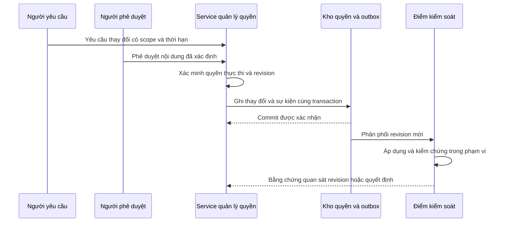

# Privilege change — Đặc tả logging và audit cho thay đổi quyền

## 1. Mục tiêu và phạm vi

Thay đổi quyền là thay đổi khả năng một danh tính được thực hiện hành động nào, trên tài nguyên nào, trong phạm vi và điều kiện nào. Một dòng “role updated” thường không đủ để biết ai đã làm gì, việc thay đổi có được phép hay không và quyền thực tế đã có hiệu lực ở đâu.

Trong chương **Logging và audit** của module `SECURITY_SECURITY_DESIGN_SECURITY_REQUIREMENTS`, bài học chuyển mục tiêu an toàn thông tin và mô hình đe dọa thành yêu cầu ghi nhận, truy vết và kiểm chứng thay đổi quyền.

Nội dung tập trung vào:

- Phạm vi thay đổi quyền trực tiếp, kế thừa, có thời hạn và khẩn cấp.
- Phân biệt yêu cầu, phê duyệt, ghi dữ liệu và hiệu lực thực tế.
- Mô hình chủ thể, đối tượng, phạm vi và bằng chứng trước/sau.
- Độ bền vững, tính toàn vẹn, phân quyền truy cập audit và đối soát.
- Kiểm thử thay đổi đồng thời, thu hồi, lỗi lan truyền và phục hồi.

Các sự kiện, schema, ngưỡng và thời hạn trong bài là **thiết kế minh họa**, cần điều chỉnh theo rủi ro và kiến trúc. Audit hỗ trợ chứng minh và phát hiện; bản ghi audit không tự cấp quyền cho một thao tác.

## 2. Tình huống xuyên suốt và mô hình đe dọa

Một nền tảng học tập phục vụ nhiều tổ chức. Mỗi tổ chức là một `tenant`. Hệ thống có quản trị viên tổ chức, nhân viên hỗ trợ và service tạo bản xuất báo cáo.

Một yêu cầu nghiệp vụ cấp cho nhân viên hỗ trợ quyền đọc báo cáo của tenant A trong hai giờ. Quy trình có người yêu cầu, người phê duyệt và service thực thi. Quyền được lưu ở kho phân quyền, sau đó lan tới cache và các điểm kiểm tra quyền.

Nhóm cần trả lời:

- Ai yêu cầu và ai thực hiện thay đổi?
- Quyền cấp có đúng nội dung được phê duyệt không?
- Đối tượng nhận quyền là người hay service nào?
- Quyền áp dụng cho tenant, tài nguyên và thời hạn nào?
- Khi nào dữ liệu đã commit, và khi nào điểm kiểm soát bắt đầu áp dụng?
- Sau thu hồi, token cũ hoặc cache cũ còn cho phép truy cập không?

| Mã rủi ro | Tình huống | Hệ quả |
| --- | --- | --- |
| R-01 | Cấp hoặc sửa quyền không được phép, tự phê duyệt hoặc vượt scope | Leo thang đặc quyền |
| R-02 | Chỉ log tên vai trò, không giữ định nghĩa hoặc phiên bản | Không giải thích được quyền thực tế |
| R-03 | Log yêu cầu hoặc phê duyệt như thể quyền đã được áp dụng | Sai kết luận về trạng thái bảo mật |
| R-04 | Thu hồi đã commit nhưng token, phiên hoặc cache còn quyền cũ | Truy cập sau khi quyền cần kết thúc |
| R-05 | Sửa hoặc bỏ qua audit qua đường quản trị, script hoặc DB trực tiếp | Mất bằng chứng và che giấu hành vi |
| R-06 | Log chứa bí mật, dữ liệu cá nhân hoặc lộ cấu hình tenant khác | Rò thông tin qua hệ thống audit |
| R-07 | Thay đổi đồng thời hoặc replay gây cấp lại quyền đã thu hồi | Trạng thái quyền sai |
| R-08 | Quyền khẩn cấp hoặc có thời hạn không kết thúc đúng | Đặc quyền tồn tại quá nhu cầu |
| R-09 | Audit hoặc nguồn quyền lỗi, phục hồi làm mất liên kết lịch sử | Không đối soát được hoặc mở lại quyền cũ |

## 3. Những thay đổi nào thuộc phạm vi privilege change?

### 3.1. Không chỉ là thêm hoặc xóa vai trò

| Loại thay đổi | Ví dụ | Điều cần ghi nhận |
| --- | --- | --- |
| Gán quyền trực tiếp | Cho một service đọc bản xuất | Chủ thể nhận, hành động, tài nguyên, điều kiện |
| Thành viên vai trò hoặc nhóm | Thêm người vào nhóm hỗ trợ | Nhóm, phiên bản liên quan, scope và đường kế thừa |
| Định nghĩa vai trò | Thêm khả năng xuất dữ liệu vào vai trò sẵn có | Phiên bản trước/sau và phạm vi bị ảnh hưởng |
| Chính sách điều kiện | Bỏ giới hạn tenant hoặc thời gian truy cập | Điều kiện bị đổi, quyết định phê duyệt |
| ACL hoặc quyền tài nguyên | Cho một nhóm tải một tệp | Tài nguyên, bên nhận, hiệu lực |
| Ủy quyền hoặc giả danh có kiểm soát | Service hành động thay người dùng | Người khởi tạo, bên thực thi, chuỗi ủy quyền |
| Quyền có thời hạn | Cấp hỗ trợ trong hai giờ | Thời điểm bắt đầu, hết hạn, kiểm soát khi sử dụng |
| Quyền khẩn cấp | Kích hoạt khả năng xử lý sự cố | Luồng khẩn cấp, phạm vi, thời hạn và bằng chứng riêng |
| Thu hồi hoặc đình chỉ | Gỡ quyền của người hoặc service | Revision mới, trạng thái lan truyền và kiểm chứng |

Tạo, xoay hoặc thu hồi thông tin xác thực cần audit riêng theo mô hình danh tính. Nó thuộc thay đổi quyền khi làm thay đổi khả năng truy cập hoặc phạm vi; không nên gộp mọi thay đổi khóa vào cùng một loại “role updated”.

### 3.2. Quyền hiệu lực có thể đến từ nhiều đường

Một người có thể còn quyền đọc qua nhóm khác dù một assignment đã bị xóa. Vì vậy:

> “Assignment X đã bị thu hồi” không đồng nghĩa “principal không còn khả năng đọc tài nguyên Y”.

Đặc tả cần phân biệt thay đổi cấu hình cụ thể với kết luận về quyền hiệu lực. Nếu mục tiêu là loại bỏ toàn bộ khả năng truy cập, phải đánh giá các đường cấp quyền, điều kiện và điểm thực thi liên quan.

Thay đổi định nghĩa vai trò có thể ảnh hưởng nhiều người mà không có sự kiện thêm thành viên nào. Danh sách sự kiện phải bao phủ cả thay đổi chính sách và quan hệ kế thừa.

### 3.3. Đường thay đổi ngoài giao diện quản trị

Cần liệt kê API, công cụ nội bộ, script triển khai, nhập dữ liệu, đồng bộ danh tính và truy cập quản trị trực tiếp. Một luồng không đi qua ứng dụng vẫn có thể thay đổi quyền thực tế.

Nếu dùng database audit hoặc tín hiệu độc lập để phát hiện thay đổi trực tiếp, cần nêu khả năng liên kết với người hoặc service. Tài khoản kết nối DB chỉ chứng minh danh tính kết nối quan sát được; không tự chứng minh người đứng sau nếu thiếu bằng chứng ủy quyền.

## 4. Phân biệt yêu cầu, commit và hiệu lực

### 4.1. Ba lớp trạng thái

| Lớp | Trạng thái minh họa | Ý nghĩa |
| --- | --- | --- |
| Quy trình yêu cầu | REQUESTED, APPROVED, REJECTED, CANCELLED | Ý định và quyết định quản trị |
| Thay đổi nguồn quyền | COMMITTED, NO_CHANGE, FAILED, UNKNOWN | Kết quả cập nhật nguồn dữ liệu có thẩm quyền |
| Áp dụng tại điểm kiểm soát | PENDING, VERIFIED, PARTIAL, UNKNOWN | Bằng chứng quyền được thực thi trong phạm vi đã kiểm tra |

Không dùng một field “success” để gộp cả ba lớp.

Ví dụ: yêu cầu được phê duyệt nhưng transaction bị lỗi. Chưa có bằng chứng quyền đã được cấp. Ngược lại, transaction có thể đã commit trước khi response bị mất; caller thấy timeout không đủ để kết luận thay đổi thất bại.

### 4.2. Commit không chứng minh mọi nơi đã áp dụng



Một thông báo “đã nhận invalidation” không luôn tương đương “mọi request sau đó đã dùng quyền mới”. Bằng chứng cần gắn với cách điểm kiểm soát thực sự quyết định quyền.

Nếu chỉ kiểm tra một tập điểm đại diện, kết luận phải ghi đúng phạm vi đó. Không ghi “đã thu hồi toàn hệ thống” khi một phần dịch vụ chưa xác minh.

### 4.3. Thu hồi cần mốc hành vi rõ ràng

Đối với ví dụ, chính sách yêu cầu điểm kiểm soát trong phạm vi không tiếp tục dùng revision quyền cũ quá **60 giây**. Khi không thể đáp ứng yêu cầu độ mới, thao tác nhạy cảm bị giữ hoặc từ chối theo chính sách.

Để điều đó có thể kiểm chứng, thiết kế cần xác định:

- Cách cache biết revision hoặc giới hạn độ mới.
- Cách xử lý token hoặc phiên mang thông tin quyền cũ.
- Hành vi khi điểm kiểm soát mất kết nối với nguồn quyền.
- Cách kiểm tra quyền trước thao tác và trước phát hành dữ liệu nhạy cảm khi yêu cầu có áp dụng.
- Giới hạn với thao tác đã được tiếp nhận hoặc dữ liệu đã chuyển trước khi thu hồi.

Con số 60 giây là lựa chọn của ví dụ, không phải cam kết tự có từ việc xóa một dòng trong DB. Xóa assignment không tự vô hiệu hóa mọi token đã phát.

## 5. Mô hình ai thay đổi quyền của ai

### 5.1. Các chủ thể cần tách riêng

| Thành phần | Câu hỏi | Ví dụ |
| --- | --- | --- |
| Người khởi tạo | Ai đề nghị hành động? | Nhân viên vận hành |
| Người phê duyệt | Ai cho phép nội dung thay đổi theo quy trình? | Chủ sở hữu tenant hoặc người được giao |
| Principal thực thi | Danh tính nào gọi thao tác ghi? | Service quản lý quyền |
| Đối tượng nhận thay đổi | Quyền của ai bị thay đổi? | Nhân viên hỗ trợ hoặc service xuất báo cáo |
| Bên ủy quyền | Service đang hành động thay ai, qua quan hệ nào? | Chuỗi ủy quyền có tham chiếu |
| Nguồn hệ thống | Thành phần nào tạo thay đổi tự động? | Cơ chế hết hạn hoặc đồng bộ danh tính |

Một service thực thi thay người dùng không được ghi chính nó là người duy nhất chịu trách nhiệm rồi làm mất người khởi tạo. Ngược lại, không tin field “requested_by” do client tự gửi mà không xác minh.

### 5.2. Danh tính và mức tin cậy

Actor trong audit phải đến từ ngữ cảnh xác thực hoặc nguồn quản trị đáng tin. Tên hiển thị, email và claim chưa xác minh không thay thế principal_ref.

Nếu hành động cần mức xác thực bổ sung, ghi tham chiếu ngữ cảnh đã đáp ứng và mức được sử dụng, không ghi mã xác thực, token hoặc bí mật.

Quy trình tách nhiệm vụ không được kiểm tra hời hợt chỉ bằng hai chuỗi tài khoản khác nhau nếu chính sách yêu cầu hai con người độc lập. Thiết kế cần xác định cách liên kết danh tính và những giới hạn có thể kiểm chứng.

### 5.3. Phê duyệt phải gắn đúng nội dung được thực thi

Một approval_ref chung không đủ nếu sau phê duyệt người gọi có thể đổi tenant, vai trò hoặc thời hạn.

Nội dung phê duyệt cần gắn với scope, đối tượng, quyền, điều kiện và phiên bản chính sách hoặc vai trò liên quan. Khi định nghĩa vai trò đổi làm tăng quyền trước lúc thực thi, phải đánh giá lại theo quy tắc đã định; không giả định cùng role_id vẫn luôn cùng ý nghĩa.

## 6. Ghi trước/sau với đúng độ hạt

### 6.1. Cấu hình thay đổi và quyền hiệu lực

Một bản ghi assignment cần chỉ rõ trước/sau của **assignment đó**, không giả vờ là toàn bộ quyền của principal.

Ví dụ cấp mới:

```json
{
  "assignment_ref": "asg_68c1",
  "before": null,
  "after": {
    "subject_ref": "principal_support_17",
    "role_ref": "REPORT_SUPPORT_READER",
    "role_version": "3",
    "tenant_ref": "ten_opaque_a",
    "resource_scope_ref": "scope_reports_weekly",
    "valid_from": "2026-11-27T09:00:00Z",
    "valid_until": "2026-11-27T11:00:00Z"
  }
}
```

`before: null` ở đây nghĩa assignment chưa tồn tại trong nguồn quyền được kiểm tra. Nó không nghĩa principal trước đó không có bất kỳ quyền nào khác.

### 6.2. Vai trò, policy và manifest có phiên bản

Để giải thích lịch sử, cần truy được định nghĩa vai trò, policy và điều kiện được dùng ở thời điểm thay đổi. Có thể giữ phiên bản bất biến hoặc tham chiếu tới manifest được bảo vệ.

Fingerprint giúp kiểm tra nội dung khớp một bản đã biết, nhưng tự nó không cho biết quyền gì nằm trong bản đó. Nếu chỉ giữ hash rồi xóa toàn bộ định nghĩa, nhiều câu hỏi điều tra không còn trả lời được.

Khi thay đổi ảnh hưởng số lượng lớn principal, ghi phiên bản và manifest phạm vi thay vì nhét danh sách khổng lồ vào một sự kiện. Phải phân biệt tập ảnh hưởng đã tính, tập đã kiểm chứng và phần còn chưa biết.

### 6.3. Dữ liệu nhạy cảm trong diff

Chính sách quyền cũng có thể lộ cấu trúc tài nguyên hoặc thông tin tổ chức. Diff cần quyền truy cập và lịch lưu phù hợp.

Không ghi private key, token quản trị, cookie, payload xác thực hoặc chuỗi kết nối. Lý do tự do và ghi chú phê duyệt cần giới hạn, làm sạch hoặc giữ ở hồ sơ có quyền riêng; không tự đưa toàn bộ nội dung vào log.

## 7. Schema sự kiện commit minh họa

```json
{
  "event_id": "evt_c493",
  "event_type": "PRIVILEGE_ASSIGNMENT_COMMITTED",
  "schema_version": "1",
  "change_ref": "chg_8e21",
  "command_ref": "cmd_902b",
  "request_ref": "req_0f67",
  "occurred_at": "2026-11-27T09:00:00Z",
  "actor": {
    "initiator_ref": "principal_ops_12",
    "executor_ref": "service_access_manager",
    "delegation_ref": "delegation_84c"
  },
  "subject": {
    "type": "HUMAN",
    "principal_ref": "principal_support_17"
  },
  "scope": {
    "tenant_ref": "ten_opaque_a",
    "resource_scope_ref": "scope_reports_weekly"
  },
  "assignment_ref": "asg_68c1",
  "change_kind": "GRANT",
  "diff_ref": "diff_772a",
  "approval_ref": "approval_26b",
  "authorization_decision_ref": "decision_8d3",
  "policy_version": "policy_19",
  "source_revision": "847",
  "mutation_outcome": "COMMITTED",
  "enforcement_state": "PENDING"
}
```

### 7.1. Ý nghĩa của các tham chiếu

| Trường | Chức năng | Điều không được suy ra |
| --- | --- | --- |
| event_id | Khử trùng lặp cùng sự kiện khi truyền lại | Mọi event cùng change_ref đều là bản trùng |
| change_ref | Liên kết toàn bộ thay đổi logic | Đã commit hoặc có hiệu lực |
| command_ref | Liên kết lệnh và cơ chế chống thực thi lặp | Ai có mã này cũng được cấp quyền |
| approval_ref | Trỏ tới quyết định và nội dung được phê duyệt | Mọi thao tác cùng role_id đều được chấp nhận |
| authorization_decision_ref | Bằng chứng quyền thực thi của actor tại điểm yêu cầu | Quyền đối tượng đích đã áp dụng |
| source_revision | Phiên bản trạng thái tại nguồn có thẩm quyền | Tất cả cache đã thấy revision đó |
| diff_ref | Trước/sau trong phạm vi được định nghĩa | Toàn bộ quyền hiệu lực của principal |
| enforcement_state | Trạng thái kiểm chứng ở mốc sự kiện | Có thể sửa ngược event cũ thành VERIFIED |

### 7.2. Sự kiện liên quan không được ghi đè lịch sử

Yêu cầu bị từ chối tạo sự kiện riêng với kết quả và nguyên nhân được phép. Lệnh không làm thay đổi trạng thái có thể ghi `NO_CHANGE`; không gọi là “đã cấp thêm quyền”.

Khi kiểm chứng lan truyền hoàn tất, tạo sự kiện mới liên kết change_ref, revision, điểm kiểm soát và bằng chứng quan sát. Không sửa event commit cũ để che khoảng thời gian PENDING.

Nếu lúc đầu chưa biết transaction có commit hay không, ghi nhận tình trạng quan sát đó và đối soát. Khi có kết luận, bổ sung sự kiện có nguồn rõ ràng; không tái tạo một lịch sử biết trước mọi kết quả.

## 8. Ghi thay đổi và bằng chứng nhất quán

### 8.1. Transactional outbox cho nguồn quyền

Nếu nguồn quyền và outbox cùng nằm trong một phạm vi transaction phù hợp, thiết kế có thể ghi thay đổi quyền và bản ghi sự kiện trong cùng giao dịch.

```text
begin transaction
    require authorized executor and approved change content
    require expected source and policy revisions
    apply assignment mutation
    append outbox record with stable event_id and change_ref
commit
```

Bản ghi outbox chỉ được chuyển tiếp sau khi đã commit. Nếu ghi outbox bắt buộc thất bại trong giao dịch, luồng thông thường không commit thay đổi mà giả vờ vẫn có đủ audit.

Cơ chế này giải quyết khoảng trống giữa ghi nguồn quyền và ghi ý định chuyển sự kiện. Nó không tự chứng minh collector đã nhận, điểm kiểm soát đã áp dụng hoặc không có đường thay đổi bypass.

### 8.2. Phân biệt audit với kênh phân phối quyền

Hệ thống có thể có cả kênh audit và kênh cập nhật dữ liệu cho điểm kiểm soát. Hai kênh phải có thẩm quyền và hợp đồng riêng.

Một sự kiện audit đọc từ kho điều tra không được tự trở thành lệnh cấp quyền. Message phân phối quyền cần xác minh nguồn, phiên bản, phạm vi và khả năng áp dụng theo thứ tự hoặc quan hệ phụ thuộc đã định.

Nếu dùng cùng hạ tầng truyền tin, vẫn phải tách quyền phát, loại message, consumer và chế độ replay. Người có quyền đọc audit không mặc nhiên có quyền phát lệnh quản trị.

### 8.3. Kết quả chưa biết và idempotency

Lệnh thay đổi có khóa chống lặp trong scope xác định và gắn với nội dung. Các request đồng thời cùng lệnh không tạo nhiều thay đổi logic.

Sau timeout, hệ thống đối soát command_ref và nguồn quyền thay vì gửi lệnh cấp mới vô điều kiện. Cùng khóa nhưng khác nội dung bị từ chối theo hợp đồng.

Đặc biệt, nếu lệnh cấp ban đầu đã hoàn tất rồi quyền được thu hồi ở một revision sau, việc gửi lại lệnh cũ không được cấp lại quyền. Hệ thống có thể trả thông tin lịch sử được phép hoặc kết quả theo hợp đồng, nhưng phải phân biệt commit cũ với quyền hiện hành.

### 8.4. Thay đổi đồng thời và thứ tự

Ví dụ, hai quản trị viên cùng sửa một assignment: một người thu hồi, người kia kéo dài thời hạn. Nếu cả hai ghi từ snapshot cũ mà không có kiểm soát, kết quả cuối có thể làm sống lại quyền.

Cần revision dự kiến, ràng buộc nguyên tử hoặc cơ chế tương đương. Audit ghi đúng trạng thái trước/sau của thay đổi được commit, không dùng dữ liệu cũ do client gửi làm sự thật.

Consumer không áp dụng theo thời gian đến một cách mù quáng. Revision cần phạm vi rõ, như assignment hoặc policy aggregate; không giả định mọi nguồn phân tán có một bộ đếm toàn cục. Khi thiếu revision hoặc phụ thuộc chưa đủ, đối soát thay vì ghi đè trạng thái mới bằng event cũ.

## 9. Thu hồi, hết hạn và quyền khẩn cấp

### 9.1. Thu hồi cần kiểm tra tại nơi quyền được dùng

Nguồn quyền, cache, token và điểm quyết định có thể có vòng đời khác nhau. Sự kiện thu hồi cần liên kết:

- Đối tượng và đường cấp quyền bị thay đổi.
- Revision nguồn và thời điểm quan sát.
- Điểm kiểm soát thuộc phạm vi.
- Bằng chứng áp dụng hoặc phần chưa xác minh.
- Hành vi khi độ mới không đạt.
- Thao tác đang chạy và điểm kiểm tra lại khi cần.

Kiểm thử cần dùng cả token hoặc phiên phát trước thu hồi. Chỉ tạo phiên mới sau thay đổi không kiểm chứng được nguy cơ từ phiên cũ.

Nếu principal còn quyền qua đường khác, kết quả phải nói rõ assignment đã bị gỡ nhưng khả năng truy cập có thể vẫn tồn tại. Khi yêu cầu là chặn toàn bộ truy cập, cần cơ chế và bằng chứng phù hợp cho mục tiêu đó.

### 9.2. Hết hạn không chỉ dựa vào job dọn dẹp

Quyền tạm thời cần valid_from và valid_until với cách diễn giải thời gian đã xác định. Điểm kiểm soát phải đánh giá điều kiện thời hạn theo thiết kế; không chỉ chờ scheduler xóa assignment.

Job hết hạn có thể cập nhật trạng thái hoặc ghi bằng chứng, nhưng nếu job trễ thì không nên mặc nhiên kéo dài quyền. Audit cần phân biệt thời điểm hết hiệu lực theo điều kiện với thời điểm job đã xử lý.

Thay đổi đồng hồ hoặc chất lượng thời gian kém phải có chính sách. Không dùng timestamp client tự gửi làm nguồn có thẩm quyền để kéo dài đặc quyền.

### 9.3. Quyền khẩn cấp có luồng riêng

Luồng truy cập khẩn cấp cần phạm vi, thời hạn, danh tính, lý do tham chiếu và yêu cầu audit riêng. Chính sách phải xác định có cần phê duyệt trước hay có bước rà soát sau trong trường hợp nào.

Không tự kích hoạt quyền khẩn cấp trong nhánh catch khi luồng cấp quyền bình thường lỗi. Phải nhận biết được các sự kiện kích hoạt, sử dụng, kéo dài và kết thúc quyền khẩn cấp.

Không chỉ ghi việc “bật chế độ” rồi bỏ qua hành vi sử dụng đặc quyền. Các hoạt động nhạy cảm trong cửa sổ đó cần liên kết tới ngữ cảnh khẩn cấp khi có yêu cầu.

### 9.4. Khi audit lỗi nhưng cần thu hồi khẩn cấp

Collector ngừng hoạt động không nhất thiết ngăn thay đổi nếu nguồn còn ghi bền vững được quyền và outbox theo hợp đồng. Cần phân biệt lỗi chuyển tiếp với lỗi không thể ghi bằng chứng tại nguồn.

Nếu nguồn quyền hoặc bằng chứng bắt buộc không ghi được, nhóm phải có chính sách cho hành động cấp thêm quyền và thu hồi. Không để một nhánh bỏ audit tùy ý trở thành đường cấp quyền.

Trường hợp cần chặn truy cập khẩn cấp có thể dùng một luồng kiểm soát riêng đã thiết kế, với thẩm quyền, phạm vi, bằng chứng độc lập và đối soát. Ví dụ, đình chỉ một danh tính tại điểm kiểm soát khác phải được ghi và kiểm chứng ở điểm đó. Không nói “đã thu hồi toàn bộ” khi thực tế chỉ chặn một kênh.

## 10. Pipeline audit, bảo vệ dữ liệu và độ bao phủ

### 10.1. Nguồn phát và collector

Nguồn phát chỉ tạo trường được duyệt từ ngữ cảnh tin cậy. Actor, tenant và quyết định không lấy nguyên từ body client.

Collector xác thực nguồn, schema, kích thước và phạm vi. Message sai được xử lý theo chính sách dữ liệu; không đẩy nguyên payload chứa bí mật vào hàng đợi lỗi.

Từng tầng cần giới hạn buffer, truyền lại và tài nguyên. Sự kiện thay đổi quyền đã cam kết audit không dùng sampling; trace hoặc log chẩn đoán có thể có chính sách riêng.

### 10.2. Tính toàn vẹn và các giới hạn

Quyền ghi tối thiểu, bảo vệ đường truyền, kiểm soát sửa/xóa, checkpoint và cơ chế phát hiện sửa đổi đều giúp bảo vệ bằng chứng.

Hash hoặc chữ ký cần mốc tin cậy và khóa được bảo vệ. Chúng không tự chứng minh nguồn đã ghi mọi thay đổi, không có bypass hoặc nội dung do nguồn phát ra luôn đúng.

Đối soát cần so sánh thay đổi ở nguồn quyền với sự kiện đã nhận, approval và trạng thái áp dụng. Tín hiệu từ đường quản trị hoặc DB có thể bổ trợ phát hiện thay đổi không qua luồng chuẩn.

### 10.3. Quyền đọc audit

Thông tin cấu trúc quyền có thể nhạy cảm. Quyền xem audit không được tự suy ra từ quyền quản trị tài nguyên thông thường.

Trong ví dụ:

| Vai trò truy cập audit | Phạm vi phù hợp |
| --- | --- |
| Hỗ trợ tenant | Thông tin thay đổi thuộc tenant được giao và mức chi tiết được phép |
| Điều tra an ninh | Dữ liệu cần thiết theo nhiệm vụ, có bằng chứng truy cập |
| Vận hành pipeline | Trạng thái chuyển tiếp và sức khỏe; không mặc nhiên được đọc mọi diff |
| Quản trị lưu giữ | Thực thi vòng đời theo chính sách, có kiểm soát riêng |
| Consumer phân phối quyền | Chỉ nhận message có thẩm quyền phục vụ áp dụng quyền, không dùng kho audit làm API lệnh |

Không cho phép đọc diff, approval hoặc chuỗi ủy quyền chỉ vì người gọi biết change_ref hay request_ref.

### 10.4. Lưu giữ và định nghĩa lịch sử

Kế hoạch phải nêu thời hạn cho sự kiện, diff, định nghĩa vai trò/policy, approval, bản sao, chỉ mục và dữ liệu xuất.

Định nghĩa phiên bản cần còn truy được trong thời gian các sự kiện liên quan được dùng để điều tra. Nếu dữ liệu tham chiếu đã hết hạn hoặc không còn sẵn có, công cụ phải thể hiện giới hạn đó; không diễn giải role_id lịch sử bằng định nghĩa hiện tại rồi coi là đúng.

“Không sửa sự kiện nghiệp vụ” không có nghĩa lưu vô hạn. Hết hạn, xóa và ngoại lệ lưu giữ cần quy trình có thẩm quyền, không phải thao tác chỉnh sửa lịch sử để che hành vi.

## 11. Đối soát và phát hiện thay đổi đáng ngờ

### 11.1. Đối soát trên nhiều lớp

| So sánh | Khoảng trống có thể phát hiện |
| --- | --- |
| Nguồn quyền với outbox và kho audit | Thay đổi thiếu sự kiện hoặc chưa chuyển |
| Nội dung commit với nội dung phê duyệt | Scope, quyền hoặc thời hạn bị đổi |
| Revision nguồn với điểm kiểm soát | Lan truyền chậm, cache hoặc token còn hiệu lực sai |
| Định nghĩa vai trò với tập được phê duyệt | Tăng quyền gián tiếp qua role hoặc policy |
| Quyền có thời hạn với điều kiện hiện hành | Quyền tồn tại quá hạn hoặc job hết hạn lỗi |
| Thay đổi quản trị trực tiếp với lệnh chuẩn | Đường bypass hoặc thiếu liên kết actor |

Trong ví dụ, đối soát nguồn quyền và audit chạy ít nhất một lần mỗi **5 phút** khi vận hành bình thường. Kiểm tra độ mới cho thu hồi tại điểm kiểm soát vẫn phải đáp ứng giới hạn **60 giây** riêng; job đối soát 5 phút không thay thế yêu cầu đó.

### 11.2. Dấu hiệu cần xem xét

Các dấu hiệu có thể gồm tự cấp quyền, vượt scope tenant, thêm quyền xuất dữ liệu vào role phổ biến, kéo dài quyền tạm nhiều lần, thu hồi rồi cấp lại nhanh hoặc thay đổi ngoài lịch đã được phê duyệt.

Mỗi quy tắc cần nguồn dữ liệu, window, điều kiện ngoại lệ và cách diễn giải. Thay đổi ngoài giờ hoặc nhiều thay đổi trong thời gian ngắn không tự chứng minh có tấn công.

Nhóm có thể yêu cầu cảnh báo thay đổi đặc quyền cao không có approval hợp lệ hoặc gap audit trong **5 phút từ lúc phát hiện**. Cần đo riêng độ trễ phát hiện và thời gian phát cảnh báo; không coi hai đại lượng là một.

### 11.3. Phản ứng không tự làm tình hình xấu hơn

Tự hoàn tác mọi thay đổi bị nghi ngờ có thể cấp lại quyền vừa được thu hồi hoặc chặn người xử lý sự cố. Nếu có hành động tự động, phải đặc tả trạng thái an toàn, quyền thực thi, idempotency và tác động tới đường phục hồi.

Bản ghi audit là bằng chứng đầu vào cho quyết định. Nó không tự thay thế phê duyệt hoặc chính sách phản ứng.

## 12. Bộ yêu cầu bảo mật mẫu

Các yêu cầu dưới đây áp dụng cho thay đổi quyền trên nền tảng minh họa.

| Mã | Yêu cầu và tiêu chí đo | Rủi ro | Điểm thực thi, chủ sở hữu |
| --- | --- | --- | --- |
| PC-01 | Danh sách sự kiện bao phủ grant, revoke, sửa scope/thời hạn, membership, định nghĩa role/policy và luồng khẩn cấp qua mọi đường thay đổi được nhận diện | R-01, R-02, R-05 | Bản đồ thay đổi và producer; nhóm quản lý quyền |
| PC-02 | Audit tách initiator, approver, executor và subject theo ngữ cảnh tin cậy; không dùng actor hoặc tenant tự khai làm trường có thẩm quyền | R-01, R-06 | API quản trị, delegation, schema; nhóm danh tính |
| PC-03 | Nội dung thực thi khớp nội dung phê duyệt về subject, scope, quyền, điều kiện và phiên bản; quyền actor được kiểm tra ở điểm commit theo thiết kế | R-01, R-02 | Bộ kiểm tra quyền, transaction; nhóm phân quyền |
| PC-04 | Sự kiện phân biệt request, approval, mutation và enforcement; không đánh dấu VERIFIED chỉ vì đã commit hoặc đã gửi invalidation | R-03, R-04 | Workflow, nguồn quyền, điểm kiểm soát; nhóm tác vụ |
| PC-05 | Thay đổi nguồn quyền và outbox bắt buộc cùng transaction trong luồng chuẩn; không commit thay đổi khi phần ghi bằng chứng bắt buộc của giao dịch thất bại | R-05, R-09 | Transaction nguồn quyền; nhóm dữ liệu |
| PC-06 | Diff có đúng trước/sau của phạm vi thay đổi, revision và định nghĩa phiên bản truy được; thay đổi diện rộng dùng manifest được bảo vệ | R-02, R-06 | Nguồn quyền, kho lịch sử; nhóm dữ liệu |
| PC-07 | Gửi lại cùng command không thực thi lặp; event trùng không tăng số thay đổi; lệnh cũ không cấp lại quyền đã bị thu hồi ở revision sau | R-07 | Idempotency, dedup, kiểm soát revision; nhóm tác vụ |
| PC-08 | Thay đổi đồng thời kiểm tra revision hoặc cơ chế tương đương; consumer không ghi đè trạng thái mới bằng message cũ | R-07 | Nguồn quyền, consumer; nhóm phân quyền |
| PC-09 | Điểm kiểm soát không dùng revision quyền cũ quá 60 giây trong phạm vi cam kết; khi độ mới không đạt thì thao tác nhạy cảm không được tiếp tục theo quyền cũ | R-04 | Cache, token/session policy, điểm quyết định; nhóm nền tảng |
| PC-10 | Quyền tạm được kiểm tra thời hạn tại nơi sử dụng theo thiết kế; quyền khẩn cấp có scope, thời hạn, sự kiện sử dụng và kết thúc riêng | R-08 | Policy engine, luồng khẩn cấp; nhóm phân quyền |
| PC-11 | Event không chứa token, cookie, private key hoặc payload xác thực; đọc/xuất diff và audit được phân quyền theo nhiệm vụ, tenant và mức chi tiết | R-06 | Producer, collector, API audit; nhóm dữ liệu và an ninh |
| PC-12 | Sự kiện thay đổi quyền thuộc audit không sampling; đối soát nguồn và audit ít nhất mỗi 5 phút; cảnh báo gap hoặc thay đổi đặc quyền cao không hợp lệ trong 5 phút từ phát hiện | R-05, R-09 | Pipeline, reconciler, detector; nhóm vận hành |
| PC-13 | Replay audit không tạo lệnh cấp quyền; phục hồi giữ ID, lịch sử và revision, xác minh quyền hiện hành trước mở lại luồng nhạy cảm | R-07, R-09 | Replay, runbook, supervisor; nhóm vận hành |
| PC-14 | Sự kiện, approval, diff và định nghĩa tham chiếu có lịch lưu nhất quán; vòng đời bao phủ bản sao, backup, chỉ mục và dữ liệu xuất | R-02, R-06, R-09 | Kho audit và lịch sử; nhóm dữ liệu |

PC-01 cần đánh dấu đường đã kiểm soát, đường chỉ có giám sát bổ trợ và phần chưa bao phủ. Không gọi độ bao phủ là 100% chỉ vì producer ứng dụng luôn có log.

PC-09 cần kiểm thử với mất kết nối, token cũ và request đang chạy. Nếu có điểm không đáp ứng được giới hạn, phải thể hiện phạm vi và thay đổi thiết kế; không đổi nhãn event để báo thu hồi thành công.

PC-12 cần giám sát sức khỏe chính reconciler và detector. “Không có cảnh báo” không chứng minh pipeline hoặc thay đổi quyền bình thường.

## 13. Ma trận nghiệm thu và bằng chứng

Dùng principal, tenant, quyền và tài nguyên giả trong môi trường có kiểm soát. Quan sát cả dữ liệu nguồn, sự kiện và quyết định tại điểm sử dụng quyền.

| Ca | Điều kiện và thao tác | Kết quả mong đợi | Yêu cầu |
| --- | --- | --- | --- |
| AT-01 | Grant, revoke, đổi thời hạn, sửa role và membership qua các đường được liệt kê | Có sự kiện đúng loại, scope và nguồn; phần chưa bao phủ được thể hiện | PC-01 |
| AT-02 | Service thực thi thay người dùng, có approver riêng | Truy được initiator, approver, executor, subject và delegation; không tin field tự khai | PC-02 |
| AT-03 | Đổi scope hoặc role version sau phê duyệt | Bị chặn hoặc yêu cầu đánh giá lại theo hợp đồng; không thực thi nội dung khác | PC-03 |
| AT-04 | Approval thành công nhưng transaction lỗi; trường hợp khác commit xong rồi mất response | Không nhầm approval với commit; kết quả chưa biết được đối soát | PC-04 |
| AT-05 | Ghi outbox bắt buộc lỗi trong transaction | Luồng chuẩn không commit quyền mà thiếu phần audit bắt buộc | PC-05 |
| AT-06 | Collector ngừng nhưng nguồn và outbox còn ghi bền vững | Theo dõi backlog, truyền lại có giới hạn; không gọi là mất nguồn quyền hoặc bỏ audit | PC-05, PC-12 |
| AT-07 | Sửa định nghĩa role ảnh hưởng nhiều principal | Có phiên bản và manifest phạm vi; không chỉ log từng membership như thể role không đổi | PC-06 |
| AT-08 | Gửi cùng command đồng thời; truyền cùng event nhiều lần | Một thay đổi logic, không tăng đếm sai; các lần thử có thể truy vết | PC-07 |
| AT-09 | Cấp quyền, thu hồi, sau đó gửi lại command cấp cũ | Không cấp lại quyền; phân biệt lịch sử lệnh với trạng thái hiện hành | PC-07 |
| AT-10 | Hai quản trị viên thu hồi và kéo dài cùng assignment từ revision cũ | Phát hiện xung đột hoặc xử lý theo cơ chế nhất quán; không mất thu hồi do ghi đè mù | PC-08 |
| AT-11 | Consumer nhận message cũ sau message mới | Không làm lùi trạng thái; gap hoặc phụ thuộc thiếu được đối soát | PC-08 |
| AT-12 | Thu hồi khi cache, token và phiên cũ vẫn tồn tại; thêm tình huống partition | Không dùng quyền cũ quá ngưỡng; điểm chưa đủ độ mới không tiếp tục thao tác nhạy cảm | PC-09 |
| AT-13 | Qua valid_until trong khi job hết hạn bị dừng | Điều kiện thời hạn vẫn được kiểm tra theo thiết kế; không tự kéo dài quyền | PC-10 |
| AT-14 | Kích hoạt, sử dụng và kết thúc quyền khẩn cấp | Đúng scope và thời hạn; sự kiện riêng, không trộn với fallback thông thường | PC-10 |
| AT-15 | Gửi lý do có bí mật giả; người tenant A đọc diff tenant B hoặc chỉ dùng change_ref | Không lộ bí mật; truy cập bị từ chối theo quyền | PC-11 |
| AT-16 | Cố ý tạo thay đổi nguồn thiếu audit và thay đổi đặc quyền cao không khớp approval | Đối soát phát hiện trong phạm vi đã thiết kế, cảnh báo theo thời gian đo | PC-12 |
| AT-17 | Phục hồi snapshot trước thu hồi, replay audit và lệnh cũ | Không tạo quyền từ audit; không làm sống lại quyền; mở lại sau đối soát | PC-13 |
| AT-18 | Đọc event cũ sau thay đổi role, sau đó thử vòng đời hết hạn trên dữ liệu kiểm thử | Giải thích bằng định nghĩa lịch sử hoặc báo giới hạn; xử lý bản sao theo chính sách | PC-06, PC-14 |

Một response quản trị trả lỗi không chứng minh quyền chưa đổi. Một event `REVOKE_COMMITTED` cũng không chứng minh mọi điểm kiểm soát đã từ chối. Bằng chứng cần kiểm tra các mốc tương ứng.

Với AT-12, đo trên tập điểm kiểm soát và điều kiện thời gian đã định. Thử cả trước, trong và sau ngưỡng 60 giây, cùng hành vi khi không xác minh được độ mới. Không chỉ kiểm tra có nhận event invalidation.

Bộ bằng chứng có thể gồm trạng thái nguồn và revision, event đã làm sạch, approval/diff tham chiếu, kết quả quyết định quyền và số liệu pipeline. Không dùng khóa quản trị hoặc token thật làm dữ liệu đánh dấu trong test.

## 14. Vận hành và phục hồi sau sự cố

### 14.1. Chỉ số phản ánh đúng tiến trình

Theo dõi số yêu cầu, số thay đổi đã commit, số còn PENDING/PARTIAL/UNKNOWN, độ trễ áp dụng, tuổi backlog và gap audit.

Không dùng số event được gửi làm số thay đổi đã có hiệu lực. Không dùng số assignment bị xóa làm số principal đã mất toàn bộ quyền.

Mã principal, change_ref hoặc nội dung diff không nên là nhãn metric không giới hạn. Metric tổng hợp theo chiều được duyệt; dữ liệu chi tiết nằm trong kho có phân quyền.

### 14.2. Điều tra một thay đổi đáng ngờ

1. Xác minh actor, chuỗi ủy quyền và mức xác thực được dùng.
2. So sánh nội dung yêu cầu, phê duyệt và commit.
3. Kiểm tra phiên bản role/policy và các đường cấp quyền khác.
4. Xác định phạm vi đã áp dụng, phần chưa biết và hoạt động sử dụng quyền.
5. Chọn phản ứng theo chính sách, tránh tự hoàn tác làm cấp lại quyền.
6. Giữ bằng chứng cần thiết và đối soát sau xử lý.

Không quy kết một người chỉ từ tên hiển thị trong ghi chú. Không kết luận không có leo thang vì “không thấy log” nếu đường thay đổi hoặc pipeline có gap.

### 14.3. Mở lại sau restore hoặc rollback

Snapshot cũ có thể chứa assignment trước thu hồi, định nghĩa vai trò cũ và checkpoint chưa mới. Kho token, cache, dịch vụ ngoài và audit có thể đang ở mốc khác.

Giữ luồng nhạy cảm ở trạng thái được kiểm soát cho đến khi xác định nguồn quyền hiện hành và trạng thái áp dụng. Event lịch sử hỗ trợ đối soát, nhưng không tự là lệnh tái cấp quyền.

Khi phải phục dựng sự kiện, ghi nguồn, thời điểm bổ sung và giới hạn kết luận. Không bịa một chuỗi VERIFIED để làm khớp dashboard. Bản sao điều tra, diff xuất ra và message cách ly cần quyền và thời hạn lưu phù hợp.

## 15. Lỗi thiết kế thường gặp

| Lỗi | Vì sao không đáp ứng | Cách sửa |
| --- | --- | --- |
| Chỉ ghi “role updated” | Thiếu actor, subject, scope, phiên bản và trước/sau | Sự kiện theo loại thay đổi và tham chiếu đầy đủ |
| Approval được coi là quyền đã có hiệu lực | Bỏ sót transaction và lan truyền | Tách workflow, mutation và enforcement |
| Giữ role_id nhưng không giữ định nghĩa | Lịch sử bị diễn giải theo quyền hiện tại | Phiên bản bất biến hoặc manifest truy được |
| Xóa một assignment là coi hết mọi quyền | Quyền có thể còn qua đường kế thừa khác | Đánh giá đúng mục tiêu quyền hiệu lực |
| Thu hồi chỉ kiểm tra phiên mới | Token hoặc cache cũ có thể còn quyền | Kiểm thử phiên cũ, độ mới và partition |
| Command cũ được chạy lại sau restore | Có thể cấp lại quyền đã thu hồi | Idempotency và revision theo trạng thái hiện hành |
| Audit replay dùng chung consumer lệnh | Dữ liệu lịch sử thành hành động quản trị | Tách thẩm quyền và chế độ replay |
| Logger lỗi thì bỏ audit để cấp quyền | Tạo đường bypass | Transaction audit bắt buộc và luồng khẩn cấp riêng |
| Hash log được coi là đủ chống che giấu | Không phát hiện mọi bỏ sót hoặc nguồn gian dối | Đối soát, nguồn độc lập và giả định tin cậy rõ |
| Log toàn diff kèm bí mật | Tạo thêm điểm rò dữ liệu | Danh sách trường, tham chiếu và quyền tối thiểu |
| Không có cảnh báo nghĩa là không có thay đổi sai | Detector hoặc pipeline có thể đã dừng | Health signal, độ tươi và gap riêng |

## 16. Bài tập vận dụng

Một hệ thống ghi `actor`, `target` và `role=admin` khi người quản trị bấm lưu. Event không có phiên bản role, không phân biệt approval với commit. Thu hồi xóa assignment nhưng token cũ vẫn chứa quyền. Sau restore, công cụ replay gửi lại mọi event cấp quyền cho consumer quản trị.

Hãy xây dựng:

1. Bản đồ các đường thay đổi quyền, gồm membership, định nghĩa role/policy và quyền tài nguyên.
2. Schema tách initiator, approver, executor, subject, scope và bằng chứng trước/sau.
3. Ba lớp trạng thái cho yêu cầu, nguồn quyền và hiệu lực tại điểm kiểm soát.
4. Sáu yêu cầu đo được về phê duyệt, ghi bền vững, thu hồi, chống lặp, riêng tư và phục hồi.
5. Kiểm thử thay đổi đồng thời, token cũ, role đổi sau phê duyệt và command cũ sau thu hồi.
6. Kế hoạch đối soát và replay không tái cấp quyền ngoài ý muốn.

Khi tự đánh giá, kiểm tra hệ thống có chứng minh được **ai thay đổi quyền của ai, trong phạm vi nào, theo quyết định nào, với trạng thái và mức chắc chắn ra sao**. Mỗi kết luận về hiệu lực cần nguồn quan sát và phạm vi kiểm chứng tương ứng.
