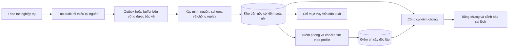

# Audit record integrity

## 1. Mục tiêu: có bằng chứng kiểm chứng được, không chỉ có log

Audit record integrity là thuộc tính giúp bảo vệ và kiểm chứng bản ghi kiểm toán trước việc sửa, chèn, thay thế hoặc xóa trái phép trong phạm vi đã xác định. Mục tiêu là có thể dựa vào dấu vết để tái dựng và đánh giá hoạt động, đồng thời biết khi nào bằng chứng không còn đủ tin cậy.

Một bảng tên `audit_log`, một checksum hoặc một dashboard không tự tạo ra thuộc tính này. Phải xác định ai có thể ghi, ai có thể thay đổi, điểm nào được bảo vệ, cách phát hiện sai lệch và những giới hạn còn lại.

Trong chương **Logging và audit**, yêu cầu cần nối được rủi ro với hành vi cụ thể:

- Bản ghi do nguồn nào phát ra và được chấp nhận bằng cách nào?
- Nội dung nào được bảo vệ, dưới dạng byte hoặc cấu trúc nào?
- Có phát hiện được mất bản ghi giữa chuỗi, cắt đoạn cuối hoặc replay không?
- Ai được quản lý kho, khóa và công cụ kiểm chứng?
- Khi không ghi hoặc không xác minh được, thao tác nghiệp vụ phải làm gì?
- Bằng chứng xuất ra có đủ để bên được phép kiểm chứng độc lập không?

Bài học dùng nền tảng học trực tuyến nhiều tenant làm ví dụ, với audit cho thay đổi quyền, xuất dữ liệu, sửa điểm và các thao tác đặc quyền. Các mã, ngưỡng và thời hạn là lựa chọn minh họa, không phải chuẩn bắt buộc cho mọi tổ chức.

## 2. Phân biệt những thuộc tính thường bị gộp chung

| Thuộc tính | Câu hỏi cần trả lời | Giới hạn cần nhớ |
|---|---|---|
| Toàn vẹn nội dung | Bản ghi có bị thay đổi so với đối tượng đã bảo vệ không? | Nội dung không đổi vẫn có thể là thông tin sai do nguồn phát ra |
| Nguồn gốc | Có đủ căn cứ gắn bản ghi với nguồn được chấp nhận không? | Nguồn bị chiếm dụng có thể tạo bản ghi giả nhưng hợp lệ về cơ chế xác thực |
| Tính đầy đủ trong phạm vi | Những sự kiện bắt buộc có được ghi và giữ đủ không? | Tập bản ghi có chữ ký hợp lệ chưa chứng minh không thiếu sự kiện chưa từng được tạo |
| Thứ tự | Có xác định được quan hệ trước sau trong miền đã định không? | Timestamp không tự tạo thứ tự toàn cục giữa nhiều máy |
| Tính sẵn dùng | Có lấy và kiểm chứng được khi điều tra không? | Chữ ký đúng nhưng mất khóa công khai, manifest hoặc công cụ vẫn gây khó kiểm chứng |
| Truy trách nhiệm | Có liên kết được hành động với chủ thể và ngữ cảnh đáng tin không? | Tài khoản hoặc khóa dùng chung làm yếu khả năng quy trách nhiệm |
| Chống chối bỏ theo mục tiêu cụ thể | Có bằng chứng đủ mạnh cho hành vi và bên liên quan không? | Chữ ký của dịch vụ không tự chứng minh một cá nhân đã hiểu và chấp nhận hành động |

NIST SP 800-53 Rev. 5, kiểm soát AU-9, đặt trọng tâm vào bảo vệ thông tin cùng công cụ audit khỏi truy cập, sửa và xóa trái phép, đồng thời cảnh báo khi phát hiện các hành vi đó. Đây là cơ sở để viết yêu cầu bao phủ cả dữ liệu và cơ chế quản lý, không chỉ một cột hash. [NIST SP 800-53 Rev. 5: AU-9](https://nvlpubs.nist.gov/nistpubs/SpecialPublications/NIST.SP.800-53r5.pdf)

Không dùng từ “tamper-proof” như một bảo đảm tuyệt đối. Cần nêu rõ chống được những nhóm quyền nào và có thể phát hiện sai lệch nào khi giả định tin cậy còn đúng.

## 3. Mô hình đe dọa và ranh giới tin cậy

### 3.1. Những hành vi cần xét

| Mã rủi ro | Kịch bản | Hướng yêu cầu |
|---|---|---|
| R-AI-01 | Tài khoản ứng dụng sửa hoặc xóa audit để che thay đổi quyền | Quyền append giới hạn; tách quyền sửa, xóa và quản lý kho |
| R-AI-02 | Quản trị kho thay nội dung và tính lại checksum nằm cạnh dữ liệu | Điểm tin cậy hoặc bằng chứng được bảo vệ độc lập |
| R-AI-03 | Bản ghi bị mất, bỏ qua hoặc cắt đoạn cuối | Sequence, checkpoint, giám sát nguồn và đối soát sự kiện bắt buộc |
| R-AI-04 | Queue replay hoặc source gửi cùng ID với nội dung khác | Idempotency, phát hiện xung đột và không ghi đè âm thầm |
| R-AI-05 | Dữ liệu đầu vào tạo bản ghi giả qua newline hoặc parser khác nhau | Schema, framing, encoding và quy tắc biểu diễn được kiểm soát |
| R-AI-06 | Collector thay đổi nội dung trước khi niêm phong | Xác định đúng điểm bắt đầu bảo đảm; bảo vệ nguồn hoặc nêu giới hạn |
| R-AI-07 | Khóa ký bị sử dụng trái phép hoặc verifier bị đổi cấu hình | Quản lý khóa, quyền ký và chính sách kiểm chứng có kiểm soát |
| R-AI-08 | Audit dừng mà nghiệp vụ vẫn báo có bằng chứng đầy đủ | Hành vi lỗi theo loại thao tác, durable queue và cảnh báo mất bao phủ |
| R-AI-09 | Export, redaction hoặc restore làm mất khả năng xác minh | Giữ liên kết với bản gốc, manifest và metadata tin cậy |
| R-AI-10 | Dữ liệu nhạy cảm bị giữ bất biến quá lâu hoặc lộ khi kiểm chứng | Tối thiểu hóa trước niêm phong, quyền đọc và vòng đời theo mục đích |

### 3.2. Bảo đảm bắt đầu từ đâu?

Nếu collector ký nội dung sau khi nhận, chữ ký đó có thể chứng minh collector đã chấp nhận nội dung nào theo điều kiện được xác định. Nó không tự chứng minh nội dung chưa bị sửa ở ứng dụng trước khi tới collector.

Nếu nguồn ký trước khi gửi, cần bảo vệ khóa và đường ghi tại nguồn. Một ứng dụng bị chiếm dụng vẫn có thể dùng quyền ký hợp lệ để tạo sự kiện sai hoặc không tạo sự kiện. Cơ chế toàn vẹn không tự chứng minh tính trung thực của mọi hoạt động nghiệp vụ.

Đặc tả phải ghi điểm bắt đầu, điểm kết thúc và miền quyền có thể cùng bị chiếm dụng. Một checkpoint ở cùng tài khoản có quyền sửa toàn bộ dữ liệu chưa chắc độc lập trước chính tài khoản đó.

### 3.3. Bảo vệ nhiều lớp



Sơ đồ không buộc mọi hệ thống cùng một công nghệ. Với từng mũi tên, cần biết đối tượng được bảo vệ, danh tính, quyền, hành vi lỗi và mức bằng chứng.

Chỉ mục tìm kiếm có thể được tái tạo từ bản gốc nếu thiết kế hỗ trợ. Việc một dòng không xuất hiện trên dashboard chưa xác định nó bị xóa ở bản gốc, lỗi index hay do bộ lọc truy vấn; quy trình kiểm chứng cần phân biệt.

## 4. Đặc tả bản ghi và cách biểu diễn được bảo vệ

### 4.1. Trường cần thiết phải gắn với ý nghĩa

Một profile audit có thể cần:

- Định danh sự kiện, nguồn và miền sequence hoặc epoch.
- Thời điểm sự kiện và thời điểm tiếp nhận, với chất lượng thời gian.
- Chủ thể đã xác minh hoặc trạng thái danh tính, hành động và phạm vi tài nguyên.
- Tenant, kết quả và mã lý do hữu hạn phù hợp quyền riêng tư.
- Phiên bản schema, policy và các tham chiếu tương quan cần thiết.
- Thông tin liên kết, xác thực toàn vẹn hoặc niêm phong theo profile.

Không lấy danh tính từ body hoặc claim chưa xác minh rồi ghi thành actor chắc chắn. Không dùng một message tự do chứa dữ liệu không tin cậy làm toàn bộ bản ghi audit.

### 4.2. Ví dụ payload nghiệp vụ

```json
{
  "schema_version": "audit-event-v3",
  "event_id": "event-test-801",
  "source_id": "permission-service-test",
  "source_epoch": "epoch-test-04",
  "source_sequence": 185,
  "occurred_at": "2026-11-27T03:00:00Z",
  "actor_ref": "admin-test-17",
  "principal_state": "AUTHENTICATED",
  "tenant_ref": "tenant-test-a",
  "action": "role.assignment.changed",
  "resource_ref": "membership-test-42",
  "outcome": "COMMITTED",
  "policy_version": "role-policy-v4",
  "correlation_id": "corr-test-012"
}
```

Đây là fixture tổng hợp, chưa phải envelope mật mã hoàn chỉnh. `COMMITTED` chỉ được ghi khi có căn cứ giao dịch tương ứng; một yêu cầu đã tiếp nhận chưa đủ để khẳng định thay đổi đã thành công.

Trường `source_sequence` cần miền thứ tự rõ. Không so sánh sequence của hai producer độc lập như một thứ tự toàn cục. Sau restart hoặc đổi nguồn, epoch và liên kết tới trạng thái trước phải được quản lý, không reset về một chuỗi mới rồi che mất khoảng thiếu.

### 4.3. Quy định chính xác nội dung nào được xác minh

Có hai hướng thiết kế thường gặp: bảo vệ các byte đã đóng khung chính xác hoặc bảo vệ một biểu diễn canonical theo profile. Dù chọn hướng nào cũng phải nêu encoding, kiểu dữ liệu, trường được bao phủ và cách xử lý dữ liệu không hợp lệ.

Với JSON canonical, cần giải quyết thứ tự khóa, khoảng trắng, Unicode, biểu diễn số, null và khóa trùng theo cơ chế được chấp nhận. Không để bên ký hiểu một actor nhưng bên đọc lại hiểu actor khác vì parser xử lý khóa trùng khác nhau.

Collector có thể thêm `received_at` hoặc metadata nguồn tiếp nhận, nhưng phải tách phần được nguồn xác thực khỏi phần bổ sung. Không trình bày toàn bộ envelope như đã được nguồn ký nếu một số trường được thêm sau đó.

Nếu dùng bản gốc đã niêm phong và bản chuẩn hóa để tìm kiếm, giữ liên kết có thể kiểm chứng giữa chúng. Không ký một cách biểu diễn rồi âm thầm serialize lại thành nội dung khác mà vẫn coi chữ ký là bao phủ đúng bản đang đưa ra.

### 4.4. Chống chèn và giả mạo cấu trúc

Schema cần giới hạn kiểu, độ dài, trường tùy chọn và cấu trúc lồng. Chuỗi chứa newline phải được serializer cùng framing xử lý như dữ liệu, không tạo thêm một audit event giả.

Không dùng log text ghép chuỗi để biểu diễn một sự kiện nhiều trường quan trọng. Ngay cả khi backend dùng JSON, giao diện hiển thị và export vẫn phải xử lý nội dung như dữ liệu, không thực thi HTML hoặc công thức ngoài ý muốn.

## 5. Kiểm soát lưu trữ và giới hạn của cơ chế mật mã

### 5.1. Append-only và WORM cần nêu nhóm quyền chống lại

Quyền append giúp tài khoản ứng dụng thêm bản ghi mà không sửa lịch sử. Nhưng một tài khoản quản trị cơ sở dữ liệu, tài khoản cloud hoặc công cụ retention có thể có quyền mạnh hơn nếu thiết kế chưa tách.

Với cơ chế bất biến hoặc WORM, phải xác định thời hạn bảo vệ, chế độ cấu hình, các quyền có thể vượt qua và ảnh hưởng của thay lifecycle, xóa tài khoản, hủy khóa hoặc restore. Nhãn “immutable” của sản phẩm không tự chứng minh mọi quản trị viên đều không thể tác động.

OWASP khuyến nghị phát hiện tampering, dùng lưu trữ chỉ đọc phù hợp và hạn chế, theo dõi truy cập vào log. Điều này hỗ trợ một thiết kế kết hợp ngăn thay đổi với phát hiện thay đổi, thay vì dựa vào một lớp duy nhất. [OWASP: Logging Cheat Sheet, Protection](https://cheatsheetseries.owasp.org/cheatsheets/Logging_Cheat_Sheet.html#protection)

### 5.2. Checksum, MAC và chữ ký trả lời các câu hỏi khác nhau

| Cơ chế | Có thể giúp | Điều không được suy ra |
|---|---|---|
| Hash của bản ghi | Đối chiếu với digest tham chiếu để phát hiện nội dung khác | Nếu cả dữ liệu và digest đều bị thay, chưa có nguồn tin cậy độc lập |
| MAC với khóa bí mật | Kiểm tra tính toàn vẹn và nguồn trong nhóm bên giữ khóa | Mọi bên giữ khóa có thể tạo MAC, nên không tự quy trách nhiệm duy nhất |
| Chữ ký số | Kiểm chứng bằng khóa công khai trong mô hình tin cậy đã chọn | Không tự chứng minh bản ghi đầy đủ, thời gian đúng hoặc hành động người dùng thực sự xảy ra |
| Chuỗi liên kết hash | Làm lộ việc thay hoặc bỏ bản ghi trong phạm vi có điểm neo đáng tin | Không tự chống cắt đuôi hoặc tính lại toàn bộ chuỗi khi không có neo độc lập |
| Kho bất biến | Hạn chế thay đổi trong phạm vi bảo vệ | Không bảo đảm dữ liệu đầu vào trung thực hoặc đầy đủ trước khi ghi |

Mã hóa thông thường bảo vệ bí mật, không tự tạo mọi thuộc tính toàn vẹn cần cho audit. Nếu sử dụng mã hóa có xác thực, vẫn cần nêu đối tượng được bao phủ, quản lý khóa và kiểm chứng thực tế. Không tự thiết kế thuật toán mật mã cho định dạng log.

RFC 5848 là một ví dụ tiêu chuẩn cho signed syslog, tách các mục tiêu như xác thực nguồn, toàn vẹn, chống replay, sequence và phát hiện thiếu thông điệp. Có thể dùng cách tách thuộc tính này khi lập yêu cầu, dù kiến trúc dự án không triển khai syslog-sign. [RFC 5848: Signed Syslog Messages](https://www.rfc-editor.org/pdfrfc/rfc5848.txt.pdf)

### 5.3. Hash chain cần điểm neo và kiểm tra liveness

Một mô hình minh họa có thể liên kết các bản ghi trong cùng stream:

```text
h_i = H(domain || stream_id || epoch || sequence_i || payload_i || h_previous)
```

Đây là biểu diễn ý tưởng, không phải công thức triển khai đầy đủ. Cần dùng framing hoặc canonicalization không nhập nhằng, profile thuật toán được duyệt và điểm neo được xác thực.

Nếu quản trị viên sửa toàn bộ payload rồi tính lại toàn bộ chuỗi, một chuỗi hash không có neo độc lập vẫn có thể tự khớp. Nếu họ xóa đoạn cuối, phần còn lại cũng có thể vẫn đúng về liên kết nội bộ.

Vì vậy, cần checkpoint chứa phạm vi, số lượng, sequence cuối và giá trị cam kết tương ứng, được bảo vệ ngoài miền có thể sửa dữ liệu. Đồng thời giám sát nguồn ngừng phát, checkpoint không tới hoặc đối soát nghiệp vụ thiếu sự kiện.

Checkpoint chỉ chứng minh phạm vi mà nó bao phủ theo giả định đã đặt. Nó không tự chứng minh một hành động bị nguồn bỏ ghi đã từng xuất hiện trong chuỗi.

## 6. Ghi nhận bền vững, chống replay và phát hiện thiếu dữ liệu

### 6.1. Audit phải phản ánh đúng kết quả nghiệp vụ

Một hành động có thể có sự kiện tiếp nhận, thử thực hiện, commit hoặc thất bại. Không dùng cùng một sự kiện “đã thay đổi quyền” cho cả việc người dùng bấm nút và việc giao dịch thật sự hoàn tất.

Nếu dữ liệu nghiệp vụ và outbox cùng nằm trong một ranh giới giao dịch phù hợp, có thể ghi chúng cùng commit để giảm nguy cơ nghiệp vụ thành công nhưng không có ý định phát audit bền vững. Tuy nhiên, lời gọi bên ngoài hoặc nhiều hệ thống độc lập cần mô hình trạng thái và đối soát riêng; một outbox không tự tạo giao dịch nguyên tử cho mọi tác động.

Nếu cần ghi cả lần thử bị từ chối hoặc giao dịch rollback, phải có thiết kế lưu bằng chứng phù hợp. Một event nằm trong chính transaction bị rollback sẽ không còn tồn tại chỉ vì mã đã gọi hàm log trước đó.

### 6.2. Hành vi khi audit không khả dụng

| Loại tình huống | Hành vi có thể được đặc tả |
|---|---|
| Thao tác đặc quyền bắt buộc có audit bền vững | Chỉ cho hoàn tất khi đã ghi được audit hoặc outbox đúng điều kiện; nếu không, từ chối theo hợp đồng |
| Đích trung tâm tạm mất nhưng nguồn còn buffer được chấp nhận | Giữ bền vững trong buffer được bảo vệ, có hạn và theo dõi độ trễ |
| Buffer đầy hoặc không còn bảo đảm bảo vệ | Không ghi tạm sang vị trí quyền rộng; áp dụng hành vi nghiệp vụ và cảnh báo đã định |
| Chưa xác minh được chữ ký hoặc checkpoint | Giữ trạng thái chưa xác minh trong vùng phù hợp; không trình bày như đã hợp lệ |
| Dữ liệu sai schema hoặc xác minh thất bại | Không nhận vào tập bằng chứng đã kiểm chứng; tạo tín hiệu xử lý lỗi tối thiểu |

Không mặc định dừng mọi request chỉ vì mất log chẩn đoán thông thường. Cũng không mặc định tiếp tục thao tác đặc quyền thiếu bằng chứng bắt buộc. Yêu cầu phải phân loại theo tác động và loại audit.

### 6.3. ACK phải có ý nghĩa rõ ràng

Cần phân biệt “đã nhận qua mạng”, “đã ghi bền vững”, “đã xác minh nguồn”, “đã niêm phong” và “đã index”. Một ACK ở bộ nhớ tạm không chứng minh bản ghi có thể phục hồi sau crash.

Nguồn chỉ được dọn buffer theo điều kiện được hợp đồng cho phép. Nếu ACK bị mất, nguồn có thể gửi lại; collector phải xử lý an toàn chứ không yêu cầu mạng có đặc tính exactly-once chưa được chứng minh.

Khả năng phục hồi cần xét cả dữ liệu đã ACK, khóa, manifest và metadata thứ tự. Nếu các thành phần này không cùng phục hồi được, không được báo audit vẫn nguyên vẹn chỉ vì tệp payload còn tồn tại.

### 6.4. Idempotency và xung đột nội dung

Có thể dùng khóa như `source_id + source_epoch + event_id` theo miền đã định. Khi nhận lại cùng khóa và cùng nội dung được bảo vệ, xử lý như retry theo hợp đồng, không tạo thêm một hành động nghiệp vụ giả.

Nếu cùng khóa nhưng nội dung khác, đó là xung đột phải được phát hiện. Không dùng cơ chế upsert để ghi đè bản cũ rồi giữ một lịch sử trông có vẻ sạch.

Việc kiểm tra trùng và lưu trạng thái phải chịu được nhiều consumer cạnh tranh. Giữ bằng chứng tiếp nhận cần thiết mà không làm mất bản gốc hoặc làm người đọc hiểu một hành động đã xảy ra nhiều lần.

### 6.5. Sequence và đối soát sự kiện bắt buộc

Khoảng nhảy sequence có thể do mất dữ liệu, event trễ hoặc quy tắc cấp sequence. Cần xác định cửa sổ chờ, semantics của số đã cấp nhưng transaction không commit và khi nào chuyển thành cảnh báo thiếu.

Sắp xếp theo timestamp không thay thế kiểm tra này. Hai sự kiện từ hai máy có thể không xác định được thứ tự tuyệt đối trong sai số đồng hồ; audit phải giữ nguồn, thời gian tiếp nhận và quan hệ tương quan thay vì tạo một timeline chắc chắn giả.

Đối soát với outbox, tập giao dịch hoặc nguồn điều khiển đáng tin cậy giúp phát hiện audit chưa được tạo hoặc chưa chuyển. Giá trị của đối soát vẫn phụ thuộc mô hình tin cậy: nếu cùng một quyền sửa được cả hai phía, nó chưa tạo ra bằng chứng độc lập trước quyền đó.

Heartbeat hoặc checkpoint đều đặn giúp phát hiện nguồn im lặng, nhưng một nguồn đang sống vẫn có thể bỏ ghi một loại hành động. Cần kết hợp sức khỏe pipeline với kiểm tra độ bao phủ các sự kiện bắt buộc.

## 7. Quản lý khóa và quy trình kiểm chứng

### 7.1. Tách trách nhiệm và quyền

| Vai trò ví dụ | Quyền cần thiết | Giới hạn chính |
|---|---|---|
| Nguồn nghiệp vụ | Tạo audit theo schema, gửi theo danh tính được cấp | Không sửa hoặc xóa lịch sử trung tâm |
| Collector | Tiếp nhận, xác minh và ghi vùng được cấp | Không tự quản lý mọi khóa, checkpoint và retention |
| Quản trị kho | Vận hành lưu trữ trong phạm vi đã duyệt | Không có đường âm thầm tính lại mọi bằng chứng độc lập |
| Bên quản lý khóa | Quản lý quyền sử dụng, rotation và trạng thái tin cậy | Không mặc nhiên sửa payload hoặc đọc mọi dữ liệu audit |
| Verifier | Đọc bằng chứng và metadata tin cậy theo quyền | Không cần khóa ký riêng để xác minh chữ ký công khai |
| Điều tra viên hoặc kiểm toán | Truy vấn, xuất phạm vi được cấp | Không sửa bản gốc hoặc bỏ trạng thái xác minh thất bại |

Tách vai trò cần được thực thi ở hạ tầng, IAM, API và công cụ. Một sơ đồ tổ chức không đủ nếu cùng một tài khoản có quyền đổi kho, khóa, verifier và checkpoint.

### 7.2. Vòng đời khóa ảnh hưởng tới lịch sử

Phải xác định thuật toán và profile được chấp nhận, danh tính được ký hoặc tạo MAC, nơi giữ khóa, quyền gọi dịch vụ khóa và metadata phiên bản. Không tin thuật toán hoặc URL lấy khóa tùy ý do bản ghi tự khai.

Khóa ký không được ghi trong log, manifest hoặc export. Việc khóa không xuất được khỏi thiết bị hoặc dịch vụ bảo vệ là hữu ích, nhưng một bên có quyền gọi ký vẫn có thể yêu cầu ký dữ liệu sai nếu không bị giới hạn.

Rotation không tự làm mất khả năng xác minh bản cũ. Cần giữ metadata tin cậy và khóa công khai cần thiết, cùng chính sách đối với khóa đã nghỉ hoặc bị nghi lộ. Với MAC, verifier cần quyền bí mật tương ứng, nên phải xét khả năng giả mạo của bên giữ khóa.

Khi có sự cố khóa, không dùng timestamp do chính bản ghi khai để kết luận chắc chắn nó được tạo trước sự cố. Cần xem checkpoint, nguồn thời gian hoặc bằng chứng độc lập trong mô hình tin cậy. Phải phân biệt chữ ký khớp về toán học với việc khóa còn được tin cậy cho phạm vi đó.

### 7.3. Trạng thái kiểm chứng cần phản ánh giới hạn

| Trạng thái ví dụ | Ý nghĩa |
|---|---|
| `VERIFIED` | Các kiểm tra được yêu cầu đã đạt trong phạm vi, profile và điểm tin cậy đã nêu |
| `INVALID` | Có bằng chứng không khớp, như nội dung bị thay, chữ ký sai hoặc liên kết không hợp lệ |
| `INCOMPLETE` | Thiếu thành phần hoặc khoảng dữ liệu được kỳ vọng theo bằng chứng phạm vi |
| `UNVERIFIABLE` | Không đủ khóa, checkpoint, profile hoặc điều kiện tin cậy để kết luận |

`VERIFIED` không có nghĩa nguồn luôn nói thật hoặc mọi sự kiện nghiệp vụ đều đã được ghi. Kết quả cần đi kèm miền nguồn, epoch, khoảng sequence, checkpoint, phiên bản verifier và kiểm tra nào đã thực hiện.

Không coi thiếu khóa là chữ ký sai, cũng không coi thiếu bằng chứng là hợp lệ mặc định. Người dùng cần nhìn thấy phạm vi chưa kiểm chứng, không chỉ một biểu tượng màu xanh cho cả kho.

### 7.4. Pseudocode kiểm chứng một đoạn audit

```text
function verifyAuditSegment(segment, trustedPolicy):
    requireSupportedFormatAndLimits(segment)
    profile = trustedPolicy.resolveApprovedProfile(segment.profileRef)
    trust = trustedPolicy.resolveSourceAndKey(segment.sourceRef, segment.keyRef)

    if profile is unavailable or trust is insufficient:
        return UNVERIFIABLE with explicit scope

    original = readProtectedOriginalBytes(segment)
    if not verifyIntegrityAndOrigin(original, segment.proof, profile, trust):
        return INVALID with safe reason

    if not verifyLinksEpochAndSequence(segment, profile):
        return INVALID or INCOMPLETE under defined rule

    checkpoint = loadAuthenticatedIndependentCheckpoint(segment.scope)
    if checkpoint is unavailable when required:
        return UNVERIFIABLE with explicit scope

    if not verifyExpectedRangeAndCommitment(segment, checkpoint):
        return INVALID or INCOMPLETE under defined rule

    return VERIFIED with scope, checkpoint and verifier version
```

Đây là mô tả yêu cầu, không phải thuật toán mật mã hoàn chỉnh. Các trạng thái phải dựa trên nguyên nhân cụ thể, không tùy ý chọn một giá trị để dashboard không báo lỗi.

Một verifier cần chạy được bằng bằng chứng cùng metadata được phép, không chỉ dựa vào một cột `is_valid` do cùng kho dữ liệu lưu. Công cụ và chính sách verifier cũng cần được quản lý thay đổi, kiểm thử và bảo vệ khỏi sửa trái phép.

## 8. Bộ yêu cầu có tiêu chí chấp nhận

| ID | Phát biểu yêu cầu mẫu | Tiêu chí chấp nhận và bằng chứng |
|---|---|---|
| REQ-AI-01 | Mỗi nhóm hành động phải có sự kiện bắt buộc, ý nghĩa kết quả, nguồn và ranh giới bảo đảm toàn vẹn đã định. | Đối chiếu hành động nghiệp vụ với audit; không dùng event tiếp nhận như bằng chứng commit. |
| REQ-AI-02 | Bản ghi phải tuân schema cùng profile encoding hoặc canonicalization được chấp nhận, kể cả dữ liệu không tin cậy. | Thử Unicode, newline, số, khóa trùng và cấu trúc lồng; nguồn, verifier và viewer không hiểu khác nghĩa. |
| REQ-AI-03 | Danh tính ứng dụng không được sửa, xóa hoặc thay chính sách bảo vệ lịch sử; quyền mạnh hơn phải có phạm vi rõ. | Thử append, update, delete, đổi lifecycle, quyền quản trị và trạng thái khóa theo ma trận danh tính. |
| REQ-AI-04 | Bằng chứng toàn vẹn phải liên kết được với điểm tin cậy không cùng bị sửa trong mô hình đe dọa đã chọn. | Sửa dữ liệu cùng digest cục bộ, tính lại chuỗi hoặc thay manifest; verifier phát hiện sai lệch với neo đã bảo vệ. |
| REQ-AI-05 | Cùng khóa idempotency với nội dung khác phải tạo xung đột, không ghi đè bản đã nhận. | Gửi lại cùng payload và payload thay đổi, gồm consumer đồng thời; kết quả đúng từng trường hợp. |
| REQ-AI-06 | Pipeline phải phát hiện gap, cắt đuôi và nguồn dừng theo phạm vi cùng cửa sổ được xác định. | Bỏ bản giữa chuỗi, xóa đuôi và chặn nguồn; không báo đầy đủ chỉ vì phần còn lại tự khớp. |
| REQ-AI-07 | Thao tác đặc quyền được chọn phải có audit hoặc outbox bền vững theo hợp đồng trước khi hoàn tất. | Tiêm lỗi commit, crash, mất ACK và đích trung tâm lỗi; không báo thành công có audit khi điều kiện chưa đạt. |
| REQ-AI-08 | Khóa, profile và verifier phải được quản lý phiên bản, quyền và lịch sử tin cậy; không dùng tham số tự khai để bỏ xác minh. | Thử key lạ, thuật toán không được phép, khóa đã rotation và thiếu metadata; trạng thái kiểm chứng đúng. |
| REQ-AI-09 | Kết quả xác minh phải tách VERIFIED, INVALID, INCOMPLETE và UNVERIFIABLE theo phạm vi rõ ràng. | Bộ fixture tương ứng cho từng trạng thái; giao diện, export và alert không đổi thiếu bằng chứng thành hợp lệ. |
| REQ-AI-10 | Bản gốc phải giữ được liên kết với bản index, redaction hoặc export; bản dẫn xuất không được giả làm bản gốc đã ký. | Thay đổi bản trình bày; kiểm chứng đúng đối tượng và metadata biến đổi, không xác nhận sai chữ ký. |
| REQ-AI-11 | Retention, sửa sai hợp lệ, ngoại lệ giữ bản và restore phải có quy tắc bảo toàn ý nghĩa bằng chứng. | Hết hạn, thêm bản đính chính và restore; không che gap trái phép hoặc làm sống lại quyền, cấu hình cũ. |
| REQ-AI-12 | Truy cập và thay đổi cơ chế audit phải được kiểm soát, ghi nhận và cảnh báo qua đường có mức độc lập phù hợp. | Thử quản trị kho, khóa, verifier và export; không sửa được cả dữ liệu lẫn dấu vết giám sát ngoài phạm vi đã chấp nhận. |
| REQ-AI-13 | Dữ liệu được niêm phong phải tối thiểu theo mục đích; không chứa credential hoặc payload không cần. | Fixture có token, mật khẩu và dữ liệu cá nhân; chúng không đi vào bản gốc hoặc bản sao ngoài profile. |

Các câu “append-only”, “có chữ ký” hoặc “đã backup” phải được chuyển thành ca thử theo quyền và ranh giới thực tế. Tên tính năng không thay thế bằng chứng.

## 9. Đo phát hiện và khả năng kiểm chứng

### 9.1. Tách các mốc quan sát

```text
t_event    = thời điểm sự kiện theo nguồn đã xác định
 t_durable = thời điểm audit hoặc outbox đạt điều kiện bền vững
 t_sealed  = thời điểm phạm vi được niêm phong theo profile
 t_anchor  = thời điểm checkpoint được bảo vệ tại điểm tin cậy
 t_verify  = thời điểm kiểm chứng hoặc phát hiện sai lệch
```

Các mốc phải có nguồn và chất lượng thời gian. Không suy ra thứ tự tuyệt đối giữa các nguồn độc lập chỉ từ timestamp, và không giấu thời gian chờ queue khi đo độ trễ kiểm chứng.

### 9.2. Ngưỡng minh họa cần gắn với mô hình đe dọa

Trên tải và môi trường tham chiếu được ghi rõ, một profile có thể yêu cầu:

- Checkpoint cho stream hoạt động được neo tối đa mỗi 60 giây.
- Cảnh báo gap sau cửa sổ chờ event trễ 30 giây theo quy tắc nguồn.
- Xác minh online các phần mới nhận với p95 không quá 5 giây sau khi đủ bằng chứng cần thiết.
- Đợt kiểm tra định kỳ phát hiện sai lệch ở phạm vi được quét trong tối đa 15 phút theo lịch đã định.

Các con số là ví dụ. Nếu nguy cơ sửa đoạn chưa được neo không chấp nhận được, cần neo hoặc bảo vệ sớm hơn; không dùng ngưỡng minh họa làm bảo đảm phổ quát.

Phải đo cửa sổ còn có thể thay đổi trước khi niêm phong hoặc neo. Một sự kiện đã vào index nhưng chưa đạt điểm bảo vệ cần thiết không được gắn cùng mức tin cậy với đoạn đã kiểm chứng đầy đủ.

### 9.3. Độ bao phủ và liveness

Báo cáo nên nêu nguồn đang hoạt động, event bắt buộc, khoảng sequence đã kiểm chứng, checkpoint cuối, nguồn quá hạn và khoảng chưa đủ bằng chứng. Tổng số dòng audit không đủ để chứng minh độ bao phủ nghiệp vụ.

Nếu một nguồn dừng, cần phân biệt shutdown có kiểm soát với mất bất thường. Một heartbeat còn tới không chứng minh mọi loại event đều đang được tạo đúng; cần đối soát theo phạm vi yêu cầu.

Không báo “không phát hiện sửa đổi” như “khẳng định không có sửa đổi” khi verifier đang dừng, thiếu khóa hoặc chỉ kiểm tra một phần dữ liệu.

## 10. Kiểm thử toàn vẹn bằng các thay đổi có chủ đích

### 10.1. Dùng bản sao thử và điểm tin cậy được kiểm soát

Bộ fixture cần có nhiều nguồn, epoch, sequence, bản ghi có Unicode, nội dung không tin cậy, đoạn đã niêm phong, checkpoint độc lập và các phiên bản khóa thử.

Mọi phép sửa, xóa hoặc làm hỏng phải chạy trên dữ liệu thử hoặc bản sao được phép. Không phá bản audit duy nhất đang dùng làm bằng chứng thật để kiểm tra một yêu cầu.

Giá trị kỳ vọng phải được xác định độc lập với chính kết quả verifier đang thử. Nếu fixture, digest và cột `is_valid` cùng được tạo lại từ một dữ liệu đã sửa thì phép thử dễ tự xác nhận điều sai.

### 10.2. Ma trận ca thử

| Ca thử | Thiết lập hoặc thao tác | Kết quả mong đợi |
|---|---|---|
| TC-AI-01 | Đổi một byte trong payload đã được bảo vệ | Xác minh phát hiện sai toàn vẹn; không nhận như bản gốc hợp lệ |
| TC-AI-02 | Đổi actor, tenant, action hoặc outcome có ý nghĩa | Các trường thuộc phạm vi bảo vệ không thể bị đổi mà không bị phát hiện |
| TC-AI-03 | Sửa dữ liệu cùng checksum cục bộ hoặc tính lại hash chain | Điểm neo độc lập phát hiện sai lệch trong phạm vi đã neo |
| TC-AI-04 | Xóa một bản ghi giữa đoạn được kỳ vọng | Phát hiện gap hoặc liên kết không khớp; báo phạm vi ảnh hưởng |
| TC-AI-05 | Xóa đuôi đã nằm trong checkpoint đáng tin cậy | Phát hiện thiếu so với phạm vi và sequence cuối được neo |
| TC-AI-06 | Chặn nguồn hoặc không cho checkpoint mới tới | Báo mất liveness hoặc thiếu bằng chứng, không coi im lặng là đầy đủ |
| TC-AI-07 | Gửi lại cùng event ID và cùng nội dung | Xử lý retry theo hợp đồng, không tạo thêm hành động nghiệp vụ giả |
| TC-AI-08 | Cùng event ID nhưng nội dung khác, kể cả gửi đồng thời | Phát hiện xung đột, không upsert ghi đè lịch sử |
| TC-AI-09 | Event đến trễ, đảo thứ tự hoặc restart với epoch mới | Xử lý đúng miền thứ tự, cửa sổ chờ và liên kết giữa epoch |
| TC-AI-10 | JSON có khóa trùng, newline, số hoặc Unicode ở trường biên | Nguồn, verifier và viewer không diễn giải lệch; dữ liệu sai profile bị xử lý rõ |
| TC-AI-11 | Crash trước và sau commit, mất ACK hoặc trung tâm mất kết nối | Bản đã được xác nhận bền vững không bị mất trong giả định; retry và audit nghiệp vụ đúng |
| TC-AI-12 | Dùng tài khoản ứng dụng hoặc quản trị thử sửa, xóa, rút retention | Bị chặn theo nhóm quyền đã định; quyền vượt được nhận diện và có biện pháp tương ứng |
| TC-AI-13 | Rotation khóa rồi kiểm chứng dữ liệu lịch sử | Dùng đúng metadata tin cậy; không mất khả năng xác minh chỉ vì khóa ký đã nghỉ |
| TC-AI-14 | Thiếu khóa, thuật toán lạ, profile lạ hoặc khóa nghi bị lộ | Không mặc định hợp lệ; trạng thái và phạm vi đúng chính sách kiểm chứng |
| TC-AI-15 | Export một phần hoặc tạo bản đã redaction | Không giả bản dẫn xuất là bản gốc đã ký; có manifest cùng bằng chứng cho phạm vi được cấp |
| TC-AI-16 | Restore snapshot cũ, index hỏng hoặc metadata thiếu | Phân biệt lỗi index, thiếu bằng chứng và lỗi bản gốc; không âm thầm niêm phong lại thành hợp lệ |
| TC-AI-17 | Loại bỏ dữ liệu theo retention hoặc thêm bản đính chính | Phạm vi còn giữ và lịch sử xử lý rõ, không che sửa trái phép bằng danh nghĩa sửa sai |
| TC-AI-18 | Verifier hoặc đường cảnh báo lỗi | Không báo kiểm chứng đạt; có trạng thái suy giảm và cách phát hiện phù hợp |
| TC-AI-19 | Fixture có credential, nội dung cá nhân và thông điệp tự do | Không đi vào bản gốc hoặc export ngoài profile; không dùng tính bất biến để giữ dư dữ liệu |
| TC-AI-20 | Nguồn hợp lệ tạo event được ký nhưng không khớp hành động trong fixture | Báo cáo không đánh đồng chữ ký hợp lệ với sự thật nghiệp vụ; đối soát phản ánh giới hạn nguồn |

### 10.3. Tiêu chí Given–When–Then

```gherkin
Scenario: Tính lại chuỗi cục bộ không che được thay đổi đã được neo
  Given stream-test-a có đoạn sequence 1 tới 100 đã được niêm phong
    And checkpoint đáng tin cậy của đoạn được giữ ngoài miền sửa kho thử
  When bản sao thử bị đổi payload ở sequence 42
    And các hash cục bộ được tính lại để tự khớp
  Then verifier phát hiện cam kết không khớp checkpoint
    And kết quả không là VERIFIED cho đoạn được yêu cầu
    And bằng chứng ghi rõ stream, epoch và phạm vi kiểm tra
    And cảnh báo không chứa payload nhạy cảm không cần thiết
```

Cần thêm ca xóa checkpoint hoặc làm mất quyền truy cập điểm tin cậy. Kết quả có thể là `UNVERIFIABLE`, không được thay bằng việc tin lại digest trong chính kho bị sửa.

### 10.4. Kiểm tra cả sự kiện không được ghi

Ngoài làm hỏng bản ghi đã có, cần bỏ có chủ đích việc tạo hoặc chuyển một event bắt buộc trong fixture. Đối soát phải phát hiện trong phạm vi đã thiết kế, hoặc báo giới hạn nếu thiếu nguồn tham chiếu đáng tin.

Đây là phép thử cho tính đầy đủ, không thể thay bằng việc mọi chữ ký còn lại đều hợp lệ. Bản ghi không từng tồn tại sẽ không tự để lại một chữ ký sai.

### 10.5. Báo cáo đúng mức kết luận

Báo cáo cần nêu phiên bản nguồn, định dạng, profile, khóa, verifier, checkpoint, miền quyền và cửa sổ dữ liệu. Nếu chỉ kiểm tra một sample, phải nói rõ đó là sample; không gắn nhãn toàn kho đã xác minh.

Thử nghiệm đạt theo giả định nguồn chưa bị chiếm dụng không chứng minh an toàn khi nguồn và quyền ký cùng bị chiếm. Những phần ngoài mô hình đe dọa cần được ghi như giới hạn, không ẩn sau một chữ “integrity”.

## 11. Vòng đời bằng chứng, export và khôi phục

### 11.1. Sửa sai bằng lịch sử có truy vết

Một audit record có thể chứa thông tin sai do lỗi ứng dụng hoặc thao tác nghiệp vụ cần đính chính. Nếu mục tiêu là giữ lịch sử, cách thiết kế thường là thêm sự kiện sửa sai với tham chiếu bản gốc, lý do, chủ thể có quyền và kết quả điều chỉnh, thay vì cập nhật âm thầm bản cũ.

Bản trình bày có thể hiển thị trạng thái mới nhất nhưng phải cho người có quyền hiểu đâu là lịch sử và đâu là đính chính. Không cho một người sửa audit tự tạo bản đính chính để thay đổi ý nghĩa hành động mà không có quyền và bằng chứng.

Việc dữ liệu phải được xóa hoặc hạn chế theo bối cảnh áp dụng cần quy trình riêng. Không dùng “append-only” để biện minh giữ mọi payload vô hạn; hãy tối thiểu hóa trước niêm phong và thiết kế vòng đời phù hợp ngay từ đầu.

### 11.2. Retention và loại bỏ hợp lệ

Cần xác định thời hạn theo loại sự kiện, mục đích, nghĩa vụ áp dụng và ngoại lệ giữ bản được duyệt. Cấu hình WORM hoặc retention phải tương thích những quyết định đó; thời hạn dài hơn không tự có nghĩa an toàn hơn.

Khi loại bỏ đoạn hết hạn, cần lưu thông tin quản lý tối thiểu được phép để phân biệt phạm vi không còn giữ với mất dữ liệu trái phép. Không tự đổi mọi gap thành hợp lệ bằng một nhãn retention không có thẩm quyền.

Manifest, checkpoint và báo cáo phải mô tả đúng phần còn có thể kiểm chứng. Nếu payload đã được loại bỏ, không tiếp tục tuyên bố đã xác minh lại nội dung đầy đủ từ một digest không cho khôi phục nội dung.

Hủy khóa mã hóa có thể ảnh hưởng nhiều đoạn hoặc nhiều tenant nếu dùng chung. Phải đánh giá phạm vi và phụ thuộc trước khi dùng như một cơ chế loại bỏ; xóa một tham chiếu khóa không tự chứng minh mọi bản dữ liệu và khóa sao lưu đã biến mất.

### 11.3. Gói bằng chứng cho bên được phép

Một gói export kiểm chứng có thể cần bản ghi trong phạm vi được cấp, manifest, proof hoặc seal, profile biểu diễn, metadata nguồn và khóa công khai cần thiết, checkpoint cùng chỉ dẫn kiểm chứng.

Không đưa khóa ký riêng, khóa MAC bí mật hoặc dữ liệu tenant khác vào gói chỉ để thuận tiện. Nếu cần chứng minh một phần của chuỗi, thiết kế proof và bối cảnh xác minh phù hợp quyền, tránh phải giao cả lịch sử nhạy cảm ngoài phạm vi.

Bản redaction hoặc CSV phục vụ đọc là bản dẫn xuất. Nó có thể có manifest riêng liên kết với bản gốc nhưng không được trình bày như nội dung gốc chưa đổi vẫn giữ nguyên chữ ký. Phải nêu phép biến đổi và thuộc tính nào còn kiểm chứng được.

Quyền export, người thực hiện, phạm vi, thời điểm và digest của gói cần được ghi nhận theo chính sách. Khi bàn giao, có thể theo dõi người giữ và các bước xử lý để hỗ trợ chuỗi quản lý bằng chứng; việc ghi chuỗi quản lý không tự bù cho một bản gốc chưa từng được bảo vệ.

### 11.4. Restore không được xóa ý nghĩa lịch sử

Khôi phục phải giữ bản gốc, định danh nguồn, epoch, sequence, proof và liên kết checkpoint cần thiết. Không đổi thời điểm gốc thành thời điểm restore hoặc đánh số lại sự kiện cũ như thể chúng vừa xảy ra.

Metadata phục hồi được ghi riêng, theo nguồn và quyền có thẩm quyền. Sau restore, kiểm chứng lại phạm vi, đối chiếu checkpoint ngoài snapshot và xác định các đoạn mới hơn chưa có trong bản phục hồi.

Không ký lại toàn bộ dữ liệu chưa xác minh rồi gọi đó là lịch sử đã được chứng minh. Một seal mới chỉ có ý nghĩa theo hành động mới và điểm bắt đầu tin cậy mới; nó không sửa được khoảng mất bằng chứng trước đó.

Nếu index hỏng nhưng bản gốc còn tốt, có thể tái tạo bản truy vấn trong quy trình kiểm soát. Kết quả tìm kiếm cần giữ liên kết và trạng thái xác minh, không tự biến một bản index mới thành nguồn có thẩm quyền thay bản gốc.

### 11.5. Bảo vệ chính công cụ audit

Thay cấu hình nguồn, dừng collector, rút retention, đổi quyền ký, đổi trust store hoặc tắt verifier đều có thể làm mất khả năng audit mà chưa sửa một payload nào.

Những hành động đó cần quyền, phê duyệt theo rủi ro, audit và cảnh báo qua đường có mức độc lập phù hợp. Không tạo vòng ghi vô hạn để “audit mọi lần ghi audit”; cần xác định các hành động quản trị quan trọng và nguồn giám sát chịu trách nhiệm.

Khi công cụ kiểm chứng dừng, trạng thái phải thể hiện chưa được kiểm tra theo lịch. Không giữ biểu tượng đạt của lần trước như thể vẫn xác nhận dữ liệu mới.

## 12. Truy vết yêu cầu từ rủi ro tới bằng chứng

| Rủi ro | Yêu cầu liên quan | Quyết định kiến trúc | Bằng chứng chính | Chủ sở hữu ví dụ |
|---|---|---|---|---|
| R-AI-01, R-AI-02 | REQ-AI-03, REQ-AI-04, REQ-AI-12 | Quyền append giới hạn, tách quản trị và điểm neo độc lập | TC-AI-03, TC-AI-12 | Nhóm nền tảng, an toàn thông tin |
| R-AI-03 | REQ-AI-01, REQ-AI-06, REQ-AI-07 | Outbox, sequence, checkpoint, liveness và đối soát | TC-AI-04 đến TC-AI-06, TC-AI-11 | Nhóm ứng dụng, logging |
| R-AI-04 | REQ-AI-05 | Idempotency và xử lý xung đột không ghi đè | TC-AI-07, TC-AI-08 | Nhóm pipeline |
| R-AI-05 | REQ-AI-02 | Schema, framing và profile biểu diễn chung | TC-AI-02, TC-AI-10 | Nhóm ứng dụng, verifier |
| R-AI-06 | REQ-AI-01, REQ-AI-04, REQ-AI-09 | Ranh giới bảo đảm rõ và kết quả theo phạm vi | TC-AI-01, TC-AI-20 | Chủ sở hữu audit |
| R-AI-07 | REQ-AI-08, REQ-AI-12 | Quản lý khóa, trust policy và công cụ kiểm chứng | TC-AI-13, TC-AI-14, TC-AI-18 | Nhóm khóa, an toàn thông tin |
| R-AI-08 | REQ-AI-06, REQ-AI-07 | Điều kiện bền vững, trạng thái suy giảm và phản ứng nghiệp vụ | TC-AI-06, TC-AI-11, TC-AI-18 | Nhóm vận hành, nghiệp vụ |
| R-AI-09 | REQ-AI-09 đến REQ-AI-11 | Bản gốc, bản dẫn xuất, manifest và restore có kiểm chứng | TC-AI-15 đến TC-AI-17 | Nhóm dữ liệu, điều tra |
| R-AI-10 | REQ-AI-11, REQ-AI-13 | Tối thiểu hóa, quyền đọc và vòng đời trước khi khóa lưu trữ | TC-AI-17, TC-AI-19 | Chủ sở hữu dữ liệu, quyền riêng tư |

Thay schema, thư viện serialize, collector, thuật toán, nguồn khóa, trust store, kho lưu hoặc quy tắc retention đều có thể đổi giả định kiểm chứng. Cần cập nhật quyết định thiết kế và ca thử liên quan trong vòng đời phát triển.

Một yêu cầu chỉ có giá trị khi có người chịu trách nhiệm cùng kết luận kiểm chứng có phạm vi. “Chữ ký hợp lệ” cần gắn với đối tượng, nguồn và điểm tin cậy cụ thể; “audit đầy đủ” cần gắn với tập hành động cùng nguồn đối soát đã xác định.

## 13. Bài tập áp dụng

Một nền tảng học ghi thay đổi quyền vào bảng `audit_log` bằng cùng tài khoản có quyền sửa dữ liệu nghiệp vụ. Mỗi dòng có hash nằm ngay cạnh payload. Quản trị viên có thể update và delete. Không có sequence hoặc checkpoint; dashboard chỉ đếm số dòng. Collector ACK trước khi ghi xuống đĩa. Khi restore, hệ thống đổi timestamp của mọi dòng thành thời điểm hiện tại và tính lại hash. Export cho kiểm toán là CSV đã che dữ liệu nhưng vẫn được gắn nhãn “bản gốc đã ký”.

Hãy lập đặc tả thay thế:

1. Phân biệt rủi ro toàn vẹn, nguồn gốc, đầy đủ, thứ tự và tính sẵn dùng.
2. Xác định ranh giới bảo đảm cùng nhóm quyền có thể sửa nguồn, kho, khóa và verifier.
3. Thiết kế schema, epoch, sequence, profile biểu diễn và cơ chế chống replay.
4. Chọn cơ chế bảo vệ, điểm neo và liveness; giải thích cách phát hiện sửa giữa chuỗi, tính lại chuỗi và cắt đuôi.
5. Viết ít nhất sáu yêu cầu có mã, hành vi khi lỗi, chủ sở hữu và tiêu chí nghiệm thu.
6. Thiết kế ghi bền vững, ACK, retry và đối soát khi nghiệp vụ commit nhưng trung tâm audit tạm mất.
7. Đề xuất vòng đời khóa, retention, đính chính, export và restore không làm sai lịch sử.
8. Lập ma trận thử nghiệm có cả dữ liệu bị sửa, thành phần thiếu, nguồn bị chiếm và bản ghi chưa từng được tạo.

Một thiết kế đáng tin phải nói rõ dữ liệu nào được bảo vệ, trước nhóm quyền nào, kiểm chứng bằng gì và giới hạn nào còn tồn tại. Khi các ràng buộc đó được nối với pipeline, quyền quản trị, vòng đời và bằng chứng, audit record integrity mới trở thành yêu cầu bảo mật có thể triển khai, đo lường và kiểm chứng.
