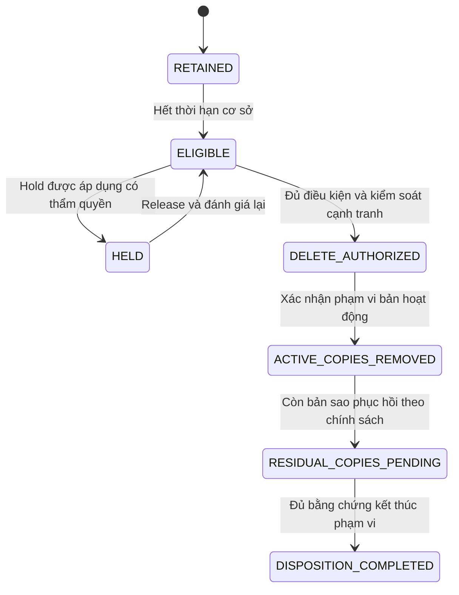

# Audit record retention — Đặc tả lưu giữ và hết hạn bản ghi audit

## 1. Mục tiêu và phạm vi

Audit record retention là chính sách và cơ chế xác định bản ghi audit được giữ để làm gì, trong bao lâu, ở đâu, ai được sử dụng và khi nào phải kết thúc khả năng truy cập hoặc phục hồi theo phạm vi đã cam kết.

“Lưu log 90 ngày” chưa đủ để triển khai hoặc nghiệm thu. Cần biết 90 ngày tính từ mốc nào, áp dụng cho loại sự kiện nào, có bao gồm chỉ mục, bản sao, backup, dữ liệu xuất và hồ sơ tạm giữ hay không.

Trong chương **Logging và audit** của module `SECURITY_SECURITY_DESIGN_SECURITY_REQUIREMENTS`, bài học chuyển mục tiêu an toàn thông tin và mô hình đe dọa thành yêu cầu lưu giữ cụ thể, đo được và có thể kiểm chứng. Nội dung kết nối chính sách dữ liệu với xác thực, phân quyền truy vấn, logging, kiến trúc lưu trữ và phục hồi.

Các thời hạn, schema và quy trình bên dưới là **thiết kế minh họa**, không phải một thời hạn áp dụng chung cho mọi tổ chức. Nhóm triển khai phải chọn chính sách phù hợp với mục đích, rủi ro và các nghĩa vụ đã được xác định riêng.

## 2. Tình huống xuyên suốt và mô hình đe dọa

Một nền tảng học tập phục vụ nhiều tổ chức, mỗi tổ chức là một `tenant`. Hệ thống ghi thất bại xác thực, thay đổi quyền, truy cập bản xuất và hoạt động quản trị kho audit.

Sự kiện đi qua buffer, hàng đợi, collector, kho nóng, kho lưu trữ, chỉ mục tìm kiếm và backup. Nhân viên điều tra có thể xuất một tập sự kiện phục vụ một vụ việc nội bộ.

Nhóm cần vừa giữ đủ bằng chứng, vừa tránh để dữ liệu nhạy cảm tồn tại không có mục đích hoặc quyền kiểm soát.

| Mã rủi ro | Tình huống | Hệ quả |
| --- | --- | --- |
| R-01 | Xóa quá sớm, sai lớp hoặc sai mốc tính | Mất bằng chứng trước khi hết thời hạn cần thiết |
| R-02 | Giữ vô hạn hoặc gia hạn ngầm qua sao chép, replay | Tăng dữ liệu phơi lộ và phạm vi điều tra không cần thiết |
| R-03 | Xóa ở kho chính nhưng còn trong chỉ mục, backup, export | Cam kết hết hạn không đúng với thực tế |
| R-04 | Người có quyền dữ liệu tự đổi chính sách hoặc xóa dấu vết | Che giấu hành vi và phá tính toàn vẹn |
| R-05 | Hold phục vụ điều tra bị bỏ qua hoặc giữ quá rộng, quá lâu | Mất bằng chứng hoặc lưu vượt mục đích |
| R-06 | Restore snapshot làm dữ liệu đã hết hạn truy cập lại được | Tái xuất hiện dữ liệu và quyền truy vấn cũ |
| R-07 | Đồng hồ, timestamp hoặc sự kiện đến trễ bị dùng sai | Gia hạn hoặc xóa sai thời điểm |
| R-08 | Lỗi job hết hạn, đầy kho hoặc mất ledger không được phát hiện | Xóa không hoàn tất hoặc suy giảm logging |
| R-09 | Giữ event nhưng xóa mất policy, role hoặc khóa cần thiết để diễn giải | Bằng chứng không còn đọc hoặc hiểu được |

Một bản ghi được giữ lâu không tự trở thành bằng chứng đáng tin. Chất lượng nguồn, tính toàn vẹn, ngữ nghĩa và khả năng giải thích vẫn cần được bảo vệ.

## 3. Phân biệt các khái niệm dễ bị gộp

| Khái niệm | Câu hỏi chính | Ví dụ |
| --- | --- | --- |
| Retention | Bao lâu dữ liệu phải hoặc được giữ theo chính sách? | Giữ sự kiện thay đổi quyền trong một cửa sổ xác định |
| Khả năng tra cứu | Bao lâu có thể tìm và đọc theo cam kết? | Dữ liệu cũ cần thời gian nạp từ archive |
| Tiering | Dữ liệu nằm ở lớp lưu trữ nào? | Chuyển từ kho nóng sang archive |
| Backup | Bản sao nào dùng để khôi phục? | Snapshot kho audit theo lịch |
| Hold | Tập dữ liệu nào đang bị tạm ngừng xóa theo quyết định có thẩm quyền? | Giữ sự kiện liên quan một vụ việc nội bộ |
| Xóa logic | Dữ liệu không còn hiện trong luồng truy vấn bình thường? | Gắn trạng thái hết hạn hoặc xóa tài liệu khỏi chỉ mục |
| Kết thúc khả năng phục hồi | Còn bản sao hoặc khóa nào cho phép khôi phục dữ liệu trong phạm vi? | Snapshot chứa dữ liệu đã hết hạn được xử lý hết vòng đời |
| RPO/RTO | Phục hồi mất tối đa bao nhiêu dữ liệu và mất bao lâu? | Mục tiêu vận hành khi kho gặp sự cố |

Kho nóng 14 ngày và tổng thời hạn 90 ngày không có nghĩa giữ 104 ngày. Mười bốn ngày đầu là một phần của tổng cửa sổ 90 ngày.

Backup không tự là kho audit có thể tra cứu. Nếu mục tiêu cần trả lời truy vấn trong một thời gian cụ thể, phải kiểm thử đường truy vấn hoặc nạp archive, không chỉ chứng minh snapshot tồn tại.

Xóa khỏi chỉ mục không chứng minh dữ liệu nguồn, phiên bản cũ và backup đã hết khả năng phục hồi.

## 4. Định nghĩa chính sách theo lớp dữ liệu

### 4.1. Ma trận lưu giữ minh họa

Đối với luồng thông thường không có hold, nền tảng chọn:

| Lớp | Mục đích | Thời hạn cơ sở | Kho nóng | Hành vi sau đủ điều kiện xóa |
| --- | --- | --- | --- | --- |
| AUTH_FAILURE | Phân tích thất bại xác thực | 30 ngày | 7 ngày đầu | Ngừng truy vấn thường và xóa bản hoạt động theo deadline |
| PRIVILEGE_CHANGE | Điều tra thay đổi quyền | 90 ngày | 14 ngày đầu | Xử lý hết hạn cùng các tham chiếu lịch sử cần thiết |
| SENSITIVE_EXPORT_ACCESS | Truy vết truy cập bản xuất | 90 ngày | 14 ngày đầu | Xử lý hết hạn theo cùng phạm vi bản sao |
| OPERATIONAL_DIAGNOSTIC | Chẩn đoán bổ trợ đã làm sạch | 7 ngày | Theo thiết kế | Không dùng nhãn audit để giữ debug vô hạn |
| RETENTION_EXECUTION_EVIDENCE | Chứng minh job vòng đời và quyết định quản trị | 180 ngày | Theo nhu cầu tra cứu | Giữ metadata tối thiểu, không giữ lại payload nguồn |

Trong ví dụ, “ngày” là **24 giờ**, tính theo mốc UTC đã xác định. Không đổi tùy ý thành tháng lịch hoặc theo múi giờ của người truy vấn.

Ma trận cần có owner, phiên bản, tập tenant áp dụng, mục đích, mức dữ liệu và quyền phê duyệt thay đổi. Đây không chỉ là cấu hình TTL của một bảng.

### 4.2. Đủ bằng chứng không đồng nghĩa giữ mọi dữ liệu

Mật khẩu, token, cookie, nội dung xác thực và payload nhạy cảm không cần thiết phải bị loại trước khi vào audit. Một lịch giữ ngắn không làm việc ghi bí mật trở nên phù hợp.

Phân loại theo nội dung và mục đích, không chỉ theo tên index. Trộn debug và audit trong cùng một đối tượng có thể khiến dữ liệu chẩn đoán bị giữ theo thời hạn dài hơn dự kiến.

Aggregate hoặc tham chiếu giả danh cũng cần lớp và mục đích riêng. Xóa event gốc không tự làm dữ liệu dẫn xuất thành ẩn danh.

### 4.3. Không để client tự chọn thời hạn

Tenant hoặc client có thể gửi loại sự kiện gợi ý, nhưng nguồn tin cậy phải gán retention_class và policy_version theo hợp đồng.

Không cho người gửi chọn thời hạn rất ngắn để xóa dấu vết, chọn lớp vô hạn để làm đầy kho hoặc tự gắn cờ hold. Các đề nghị cấu hình cần đi qua quyền quản trị và quy trình được xác định.

## 5. Mốc tính thời hạn, dữ liệu đến trễ và phiên bản

### 5.1. Chọn anchor có thẩm quyền

Thiết kế ví dụ dùng `first_accepted_at`: thời điểm collector có thẩm quyền lần đầu chấp nhận sự kiện vào pipeline audit của hệ thống.

```text
base_expires_at = first_accepted_at + duration(retention_class, policy_version)
```

Mốc này khác `occurred_at`, là thời gian phát sinh được nguồn ghi. Hệ thống phải công bố lựa chọn đó để không hứa một cửa sổ lịch sử theo event time trong khi thực tế tính từ thời gian tiếp nhận.

Các hệ thống khác có thể chọn mốc khác, nhưng phải chỉ rõ nguồn, độ tin cậy và cách xử lý bất thường. Không sử dụng timestamp client chưa xác minh để quyết định xóa.

### 5.2. Replay và sao chép không khởi động lại đồng hồ

Cùng một sự kiện truyền lại giữ event_id và mốc first_accepted_at gốc. Chuyển tier, lập lại chỉ mục, restore hoặc copy không tự làm thời hạn bắt đầu lại.

Nguồn và collector cần cơ chế xác định sự kiện trùng, cùng provenance phù hợp. Không tin một header “original timestamp” do bất kỳ client nào gửi.

Dữ liệu nhập lịch sử hoặc di chuyển từ hệ thống khác cần quy tắc migration được phê duyệt: mốc nào được tin, chính sách nào áp dụng và phần không xác định xử lý ra sao. Không mặc định cấp thêm trọn một cửa sổ mới cho mọi dữ liệu cũ.

### 5.3. Thời gian bất thường

Sự kiện đến muộn, timestamp tương lai hoặc đồng hồ lệch cần được phát hiện. Nếu không đủ thông tin phân loại, giữ ở phạm vi hạn chế và xử lý theo quy tắc có deadline, không đoán mốc rồi xóa hoặc giữ vô hạn.

Lựa chọn first_accepted_at cũng không làm mất nhu cầu quản lý đồng hồ collector. Độ chính xác thời gian và cách ứng phó khi không đạt phải nằm trong đặc tả.

### 5.4. Khi chính sách thay đổi

Ví dụ giảm thời hạn PRIVILEGE_CHANGE từ 90 xuống 60 ngày cần quyết định rõ:

- Chỉ áp dụng cho sự kiện mới hay cả dữ liệu hiện có.
- Dữ liệu nào đang chịu hold hoặc ràng buộc lưu trữ không thể rút ngắn.
- Deadline xử lý tập vừa đủ điều kiện xóa.
- Quyền phê duyệt, đánh giá ảnh hưởng và bằng chứng triển khai.

Tăng thời hạn cũng là thay đổi mục đích và phạm vi lưu dữ liệu cần xem xét, không phải thao tác vận hành tùy ý để tránh việc dữ liệu sắp hết hạn.

Mỗi lần tính lại expiry cần giữ policy_version và nguồn quyết định. Không ghi đè âm thầm khiến không giải thích được vì sao hai bản ghi cùng loại có thời hạn khác nhau.

## 6. Mô hình vòng đời và hồ sơ dữ liệu

### 6.1. Schema metadata minh họa

```json
{
  "record_ref": "audit_83f1",
  "event_id": "evt_42a7",
  "tenant_ref": "ten_opaque_a",
  "retention_class": "PRIVILEGE_CHANGE",
  "policy_version": "retention_v3",
  "first_accepted_at": "2026-11-27T09:00:00Z",
  "base_expires_at": "2027-02-25T09:00:00Z",
  "storage_manifest_ref": "manifest_64d2",
  "dependency_manifest_ref": "dependencies_90c1",
  "hold_state": "NONE",
  "lifecycle_state": "RETAINED",
  "control_revision": "51"
}
```

Trong ví dụ này, base_expires_at được tính theo 90 lần 24 giờ từ first_accepted_at. Giá trị metadata không tự chứng minh mọi bản sao đã dùng đúng chính sách.

### 6.2. Trạng thái cần có ý nghĩa rõ



Sơ đồ giản lược đường thông thường. Hold cũng có thể được đặt trước khi hết hạn; trạng thái hold nên được quản lý riêng với trạng thái tier và thực thi xóa.

Lỗi hoặc kết quả chưa biết phải được biểu diễn riêng trong triển khai. Không ép một lời gọi xóa timeout thành `DISPOSITION_COMPLETED`.

### 6.3. Hết hạn không đồng nghĩa phải xóa ngay trong cùng giây

Trong ví dụ, sau khi đủ điều kiện và không có hold, bản hoạt động phải ngừng xuất hiện trong truy vấn thường và hoàn tất xử lý xóa trong **24 giờ**.

Deadline này áp dụng cho phạm vi đã liệt kê như kho hoạt động, replica truy vấn, chỉ mục và cache. Backup có vòng đời riêng, được mô tả rõ ở phần sau.

Nếu cần khả năng truy cập trong toàn bộ thời hạn, phải bảo đảm dữ liệu không bị xóa sớm do tiering, compaction hoặc cấu hình storage.

## 7. Bản đồ các bản sao phải quản lý

### 7.1. Không chỉ kho chính

| Vị trí | Điểm cần kiểm soát |
| --- | --- |
| Buffer và hàng đợi | Dữ liệu đã làm sạch, tuổi tối đa, retry và quá tải |
| Kho nóng và archive | Expiry, quyền đọc, tiering và đối tượng bị trộn lớp |
| Replica và vùng dự phòng | Đồng bộ hết hạn, lag và quyền truy cập |
| Chỉ mục tìm kiếm | Event đã hết hạn không còn hiện trong kết quả hoặc bản cache |
| Object version và thùng rác storage | Phiên bản cũ, delete marker và thời gian khôi phục |
| Backup, snapshot | Thời hạn bản sao, copy dẫn xuất và điều kiện restore |
| Message cách ly | Không trở thành kho audit bỏ quên |
| File export và công cụ điều tra | Owner, scope, expiry, quyền người nhận |
| Bản sao tại hệ thống tích hợp | Hợp đồng vòng đời và bằng chứng trong phạm vi kiểm soát |

Nếu dữ liệu đã được xuất tới một nơi ngoài khả năng quản lý, không tuyên bố đã xóa ở đó chỉ vì xóa bản gốc. Cần xác định trách nhiệm, phạm vi xác minh và giới hạn kết luận.

### 7.2. Phân vùng phù hợp với expiry và hold

Gộp nhiều tenant, lớp và ngày hết hạn vào cùng một object có thể làm khó xóa đúng hạn. Nếu xóa toàn object, một số dữ liệu mất sớm; nếu giữ theo ngày muộn nhất, dữ liệu khác bị giữ quá lâu.

Thiết kế nên chọn đơn vị lưu trữ và phân vùng cho phép đáp ứng chính sách, chẳng hạn gom theo scope, lớp và nhóm expiry phù hợp. Đây là quyết định kiến trúc cần đo bằng tải và kích thước thực tế.

Tạm giữ một vài record không nên tự biến thành hold vô hạn cho cả kho. Nếu granularity storage buộc giữ rộng hơn, phải thể hiện phần giữ thêm, đánh giá và xử lý có thời hạn.

### 7.3. Dữ liệu tham chiếu cần còn giải thích được

Event thay đổi quyền có thể tham chiếu role_version, policy_version hoặc manifest. Lịch giữ cần duy trì khả năng giải thích trong thời gian các event liên quan còn cần dùng.

Không mặc định giữ mọi bảng tham chiếu vĩnh viễn. Cần nhóm phụ thuộc, quy tắc hết hạn và bằng chứng không còn phụ thuộc đang được giữ hoặc hold.

Fingerprint không thay nội dung định nghĩa. Khóa giải mã cần thiết để đọc archive và vật liệu kiểm chứng phù hợp cũng có vòng đời riêng, theo quyền và mục đích đã xác định.

## 8. Hold phục vụ điều tra và cạnh tranh với lệnh xóa

### 8.1. Hold là một quyết định có phạm vi

Trong bài, hold là tạm giữ phục vụ điều tra hoặc mục đích nội bộ đã được tổ chức xác định. Hồ sơ cần có:

- Hold_ref và hồ sơ vụ việc tham chiếu.
- Người đề nghị, người có thẩm quyền quyết định và principal thực thi.
- Scope tenant, loại dữ liệu, khoảng thời gian và cách chọn record.
- Thời điểm yêu cầu, thời điểm xác nhận được bảo vệ và phần chưa bao phủ.
- Mục đích, người chịu trách nhiệm và lịch rà soát.
- Điều kiện release và bằng chứng kết thúc.

Không ghi toàn bộ nội dung vụ việc hoặc danh sách dữ liệu nhạy cảm vào log quản trị nếu chỉ cần tham chiếu.

### 8.2. Hold không tự mở quyền đọc

Tạm giữ ngăn xử lý xóa trong phạm vi được xác nhận. Nó không cấp cho người đề nghị quyền xem mọi dữ liệu, không mở lại truy vấn thường của event đã hết hạn và không tự gia hạn một bản export bên ngoài phạm vi.

Trong ví dụ, dữ liệu hết thời hạn cơ sở nhưng đang hold chỉ được truy cập qua luồng điều tra có phân quyền. Truy vấn ứng dụng thông thường vẫn áp dụng chính sách hết hạn.

### 8.3. Không đánh đồng “đã nhận yêu cầu” với “đã hold”

Một request hold đã vào hàng đợi có thể chưa chặn được job xóa. Cần các trạng thái như REQUESTED, ACTIVE, PARTIAL, RELEASED hoặc TOO_LATE theo hợp đồng.

Hold chỉ được báo ACTIVE khi hệ thống có căn cứ dữ liệu trong scope đã được bảo vệ trước bước xóa không thể đảo ngược. Với phần đã bị xóa hoặc kết quả xóa chưa biết, phải thể hiện giới hạn; không hứa phục hồi bằng cách đổi một field.

### 8.4. Giải quyết race tại cùng điểm điều phối

Chỉ làm “kiểm tra hold rồi gọi xóa” có thể còn khoảng đua nếu hold xuất hiện giữa hai bước.

Thiết kế cần điều phối quyết định hold và quyền thực hiện xóa qua cùng nguồn trạng thái có revision hoặc cơ chế tương đương. Khi đã cấp quyền bắt đầu xóa, yêu cầu hold đến sau phải chờ xác nhận hủy hoặc nhận kết quả PARTIAL/TOO_LATE phù hợp, không lập tức nhận ACTIVE.

Tác vụ xóa cần kiểm soát lệnh cũ và quyền thực thi còn hiệu lực. Nếu storage không hỗ trợ điều kiện nguyên tử cần thiết, kiến trúc phải có cơ chế điều phối hoặc giới hạn rõ; không coi transaction trong DB metadata là transaction toàn cục với object storage.

TTL tự động ở storage cũng phải tương thích với hold. Một job ứng dụng biết hold không bảo vệ dữ liệu nếu một cơ chế xóa độc lập vẫn chạy không biết hold.

### 8.5. Release không đặt lại đồng hồ

Sau khi release, đánh giá lại base_expires_at và các hold còn hiệu lực. Nếu thời hạn cơ sở đã qua và không còn lý do giữ, dữ liệu đi vào xử lý hết hạn theo deadline release được đặc tả.

Không mặc định cấp thêm 90 ngày từ lúc release. Nếu cần mục đích lưu mới, đó là quyết định chính sách riêng có bằng chứng.

Trong ví dụ, hold được rà soát ít nhất mỗi **30 ngày**. Quá lịch rà soát cần cảnh báo và xử lý, không tự xóa dữ liệu đang được bảo vệ chỉ vì người phụ trách chưa phản hồi, cũng không cho phép bỏ quên hold vô thời hạn.

## 9. Xóa bản hoạt động, backup và kết thúc khả năng phục hồi

### 9.1. Các mức xác nhận khác nhau

| Mức xác nhận | Chứng minh được | Chưa chứng minh được |
| --- | --- | --- |
| Ẩn khỏi truy vấn | Người dùng không còn thấy qua đường đã kiểm tra | Dữ liệu đã bị xóa khỏi nguồn |
| Xóa bản hoạt động | Các bản trong manifest hoạt động đã được xử lý và xác minh theo hợp đồng | Không còn snapshot hoặc export |
| Xử lý phiên bản storage | Phiên bản, thùng rác hoặc lớp phục hồi đã được xử lý theo phạm vi | Mọi bản sao bên ngoài đã hết |
| Kết thúc bản phục hồi | Không còn bản có thể phục hồi trong manifest đã xác minh | Mọi sector vật lý đã được ghi đè theo một phương pháp không được đo |
| Hủy khả năng giải mã | Vật liệu cần giải mã đã bị xử lý đúng phạm vi và điều kiện | Không tồn tại bản rõ, key copy hoặc đường truy cập khác |

Tên trạng thái phải phù hợp với bằng chứng. Một delete marker không đủ để khẳng định đã xóa mọi phiên bản object.

### 9.2. Backup có thời hạn riêng và không được che giấu

Ví dụ, snapshot được giữ tối đa **35 ngày từ lúc tạo**, và mọi bản copy snapshot giữ nguyên expiry của snapshot gốc.

Đối với một record không có hold, nếu bản hoạt động được xác nhận xóa ở thời điểm T, snapshot chứa record đó còn có thể tồn tại theo vòng đời, nhưng phải kết thúc khả năng phục hồi trong phạm vi cam kết **không muộn hơn T cộng 35 ngày**, với điều kiện:

- Không tạo snapshot mới chứa record từ nguồn hoạt động sau mốc xóa đã xác nhận.
- Copy hoặc replication không đặt lại expiry.
- Không có bản phục hồi hoặc export ngoài manifest được bỏ sót.
- Hệ thống xử lý đúng vòng đời snapshot và các lớp khôi phục phụ thuộc.

Nếu bản hoạt động phải xóa trong 24 giờ sau ngày cơ sở thứ 90, thì ví dụ này có thể còn bản phục hồi tới ngày thứ 126 tính từ anchor. Không được quảng bá rằng mọi bản sao biến mất ở ngày 90.

Đây là một chính sách chấp nhận phần dư được mô tả rõ. Nếu mục tiêu yêu cầu mọi bản sao không còn phục hồi được tại mốc sớm hơn, phải đổi kiến trúc hoặc thời hạn backup để đáp ứng.

### 9.3. Storage bất biến cần được cấu hình từ trước

Cơ chế lưu trữ chống sửa/xóa có thời hạn có thể hỗ trợ bảo vệ bằng chứng. Tuy nhiên, thời hạn khóa quá dài hoặc phạm vi object quá rộng có thể cản xử lý hết hạn và thu hẹp chính sách.

Thiết kế cần kiểm tra khả năng thay đổi retention, hold, version và quyền quản trị của storage trước khi chọn. Không hứa rút ngắn ngay một khoảng khóa mà hệ thống không cho phép rút ngắn.

Bất biến trong thời gian cần giữ và xóa đúng vòng đời là hai yêu cầu cần phối hợp.

### 9.4. Hủy khóa không phải một nút xóa chung

Nếu dùng kết thúc khả năng giải mã, cần chứng minh phạm vi khóa, các bản key, khóa được bọc, bản sao backup và mọi đường giải mã liên quan.

Một khóa dùng chung cho nhiều record có thể làm mất dữ liệu còn phải giữ hoặc đang hold. Ngược lại, hủy một bản key không có hiệu lực nếu nơi khác vẫn giữ bản cần thiết hoặc bản rõ.

Granularity khóa phải phù hợp với đơn vị retention và hold. Không mặc định mọi dữ liệu mã hóa đều có thể được xóa riêng an toàn bằng cùng một thao tác.

## 10. Thực thi vòng đời, bằng chứng và quyền quản trị

### 10.1. Mẫu quy trình ở mức thiết kế

```text
for candidate in selectByAuthoritativeExpiry():
    decision = authorizeDisposition(
        candidate,
        currentPolicyRevision,
        currentHoldRevision,
        currentStorageManifestRevision
    )

    if decision is HELD or UNRESOLVED:
        retainWithinRestrictedAccess()
        recordBoundedStatusAndEscalateWhenRequired()
        continue

    result = executeOnlyAuthorizedDisposition(decision)
    receipts = verifyDeclaredCopyScopes(result)
    recordMinimalExecutionEvidence(decision, receipts)
```

Hàm authorizeDisposition phải có hợp đồng giải quyết cạnh tranh như phần hold, không chỉ là một lần đọc metadata. Sau bước không thể đảo ngược, yêu cầu hold mới cần được xử lý với kết quả thực tế.

Job có ID, manifest, checkpoint và khả năng chạy lại an toàn. Timeout ở storage giữ trạng thái chưa biết cho đến khi xác minh; không tự đánh dấu hoàn tất.

### 10.2. Bằng chứng xóa tối thiểu

Có thể ghi:

```json
{
  "event_type": "RETENTION_EXECUTION_RECORDED",
  "run_ref": "run_4d72",
  "manifest_ref": "disposition_73a1",
  "policy_version": "retention_v3",
  "control_revision": "58",
  "scope_ref": "scope_tenant_a_class_privilege",
  "eligible_count": 1250,
  "active_removed_count": 1240,
  "held_count": 8,
  "unknown_count": 2,
  "residual_manifest_ref": "backup_residual_62b8"
}
```

Các số đếm cần cùng định nghĩa và đối soát được. Bản ghi này chưa chứng minh 1250 record đã hoàn tất mọi bản sao: còn held, unknown và bản phục hồi được tham chiếu.

Không lưu lại nguyên payload bị xóa trong “bằng chứng xóa”. Record_ref, hash hoặc manifest vẫn có thể liên kết tới cá nhân và cần lịch giữ riêng.

Bằng chứng vòng đời cũng có hạn. Có thể dùng batch và summary theo chính sách để tránh chuỗi metadata chi tiết tăng không giới hạn qua mỗi lần xử lý hết hạn.

### 10.3. Tách quyền đọc, đổi chính sách, hold và xóa

| Quyền | Phạm vi cần kiểm soát |
| --- | --- |
| Đọc audit | Tenant, mục đích, lớp dữ liệu và mức chi tiết |
| Đổi retention policy | Nội dung, phiên bản, tác động hồi tố và quyền phê duyệt |
| Đặt hoặc release hold | Scope, hồ sơ, thẩm quyền và trạng thái xác nhận |
| Thực thi xóa | Chỉ manifest và quyết định đã được phép |
| Quản trị storage/khóa | Quyền nhạy cảm riêng, có bằng chứng sử dụng |
| Restore | Môi trường cách ly và điều kiện mở truy cập |

Một người có quyền đọc log không tự có quyền gia hạn, xóa hoặc xuất toàn bộ dữ liệu. Principal chạy job xóa cũng không được tự release hold để hoàn tất công việc.

Hành động quản trị nhạy cảm cần danh tính đã xác thực, phân quyền theo nhiệm vụ, kiểm soát xác thực bổ sung khi chính sách yêu cầu và audit. Không ghi token hoặc bí mật xác thực trong bằng chứng.

### 10.4. Sức chứa và lỗi vận hành

Ước lượng dung lượng cần xét:

```text
dung_lượng_cơ_sở ≈ tốc_độ_event × kích_thước_event × thời_gian_giữ

nhu_cầu_thực ≈ bản_cơ_sở + replica + index + backup + buffer + dữ_liệu_hold
```

Nén, phân vùng và archive ảnh hưởng chi phí nhưng không thay đổi nghĩa chính sách.

Khi đầy kho, không tự xóa dữ liệu còn được bảo vệ hoặc rút ngắn retention để che sự cố. Cần cảnh báo sớm, dự phòng và chính sách suy giảm logging có giới hạn. Sự kiện audit bắt buộc không được âm thầm đổi thành sampling chỉ vì lưu giữ tốn dung lượng.

## 11. Restore không làm dữ liệu hết hạn sống lại

### 11.1. Snapshot có thể chứa chính sách và trạng thái cũ

Một snapshot trước lần xóa có thể chứa record đã hết hạn, hold đã release, quyền truy vấn cũ và expiry chưa cập nhật.

Không mở truy vấn hoặc kết nối consumer ngay sau restore. Trước tiên cần đưa hệ thống vào môi trường hạn chế và đối soát với nguồn chính sách, hold và ledger vòng đời hiện hành.

Audit event lịch sử không được dùng như lệnh tái cấp quyền. Quyền xem dữ liệu sau restore phải được xác minh theo trạng thái hiện hành.

### 11.2. Ledger xóa và overlay hết hạn

Để nhận biết dữ liệu không được phục hồi trở lại luồng truy cập, hệ thống có thể dùng ledger hoặc manifest disposition được bảo vệ, cùng expiry và hold hiện hành.

Metadata đó cũng có vòng đời và độ nhạy. Cần giữ đủ để bao phủ những snapshot còn có thể phục hồi, không mặc định giữ mọi định danh vĩnh viễn.

Nếu ledger mất hoặc trạng thái chưa xác định, giữ dữ liệu restore bị cách ly. Không mở toàn bộ rồi chờ job TTL xử lý sau. Cần owner, thời hạn xử lý ngoại lệ và cảnh báo để trạng thái chưa biết không trở thành lưu giữ vô hạn không quản lý.

### 11.3. Điều kiện mở lại

Trước mở truy cập:

1. Xác minh nguồn thời gian, phiên bản chính sách và scope dữ liệu.
2. Áp dụng expiry, disposition và hold hiện hành.
3. Loại khỏi đường truy vấn dữ liệu không còn được phép xuất hiện.
4. Kiểm tra bản sao, chỉ mục và cache được tái tạo.
5. Kiểm tra quyền truy vấn và truy xuất archive theo hiện trạng.
6. Ghi bằng chứng đối soát và phần chưa giải quyết.

Restore để kiểm thử cũng phải tuân theo quy tắc này. Môi trường thử không phải nơi được giữ dữ liệu đã hết hạn vô thời hạn.

## 12. Bộ yêu cầu bảo mật mẫu

Các yêu cầu dưới đây áp dụng cho nền tảng audit của ví dụ.

| Mã | Yêu cầu và tiêu chí đo | Rủi ro | Điểm thực thi, chủ sở hữu |
| --- | --- | --- | --- |
| AR-01 | Mỗi lớp audit có mục đích, thời hạn cơ sở, anchor, phạm vi bản sao, owner và policy_version; không có lớp production chưa được phân loại | R-01, R-02 | Catalog và collector; nhóm dữ liệu |
| AR-02 | Collector gán lớp và first_accepted_at theo nguồn tin cậy; client không được tự rút thời hạn, gia hạn hoặc gắn hold | R-04, R-07 | Ingress, schema, policy engine; nhóm nền tảng |
| AR-03 | Replay, copy, tiering, reindex và restore giữ anchor gốc; migration và thay đổi hồi tố có quyết định, phiên bản và bằng chứng riêng | R-02, R-07 | Dedup, migration, lifecycle; nhóm dữ liệu |
| AR-04 | Không xóa trước thời hạn còn hiệu lực; truy vấn thường không trả record hết hạn cơ sở nếu không có luồng truy cập riêng được phép; bản hoạt động đủ điều kiện được xử lý trong 24 giờ | R-01, R-02 | Query, index, cache, worker hết hạn; nhóm lưu trữ |
| AR-05 | Manifest bao phủ buffer, replica, archive, version, backup, message cách ly và export trong phạm vi kiểm soát; trạng thái hoàn tất không bỏ qua bản còn phục hồi | R-03 | Inventory và đối soát; nhóm hạ tầng |
| AR-06 | Snapshot có thời hạn tối đa 35 ngày trong ví dụ, copy giữ expiry gốc; phần dư được công bố và không muộn hơn T xóa hoạt động cộng 35 ngày khi đủ điều kiện đã nêu | R-02, R-03 | Backup và bản sao snapshot; nhóm vận hành |
| AR-07 | Hold có thẩm quyền, scope, trạng thái bao phủ, owner và lịch rà soát tối đa 30 ngày; hold không tự cấp quyền đọc | R-04, R-05 | Control plane hold và API điều tra; nhóm an ninh |
| AR-08 | Hold và cấp quyền xóa được điều phối nhất quán; không báo ACTIVE khi chưa bảo vệ được scope; phần đã xóa hoặc chưa biết được thể hiện rõ | R-01, R-05 | Control revision, worker, storage; nhóm nền tảng |
| AR-09 | Release đánh giá lại expiry và các hold còn lại, không đặt lại thời hạn; dữ liệu đã hết hạn không có hold được xử lý trong 24 giờ từ release có hiệu lực | R-02, R-05 | Hold workflow, lifecycle; nhóm dữ liệu |
| AR-10 | Mỗi lệnh xử lý vòng đời có ID, policy/hold revision, manifest và kết quả theo bản sao; timeout chưa biết không bị đánh dấu hoàn tất | R-01, R-03, R-08 | Worker và receipt verifier; nhóm vận hành |
| AR-11 | Quyền đọc, đổi policy, hold, release, xóa, restore và quản trị khóa được xác định riêng; hành động nhạy cảm có audit tối thiểu không chứa bí mật | R-04, R-06 | IAM và API quản trị; nhóm phân quyền |
| AR-12 | Restore bị cách ly tới khi áp dụng chính sách, hold, disposition và quyền truy vấn hiện hành; không mở dữ liệu hết hạn trước rồi chờ TTL | R-06 | Runbook và cổng mở truy cập; nhóm vận hành |
| AR-13 | Role/policy history, manifest và vật liệu đọc/kiểm chứng cần thiết có vòng đời phối hợp với record còn được giữ; giới hạn diễn giải được thể hiện | R-01, R-09 | Dependency manifest và archive; nhóm dữ liệu |
| AR-14 | Theo dõi backlog, tuổi record đủ điều kiện, hold quá lịch, bản sao chưa xác minh và độ tươi job; đối soát ít nhất mỗi giờ khi vận hành bình thường | R-02, R-05, R-08 | Health signal và reconciler; nhóm vận hành |
| AR-15 | Đầy kho hoặc lỗi job không tự xóa dữ liệu được bảo vệ, rút retention hoặc đổi audit bắt buộc sang sampling; có xử lý suy giảm được duyệt | R-01, R-08 | Capacity, logging pipeline, cảnh báo; nhóm nền tảng |

AR-04 và AR-06 là hai cam kết khác nhau về bản hoạt động và bản phục hồi. Tài liệu sản phẩm và bằng chứng phải thể hiện rõ cả hai.

AR-08 cần kiểm thử thứ tự và thời điểm xác nhận, không chỉ test field hold=true. AR-13 không cho phép giữ mọi dữ liệu phụ thuộc vô hạn; cần một mô hình vòng đời có thể kết thúc.

## 13. Ma trận nghiệm thu và bằng chứng

Dùng dữ liệu giả, thời gian kiểm thử có kiểm soát và storage thử nghiệm. Không thay đồng hồ production để làm test hết hạn.

| Ca | Điều kiện và thao tác | Kết quả mong đợi | Yêu cầu |
| --- | --- | --- | --- |
| AT-01 | Gửi các loại event, event chưa phân loại và class tự khai | Đúng lớp theo policy; dữ liệu không hợp lệ được xử lý có giới hạn, không tự chọn thời hạn | AR-01, AR-02 |
| AT-02 | Kiểm tra trước, tại và sau mốc expiry với record không hold | Không xóa sớm; query và deadline xóa hoạt động đúng hợp đồng | AR-04 |
| AT-03 | Replay, reindex, chuyển tier và copy record | Anchor và expiry không được đặt lại ngầm | AR-03 |
| AT-04 | Timestamp tương lai, sự kiện trễ và migration dữ liệu cũ | Chính sách ngoại lệ rõ, không xóa hoặc gia hạn theo input chưa tin | AR-02, AR-03 |
| AT-05 | Xóa kho chính trong khi còn replica, index, version và cache | Chỉ kết luận theo phạm vi đã xác minh; phát hiện phần còn sót | AR-05, AR-10 |
| AT-06 | Tạo, copy và khôi phục snapshot có record hết hạn | Snapshot giữ expiry gốc; phần dư không vượt cam kết, restore không mở lại record sai | AR-06, AR-12 |
| AT-07 | Đặt hold trước expiry, sau đó chạy job xóa | Dữ liệu được bảo vệ đúng scope; quyền đọc không tự mở rộng | AR-07 |
| AT-08 | Cho hold đến đồng thời hoặc sau khi lệnh xóa được phép bắt đầu | Kết quả ACTIVE/PARTIAL/TOO_LATE đúng bằng chứng; không hứa bảo vệ dữ liệu đã mất | AR-08 |
| AT-09 | Release một hold khi còn hold khác; sau đó release hold cuối | Không xóa khi còn bảo vệ; không đặt lại thời hạn; deadline release đúng | AR-09 |
| AT-10 | Worker chết hoặc storage timeout sau gửi lệnh xóa | Chạy lại có kiểm soát, đối soát trạng thái chưa biết, không báo hoàn tất giả | AR-10 |
| AT-11 | Reader thử đổi policy; worker thử release hold; tenant A đọc dữ liệu B | Bị chặn theo quyền; hành động nhạy cảm có bằng chứng phù hợp | AR-11 |
| AT-12 | Restore snapshot trước lần xóa và trước lần thu hồi quyền truy vấn | Dữ liệu vẫn cách ly tới khi overlay hiện hành và quyền được kiểm tra | AR-12 |
| AT-13 | Event còn trong hạn nhưng role/policy hoặc khóa đọc archive sắp hết vòng đời | Không mất khả năng giải thích hoặc đọc trong phạm vi cam kết | AR-13 |
| AT-14 | Job hết hạn dừng, backlog tăng và hold quá lịch | Health và đối soát phát hiện; không coi thiếu log là hoàn tất | AR-14 |
| AT-15 | Kho gần đầy, buffer quá tải hoặc lỗi audit quản trị | Không tự xóa sớm, nới quyền hoặc giữ vô hạn không quản lý; có trạng thái suy giảm | AR-15 |
| AT-16 | Thử rút ngắn policy khi storage còn khóa giữ bất biến | Phát hiện ràng buộc, không hứa deadline không thể thực hiện | AR-01, AR-03, AR-05 |
| AT-17 | Thử hủy khóa dùng chung với record còn được giữ hoặc hold | Không làm mất dữ liệu được bảo vệ; kiểm chứng đúng phạm vi key và copy | AR-07, AR-13 |
| AT-18 | Xem evidence xử lý hết hạn và export điều tra | Không chứa payload đã xóa; có owner, quyền và vòng đời riêng | AR-05, AR-10, AR-11 |

Bằng chứng có thể gồm manifest, receipt storage, trạng thái control plane, truy vấn kiểm thử và số liệu deadline. Một log “delete succeeded” không đủ nếu không biết xóa bản nào, có version nào còn lại và bằng chứng đến từ đâu.

Không chỉ test bằng cách đặt TTL rất ngắn trên kho chính. Cần test đường phục hồi, hold, bản sao và giới hạn trạng thái khi thao tác không thể xác nhận.

## 14. Vận hành, xử lý ngoại lệ và bằng chứng kết luận

### 14.1. Những chỉ số cần tách

Theo dõi số record đủ điều kiện, số đã xóa bản hoạt động, số đang hold, số chưa biết, phần dư backup và tuổi ngoại lệ.

Không dùng số record biến mất khỏi truy vấn làm số record đã hết khả năng phục hồi. Không dùng dung lượng giảm làm bằng chứng xóa đúng đối tượng.

Metric dùng chiều hữu hạn như lớp, trạng thái và tier được duyệt. Record_ref, vụ việc hoặc thông tin cá nhân không nên trở thành nhãn metric không giới hạn.

### 14.2. Khi job không hoàn tất

Xác định nguyên nhân: chưa đủ quyền, storage khóa, hold chưa rõ, manifest thiếu, kết quả timeout, clock không tin cậy hoặc phụ thuộc lịch sử chưa thể xử lý.

Giữ dữ liệu cần bảo vệ và hạn chế quyền truy cập tương ứng. Giao owner và deadline xử lý, cảnh báo việc quá hạn. Không tự đánh dấu thành công để dashboard xanh hoặc bỏ qua hold nhằm giải phóng dung lượng.

Nếu dữ liệu đã xóa nhầm, ngăn phần xóa tiếp theo và đánh giá các bản còn phục hồi theo quyền. Không nói khôi phục được trước khi xác minh; cũng không đưa dữ liệu đã hết hạn trở lại truy cập thường chỉ vì cần điều tra.

### 14.3. Kết luận trong đúng phạm vi

Một báo cáo xử lý vòng đời cần nêu policy, scope, mốc thời gian, bản sao đã xác minh, hold và phần chưa biết. Hệ thống ngoài phạm vi hoặc bản export chưa được xác nhận phải được thể hiện riêng.

Khi sửa bằng chứng hoặc phục dựng kết quả, ghi nguồn, thời điểm bổ sung và giới hạn. Không tạo lịch sử giả như thể đã biết kết quả từ đầu.

## 15. Lỗi thiết kế thường gặp

| Lỗi | Vì sao không đáp ứng | Cách sửa |
| --- | --- | --- |
| Chỉ viết “giữ 90 ngày” | Thiếu anchor, lớp, bản sao, hold và deadline | Ma trận có phạm vi và điều kiện nghiệm thu |
| Cộng ngày kho nóng vào tổng thời hạn | Giữ lâu hơn ý định | Phân biệt tier với cửa sổ cơ sở |
| Replay đặt lại thời gian tiếp nhận | Dữ liệu cũ được giữ mới vô hạn | Anchor gốc và provenance tin cậy |
| Xóa index rồi báo xóa hoàn tất | Nguồn, version và backup còn dữ liệu | Manifest và kết quả theo từng phạm vi |
| Hold được nhận là coi đã bảo vệ | Job xóa có thể đã bắt đầu | Trạng thái và điều phối cạnh tranh rõ |
| Release cho thêm một cửa sổ mới | Gia hạn ngầm không có mục đích mới | Đánh giá lại base expiry |
| Backup được giữ nhưng không công bố phần dư | Cam kết thời hạn sai với thực tế | Vòng đời snapshot và deadline phục hồi riêng |
| Hủy một khóa là coi đã xóa mọi bản | Có thể còn key copy hoặc ảnh hưởng record khác | Phạm vi khóa, copy và dữ liệu còn bảo vệ |
| Restore rồi mới chạy TTL | Dữ liệu hết hạn có thể truy cập lại | Cách ly và overlay trước mở truy vấn |
| Giữ mọi dependency vĩnh viễn | Tạo kho dữ liệu phụ không kết thúc | Nhóm phụ thuộc và lịch xử lý rõ |
| Đầy đĩa thì xóa bản cũ nhất bất kể hold | Mất bằng chứng đang được bảo vệ | Capacity, cảnh báo và chính sách suy giảm |

## 16. Bài tập vận dụng

Một hệ thống nói “audit giữ 90 ngày”. Kho nóng xóa sau 14 ngày, archive giữ thêm 90 ngày. Backup được copy mỗi tháng và mỗi lần copy đặt lại tuổi snapshot. Hold chỉ là một nhãn trong UI, job TTL không đọc nhãn đó. Sau restore, hệ thống mở truy vấn trước rồi chờ TTL chạy.

Hãy xây dựng:

1. Ma trận lớp, mục đích, anchor, thời hạn cơ sở và phạm vi bản sao.
2. Mô hình trạng thái phân biệt expiry, hold, xóa hoạt động và bản phục hồi.
3. Giao thức hold cạnh tranh với lệnh xóa, có kết quả khi đã quá muộn.
4. Sáu yêu cầu có mã, deadline, điểm thực thi và bằng chứng.
5. Kiểm thử replay, snapshot copy, hold/release, storage version và restore.
6. Báo cáo kết luận không đánh đồng ẩn khỏi truy vấn với kết thúc khả năng phục hồi.

Khi tự đánh giá, kiểm tra mỗi mốc thời hạn có nguồn tin cậy, mỗi bản sao có owner, mỗi ngoại lệ có vòng đời và mỗi kết luận có bằng chứng trong phạm vi đã định. Chính sách retention cần vừa bảo vệ bằng chứng còn cần thiết, vừa thực hiện được việc kết thúc lưu giữ đã cam kết.
