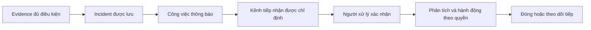

# Alert theo authentication anomaly

## 1. Cảnh báo bất thường xác thực phải giải quyết vấn đề gì?

**Authentication anomaly** là mẫu hoạt động xác thực khác với điều kiện hoặc hành vi được kỳ vọng và có thể cần kiểm tra. Nó có thể liên quan tấn công dò credential, chiếm tài khoản, lạm dụng MFA, thay đổi môi trường sử dụng hoặc sự cố của hệ thống xác thực.

**Alert** là một kết quả phát hiện được chuyển tới người hoặc hệ thống có trách nhiệm xử lý, kèm bằng chứng và ngữ cảnh đủ dùng. Có log đăng nhập chưa đồng nghĩa có alert; một dashboard đếm thất bại cũng chưa chứng minh ai sẽ nhận và xử lý tình huống nguy hiểm.

Ví dụ, một tài khoản quản trị có nhiều lần xác thực thất bại từ nhiều nguồn, sau đó đăng nhập thành công trong ngữ cảnh chưa từng được xác nhận. Hệ thống cần nối các sự kiện, đánh giá mức tin cậy và đưa ra cảnh báo đúng phạm vi, thay vì kết luận chỉ từ một địa chỉ IP mới.

Bài học thuộc chương Monitoring và detection của module yêu cầu bảo mật. Trọng tâm là chuyển rủi ro thành yêu cầu có thể triển khai và nghiệm thu: cần dữ liệu gì, rule hoạt động trên cửa sổ nào, cảnh báo chứa gì, khi nào phải được chuyển và phản ứng nào được phép.

Mọi threshold, cửa sổ và mục tiêu thời gian dưới đây là ví dụ của một nền tảng giả định, không phải mức mặc định an toàn cho mọi hệ thống.

## 2. Phân biệt bất thường, tấn công và lỗi xác thực

### 2.1. Một thất bại không có cùng ý nghĩa trong mọi trường hợp

| Tình huống | Ý nghĩa cần giữ | Sai lầm cần tránh |
|---|---|---|
| Credential không hợp lệ | Yêu cầu không vượt xác minh theo contract | Coi mọi lần nhập sai là tấn công |
| Policy từ chối | Có quyết định từ chối điều kiện truy cập/xác thực | Gộp với lỗi hạ tầng hoặc thông báo thành công |
| Identity provider timeout | Chưa có kết quả xác minh đáng tin | Đếm như sai password và tự khóa người dùng |
| MFA challenge được tạo | Luồng đang ở một bước trung gian | Đếm thành đăng nhập thành công |
| MFA bị từ chối/hết hạn | Một kết quả ở bước MFA theo catalog | Suy chắc chắn password đã bị lộ hoặc người dùng bị chiếm |
| Refresh/session renewal | Hoạt động duy trì phiên theo giao thức | Đếm mọi lần refresh như một login tương tác mới |
| Đăng nhập hợp lệ từ mạng khác | Có thay đổi ngữ cảnh | Suy IP mới đồng nghĩa kẻ tấn công |

[OWASP Authentication Cheat Sheet](https://cheatsheetseries.owasp.org/cheatsheets/Authentication_Cheat_Sheet.html#logging-and-monitoring) nhấn mạnh logging và monitoring chức năng xác thực. Để triển khai đúng, service cần chuẩn hóa ý nghĩa sự kiện trước khi dùng chúng làm điều kiện alert.

### 2.2. Phát hiện là một đánh giá có bằng chứng

Một anomaly có thể đúng về mặt thống kê nhưng không phải hành vi xấu: người dùng đi công tác, lớp học cùng đăng nhập sau giờ nghỉ hoặc cả công ty dùng một proxy chung. Ngược lại, kẻ tấn công có thể hoạt động chậm và phân tán để không tạo một đỉnh lưu lượng rõ ràng.

Cảnh báo cần diễn đạt điều đã quan sát, điều đang nghi ngờ và giới hạn dữ liệu. Không đổi một risk score chưa được hiệu chuẩn thành khẳng định “tài khoản chắc chắn bị chiếm”.

## 3. Mô hình đe dọa và use case phát hiện

### 3.1. Những mẫu cần phân biệt

| Mẫu | Dấu hiệu cần đánh giá | Giới hạn của bằng chứng |
|---|---|---|
| Dò credential tập trung | Nhiều lần thử vào một identity hoặc một nhóm nhỏ | Không biết nội dung password đã thử nếu không thu dữ liệu không nên thu |
| Password spraying | Ít lần trên mỗi identity nhưng trải trên nhiều identity | Một threshold theo từng tài khoản có thể không bắt được |
| Credential stuffing | Nhiều cặp credential bị thử theo một chiến dịch | Log xác thực đơn thuần thường không chứng minh credential đến từ nguồn rò rỉ nào |
| MFA request flooding | Nhiều challenge, deny/timeout hoặc phê duyệt sau chuỗi bất thường | Phải tách challenge mới khỏi retry giao nhận cùng challenge |
| Success sau chuỗi failure đáng ngờ | Đăng nhập thành công nối với lịch sử hoặc ngữ cảnh rủi ro | Có thể là người thật nhập sai rồi sửa đúng |
| Vị trí/thiết bị bất thường | Thay đổi ngữ cảnh hoặc baseline | IP, geo và device label có thể thiếu, sai hoặc bị giả mạo |

[MITRE ATT&CK T1110.003](https://attack.mitre.org/techniques/T1110/003/) mô tả password spraying trên nhiều tài khoản, còn [T1110.004](https://attack.mitre.org/techniques/T1110/004/) mô tả credential stuffing dựa trên credential đã có từ nơi khác. Tên kỹ thuật giúp xác định giả thuyết, không tự tạo bằng chứng rằng mọi cụm failure đều thuộc đúng kỹ thuật đó.

Với MFA, [MITRE ATT&CK T1621](https://attack.mitre.org/techniques/T1621/) mô tả lạm dụng việc tạo nhiều yêu cầu xác thực. Rule cần quan sát các bước và kết quả phù hợp, không chỉ tổng số HTTP request tới endpoint MFA.

### 3.2. Các rủi ro khi đặc tả alert không đầy đủ

| Mã | Sai lệch thiết kế | Hệ quả |
|---|---|---|
| R1 | Chỉ đếm theo IP hoặc một cửa sổ rất ngắn | Bỏ sót hoạt động phân tán hoặc chậm |
| R2 | Outcome sai, sự kiện trùng hoặc định danh ghép nhầm | Báo động nhầm, quy sai tài khoản hoặc bỏ sót |
| R3 | Không có dữ liệu bị hiểu thành không có bất thường | Mất khả năng phát hiện mà không biết |
| R4 | Ngưỡng hoặc baseline không phù hợp bối cảnh | Quá nhiều cảnh báo hoặc cảnh báo quá trễ |
| R5 | Alert có nhưng không chuyển đúng owner hoặc bị suppress vô hạn | Không có phản ứng kịp thời |
| R6 | Tự khóa/chặn dựa trên tín hiệu yếu | Kẻ tấn công gây từ chối dịch vụ cho người thật |
| R7 | Thu secret hoặc phát tán dữ liệu nhạy cảm trong alert | Tạo thêm đường rò rỉ credential và dữ liệu cá nhân |
| R8 | Rule/baseline thay đổi không được kiểm chứng | Detection suy giảm hoặc bị vô hiệu ngoài ý muốn |

## 4. Dữ liệu đầu vào phải có ngữ nghĩa và nguồn tin cậy

### 4.1. Chuẩn hóa event trước khi viết rule

Một schema minh họa cho kết quả xác thực cuối cùng:

```json
{
  "eventId": "auth-event-demo-341",
  "schemaVersion": 1,
  "authenticationAttemptId": "auth-attempt-demo-71",
  "eventType": "AUTHENTICATION_COMPLETED",
  "flowType": "INTERACTIVE_SIGN_IN",
  "stage": "FINAL",
  "occurredAt": "2026-01-12T09:15:00.123Z",
  "observedAt": "2026-01-12T09:15:00.520Z",
  "issuerRef": "identity-provider-demo",
  "tenantRef": "tenant-demo-a",
  "principalResolution": "UNCONFIRMED",
  "claimedIdentityRef": "claim-demo-18",
  "subjectRef": null,
  "sourceNetworkRef": "source-demo-9",
  "deviceContextState": "UNKNOWN",
  "outcome": "FAILURE",
  "reasonClass": "INVALID_CREDENTIAL",
  "requestId": "request-demo-901"
}
```

Đây là schema riêng cho ví dụ. Các tham chiếu được tạo/giải quyết theo policy; không phải raw username, password, token hoặc cookie.

`claimedIdentityRef` là định danh của thông tin được khai trong yêu cầu, không tự chứng minh một tài khoản thật tồn tại. `subjectRef` chỉ được gắn khi nguồn có thẩm quyền đã phân giải đủ theo contract. Rule và giao diện điều tra phải giữ sự khác biệt đó.

### 4.2. Các field quan trọng cho phát hiện

| Nhóm | Cần đặc tả |
|---|---|
| Identity | Tenant/realm/issuer, loại subject, trạng thái phân giải và quy tắc chuẩn hóa |
| Attempt | Một lần thử logic là gì, ID nào nối các bước, đâu là kết quả cuối |
| Kết quả | Thành công, thất bại credential, từ chối policy, lỗi phụ thuộc hoặc chưa biết |
| Yếu tố | Password/passkey/MFA/recovery theo loại, không có secret/proof thô |
| Nguồn | Source network đã xác minh ở ingress, thiết bị/ngữ cảnh với mức tin cậy |
| Thời gian | Event time, observed time, độ trễ và chất lượng đồng hồ |
| Liên kết | Request, challenge, session/workflow reference không có khả năng sử dụng như credential |
| Chất lượng | Nguồn thiếu, field chưa biết, duplicate, schema version hoặc event mâu thuẫn |

Chuẩn hóa identity phải theo contract của nguồn. Không tự lowercase mọi username hoặc dùng email hiện tại để ghép toàn bộ lịch sử của các tài khoản khác nhau.

Nếu nhóm theo identity khai báo để phát hiện một chiến dịch, cần cách giảm dữ liệu phù hợp và scope nhất quán. Không thu password hay hash password người dùng thử chỉ để chứng minh nhiều người bị thử cùng một giá trị.

### 4.3. Xác minh source và context

Không tin nguyên header `X-Forwarded-For`, device ID, tenant hoặc risk flag client tự gửi. Cần xác định chuỗi proxy tin cậy, nguồn đăng nhập và quyền producer gửi sự kiện.

IP hoặc device label có thể là tín hiệu phân nhóm, không phải danh tính mật mã. Nhiều người dùng có thể đi qua NAT/proxy chung; một người có thể đổi mạng hoặc thiết bị.

[NIST SP 800-63B-4](https://pages.nist.gov/800-63-4/sp800-63b.html) xem các chỉ báo như vị trí/IP bất thường là tín hiệu rủi ro cần đánh giá hiệu quả và tác động. Chúng không thay thế một yếu tố xác thực hoặc tự thay đổi mức bảo đảm của giao dịch.

## 5. Đếm đúng: attempt, stage, duplicate và cửa sổ thời gian

### 5.1. Không đếm raw log line thành số lần đăng nhập

Một attempt có thể tạo event ở gateway, identity provider, bước password, MFA và ứng dụng. Retry vận chuyển có thể gửi cùng event nhiều lần.

Cần hai quy tắc riêng:

- Dedup event vận chuyển bằng Event ID và scope nguồn thích hợp.
- Tính lần thử logic bằng `authenticationAttemptId`, stage và outcome có thẩm quyền theo catalog.

Không dedup tất cả request trong cùng trace thành một attempt nếu người dùng thật sự đã thử lại nhiều lần. Cũng không đếm một challenge MFA có nhiều delivery retry thành nhiều challenge mới.

Nếu hai record cùng attempt có outcome mâu thuẫn mà không có rule version/transition hợp lệ, phải xử lý chất lượng dữ liệu. Không tùy ý đếm cả failure và success như hai lần xác thực độc lập.

### 5.2. Cửa sổ cần có định nghĩa chính xác

Ví dụ một rule dùng cửa sổ trượt 10 phút theo event time, đánh giá mỗi 15 giây. Tại thời điểm T, khoảng được tính là `(T - 10 phút, T]`: event đúng biên dưới không thuộc cửa sổ, event đúng T được tính.

Những lựa chọn khác cũng có thể phù hợp, nhưng đặc tả phải nêu rõ sliding/tumbling, clock, biên, cadence và cách xử lý dữ liệu trễ. Không chỉ ghi “nhiều lần trong khoảng ngắn”.

Một khoảng dung nạp event trễ, ví dụ 60 giây, cần rule về cập nhật evidence/alert. Event muộn hơn khoảng đó có thể vẫn cần điều tra hoặc đối soát; không tự diễn đạt rằng nó chưa từng xảy ra.

### 5.3. Cửa sổ và state cần bao phủ mọi instance liên quan

Nếu mỗi instance chỉ đếm cục bộ, cùng một tài khoản bị thử trên nhiều node có thể không bao giờ vượt ngưỡng. Yêu cầu phải nêu miền tổng hợp: service, realm, tenant, issuer hoặc nhóm nguồn được phép.

Tương quan nhiều tenant có thể giúp nhận diện một chiến dịch nhưng không được mở dữ liệu của tenant này cho người vận hành tenant khác. Cần phân quyền xử lý và projection bằng chứng phù hợp.

## 6. Rule mẫu: từ mẫu bất thường tới điều kiện đo được

### 6.1. Bộ rule khởi đầu cho hệ thống giả định

| Rule | Điều kiện minh họa | Bằng chứng và lưu ý |
|---|---|---|
| AUTH-A01 | Ít nhất 12 attempt credential thất bại cho cùng entity trong 10 phút, từ ít nhất 3 nguồn được phân giải | Loại lỗi phụ thuộc và duplicate; nêu entity là subject đã biết hay identity khai báo |
| AUTH-A02 | Một nhóm nguồn có ít nhất 80 failure trên ít nhất 25 identity khai báo khác nhau trong 10 phút | Dấu hiệu chiến dịch đa tài khoản; kiểm NAT/proxy và bối cảnh cohort |
| AUTH-A03 | Success nối sau chuỗi failure đáng ngờ, kèm ngữ cảnh mới được xác định đủ tin cậy | Tăng ưu tiên điều tra, không tự chứng minh takeover |
| AUTH-A04 | Ít nhất 6 challenge MFA mới trong 5 phút, trong đó ít nhất 4 bị deny/hết hạn | Đếm challenge logic, tách retry provider và luồng người dùng chủ động |
| AUTH-A05 | Vị trí/thiết bị khác baseline kèm tín hiệu bổ sung | Mức tin cậy, thiếu dữ liệu, VPN/proxy và baseline quyết định cách dùng |
| AUTH-H01 | Nguồn hoặc rule không hoạt động theo contract | Cảnh báo health của detection, không gán thành tấn công credential |

Tất cả con số là giả định để minh họa cách đặc tả, không phải đề xuất deploy nguyên trạng. Các rule cần được đánh giá cùng volume, loại tài khoản và đường xác thực của hệ thống thực tế.

### 6.2. Theo nhiều entity và nhiều khoảng thời gian

AUTH-A01 thiên về một entity; AUTH-A02 thiên về nhiều entity. Cần thêm use case dài hơn hoặc tương quan phù hợp nếu mô hình đe dọa có hoạt động chậm/phân tán dưới ngưỡng ngắn.

[OWASP Credential Stuffing Prevention Cheat Sheet](https://cheatsheetseries.owasp.org/cheatsheets/Credential_Stuffing_Prevention_Cheat_Sheet.html) thảo luận nhiều tín hiệu, lớp phòng vệ và metric. Một threshold theo IP đơn lẻ không đại diện cho toàn bộ hoạt động tự động hoặc mọi chiến dịch.

Không cộng các nguồn thiếu tin cậy thành một số liệu có vẻ chính xác. Nếu source network chưa phân giải được, rule phải ghi trạng thái đó, không tạo ba giá trị ngẫu nhiên để đạt điều kiện “3 nguồn”.

### 6.3. Pseudocode cho một lần đánh giá

```text
evaluateAuthenticationWindow(rule, scope, evaluationTime):
    events = readNormalizedEvents(scope, rule.eventTimeWindow)
    events = deduplicateTransportEvents(events)
    attempts = resolveAuthoritativeAttemptOutcomes(events)

    evidence = aggregateApprovedFeatures(attempts, rule)
    quality = assessCoverageAndDataQuality(scope, events)

    if rule.conditionMatches(evidence):
        updateOrOpenIncident(
            correlationKey = rule + scope + approvedEntityReference,
            evidence = evidence,
            quality = quality,
            ruleVersion = rule.version
        )

    reportDetectionHealthSeparately(quality)
```

Mã giả không có nghĩa thiếu coverage thì luôn bỏ mọi cảnh báo đã có đủ evidence. Nó có nghĩa mức dữ liệu thiếu phải được thể hiện và không được biến thành kết luận “không có bất thường”.

## 7. Baseline, ngưỡng và báo động nhầm

### 7.1. Baseline cần bối cảnh

Một nhóm học viên có thể đăng nhập tập trung lúc bắt đầu buổi học; service account có thể dùng lịch máy; quản trị viên có tập hành vi khác tài khoản thông thường. Cần tách cohort phù hợp trước khi kết luận tăng bất thường.

Các yếu tố nên xét gồm loại subject, realm, phương thức, giờ hoạt động, mùa vụ, chiến dịch hợp lệ, mạng dùng chung và thay đổi sản phẩm. Không dùng một tài khoản ít dữ liệu để tạo baseline cá nhân có vẻ chắc chắn.

Nếu chưa có lịch sử, phải có chế độ cold start rõ ràng. `UNKNOWN` không tự có nghĩa “thiết bị mới nguy hiểm” hoặc “thiết bị đã an toàn”.

### 7.2. Địa lý không chứng minh chuyển động của con người

“Impossible travel” chỉ có ý nghĩa khi dữ liệu thời gian, vị trí, loại hoạt động và actor đủ phù hợp. Hai IP ở xa có thể do VPN, proxy, mạng di động, endpoint dịch vụ hoặc phiên hoạt động song song.

Không biến một phép chia khoảng cách/thời gian thành lệnh khóa chắc chắn. Cần ghi nguồn geolocation, độ tin cậy, mức mới và tín hiệu hỗ trợ. Ngữ cảnh vị trí hoặc thiết bị không thay thế kiểm credential, MFA hay phân quyền.

### 7.3. Bảo vệ baseline và quy trình tuning

Baseline có thể bị làm lệch nếu học từ giai đoạn đang bị tấn công hoặc gộp quá rộng. Cần owner, khoảng dữ liệu, phiên bản, kiểm chất lượng và quy tắc cập nhật.

Tuning nên dựa vào case đã được phân tích, không chỉ hạ ngưỡng cảnh báo cho dashboard yên hơn. Allowlist cần scope, lý do, thời hạn và cơ chế rà soát; không miễn vĩnh viễn mọi event từ một IP hoặc service account.

## 8. Alert phải đủ bằng chứng để người nhận hành động

### 8.1. Nội dung một alert

Một alert nên cho biết rule/version, giả thuyết, phạm vi, cửa sổ, entity, dữ liệu quan sát, chất lượng nguồn, mức ưu tiên và bước xử lý phù hợp. Không chỉ gửi “đăng nhập bất thường” rồi buộc người trực tìm từ đầu.

Ví dụ:

```json
{
  "alertId": "alert-demo-501",
  "ruleId": "AUTH-A01",
  "ruleVersion": 4,
  "hypothesis": "POSSIBLE_DISTRIBUTED_CREDENTIAL_GUESSING",
  "tenantRef": "tenant-demo-a",
  "realmRef": "realm-demo-a",
  "entity": {
    "kind": "CLAIMED_IDENTITY",
    "reference": "claim-demo-18"
  },
  "window": {
    "startExclusive": "2026-01-12T10:00:00Z",
    "endInclusive": "2026-01-12T10:10:00Z"
  },
  "evidenceSummary": {
    "distinctFailedAttempts": 12,
    "distinctSourceGroups": 3
  },
  "dataQuality": "PARTIAL_SOURCE_COVERAGE",
  "severity": "MEDIUM",
  "status": "OPEN",
  "playbookRef": "auth-anomaly-triage-demo-2",
  "evidenceSetRef": "evidence-set-demo-708"
}
```

Đây là dữ liệu giả. Entity khai báo chưa trở thành một tài khoản đã xác nhận; hypothesis chưa phải kết luận xâm phạm. Coverage thiếu được biểu diễn ngay trong alert thay vì ẩn đi.

Số đếm cần truy ngược được tới evidence theo quyền. Nếu thuật toán dùng ước lượng distinct count, phải ghi giới hạn và có cách xử lý khi gần threshold; không trình bày ước lượng như một phép đếm chính xác không sai số.

### 8.2. Phân biệt severity và confidence

Severity phản ánh mức ưu tiên/tác động cần xử lý; confidence phản ánh độ vững của giả thuyết theo dữ liệu. Tài khoản đặc quyền có thể làm tác động lớn hơn, nhưng không khiến một tín hiệu địa lý thiếu tin cậy tự trở thành bằng chứng chắc chắn.

Nếu dùng risk score hoặc mô hình, cần biết feature/version, ý nghĩa và giới hạn. Không gọi score 0.9 là xác suất xâm phạm 90% trừ khi có cơ sở hiệu chuẩn tương ứng.

Alert cần ghi reason có thể giải thích được, ví dụ “12 attempt credential failure, 3 nguồn, cửa sổ 10 phút”, thay vì chỉ một số điểm không có evidence.

### 8.3. Bảo vệ thông tin trong kênh cảnh báo

Không đưa password, OTP, token, cookie, raw authorization header hoặc hash của credential đã thử vào alert. Nội dung email/chat/page chỉ nên có phần tối thiểu và link tới evidence có xác thực, phân quyền.

Không gửi chi tiết tới email do người thử đăng nhập tự nhập. Thông báo cho chủ thể, nếu có, phải đi qua kênh đã được xác định tin cậy và policy riêng, tránh biến alert thành đường enumeration hoặc quấy rối.

Bảng điều tra, API evidence, export và archive cần kiểm scope. Một người vận hành tenant A không được xem danh sách identity hay source chi tiết của tenant B chỉ vì cùng một chiến dịch được tương quan ở tầng quản trị.

## 9. Vòng đời, dedup, suppression và chuyển cảnh báo

### 9.1. Một cửa sổ trượt không nên tạo một sự cố mới mỗi lần chạy

Khi rule đánh giá mỗi 15 giây, cùng chuỗi thất bại có thể khớp nhiều lần. Cần correlation key và lifecycle cho incident, tách khỏi Event ID.

Một key có thể dựa trên rule family, tenant/realm và entity trong phạm vi được phép. Quy tắc gộp/tách phải nêu cách xử lý rule version, chiến dịch nhiều entity và khoảng yên lặng; không mặc định dùng mỗi thời điểm kết thúc cửa sổ làm key khiến alert liên tục bị nhân bản.

Cùng incident có thể được cập nhật evidence mới, tăng severity hoặc chuyển trạng thái. Replay event không được tạo nhiều incident hoặc nhiều phản ứng không cần thiết.

### 9.2. Suppression không được xóa bằng chứng

Có thể hạn chế số thông báo lặp, nhưng cần tách điều đó khỏi việc bỏ event hoặc ngừng đánh giá. Incident vẫn phải giữ evidence/counter mới theo policy.

Ví dụ một khoảng hạn chế thông báo 15 phút cần nêu scope, thời điểm hết hạn, điều kiện mở lại và ngoại lệ cho severity tăng. Không kéo dài suppress vô hạn mỗi khi có event mới mà không có giới hạn hoặc người chịu trách nhiệm.

Một source bị allowlist có thể vẫn bị ghi nhận, được kiểm health và được đánh giá theo những rule khác phù hợp. Không để allowlist cho bảo trì biến thành miễn giám sát mọi đăng nhập của source đó.

### 9.3. Trạng thái giao nhận khác trạng thái xử lý



Kênh thông báo chấp nhận không tự chứng minh người trực đã xem. Cần trạng thái queued, accepted/delivered theo contract, human acknowledgment, triage và resolution nếu quy trình yêu cầu.

Cần owner cho từng rule/scope, cơ chế chuyển ca, escalation khi không có xác nhận và đường dự phòng khi kênh lỗi. “Đã gọi API gửi cảnh báo” không đủ để đánh dấu đã có người chịu trách nhiệm.

Lưu incident và công việc gửi có thể cần journal/outbox phù hợp để tránh case đã tạo nhưng mất notification. Retry notification phải idempotent theo contract, không tạo một incident mới cho mỗi lần gửi lại.

## 10. Phản ứng phải có quyền, phạm vi và khả năng kiểm soát tác động

### 10.1. Alert không tự cấp quyền thay đổi tài khoản

| Mức bằng chứng/tác động | Phản ứng minh họa cần đánh giá |
|---|---|
| Ngữ cảnh mới với độ tin cậy thấp | Bổ sung evidence, quan sát, chuyển review theo profile |
| Chuỗi failure hoặc MFA bất thường có evidence phù hợp | Điều tra, hạn chế theo scope hoặc xác thực tăng cường nếu policy cho phép |
| Có bằng chứng đủ về session/credential bị lạm dụng | Thu hồi hoặc chặn phạm vi bị ảnh hưởng bằng quy trình được ủy quyền |
| Nguồn/engine detection bị lỗi | Cảnh báo health và áp chế độ suy giảm đã đặc tả, không suy thành tài khoản bị chiếm |

Bảng không phải một công thức bắt buộc. Mỗi hành động cần điều kiện, thẩm quyền, hạn mức và bằng chứng đã thực thi.

Không tự khóa tất cả tài khoản sau vài failure do bất kỳ người ngoài nào gây ra. Kẻ tấn công có thể biến cơ chế đó thành công cụ từ chối dịch vụ. Chặn một IP dùng chung cũng có thể ảnh hưởng nhiều người hợp lệ.

### 10.2. Tách prevention khỏi detection bất đồng bộ

Rate limit, kiểm credential, MFA và phân quyền là những kiểm soát tại boundary. Alert có thể xuất hiện sau hành động, nên không được mô tả như đã ngăn một đăng nhập chỉ vì đã tạo case.

Nếu risk engine tham gia trực tiếp quyết định đăng nhập, nó cần contract thời gian, độ sẵn sàng và fail behavior riêng. Nếu engine chỉ giám sát bất đồng bộ, đừng âm thầm biến một lỗi pipeline thành lệnh cho phép hoặc từ chối mọi người dùng.

Dù detection ngừng hoạt động, hệ thống không được bỏ xác minh chữ ký, credential, MFA bắt buộc hoặc kiểm quyền. Tín hiệu rủi ro thấp cũng không thay thế các điều kiện xác thực đã được yêu cầu.

### 10.3. Đo kết quả và khả năng khôi phục

Một lệnh thu hồi được gửi không chứng minh phiên đã mất hiệu lực ở mọi verifier. Cần scope, deadline và phép đo tại đường truy cập thực tế.

Hành động tự động cần idempotency, giới hạn blast radius, audit và cách xử lý chặn nhầm. Với quyết định có thể gây lockout, cần đường hỗ trợ/khôi phục được bảo vệ để chủ thể hợp lệ không bị bỏ lại ngoài hệ thống.

## 11. Mất dữ liệu, lỗi pipeline và khả năng quan sát detection

### 11.1. Không có alert không đồng nghĩa đang an toàn

Nguồn mất event, parser lỗi, đồng hồ sai, queue lag hoặc rule bị tắt đều có thể làm không xuất hiện alert. Cần health signal cho từng chặng và inventory nguồn được kỳ vọng.

Thông tin cần theo dõi gồm tỷ lệ event không parse được, outcome chưa phân loại, source im lặng, độ trễ, state store không khả dụng, rule không chạy, lỗi chuyển notification và incident chưa được nhận.

Một source thiếu không nhất thiết vô hiệu mọi kết luận từ evidence còn lại, nhưng phải giới hạn những gì được khẳng định. Không biến số liệu thiếu thành mẫu số bằng không rồi báo “failure rate thấp”.

### 11.2. Độ trễ phải có mốc bắt đầu rõ ràng

Một mục tiêu minh họa:

> Trong tải thiết kế và khi dữ liệu đáp ứng contract, incident phải được lưu và chuyển tới kênh chịu trách nhiệm trong tối đa 60 giây kể từ lúc engine quan sát đủ evidence để rule thỏa điều kiện.

Mốc này khác thời điểm failure đầu tiên. Rule cần 12 lần thử thì chưa thể khớp ngay ở lần đầu. Nó cũng chưa bao phủ độ trễ từ nguồn tới engine; độ trễ ingest cần mục tiêu và cảnh báo riêng.

Cần đo riêng event-to-ingest, điều kiện đủ-to-incident, incident-to-channel và channel-to-human acknowledgment. Nếu mục tiêu là từ thời điểm sự kiện cuối tạo đủ điều kiện, ngân sách phải bao gồm việc truyền dữ liệu và chất lượng đồng hồ tương ứng.

Một số liệu p99 không chứng minh mọi incident nằm trong giới hạn. Nếu có thời hạn tối đa hoặc rule cho tình huống quá hạn, phải đặc tả riêng.

### 11.3. Chống flood vào chính detector

Kẻ tấn công có thể tạo nhiều identity/source giả, làm tăng cardinality của state và số case. Cần giới hạn tài nguyên, ưu tiên, backpressure và cách giữ evidence theo mức rủi ro.

Không làm giới hạn bằng cách âm thầm bỏ mọi event của một tenant đang bị tấn công. Chế độ suy giảm phải có chỉ báo, phạm vi và owner; nếu chỉ giữ dữ liệu tổng hợp, cần nói rõ điều tra chi tiết bị giới hạn thế nào.

Health alert nên có đường không phụ thuộc hoàn toàn vào chính thành phần đang hỏng. Synthetic event có thể kiểm đường từ ingest tới notification trong môi trường và scope được cho phép, không cần dùng credential thật hoặc tạo tác động trái phép.

## 12. Đo hiệu quả phát hiện và quản trị rule

### 12.1. Precision và recall cần mẫu số có ý nghĩa

Với những alert đã được phân tích và gán nhãn theo tiêu chí rõ:

```text
Precision = TP / (TP + FP)
```

TP là cảnh báo được xác nhận phù hợp với giả thuyết trong phạm vi đánh giá; FP là cảnh báo không phù hợp theo tiêu chí đó. Những case chưa phân tích không được tự gắn FP hoặc bỏ qua rồi tuyên bố hiệu quả cho toàn hệ thống.

Trên tập kịch bản có ground truth, có thể đo:

```text
Recall = TP / (TP + FN)
```

FN là kịch bản thuộc phạm vi cần phát hiện nhưng bị bỏ sót. Không thể ước lượng recall production chỉ từ các alert đã xuất hiện, vì những tấn công chưa được quan sát có thể chưa được biết.

Ví dụ, precision 75% trên 200 case đã review không chứng minh 75% mọi đăng nhập là tấn công; recall trên mô phỏng cũng không bảo đảm phát hiện mọi chiến dịch ngoài tập thử.

### 12.2. Các chỉ số bổ sung

Cần xem coverage của use case, độ trễ phát hiện/chuyển, nguồn dữ liệu, tỷ lệ case được xử lý, false-positive burden và tác động của phản ứng. Một rule bắt nhiều anomaly nhưng tạo quá nhiều lockout có thể gây hại.

Khi có sự cố thật, cần đối chiếu detection với timeline và khoảng trống: rule chưa có, dữ liệu thiếu, threshold sai, case bị suppress hay đã alert nhưng chưa có người phản ứng.

### 12.3. Rule và baseline là tài sản có phiên bản

Mỗi rule cần owner, giả thuyết, nguồn dữ liệu, điều kiện, threshold, scope, severity, evidence, playbook và lịch rà soát. Thay đổi parser, enum outcome hoặc identity mapping phải kích hoạt kiểm tương thích.

Có thể chạy shadow hoặc replay dữ liệu được phép trước khi mở reaction tự động. Rollback rule cũng cần giữ lịch sử, tránh xóa dấu vết rằng một giai đoạn đã dùng logic khác.

Thay threshold, allowlist hoặc suppress phải có lý do và phạm vi. Không cho tài khoản bị giám sát tự tắt rule liên quan mà không có kiểm soát thích hợp.

## 13. Bộ yêu cầu bảo mật mẫu có thể nghiệm thu

| ID | Yêu cầu | Rủi ro và bằng chứng |
|---|---|---|
| AAUTH-01 | Có catalog use case theo rủi ro, nguồn dữ liệu, entity và phạm vi cần phát hiện | R1, R8; threat-to-rule map và coverage inventory |
| AAUTH-02 | Event phân biệt attempt, stage, outcome, issuer/realm và identity đã/ chưa xác minh | R2; schema và đối chiếu các bước password/MFA/SSO/refresh |
| AAUTH-03 | Context nguồn được xác minh; input client không tự trở thành actor, source tin cậy hoặc risk verdict | R2, R7; giả proxy/header/device/tenant và source producer |
| AAUTH-04 | Rule có cửa sổ, biên, cadence, event-time/late-data và dedup rõ ràng trên miền tổng hợp cần thiết | R1, R2; replay, đa node, biên thời gian và event đến trễ |
| AAUTH-05 | Threshold/baseline theo bối cảnh, có cold start và đánh giá NAT/VPN/mạng dùng chung | R4, R6; kịch bản hợp lệ, cohort và baseline version |
| AAUTH-06 | Alert có hypothesis, evidence, rule/version, scope và chất lượng dữ liệu; không khẳng định xâm phạm quá mức | R2, R4; evidence truy ngược được và case thiếu dữ liệu |
| AAUTH-07 | Correlation/suppression giảm thông báo lặp mà không xóa evidence hoặc ngăn escalation quan trọng | R5; cửa sổ trượt, severity tăng, hết suppress và replay |
| AAUTH-08 | Incident/notification có độ bền, owner, mốc chuyển/xác nhận và đường dự phòng đo được | R5; mất ack, notification lỗi và chuyển ca |
| AAUTH-09 | Reaction chỉ chạy theo policy có quyền, scope, giới hạn và audit; tránh lockout hàng loạt từ tín hiệu yếu | R6; giả anomaly, IP dùng chung và phạm vi tài khoản |
| AAUTH-10 | Thiếu dữ liệu hoặc detector lỗi có health alert và hành vi suy giảm; không biến thành kết luận an toàn | R3; mất nguồn/parser/state store và synthetic probe |
| AAUTH-11 | Dữ liệu đầu vào, alert, evidence, export và retention không chứa secret hoặc vượt quyền giữa tenant | R7; canary, IAM và các kênh thông báo |
| AAUTH-12 | Có đo hiệu quả trên tập được gán nhãn/ground truth phù hợp và regression khi rule/schema thay đổi | R4, R8; bộ kịch bản, tuning record và rollback test |

Ví dụ đặc tả một rule:

```yaml
id: AAUTH-DEMO-01
hypothesis: Possible distributed credential guessing against one identity
scope:
  - tenant
  - realm
  - approvedIdentityReference
eligibleEvents:
  flowType: INTERACTIVE_SIGN_IN
  stage: FINAL
  outcome: FAILURE
  reasonClass: INVALID_CREDENTIAL
window:
  type: SLIDING_EVENT_TIME
  durationSeconds: 600
  interval: START_EXCLUSIVE_END_INCLUSIVE
  evaluationCadenceSeconds: 15
  allowedLatenessSeconds: 60
condition:
  distinctFailedAttemptsAtLeast: 12
  distinctTrustedSourceGroupsAtLeast: 3
lateDataBehavior: Update evidence under the incident lifecycle policy
qualityBehavior: Preserve coverage limitations and report source health
reaction: TRIAGE_ONLY
owner: identity-security
```

Mẫu không phải một cấu hình engine có thể deploy nguyên trạng. Nó minh họa thông tin cần đủ để implementer và người nghiệm thu không phải tự đoán. Quy tắc xử lý dữ liệu vượt lateness, đóng/mở lại incident và version vẫn cần nằm trong catalog/lifecycle liên quan.

## 14. Ma trận kiểm thử theo thuộc tính

Đây là tiêu chí thiết kế kiểm thử, chưa phải kết quả QA của một triển khai cụ thể. Dùng identity, credential và sự kiện tổng hợp trong môi trường có thẩm quyền.

| Tình huống | Kết quả mong đợi |
|---|---|
| Một vài lần nhập sai rồi sửa đúng theo bối cảnh bình thường | Không tự kết luận takeover; hành vi theo rule/baseline đã chọn |
| Rule đủ/thiếu đúng một attempt hoặc một source ở ngưỡng | Khớp chính xác điều kiện, không sai biên |
| Event đúng biên dưới/trên cửa sổ | Tính theo quy ước đã công bố |
| Cùng event được gửi lại hoặc nhiều stage cùng attempt | Không đếm nhầm thành nhiều lần đăng nhập |
| Cùng trace chứa nhiều lần thử thật sự khác nhau | Không dedup mất attempt hợp lệ |
| MFA provider retry gửi cùng challenge | Không tạo số challenge mới giả |
| Password qua nhưng MFA chưa hoàn tất | Không coi thành công cuối cùng |
| Identity provider timeout hoặc service account refresh lỗi | Không đếm sai thành password failure của login tương tác |
| Client giả IP chuyển tiếp, device, tenant hoặc risk flag | Không thay context tin cậy của rule |
| Nhiều người qua NAT/proxy hoặc cùng lớp đăng nhập tập trung | Mức báo động và phản ứng xét bối cảnh; không khóa hàng loạt máy móc |
| Một entity bị thử qua nhiều node/source | Miền tổng hợp phát hiện theo contract, không chỉ từng instance |
| Chiến dịch nhiều identity nhưng mỗi identity dưới ngưỡng ngắn | Kiểm coverage rule đa entity và giới hạn còn lại |
| Hoạt động chậm, phân tán hoặc nằm ngoài cửa sổ ngắn | Đo khả năng phát hiện theo use case, không tuyên bố coverage không có |
| Success sau chuỗi failure hoặc ngữ cảnh mới | Evidence/ưu tiên đúng; không tự xác nhận xâm phạm chắc chắn |
| Geolocation sai, VPN, clock skew hoặc thiết bị chưa biết | Chất lượng được biểu diễn, không suy tín hiệu thiếu thành bằng chứng mạnh |
| Event muộn, đảo thứ tự hoặc outcome mâu thuẫn | Theo policy late-data/quality, không nhân bản case hoặc che sự cố |
| Rule khớp liên tiếp trên nhiều cửa sổ trượt | Cập nhật incident theo correlation, không mở case mới mỗi tick |
| Severity tăng khi đang suppress | Escalation theo policy vẫn hoạt động, evidence không mất |
| Kênh nhận lỗi, mất acknowledgment hoặc không có người nhận ca | Retry/escalation có trạng thái và owner rõ |
| Thiếu nguồn, parser lỗi, state store không hoạt động | Health alert; không coi không có alert là an toàn |
| Alert chứa canary password/token hoặc dữ liệu tenant khác | Không tới kênh/evidence/export ngoài quyền và policy |
| Phản ứng tự động với nguồn chia sẻ hoặc identity do người ngoài khai | Không tạo lockout/chặn ngoài giới hạn được cấp |
| Rule/baseline/identity mapping thay và rollback | Có regression, lineage và đánh giá dữ liệu cũ/tương thích |

Bằng chứng cần bao phủ input chuẩn hóa, feature/count, quyết định rule, incident, chuyển notification và reaction thực tế nếu có. Chỉ assert một query trả một dòng chưa chứng minh cảnh báo tới người chịu trách nhiệm.

Ca kiểm độ trễ phải xác định lúc điều kiện đủ, độ trễ source, cadence và trạng thái kênh. Ca kiểm recall cần ground truth trong tập mô phỏng; ca không có tấn công cần đủ bối cảnh hợp lệ để đánh giá burden báo động nhầm.

## 15. Những lỗi đặc tả thường gặp

- **“Nhiều login fail là tấn công.”** Chưa chuẩn hóa outcome hoặc xét lỗi hạ tầng và bối cảnh người dùng.
- **“Chỉ cần threshold theo IP.”** Bỏ qua phân tán, NAT/proxy và entity đang bị nhắm tới.
- **“Biết password nào bị thử sẽ dễ phát hiện hơn.”** Tạo lý do thu secret hoặc vật phẩm giúp dò credential không cần thiết.
- **“Một log line là một attempt.”** Đếm trùng stage, retry hoặc nhiều lớp của một giao dịch.
- **“IP mới/impossible travel là đủ khóa.”** Đánh đồng tín hiệu ngữ cảnh với bằng chứng chiếm tài khoản.
- **“Suppress nghĩa là thôi ghi và thôi đánh giá.”** Làm mất evidence và escalation.
- **“Đã gửi webhook là đã có người xử lý.”** Không kiểm giao nhận, chuyển ca và acknowledgment.
- **“Không có alert chứng minh hệ thống bình thường.”** Bỏ qua nguồn dữ liệu và health của detection.
- **“Recall tốt trên mô phỏng là bắt được mọi tấn công.”** Suy rộng vượt ground truth và phạm vi đánh giá.

Một yêu cầu alert theo authentication anomaly tốt nối được giả thuyết đe dọa, dữ liệu tin cậy, logic thời gian, evidence và người chịu trách nhiệm. Cảnh báo cần đủ nhanh và đủ giải thích để hỗ trợ phản ứng, đồng thời giữ quyền riêng tư, giới hạn bất định và tránh trở thành công cụ gây gián đoạn cho chính người dùng hợp lệ.
