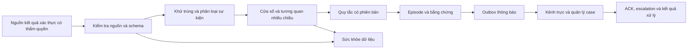

# Alert theo brute force

## 1. Biến dấu hiệu đoán credential thành yêu cầu phát hiện

Alert theo brute force là cảnh báo được tạo khi dữ liệu quan sát thỏa một quy tắc về hành vi thử credential hoặc lạm dụng luồng xác thực. Cảnh báo cần giúp người xử lý biết điều gì đã được quan sát, phạm vi ảnh hưởng, độ tin cậy và bước tiếp theo phù hợp.

Trong chương **Monitoring và detection**, yêu cầu “cảnh báo khi đăng nhập sai nhiều lần” chưa đủ. Cần xác định:

- Sự kiện nào được tính là một lần thử và nguồn nào có thẩm quyền ghi kết quả?
- Đếm theo tài khoản, định danh được thử, nguồn mạng, tenant hay tổ hợp nào?
- Cửa sổ, ngưỡng, điều kiện dữ liệu và ngoại lệ được định nghĩa ra sao?
- Alert được gom, chuyển, xác nhận và nâng mức như thế nào?
- Biện pháp phản ứng có thể làm gián đoạn người dùng hợp lệ không?
- Bằng chứng nào chứng minh không bỏ sót vì log trùng, event trễ hoặc nguồn ngừng gửi?

Bài học dùng nền tảng học trực tuyến nhiều tenant làm ví dụ. Đăng nhập có thể đi qua gateway và dịch vụ xác thực, người học thường dùng chung mạng trường học, còn quản trị có thao tác nhạy cảm hơn. Các ngưỡng và thời hạn dưới đây là lựa chọn minh họa, không phải chuẩn mặc định hay giới hạn chung của giao thức.

## 2. Phân loại hành vi và giới hạn kết luận

### 2.1. Không chỉ có một dạng brute force

| Nhóm hành vi | Đặc điểm khái quát | Góc quan sát cần thiết |
|---|---|---|
| Đoán mật khẩu tập trung | Nhiều lần thử hướng vào một hoặc ít định danh | Theo định danh được thử, không chỉ từng IP |
| Password spraying | Thử ít mật khẩu trên nhiều định danh | Mức lan rộng giữa các định danh và nhịp hoạt động |
| Credential stuffing | Thử các cặp credential đã có từ nguồn khác | Có thể có thành công ngay; chỉ đếm thất bại chưa đủ |
| Hoạt động phân tán, chậm | Khối lượng thấp tại từng nguồn hoặc cửa sổ ngắn | Tương quan nhiều nguồn và nhiều khoảng thời gian |
| Password cracking offline | Thử trên dữ liệu credential đã lấy ra khỏi hệ thống | Log đăng nhập online không trực tiếp cho biết các phép thử offline |

MITRE ATT&CK T1110 phân biệt password guessing, password cracking, password spraying và credential stuffing. Có thể dùng cách phân loại này để xác định phạm vi bao phủ của bộ quy tắc, thay vì gắn một ngưỡng theo IP cho mọi kiểu hành vi. [MITRE ATT&CK: Brute Force, T1110](https://attack.mitre.org/techniques/T1110/)

### 2.2. Alert là nhận định theo bằng chứng, không phải kết luận tự động

Mười lần sai có thể do người dùng quên mật khẩu, client cũ tự retry hoặc một hoạt động trái phép. Một đợt nhiều người đăng nhập đầu buổi học có thể tạo lưu lượng lớn từ cùng NAT.

Thông báo cần diễn đạt “quan sát thấy mẫu thử credential vượt quy tắc” thay vì khẳng định một IP là kẻ tấn công hoặc tài khoản chắc chắn bị chiếm. Mức phản ứng phải xét chất lượng nguồn, ngữ cảnh và hậu quả chặn nhầm.

Không ghi mật khẩu, OTP hoặc hash của mật khẩu thử vào telemetry để chứng minh các lần thử dùng cùng secret. Với dữ liệu đã tối thiểu hóa, hệ thống có thể nhận diện mẫu phù hợp spraying nhưng không nhất thiết xác nhận được mọi đặc điểm của kỹ thuật đó.

### 2.3. Detection và prevention là hai yêu cầu khác nhau

Rate limiting, chống tự động hóa và các cơ chế bảo vệ xác thực tác động trực tiếp lên lần thử. Alert hỗ trợ nhận biết, điều tra và phối hợp phản ứng. Một alert tới sau vài phút không thay thế giới hạn đoán credential ở đường xác thực.

NIST SP 800-63B-4 đặt yêu cầu rate limiting theo loại authenticator và bối cảnh áp dụng. Khi thiết kế, cần phân biệt giới hạn bảo vệ đó với ngưỡng cảnh báo của đội vận hành; không lấy một ngưỡng minh họa trong bài làm chính sách xác thực bắt buộc cho mọi dịch vụ. [NIST SP 800-63B-4: Rate Limiting](https://pages.nist.gov/800-63-4/sp800-63b.html)

Detector lỗi không được làm tắt các kiểm soát xác thực cốt lõi. Ngược lại, lưu lượng đã bị rate limiter chặn vẫn là tín hiệu lạm dụng có thể cần quan sát riêng.

## 3. Mô hình đe dọa và yêu cầu phát sinh

| Mã rủi ro | Kịch bản | Hướng yêu cầu |
|---|---|---|
| R-BF-01 | Chỉ đếm theo IP nên không thấy nhiều nguồn cùng thử một định danh | Quy tắc theo đích và tương quan nhiều nguồn |
| R-BF-02 | Chỉ đếm theo tài khoản nên bỏ qua việc thử nhiều định danh | Quy tắc theo mức lan rộng và nguồn hoặc cụm có căn cứ |
| R-BF-03 | Thành công sau chuỗi thất bại làm bộ đếm reset và che dấu hiệu | Giữ lịch sử phát hiện trong cửa sổ, tách bộ đếm bảo vệ khỏi bằng chứng detection |
| R-BF-04 | Gateway và auth service ghi cùng lần thử thành hai event | Nguồn kết quả có thẩm quyền và idempotency theo lần thử |
| R-BF-05 | Event trễ, sampling hoặc nguồn mất làm số lần bị thiếu | Độ đầy đủ, chất lượng thời gian, xử lý trễ và trạng thái suy giảm |
| R-BF-06 | Header IP hoặc tenant do client tự khai làm sai tương quan | Chuỗi proxy tin cậy và phạm vi xác thực do server xác định |
| R-BF-07 | NAT, kiểm thử hợp lệ hoặc client lỗi gây alert storm | Baseline, nhóm trường hợp hợp lệ, gom cảnh báo và ngoại lệ có hạn |
| R-BF-08 | Phản ứng khóa tài khoản hoặc IP bị lợi dụng để gây gián đoạn | Phạm vi, TTL, điều kiện phản ứng và đường phục hồi an toàn |
| R-BF-09 | Alert, dashboard hoặc ticket lộ định danh và credential | Tham chiếu bảo vệ, quyền đọc theo tenant và nội dung tối thiểu |
| R-BF-10 | Rule hoặc kênh thông báo dừng nhưng dashboard vẫn xanh | Synthetic test, sức khỏe pipeline, ACK và escalation |

Mỗi rủi ro phải nối được tới yêu cầu, quyết định kiến trúc và ca thử. Không coi tên sản phẩm SIEM hoặc một biểu đồ số lần sai là bằng chứng đã bao phủ những rủi ro này.

## 4. Hợp đồng sự kiện xác thực

### 4.1. Định nghĩa một lần thử đủ điều kiện

Trong hệ thống mẫu, một lần thử có định danh do thành phần xác thực đáng tin cậy tạo. Kết quả cuối của giai đoạn được chọn chỉ được tính một lần cho quy tắc tương ứng.

| Loại sự kiện | Ý nghĩa | Cách sử dụng |
|---|---|---|
| `authn.primary_rejected` | Kết quả kiểm tra credential chính bị từ chối theo nhóm đã định | Đầu vào cho quy tắc thử credential chính |
| `authn.primary_accepted` | Giai đoạn credential chính đạt | Chưa mặc định là đăng nhập đầy đủ nếu còn MFA |
| `authn.completed` | Luồng xác thực hoàn tất theo profile | Tương quan thành công sau hoạt động nghi vấn |
| `authn.mfa_rejected` | Bước MFA bị từ chối | Quy tắc riêng theo giai đoạn và challenge |
| `authn.rate_limited` | Lần thử bị kiểm soát tốc độ chặn | Tín hiệu lạm dụng riêng, không tự tính là một phép kiểm tra mật khẩu thất bại đã diễn ra |
| `authn.dependency_error` | Không xác định kết quả vì lỗi kỹ thuật | Sức khỏe xác thực, không gộp thành mật khẩu sai |

Một HTTP `401` không đủ để quyết định đó là một lần thử mật khẩu thất bại. Nó có thể liên quan token hết hạn, credential thiếu hoặc cơ chế khác. `403` cũng không mặc định là brute force; nó có thể là lỗi phân quyền sau xác thực.

### 4.2. Schema minh họa

```json
{
  "event_id": "event-test-401",
  "attempt_id": "attempt-test-088",
  "event_type": "authn.primary_rejected",
  "source_id": "auth-service-test",
  "occurred_at": "2026-11-27T03:00:00Z",
  "observed_at": "2026-11-27T03:00:02Z",
  "auth_realm": "learning-realm-test",
  "tenant_scope": "tenant-test-a",
  "candidate_ref": "candidate-ref-test-17",
  "network_source_ref": "network-ref-test-09",
  "factor_stage": "primary_secret",
  "reason_group": "CREDENTIAL_REJECTED",
  "schema_version": "auth-signal-v3",
  "correlation_id": "corr-test-004"
}
```

Đây là fixture tổng hợp. `candidate_ref` là tham chiếu bảo vệ của định danh được thử, không tự khẳng định tài khoản tồn tại hoặc người gọi đã được xác thực. Khi chưa giải quyết được tenant, dùng phạm vi realm đã biết theo thiết kế, không tin tenant do client tùy ý khai.

Định danh lần thử phải có miền duy nhất và quy tắc gắn với giai đoạn. Một event được gửi lại qua queue không phải lần thử mới; một request thực sự mới do client retry có thể là lần thử mới theo hợp đồng. Không để client tái sử dụng một ID để ép detector bỏ qua các lần thử khác nhau.

### 4.3. Định danh và mạng cần nguồn đáng tin cậy

Chuẩn hóa định danh phải tương thích với cách hệ thống xác thực nhận diện tài khoản. Không tùy ý đổi hoa thường hoặc gộp Unicode khiến hai định danh khác nhau bị tính thành một đích.

Nếu dùng tham chiếu dẫn xuất, cần cơ chế được phê duyệt, phạm vi liên kết, quản lý khóa nếu có và retention. Rotation tham chiếu trong lúc cửa sổ còn hoạt động có thể làm tách số liệu; phải có kế hoạch chuyển tiếp hoặc báo giới hạn.

Nguồn mạng phải đến từ chuỗi proxy được kiểm chứng. Không dùng nguyên `X-Forwarded-For` từ Internet làm căn cứ chặn người khác. IP là thuộc tính mạng, không phải một danh tính người dùng hoặc thiết bị chắc chắn.

### 4.4. Không mất dữ liệu bắt buộc vì sampling hoặc lọc sai

Nguồn và pipeline cần giữ các sự kiện mà quy tắc yêu cầu với mức đầy đủ đã định. Không áp sampling của trace chẩn đoán lên số đếm xác thực rồi vẫn dùng ngưỡng tuyệt đối như dữ liệu đầy đủ.

Cùng một lần thử được proxy, ứng dụng và auth service ghi lại phải có cách chọn nguồn có thẩm quyền hoặc liên kết đúng. Bản sao phục vụ điều tra không được làm tăng bộ đếm.

Các event kỹ thuật và rate limiting cần tồn tại cho mục đích riêng. Tách chúng khỏi phép đếm credential không có nghĩa bỏ qua sức khỏe hệ thống hoặc lưu lượng bị chặn.

## 5. Đặc tả quy tắc, cửa sổ và ngưỡng

### 5.1. Chốt semantics của cửa sổ

Ví dụ quy tắc dùng cửa sổ trượt theo thời gian sự kiện đáng tin cậy:

```text
W(t) = các lần thử đủ điều kiện có t - window < occurred_at <= t
```

Phải nói rõ tính một lần theo khóa nào, chạy đánh giá khi nào, event trễ được nhận trong bao lâu và xử lý đồng hồ sai thế nào. Trong ví dụ này, event đúng mốc `t - window` không thuộc cửa sổ, còn event tại `t` có thuộc.

Một hệ thống chỉ dùng bucket cố định có thể cho kết quả khác cửa sổ trượt ở ranh giới. Không gọi hai thiết kế là tương đương nếu chưa đánh giá ảnh hưởng phát hiện.

### 5.2. Ba quy tắc minh họa bổ sung cho nhau

| Mã quy tắc | Khóa đánh giá | Điều kiện ví dụ | Kết luận công khai trong case |
|---|---|---|---|
| BF-TARGET-01 | Realm và candidate_ref | Ít nhất 10 lần primary_rejected khác nhau trong 5 phút | Nhiều lần thử hướng vào cùng định danh |
| BF-SOURCE-02 | Realm và network_source_ref | Ít nhất 50 lần từ chối trên ít nhất 20 candidate_ref trong 5 phút | Mẫu thử trên nhiều định danh từ cùng nguồn quan sát |
| BF-DISTRIBUTED-03 | Realm và candidate_ref | Ít nhất 20 lần từ chối từ ít nhất 5 network_source_ref trong 15 phút | Mẫu phân tán hướng vào cùng định danh |

Các ngưỡng chỉ để học cách viết đặc tả. Chúng cần được hiệu chỉnh theo lưu lượng, cơ chế bảo vệ và tác động thực tế. Không tự áp ngưỡng 10 hoặc 50 cho mọi môi trường.

BF-SOURCE-02 không tự chứng minh password spraying vì detector không thu mật khẩu để biết các lần thử dùng cùng secret. Cũng không chứng minh credential stuffing chỉ từ việc có nhiều định danh. Nhãn case phải phản ánh mức suy luận thật.

### 5.3. Nhiều cửa sổ và ngữ cảnh bổ sung

Cần đánh giá cửa sổ ngắn cho burst và cửa sổ dài hơn cho hoạt động chậm, với ngưỡng cùng baseline riêng. Không chỉ kéo cùng một ngưỡng 5 phút sang 24 giờ, vì lưu lượng hợp lệ và ý nghĩa tín hiệu đã đổi.

OWASP lưu ý chặn theo IP đơn lẻ không đủ cho credential stuffing phân tán, và biện pháp phản ứng cần xét nhiều chiều cùng cả khoảng ngắn lẫn dài. Điều này là cơ sở để yêu cầu bộ quy tắc bổ sung, không coi một ngưỡng per-IP là toàn bộ phòng vệ. [OWASP: Credential Stuffing Prevention](https://cheatsheetseries.owasp.org/cheatsheets/Credential_Stuffing_Prevention_Cheat_Sheet.html#ip-mitigation-and-intelligence)

Có thể xét tỷ lệ thất bại nếu định nghĩa mẫu số và lượng quan sát tối thiểu. Mẫu số phải cùng giai đoạn và phạm vi, không gộp lỗi hạ tầng hoặc request đã bị chặn thành các lần credential đã được kiểm tra.

Một lần `authn.completed` sau chuỗi thất bại có thể nâng mức cần điều tra, nhưng không tự chứng minh tài khoản đã bị chiếm. Bộ đếm phòng vệ có thể reset theo chính sách xác thực; lịch sử dùng cho detection không được xóa âm thầm chỉ vì có một lần thành công.

## 6. Từ quy tắc tới alert có vòng đời

### 6.1. Đặc tả quy tắc có phiên bản

```yaml
rule_id: BF-TARGET-01
rule_version: 3
source_profile: trusted-auth-result-v3
eligible_event: authn.primary_rejected
eligible_stage: primary_secret
group_by:
  - auth_realm
  - candidate_ref
deduplicate_by:
  - source_id
  - auth_realm
  - attempt_id
  - factor_stage
window:
  mode: sliding_event_time
  duration: 5m
  interval: open_left_closed_right
  allowed_lateness: 30s
condition:
  distinct_attempts_greater_than_or_equal: 10
response_profile: notify_and_assess
```

Đây là ví dụ đặc tả trong bài, không phải cấu hình của một engine cụ thể. Các tham số phải ánh xạ tới hành vi thật: event trễ trong 30 giây có thể cập nhật cửa sổ theo chính sách, còn event quá trễ phải được ghi trạng thái và xử lý riêng, không biến mất âm thầm.

Nếu cùng khóa lần thử có kết quả mâu thuẫn, đó có thể là lỗi hợp đồng hoặc nguồn cần điều tra. Không ghi đè payload cũ để giữ số đếm thuận tiện.

### 6.2. Không tạo một alert mới cho mỗi lần đánh giá

Một episode có thể đi qua các trạng thái quan sát, phát hiện, đã chuyển, đã xác nhận, đang xử lý và đóng. Trạng thái giao nhận và trạng thái điều tra có thể được quản lý riêng; gửi xong không có nghĩa đã có người xử lý.

Khóa gom alert cần gắn với quy tắc, realm, thực thể hoặc nhóm được đánh giá và episode theo chính sách. Không đưa timestamp của mỗi lần chạy vào khóa để tạo hàng trăm cảnh báo cho cùng một đợt.

Khi ngưỡng tiếp tục bị vượt, cập nhật bằng chứng và counters của episode. Khi có tình huống làm tăng mức rủi ro, như đăng nhập hoàn tất sau một chuỗi đáng chú ý ở tài khoản đặc quyền, phải có đường nâng mức dù đang trong cooldown thông báo thường.

Cooldown chỉ giới hạn gửi lặp, không được ngừng thu sự kiện hoặc ngừng phát hiện. Điều kiện đóng cần xét dữ liệu khỏe và khoảng hạ nhiệt đã định; nguồn ngừng gửi không phải bằng chứng hoạt động đã kết thúc.

### 6.3. Nội dung alert cần trả lời câu hỏi điều tra

```json
{
  "alert_id": "alert-test-004",
  "rule_id": "BF-TARGET-01",
  "rule_version": 3,
  "episode_ref": "episode-test-09",
  "auth_realm": "learning-realm-test",
  "tenant_scope": "tenant-test-a",
  "candidate_ref": "candidate-ref-test-17",
  "window_start_exclusive": "2026-11-27T03:00:00Z",
  "window_end_inclusive": "2026-11-27T03:05:00Z",
  "distinct_attempts": 12,
  "distinct_network_sources": 4,
  "severity": "medium",
  "confidence": "pattern_observed",
  "data_quality": "complete_under_profile",
  "evidence_ref": "evidence-test-014",
  "owner_queue": "security-operations-test"
}
```

Mức độ nghiêm trọng và độ tin cậy không phải một đại lượng. Một tín hiệu có thể ảnh hưởng tài khoản đặc quyền nhưng nguồn dữ liệu chưa đầy đủ. Alert phải biểu diễn được cả tác động tiềm năng và giới hạn bằng chứng.

`evidence_ref` cần dẫn tới dữ liệu được phân quyền, không phải URL công khai hoặc quyền đọc mọi log. Bằng chứng nên giữ phạm vi thời gian, phiên bản quy tắc, điều kiện lọc và tham chiếu đủ để tái kiểm tra trong vòng đời đã định. Một truy vấn luôn chạy trên dữ liệu hiện tại có thể không tái dựng được kết quả alert ở thời điểm trước.

### 6.4. Pipeline và tính nhất quán



Ghi alert và ý định gửi cần cơ chế nhất quán phù hợp, chẳng hạn outbox. Nếu chỉ lưu alert rồi gọi kênh ngoài mà không xử lý lỗi giữa hai bước, episode có thể tồn tại nhưng không ai nhận được.

Consumer cần chịu được event trùng và nhiều instance cạnh tranh khi cập nhật bộ đếm hoặc episode. Pseudocode và kiểm thử phải chứng minh không đếm hai lần hoặc tạo thông báo lặp ngoài chính sách; không dựa vào một giả định queue luôn exactly-once.

### 6.5. Giới hạn tài nguyên không được âm thầm xóa độ bao phủ

Số candidate hoặc nguồn do bên ngoài tạo có thể rất lớn. Cần giới hạn trạng thái, TTL, quota và backpressure theo profile, đồng thời theo dõi việc loại bỏ hoặc giảm độ chính xác.

Nếu dùng phép ước lượng distinct để tiết kiệm tài nguyên, phải công bố sai số và ảnh hưởng ở gần ngưỡng. Biện pháp gây hậu quả lớn không nên dựa vào một con số xấp xỉ mà không có điều kiện kiểm chứng hoặc ngưỡng an toàn phù hợp.

Không đưa từng candidate_ref hoặc IP thành label metric vận hành không giới hạn. Dữ liệu điều tra chi tiết thuộc kho được cấp quyền; metric sức khỏe dùng nhãn hữu hạn.

## 7. Triage, phản ứng và giảm gián đoạn

### 7.1. Alert không tự trở thành quyền khóa tài khoản

Một response profile cần nêu ai hoặc thành phần nào được hành động, phạm vi, điều kiện, thời hạn, cách xác nhận kết quả và cách phục hồi. Các lựa chọn có thể gồm quan sát tăng cường, challenge chống tự động hóa, giới hạn tạm theo phạm vi, step-up hoặc điều tra phiên thành công liên quan.

OWASP cảnh báo cơ chế account lockout có thể bị lợi dụng để gây từ chối dịch vụ bằng cách khóa tài khoản của người khác. Vì vậy, ngưỡng alert và ngưỡng khóa không được đồng nhất một cách máy móc. [OWASP: Account Lockout](https://cheatsheetseries.owasp.org/cheatsheets/Authentication_Cheat_Sheet.html#account-lockout)

Trong ví dụ, BF-TARGET-01 tạo case và yêu cầu đánh giá, không mặc định khóa vĩnh viễn. Một phản ứng tự động mạnh hơn cần chính sách riêng cùng kiểm thử chặn nhầm và cơ chế khôi phục phù hợp.

### 7.2. NAT và ngữ cảnh hợp lệ cần được đánh giá

Một mạng trường học có thể có nhiều người đăng nhập cùng lúc và vài người nhập sai. Không kết luận một IP là một người, cũng không miễn toàn bộ mạng đó khỏi kiểm soát chỉ vì đã biết có NAT.

Có thể phân tích độ lan rộng, tỷ lệ thất bại theo mẫu số đúng, thời điểm sự kiện, lưu lượng bình thường và các tín hiệu khác đã được duyệt. Baseline không được ghi đè quy tắc credential hết hiệu lực hoặc bỏ qua bảo vệ xác thực cốt lõi.

Ngoại lệ cho kiểm thử hoặc hệ thống hợp lệ phải có chủ sở hữu, phạm vi cụ thể, hạn và audit. Không tạo một whitelist chung cho toàn tổ chức rồi ngừng nhìn thấy tín hiệu từ đó.

### 7.3. Đường xử lý và escalation

Mỗi loại alert cần owner queue, mức ưu tiên, nội dung tối thiểu, thời gian chờ ACK và đường nâng mức khi không có ACK hoặc khi bằng chứng thay đổi.

ACK của hệ thống gửi hoặc HTTP thành công từ webhook không đồng nghĩa một người đã tiếp nhận. Cần phân biệt kênh đã nhận, case đã tạo, người đã xác nhận và kết luận xử lý.

Nếu kênh chính lỗi, dùng đường dự phòng đã được phép, không gửi nguyên dữ liệu cá nhân sang một nhóm rộng hơn chỉ để bảo đảm có thông báo. Lỗi gửi cũng phải được phát hiện ngoài chính kênh đang lỗi khi có yêu cầu đó.

### 7.4. Client và thông báo cho người dùng

Không trả thông tin detector nội bộ như bộ đếm còn lại, tên tài khoản tồn tại hoặc danh sách nguồn đang bị chặn cho người gọi chưa có quyền biết. Thông báo xác thực công khai phải giữ chính sách chống dò tài khoản của hệ thống.

Nếu thông báo cho chủ tài khoản, nội dung và đường liên hệ phải được kiểm soát. Không tự gửi email tới một địa chỉ vừa được kẻ gọi nhập mà chưa xác định đó là kênh của người cần nhận.

Challenge hoặc phục hồi không được yêu cầu người dùng gửi mật khẩu, OTP hoặc cookie cho đội hỗ trợ. Phản ứng cũng cần hạn chế notification storm, tránh biến một đợt thử credential thành spam người dùng hợp lệ.

## 8. Bộ yêu cầu có tiêu chí nghiệm thu

| ID | Phát biểu yêu cầu mẫu | Tiêu chí chấp nhận và bằng chứng |
|---|---|---|
| REQ-BF-01 | Nguồn sự kiện, loại kết quả và định nghĩa một lần thử đủ điều kiện phải được chốt theo cơ chế xác thực. | Fixture gồm sai credential, MFA, rate limit, token hết hạn và lỗi kỹ thuật; chỉ đúng nhóm được tính. |
| REQ-BF-02 | Bộ đếm phải khử trùng theo lần thử có thẩm quyền, chịu được nhiều consumer và phát hiện kết quả mâu thuẫn. | Replay, event trùng khác ID và request thực sự mới cho kết quả đúng, không nhân số liệu hoặc bỏ lần thử khác. |
| REQ-BF-03 | Bộ quy tắc phải có phạm vi theo đích, nguồn và tương quan phân tán phù hợp mô hình đe dọa. | Chạy các mẫu tập trung, lan rộng và nhiều nguồn; báo rõ phần chưa bao phủ thay vì chỉ có per-IP rule. |
| REQ-BF-04 | Mỗi quy tắc phải định nghĩa cửa sổ, dấu so sánh, ngưỡng, event trễ, chất lượng và phiên bản. | Thử N-1, N, N+1, các mốc cửa sổ và clock skew; kết quả đúng hợp đồng. |
| REQ-BF-05 | Một episode phải gom thông báo lặp nhưng vẫn cập nhật bằng chứng và nâng mức khi có điều kiện mới. | Giữ ngưỡng lâu, cooldown và thành công sau chuỗi nghi vấn; không tạo alert storm hoặc bỏ escalation. |
| REQ-BF-06 | Alert phải có phạm vi, bằng chứng, mức tác động, độ tin cậy và owner; dữ liệu điều tra phải truy cập theo quyền. | Tái dựng kết quả từ phiên bản và bằng chứng; thử tài khoản hoặc tenant ngoài quyền. |
| REQ-BF-07 | Từ phát hiện tới chuyển, ACK và escalation phải có các mốc đo cùng hành vi khi kênh lỗi. | Giả lập webhook lỗi, mất ACK và không có người nhận; trạng thái không bị báo đã xử lý sai. |
| REQ-BF-08 | Phản ứng tự động phải có điều kiện, phạm vi, TTL và đường phục hồi; không khóa rộng từ tín hiệu yếu hoặc giả. | Thử NAT, header giả, nguồn không tin cậy và pattern hợp lệ; không gây tác động ngoài chính sách. |
| REQ-BF-09 | Sampling, mất nguồn, queue trễ hoặc giới hạn trạng thái phải làm thay đổi trạng thái chất lượng rõ ràng. | Chặn nguồn, tăng lag và ép quota; không báo không có rủi ro chỉ vì không có dữ liệu. |
| REQ-BF-10 | Credential, nội dung request và định danh gốc không cần thiết không được xuất hiện trong event, alert, ticket hoặc metric ngoài profile. | Fixture có mật khẩu, OTP, token và email; kiểm tra toàn đường dữ liệu, không chỉ dashboard. |
| REQ-BF-11 | Ngoại lệ, suppression và thay đổi rule phải có quyền, phạm vi, hạn và audit; rollback không tắt bảo vệ cốt lõi. | Thêm whitelist, sửa ngưỡng, hết hạn và rollback; dữ liệu cùng quy tắc bắt buộc không biến mất âm thầm. |
| REQ-BF-12 | Chất lượng detection phải được đánh giá bằng dữ liệu có nhãn, kịch bản hợp lệ, độ bao phủ và tác động người dùng. | Báo cáo phát hiện, cảnh báo sai, điều tra và giới hạn; không dùng số alert đơn thuần làm tiêu chí thành công. |
| REQ-BF-13 | Restore phải giữ hoặc tái dựng đúng trạng thái episode, dedup, phiên bản và lịch sử phản ứng theo policy hiện hành. | Restore snapshot rồi replay; không nhân cảnh báo, sống lại ngoại lệ hết hạn hoặc gia hạn block ngoài điều kiện. |

## 9. Đo độ trễ, sức khỏe dữ liệu và chất lượng

### 9.1. Xác định mốc phát hiện

```text
t_first     = lần thử đầu của mẫu đang xét
t_threshold = thời điểm tập sự kiện đủ điều kiện vượt ngưỡng theo rule
t_ingest    = lúc nhận được bằng chứng cuối cần cho việc đánh giá
t_detect    = lúc quyết định alert được ghi bền vững
t_deliver   = lúc kênh nhận xác nhận tiếp nhận theo hợp đồng
t_ack       = lúc người hoặc bộ phận chịu trách nhiệm xác nhận
```

Độ trễ phát hiện sau ngưỡng khác với thời gian từ lần thử đầu. Cần đo riêng đường nhận dữ liệu và xử lý; không tính từ lúc worker bắt đầu rồi bỏ qua thời gian event đã chờ trong queue.

Nếu không có thời gian nguồn đáng tin hoặc dữ liệu đủ, trạng thái đo phải nêu giới hạn. Không đặt độ trễ bằng không khi thiếu timestamp hoặc lùi mốc để làm số liệu đẹp hơn.

### 9.2. Mục tiêu minh họa

Trên môi trường và tải tham chiếu đã ghi, một dự án có thể đặt:

- Alert đủ điều kiện được quyết định trong tối đa 30 giây từ `t_threshold` khi độ trễ nguồn nằm trong điều kiện đã định.
- Kênh trực nhận alert trong tối đa 60 giây từ quyết định đã commit.
- Chuyển escalation nếu không có ACK trong 5 phút với queue được tổ chức bố trí trực tương ứng.
- Phát hiện nguồn bắt buộc ngừng gửi hoặc lag vượt ngưỡng qua cơ chế sức khỏe riêng, không chờ có brute-force alert.

Đây là ví dụ để viết yêu cầu đo được, không phải cam kết mặc định của công cụ. Cần nêu tải, tần suất đánh giá, nguồn, event trễ và điều kiện outage; đo trên cả kịch bản bình thường lẫn suy giảm.

### 9.3. Không nhầm yên lặng với an toàn

Không có event có thể do không có lần thử, nguồn hỏng, collector chặn, schema mới bị từ chối hoặc pipeline mất quyền đọc. Cần phân biệt số không có bằng chứng với trạng thái chưa biết do thiếu dữ liệu.

Độ bao phủ nên nêu endpoint, realm, giai đoạn, tenant và nguồn bắt buộc đang hoạt động. Giảm độ chính xác distinct, mất trạng thái do quota hoặc xoay tham chiếu giữa cửa sổ đều cần được nhìn thấy.

### 9.4. Đánh giá chất lượng mà không phóng đại

Với tập dữ liệu có nhãn, có thể đo tỷ lệ mẫu rủi ro đã biết được phát hiện và tỷ lệ alert được xác nhận là đáng xử lý. Trong production, các trường hợp chưa từng phát hiện thường thiếu nhãn, nên kết luận về false negative có giới hạn.

Cần theo dõi alert lặp, thời gian triage, số người bị challenge hoặc chặn nhầm, tỷ lệ phục hồi và kết quả điều tra. Ít alert hơn không tự chứng minh tốt hơn nếu nguồn đã dừng hoặc suppression quá rộng.

Credential stuffing có thể thành công mà không tạo chuỗi thất bại lớn. Phần bao phủ đó cần các tín hiệu xác thực hoặc phiên bổ sung phù hợp; không tuyên bố rule đếm sai bao phủ toàn bộ chiếm tài khoản.

## 10. Thiết kế kiểm thử theo quy tắc và đường giao nhận

### 10.1. Fixture phải có số đếm kỳ vọng độc lập

Bộ dữ liệu thử cần có attempt ID, source, realm, candidate, nguồn mạng và thời gian được kiểm soát. Tạo riêng các loại kết quả, event trùng, event trễ, đồng hồ sai và traffic hợp lệ để biết chính xác điều gì phải được tính.

Không dùng số đếm do chính detector xuất làm giá trị kỳ vọng duy nhất. Nếu detector bỏ cùng một loại event trong cả phần đếm và báo cáo, kết quả có thể tự khớp nhưng vẫn sai.

Mọi lần thử phải dùng tài khoản và endpoint thử được phép, hoặc replay sự kiện tổng hợp vào đường kiểm thử. Không tạo hàng loạt request vào hệ thống thật chỉ để chứng minh rule hoạt động.

### 10.2. Ma trận ca thử

| Ca thử | Thiết lập hoặc thao tác | Kết quả mong đợi |
|---|---|---|
| TC-BF-01 | BF-TARGET-01 có 9 lần đủ điều kiện trong cửa sổ | Chưa vượt ngưỡng 10; không tạo episode do rule này |
| TC-BF-02 | Thêm lần thử khác nhau thứ 10 | Tạo alert đúng khóa, thời gian, phiên bản và bằng chứng |
| TC-BF-03 | Tiếp tục thêm các lần thử trong cùng episode | Cập nhật bằng chứng; không gửi alert mới ở mọi lần chạy ngoài policy |
| TC-BF-04 | Event đúng mốc đầu mở, cuối đóng của cửa sổ | Đếm đúng interval đã định, không lệch một lần ở ngưỡng |
| TC-BF-05 | Replay cùng event hoặc cùng lần thử được ghi lại theo hợp đồng | Không tăng distinct attempts; xung đột nội dung được phát hiện riêng |
| TC-BF-06 | Client thực sự tạo request mới dù dữ liệu credential giống nhau | Được tính theo định nghĩa lần thử, không bị bỏ chỉ vì client giữ một ID cũ |
| TC-BF-07 | Lỗi MFA, token hết hạn, dependency error và rate limit | Không gộp vào primary_rejected; tín hiệu riêng vẫn được quan sát |
| TC-BF-08 | Một nguồn thử nhiều candidate vượt điều kiện BF-SOURCE-02 | Có mẫu lan rộng; không khẳng định chắc chắn cùng mật khẩu hoặc credential stuffing |
| TC-BF-09 | Nhiều nguồn cùng thử một candidate, mỗi nguồn dưới ngưỡng riêng | Quy tắc theo đích hoặc phân tán vẫn hoạt động theo phạm vi |
| TC-BF-10 | Mẫu chậm qua nhiều cửa sổ | Đánh giá theo rule dài đã chọn; không tuyên bố bao phủ nếu chưa có quy tắc tương ứng |
| TC-BF-11 | Event trễ trong và ngoài allowed lateness | Cập nhật hoặc đánh dấu theo policy, không mất im lặng hay nhân episode |
| TC-BF-12 | Nguồn có timestamp tương lai, lệch đồng hồ hoặc thiếu thời gian | Không làm sai cửa sổ không kiểm soát; chất lượng dữ liệu được phản ánh |
| TC-BF-13 | Nhiều người hợp lệ dùng chung NAT với một số lần sai | Rule giữ semantics đã định; phản ứng không khóa rộng trái policy, có đánh giá alert sai |
| TC-BF-14 | Header IP, tenant hoặc candidate do nguồn không tin cậy gửi | Không biến thành sự kiện có thẩm quyền hoặc tác động người khác |
| TC-BF-15 | authn.completed sau một chuỗi nghi vấn | Giữ bằng chứng detection; nâng mức nếu policy yêu cầu, không kết luận chắc chắn bị chiếm |
| TC-BF-16 | Cooldown đang hiệu lực nhưng mức rủi ro tăng | Không spam thông báo thường, vẫn có escalation theo điều kiện |
| TC-BF-17 | Webhook lỗi, ACK mất hoặc queue không có người nhận | Retry có kiểm soát, trạng thái rõ và escalation; không báo đã xử lý |
| TC-BF-18 | Nguồn dừng, event bị sampling hoặc trạng thái bị loại do quota | Có trạng thái suy giảm và health alert, không báo dữ liệu bằng không là an toàn |
| TC-BF-19 | Whitelist hoặc suppression hết hạn | Chấm dứt ngoại lệ đúng mốc; không tiếp tục che tín hiệu ngoài phạm vi |
| TC-BF-20 | Restore rồi replay event và outbox | Không tạo episode sai hoặc nhân thông báo ngoài policy; quản lý kết quả giao nhận chưa rõ |
| TC-BF-21 | Người tenant A mở evidence hoặc API case tenant B | Không đọc, sửa hoặc xác nhận cảnh báo ngoài quyền |
| TC-BF-22 | Fixture có password, OTP, token và email trong nhánh lỗi | Không lộ vào log, alert, ticket, nhãn metric hoặc kênh dự phòng ngoài profile |

### 10.3. Tiêu chí Given–When–Then

```gherkin
Scenario: Event trùng không làm đủ ngưỡng brute-force alert
  Given rule BF-TARGET-01 yêu cầu ít nhất 10 lần thử khác nhau trong 5 phút
    And đã có 9 lần thử đủ điều kiện của cùng candidate trong realm thử
  When event kết quả của lần thử thứ 9 được giao lại nhiều lần
  Then số lần thử khác nhau vẫn là 9
    And rule này chưa tạo episode vượt ngưỡng
  When một lần thử đủ điều kiện mới thứ 10 được tiếp nhận
  Then một episode được tạo theo khóa gom đã định
    And bằng chứng có đúng phiên bản rule và phạm vi cửa sổ
```

Ca thử cần chạy qua consumer và kho trạng thái dùng trong môi trường thử, kể cả nhiều consumer cạnh tranh. Một mock chỉ xác nhận hàm so sánh `count >= 10` chưa chứng minh idempotency hoặc semantics cửa sổ.

### 10.4. Kiểm thử đầu cuối và cảnh báo sức khỏe

Dùng tín hiệu tổng hợp có nhãn kiểm thử để kiểm chứng nguồn, pipeline, rule, episode, kênh nhận, ACK và escalation. Phải có điều kiện tránh kích hoạt block hoặc thông báo thật ngoài phạm vi thử.

Một synthetic test thành công không chứng minh mọi realm đều được bao phủ. Lịch kiểm tra cần xét danh mục nguồn và có ca phù hợp các đường quan trọng, đặc biệt sau thay đổi routing, schema hoặc thông tin xác thực của kênh gửi.

Nếu kênh cảnh báo chính đang hỏng, health alert chỉ gửi qua chính kênh đó không đủ theo mục tiêu độc lập đã đặt. Cần đường hoặc phép kiểm tra phù hợp để người có trách nhiệm biết có vấn đề.

### 10.5. Giới hạn của kết luận kiểm thử

Báo cáo cần nêu bộ fixture, tải, nguồn, rule, phiên bản, trạng thái dữ liệu và endpoint đã quan sát. Không suy ra phát hiện mọi tấn công từ việc ba rule minh họa đều sinh alert.

Mẫu lạm dụng dưới ngưỡng, credential đã đúng từ lần đầu hoặc phương thức xác thực ngoài phạm vi có thể không bị các rule này nhận ra. Phần đó phải được nêu như giới hạn và nối với các lớp kiểm soát hoặc yêu cầu khác phù hợp.

## 11. Vận hành quy tắc và bảo vệ dữ liệu cảnh báo

### 11.1. Triển khai và điều chỉnh có bằng chứng

Một quy tắc mới có thể chạy ở chế độ quan sát trước khi bật phản ứng mạnh, với phạm vi, thời gian và tiêu chí đánh giá rõ. Cần biết có bao nhiêu alert trùng, trường hợp hợp lệ nào bị ảnh hưởng và đội trực có thể xử lý khối lượng đó không.

Thay ngưỡng, cửa sổ, nguồn hoặc logic candidate đều là thay đổi semantics. Lưu phiên bản, người chịu trách nhiệm, lý do và kết quả kiểm thử. Nếu đổi khóa tương quan, cần kế hoạch cho episode cùng trạng thái đang tồn tại, không tự đếm lại mọi dữ liệu như một đợt mới.

Rollback cần trả hệ thống về trạng thái được chấp nhận mà không tắt rate limiting, audit hoặc xác thực cốt lõi. Không xóa lịch sử case chỉ để dashboard bớt nhiễu sau một lần phát hành sai.

### 11.2. Suppression và ngoại lệ có phạm vi

Phân biệt ít nhất ba thao tác: ngừng tính một nguồn không đủ điều kiện, vẫn phát hiện nhưng gom thông báo và miễn một phản ứng đã xác định. Chúng có tác động khác nhau và không nên được gộp thành một cờ `ignore`.

Ngoại lệ cần người chịu trách nhiệm, điều kiện, phạm vi realm hoặc đối tượng, hạn và audit. Phải tiếp tục thấy dữ liệu sức khỏe và lượng tín hiệu bị ảnh hưởng theo cách không lộ dữ liệu.

Không cho một người chỉ có quyền xử lý case tự sửa rule toàn hệ thống hoặc thêm IP vào whitelist vô hạn. Sự phân tách quyền phải được thực thi ở API và công cụ quản trị, không chỉ trên giao diện.

### 11.3. Vòng đời dữ liệu và bộ nhớ detector

Thời hạn trạng thái cửa sổ cần đủ cho khoảng đánh giá, event trễ và cơ chế replay được hỗ trợ. TTL quá ngắn có thể làm mất lần thử trước khi cần, còn giữ vô hạn làm tăng rủi ro riêng tư và chi phí.

Bằng chứng case, event nguồn, tham chiếu candidate, dữ liệu mạng và nhật ký phản ứng có thể có retention khác nhau theo mục đích đã duyệt. Không giữ cả payload credential vì muốn điều tra dài hạn.

Nếu dữ liệu nguồn đã được loại bỏ, case phải phản ánh giới hạn tái dựng. Không tiếp tục khẳng định có thể kiểm tra lại đầy đủ chỉ từ một số đếm cũ không còn bằng chứng hỗ trợ.

Log, export, alert qua email, ticket, bản sao backup và kênh dự phòng đều thuộc vòng đời. Tham chiếu giả danh vẫn có thể liên kết hoạt động và phải được bảo vệ; nó không tự biến thành dữ liệu công khai.

### 11.4. Phục hồi và thay đổi hệ thống xác thực

Restore có thể đưa lại episode đã đóng, ngoại lệ đã hết hạn, trạng thái dedup cũ hoặc outbox chưa biết đã gửi. Cần đối soát với trạng thái hiện hành, thời gian và kết quả giao nhận được biết trước khi mở gửi lại.

Nếu provider thông báo không hỗ trợ idempotency và kết quả lần gửi trước chưa rõ, quy trình cần quản lý tình huống đó; không khẳng định có exactly-once delivery mà thiếu cơ chế thực tế. Dù vậy, không được tự tạo một episode nghiệp vụ mới chỉ vì retry thông báo.

Thay IdP, cơ chế MFA, định nghĩa event hoặc proxy có thể làm thay ý nghĩa `authn.primary_rejected` và nguồn mạng. Cần kiểm tra lại rule, số đếm và mức bao phủ trước khi phụ thuộc vào pipeline mới.

### 11.5. Runbook cho người xử lý

Runbook nên giúp xác minh sức khỏe dữ liệu, phạm vi thời gian, loại rule, chủ thể được thử, mạng quan sát, phản ứng đã áp dụng và hoạt động thành công liên quan nếu có.

Không đánh dấu “đã chiếm tài khoản” chỉ vì vượt ngưỡng. Kết luận cần phân biệt mẫu đáng điều tra, client lỗi, người dùng quên credential, hoạt động thử hợp lệ và sự cố có bằng chứng bổ sung.

Nếu cần thực hiện phản ứng, kiểm tra đúng đối tượng và phạm vi, hậu quả chặn nhầm, TTL cùng đường phục hồi. Ghi lại quyết định, căn cứ, người thực hiện và kết quả áp dụng, không chỉ trạng thái đóng ticket.

## 12. Truy vết yêu cầu từ rủi ro tới bằng chứng

| Rủi ro | Yêu cầu liên quan | Quyết định kiến trúc | Bằng chứng chính | Chủ sở hữu ví dụ |
|---|---|---|---|---|
| R-BF-01, R-BF-02 | REQ-BF-03, REQ-BF-04 | Quy tắc theo đích, nguồn và nhiều cửa sổ | TC-BF-08 đến TC-BF-10 | Nhóm detection, danh tính |
| R-BF-03 | REQ-BF-03, REQ-BF-05 | Lịch sử detection tách bộ đếm bảo vệ, escalation theo ngữ cảnh | TC-BF-15, TC-BF-16 | Nhóm danh tính, an ninh |
| R-BF-04 | REQ-BF-01, REQ-BF-02 | Nguồn kết quả có thẩm quyền, attempt ID và consumer idempotent | TC-BF-05 đến TC-BF-07 | Nhóm ứng dụng, pipeline |
| R-BF-05 | REQ-BF-04, REQ-BF-09 | Cửa sổ, allowed lateness, chất lượng và health signal | TC-BF-04, TC-BF-11, TC-BF-12, TC-BF-18 | Nhóm logging, vận hành |
| R-BF-06 | REQ-BF-01, REQ-BF-08 | Ngữ cảnh realm, tenant và proxy đáng tin | TC-BF-14 | Nhóm nền tảng, danh tính |
| R-BF-07 | REQ-BF-05, REQ-BF-11, REQ-BF-12 | Episode, suppression có hạn và đánh giá ngữ cảnh hợp lệ | TC-BF-03, TC-BF-13, TC-BF-19 | Nhóm detection, sản phẩm |
| R-BF-08 | REQ-BF-08 | Response profile có điều kiện, TTL và đường phục hồi | TC-BF-13, TC-BF-14; kiểm tra kết quả phản ứng | Nhóm an ninh, nghiệp vụ |
| R-BF-09 | REQ-BF-06, REQ-BF-10 | Evidence có quyền, tham chiếu bảo vệ và nội dung tối thiểu | TC-BF-21, TC-BF-22 | Chủ sở hữu dữ liệu, quyền riêng tư |
| R-BF-10 | REQ-BF-07, REQ-BF-09, REQ-BF-13 | Outbox, ACK, escalation, synthetic test và đối soát restore | TC-BF-17, TC-BF-18, TC-BF-20 | Nhóm vận hành, nền tảng |

Mỗi yêu cầu cần phạm vi, chủ sở hữu và trạng thái kiểm chứng. Khi thay rule hoặc dữ liệu nguồn, cập nhật cả mục tiêu phát hiện, tiêu chí vận hành và ca thử, không chỉ số ngưỡng.

Một kết quả đạt phải cho biết mẫu nào được phát hiện, dữ liệu đủ đến đâu, ai nhận alert và hành động nào đã được áp dụng. Những phần chưa kiểm chứng hoặc ngoài mô hình đe dọa cần được nêu rõ.

## 13. Bài tập áp dụng

Một nền tảng học cảnh báo khi một IP có 10 response `401` trong 5 phút. Gateway và auth service đều đẩy log nên cùng lần thử bị đếm hai lần. Rule không có distinct attempt ID, nguồn mạng lấy trực tiếp từ header client và mọi alert lập tức khóa tài khoản 24 giờ. Kênh gửi chỉ có một webhook không theo dõi ACK. Khi webhook lỗi, dashboard vẫn xanh. Đăng nhập thành công xóa toàn bộ lịch sử phát hiện.

Hãy lập đặc tả cải tiến:

1. Phân biệt lần thử credential, lỗi token, MFA, rate limit và lỗi kỹ thuật; chọn nguồn có thẩm quyền.
2. Thiết kế schema, candidate_ref, attempt ID, nguồn mạng và phạm vi realm hoặc tenant.
3. Viết ít nhất ba rule bổ sung, nêu cửa sổ, ngưỡng, dấu so sánh, event trễ và giới hạn kết luận.
4. Thiết kế episode, cooldown, điều kiện đóng, nâng mức và kênh ACK–escalation.
5. Viết ít nhất sáu yêu cầu có mã, chủ sở hữu, hành vi khi lỗi và tiêu chí chấp nhận.
6. Chọn phản ứng có phạm vi, TTL và phục hồi, giải thích cách tránh NAT hoặc khóa tài khoản bị lạm dụng.
7. Lập ca thử N-1, N, N+1, ranh giới cửa sổ, event trùng, nhiều nguồn, sự kiện thành công và nguồn mất dữ liệu.
8. Đề xuất vòng đời bằng chứng, ngoại lệ, restore và cách đo cảnh báo sai cùng độ bao phủ còn thiếu.

Một thiết kế đầy đủ phải nối được sự kiện đáng tin cậy, quy tắc có semantics rõ, alert có người chịu trách nhiệm và phản ứng đúng phạm vi. Khi đi cùng phép đo, bằng chứng và giới hạn quyền riêng tư, alert theo brute force trở thành yêu cầu monitoring và detection cụ thể, đo được và có thể kiểm chứng.
