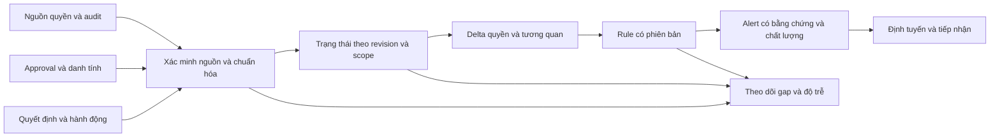
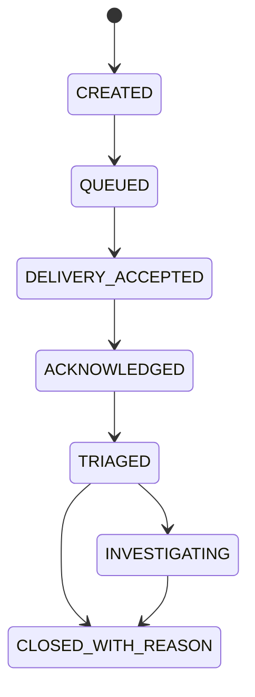

# Alert theo privilege escalation — Đặc tả cảnh báo leo thang đặc quyền

## 1. Mục tiêu và phạm vi

Cảnh báo theo privilege escalation là cảnh báo về dấu hiệu một danh tính có thêm khả năng truy cập hoặc kiểm soát nhạy cảm, vượt khỏi phạm vi dự kiến hoặc thông qua một đường có rủi ro. Cảnh báo cần chỉ ra **quyền nào tăng, của ai, trong scope nào, theo bằng chứng nào và điều gì còn chưa biết**.

Trong chương **Monitoring và detection** của module `SECURITY_SECURITY_DESIGN_SECURITY_REQUIREMENTS`, bài học chuyển mục tiêu an toàn thông tin và mô hình đe dọa thành yêu cầu phát hiện, cảnh báo và nghiệm thu có thể kiểm chứng.

Nội dung bao gồm nguồn bằng chứng, quyền hiệu lực, tương quan sự kiện, chính sách ngoại lệ, độ trễ, chất lượng dữ liệu, quy trình tiếp nhận và phục hồi detector. Bài học không coi mọi lần cấp quyền là tấn công và không coi một alert là lệnh tự động cấp hoặc thu hồi quyền.

Các mã rule, ngưỡng và schema trong bài là **thiết kế minh họa**, phải được điều chỉnh theo rủi ro, kiến trúc và năng lực vận hành.

## 2. Tình huống xuyên suốt và mô hình đe dọa

Một nền tảng học tập phục vụ nhiều tổ chức; mỗi tổ chức là một `tenant`. Hệ thống có người học, quản trị viên tenant, nhân viên hỗ trợ và service xuất báo cáo.

Một nhân viên hỗ trợ chỉ nên đọc dữ liệu được giao trong thời hạn giới hạn. Một service chỉ nên tạo bản xuất trong scope được phê duyệt. Rủi ro xuất hiện khi các danh tính đó có thêm khả năng xuất diện rộng, sửa phân quyền hoặc truy cập tenant khác.

| Mã rủi ro | Tình huống | Hệ quả |
| --- | --- | --- |
| R-01 | Tự cấp hoặc cấp trái phép quyền nhạy cảm | Leo thang khả năng truy cập và điều khiển |
| R-02 | Quyền tăng gián tiếp qua nhóm, role, policy hoặc ủy quyền | Detector chỉ theo dõi membership bỏ sót |
| R-03 | Mở rộng tenant, resource scope hoặc bỏ điều kiện | Truy cập ngoài ranh giới dữ liệu |
| R-04 | Có quyền mới rồi nhanh chóng sử dụng vào hành động nhạy cảm | Tăng tác động trước khi vận hành phản ứng |
| R-05 | Thu hồi bị ghi đè, lệnh cũ hoặc restore cấp lại quyền | Đặc quyền tồn tại trái với trạng thái mong muốn |
| R-06 | Log giả, thiếu, trễ hoặc sai danh tính làm cảnh báo sai | Bỏ sót, quy kết sai hoặc gây gián đoạn |
| R-07 | Ngoại lệ quá rộng, suppression hoặc dedup che thay đổi khác | Mất độ bao phủ phát hiện |
| R-08 | Alert không tới người chịu trách nhiệm hoặc phản ứng tự động sai | Chậm xử lý hoặc tự gây sự cố |
| R-09 | Bằng chứng và alert làm lộ dữ liệu hoặc quyền tenant khác | Rò thông tin qua chính hệ thống giám sát |

Mục tiêu cần cụ thể, chẳng hạn: phát hiện việc một principal có thêm khả năng `EXPORT_TENANT_DATA` hoặc `MANAGE_ACCESS_POLICY` ngoài thay đổi đã được phê duyệt, trong scope được hệ thống quan sát.

“Phát hiện mọi leo thang trong toàn hệ thống” không phải yêu cầu có thể nghiệm thu nếu chưa xác định tài nguyên, danh tính, điểm kiểm soát và đường thay đổi thuộc phạm vi.

## 3. Hiểu đúng sự tăng quyền

### 3.1. Tăng quyền có nhiều hình thức

| Hình thức | Ví dụ | Bằng chứng cần xem xét |
| --- | --- | --- |
| Tăng khả năng thao tác | Từ đọc báo cáo sang tạo bản xuất | Định nghĩa hành động trước/sau |
| Mở rộng tài nguyên hoặc tenant | Từ khóa học được giao sang toàn tenant | Scope và điều kiện quyền |
| Tăng quyền quản trị | Có khả năng sửa role hoặc cấp quyền | Quyền điều khiển và đường cấp tiếp theo |
| Tăng qua kế thừa | Thêm một nhóm vào nhóm đặc quyền | Đồ thị membership và phiên bản |
| Bỏ điều kiện hạn chế | Gỡ thời hạn hoặc ràng buộc tài nguyên | Policy trước/sau |
| Tăng qua ủy quyền | Service được hành động thay phạm vi rộng hơn | Chuỗi ủy quyền được xác minh |
| Cấp lại sau thu hồi | Lệnh cũ làm xuất hiện assignment đã bị gỡ | Revision, command_ref và lịch sử thu hồi |

Thay đổi tên role không chứng minh tăng quyền. Ngược lại, role_id không đổi vẫn có thể tăng quyền nếu định nghĩa role được mở rộng.

### 3.2. Quyền cấu hình, quyền hiệu lực và sử dụng thực tế

Cần phân biệt ba lớp:

1. **Cấu hình:** assignment, membership, policy hoặc điều kiện đã đổi.
2. **Quyền hiệu lực:** điểm quyết định cho phép thêm khả năng trong ngữ cảnh đã xác định.
3. **Sử dụng:** hành động đã được yêu cầu, được cho phép hoặc thực sự có kết quả.

Một event grant có thể mới COMMITTED nhưng chưa được áp dụng ở mọi nơi. Một event cho phép xuất không tự chứng minh dữ liệu đã chuyển ra ngoài. Một event từ chối cũng không chứng minh actor đã có quyền mới.

Alert phải ghi mức bằng chứng đang có, như `CONFIGURATION_CHANGE`, `EFFECTIVE_ACCESS_VERIFIED` hoặc `SENSITIVE_ACTION_OBSERVED`, thay vì gộp thành “tấn công thành công”.

### 3.3. Tính delta trong phạm vi có thể đánh giá

Có thể mô hình hóa khái niệm:

```text
EffectiveAccess(subject, context, policy_revision)
    -> tập khả năng được phép trong phạm vi đánh giá

AddedAccess = AccessAfter - AccessBefore
```

Một khả năng gồm hành động, tài nguyên và điều kiện có ý nghĩa. So sánh cần dùng ngữ cảnh tương ứng và các phiên bản policy đúng thời điểm.

Công thức chỉ có giá trị trên phạm vi đã đánh giá. Với chính sách có điều kiện, deny hoặc nhiều nguồn quyền, không thể thay nó bằng phép cộng tên role. Phân tích trên một tập tài nguyên kiểm thử không chứng minh đã liệt kê mọi tài nguyên có thể truy cập.

Nếu thiếu định nghĩa trước/sau, detector có thể phát candidate alert và cảnh báo suy giảm dữ liệu. Không được diễn giải “không tính được delta” thành “không có quyền tăng”.

### 3.4. Khả năng mở đường tăng quyền cần nhãn riêng

Một principal có thể chưa có quyền đọc dữ liệu nhưng vừa có khả năng sửa nhóm hoặc ủy quyền để tự đạt quyền đó. Đây là tăng khả năng điều khiển có rủi ro.

Nếu phát hiện dựa trên đường có thể dẫn tới quyền nhạy cảm, ghi rõ đó là **khả năng tạo đường truy cập**, chưa phải bằng chứng quyền đích đã được sử dụng. Cách phân loại này giúp người tiếp nhận hiểu đúng mức độ chắc chắn.

## 4. Nguồn dữ liệu và ranh giới tin cậy

### 4.1. Bản đồ dữ liệu tối thiểu

| Nguồn | Dữ liệu cần thiết | Giới hạn |
| --- | --- | --- |
| Nguồn quyền có thẩm quyền | Assignment, membership, role/policy revision, before/after hoặc manifest | Chỉ biết cấu hình, chưa chắc mọi nơi áp dụng |
| Audit thay đổi quyền | Initiator, executor, subject, scope, change_ref, kết quả | Phải xác minh nguồn và độ bao phủ |
| Quy trình phê duyệt | Nội dung được duyệt, phạm vi, thời gian, người có thẩm quyền | Không chỉ là một cờ approved |
| Danh tính và ủy quyền | Principal ổn định, service, chuỗi hành động thay | Không dùng tên tự khai làm danh tính thật |
| Điểm kiểm soát | Revision dùng để quyết định, action, resource, outcome | ALLOW không đồng nghĩa tác dụng phụ hoàn tất |
| Nguồn thực thi nghiệp vụ | Kết quả hành động hoặc phát hành dữ liệu | Phải có ý nghĩa trạng thái rõ |
| Kiểm kê tài nguyên | Mức nhạy cảm và owner | Dữ liệu cũ làm sai tác động |
| Sức khỏe pipeline | Lag, gap, heartbeat, schema, checkpoint | Không có event không chứng minh không có thay đổi |

### 4.2. Ai thay đổi quyền của ai?

Cần tách initiator, approver, executor và subject. Một service thực thi nhiều lệnh không có nghĩa service đó là người khởi tạo mọi thay đổi.

Rule tự cấp quyền phải dựa trên quan hệ danh tính có thẩm quyền giữa người khởi tạo và đối tượng nhận quyền, cùng chính sách tách nhiệm vụ. So sánh executor_ref với subject_ref có thể gây kết luận sai khi mọi thao tác đều đi qua service chung.

Không lấy actor, tenant hoặc role từ claim chưa xác minh hay body client làm trường có thẩm quyền.

### 4.3. Tương quan theo scope

Các phép join cần tenant, principal ổn định, resource scope, change_ref và revision phù hợp. Không tương quan chỉ bằng tên hiển thị, email thô hoặc khoảng thời gian gần nhau.

Một service hoạt động ở nhiều tenant cần được đánh giá từng scope được phép. Không gộp hành vi tenant A và B rồi làm alert lộ dữ liệu của cả hai cho người chỉ được xem A.

Khi tham chiếu giả danh thay đổi khóa hoặc cách chuẩn hóa, cần phiên bản và quy tắc nối được duyệt. Không tự giả định hai ref khác nhau là hai người khác nhau, hoặc hai chuỗi giống nhau luôn cùng một thực thể.

## 5. Pipeline phát hiện và hồ sơ rule



### 5.1. Hợp đồng của một rule

Mỗi rule cần ghi:

- Mã và phiên bản rule, owner và rủi ro được xử lý.
- Loại principal, tài nguyên và đường thay đổi thuộc phạm vi.
- Nguồn, field, quyền tin và mức đầy đủ cần thiết.
- Điều kiện kích hoạt, window, cách đánh giá event time và dữ liệu đến trễ.
- Mức tác động, độ tin cậy và điều kiện thiếu dữ liệu.
- Ngoại lệ, dedup, suppression và thời hạn áp dụng.
- Bằng chứng phải đi kèm alert.
- Tuyến tiếp nhận, playbook và kiểm thử.

Đây là đặc tả hành vi, không chỉ là một truy vấn trong công cụ giám sát.

### 5.2. Trạng thái thiếu dữ liệu

Ví dụ kho approval không truy cập được. Detector không biết thay đổi đã được duyệt hay chưa.

Cần phân biệt `APPROVAL_MATCHED`, `APPROVAL_NOT_MATCHED` sau kiểm tra đủ điều kiện và `APPROVAL_UNKNOWN` do nguồn thiếu hoặc lỗi. Có thể cảnh báo quyền nhạy cảm tăng với ngữ cảnh chưa đủ, nhưng không khẳng định “không được phê duyệt” khi chưa xác minh.

Nếu snapshot policy quá cũ, ghi `BASELINE_STALE`. Nếu thiếu một revision, ghi `REVISION_GAP`. Các cờ này hỗ trợ triage và có thể kích hoạt cảnh báo sức khỏe riêng.

Thiếu dữ liệu không được làm hệ thống im lặng báo xanh.

## 6. Danh mục rule minh họa

### 6.1. PE-01 — Quyền nhạy cảm tăng ngoài nội dung phê duyệt

Điều kiện:

1. Có thay đổi đã commit hoặc quyền hiệu lực được xác minh.
2. Delta có khả năng nhạy cảm trong danh mục, như xuất dữ liệu tenant hoặc sửa phân quyền.
3. Nội dung thay đổi không khớp phê duyệt hợp lệ trong phạm vi đã kiểm tra.

Approval phải khớp subject, scope, quyền, điều kiện, thời hạn và phiên bản liên quan. Cùng change_ref hoặc role_id không đủ nếu nội dung đã bị đổi.

Nếu nguồn approval chưa đủ, tạo alert với trạng thái ngữ cảnh chưa xác định theo chính sách, thay vì tự chuyển thành trường hợp đã duyệt hoặc kết luận không được duyệt.

### 6.2. PE-02 — Tự tăng quyền hoặc vi phạm tách nhiệm vụ

Phát hiện người khởi tạo nhận thêm khả năng nhạy cảm, hoặc quan hệ phê duyệt vi phạm chính sách tách nhiệm vụ đã định.

Ngoại lệ khẩn cấp phải có hồ sơ, scope, thời hạn và quy trình riêng. Không có ngoại lệ kiểu “mọi thay đổi của nhóm admin đều bỏ qua”.

Hai tài khoản khác nhau chưa chắc là hai người độc lập. Rule cần dùng quan hệ danh tính được hệ thống xác định và ghi giới hạn khi chưa có dữ liệu đó.

### 6.3. PE-03 — Quyền tăng gián tiếp hoặc ảnh hưởng diện rộng

Kích hoạt khi role definition, nhóm lồng nhau, resource policy hoặc chuỗi ủy quyền mở thêm khả năng nhạy cảm.

Alert cần manifest hoặc mô tả tập bị ảnh hưởng, phiên bản trước/sau và mức đầy đủ. Nếu phạm vi lớn cần xử lý theo batch, phải giữ trạng thái PENDING/PARTIAL và theo dõi đến hoàn tất.

Không âm thầm chỉ xét 500 principal đầu rồi báo toàn hệ thống không có vấn đề. Có thể phát cảnh báo sớm về thay đổi rủi ro, sau đó bổ sung kết quả đánh giá phạm vi.

### 6.4. PE-04 — Có quyền mới rồi sử dụng nhạy cảm

Ví dụ window là **10 phút theo event time**:

```text
quyền nhạy cảm tăng
    + cùng subject và tenant
    + hành động thuộc scope được mở rộng
    + kết quả thực thi nhạy cảm được quan sát trong 10 phút
    -> alert tương quan
```

Cần phân biệt “request xuất được tiếp nhận” với “dữ liệu đã phát hành”. Alert ghi loại bằng chứng cụ thể.

Tương quan này nâng mức quan tâm, không tự chứng minh hành vi xấu. Một thay đổi hợp lệ có thể được sử dụng ngay. Approval và bối cảnh vẫn là đầu vào triage, không phải lý do bỏ qua mọi bằng chứng khác.

### 6.5. PE-05 — Quyền xuất hiện lại sau thu hồi

Phát hiện quyền nhạy cảm được cấp lại qua lệnh cũ, revision lùi hoặc trạng thái restore không khớp thu hồi có thẩm quyền.

Cần lịch sử và nguồn quyền hiện hành. Nếu thấy sử dụng quyền cũ sau thu hồi nhưng chưa chứng minh có cấp lại, dùng loại tín hiệu riêng như `POST_REVOCATION_PRIVILEGE_USE`, không khẳng định đã có mutation mới.

Độ trễ cache chỉ được coi nằm trong dự kiến khi phù hợp hợp đồng độ mới. Vượt giới hạn cần được cảnh báo theo chính sách, không bỏ qua vô hạn vì “eventual consistency”.

### 6.6. PE-06 — Trạng thái quyền tăng nhưng thiếu đường thay đổi chuẩn

Đối soát phát hiện nguồn quyền hoặc điểm kiểm soát có khả năng nhạy cảm tăng nhưng không liên kết được audit/command chuẩn trong phạm vi đã xác định.

Có thể là bypass, lỗi instrumentation hoặc gap pipeline. Alert ghi các khả năng và chất lượng bằng chứng; không tự quy kết actor nếu chỉ có tài khoản kết nối hệ thống.

Rule cần nguồn đối soát đủ độc lập và định nghĩa mức bao phủ. So sánh hai bản sao cùng nhận từ một producer thiếu sự kiện không tự chứng minh không có bypass.

## 7. Thời gian, thứ tự và tương quan

### 7.1. Giữ cả event time và processing time

Event time là thời gian hành vi được nguồn có thẩm quyền ghi. Processing time mô tả lúc pipeline tiếp nhận, đánh giá hoặc tạo alert.

Các mốc cần thiết gồm:

```text
t_occurred       : hành vi đủ điều kiện thực sự được nguồn ghi
t_available     : bằng chứng cần thiết đã sẵn sàng cho detector
t_alert_created : detector tạo alert
t_delivery_ack  : tuyến nhận xác nhận tiếp nhận thông báo
t_human_ack     : người chịu trách nhiệm xác nhận xử lý
```

Khi một rule cần nhiều sự kiện, mốc hành vi đủ điều kiện là lúc bộ điều kiện đã hình thành, không mặc định là sự kiện đầu tiên.

Ví dụ PE-04 có grant ở phút 0 và hành động nhạy cảm ở phút 9. Không thể yêu cầu alert tương quan đó xuất hiện 60 giây sau grant khi hành động chưa xảy ra. Tuy nhiên, PE-01 hoặc PE-03 có thể đã đủ điều kiện cảnh báo sớm từ cấu hình thay đổi.

### 7.2. Tách các loại độ trễ

| Chỉ số | Công thức khái niệm | Cho biết |
| --- | --- | --- |
| Thu thập | t_available trừ mốc sự kiện đủ điều kiện | Độ trễ nguồn và pipeline |
| Đánh giá | t_alert_created trừ t_available | Độ trễ detector sau khi đủ đầu vào |
| Chuyển thông báo | t_delivery_ack trừ t_alert_created | Độ trễ tuyến nhận |
| Tiếp nhận con người | t_human_ack trừ t_delivery_ack | Khả năng đáp ứng của người chịu trách nhiệm |
| Tổng quan sát được | t_delivery_ack trừ mốc sự kiện đủ điều kiện | Thời gian từ tín hiệu tới tuyến tiếp nhận |

Các phép trừ giữa hệ thống cần chất lượng đồng hồ phù hợp. Nếu thời gian không đủ tin cậy, phải đánh dấu giới hạn đo; không sửa timestamp để chỉ số đạt mục tiêu.

Đo từ t_available mà bỏ qua hàng giờ log chưa tới có thể làm detector trông nhanh nhưng phát hiện thực tế vẫn muộn. Cần báo cả lag nguồn và độ trễ đánh giá.

### 7.3. Sự kiện đến trễ và revision

Trong ví dụ, PE-04 cho phép bổ sung sự kiện đến trễ trong **2 phút** so với tiến độ event time đã định. Quá khoảng đó, dữ liệu không bị bỏ âm thầm: đi vào xử lý hồi cứu hoặc cơ chế cập nhật kết quả theo chính sách.

Cần định nghĩa thế nào là đủ đầu vào và lúc nào kết luận approval không khớp. Approval đến muộn hoặc nguồn bị lỗi không được biến thành bằng chứng chắc chắn “không được phê duyệt”.

State store áp dụng revision theo phạm vi nguồn. Sự kiện cũ có thể cần để tái dựng lịch sử nhưng không được ghi đè trạng thái hiện hành mới hơn chỉ vì nó đến sau.

### 7.4. Chống đếm lặp và gom alert

Cùng event truyền lại giữ event_id. Một sự kiện mới, một change khác hoặc một hành động khác vẫn phải được nhận diện.

Khóa finding có thể dựa trên tenant, subject, change_ref, rule_id, rule_version và loại bằng chứng. Các sự kiện liên quan có thể cập nhật cùng một finding theo hợp đồng, kèm lịch sử bổ sung.

Không dedup chỉ theo tên role hoặc “cùng tenant trong một giờ”. Cách đó có thể che nhiều principal, scope hoặc loại quyền tăng khác nhau.

Khi nâng cấp rule, kết quả đánh giá mới cần liên kết phiên bản và finding trước nếu phù hợp. Không giả là cùng một lần chạy cũ hoặc tự phát nhiều thông báo giống nhau mà không có thay đổi có ý nghĩa.

## 8. Ngoại lệ, suppression và chất lượng cảnh báo

### 8.1. Approval phải khớp nội dung

Một ngoại lệ hợp lệ cần scope, chủ thể, quyền, thời hạn, nguồn phê duyệt và owner. Nó không chỉ là chuỗi “maintenance” trong message.

Ví dụ ngoại lệ cho service triển khai role revision 8 tại tenant A không bao phủ:

- Revision 9 có thêm quyền khác.
- Tenant B.
- Principal khác.
- Thời gian sau khi ngoại lệ hết hạn.
- Một hành động nhạy cảm ngoài scope đã duyệt.

Hệ thống kiểm tra ngoại lệ ở thời điểm sự kiện và theo phiên bản phù hợp. Việc response sau này cần làm gì vẫn phải xem trạng thái hiện hành.

### 8.2. Suppression không xóa bằng chứng

Có thể giảm thông báo lặp cho cùng finding hoặc điều chỉnh định tuyến trong cửa sổ được duyệt. Sự kiện và kết quả đánh giá vẫn cần được giữ theo chính sách.

Suppression cần người có thẩm quyền, lý do tham chiếu, thời hạn và scope. Khi hết hạn hoặc có dấu hiệu mới như sử dụng quyền nhạy cảm, hệ thống đánh giá lại theo hợp đồng.

Không cho operator hoặc producer tự thêm nhãn “ignore” rồi bỏ mọi rule. Thay đổi suppression và rule cũng là hành động quản trị cần audit.

### 8.3. Tác động và độ tin cậy là hai chiều

| Tình huống | Tác động tiềm năng | Mức chắc chắn về bằng chứng | Cách diễn đạt |
| --- | --- | --- | --- |
| Quyền quản trị toàn nền tảng được xác minh tăng, không khớp approval | Rất cao | Cao nếu nguồn và phạm vi đầy đủ | Tăng quyền quản trị ngoài nội dung đã xác minh |
| Role nhạy cảm đổi, chưa tính đủ tập ảnh hưởng | Có thể rất cao | Một phần | Candidate với phạm vi còn đang đánh giá |
| Nguồn quyền khác audit, pipeline đang có gap | Cao tùy quyền | Chưa đủ kết luận nguyên nhân | Thay đổi quyền chưa có chuỗi bằng chứng đầy đủ |
| Thay đổi đã duyệt đúng nội dung, không có dấu hiệu khác | Theo quyền được cấp | Bằng chứng thay đổi rõ, dấu hiệu bất thường thấp | Ghi nhận hoặc xử lý theo chính sách tương ứng |
| Actor tự khai tên người khác, nguồn không được xác minh | Chưa xác định | Thấp | Không quy kết principal từ dữ liệu tự khai |

Không hạ tác động xuống thấp chỉ vì thiếu dữ liệu. Cần thể hiện tác động tiềm năng và mức chắc chắn riêng để người tiếp nhận chọn bước xử lý phù hợp.

## 9. Hợp đồng alert và bảo vệ bằng chứng

### 9.1. Schema minh họa

```json
{
  "alert_id": "alert_6c2e",
  "finding_ref": "finding_34b8",
  "rule_id": "PE-04",
  "rule_version": "3",
  "evaluation_mode": "LIVE",
  "tenant_ref": "ten_opaque_a",
  "subject_ref": "principal_support_17",
  "change_ref": "change_82e1",
  "added_capability_ref": "capability_manifest_04f",
  "evidence_level": "SENSITIVE_ACTION_OBSERVED",
  "impact": "HIGH",
  "confidence": "HIGH",
  "approval_status": "NOT_MATCHED",
  "data_quality": {
    "revision_state": "COMPLETE_IN_SCOPE",
    "approval_source": "AVAILABLE",
    "late_data_state": "WITHIN_POLICY"
  },
  "evidence_manifest_ref": "evidence_295d",
  "created_at": "2026-11-27T09:15:30Z",
  "routing_policy_version": "routing_12",
  "playbook_ref": "playbook_privilege_review_v2"
}
```

`NOT_MATCHED` trong ví dụ là kết quả kiểm tra đủ điều kiện theo hợp đồng, không phải mặc định khi không truy cập được kho approval.

### 9.2. Alert đủ để hành động, không chứa mọi dữ liệu

Người tiếp nhận cần biết quyền tăng, subject, scope, mốc thời gian, loại bằng chứng, trạng thái approval và giới hạn kết luận.

Chi tiết đầy đủ nên nằm trong kho có phân quyền. Không đưa token, cookie, khóa bí mật, payload dữ liệu xuất hoặc toàn bộ diff nhạy cảm vào thông báo.

Tham chiếu không tự là quyền truy cập. Người biết alert_id hoặc evidence_manifest_ref vẫn phải được xác thực và phân quyền theo tenant, nhiệm vụ và mức chi tiết.

Thông điệp hoặc lý do tự do từ nguồn là dữ liệu chưa tin. Hiển thị an toàn; không thực thi nội dung, không lấy lệnh phản ứng hay liên kết playbook tùy ý từ chuỗi log.

### 9.3. Lịch sử finding

Khi có thêm bằng chứng, có thể nâng mức, thay trạng thái triage hoặc bổ sung phạm vi bằng sự kiện cập nhật có nguồn.

Không sửa ngược một alert ban đầu thiếu dữ liệu thành như thể đã có đầy đủ ngay từ đầu. Cần giữ phiên bản đánh giá, thời điểm bổ sung và liên kết tới bằng chứng.

## 10. Định tuyến, tiếp nhận và phản ứng

### 10.1. Vòng đời từ tạo alert tới xử lý



Cần trạng thái lỗi chuyển tin, retry và escalation trong triển khai thực tế. DELIVERY_ACCEPTED chỉ nghĩa tuyến nhận đã chấp nhận, không phải người đã đọc hoặc xử lý.

Hệ thống phải có owner cho từng scope và mức độ. Tenant được quản trị bởi khách hàng có thể có tuyến khác với hạ tầng dùng chung; không gửi bằng chứng tenant B cho người chỉ có quyền tenant A.

### 10.2. Ngân sách và lỗi chuyển thông báo

Ví dụ trong tải công bố:

- Ít nhất 99% alert đặc quyền cao đủ đầu vào được tạo trong **60 giây từ t_available**.
- Ít nhất 99% các alert đó được tuyến tiếp nhận xác nhận trong **30 giây từ lúc tạo**.
- Lag thu thập, alert chưa chuyển và alert chưa được xác nhận bởi người phụ trách được theo dõi riêng.

Các ngưỡng này không phải cam kết con người xử lý xong sự cố trong 90 giây. Chúng cũng không che độ trễ ở nguồn.

Retry chuyển thông báo cần giới hạn, backoff và chống lặp. Có đường escalation khi tuyến chính lỗi, nhưng không phát rộng dữ liệu nhạy cảm cho mọi người để bù sự cố.

### 10.3. Playbook phản ứng

Một playbook có thể yêu cầu:

1. Xác minh nguồn, scope, chất lượng dữ liệu và phiên bản rule.
2. Kiểm tra nội dung approval, quyền hiệu lực và hành động liên quan.
3. Xác định subject còn quyền gì ở thời điểm hiện hành.
4. Chọn giới hạn tác động theo chính sách, duy trì đường phục hồi cần thiết.
5. Thu thập bằng chứng tối thiểu và đối soát sau phản ứng.
6. Ghi kết luận, mức chắc chắn và tác động.

Không tự thu hồi mọi quyền của actor vì một alert có confidence thấp. Không tự hoàn tác một event cũ nếu điều đó làm cấp lại quyền đã thu hồi sau đó.

### 10.4. Nếu có phản ứng tự động

Phản ứng tự động cần yêu cầu riêng về thẩm quyền, scope, điều kiện kích hoạt, độ mới trạng thái, idempotency và điều kiện dừng.

Alert là tín hiệu, không phải credential hoặc lệnh quản trị. Service phản ứng phải kiểm tra lại trạng thái và quyền trước thao tác, xác minh nguồn alert và giữ bằng chứng.

Replay dữ liệu lịch sử không được gửi lệnh cô lập hoặc thu hồi theo đường LIVE nếu chưa được quy trình riêng cho phép.

## 11. Bộ yêu cầu bảo mật có thể kiểm chứng

Bộ yêu cầu sau dành cho nền tảng minh họa.

| Mã | Yêu cầu và tiêu chí đo | Rủi ro | Điểm thực thi, chủ sở hữu |
| --- | --- | --- | --- |
| PD-01 | Mỗi rule có rủi ro, scope, nguồn, field, độ tin cậy, window, owner, playbook và test; danh mục khả năng nhạy cảm có phiên bản | R-01, R-02, R-03 | Catalog rule và thiết kế; nhóm an ninh |
| PD-02 | Delta sử dụng định nghĩa quyền và context có phiên bản; thiếu baseline hoặc phạm vi chưa đủ được đánh dấu, không diễn giải thành không tăng quyền | R-02, R-06 | Policy projection, graph/state store; nhóm phân quyền |
| PD-03 | Alert tách initiator, executor và subject theo dữ liệu tin cậy; join theo tenant, principal, scope và revision; không quy kết từ tên tự khai | R-06, R-09 | Normalizer, identity resolver; nhóm danh tính |
| PD-04 | Phát hiện cả grant trực tiếp, role/policy/membership thay đổi gián tiếp, mở scope và cấp lại sau thu hồi trong phạm vi công bố | R-01, R-02, R-03, R-05 | PE-01, PE-03, PE-05, PE-06; nhóm detection |
| PD-05 | Approval khớp đúng subject, quyền, scope, thời hạn và phiên bản; lỗi nguồn là UNKNOWN, không mặc định MATCHED hoặc NOT_MATCHED | R-01, R-06, R-07 | Approval matcher; nhóm quản lý thay đổi |
| PD-06 | PE-04 tương quan hành động nhạy cảm trong 10 phút theo event time, phân biệt quyết định ALLOW với kết quả thực thi; dữ liệu đến trễ có cửa sổ và xử lý riêng | R-04, R-06 | Correlator và nguồn nghiệp vụ; nhóm detection |
| PD-07 | Cùng sự kiện truyền lại không tăng finding sai; dedup/suppression không che principal, scope hoặc thay đổi độc lập; mọi ngoại lệ có scope và hạn | R-06, R-07 | Dedup, exception registry; nhóm vận hành detection |
| PD-08 | Trong tải công bố, 99% alert đặc quyền cao đủ đầu vào được tạo trong 60 giây; lag thu thập và độ trễ tổng được báo riêng | R-04, R-08 | Evaluator và metric; nhóm nền tảng |
| PD-09 | Trong tải công bố, 99% alert đặc quyền cao được tuyến nhận chấp nhận trong 30 giây từ lúc tạo; có owner, trạng thái lỗi và escalation | R-08 | Routing, delivery queue; nhóm vận hành |
| PD-10 | Alert có rule_version, change/evidence refs, loại bằng chứng, tác động, confidence và chất lượng dữ liệu; không chứa bí mật hoặc payload nhạy cảm đầy đủ | R-06, R-09 | Alert serializer và kho bằng chứng; nhóm dữ liệu |
| PD-11 | Truy vấn alert/bằng chứng, đổi rule/ngoại lệ và phản ứng được phân quyền; biết một reference không đủ để đọc hoặc sửa dữ liệu | R-07, R-09 | API, IAM và audit quản trị; nhóm phân quyền |
| PD-12 | Theo dõi nguồn, lag, gap revision, rule lỗi, state store, routing và độ tươi đối soát; đối soát cấu hình/audit ít nhất mỗi 5 phút khi vận hành bình thường | R-05, R-06, R-08 | Health signal, PE-06, reconciler; nhóm vận hành |
| PD-13 | Replay/restore giữ ID, phiên bản và thứ tự logic, đánh dấu HISTORICAL; không tự chuyển sang đường phản ứng LIVE | R-05, R-08 | Replay pipeline và runbook; nhóm nền tảng |
| PD-14 | Phản ứng tự động nếu có phải xác minh nguồn, trạng thái hiện hành, quyền, scope và chống lặp; không dùng alert như lệnh cấp/thu hồi quyền | R-06, R-08 | Response service; nhóm an ninh và phân quyền |

PD-04 cần bản đồ các đường thay đổi được quan sát và phần chưa bao phủ. PD-08 đo khi rule đủ đầu vào, không thay yêu cầu nguồn và độ trễ tổng.

PD-12 chạy đối soát mỗi 5 phút không làm mọi rule trở thành rule thời gian thực 60 giây. Cần chỉ rõ đường streaming, đường định kỳ và giới hạn tương ứng.

## 12. Ma trận nghiệm thu và bằng chứng

Kiểm thử dùng tenant, principal, quyền và tài nguyên giả trong môi trường có kiểm soát. Tập ca cần có tình huống rủi ro và tình huống hợp lệ làm đối chứng.

| Ca | Điều kiện và thao tác | Kết quả mong đợi | Yêu cầu |
| --- | --- | --- | --- |
| AT-01 | Grant trực tiếp khả năng nhạy cảm ngoài nội dung được duyệt | Alert đúng subject, scope, delta và trạng thái approval | PD-01, PD-04, PD-05 |
| AT-02 | Tăng quyền qua role definition, nhóm lồng nhau hoặc bỏ điều kiện scope | Phát hiện đường gián tiếp, có phiên bản và phạm vi đánh giá | PD-02, PD-04 |
| AT-03 | Đổi tên role hoặc refactor metadata mà quyền hiệu lực không tăng | Không kết luận tăng quyền chỉ vì tên đổi | PD-02 |
| AT-04 | Người khởi tạo tự nhận quyền, service chung là executor | PE-02 dùng initiator/subject đúng; không quy kết mọi lệnh cho service | PD-03, PD-04 |
| AT-05 | Thay đổi được duyệt chính xác; trường hợp khác chỉ cùng role_id nhưng scope khác | Trường hợp đúng không bị gắn nhãn unapproved; trường hợp lệch được phát hiện | PD-05 |
| AT-06 | Kho approval lỗi hoặc baseline policy thiếu | Chất lượng UNKNOWN/INCOMPLETE rõ, không im lặng hoặc khẳng định sai | PD-02, PD-05 |
| AT-07 | Grant rồi hành động nhạy cảm trong 10 phút; đối chứng là chỉ request được tiếp nhận | Alert phân biệt loại bằng chứng, không gọi mọi request là dữ liệu đã chuyển | PD-06 |
| AT-08 | Event hành động đến trước event grant, event trễ trong và ngoài cửa sổ 2 phút | Tương quan theo chính sách; dữ liệu quá trễ đi đường hồi cứu, không bỏ âm thầm | PD-06, PD-13 |
| AT-09 | Event truyền lại, hai subject khác nhau và hai thay đổi độc lập cùng tenant | Dedup đúng; không suppression nhầm các finding khác | PD-07 |
| AT-10 | Ngoại lệ hết hạn hoặc bị đổi scope; có thêm dấu hiệu sử dụng nhạy cảm | Đánh giá lại theo hợp đồng, không bỏ mọi rule vì maintenance | PD-05, PD-07 |
| AT-11 | Tải trong mức công bố và cố ý gây lag riêng ở nguồn, evaluator, routing | Đo tách các độ trễ, nhận ra phần lỗi; không che lag bằng chỉ số evaluator | PD-08, PD-09, PD-12 |
| AT-12 | Tuyến nhận lỗi, phản hồi chuyển tin timeout, người chưa ack | Retry/escalation hữu hạn, không nhầm delivery ack với human ack | PD-09 |
| AT-13 | Lệnh cũ hoặc snapshot cũ làm quyền xuất hiện lại sau thu hồi | PE-05 có lịch sử/revision đúng, không dùng event cũ làm trạng thái hiện hành | PD-04, PD-13 |
| AT-14 | Nguồn quyền thay đổi nhưng thiếu event chuẩn | PE-06 hoặc cảnh báo gap nêu nguồn và giới hạn, không bịa actor | PD-04, PD-12 |
| AT-15 | Tenant A mở alert/evidence tenant B; nội dung log chứa markup hoặc chỉ dẫn giả | Chặn truy cập, hiển thị dữ liệu an toàn, không thực thi nội dung | PD-10, PD-11 |
| AT-16 | Thay đổi rule hoặc suppression không đủ quyền | Bị chặn; thay đổi hợp lệ có phiên bản và audit | PD-01, PD-07, PD-11 |
| AT-17 | Restore state store và replay lịch sử cùng dữ liệu LIVE | Phân luồng và ID đúng, không phát lệnh phản ứng lịch sử hoặc đếm lặp sai | PD-13 |
| AT-18 | Alert giả, trùng hoặc cũ được gửi tới service phản ứng | Không thao tác quyền nếu chưa đủ nguồn, trạng thái, scope và thẩm quyền | PD-14 |
| AT-19 | Role nhạy cảm ảnh hưởng lượng lớn principal, đánh giá chưa xong | Alert ban đầu nêu mức đầy đủ; theo dõi batch còn lại, không báo đã kiểm tra tất cả | PD-02, PD-04 |
| AT-20 | Heartbeat hoặc job đối soát dừng trong khi không có event mới | Có tín hiệu suy giảm, không coi im lặng là không có rủi ro | PD-12 |

Bằng chứng nên gồm snapshot quyền và revision, approval đã làm sạch, event đầu vào, kết quả rule, alert, lịch sử delivery và phản ứng kiểm thử. Chỉ có ảnh chụp dashboard không đủ để chứng minh delta và scope đúng.

Tập đối chứng cần quyền tăng hợp lệ, hành vi không tăng quyền, thay đổi tên role, nhiều tenant trùng tên principal và dữ liệu chưa đủ. Không chỉ thử những ca chắc chắn phải cảnh báo.

## 13. Đo hiệu quả mà không tạo cảm giác bao phủ giả

### 13.1. Các lớp độ bao phủ

Cần tách:

- Độ bao phủ nguồn: đường thay đổi và hành động nào có tín hiệu.
- Độ bao phủ ngữ nghĩa: quyền, scope và điều kiện nào đánh giá được.
- Độ bao phủ rule: rủi ro nào đã có logic và nghiệm thu.
- Độ bao phủ vận hành: alert có tới đúng người, có được tiếp nhận và xử lý không.

Một rule đạt trên dữ liệu mẫu không chứng minh mọi service có log đầy đủ. Một pipeline không mất event cũng không chứng minh rule hiểu đúng quyền kế thừa.

### 13.2. False positive và false negative

Precision và recall chỉ có ý nghĩa trên tập có nhãn và định nghĩa rõ. Kết quả từ một tập kiểm thử không thể tự suy rộng thành khả năng phát hiện mọi hành vi thực tế.

Alert được đóng vì thay đổi hợp lệ không luôn có nghĩa rule sai; rule có thể được thiết kế để yêu cầu xem xét mọi thay đổi đặc quyền cao. Cần phân biệt mục tiêu “phát hiện tăng quyền cần kiểm tra” với “kết luận hành vi xấu”.

Các ca bị bỏ sót, dữ liệu thiếu và alert chưa có kết luận phải được ghi riêng. Không coi “chưa xác nhận tấn công” là bằng chứng chắc chắn không có tấn công.

### 13.3. Chỉ số không làm rò dữ liệu hoặc cạn tài nguyên

Có thể tổng hợp theo rule_id, phiên bản, loại bằng chứng, impact, confidence và trạng thái pipeline trong tập chiều đã duyệt.

Không dùng subject_ref, change_ref, email hoặc nội dung diff làm nhãn metric không giới hạn. Chi tiết cần được tra cứu qua kho có phân quyền và giới hạn tài nguyên.

## 14. Vận hành, thay đổi rule và phục hồi

### 14.1. Khi phát hành rule

Gắn rule với rủi ro, schema và phiên bản nguồn. Chạy kiểm thử hồi quy trên dữ liệu giả hoặc dữ liệu đã được phép dùng, xem xét ngoại lệ và kết quả đối chứng.

Một giai đoạn quan sát trước khi bật phản ứng tự động có thể giúp hiểu hành vi nếu nằm trong kế hoạch. Các điều kiện bật, owner và kết thúc giai đoạn phải rõ; không để rule mãi ở chế độ không ai tiếp nhận.

Khi thay đổi phiên bản, giữ lịch sử để giải thích alert cũ. Không diễn giải kết quả PE-03 v1 theo logic v4 mà không ghi đó là tái đánh giá.

### 14.2. Khi detector suy giảm

Xác định lỗi ở nguồn, schema, identity resolver, baseline, correlator, rule, routing hay quyền truy vấn. Báo trạng thái suy giảm và phần rủi ro không còn được quan sát.

Không tắt toàn bộ cảnh báo để giảm nhiễu khi nguyên nhân là một nguồn bị lỗi. Không mặc định lấy dữ liệu tự khai thay dữ liệu tin cậy để detector tiếp tục có kết quả.

Backlog, sự kiện cách ly và bằng chứng phụ có quyền và thời hạn lưu riêng; không trở thành kho dữ liệu nhạy cảm bỏ quên.

### 14.3. Khi restore hoặc replay

Khôi phục checkpoint, revision, quan hệ danh tính và phiên bản rule nhất quán. Có thể dựng projection cách ly và đối soát trước khi chuyển sang phục vụ LIVE.

Dữ liệu lịch sử giữ nhãn và đường tác động riêng. Một finding quan trọng phát hiện hồi cứu cần được tiếp nhận với thời gian hành vi thật và mức trễ rõ, không giả là sự kiện vừa xảy ra.

Trước phản ứng, xác minh quyền hiện hành. Một grant trong dữ liệu cũ có thể đã được thu hồi hoặc thay thế; replay không phải lý do để hoàn tác trạng thái mới.

## 15. Lỗi thiết kế thường gặp

| Lỗi | Vì sao nguy hiểm | Cách sửa |
| --- | --- | --- |
| Chỉ alert khi thấy chuỗi admin | Bỏ sót scope, policy và quyền gián tiếp | Danh mục khả năng, phiên bản và delta |
| Mọi grant là tấn công đã xác nhận | Tạo kết luận vượt bằng chứng | Tách thay đổi, bất thường và kết luận triage |
| Role_id không đổi thì coi không tăng quyền | Định nghĩa role có thể mở rộng | So sánh ngữ nghĩa và phiên bản |
| Actor do client gửi là người gây sự cố | Quy kết sai, dễ giả mạo | Danh tính và delegation có thẩm quyền |
| Approval nguồn lỗi thì coi đã duyệt | Bỏ lọt thay đổi rủi ro | UNKNOWN rõ và xử lý suy giảm |
| Cùng tenant là gom một alert | Che subject và scope độc lập | Finding key và suppression có hợp đồng |
| ALLOW được coi là dữ liệu đã xuất | Nhầm quyết định với tác dụng phụ | Phân loại loại bằng chứng |
| Chỉ đo từ lúc detector có dữ liệu | Che hàng giờ ingest lag | Độ trễ nguồn, đánh giá, delivery và tổng riêng |
| Delivery thành công nghĩa là người đã xử lý | Bỏ khoảng trống trách nhiệm | Trạng thái và owner tiếp nhận rõ |
| Alert tự là lệnh thu hồi | Dữ liệu giả, trễ hoặc trùng gây thay đổi quyền sai | Kiểm tra thẩm quyền, trạng thái và chống lặp |
| Replay đi cùng đường LIVE không phân biệt | Phản ứng lại trên hành vi cũ | Chế độ hồi cứu và tác động có kiểm soát |
| Không có alert nghĩa là không có tăng quyền | Có thể thiếu nguồn hoặc rule đã lỗi | Health, gap và độ bao phủ riêng |

## 16. Bài tập vận dụng

Một hệ thống chỉ cảnh báo khi role mới có tên chứa “admin”. Nó không đọc phiên bản định nghĩa role. Actor lấy từ body client; approval service lỗi thì mặc định cho qua. Alert cùng tenant bị gộp trong một giờ, và mọi alert đều tự động gỡ role. Sau restore, dữ liệu cũ được replay qua đường phản ứng LIVE.

Hãy xây dựng:

1. Bảng rủi ro và scope nguồn cần quan sát.
2. Định nghĩa quyền tăng trực tiếp, gián tiếp, mở scope và cấp lại sau thu hồi.
3. Ba rule có nguồn, window, mức đầy đủ, ngoại lệ và bằng chứng cụ thể.
4. Schema alert phân biệt tác động, confidence, approval và chất lượng dữ liệu.
5. Sáu yêu cầu đo được về tương quan, độ trễ, dedup, phân quyền và phục hồi.
6. Bộ kiểm thử có ca rủi ro, ca hợp lệ, nguồn lỗi và replay không gây thay đổi quyền sai.

Khi tự đánh giá, kiểm tra alert có giải thích được quyền nào tăng, của ai, trong phạm vi nào và bằng chứng mạnh tới đâu. Một cơ chế phát hiện tốt cần vừa giúp người phụ trách hành động kịp thời, vừa giữ đúng ranh giới dữ liệu, thẩm quyền và giới hạn kết luận.
