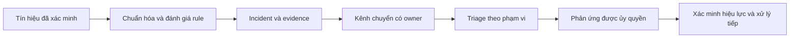

# Alert theo malware signal

## 1. Mục tiêu của cảnh báo theo tín hiệu malware

**Malware signal** là dữ liệu quan sát hoặc kết luận từ một nguồn phát hiện về mã độc hay hành vi có thể liên quan mã độc. Nguồn có thể là antivirus, endpoint detection and response — EDR, dịch vụ quét file, bộ phân tích hành vi, bảo vệ email hoặc telemetry mạng.

**Alert theo malware signal** là yêu cầu chuyển tín hiệu đủ điều kiện thành một cảnh báo có bằng chứng, phạm vi, mức ưu tiên và người chịu trách nhiệm xử lý. Tạo alert không tự chứng minh máy đã bị nhiễm, malware đã chạy hoặc sự cố đã được xử lý xong.

Ví dụ, một file bị scanner gắn verdict độc hại trong vùng upload chưa công bố. Hệ thống cần ngăn phục vụ file theo policy, lưu bằng chứng và chuyển cảnh báo phù hợp. Điều đó khác với quan sát một tiến trình đang sửa dữ liệu hàng loạt trên máy chủ quan trọng.

Bài học thuộc chương Monitoring và detection của module yêu cầu bảo mật. Trọng tâm là chuyển rủi ro thành contract: nhận tín hiệu gì, tin cậy đến đâu, tạo alert khi nào, phản ứng nào được phép và bằng chứng nào xác nhận hiệu lực.

[NIST SP 800-83 Rev. 1](https://csrc.nist.gov/pubs/sp/800/83/r1/final) bàn về phòng ngừa và xử lý malware trên desktop/laptop. [NIST SP 800-61 Rev. 3](https://csrc.nist.gov/pubs/sp/800/61/r3/final) đặt phát hiện, phản ứng và phục hồi trong quản lý rủi ro an ninh. Bài học vận dụng các mục tiêu đó để đặc tả pipeline cảnh báo; không coi một sản phẩm hay chữ ký đơn lẻ là bảo đảm toàn diện.

Mọi rule, ngưỡng, thời hạn, tên tài nguyên và verdict trong ví dụ là thiết kế giả định, không phải giá trị bắt buộc cho mọi hệ thống.

## 2. Phân loại nguồn tín hiệu và giới hạn của chúng

| Nguồn | Tín hiệu minh họa | Giới hạn cần giữ khi diễn giải |
|---|---|---|
| Antivirus/file scanner | Chữ ký, verdict hoặc danh tính nội dung | Phát hiện nội dung không tự chứng minh nội dung đã thực thi |
| EDR/runtime sensor | Process, lineage, hành vi, tamper hoặc action outcome | Cần asset/process identity, coverage và trạng thái sensor |
| Email/upload gateway | File bị chặn, kết quả phân tích attachment | Không mặc định mọi bản sao hoặc đường chia sẻ đều đã bị chặn |
| Reputation/threat intelligence | Digest, domain/IP hoặc publisher bị đánh giá rủi ro | Indicator có thời hạn, nguồn và khả năng trùng bối cảnh hợp lệ |
| Network telemetry | Kết nối hoặc mẫu lưu lượng đáng ngờ | Kết nối tới một đích không tự chứng minh mã độc nào đã chạy |
| Sandbox/phân tích có kiểm soát | Hành vi quan sát trong môi trường phân tích | Phạm vi quan sát không đồng nhất với điều đã xảy ra trên production |
| Bảo vệ container/cloud workload | Verdict hoặc hoạt động gắn với image/workload cụ thể | Cần version/instance; finding lỗ hổng không đồng nghĩa finding malware |

Các tín hiệu có thể bổ sung cho nhau. Tuy nhiên, hai alert do cùng một engine phát sinh rồi chuyển qua hai hệ thống không phải hai nguồn độc lập xác nhận lẫn nhau.

Một file chưa có reputation hoặc không khớp chữ ký đã biết vẫn có thể cần phân tích theo policy. Ngược lại, một công cụ quản trị hợp lệ có thể bị đánh dấu đáng ngờ do ngữ cảnh. Yêu cầu cần nói rõ kết luận nào đã được nguồn xác lập và điều nào mới là giả thuyết.

## 3. Không gộp verdict, thực thi và xử lý thành một trạng thái

### 3.1. Kết quả quét cần tách khỏi lỗi quét

| Kết quả | Ý nghĩa theo contract minh họa | Điều không được tự suy ra |
|---|---|---|
| `MALICIOUS` | Engine đã kết luận độc hại theo profile/version | Chắc chắn đã lây nhiễm mọi asset liên quan |
| `SUSPICIOUS` | Có dấu hiệu cần đánh giá thêm | Đã xác nhận một họ malware hoặc hành vi xâm phạm |
| `NO_DETECTION` | Không phát hiện trong phép quét đã hoàn tất và phạm vi đã nêu | Nội dung chắc chắn an toàn trong mọi điều kiện |
| `UNSCANNABLE` | Không thể kiểm đủ do định dạng, mã hóa, giới hạn hoặc điều kiện khác | Tương đương không có malware |
| `ERROR` | Quét không hoàn tất do lỗi | Có thể cho qua như một file đã quét sạch |
| `UNKNOWN` | Chưa có kết luận đáng tin cậy | Có một kết luận âm tính |

Tên enum có thể khác theo sản phẩm. Adapter cần giữ ý nghĩa, scan status, coverage và lý do; không ép mọi kết quả khác positive thành `CLEAN`.

Archive được bảo vệ bằng password, định dạng không hỗ trợ hoặc file vượt giới hạn quét cần đường xử lý riêng. Bài học không đặt quy tắc chung phải nhận hay từ chối tất cả; profile phải quyết định, và audit/alert phải phản ánh đúng.

### 3.2. Các mốc tác động và xử lý là những dữ kiện riêng

```text
signal detected
  -> file delivery prevented hoặc chưa biết
  -> execution observed hoặc chưa có bằng chứng
  -> quarantine/isolation requested
  -> quarantine/isolation confirmed theo scope
  -> investigation và remediation
  -> verification/recovery theo quyết định
```

Một công cụ có thể đã chặn file nhưng còn cần điều tra nguồn phát tán. Một request cách ly đã được gửi có thể chưa tới agent. Một file đã được quarantine không chứng minh tiến trình đã chạy trước đó cũng bị dừng hoặc credential liên quan không bị lộ.

Không đóng incident chỉ vì API phản ứng trả thành công, trừ khi contract và bằng chứng thật sự đáp ứng điều kiện đóng đã định.

## 4. Mô hình đe dọa và mục tiêu phát hiện

| Mã | Tình huống | Rủi ro cần giải quyết |
|---|---|---|
| R1 | Chỉ dựa vào chữ ký hoặc một nguồn duy nhất | Bỏ sót hành vi hoặc nội dung ngoài coverage |
| R2 | Ghép sai file/version/asset hoặc tin verdict tự khai | Chặn nhầm, cho nhầm hoặc quy sai phạm vi |
| R3 | Không quét được, sensor im lặng hoặc dữ liệu trễ bị coi là an toàn | Điểm mù không được phát hiện |
| R4 | Positive, execution và containment bị gộp | Đánh giá sai mức ảnh hưởng hoặc đóng case quá sớm |
| R5 | Alert lặp hoặc suppression chỉ theo hash | Nhiễu hoặc bỏ sót các asset mới chịu tác động |
| R6 | Hành động tự động quá rộng hoặc phá bằng chứng | Gián đoạn nghiệp vụ, mất khả năng điều tra |
| R7 | File, command line, URL, token hoặc mẫu nghi độc bị phát tán qua alert | Rò rỉ dữ liệu hoặc tạo thêm đường tiếp cận vật phẩm nguy hiểm |
| R8 | Không có owner, kênh lỗi hoặc rule thay đổi không kiểm thử | Cảnh báo không dẫn tới xử lý có trách nhiệm |

Các mục tiêu minh họa:

- Phát hiện nội dung bị engine tin cậy kết luận độc hại trong luồng nhận file.
- Ưu tiên cao hơn khi có bằng chứng thực thi hoặc hành vi gây ảnh hưởng.
- Nối các asset/workload liên quan mà không nhầm duplicate với lây lan mới.
- Phát hiện mất coverage hoặc hành động bảo vệ chưa hoàn tất.
- Chuyển evidence an toàn tới đúng owner và xác minh phản ứng theo scope.

## 5. Chuẩn hóa tín hiệu và xác minh nguồn

### 5.1. Schema đầu vào tối thiểu

```json
{
  "eventId": "malware-event-demo-341",
  "schemaVersion": 1,
  "eventType": "MALWARE_SCAN_COMPLETED",
  "occurredAt": "2026-01-12T09:15:00.123Z",
  "observedAt": "2026-01-12T09:15:00.520Z",
  "tenantRef": "tenant-demo-a",
  "sourceRef": "upload-scanner-demo",
  "engineVersion": "engine-demo-12",
  "detectionContentVersion": "content-demo-88",
  "artifact": {
    "objectRef": "upload-demo-71",
    "objectVersion": "version-demo-3",
    "contentDigestRef": "digest-record-demo-83"
  },
  "scanStatus": "COMPLETED",
  "verdict": "MALICIOUS",
  "executionState": "UNKNOWN",
  "containmentState": "PENDING",
  "evidenceRef": "evidence-demo-19"
}
```

Đây là dữ liệu giả. `contentDigestRef` trỏ tới record digest được bảo vệ phù hợp, không phải một chuỗi giả làm giá trị hash. Schema thực tế cần loại/định dạng digest khi dùng để đối chiếu nội dung.

Nguồn event phải được xác minh qua kênh và identity của producer. Field `sourceRef` trong JSON hoặc header kiểu “scan clean” từ client không đủ để xác lập verdict.

### 5.2. Identity của asset và process phải bền trong đúng phạm vi

File name hoặc path có thể bị đổi và tái sử dụng. Kết quả quét cần gắn với object/version hoặc nội dung cụ thể. Một file khác ghi vào cùng path không được thừa hưởng verdict của file trước.

PID có thể được tái sử dụng. Tương quan process cần danh tính instance phù hợp với host/boot/start hoặc cơ chế do nguồn cung cấp, không chỉ PID. Tên host, pod hoặc workload cũng có thể được tái sử dụng sau triển khai; cần tham chiếu instance và inventory tại thời điểm liên quan.

Với image/container, cần phân biệt artifact được quét với workload đang thực thi. Một tên tag thay đổi không tự chứng minh mọi instance đang chạy cùng nội dung.

### 5.3. Timestamps, coverage và giới hạn quan sát

Giữ thời điểm xảy ra, thu nhận và trạng thái độ mới của engine/sensor. Event đến muộn không được đổi thời điểm nguồn thành hiện tại để che backlog.

Nếu source không cung cấp một thuộc tính, giữ unknown hoặc trạng thái chất lượng tương ứng. Không suy “chưa quan sát thực thi” thành “chắc chắn chưa từng chạy” khi telemetry không bao phủ toàn bộ khoảng cần xem xét.

## 6. Rule theo malware signal cần gì ngoài một verdict?

### 6.1. Bộ use case minh họa

| Rule | Điều kiện minh họa | Điều cần giữ trong alert |
|---|---|---|
| MAL-A01 | Verdict `MALICIOUS` hợp lệ cho một artifact/version thuộc luồng được giám sát | Nguồn, version, vị trí/scope, delivery và containment chưa/đã xác nhận |
| MAL-A02 | Tín hiệu đáng ngờ nối với process execution và hành vi bổ sung trong cửa sổ phù hợp | Process lineage, asset instance, quan hệ thời gian và mức độc lập của evidence |
| MAL-A03 | Mẫu sửa dữ liệu hàng loạt vượt baseline, kết hợp tín hiệu runtime liên quan | Giả thuyết ảnh hưởng dữ liệu; phân biệt backup, mã hóa hoặc công cụ hợp lệ |
| MAL-A04 | Hành vi làm suy giảm sensor hoặc control đi cùng tín hiệu bất thường | Phân biệt maintenance được duyệt với tamper chưa giải thích |
| MAL-A05 | Artifact/tín hiệu liên quan xuất hiện trên nhiều instance trong phạm vi tương quan | Danh sách asset mới, evidence tại từng nơi và thời gian |
| MAL-H01 | Sensor, scanner, rule hoặc kênh phản ứng mất khả năng theo contract | Health/coverage alert, không giả thành malware đã xác nhận |

Không cần chờ nhiều tín hiệu mới tạo alert cho một positive đủ tin cậy. Tương quan dùng để nâng ngữ cảnh và ưu tiên; nó không phải lý do trì hoãn mọi cảnh báo quan trọng.

Với giả thuyết ransomware, [MITRE ATT&CK T1486](https://attack.mitre.org/techniques/T1486/) mô tả mã hóa dữ liệu nhằm gây ảnh hưởng khả dụng. Tuy nhiên, chỉ nhìn một thao tác mã hóa hoặc nhiều file đổi tên chưa đủ xác định ransomware; cần ngữ cảnh và bằng chứng thích hợp.

### 6.2. Điều kiện thời gian và ngưỡng phải cụ thể

Ví dụ một rule hành vi có thể xét cùng process instance tạo nhiều thay đổi tài liệu trong 60 giây và có evidence bổ sung. Ngưỡng, loại thay đổi, scope tài liệu, baseline và hành vi hợp lệ phải được đặc tả theo môi trường.

Nếu đặt một ngưỡng số lượng minh họa để thử nghiệm, cần kiểm quanh biên, tải hợp lệ và các mẫu hoạt động chậm/phân tán. Không lấy một con số dùng ở desktop rồi áp nguyên cho server xử lý batch.

Cần nêu event time hay ingest time, biên cửa sổ, cadence, lateness và cách cập nhật alert khi có evidence muộn. Thứ tự đến không luôn là thứ tự xảy ra.

### 6.3. Reputation và allowlist có vòng đời

Indicator có nguồn, thời điểm đánh giá, phạm vi và thời hạn. Một hash không có trong danh sách xấu không tự là bằng chứng an toàn; một IP có reputation xấu có thể dùng chung nhiều dịch vụ.

Allowlist cần gắn đúng nội dung, publisher/profile, scope và điều kiện, có owner cùng ngày rà soát. Chỉ tên file, path, chữ ký publisher hoặc tag image không tự bảo đảm nội dung không thể bị lạm dụng.

Khi verdict hoặc detection content thay đổi, cần giữ phiên bản và mối liên hệ với kết luận trước. Không ghi đè lịch sử khiến không thể giải thích tại sao một object từng được cho qua hoặc bị chặn.

## 7. Kết nối alert với cổng nhận file mà không nhầm chức năng

### 7.1. Prevention và detection là hai contract

Một luồng upload có thể có trạng thái pending scan, được phép phục vụ, quarantine hoặc review. Alert có thể chạy bất đồng bộ, nên không được là lý do duy nhất để giả định file đã được chặn trước khi người dùng tải.

Quyết định phục vụ cần xét verdict hợp lệ, artifact version, freshness và policy ngay tại cổng liên quan. Lỗi detector không được khiến cổng bỏ qua điều kiện quét bắt buộc.

Nếu một archive không quét đủ, phải theo profile cho unsupported/unscannable, không biến thành `NO_DETECTION` để giữ luồng chạy. Những đường download trực tiếp, signed URL, cache, bản sao và alias cũng cần được đánh giá theo phạm vi phục vụ.

### 7.2. Giữ binding giữa kết quả và nội dung

Một object có thể thay nội dung sau khi được quét. Cần cơ chế version/immutability hoặc kiểm binding thích hợp để kết quả cũ không áp vào bytes mới.

Quét lại sau cập nhật engine hoặc khi có intelligence mới có thể làm thay đổi verdict cho nội dung trước đây. Cần rule về tác động tới bản đang được phục vụ, case liên quan và người chịu trách nhiệm; không tự xóa lịch sử verdict cũ.

### 7.3. Positive trong upload chưa chứng minh host bị nhiễm

Một file được nhận trong vùng cách ly có thể chưa được thực thi. Alert nên ghi đúng trạng thái delivery/execution đã biết và giữ các trạng thái khác là unknown hoặc theo evidence.

Ngược lại, một lần quarantine thành công không phủ nhận evidence rằng file đã được thực thi trước đó. Điều tra và phản ứng phải xét timeline của từng mốc.

## 8. Nội dung alert: đủ để điều tra, không suy diễn quá mức

### 8.1. Một alert phải trả lời những câu hỏi nào?

| Nhóm | Thông tin cần có |
|---|---|
| Phát hiện | Rule/version, nguồn, loại tín hiệu, verdict và detection content |
| Giả thuyết | Điều đang nghi ngờ, mức tin cậy và lý do |
| Phạm vi | Tenant, asset instance, artifact/version hoặc process reference |
| Thời gian | First/last observation phù hợp, cửa sổ và thời điểm nhận |
| Tác động | Delivery, execution, dữ liệu hoặc chức năng liên quan đã biết |
| Kiểm soát | Action requested/confirmed/failed/unknown với scope |
| Chất lượng | Sensor coverage, nguồn thiếu, dữ liệu trễ hoặc tương quan chưa chắc chắn |
| Xử lý | Owner, playbook, evidence reference, severity và trạng thái case |

Ví dụ một alert upload:

```json
{
  "alertId": "malware-alert-demo-501",
  "ruleId": "MAL-A01",
  "ruleVersion": 4,
  "hypothesis": "MALICIOUS_CONTENT_IN_UPLOAD",
  "tenantRef": "tenant-demo-a",
  "artifactRef": "upload-demo-71",
  "artifactVersion": "version-demo-3",
  "signalVerdict": "MALICIOUS",
  "executionEvidence": "UNKNOWN",
  "containment": {
    "action": "QUARANTINE_OBJECT",
    "status": "REQUESTED",
    "scopeRef": "object-scope-demo-71"
  },
  "severity": "MEDIUM",
  "status": "OPEN",
  "evidenceSetRef": "evidence-set-demo-708",
  "playbookRef": "malicious-upload-triage-demo-2"
}
```

Severity trong ví dụ là lựa chọn minh họa, không phải mọi positive upload đều ở mức trung bình. Chưa có bằng chứng thực thi thì không gắn host là đã nhiễm; action mới requested thì không gắn incident là đã contained.

### 8.2. Severity, confidence và tác động là các trục riêng

Severity nên xét mức quan trọng của asset, dữ liệu, bằng chứng thực thi, khả năng lan rộng và kiểm soát đã hiệu lực. Confidence phản ánh độ vững của kết luận theo nguồn/evidence. Hai trục không tự thay thế nhau.

Một positive mạnh đã bị chặn trước công bố có thể có confidence cao nhưng tác động khác với hành vi phá dữ liệu đang diễn ra trên hệ thống quan trọng. Một anomaly độ tin cậy thấp trên asset quan trọng vẫn cần cách xử lý thận trọng theo profile.

Nếu nguồn cung cấp risk score, phải giữ ý nghĩa/version và giới hạn. Không chuyển một số điểm thành xác suất xâm phạm hoặc sự chắc chắn tuyệt đối nếu không có cơ sở tương ứng.

### 8.3. Kênh cảnh báo chỉ mang dữ liệu tối thiểu

Thông báo nên có tóm tắt, phạm vi tối thiểu và link tới evidence được phân quyền. Không đính kèm mẫu nghi độc hoặc raw command line có token/password vào email/chat thông thường.

Filename, path, URL, tên người dùng và nội dung file có thể chứa PII, secret hoặc chuỗi không tin cậy. Cần projection, encode và giới hạn phù hợp; evidence chi tiết nằm ở vùng có quyền riêng.

Link evidence không phải bearer bypass. Biết Alert ID hoặc URL không được tự tạo quyền tải mẫu, xem dữ liệu tenant khác hoặc điều khiển phản ứng.

## 9. Correlation, dedup và suppression phải giữ phạm vi ảnh hưởng

### 9.1. Không dedup cả sự cố chỉ bằng hash

Cùng một nội dung xuất hiện trên hai asset mới là thông tin về phạm vi, không đơn thuần là hai bản log trùng. Nếu suppress theo hash toàn hệ thống, asset thứ hai có thể bị bỏ qua.

Cần tách:

- Duplicate vận chuyển: cùng event được gửi lại, không phải một lần phát hiện mới.
- Phát hiện lặp tại cùng object/asset theo policy: có thể cập nhật cùng incident.
- Phát hiện trên instance hoặc object version mới: phải giữ bằng chứng phạm vi mới.
- Verdict mới, nguồn mới hoặc evidence thực thi mới: có thể làm thay đổi severity và workflow.

Correlation có thể gom các case liên quan thành một chiến dịch, nhưng phải giữ từng asset, mốc thời gian và trạng thái xử lý. Không dùng danh sách asset đã bị cache cũ để gửi lệnh cách ly tới một instance khác vừa dùng lại tên.

### 9.2. Suppression giới hạn thông báo, không xóa sự kiện

Rule cần scope, thời hạn, lý do, owner và điều kiện escalation. Trong thời gian suppress, evidence hoặc counter quan trọng vẫn được cập nhật theo contract.

Bằng chứng execution mới, asset quan trọng mới hoặc containment thất bại có thể cần vượt suppression theo policy. Không tiếp tục im lặng chỉ vì case đầu đã được một provider đánh dấu “handled”.

Allowlist cho một bản công cụ kiểm thử hoặc bảo trì không tự miễn mọi file cùng tên hay mọi hoạt động từ một nhóm người dùng. Phải định nghĩa binding và ngày rà soát phù hợp.

### 9.3. Một pipeline nhiều tầng không tạo nhiều nguồn độc lập giả

Một verdict từ scanner được chuyển qua gateway, SIEM và case management vẫn có thể là cùng một nguồn ban đầu. Evidence lineage giúp tránh cộng confidence như thể ba công cụ đã tự xác nhận độc lập.

Nếu dùng nhiều nguồn, cần xem chúng quan sát cùng vật phẩm, cùng thời điểm hay những hoạt động khác nhau. Không ghép hai process chỉ vì tên giống nhau hoặc hai file chỉ vì path trùng.

## 10. Chuyển cảnh báo và phản ứng theo thẩm quyền

### 10.1. Alert, notification và incident có trạng thái riêng



Incident cần được lưu bền và công việc gửi có khả năng retry thích hợp. Kênh thông báo chấp nhận không đồng nghĩa người trực đã xem; cần acknowledgment, chuyển ca và escalation theo mức ưu tiên.

Nếu kênh lỗi, phải có trạng thái và đường dự phòng. Không tạo một incident mới cho mỗi lần gửi lại cùng notification, và không đóng incident chỉ vì gửi webhook thành công.

### 10.2. Phản ứng cần đúng đối tượng và mức tác động

| Hành động | Bằng chứng cần xác nhận | Điều không tự được suy ra |
|---|---|---|
| Chặn nhận/serving artifact | Đúng object/version và các đường phục vụ trong scope bị chặn | Mọi bản sao hoặc host liên quan đã an toàn |
| Quarantine file/object | Lưu trữ/quyền truy cập của vật phẩm đã thay theo contract | Process đã chạy bị dừng hoặc credential đã lộ được xử lý |
| Dừng process | Đúng process instance bị xử lý và kết quả được xác minh | Persistence hoặc các process khác đã được loại bỏ |
| Cách ly asset | Scope kết nối cần chặn đã có hiệu lực trên đúng instance | Đã xóa malware hoặc có thể phục hồi production ngay |
| Thu hồi credential liên quan | Credential/session đúng phạm vi bị chặn theo profile | Mọi tác động trước thu hồi đã được đảo ngược |
| Cleanup/rebuild/recovery | Hoàn tất các bước và phép kiểm theo quyết định có thẩm quyền | Chỉ cần một lần scan không phát hiện là đủ cho mọi case |

Phản ứng tự động cần điều kiện, identity có quyền tối thiểu, giới hạn blast radius, idempotency và audit. Không xóa mọi file cùng tên hoặc cách ly mọi host có chung một địa chỉ mạng do một tín hiệu yếu.

Với asset quan trọng, profile cần xét tác động và cách phối hợp người chịu trách nhiệm. Đối với dấu hiệu gây hại đang diễn ra, không đặt quy tắc máy móc luôn chờ thu thập toàn bộ evidence rồi mới được ngăn tác động.

### 10.3. Cân bằng ngăn hại và bảo toàn bằng chứng

Playbook cần xác định dữ liệu dễ mất, quyền thu thập, thao tác có thể làm thay đổi hiện trường và quyết định ưu tiên trong từng mức rủi ro. Không mặc định luôn xóa, reboot hoặc hủy vật phẩm ngay khi thấy một alert.

Cũng không chờ vô hạn trong lúc thiệt hại tiếp diễn chỉ vì evidence chưa hoàn hảo. Yêu cầu phải phân công thẩm quyền và ghi lại quyết định, scope, kết quả quan sát và phần chưa biết.

Sự cân bằng này nằm trong thiết kế ứng phó và phục hồi gắn với rủi ro; tham khảo cách tiếp cận của [NIST SP 800-61 Rev. 3](https://csrc.nist.gov/pubs/sp/800/61/r3/final). Alert chỉ là một đầu vào, không thay toàn bộ quy trình.

## 11. Bảo vệ evidence và vật phẩm nghi độc

### 11.1. Không biến kho cảnh báo thành nơi phát tán mẫu

Evidence có thể bao gồm artifact, digest, metadata process, command line hoặc network observation. Cần phân quyền theo nhiệm vụ/case, mã hóa và retention phù hợp; mẫu nghi độc có vùng lưu và thao tác riêng.

Không tự mở preview, render, extract hoặc index nội dung mẫu bằng công cụ xử lý tài liệu production chỉ để làm đẹp giao diện case. Nếu cần phân tích, phải có môi trường và quyền phù hợp, giới hạn tài nguyên cùng kiểm soát việc đưa dữ liệu ra ngoài.

Không để enrichment job tự tải URL lấy từ file hoặc command line với quyền/mạng của production. Những giá trị đó là dữ liệu không tin cậy, không phải chỉ dẫn thực thi.

### 11.2. Nguồn gốc và toàn vẹn của evidence

Cần tham chiếu tới object/version, thời điểm thu, nguồn, người/workload xử lý, digest phù hợp và các thao tác đã thực hiện. Hash hỗ trợ kiểm vật phẩm không đổi so với mốc đã ghi, không tự chứng minh nguồn đúng hoặc nội dung đã được kết luận chính xác.

Lịch sử verdict, containment và các quyết định sửa kết luận cần được giữ theo policy. Không sửa đè một event quá khứ thành kết luận mới mà không có lineage khiến mất khả năng tái dựng.

Quyền thay rule, xóa event và đọc mẫu cần được tách phù hợp. Audit truy cập/export evidence cũng là một phần kiểm soát, kể cả với nhân sự có đặc quyền.

### 11.3. Dữ liệu gửi tới công cụ ngoài

Đưa mẫu, path, hash hoặc telemetry tới một dịch vụ phân tích ngoài có thể tiết lộ dữ liệu hay inventory nhạy cảm. Cần policy về dịch vụ được phép, dữ liệu tối thiểu, quyền, nơi xử lý và retention; không mặc định tải mẫu lên dịch vụ công khai để có thêm verdict.

Kênh thông báo thông thường không mang secret, token, raw memory hoặc attachment nghi độc. Link và metadata vẫn cần kiểm scope, không chỉ bảo vệ mỗi kho lưu mẫu.

## 12. Health, độ trễ và chất lượng phát hiện

### 12.1. Không có positive chưa chắc là có coverage

Sensor bị tắt, engine/content quá cũ, scanner queue tồn, nguồn không hỗ trợ loại artifact hoặc parser không hiểu verdict đều có thể làm không có alert. Cần inventory coverage theo loại asset/luồng và health signal riêng.

Một heartbeat chỉ chứng minh agent còn liên lạc theo contract, không tự chứng minh mọi tính năng phát hiện, quyền quét hoặc đường phản ứng còn hiệu lực. Synthetic event hoặc kiểm tra được kiểm soát giúp đo từng chặng cần thiết.

Nguồn im lặng trên một workload đã kết thúc có thể bình thường; nguồn mất trên asset còn cần bảo vệ là trường hợp khác. Health rule cần nối với inventory và vòng đời asset.

### 12.2. Tách các khoảng thời gian

Ví dụ mục tiêu kỹ thuật:

> Trong tải thiết kế, khi nhận được một verdict `MALICIOUS` hợp lệ thuộc rule MAL-A01, incident phải được lưu và chuyển tới kênh chịu trách nhiệm trong tối đa 60 giây theo điểm nhận đã xác định.

Đây là ngưỡng giả định. Nó không bao gồm toàn bộ thời gian từ lúc file xuất hiện tới scanner có kết quả nếu chưa có yêu cầu riêng cho khâu quét/ingest.

Cần đo riêng occurrence-to-scan, scan-to-ingest, rule-to-incident, incident-to-owner, action-request-to-confirmation và tiến trình recovery. Mỗi mốc cần nguồn timestamp, điều kiện vận hành và cách xử lý quá hạn.

Nếu chỉ có p99, phải công bố giới hạn của số liệu và cách xử lý phần vượt ngưỡng. Lệnh cách ly được enqueue chưa đạt một mục tiêu “đã cách ly” nếu chưa có bằng chứng scope đã bị chặn.

### 12.3. Chất lượng và false positive

Cần theo dõi positive đã được review, kết luận chưa xác định, action thành công/thất bại, case trễ và phạm vi dữ liệu thiếu. Không tự coi chưa có phản hồi từ analyst là false positive.

Precision trên case đã gán nhãn và recall trên bộ kịch bản có ground truth phục vụ những câu hỏi khác nhau. Một mẫu thử được phát hiện không chứng minh coverage của mọi malware hoặc mọi đường thực thi.

Thay engine/content, parser, rule hoặc allowlist cần kiểm tương thích và tác động tới false positive. Không tắt rule trên toàn hệ thống chỉ vì một artifact hợp lệ bị nhận nhầm; cần ngoại lệ có scope, review và thời hạn thích hợp.

## 13. Bộ yêu cầu bảo mật mẫu có thể nghiệm thu

| ID | Yêu cầu | Rủi ro và bằng chứng |
|---|---|---|
| MALERT-01 | Có inventory nguồn, loại artifact/asset và use case; giới hạn coverage được công bố | R1, R3; threat-to-signal map và inventory |
| MALERT-02 | Verdict, scan status, execution và containment được tách theo ngữ nghĩa nguồn | R3, R4; adapter test, unscannable/error và action pending |
| MALERT-03 | Event source được xác minh; kết quả gắn đúng object/version, process và asset instance | R2; giả verdict, đổi nội dung cùng path và PID/hostname tái sử dụng |
| MALERT-04 | Rule có condition, window, lateness, scope và version; không phụ thuộc duy nhất indicator thiếu ngữ cảnh | R1, R2; scenario replay, baseline và nguồn có quan hệ phụ thuộc |
| MALERT-05 | Alert có hypothesis, evidence, quality, impact và owner; không khẳng định infection/remediation quá mức | R4, R8; kiểm payload và timeline thực tế |
| MALERT-06 | Dedup/suppression giữ evidence và asset mới, không gộp mọi phạm vi chỉ theo hash | R5; duplicate, nhiều instance và severity tăng |
| MALERT-07 | Incident và notification có độ bền, trạng thái, retry và escalation đo được | R8; mất ack, kênh lỗi và chuyển ca |
| MALERT-08 | Cổng nhận/serving artifact giữ policy quét và binding nội dung, không phụ thuộc vào giả định alert đã chặn | R2, R3; TOCTOU version, direct download và scanner lỗi |
| MALERT-09 | Reaction có quyền, scope, giới hạn tác động và xác minh hiệu lực; yêu cầu action khác với confirmation | R4, R6; sai target, agent không phản hồi và isolation scope |
| MALERT-10 | Evidence/mẫu/telemetry có quyền, lineage, retention và cách phân tích/chia sẻ được phép | R6, R7; kiểm UI/API/export, sample store và enrichment |
| MALERT-11 | Health/latency được đo theo chặng; thiếu signal không bị diễn đạt thành an toàn | R3, R8; sensor mất, content stale, queue và parser lỗi |
| MALERT-12 | Có bộ kiểm thử an toàn, ground truth và regression cho engine/rule/content, không suy rộng quá phạm vi thử | R1, R5, R8; test plan, tuning và rollback |

Ví dụ một rule có thể đặc tả như sau:

```yaml
id: MAL-A01-DEMO
hypothesis: Malicious content observed in a monitored upload
eligibleSignal:
  eventType: MALWARE_SCAN_COMPLETED
  sourceTrust: VERIFIED
  scanStatus: COMPLETED
  verdict: MALICIOUS
requiredBinding:
  - tenantRef
  - objectRef
  - objectVersion
  - contentIdentityEvidence
requiredAlert:
  - Preserve engine and detection-content versions
  - Keep execution and containment states separate
  - Link to protected evidence and the assigned playbook
notificationBudgetSecondsFromAcceptedSignal: 60
reactionProfile: upload-quarantine-demo-v2
qualityBehavior: Preserve unknown or unsupported context explicitly
owner: application-security
```

Mẫu không phải cấu hình deploy cho một engine cụ thể. Nó thể hiện thông tin cần đủ để triển khai và nghiệm thu thống nhất. Action quarantine vẫn cần policy và kiểm hiệu lực riêng, không tự được coi là hoàn tất bởi rule này.

## 14. Kiểm thử an toàn và ma trận nghiệm thu

### 14.1. Chọn đúng loại phép thử

Có thể dùng event tổng hợp, stub scanner, fault injection và vật phẩm kiểm thử được phê duyệt. [EICAR](https://www.eicar.org/download-anti-malware-testfile/) cung cấp test file không phải virus thật để kiểm phản ứng của sản phẩm hỗ trợ cơ chế đó.

Một phép thử EICAR có thể giúp kiểm một đường phát hiện/chuyển cảnh báo, nhưng không chứng minh engine phát hiện mọi malware, hành vi runtime hay ransomware. Nếu browser/network chặn test trước khi tới upload scanner, nó cũng chưa chứng minh upload scanner đã được kiểm.

Các ca dưới đây mô tả thuộc tính cần nghiệm thu bằng dữ liệu tổng hợp hoặc vật phẩm kiểm thử được phê duyệt trong môi trường có thẩm quyền.

### 14.2. Ma trận kiểm thử

| Tình huống | Kết quả mong đợi |
|---|---|
| Positive hợp lệ từ nguồn tin cậy cho object đúng version | Có incident/evidence/owner theo rule và không suy thực thi ngoài bằng chứng |
| Client tự khai verdict sạch/độc hoặc giả source | Không được nhập như kết luận tin cậy |
| Scanner trả error, unsupported hoặc archive không kiểm đủ | Không chuyển thành `NO_DETECTION`/clean |
| Nội dung đổi nhưng path/tên giữ nguyên sau quét | Verdict cũ không áp cho bytes/version mới |
| Cùng artifact xuất hiện ở nhiều asset mới | Giữ scope từng nơi, không suppress toàn bộ bằng một hash |
| Event vận chuyển trùng hoặc replay | Không tạo case/action thừa, vẫn giữ lineage |
| PID, hostname hoặc workload name được tái sử dụng | Không tương quan/cách ly nhầm instance |
| Nguồn thứ hai chỉ chuyển lại verdict của nguồn thứ nhất | Không tăng confidence như xác nhận độc lập |
| Hành vi backup, batch rewrite hoặc công cụ hợp lệ | Rule xét baseline/ngữ cảnh; phản ứng theo policy phù hợp |
| Evidence thực thi xuất hiện sau alert upload ban đầu | Incident được cập nhật/escalate theo policy |
| Quarantine đã requested nhưng chưa confirmed | Không đóng case như đã xử lý xong |
| Agent nhận lệnh isolation nhưng scope chưa hiệu lực | Theo dõi chưa hoàn tất, đo tại boundary đã đặc tả |
| File bị chặn nhưng có evidence đã thực thi trước đó | Không xóa giả thuyết ảnh hưởng chỉ từ trạng thái block hiện tại |
| Scanner/detector bị lỗi khi có luồng nhận file | Cổng phục vụ giữ policy tương ứng, health có trạng thái |
| Suppression đang hoạt động khi có asset/impact mới | Evidence và escalation quan trọng không bị bỏ |
| Kênh notification lỗi hoặc không có người nhận ca | Retry/escalation có trạng thái và owner |
| Alert chứa canary token/PII hoặc link/sample không được phép | Không xuất dữ liệu/vật phẩm ngoài scope |
| Enrichment gặp URL/path/command line không tin cậy | Không tự biến nội dung đó thành chỉ dẫn truy cập/thực thi |
| Sensor mất, engine content stale hoặc parser không hiểu schema | Health alert, không kết luận môi trường không có malware |
| Test file/event chỉ chạm một lớp trước scanner mục tiêu | Bằng chứng ghi đúng đường được kiểm, không đánh dấu nhầm coverage |
| Verdict được điều chỉnh là false positive hoặc policy thay | Có lineage, review và kiểm release phù hợp; không sửa đè lịch sử |
| Thay engine, rule, allowlist hoặc rollback phiên bản | Có regression cho positive, benign, unknown và reaction |

Kiểm cả output rule, incident, giao nhận, action request và hành vi thực tế của control. Một API HTTP thành công hoặc dashboard ghi “handled” không đủ xác nhận asset đã được bảo vệ theo scope.

Case về nội dung/version cần kiểm ngay ranh giới phục vụ. Case về isolation cần xác định đúng instance và kết nối cần chặn; case về evidence cần kiểm cả export, sample store và quyền người đọc.

## 15. Quản trị detection và điều kiện đóng case

Rule, parser, detection content, baseline và reaction profile cần owner cùng phiên bản. Khi nguồn thay enum verdict hoặc semantics action, phải đánh giá lại mapping trước khi coi pipeline tương thích.

Đóng case cần tiêu chí theo loại sự cố: false positive đã được xác minh, artifact bị chặn trong scope phù hợp, hoặc điều tra/containment/remediation/recovery đạt những điều kiện được duyệt. Không dùng một nhãn đóng chung để che phần ảnh hưởng chưa biết.

Release một vật phẩm bị nhận nhầm cũng là hành động cần quyền, xác minh binding/version và audit. Việc một chữ ký được sửa không tự chứng minh mọi hoạt động trước đó đều hợp lệ.

Những lỗi đặc tả thường gặp:

- **“Positive nghĩa là host đã nhiễm.”** Nhầm phát hiện artifact với bằng chứng thực thi.
- **“Không phát hiện nghĩa là an toàn.”** Bỏ qua coverage, unscannable, lỗi và nội dung mới.
- **“Quarantine requested là xử lý xong.”** Chưa có xác nhận hiệu lực hoặc đánh giá tác động trước đó.
- **“Gộp theo hash là hết trùng.”** Làm mất asset mới và trạng thái từng phạm vi.
- **“Tên file/PID đủ nhận diện đối tượng.”** Có thể gán verdict hoặc phản ứng cho instance khác.
- **“Đính mẫu vào cảnh báo cho dễ điều tra.”** Đưa vật phẩm và dữ liệu nhạy cảm ra ngoài vùng kiểm soát.
- **“Một test file được phát hiện là có coverage mọi malware.”** Suy rộng vượt đường và loại phép thử.
- **“Không có alert là sensor đang bảo vệ tốt.”** Không xét health, độ mới và những nguồn bị mất.

Một yêu cầu alert theo malware signal tốt giữ được ý nghĩa của nguồn, binding của vật phẩm/asset và giới hạn quan sát. Cảnh báo cần đủ bằng chứng để ưu tiên đúng, chuyển tới người có trách nhiệm và dẫn tới phản ứng được xác minh, đồng thời bảo vệ dữ liệu và tránh làm tăng thiệt hại do xử lý nhầm.
