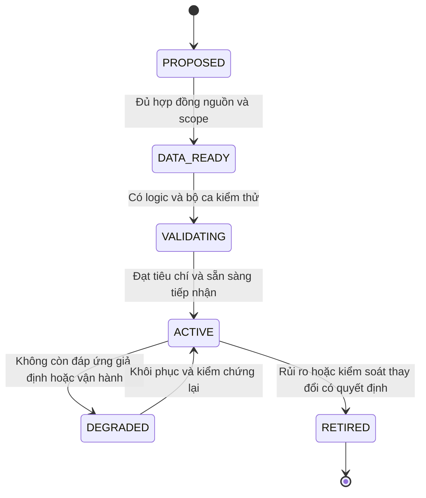

# Detection use case — Đặc tả kịch bản phát hiện có thể kiểm chứng

## 1. Mục tiêu và phạm vi

Detection use case là một đặc tả cho việc nhận biết một tình huống an ninh cần quan tâm trong phạm vi đã xác định. Nó liên kết **rủi ro, tài sản, dấu hiệu quan sát được, nguồn dữ liệu, logic phát hiện, đầu ra, người xử lý và bằng chứng nghiệm thu**.

Một truy vấn trả về vài sự kiện đáng ngờ chưa đủ tạo thành use case vận hành được. Nhóm còn phải biết truy vấn quan sát được phần nào của hệ thống, dữ liệu thiếu sẽ dẫn tới điều gì và ai chịu trách nhiệm khi có kết quả.

Trong chương **Monitoring và detection** của module `SECURITY_SECURITY_DESIGN_SECURITY_REQUIREMENTS`, bài học chuyển mục tiêu an toàn thông tin và mô hình đe dọa thành yêu cầu phát hiện cụ thể, đo được và có thể kiểm chứng. Nội dung kết nối xác thực, phân quyền, dữ liệu, logging, kiến trúc, kiểm thử và phục hồi.

Các ID, schema và ngưỡng trong bài thuộc **một thiết kế minh họa**. Chúng cần được lựa chọn theo rủi ro, tải và khả năng vận hành thực tế.

## 2. Phân biệt use case với các thành phần triển khai

| Thành phần | Câu hỏi chính | Ví dụ |
| --- | --- | --- |
| Mục tiêu bảo mật | Cần bảo vệ điều gì? | Bản xuất chỉ được phát hành trong scope được phép |
| Rủi ro | Điều gì có thể sai và gây tác động gì? | Tệp của tenant A được mở cho bên nhận ngoài phạm vi |
| Detection use case | Tình huống nào cần nhận biết, bằng chứng và xử lý ra sao? | Phát hiện bản xuất nhạy cảm được phát hành vượt scope đã duyệt |
| Signal | Quan sát đầu vào nào có ý nghĩa? | Event cổng phát hành xác nhận mở quyền tải |
| Rule | Điều kiện máy thực thi là gì? | Scope thực tế không khớp hồ sơ cho phép tại thời điểm phát hành |
| Alert | Kết quả nào cần được tiếp nhận? | Finding có manifest, scope, nguồn và mức chắc chắn |
| Playbook | Sau khi tiếp nhận cần làm gì? | Xác minh quyền hiện hành, hạn chế tác động, giữ bằng chứng |
| Kiểm soát phòng ngừa | Điều gì phải ngăn hành vi ngay tại nơi thực thi? | Kiểm tra scope trước khi mở quyền tải |

Một use case có thể có nhiều rule và nhiều mức bằng chứng. Một rule kỹ thuật cũng có thể hỗ trợ nhiều use case, nhưng các mục tiêu, phạm vi và trách nhiệm vẫn phải rõ.

Use case không thay thế kiểm soát phòng ngừa. Việc đã có cảnh báo không cho phép hệ thống bỏ xác thực, phân quyền hoặc kiểm tra dữ liệu trước phát hành.

## 3. Tình huống xuyên suốt: bản xuất vượt scope

Một nền tảng học tập phục vụ nhiều tổ chức. Mỗi tổ chức là một `tenant`. Service báo cáo tạo bản xuất tiến độ và có thể mở quyền tải cho bên nhận được phép.

Đối với luồng xuất sang đối tác trong ví dụ, mỗi lần phát hành phải liên kết với một hồ sơ cho phép có phiên bản. Hồ sơ xác định tenant, nguồn dữ liệu, trường được xuất, bên nhận, workflow và thời hạn. Quy trình cho phép có thể gồm phê duyệt của con người hoặc quyết định tự động theo policy; điều này phải được đặc tả, không mặc định mọi bản xuất đều có cùng quy trình.

Use case minh họa có ID **DC-EXPORT-SCOPE-01**:

> Nhận biết khi một bản xuất nhạy cảm đã được mở quyền tải qua cổng phát hành của nền tảng nhưng scope thực tế không khớp hồ sơ cho phép có thẩm quyền tại thời điểm đó.

### 3.1. Định nghĩa “đã phát hành”

Trong use case này, “đã phát hành” nghĩa cổng được quản lý đã xác nhận mở khả năng tải cho bên nhận được xác định. Nó khác với:

- Tác vụ xuất được tiếp nhận.
- Tệp đã tạo xong trong vùng chưa công khai.
- Quyết định phân quyền trả ALLOW.
- Bên nhận thực sự tải xong hoặc sử dụng dữ liệu.

Nếu cần phát hiện dữ liệu đã được chuyển, phải bổ sung nguồn và rule về kết quả chuyển giao. Không đổi tên một event mở tải thành “đã nhận toàn bộ dữ liệu” để làm alert có vẻ chắc chắn hơn.

### 3.2. Rủi ro và giả thuyết

| Mã rủi ro | Tình huống | Tác động |
| --- | --- | --- |
| R-01 | Bản xuất có tenant, dataset hoặc trường vượt phạm vi cho phép | Lộ dữ liệu |
| R-02 | Mở tải cho bên nhận hoặc workflow không được phép | Chuyển khả năng truy cập sai đối tượng |
| R-03 | Dùng hồ sơ đã hết hiệu lực hoặc bị thu hồi | Truy cập ngoài điều kiện hiện hành |
| R-04 | Event hoặc manifest thiếu, giả hoặc không liên kết đúng | Kết luận sai hoặc bỏ sót |
| R-05 | Thay đổi hợp lệ bị coi là vi phạm do so sánh sai phiên bản/thời gian | Cảnh báo nhiễu, gây gián đoạn |
| R-06 | Alert tạo nhưng không tới người có trách nhiệm | Tác động tiếp tục mà không được xử lý |
| R-07 | Bằng chứng hoặc phản ứng làm lộ dữ liệu, mở rộng quyền hoặc khóa sai | Tạo rủi ro mới |
| R-08 | Replay/restore làm sai trạng thái hoặc kích hoạt phản ứng lịch sử | Hành động sai trên hiện trạng mới |

Giả thuyết có thể kiểm chứng là: nếu cổng phát hành ghi nhận đúng bên nhận và artifact, manifest phản ánh đúng nội dung trong phạm vi thiết kế, và hồ sơ cho phép tại thời điểm đó được truy xuất, thì có thể so sánh scope để phát hiện sai lệch.

Giả thuyết không chứng minh mọi nội dung tệp chỉ bằng nhãn metadata. Cần nguồn tạo manifest, cơ chế kiểm tra và những giới hạn được ghi rõ.

## 4. Chọn use case từ rủi ro và đường tấn công

### 4.1. Bắt đầu từ tài sản và hành vi

Một chuỗi phân tích có thể là:

```text
Tài sản cần bảo vệ
  -> hành vi hoặc thất bại gây rủi ro
  -> điểm có thể quan sát
  -> bằng chứng và ngữ nghĩa
  -> điều kiện phát hiện
  -> alert và xử lý
  -> nghiệm thu
```

Ví dụ, “có nhiều log lỗi” chưa chỉ ra rủi ro. Trong khi đó, “cổng phát hành mở tải cho recipient không nằm trong hồ sơ cho phép” xác định được tài sản, hành vi, nguồn quan sát và đối tượng kiểm thử.

### 4.2. Xét cả đối thủ và sự cố

Scope vượt mức có thể do người dùng lạm dụng quyền, service bị chiếm, cấu hình sai, race khi đổi policy hoặc bug tạo manifest.

Use case cần phát hiện dấu hiệu theo bằng chứng, không chỉ khi biết trước động cơ. Alert có thể mô tả sai lệch đã quan sát mà chưa kết luận tấn công.

### 4.3. Tình huống đối chứng

Cần liệt kê những tình huống trông tương tự nhưng hợp lệ:

- Hồ sơ cho phép mới đã có hiệu lực trước phát hành.
- Một artifact có scope hợp lệ nhưng tên tệp khác.
- Tệp được tạo xong nhưng chưa mở tải.
- Event đến sai thứ tự trong khi revision vẫn nhất quán.
- Cùng service xử lý các tenant khác nhau theo nhiệm vụ được cấp.

Đối chứng giúp làm rõ ngữ nghĩa và đánh giá false positive. Không tự thêm ngoại lệ rộng chỉ để các ví dụ hợp lệ không tạo alert.

### 4.4. Tiêu chí ưu tiên

Có thể so sánh các use case theo tác động, khả năng xảy ra, thời gian cần phát hiện, khả năng quan sát và khả năng phản ứng.

Không chỉ chọn use case vì log sẵn có. Nếu rủi ro quan trọng nhưng chưa có dữ liệu, công việc đúng có thể là bổ sung telemetry và kiểm soát nguồn trước khi viết rule.

Ngược lại, không công bố một use case đang hoạt động nếu chưa có người tiếp nhận hoặc playbook phù hợp.

## 5. Hồ sơ detection use case tối thiểu

| Trường đặc tả | Nội dung cần có cho DC-EXPORT-SCOPE-01 |
| --- | --- |
| Định danh và phiên bản | ID ổn định, phiên bản, owner |
| Mục tiêu | Nhận biết phát hành vượt scope của luồng được quản lý |
| Rủi ro liên kết | R-01, R-02, R-03 và rủi ro chất lượng dữ liệu |
| Tài sản | Artifact nhạy cảm, dữ liệu tenant, quyền tải |
| Đối tượng | Người hoặc service được xác thực, bên nhận và tenant |
| Phạm vi quan sát | Cổng phát hành, workflow và loại artifact được liệt kê |
| Phần chưa bao phủ | Đường tải ngoài cổng, nội dung ngoài khả năng kiểm chứng manifest |
| Giả thuyết | Có bằng chứng phát hành và scope cho phép đủ tin cậy để so sánh |
| Nguồn và hợp đồng | Event, manifest, hồ sơ cho phép, danh tính và trạng thái thời gian |
| Logic và chất lượng | Điều kiện khớp, không khớp, chưa biết và dữ liệu đến trễ |
| Kết quả | Alert hoặc tín hiệu suy giảm, bằng chứng và mức chắc chắn |
| Mục tiêu thời gian | Thu thập, đánh giá, chuyển thông báo và tiếp nhận riêng |
| Ngoại lệ | Scope, người quyết định, thời hạn, audit |
| Tiếp nhận và phản ứng | Owner, tuyến, playbook, giới hạn tác động |
| Nghiệm thu | Ca dương, ca âm, lỗi dữ liệu, tải, routing và phục hồi |
| Vòng đời | Điều kiện bật, suy giảm, thay đổi và ngừng sử dụng |

Hồ sơ không cần dài vì hình thức. Nó phải đủ để một người không tham gia buổi thiết kế vẫn biết hệ thống đang hứa điều gì và cách kiểm chứng lời hứa đó.

## 6. Hợp đồng dữ liệu và ranh giới tin cậy

### 6.1. Dữ liệu tối thiểu

| Nguồn | Field hoặc thông tin | Mục đích |
| --- | --- | --- |
| Cổng phát hành | publication_ref, artifact_ref/version, recipient_ref, workflow_ref, outcome | Xác định khả năng tải thực tế đã được mở |
| Manifest artifact | Tenant, dataset/version, tập trường, scope và nguồn kiểm chứng | Mô tả dữ liệu trong artifact theo hợp đồng |
| Hồ sơ cho phép | Grant/approval ref, phiên bản, điều kiện, hiệu lực và thu hồi | Xác định scope được phép tại thời điểm phát hành |
| Danh tính và ủy quyền | Initiator, executor, principal, delegation refs | Biết ai hoặc service nào hành động theo scope nào |
| Nguồn thời gian/revision | Event time, ingestion time, revision và chất lượng | Chọn đúng trạng thái để so sánh |
| Sức khỏe pipeline | Gap, lag, schema lỗi, trạng thái nguồn | Biết khi nào không thể kết luận đầy đủ |

Không cần đưa nội dung người học hoặc tệp báo cáo vào detector nếu manifest và bằng chứng cần thiết có thể đáp ứng mục tiêu. Việc đọc payload phải là một yêu cầu riêng có mục đích và quyền rõ.

### 6.2. Xác minh nguồn

Nguồn phát phải được xác thực và được cấp phạm vi phát sự kiện. Collector kiểm tra schema, kích thước và scope theo cấu hình tin cậy.

Chữ ký hoặc kênh xác thực chứng minh nguồn theo mô hình tin cậy; không tự chứng minh nguồn không bị chiếm quyền hoặc manifest phản ánh đúng từng byte của tệp.

Cần nguồn kiểm chứng độc lập khi rủi ro yêu cầu, chẳng hạn đối soát trạng thái mở tải và manifest từ kho tạo artifact. Hai log cùng lấy từ một đối tượng ứng dụng không tự thành hai bằng chứng độc lập.

### 6.3. Danh tính và tenant

Actor, tenant và recipient không lấy nguyên từ input client. Cần phân biệt người khởi tạo, service thực thi và đối tượng nhận quyền tải.

Join theo principal ổn định, tenant, publication_ref, artifact_version và các ref liên quan. Không tương quan chỉ bằng email, tên file hoặc cùng thời điểm.

Một label purpose hoặc workflow do client tự chọn không phải bằng chứng rằng hoạt động đã được cho phép.

### 6.4. Phiên bản lịch sử

So sánh trạng thái có thẩm quyền **tại thời điểm phát hành**, không tự dùng policy mới nhất cho mọi event cũ.

Hồ sơ cấp sau không làm một lần phát hành trước đó trở nên hợp lệ hồi tố. Hồ sơ bị thu hồi sau phát hành cũng không tự chứng minh lần phát hành trước đã sai.

Nếu thiếu lịch sử cần thiết, giữ kết luận chưa biết hoặc giới hạn phạm vi; không thay bằng suy đoán từ trạng thái hiện tại.

## 7. Từ use case tới rule có thể thực thi

### 7.1. Ba nhóm kết quả

| Nhóm | Điều kiện | Ý nghĩa |
| --- | --- | --- |
| Scope mismatch | Có bằng chứng phát hành và đủ dữ liệu cho phép, so sánh xác nhận không khớp | Sai lệch trong phạm vi đã kiểm chứng |
| Coverage/data quality finding | Có dấu hiệu phát hành nhưng thiếu manifest, nguồn hoặc lịch sử cần thiết | Use case không thể đánh giá đầy đủ |
| Matched in scope | Đủ dữ liệu và scope khớp theo phiên bản/thời gian | Không thấy sai lệch thuộc điều kiện rule này |

Matched in scope không chứng minh hệ thống không có rủi ro nào khác. Data quality finding không được gắn nhãn “đã lộ dữ liệu trái phép” nếu chưa đủ bằng chứng.

### 7.2. Bộ rule minh họa

**DC-R1 — Phát hành lệch scope dữ liệu:** tenant, dataset, trường hoặc resource scope thực tế vượt hồ sơ cho phép.

**DC-R2 — Bên nhận hoặc workflow không khớp:** recipient hoặc danh tính thực thi không nằm trong binding có thẩm quyền.

**DC-R3 — Điều kiện hiệu lực không đạt:** nguồn có thẩm quyền cho thấy hồ sơ không có hiệu lực tại thời điểm phát hành, theo chính sách thời gian và thu hồi đã đặc tả.

**DC-R4 — Thiếu chuỗi bằng chứng bắt buộc:** publication đã được ghi nhận nhưng không xác minh được manifest, hồ sơ hoặc liên kết revision; tạo finding về độ bao phủ.

Cùng use case có thể dùng nhiều rule với mức tác động và tuyến khác nhau. Không ép mọi kết quả vào một boolean “attack”.

### 7.3. Mã giả định hướng

```text
evaluatePublication(event):
    verifySourceAndSchema(event)
    if event.outcome is not CONFIRMED_ACCESS_OPENED:
        return NOT_THIS_USE_CASE_TRIGGER

    artifact = resolveVerifiedArtifactManifest(event)
    permitted = resolveAuthoritativePermissionAt(event.occurred_at)

    if artifact is UNKNOWN or permitted is UNKNOWN:
        return COVERAGE_FINDING with missing-data reasons

    comparison = compareScopeAndConditions(
        artifact,
        event.recipient_ref,
        event.executor_ref,
        event.workflow_ref,
        permitted
    )

    if comparison is NOT_MATCHED:
        return SCOPE_MISMATCH_FINDING with exact dimensions

    return MATCHED_IN_DECLARED_SCOPE
```

Nếu nguồn xác nhận hồ sơ không tồn tại trong phạm vi truy vấn có thẩm quyền, điều đó khác với resolve timeout. Triển khai cần loại kết quả rõ để không nhầm NOT_FOUND với UNKNOWN.

Mã giả không mô tả một cơ chế phòng ngừa. Tại cổng phát hành, kiểm tra quyền vẫn phải được thực hiện trước hành động theo yêu cầu riêng.

### 7.4. Giới hạn của so sánh scope

So sánh tập trường cần phiên bản schema và ý nghĩa trường. Một tên trường không đổi nhưng phép biến đổi hoặc nội dung thay đổi có thể cần đánh giá lại.

Quyền có điều kiện hoặc tập tài nguyên động không phải lúc nào cũng so sánh được bằng phép trừ tập đơn giản. Có thể cần bộ đánh giá policy hoặc manifest hữu hạn với giới hạn rõ.

Nếu chỉ đánh giá một phần artifact hoặc tài nguyên, alert và báo cáo phải ghi mức đầy đủ đó.

## 8. Thời gian, liên kết sự kiện và dữ liệu thiếu

### 8.1. Định nghĩa từng loại thời gian

Cần giữ các mốc:

- Thời gian phát hành được nguồn có thẩm quyền ghi.
- Thời gian pipeline tiếp nhận sự kiện.
- Thời gian đủ dữ liệu để đánh giá rule.
- Thời gian tạo finding/alert.
- Thời gian tuyến nhận chấp nhận.
- Thời gian người phụ trách xác nhận xử lý.

Không gọi tất cả là “thời gian phát hiện”. Một evaluator chạy nhanh vẫn có thể phát hiện muộn nếu nguồn không chuyển event trong nhiều giờ.

Với so sánh điều kiện hiệu lực, cần chất lượng đồng hồ và quy tắc sai số. Không coi một chênh lệch nhỏ giữa hai đồng hồ không đạt yêu cầu là bằng chứng chắc chắn vi phạm thời hạn.

### 8.2. Ngân sách chờ dữ liệu

Trong ví dụ, manifest hoặc hồ sơ liên kết có thể đến sau publication event. Detector chờ tối đa **2 phút từ lúc có publication event hợp lệ để xử lý trực tiếp** trước khi kết luận chuỗi bằng chứng bắt buộc chưa đủ và tạo coverage finding.

Đây là ngân sách chờ dữ liệu, không phải thời gian cho phép phát hành ngoài quyền. Kiểm soát phòng ngừa vẫn có điều kiện riêng trước khi mở tải.

Khi bằng chứng tới sau:

- Trong **10 phút**, hệ thống có thể tái đánh giá trực tiếp và cập nhật finding theo hợp đồng.
- Quá khoảng đó, chuyển sang đánh giá hồi cứu với thời điểm hành vi và mức trễ rõ.
- Kết quả quan trọng vẫn có tuyến tiếp nhận phù hợp; không bỏ chỉ vì dữ liệu đến trễ.
- Không tự thực thi phản ứng của đường LIVE trên hiện trạng mới.

Coverage finding ban đầu được giữ lịch sử. Nếu sau đó đủ dữ liệu, ghi kết quả bổ sung và nguồn, không sửa ngược như thể ngay từ đầu đã có kết luận chắc chắn.

### 8.3. ID, thứ tự và dedup

Dùng publication_ref, artifact_version, grant/approval version và event_id theo hợp đồng. Cùng sự kiện truyền lại không tạo lần phát hành mới.

Một publication khác hoặc artifact_version khác phải được đánh giá riêng, kể cả cùng tenant và service. Dedup chỉ theo tên file hoặc theo tenant trong một giờ có thể che nhiều sai lệch độc lập.

Sự kiện lịch sử tới sau cần phục vụ tái dựng, không ghi đè trạng thái hiện hành mới hơn. Cần quy tắc revision và checkpoint phù hợp từng nguồn.

### 8.4. Không trộn dữ liệu không tin cậy vào kết luận

Event sai chữ ký, không xác minh được producer hoặc schema không hợp lệ không trở thành bằng chứng rằng subject đã phát hành dữ liệu.

Xử lý qua kênh cách ly đã làm sạch và tín hiệu sức khỏe/an ninh cho nguồn đó. Không đặt tên một người do payload tự khai vào alert khẳng định hành vi đã xảy ra.

Nguồn tạm lỗi, nguồn không đủ tin cậy và nguồn xác nhận “không tồn tại” là ba tình trạng khác nhau.

## 9. Hợp đồng đầu ra và người tiếp nhận

### 9.1. Alert phải giúp hiểu kết luận

Ví dụ:

```json
{
  "alert_id": "alert_d81c",
  "use_case_id": "DC-EXPORT-SCOPE-01",
  "use_case_version": "2",
  "rule_id": "DC-R2",
  "rule_version": "3",
  "evaluation_mode": "LIVE",
  "tenant_ref": "ten_opaque_a",
  "publication_ref": "publication_73f2",
  "artifact_ref": "artifact_84bc",
  "artifact_version": "5",
  "subject_ref": "service_report_exporter",
  "finding_type": "RECIPIENT_SCOPE_MISMATCH",
  "evidence_level": "CONFIRMED_ACCESS_OPENED",
  "impact": "HIGH",
  "confidence": "HIGH",
  "permission_resolution": "COMPLETE_IN_SCOPE",
  "evidence_manifest_ref": "evidence_f209",
  "owner_route_ref": "route_data_security",
  "playbook_ref": "playbook_export_scope_review",
  "created_at": "2026-11-27T09:15:30Z"
}
```

Alert không chứa toàn bộ tệp, token tải hoặc URL có bí mật. Tham chiếu bằng chứng không tự cấp quyền xem.

Mức confidence mô tả độ chắc chắn của kết luận trong phạm vi, không tự là xác suất một con người có động cơ xấu. Tác động tiềm năng và chất lượng bằng chứng nên được biểu diễn riêng.

### 9.2. Ai cần tiếp nhận?

| Vai trò | Trách nhiệm chính |
| --- | --- |
| Owner rủi ro/nghiệp vụ | Xác nhận tác động, scope và mức ưu tiên |
| Owner use case | Duy trì đặc tả, tiêu chí bật và chất lượng |
| Owner dữ liệu nguồn | Bảo đảm ngữ nghĩa, phiên bản và chất lượng nguồn |
| Nhóm detection | Logic, state, kiểm thử và thay đổi rule |
| Người trực tiếp nhận | Xác minh, triage và chuyển xử lý đúng hạn |
| Nhóm phản ứng | Thao tác giới hạn tác động theo thẩm quyền |
| Owner pipeline | Lag, checkpoint, capacity, routing và phục hồi |

Các vai trò có thể do cùng một nhóm đảm nhiệm nếu phù hợp, nhưng trách nhiệm vẫn phải rõ. Không để alert “gửi cho nhóm an ninh” mà không có tuyến, owner hoặc xử lý khi tuyến lỗi.

### 9.3. Phân biệt tạo, chuyển và tiếp nhận

Tạo alert không chứng minh thông báo đã tới. Tuyến nhận chấp nhận không chứng minh người đã đọc. Người xác nhận không chứng minh tác động đã được xử lý.

Cần trạng thái, mốc thời gian và retry/escalation cho từng bước. Lỗi chuyển thông báo phải được giám sát qua kênh phù hợp, không chỉ nằm trong chính hàng đợi đang hỏng.

Trong ví dụ, mục tiêu vận hành là:

- Ít nhất 99% scope mismatch alert được tạo trong **60 giây sau khi đủ đầu vào**, trong tải công bố.
- Ít nhất 99% alert ưu tiên cao được tuyến nhận chấp nhận trong **30 giây từ lúc tạo**, trong tải công bố.
- Coverage finding có ngân sách chờ 2 phút riêng, sau đó chịu ngân sách đánh giá đã đặc tả.
- Độ trễ thu thập và thời gian tiếp nhận bởi con người được đo riêng.

Không cộng các percentile rồi tuyên bố có cùng percentile cho tổng thời gian. Nếu có mục tiêu end-to-end, phải đo trực tiếp trên tập sự kiện và điều kiện đã xác định.

## 10. Ngoại lệ, phản ứng và ranh giới bảo mật

### 10.1. Ngoại lệ có scope và vòng đời

Một luồng chuyển dữ liệu thử nghiệm có thể được phép trong môi trường, bên nhận và thời gian cụ thể. Ngoại lệ cần nội dung, owner, thẩm quyền, mốc hết hạn và audit.

Không dùng cờ “maintenance=true” do producer tự gửi để bỏ mọi đánh giá. Ngoại lệ tenant A không bao phủ tenant B, phiên bản artifact khác hoặc bên nhận mới.

Suppression có thể giảm chuyển thông báo lặp cho cùng finding, nhưng không xóa sự kiện, kết quả rule hoặc che finding độc lập.

### 10.2. Playbook không vượt quá bằng chứng

Một playbook cho use case minh họa có thể:

1. Xác minh nguồn, publication, artifact_version và mức đầy đủ.
2. Đọc hồ sơ cho phép đúng thời điểm, kiểm tra những chiều không khớp.
3. Xác minh quyền tải hiện hành và việc dữ liệu đã được chuyển nếu có nguồn.
4. Giới hạn quyền tải hoặc luồng liên quan theo chính sách và thẩm quyền.
5. Đối soát các publication khác có liên quan trong scope được phép.
6. Giữ bằng chứng tối thiểu và ghi kết luận, tác động, giới hạn.

Đóng khả năng tải không thu hồi được dữ liệu đã nhận. Một coverage finding không đủ để quy kết bên nhận đã nhận dữ liệu trái phép.

### 10.3. Tự động hóa cần hợp đồng riêng

Nếu tự động khóa đường tải, service phản ứng cần xác minh nguồn alert, quyền thao tác, trạng thái hiện hành, scope, chống lặp và điều kiện dừng.

Không dùng alert như credential. Không thực thi nội dung lệnh từ trường message hoặc lý do tự do. Playbook và hành động được lấy từ catalog có kiểm soát.

Không tự thu hồi mọi quyền của service khi chỉ có một record thiếu metadata. Chính sách phản ứng phải cân nhắc tác động, độ chắc chắn và đường phục hồi.

### 10.4. Quyền truy vấn và lưu giữ

Quyền đọc alert, manifest, lịch sử approval và dữ liệu điều tra được phân theo tenant, nhiệm vụ và mức chi tiết.

Các truy cập nhạy cảm, đổi rule, ngoại lệ và phản ứng cần logging/audit tối thiểu. Không ghi token, cookie, URL tải có bí mật hoặc nội dung báo cáo vào bằng chứng thông thường.

Evidence, alert, state trung gian, dữ liệu cách ly và export điều tra đều cần lịch lưu. Dữ liệu phục vụ detection không được mặc định giữ vô hạn.

## 11. Bộ yêu cầu bảo mật mẫu

Bộ yêu cầu sau dành cho use case DC-EXPORT-SCOPE-01.

| Mã | Yêu cầu và tiêu chí đo | Rủi ro | Điểm thực thi, owner |
| --- | --- | --- | --- |
| DU-01 | Use case có ID/phiên bản, rủi ro, tài sản, giả thuyết, scope, phần chưa bao phủ, owner và tiêu chí bật/ngừng | R-01, R-02, R-04 | Catalog và thiết kế; owner use case |
| DU-02 | Từng nguồn có ngữ nghĩa, principal phát, schema, scope, revision và điều kiện tin cậy; field actor/tenant/recipient không lấy nguyên từ input chưa xác minh | R-04, R-07 | Producer, collector, normalizer; owner nguồn |
| DU-03 | So sánh dùng artifact_version và hồ sơ cho phép có thẩm quyền tại thời điểm phát hành; NOT_FOUND đã xác minh khác UNKNOWN do lỗi nguồn | R-03, R-04, R-05 | Resolver và state lịch sử; nhóm dữ liệu |
| DU-04 | DC-R1 đến DC-R4 phân biệt scope mismatch, matched in scope và coverage finding; không suy ALLOW hoặc file ready thành phát hành/xác nhận nhận dữ liệu | R-01, R-02, R-04 | Rule evaluator; nhóm detection |
| DU-05 | Chờ dữ liệu liên kết tối đa 2 phút trước coverage finding; tái đánh giá trực tiếp tới 10 phút, dữ liệu muộn hơn có đường hồi cứu và lịch sử kết luận | R-04, R-05, R-08 | Correlator; nhóm detection |
| DU-06 | Trong tải công bố, 99% scope mismatch alert được tạo trong 60 giây từ lúc đủ đầu vào; lag nguồn và end-to-end được báo riêng | R-06 | Evaluator và metric; owner pipeline |
| DU-07 | Trong tải công bố, 99% alert ưu tiên cao được tuyến nhận chấp nhận trong 30 giây từ lúc tạo; mỗi tuyến có owner, trạng thái lỗi và escalation | R-06 | Router, queue, người trực; nhóm vận hành |
| DU-08 | Sự kiện phát hành bắt buộc trong phạm vi không sampling; theo dõi gap, lag, schema lỗi, heartbeat và độ tươi nguồn; thiếu dữ liệu không báo trạng thái đã kiểm tra đủ | R-04, R-06 | Audit pipeline và health; owner nguồn |
| DU-09 | Truyền lại cùng event không tạo publication/finding mới sai; publication, artifact_version hoặc scope độc lập vẫn được đánh giá | R-04, R-05 | Dedup và finding store; nhóm detection |
| DU-10 | Ngoại lệ/suppression có scope, thẩm quyền, owner, thời hạn và audit; không do input sự kiện tự quyết định; hết hạn phải đánh giá lại | R-01, R-05 | Exception registry; owner use case |
| DU-11 | Alert/evidence không có bí mật hoặc payload báo cáo đầy đủ; đọc, xuất, đổi rule và phản ứng được phân quyền; state và bằng chứng có vòng đời | R-07 | IAM, kho evidence, serializer; nhóm dữ liệu |
| DU-12 | Nghiệm thu có ca dương, âm, biên, dữ liệu thiếu/giả/trễ, tải, routing và phục hồi; từng yêu cầu có test và bằng chứng | R-04, R-05, R-06, R-08 | Bộ test và release gate; nhóm kiểm thử |
| DU-13 | Replay/restore giữ ID, phiên bản và provenance; dữ liệu hồi cứu không tự đi vào phản ứng LIVE; mở lại sau đối soát state/checkpoint | R-08 | Replay và runbook; owner pipeline |
| DU-14 | Mỗi trạng thái vận hành có tiêu chí, owner và health; thay đổi nguồn/rule/ngoại lệ có phiên bản, đánh giá tác động và kiểm thử hồi quy | R-04, R-05, R-06 | Quản lý vòng đời; owner use case |
| DU-15 | Detection không thay kiểm soát phòng ngừa; phản ứng nếu có xác minh nguồn, quyền, scope, độ mới và chống lặp trước thay đổi khả năng tải | R-01, R-07, R-08 | Cổng phát hành, response service; nhóm phân quyền |

Các chỉ tiêu DU-06 và DU-07 cần tải, môi trường, tập đo và cách xử lý lỗi được công bố. Không bỏ các ca chậm khỏi mẫu để giữ số liệu đẹp.

DU-08 không chứng minh toàn hệ thống không có đường tải khác. Cần kiểm kê, kiểm soát đường ngoài cổng và thể hiện phần chưa bao phủ.

### 11.1. Ví dụ truy vết yêu cầu

| Rủi ro | Rule | Yêu cầu | Thành phần | Bằng chứng nghiệm thu |
| --- | --- | --- | --- | --- |
| R-01 dữ liệu vượt scope | DC-R1 | DU-03, DU-04 | Manifest resolver, scope comparator | Artifact có trường ngoài hồ sơ được phát hiện |
| R-02 sai bên nhận | DC-R2 | DU-02, DU-04 | Cổng phát hành, recipient binding | Bên nhận ngoài scope tạo alert đúng tenant |
| R-03 hồ sơ hết hiệu lực | DC-R3 | DU-03 | Lịch sử quyền, nguồn thời gian | So sánh trước/tại/sau mốc hiệu lực |
| R-04 thiếu dữ liệu | DC-R4 | DU-05, DU-08 | Correlator, health signal | Coverage finding sau ngân sách chờ |
| R-06 không được tiếp nhận | Các rule | DU-06, DU-07 | Evaluator, router | Độ trễ và escalation khi tuyến lỗi |
| R-08 replay sai tác động | Các rule | DU-13, DU-15 | Replay, response service | Không đổi quyền từ lịch sử chưa được cho phép |

Truy vết cần đi được cả hai chiều: từ rủi ro tới test và từ một alert tới rule, use case, yêu cầu và nguồn bằng chứng.

## 12. Ma trận nghiệm thu

Dùng dữ liệu giả, bên nhận kiểm thử và môi trường có kiểm soát. Kết quả kỳ vọng phải được xác định độc lập với chính truy vấn đang được kiểm thử.

| Ca | Điều kiện và thao tác | Kết quả mong đợi | Yêu cầu |
| --- | --- | --- | --- |
| AT-01 | Artifact, bên nhận, workflow và hồ sơ đều khớp, đúng thời điểm | MATCHED_IN_DECLARED_SCOPE; không gắn nhãn phát hành vượt scope | DU-03, DU-04 |
| AT-02 | Artifact có trường hoặc dataset vượt hồ sơ | DC-R1 phát hiện đúng chiều sai lệch và phiên bản | DU-03, DU-04 |
| AT-03 | Bên nhận hoặc executor không đúng binding | DC-R2 tạo alert đúng principal, tenant và phạm vi | DU-02, DU-04 |
| AT-04 | Phát hành trước, tại và sau mốc hiệu lực/thu hồi theo hợp đồng | DC-R3 dùng đúng lịch sử và quy tắc thời gian; sai số không được che giấu | DU-03 |
| AT-05 | File ready hoặc ALLOW nhưng chưa có xác nhận mở tải | Không dùng làm bằng chứng đã phát hành trong use case này | DU-04 |
| AT-06 | Hồ sơ không tồn tại đã được nguồn xác nhận; đối chứng là nguồn timeout | Phân biệt thiếu quyền có căn cứ với UNKNOWN/coverage | DU-03, DU-04 |
| AT-07 | Manifest tới sau publication trong ngân sách, sau 2 phút và quá 10 phút | Chờ/cập nhật/hồi cứu đúng chính sách, không kết luận giả | DU-05 |
| AT-08 | Cùng event được truyền lại, publication mới cùng service, artifact_version khác | Dedup bản trùng, vẫn đánh giá trường hợp độc lập | DU-09 |
| AT-09 | Event sai nguồn, actor/tenant tự khai hoặc manifest không xác minh được | Không thành bằng chứng hành vi; cách ly và tín hiệu chất lượng phù hợp | DU-02, DU-08 |
| AT-10 | Nhiều tenant trùng tên file và tên hiển thị | Join đúng ref/scope, không trộn bằng chứng chéo tenant | DU-02, DU-09 |
| AT-11 | Policy mới cho phép sau hành vi hoặc bị thu hồi sau hành vi hợp lệ | Không dùng hiện trạng để kết luận sai về thời điểm cũ | DU-03 |
| AT-12 | Ngoại lệ đúng scope; đối chứng là khác recipient hoặc đã hết hạn | Chỉ áp dụng phạm vi hợp lệ, không suppression mọi finding | DU-10 |
| AT-13 | Tải trong mức công bố, lag riêng ở nguồn, rule và routing | Đo đúng từng phần; nhận ra chậm và không loại ca lỗi khỏi mẫu | DU-06, DU-07, DU-08 |
| AT-14 | Tuyến nhận lỗi, callback timeout, người chưa xác nhận | Retry/escalation có giới hạn, không nhầm delivery với human ack | DU-07 |
| AT-15 | Tenant A tra evidence tenant B, alert có chuỗi đánh dấu bí mật giả | Bị chặn theo quyền, không lộ bí mật hoặc payload | DU-11 |
| AT-16 | Rule/state lỗi và nguồn ngừng heartbeat dù không có event | Trạng thái suy giảm rõ, không báo đã quan sát bình thường | DU-08, DU-14 |
| AT-17 | Restore checkpoint cũ và replay event đã xử lý | Không đếm lặp sai; lịch sử không tự kích hoạt phản ứng LIVE | DU-13 |
| AT-18 | Alert cũ/giả/trùng được gửi tới service phản ứng | Không đổi quyền nếu chưa đủ thẩm quyền, nguồn và hiện trạng | DU-15 |
| AT-19 | Nguồn đổi schema hoặc ý nghĩa field nhưng tên không đổi | Phát hiện tác động, yêu cầu cập nhật hợp đồng và kiểm thử | DU-02, DU-12, DU-14 |
| AT-20 | Manifest chỉ xác minh được một phần artifact hoặc đường phát hành | Kết luận và độ bao phủ giới hạn đúng, không tuyên bố kiểm tra toàn bộ | DU-01, DU-04, DU-08 |

Một bộ test chỉ có ca dương không cho biết rule có phân biệt được hành vi hợp lệ. Một bộ test chỉ giả lập output của evaluator không chứng minh nguồn và đường tiếp nhận hoạt động.

Bằng chứng nên gồm event/manifest đã làm sạch, hồ sơ cho phép và phiên bản, kết quả đánh giá, alert, trạng thái delivery và trạng thái quyền kiểm thử. Không đưa tệp dữ liệu thật hoặc token tải thật vào báo cáo test.

## 13. Đánh giá hiệu quả và lựa chọn danh mục use case

### 13.1. Tách các lớp độ bao phủ

| Lớp | Câu hỏi |
| --- | --- |
| Tài sản/đường đi | Những dữ liệu, danh tính và đường phát hành nào thuộc scope? |
| Nguồn | Các điểm đó có phát đúng dữ liệu, có gap hoặc sampling không? |
| Ngữ nghĩa | Manifest, quyền và thời gian có đủ để kết luận không? |
| Rule | Điều kiện rủi ro nào đã được triển khai và kiểm thử? |
| Vận hành | Finding có tới đúng người và được xử lý không? |
| Phục hồi | Sau lỗi, kết quả có còn đúng và không gây tác động lặp không? |

Không dùng số lượng rule làm thước đo duy nhất. Mười rule cùng nhìn một nguồn thiếu dữ liệu không tạo ra độ bao phủ của mười đường khác nhau.

### 13.2. Precision, recall và tập có nhãn

Chỉ số trên tập kiểm thử cần ground truth rõ: trường hợp nào thực sự có sai lệch scope theo hồ sơ và thời điểm đã biết.

Kết quả đó giúp so sánh phiên bản trong phạm vi tập mẫu, không chứng minh phát hiện được mọi hành vi thực tế. Các ca thiếu dữ liệu, chưa điều tra xong và ngoài scope cần được tách riêng.

Không coi mọi alert đóng với lý do “đã được phép” là rule lỗi nếu mục tiêu của rule là phát hiện thay đổi cần rà soát. Ngược lại, use case đã định nghĩa scope mismatch thì không được ghi nhận thành công chỉ vì tạo nhiều alert.

### 13.3. Ví dụ danh mục không gộp thành một rule lớn

| Use case | Câu hỏi phát hiện | Nguồn quyết định |
| --- | --- | --- |
| Xuất vượt scope | Đã mở khả năng tải ngoài hồ sơ cho phép chưa? | Cổng phát hành, manifest, quyền lịch sử |
| Thất bại xác thực bất thường | Có mẫu thử bằng chứng cần điều tra không? | Kết quả xác thực theo attempt và metadata đáng tin |
| Quyền nhạy cảm xuất hiện lại | Có cấp lại sau thu hồi hoặc state lùi không? | Nguồn quyền, revision, lịch sử thay đổi |

Các use case có thể dùng chung identity resolver hoặc pipeline. Chúng vẫn có ý nghĩa, window, người tiếp nhận và bằng chứng khác nhau.

### 13.4. Tác động tới mục tiêu bảo mật

Cần theo dõi thời gian từ hành vi tới tiếp nhận, thời gian giảm tác động, phần chưa biết và các sai lệch bị bỏ sót trong phạm vi có thể xác minh.

Alert count tăng không tự là an toàn tăng. Alert count giảm cũng không tự là rủi ro giảm nếu nguồn bị hỏng, ngoại lệ mở rộng hoặc người trực bỏ qua cảnh báo.

## 14. Vòng đời use case và quản lý thay đổi

### 14.1. Các trạng thái có tiêu chí



Có thể có giai đoạn shadow nếu kế hoạch cần, với owner và điều kiện kết thúc. “Chạy một tuần không có alert” không đủ để chứng minh use case đúng hoặc sẵn sàng.

ACTIVE cần logic đạt nghiệm thu, nguồn và health hoạt động, quyền truy vấn được xác định, tuyến nhận và playbook có người chịu trách nhiệm. DEGRADED cần mô tả phần mất khả năng; các rule còn đủ đầu vào có thể tiếp tục theo chính sách.

### 14.2. Thay đổi có thể làm use case hỏng

Ngoài sửa rule, cần xem xét:

- Nguồn đổi schema hoặc ý nghĩa của outcome.
- Service identity, tenant routing hoặc recipient model đổi.
- Policy, role hoặc workflow có cách diễn giải mới.
- Archive, retention hoặc khóa tham chiếu làm mất lịch sử.
- Tuyến người trực, quyền evidence hoặc response service đổi.
- Scope sản phẩm có thêm đường tải ngoài cổng.

Mỗi thay đổi cần đánh giá tác động và kiểm thử phù hợp. Giữ ID/phiên bản cũ để giải thích alert lịch sử; không dùng logic hiện tại để viết lại kết luận quá khứ mà không ghi tái đánh giá.

### 14.3. Phục hồi sau lỗi

Khôi phục state và checkpoint nhất quán, đối soát đầu vào, ID, revision và dữ liệu liên kết. Dựng projection cách ly nếu cần trước khi phục vụ LIVE.

Nếu thiếu dữ liệu cần thiết, báo phạm vi suy giảm và giữ kết luận chưa biết. Không tự tạo event giả để làm chuỗi bằng chứng trông đầy đủ.

Replay có thể tìm ra sai lệch cũ quan trọng; kết quả vẫn cần được tiếp nhận với thời gian hành vi thật, độ trễ và điều kiện phản ứng phù hợp hiện trạng.

### 14.4. Ngừng use case

Ngừng khi có lý do rõ, chẳng hạn sản phẩm đã bỏ đường dữ liệu hoặc use case được thay thế. Cần xác định rủi ro còn lại, use case thay thế nếu có, owner và cách lưu lịch sử.

Không xóa rule vì “ít alert” khi chưa biết đó là ít rủi ro, thiếu dữ liệu hay detector lỗi.

## 15. Lỗi thiết kế thường gặp

| Lỗi | Vì sao không đáp ứng | Cách sửa |
| --- | --- | --- |
| Use case chỉ là tên truy vấn | Thiếu rủi ro, scope, owner và nghiệm thu | Hồ sơ gắn từ rủi ro tới xử lý |
| Có log là coi quan sát đủ | Log có thể thiếu ngữ nghĩa hoặc đường đi | Hợp đồng nguồn và bản đồ độ bao phủ |
| File ready được coi đã phát hành | Nhầm trạng thái dữ liệu | Định nghĩa mốc đủ điều kiện rõ |
| ALLOW được coi đã chuyển dữ liệu | Nhầm quyết định với kết quả | Nguồn thực thi và loại bằng chứng |
| Approval timeout được coi không có quyền | Kết luận vượt dữ liệu | UNKNOWN và coverage finding riêng |
| Luôn so với policy mới nhất | Sai ngữ nghĩa thời điểm lịch sử | Phiên bản và trạng thái tại thời điểm hành vi |
| Một ngoại lệ bỏ mọi rule | Che sai lệch mới hoặc khác scope | Scope, thời hạn và audit ngoại lệ |
| Chỉ đo evaluator latency | Bỏ lag nguồn và tuyến nhận | Đo từng chặng và end-to-end riêng |
| Có alert nghĩa là đã xử lý | Không có bằng chứng tiếp nhận/phản ứng | Trạng thái, owner và escalation |
| Nhiều alert nghĩa là use case hiệu quả | Có thể là nhiễu hoặc lỗi nguồn | Đo chất lượng, độ bao phủ và tác động |
| Detection thay kiểm tra quyền | Chấp nhận dữ liệu đi sai rồi mới biết | Phòng ngừa và phát hiện có yêu cầu riêng |
| Replay đi thẳng vào phản ứng | Tác động sai trên hiện trạng mới | Chế độ hồi cứu, quyền và kiểm tra lại |

## 16. Bài tập vận dụng

Một nhóm đặt tên use case là “data exfiltration”, nhưng chỉ có truy vấn đếm tác vụ export. Nó xem mỗi tác vụ hoàn tất là dữ liệu đã được nhận, mặc định approval timeout là không được phép và gửi mọi alert vào một hộp không có owner. Sau restore, rule replay lại có thể tự khóa quyền tải hiện hành.

Hãy xây dựng:

1. Mục tiêu, giả thuyết, scope và phần chưa bao phủ có thể kiểm chứng.
2. Hợp đồng dữ liệu phân biệt tác vụ, artifact, mở tải và chuyển giao.
3. Ba rule có ngữ nghĩa, trạng thái UNKNOWN và nguồn bằng chứng rõ.
4. Sáu yêu cầu có mã, ngưỡng, owner, điểm thực thi và test.
5. Ma trận gồm ca dương, âm, thiếu dữ liệu, lệch thời gian và lỗi routing.
6. Điều kiện ACTIVE/DEGRADED cùng kế hoạch replay không gây phản ứng sai.

Khi tự đánh giá, kiểm tra có truy được từ một rủi ro tới nguồn, rule, alert, người xử lý và bằng chứng nghiệm thu hay không. Detection use case hoàn chỉnh phải giúp hệ thống nhận biết và xử lý tình huống trong phạm vi đã hứa, đồng thời thể hiện trung thực những gì còn chưa biết.
