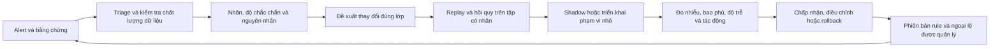

# False positive handling

## 1. Mục tiêu: giảm nhiễu mà không làm mất khả năng phát hiện

False positive handling là quy trình xác minh, phân loại và xử lý những cảnh báo không phản ánh đúng mục tiêu an ninh mà quy tắc muốn phát hiện. Công việc này bao gồm triage, sửa dữ liệu hoặc logic, điều chỉnh ngữ cảnh, quản lý ngoại lệ và đo ảnh hưởng sau thay đổi.

Trong chương **Monitoring và detection**, mục tiêu không nên chỉ là “ít alert hơn”. Số cảnh báo giảm có thể do rule tốt hơn, nhưng cũng có thể do nguồn log mất, suppression quá rộng hoặc hành vi nguy hiểm bị bỏ qua.

Thiết kế yêu cầu bảo mật cần trả lời:

- Điều kiện kỹ thuật khớp có thực sự tương ứng với mục tiêu an ninh không?
- Ai có thẩm quyền kết luận, dựa trên bằng chứng nào và với mức chắc chắn nào?
- Vấn đề nằm ở dữ liệu, rule, routing, thông báo lặp hay ngữ cảnh hợp lệ?
- Cần sửa logic, gom thông báo hay tạo ngoại lệ; phạm vi ảnh hưởng là gì?
- Làm sao biết thay đổi không làm mất các trường hợp bắt buộc phải phát hiện?
- Ngoại lệ hết hạn, rollback, restore và feedback được quản lý ra sao?

Bài học dùng nền tảng học trực tuyến nhiều tenant làm ví dụ. Hệ thống có cảnh báo nhiều lần xác thực thất bại, thay đổi ngữ cảnh phiên và xuất dữ liệu bất thường. Các số liệu, nhãn và thời hạn dưới đây là lựa chọn minh họa, không phải mức bắt buộc cho mọi tổ chức.

## 2. Phân biệt cảnh báo sai với những tình huống trông giống nhau

### 2.1. Khớp rule và kết luận an ninh là hai câu hỏi khác nhau

Một rule phát hiện “đăng nhập từ mạng mới” có thể khớp chính xác khi người dùng chuyển mạng. Nếu mục tiêu chỉ là thông báo thay đổi ngữ cảnh, đó chưa chắc là false positive. Nếu hệ thống lại khẳng định “tài khoản đã bị chiếm” từ cùng bằng chứng, vấn đề có thể nằm ở cách diễn giải và mức phản ứng.

Cần viết rõ mục tiêu của rule: ghi nhận sự kiện, nhận diện hành vi cần xem xét, hay phát hiện một kiểu sự cố cụ thể. Không đánh giá đúng sai chỉ theo việc người vận hành có muốn nhận thông báo đó hay không.

NIST SP 800-94 thảo luận trade-off khi tăng hoặc giảm độ nhạy và việc thay đổi môi trường có thể làm phát sinh cảnh báo. Điều này hỗ trợ yêu cầu phải đánh giá cả khả năng phát hiện lẫn nhiễu, thay vì tối ưu một phía. [NIST SP 800-94: Guide to IDPS](https://nvlpubs.nist.gov/nistpubs/legacy/sp/nistspecialpublication800-94.pdf)

### 2.2. Một taxonomy xử lý có thể kiểm chứng

| Nhãn xử lý ví dụ | Ý nghĩa | Không được tự suy ra |
|---|---|---|
| `confirmed_security_event` | Có bằng chứng đáp ứng mục tiêu an ninh đã định | Không mặc định mọi tài khoản hay tài nguyên liên quan đều bị xâm phạm |
| `benign_activity` | Hoạt động được xác minh là hợp lệ trong phạm vi cụ thể | Không tự miễn mọi hoạt động tương lai của chủ thể |
| `rule_logic_error` | Truy vấn hoặc điều kiện khớp sai mục tiêu | Không nên chỉ tắt thông báo rồi giữ lỗi |
| `data_quality_issue` | Event trùng, sai thời gian, thiếu thuộc tính hoặc nguồn sai | Không phải bằng chứng mọi hoạt động gốc đều an toàn |
| `duplicate_notification` | Nhiều thông báo cho cùng một episode | Không phải nhiều false positive độc lập của detector |
| `authorized_test` | Hoạt động thử được xác minh có phạm vi và hạn | Không miễn hành vi vượt phạm vi thử hoặc xóa bằng chứng |
| `insufficient_evidence` | Chưa đủ căn cứ kết luận | Không phải false positive đã được xác nhận |
| `expected_but_risky` | Hành vi có chủ đích nhưng vẫn vi phạm hoặc tạo rủi ro | Không trở thành hợp lệ chỉ vì chủ hệ thống nói đã biết |

Tên nhãn là ví dụ. Điều quan trọng là tách được chất lượng dữ liệu, tính đúng của rule, đánh giá an ninh và trạng thái workflow.

### 2.3. Đóng case không đồng nghĩa thay đổi rule

Một case có thể đóng sau khi được xác minh không phải sự cố, nhưng rule vẫn đúng cho những tình huống khác. Một rule có thể cần sửa dù case hiện tại chưa đủ bằng chứng để kết luận.

Tương tự, silencing một notification không biến sự kiện thành false positive, và kết luận benign không tự hủy một quyết định thu hồi credential có căn cứ độc lập. Các trạng thái phải liên kết nhưng không ghi đè ý nghĩa của nhau.

## 3. Mô hình đe dọa của chính quá trình giảm nhiễu

| Mã rủi ro | Kịch bản | Hướng yêu cầu |
|---|---|---|
| R-FP-01 | Analyst thiếu bằng chứng gắn nhãn false positive để giải phóng queue | Taxonomy, mức chắc chắn, lý do và điều kiện kết luận rõ |
| R-FP-02 | Alert lặp bị dùng làm số liệu để chứng minh rule sai | Tách đơn vị event, episode, case và notification |
| R-FP-03 | Ngoại lệ theo IP hoặc user-agent quá rộng bị dùng để né phát hiện | Điều kiện tin cậy, phạm vi hẹp, hạn và kiểm thử ca sát biên |
| R-FP-04 | Tăng ngưỡng giúp giảm nhiễu nhưng bỏ các ca rủi ro quan trọng | Kiểm thử hồi quy và chấp nhận rủi ro theo phạm vi |
| R-FP-05 | Người chỉ có quyền xử lý case tắt rule toàn hệ thống | Phân quyền thay đổi, audit và phân tách trách nhiệm |
| R-FP-06 | Suppression hết hạn nhưng không được gỡ ở mọi instance | Thực thi thời hạn, theo dõi phiên bản và kiểm tra hiệu lực |
| R-FP-07 | Inhibition che cảnh báo an ninh vì một sự cố hạ tầng không liên quan | Quan hệ phụ thuộc đáng tin, khóa phạm vi và nhóm không được che |
| R-FP-08 | Dữ liệu mất làm số alert giảm, bị xem là cải thiện | Chất lượng nguồn và độ bao phủ đi cùng metric nhiễu |
| R-FP-09 | Feedback hoặc baseline bị đầu độc bởi hoạt động đã bị chiếm dụng | Nguồn nhãn có thẩm quyền, xem xét thay đổi và dữ liệu kiểm chứng độc lập |
| R-FP-10 | Case, export hoặc ticket chứa credential và dữ liệu tenant khác | Bằng chứng tối thiểu, quyền truy cập và vòng đời riêng |
| R-FP-11 | Restore hoặc rollback làm sống lại ngoại lệ cũ | Đối soát thời gian, phiên bản và trạng thái hiện hành |

Giảm nhiễu là thay đổi đối với một cơ chế phát hiện. Nó cần mô hình rủi ro như các thay đổi bảo mật khác, không chỉ một thao tác tiện ích trên dashboard.

## 4. Quy trình triage dựa trên bằng chứng

### 4.1. Xác minh trước khi chọn biện pháp

Một quy trình có thể gồm:

1. Xác định rule, phiên bản, mục tiêu, phạm vi và thời điểm đánh giá.
2. Kiểm tra sức khỏe nguồn, chất lượng event, dedup và semantics cửa sổ.
3. Tái dựng bằng chứng khớp, phân biệt dữ liệu nguồn với thuộc tính suy ra.
4. Đối chiếu quyền, công việc, lịch thay đổi hoặc hoạt động thử từ nguồn được xác minh.
5. Đánh giá tác động, mức chắc chắn và những bằng chứng còn thiếu.
6. Chọn nhãn có lý do, owner và hành động tiếp theo.
7. Tách quyết định cho case hiện tại khỏi đề nghị tuning hoặc ngoại lệ tương lai.

Không tin một header `maintenance=true`, tên tài khoản “scanner” hoặc lời khẳng định từ chính phiên đang bị nghi ngờ như căn cứ duy nhất để bỏ cảnh báo.

### 4.2. Hồ sơ kết luận tối thiểu

```json
{
  "case_ref": "case-test-011",
  "rule_id": "AUTH-FAILURE-BURST-01",
  "rule_version": 4,
  "tenant_scope": "tenant-test-a",
  "assessment": "data_quality_issue",
  "assessment_confidence": "verified_for_scope",
  "reason_code": "DUPLICATE_ATTEMPT_EVENTS",
  "evidence_ref": "evidence-test-103",
  "reviewer_ref": "analyst-test-17",
  "assessed_at": "2026-11-27T03:00:00Z",
  "recommended_change": "repair_deduplication",
  "unknowns": []
}
```

Đây là fixture tổng hợp. Một kết luận có thể còn unknowns; không bắt người xử lý chọn chắc chắn an toàn chỉ vì workflow không có trạng thái chưa đủ bằng chứng.

`evidence_ref` không cấp quyền đọc mọi log. Người đánh giá phải có quyền tương ứng, và hồ sơ chỉ giữ thông tin cần cho quyết định. Không sao chép body, token hoặc toàn bộ lịch sử cá nhân vào case cho tiện.

### 4.3. Ví dụ một alert brute force tại mạng trường học

Cảnh báo ghi nhận 20 lần xác thực thất bại trong 5 phút. Trước khi whitelist IP của trường, cần kiểm tra:

- Có 20 lần thử khác nhau hay 10 lần bị hai nguồn ghi lặp?
- Event có đúng loại thất bại credential hay lẫn token hết hạn và lỗi hạ tầng?
- Rule muốn nhận diện nhiều lần thử trên một đích hay lưu lượng toàn NAT?
- Có nhiều người hợp lệ bắt đầu buổi học hoặc một công việc thử được duyệt không?
- Có tín hiệu khác hoặc hoạt động thành công cần đánh giá tiếp không?

Nếu nguyên nhân là event trùng, sửa dedup là biện pháp đúng lớp. Whitelist mạng sẽ vừa che lỗi pipeline vừa bỏ tín hiệu nguy hiểm thật từ cùng mạng.

### 4.4. Lưu lịch sử thay đổi kết luận

Nhãn có thể được sửa khi có bằng chứng mới. Cần giữ ai thay đổi, lý do, bằng chứng và thời điểm, không ghi đè lịch sử như thể kết luận mới đã tồn tại từ đầu.

Người dùng nói “đây là tôi” có thể là thông tin hỗ trợ, nhưng cần đánh giá cách xác minh và phạm vi. Không tự dùng feedback của một tài khoản đang bị nghi chiếm làm nhãn benign để huấn luyện hoặc bỏ kiểm soát.

## 5. Chọn đúng lớp cần điều chỉnh

### 5.1. Phân biệt các biện pháp giảm nhiễu

| Biện pháp | Thay đổi gì? | Rủi ro hoặc kiểm tra cần thiết |
|---|---|---|
| Sửa chất lượng dữ liệu | Chuẩn hóa, loại trùng, sửa thời gian hoặc phân loại | Không làm mất event thật hoặc thay đổi ngữ nghĩa nguồn |
| Sửa điều kiện phát hiện | Đối tượng, ngưỡng, cửa sổ, tương quan và tiền điều kiện | Có thể tạo false negative; cần hồi quy theo mục tiêu |
| Thêm ngữ cảnh | Đánh giá vai trò, công việc hoặc quan hệ hợp lệ | Context phải đáng tin và không mở rộng vô hạn |
| Grouping hoặc dedup | Gộp nhiều thông báo hay bản sao | Không gộp các sự cố khác nhau hoặc mất bằng chứng |
| Silence thông báo | Tạm ngừng gửi notification trong phạm vi | Detection và bằng chứng cần tiếp tục theo hợp đồng |
| Inhibition | Giảm notification phụ thuộc khi alert nguồn đủ điều kiện | Phải có quan hệ, phạm vi và đường thoát khi điều kiện hết |
| Điều chỉnh phản ứng | Giữ alert nhưng giảm hoặc đổi hành động tự động | Không bỏ kiểm soát xác thực, quyền hoặc thu hồi bắt buộc |
| Loại trừ khỏi rule | Không đánh giá hoặc không khớp một tập hoạt động | Tác động bao phủ lớn hơn, cần lý do và kiểm chứng chặt |

Tài liệu Alertmanager phân biệt grouping, inhibition và silences ở lớp quản lý notification. Đây là ví dụ hữu ích để yêu cầu tách hành vi phát hiện khỏi hành vi gửi, không dùng một cờ “ignore” cho mọi tầng. [Prometheus: Alertmanager concepts](https://prometheus.io/docs/alerting/latest/alertmanager/)

### 5.2. Tài liệu về false positive không tự là filter thực thi

Một rule có thể ghi các ngữ cảnh hợp lệ để hỗ trợ analyst. Điều đó không có nghĩa engine đã tự loại trừ các ngữ cảnh đó.

Sigma phân biệt metadata `falsepositives` với điều kiện hoặc filter thực sự ảnh hưởng detection. Khi dùng định dạng hoặc công cụ tương tự, yêu cầu phải chỉ rõ phần nào là tài liệu và phần nào làm thay đổi kết quả thực thi. [Sigma: False Positives vs Filters](https://sigmahq.io/docs/basics/rules.html#false-positives)

Không nghiệm thu bằng cách nhìn thấy một mô tả trong rule. Phải chạy fixture và quan sát hành vi của engine hoặc pipeline đang dùng.

### 5.3. Inhibition cần quan hệ phụ thuộc thật

Một cảnh báo mất kết nối cơ sở dữ liệu có thể giúp giảm thông báo lỗi dịch vụ phát sinh từ cùng sự cố, nếu cùng failure domain và quan hệ đã được xác minh.

Nó không tự cho phép che cảnh báo xuất dữ liệu bất thường, thay đổi quyền hoặc credential bị thu hồi. Hai alert cùng cluster chưa chứng minh một alert là hệ quả của alert kia.

Nếu thiếu thuộc tính dùng để khớp phạm vi, không mặc định chúng bằng nhau rồi inhibit trên toàn hệ thống. Cần quy tắc cho trường thiếu, nguồn không tin cậy và điều kiện alert nguồn hết hiệu lực.

### 5.4. Không sửa triệu chứng bằng cách bỏ hàng loạt tín hiệu

Tăng ngưỡng, loại cả một mạng hoặc hạ mọi mức nghiêm trọng có thể giảm số notification rất nhanh. Nhưng nếu mục tiêu phát hiện không đổi, những thay đổi đó phải được đánh giá bằng ca rủi ro bắt buộc và phạm vi mới mất bao phủ.

Một hoạt động được mong đợi vẫn có thể vi phạm chính sách, như xuất dữ liệu ngoài quyền theo lịch cố định. Không tự thêm nó vào baseline hợp lệ chỉ vì đã xảy ra nhiều lần.

## 6. Quản lý ngoại lệ và suppression như một chính sách bảo mật

### 6.1. Một ngoại lệ phải trả lời được ai, cái gì, ở đâu và đến khi nào

Thông tin tối thiểu nên gồm mục tiêu, lý do, rule hoặc nhóm phản ứng bị tác động, tenant, nguồn hoặc workload được xác minh, hành động, tài nguyên, thời gian, owner và phiên bản phê duyệt theo quy trình của tổ chức.

Ví dụ một ngoại lệ chỉ giảm notification cho một tác vụ thử đã được xác minh:

```yaml
exception_ref: exception-test-011
version: 2
mode: mute_notification_only
rule_ids:
  - AUTH-FAILURE-BURST-01
tenant_scope: tenant-test-a
trusted_workload_ref: test-runner-test-03
approved_job_ref: test-job-082
resource_scope: test-account-pool-01
starts_at: 2026-11-27T03:00:00Z
expires_at: 2026-11-27T03:30:00Z
owner_ref: detection-owner-test
reason_code: AUTHORIZED_AUTHENTICATION_TEST
protected_control_profile: core-auth-controls-v3
```

Đây là mô hình yêu cầu, không phải cấu hình của sản phẩm cụ thể. Workload, job và resource scope phải được ràng buộc bằng ngữ cảnh đáng tin cậy. Một client tự đặt cùng nhãn hoặc cùng tên công cụ không được thừa hưởng ngoại lệ.

Trong ví dụ, event và kết quả detection vẫn được giữ theo profile; chỉ notification khớp phạm vi bị giảm. Xác thực, phân quyền, thu hồi credential và các rule không thuộc ngoại lệ không bị tắt.

### 6.2. Phạm vi phải hẹp hơn danh tính chung

Không miễn mọi hoạt động của một admin chỉ vì một công việc của họ thường tạo alert. Không miễn toàn bộ mạng công ty chỉ vì một job xuất dữ liệu được duyệt. Chủ thể hợp lệ hoặc workload đáng tin vẫn có thể bị chiếm hoặc làm việc ngoài phạm vi.

Một ngoại lệ tốt giới hạn theo điều kiện thực tế có thể xác minh. Cần thử các ca gần giống: cùng workload nhưng sai tenant, cùng tenant nhưng khác tài nguyên, cùng job nhưng quá thời gian, cùng IP nhưng không có bằng chứng danh tính nguồn.

Nếu điều kiện quá rộng hoặc không thể xác minh, hệ thống cần từ chối kích hoạt ngoại lệ hoặc chuyển sang phương án ít ảnh hưởng hơn theo quy trình. Không tự mở match-all để tránh lỗi cấu hình.

### 6.3. Thời hạn và phiên bản phải có hiệu lực thực tế

Trong ví dụ, ngoại lệ có hiệu lực khi `starts_at <= now < expires_at`, với `now` từ nguồn thời gian được hệ thống chấp nhận. Mốc hết hạn phải được thực thi dù không ai mở lại giao diện.

Cần theo dõi các instance đã áp dụng phiên bản nào. Cache, queue hoặc một replica chậm không được giữ ngoại lệ vô hạn. Thay scope hay gia hạn là thay đổi chính sách, không chỉ sửa một ghi chú.

Khi ngoại lệ hết hạn, xử lý các alert đang hoạt động theo policy: có thể đánh giá lại, gửi tóm tắt hoặc notification quan trọng còn hiệu lực. Không phát lại mọi bản sao event tạo một đợt alert storm mới.

### 6.4. Hành vi khi không xác định được ngoại lệ

Nếu schema sai, nguồn điều kiện không đáng tin hoặc chính sách hết hiệu lực, không tự áp một ngoại lệ rộng hơn. Detection phải giữ trạng thái chất lượng và thực thi theo profile hợp lệ còn được chấp nhận.

Điều này không có nghĩa tự động tăng phản ứng gây hại với mọi alert chưa được mute. Biện pháp khóa, challenge hoặc thu hồi vẫn cần điều kiện riêng của response profile. Lỗi suppression không tự cấp quyền thực hiện phản ứng mạnh hơn.

Nếu có cache chính sách dự phòng, cần tuổi tối đa, phiên bản, phạm vi và điều kiện dùng. Không giữ silence cũ chỉ vì dịch vụ quản lý ngoại lệ đang mất kết nối.

### 6.5. Audit và quyền quản trị

Tạo, gia hạn, thu hẹp, hủy hoặc áp dụng ngoại lệ cần được ghi nhận. Với thay đổi có ảnh hưởng lớn, quy trình có thể yêu cầu vai trò xem xét độc lập phù hợp mức rủi ro.

Quyền đóng case không mặc nhiên cấp quyền tắt rule, sửa nguồn dữ liệu hoặc thay chính sách toàn tenant. Metadata như lý do, owner và thời hạn phải được kiểm tra ở phía server, không chỉ các ô bắt buộc trên UI.

Trạng thái suppression cũng là dữ liệu cần bảo vệ. Người dùng tenant A không được xem hoặc sửa ngoại lệ của tenant B để suy ra hoạt động nội bộ hoặc làm mất phát hiện.

## 7. Vòng cải tiến rule có kiểm chứng

### 7.1. Từ case tới thay đổi cụ thể



Cần giữ liên kết từ thay đổi tới các case nguyên nhân, mục tiêu mong muốn, nguy cơ mất bao phủ và ca kiểm thử. Không chỉ viết “tuning để giảm noise” trong một ghi chú không thể nghiệm thu.

### 7.2. Tập đánh giá cần cả benign và trường hợp bắt buộc phát hiện

Mỗi đề nghị nên có ca hợp lệ từng gây nhiễu, ca rủi ro đã biết, ca sát biên và biến thể ngoài phạm vi ngoại lệ. Thay đổi chỉ được coi là đạt khi đáp ứng các tiêu chí giữ độ bao phủ bắt buộc cùng mục tiêu giảm nhiễu đã xác định.

Không dùng toàn bộ dữ liệu vừa tuning làm bằng chứng độc lập duy nhất. Cần tập holdout hoặc các ca không được dùng trực tiếp khi chọn điều kiện, đồng thời ghi hạn chế của dữ liệu.

Với baseline hoặc mô hình học, nhãn feedback cần nguồn và quyền. Hoạt động tồn tại lâu không tự là benign, và một chủ thể không nên tự đưa hành vi của mình vào allowlist bằng feedback chưa được kiểm chứng.

### 7.3. Shadow và phạm vi triển khai

Chạy shadow có thể so sánh rule cũ với rule mới trên cùng luồng mà chưa thay notification hoặc phản ứng. Cần biết bản nào đang điều khiển hành động thực tế, tránh cả hai cùng gây tác động hoặc cả hai đều bị tắt.

Triển khai từng phạm vi có thể giúp nhìn tác động theo tenant, dịch vụ hoặc loại endpoint. Kết quả ở môi trường thử không tự đại diện production; cần theo dõi nguồn, tải và ngữ cảnh thay đổi.

Khi rollback, giữ lịch sử kết luận cùng bằng chứng và xác định cách xử lý episode đang tồn tại. Không xóa nhãn bất lợi hoặc reset mọi counter để tạo vẻ cải thiện.

### 7.4. Điều kiện không được mất

Một ngoại lệ giảm alert cho thử đăng nhập không được cho phép credential sai được xác thực. Một tuning session anomaly không được làm access token đã bị thu hồi trở lại hợp lệ. Một case benign không được mở quyền xuất dữ liệu ngoài tenant.

Các ranh giới xác thực, authorization và hiệu lực credential là kiểm soát cốt lõi. False positive handling điều chỉnh cách phát hiện hoặc phản ứng theo phạm vi đã định, không phải giấy phép bỏ các ranh giới đó.

## 8. Bộ yêu cầu có tiêu chí chấp nhận

| ID | Phát biểu yêu cầu mẫu | Tiêu chí chấp nhận và bằng chứng |
|---|---|---|
| REQ-FP-01 | Mỗi rule phải có mục tiêu an ninh, đơn vị đánh giá và semantics đủ để phân loại đúng sai. | Reviewer phân biệt được khớp điều kiện với sự cố; case thử có kết luận giải thích được. |
| REQ-FP-02 | Kết luận case phải có nhãn, mức chắc chắn, lý do, bằng chứng, người và thời điểm; thiếu bằng chứng không tự thành benign. | Thử đóng case thiếu evidence, sửa nhãn và tái mở; lịch sử cùng unknowns được giữ đúng. |
| REQ-FP-03 | Event trùng, notification lặp và false positive của rule phải được tách trong workflow cùng metric. | Replay và alert storm không bị đếm như nhiều kết luận sai độc lập. |
| REQ-FP-04 | Đề nghị tuning phải nêu lớp thay đổi, mục tiêu giảm nhiễu, phần mất bao phủ và ca hồi quy. | Chạy ca benign, ca rủi ro bắt buộc và sát biên; không nghiệm thu chỉ bằng số alert giảm. |
| REQ-FP-05 | Ngoại lệ phải có chế độ tác động, scope, điều kiện tin cậy, owner, thời gian và phiên bản. | Request thiếu điều kiện, matcher quá rộng hoặc nhãn client giả không kích hoạt ngoại lệ ngoài quyền. |
| REQ-FP-06 | Silence notification không được tự dừng event, detection hoặc xóa bằng chứng ngoài hợp đồng. | Sự kiện trong thời gian mute vẫn được đánh giá, truy vết và đo lượng ảnh hưởng. |
| REQ-FP-07 | Inhibition phải dùng quan hệ phụ thuộc và phạm vi đã xác minh, với quy tắc cho trường thiếu và nhóm được bảo vệ. | Alert khác tenant, khác failure domain hoặc không liên quan không bị che; kiểm tra khi alert nguồn hết. |
| REQ-FP-08 | Ngoại lệ hết hạn hoặc bị thu hồi phải ngừng tác động trong ngưỡng đã định tại mọi điểm thực thi liên quan. | Kiểm tra mốc biên, cache, replica chậm, queue và đồng hồ; không gia hạn ngầm. |
| REQ-FP-09 | Quyền phân loại case, sửa rule, quản lý ngoại lệ và thay nguồn phải tách theo trách nhiệm; thay đổi được audit. | Vai trò analyst thường không tạo được ngoại lệ toàn hệ thống hoặc sửa tenant ngoài quyền. |
| REQ-FP-10 | Metric giảm nhiễu phải đi cùng độ bao phủ, chất lượng dữ liệu, đơn vị đếm và tỷ lệ nhãn đã đánh giá. | Dashboard không coi nguồn dừng hoặc nhiều case chưa triage là cải thiện chính xác. |
| REQ-FP-11 | Nhãn feedback, baseline và mô hình phải có nguồn tin cậy, phiên bản và kiểm chứng trước khi ảnh hưởng phát hiện. | Feedback tự khai hoặc hành vi bị đầu độc không tự trở thành điều kiện miễn rộng. |
| REQ-FP-12 | Restore hoặc rollback phải đối soát thời gian, phiên bản và trạng thái ngoại lệ hiện hành trước mở thực thi. | Ngoại lệ hết hạn không sống lại; episode và notification không bị nhân ngoài policy. |
| REQ-FP-13 | Case, evidence, export và audit phải có quyền, dữ liệu tối thiểu, retention cùng quy tắc sửa sai có truy vết. | Thử truy cập chéo tenant, payload bí mật và thay nhãn; không lộ dữ liệu hoặc ghi đè lịch sử. |
| REQ-FP-14 | Lỗi công cụ hoặc dữ liệu phải có trạng thái chưa xác định, phản ứng suy giảm và giám sát riêng. | Chặn nguồn, lỗi rule hoặc exception service; không báo an toàn mặc định hay tự mở quyền. |

## 9. Đo hiệu quả mà không nhầm công thức

### 9.1. Chốt đơn vị và tập dữ liệu

Đơn vị có thể là cửa sổ đánh giá, episode hoặc case độc lập. Phải dùng cùng đơn vị khi so sánh, xử lý bản sao trước khi tính và ghi rõ nhãn có nghĩa gì đối với mục tiêu của rule.

Với một tập có nhãn đầy đủ theo đơn vị đã chọn:

```text
Precision = TP / (TP + FP)
Recall    = TP / (TP + FN)
FPR       = FP / (FP + TN)
```

TP là đơn vị mục tiêu cần phát hiện và được phát hiện; FP là đơn vị không thuộc mục tiêu nhưng vẫn được phát hiện; FN là đơn vị cần phát hiện bị bỏ sót; TN là đơn vị không thuộc mục tiêu và không bị phát hiện.

`FP / tổng alert đã phân loại` là tỷ lệ alert sai trong tập đã phân loại, không tự bằng false positive rate ở công thức trên. FPR cần cả tập âm tính, với cách xác định TN có ý nghĩa.

Nếu mẫu số bằng không hoặc nhãn chưa đủ, báo không xác định cùng số lượng liên quan, không thay bằng 0% để dashboard trông tốt hơn.

### 9.2. Ví dụ cho thấy precision tăng vẫn có thể mất bao phủ

Giả sử bộ thử có 200 cửa sổ đã gán nhãn: 20 cần phát hiện và 180 không thuộc mục tiêu. Các số sau chỉ dùng minh họa:

| Kết quả | Rule A | Rule B sau tuning |
|---|---:|---:|
| TP | 20 | 18 |
| FP | 80 | 12 |
| FN | 0 | 2 |
| TN | 100 | 168 |
| Precision | 20% | 60% |
| Recall | 100% | 90% |
| FPR trên bộ thử | Khoảng 44,4% | Khoảng 6,7% |

Rule B ít nhiễu hơn nhưng bỏ hai trường hợp mục tiêu. Nếu hai trường hợp đó thuộc tập bắt buộc, thay đổi không đạt dù precision tăng mạnh. Nếu có phần rủi ro được tổ chức chấp nhận, phải ghi phạm vi, căn cứ và kiểm soát bù tương ứng.

Bộ thử này không tự cho biết tỷ lệ sự cố ngoài production. Khi tần suất nền, nguồn hoặc hành vi thay đổi, các chỉ số có thể thay đổi; cần xem counts, tính đại diện và cách tạo nhãn.

### 9.3. Metric vận hành bổ sung

Cần theo dõi số episode, số notification trên episode, thời gian triage theo mức rủi ro, tỷ lệ case đã có kết luận, số chưa đủ bằng chứng và số nhãn bị sửa khi có thông tin mới.

Theo dõi ngoại lệ đang hoạt động, khối lượng match bị tác động, ngoại lệ sắp hết hạn, thời gian áp dụng thu hồi và nguồn chưa khỏe. Metric dùng nhãn hữu hạn; không đưa user ID, email hoặc payload evidence vào label.

Một báo cáo chỉ tính trên case đã được analyst chọn xử lý có thể bị lệch mẫu. Cần hiển thị cả backlog và coverage, tránh dùng một nhóm được chọn lọc để khẳng định độ chính xác của toàn detector.

### 9.4. Ngưỡng nghiệm thu cần gắn với rủi ro

Ví dụ dự án có thể yêu cầu mọi ca critical bắt buộc trong bộ hồi quy tiếp tục được phát hiện, giảm notification lặp theo episode và không làm tăng độ trễ ngoài ngân sách đã ghi.

Có thể đặt mục tiêu ngừng áp dụng ngoại lệ trong tối đa 30 giây từ mốc thu hồi có thẩm quyền, hoặc kiểm tra triage trong một khoảng thời gian theo queue thực sự được bố trí trực. Đây là ngưỡng minh họa, không phải cam kết mặc định của sản phẩm.

Không chọn một precision tối thiểu duy nhất cho mọi rule. Tác động bỏ sót, chất lượng nhãn, nguồn dữ liệu và năng lực xử lý quyết định tiêu chí phù hợp; các giả định đó phải được ghi cùng kết luận.

## 10. Kiểm thử giảm nhiễu bằng ca đối chứng

### 10.1. Tập fixture phải chứng minh cả phần được giảm và phần còn giữ

Bộ thử cần có benign match đã được xác minh, trường hợp mục tiêu bắt buộc, case chưa đủ bằng chứng, event trùng, context giả và các tình huống gần phạm vi ngoại lệ.

Không chỉ tạo một event đã biết là được mute rồi xác nhận không có email. Cần kiểm tra event gốc còn tồn tại, detection vẫn thực hiện theo hợp đồng, phản ứng cốt lõi không bị tắt và hoạt động ngoài scope vẫn được xử lý.

Dùng dữ liệu tổng hợp hoặc tập được phép với kiểm soát phù hợp. Không phát lại credential thật, thông tin cá nhân dư thừa hoặc thao tác có tác động thật chỉ để thử suppression.

### 10.2. Ma trận ca thử

| Ca thử | Thiết lập hoặc thao tác | Kết quả mong đợi |
|---|---|---|
| TC-FP-01 | Case thiếu evidence hoặc có mâu thuẫn chưa giải quyết | Không tự được gắn benign; lưu mức chưa xác định và bước tiếp theo |
| TC-FP-02 | Có bằng chứng mới khiến kết luận cũ thay đổi | Giữ lịch sử, lý do, người sửa và liên kết bằng chứng, không ghi đè âm thầm |
| TC-FP-03 | Nhiều notification cùng episode so với hai episode độc lập | Gom đúng bản sao nhưng không nhập hai sự kiện riêng thành một kết luận |
| TC-FP-04 | Tuning sửa event trùng tại nguồn | Đếm đúng lần thật, không cần miễn toàn mạng hoặc bỏ các lần thử khác |
| TC-FP-05 | Chạy tập benign cùng tập rủi ro trên rule mới | Đạt mục tiêu giảm nhiễu và giữ các ca bắt buộc theo tiêu chí |
| TC-FP-06 | Precision tăng nhưng mất một ca critical bắt buộc | Thay đổi không được coi là đạt chỉ từ chỉ số precision |
| TC-FP-07 | Silence chỉ ở notification | Event, match, evidence và metric ảnh hưởng vẫn có theo profile |
| TC-FP-08 | Cùng workload nhưng sai tenant, job hoặc tài nguyên | Không thừa hưởng ngoại lệ ngoài scope |
| TC-FP-09 | Điều kiện matcher thiếu trường, rỗng hoặc lấy từ client giả | Không biến thành match-all hoặc bằng chứng tin cậy |
| TC-FP-10 | Event tại starts_at, ngay trước và đúng expires_at | Thực thi đúng khoảng hiệu lực đã chốt; không cần thao tác UI để hết hạn |
| TC-FP-11 | Exception service lỗi hoặc cache quá điều kiện chấp nhận | Không áp ngoại lệ vô hạn; chất lượng và hành vi suy giảm rõ |
| TC-FP-12 | Alert hạ tầng nguồn đang hoạt động cùng alert không liên quan | Chỉ notification có quan hệ và phạm vi phù hợp bị inhibit |
| TC-FP-13 | Alert nguồn hết, bị xác định không tin cậy hoặc thiếu khóa phạm vi | Inhibition ngừng hoặc bị từ chối theo policy, không che rộng |
| TC-FP-14 | Analyst thường thử sửa rule toàn cục hoặc ngoại lệ tenant khác | Bị từ chối ở API; có audit phù hợp |
| TC-FP-15 | Feedback do nguồn chưa xác minh hoặc chủ thể đang nghi vấn cung cấp | Không tự trở thành nhãn huấn luyện hoặc allowlist có hiệu lực |
| TC-FP-16 | Ngắt nguồn log khiến số alert giảm | Dashboard báo mất bao phủ, không trình bày như giảm false positive thành công |
| TC-FP-17 | Mute có điều kiện nhưng xuất hiện nhóm rule được bảo vệ | Kiểm soát và đường escalation theo profile vẫn có hiệu lực |
| TC-FP-18 | Ngoại lệ hết hạn trên nhiều instance, có replica chậm | Đo hiệu lực theo ngưỡng; phần chưa đạt được hiển thị, không lấy trung bình che lỗi |
| TC-FP-19 | Restore snapshot có ngoại lệ hết hạn hoặc đã bị hủy | Không sống lại scope cũ; đối soát phiên bản và thời gian trước thực thi |
| TC-FP-20 | Rollback rule trong khi có episode đang hoạt động | Hành vi episode, notification và bằng chứng theo kế hoạch, không nhân hoặc mất âm thầm |
| TC-FP-21 | Case hoặc export chứa token, body và dữ liệu tenant khác | Chỉ trường được phép; truy cập, redaction và vòng đời đúng profile |
| TC-FP-22 | Kết thúc maintenance nhưng nguồn sự kiện vẫn mất | Không tự kết luận không còn rủi ro hoặc đóng mọi alert do im lặng |

### 10.3. Tiêu chí Given–When–Then

```gherkin
Scenario: Ngoại lệ notification không lan sang hoạt động ngoài phạm vi thử
  Given ngoại lệ chỉ mute AUTH-FAILURE-BURST-01 cho một job đã xác minh
    And ngoại lệ giới hạn tenant-test-a và test-account-pool-01
    And thời điểm hiện tại nằm trong khoảng hiệu lực
  When cùng workload tạo hoạt động khớp rule nhưng ngoài resource_scope
  Then ngoại lệ không mute notification của hoạt động ngoài scope
    And event cùng bằng chứng vẫn được giữ theo profile
    And các kiểm soát xác thực và quyền vẫn áp dụng
    And kết quả đánh giá ngoại lệ có thể truy vết
```

Cần có ca cho header hoặc nhãn giả mang cùng tên job. Hệ thống phải kiểm chứng nguồn context, không chỉ so sánh chuỗi trong event do client tùy ý tạo.

### 10.4. Kiểm chứng semantics thật của công cụ

Một số nền tảng đặt grouping, suppression, routing và detector ở các thành phần khác nhau. Phải thử đúng phiên bản, cấu hình hiệu lực và đường dữ liệu đang dùng, không suy ra hành vi từ tên một nút trên UI.

Với triển khai nhiều instance, kiểm tra lan truyền cấu hình, xung đột cập nhật, TTL và điều kiện phân vùng mạng. Ghi rõ mức nhất quán cùng hành vi cho notification có thể bị lặp; không hứa exactly-once nếu kênh không hỗ trợ.

Kết quả kiểm thử cần có phạm vi nguồn, rule, exception, actor, tenant, thời gian và những tác động quan sát được. Một phép thử không có notification chưa chứng minh detector vẫn hoạt động nếu chưa quan sát match cùng sức khỏe dữ liệu.

## 11. Vận hành kết luận và chính sách theo vòng đời

### 11.1. Giao diện và API phải biểu diễn đúng tầng

Người xử lý cần nhìn thấy rule đang bật hay tắt, alert có khớp không, notification bị giảm vì điều kiện nào và phản ứng nào còn hoạt động. Không dùng một nhãn “ignored” mơ hồ cho mọi trạng thái.

Khi tạo suppression, giao diện có thể hỗ trợ xem trước số lượng và phạm vi match, nhưng server vẫn phải kiểm tra policy, quyền và thời hạn. Preview dựa trên dữ liệu quá khứ không bảo đảm phạm vi tương lai giữ nguyên; cần theo dõi sau khi mở.

Không cho UI âm thầm thêm wildcard khi trường scope bị thiếu. Nếu không đủ điều kiện, báo rõ và không kích hoạt một ngoại lệ rộng hơn đề nghị.

### 11.2. Theo dõi tác động của ngoại lệ

Cần biết có bao nhiêu match hoặc notification bị tác động, rule nào liên quan, nguồn có khỏe không và phần nào được xem xét lại. Các thống kê nên dùng nhóm hữu hạn; bằng chứng chi tiết nằm ở kho có quyền.

Một ngoại lệ không còn được dùng có thể cần kết thúc thay vì tiếp tục gia hạn tự động. Một ngoại lệ có khối lượng hoặc phạm vi tăng bất thường cần được đánh giá lại, không tự coi mọi match mới là đã được chấp nhận trước.

Rà soát định kỳ và khi có thay đổi là hai việc bổ sung cho nhau. Đổi workload, owner, tenant, loại tài nguyên hoặc rule có thể làm lý do cũ không còn đúng ngay cả khi thời hạn chưa tới.

### 11.3. Phân loại, audit và quyền riêng tư

Case có thể chứa dữ liệu về hành vi cá nhân, hệ thống, địa chỉ mạng và kế hoạch vận hành. Phải xác định quyền theo mục đích, tenant và mức trách nhiệm; không mặc định mọi người xem dashboard đều được mở toàn bộ evidence.

Nhãn giả danh không tự làm hồ sơ vô danh. Không lưu credential, request body hoặc thông tin cá nhân dư thừa chỉ để giải thích false positive. Report hoặc ticket dùng tham chiếu và phần tối thiểu cần thiết.

Audit cần ghi các thay đổi kết luận, rule, ngoại lệ, phê duyệt theo quy trình và kết quả áp dụng. Giữ lịch sử sửa sai với retention được xác định, không dùng yêu cầu truy vết để giữ mọi payload vô hạn.

### 11.4. Sự cố tuning làm mất phát hiện

Nếu phát hiện filter quá rộng hoặc suppression che một hoạt động đáng xử lý, cần xác định khoảng ảnh hưởng, rule, nguồn, tenant, phiên bản và các match bị tác động còn có thể tái dựng.

Rollback hoặc thu hồi ngoại lệ phải có đường thực thi kiểm chứng được. Sau đó đánh giá lại dữ liệu còn được phép giữ, xử lý case cần mở và ghi rõ phần không thể tái dựng vì dữ liệu đã hết hạn hoặc chưa từng thu.

Không chỉ bật lại notification rồi kết luận đã khắc phục hoàn toàn. Khoảng mất bao phủ có thể còn rủi ro và cần điều tra riêng. Đồng thời tránh phát lại ồ ạt mọi notification cũ mà không có kế hoạch ưu tiên.

### 11.5. Học từ feedback có kiểm soát

Feedback hữu ích khi có chất lượng, nguồn và liên hệ với mục tiêu. Có thể dùng các case đã xác minh để tạo fixture hồi quy, bổ sung bối cảnh hoặc sửa rule; không tự đưa mọi lần đóng case thành một mẫu âm tính đúng.

Cần xem xét dữ liệu bị lệch theo analyst, tenant hoặc loại case được ưu tiên. Mô hình hoặc baseline không nên tự học rằng hoạt động nguy hiểm là bình thường chỉ vì nó lặp lại lâu và chưa có người điều tra.

Khi một kết luận thay đổi, dữ liệu đánh giá hoặc huấn luyện liên quan cần có quy trình cập nhật theo phiên bản. Không tiếp tục dùng nhãn cũ như ground truth mà không thể truy vết.

## 12. Truy vết yêu cầu từ rủi ro tới bằng chứng

| Rủi ro | Yêu cầu liên quan | Quyết định kiến trúc | Bằng chứng chính | Chủ sở hữu ví dụ |
|---|---|---|---|---|
| R-FP-01 | REQ-FP-01, REQ-FP-02 | Mục tiêu rule, taxonomy và kết luận có bằng chứng | TC-FP-01, TC-FP-02 | Nhóm detection, chủ sở hữu rủi ro |
| R-FP-02 | REQ-FP-03 | Tách event, episode, case và notification | TC-FP-03, TC-FP-04 | Nhóm pipeline, vận hành |
| R-FP-03 | REQ-FP-05, REQ-FP-06 | Scope hẹp, context tin cậy và chế độ tác động riêng | TC-FP-07 đến TC-FP-09 | Nhóm nền tảng, an toàn thông tin |
| R-FP-04 | REQ-FP-04, REQ-FP-10 | Tập hồi quy, holdout và metric nhiều chiều | TC-FP-05, TC-FP-06 | Nhóm detection, nghiệp vụ |
| R-FP-05 | REQ-FP-09 | Phân quyền thay đổi và audit | TC-FP-14 | Nhóm danh tính, vận hành |
| R-FP-06 | REQ-FP-08 | Thời hạn, phiên bản, cache và xác nhận thực thi | TC-FP-10, TC-FP-11, TC-FP-18 | Nhóm nền tảng |
| R-FP-07 | REQ-FP-07 | Quan hệ phụ thuộc, khóa phạm vi và nhóm được bảo vệ | TC-FP-12, TC-FP-13, TC-FP-17 | Nhóm detection, vận hành |
| R-FP-08 | REQ-FP-10, REQ-FP-14 | Chất lượng dữ liệu gắn cùng báo cáo nhiễu | TC-FP-16, TC-FP-22 | Nhóm logging, monitoring |
| R-FP-09 | REQ-FP-11 | Feedback có thẩm quyền, phiên bản và tập độc lập | TC-FP-15 | Nhóm detection, phân tích |
| R-FP-10 | REQ-FP-13 | Evidence tối thiểu, phân quyền và lịch sử nhãn | TC-FP-02, TC-FP-21 | Chủ sở hữu dữ liệu, quyền riêng tư |
| R-FP-11 | REQ-FP-12 | Đối soát trạng thái hiện hành trước restore hoặc rollback | TC-FP-19, TC-FP-20 | Nhóm nền tảng, vận hành |

Thay nguồn, schema, rule, hành vi sản phẩm, owner hoặc mô hình tenant đều có thể làm một ngoại lệ cũ không còn hợp lệ. Truy vết giúp xác định yêu cầu và ca thử cần đánh giá lại, thay vì tiếp tục gia hạn theo thói quen.

Bằng chứng đạt phải nói rõ phần nhiễu đã giảm, phần bao phủ được giữ, tác động được chấp nhận và giới hạn chưa kiểm chứng. Một dashboard ít alert không tự thay thế kết luận đó.

## 13. Bài tập áp dụng

Một nhóm vận hành đánh dấu mọi cảnh báo của job quản trị hằng đêm là false positive. Không ai kiểm tra job có xuất đúng dữ liệu được phép hay không. Analyst có thể tạo silence toàn tenant không có hạn. Alert lặp được tính thành nhiều false positive, case chưa đọc cũng bị đưa vào nhóm benign. Sau khi tăng ngưỡng, số alert giảm mạnh nhưng nguồn log của một dịch vụ đồng thời đã mất. Restore snapshot lại bật một whitelist từng bị hủy.

Hãy lập đặc tả cải tiến:

1. Viết mục tiêu của rule và taxonomy tách benign, lỗi dữ liệu, lỗi rule, duplicate cùng trường hợp chưa đủ bằng chứng.
2. Thiết kế hồ sơ triage, điều kiện kết luận, lịch sử sửa nhãn và quyền của từng vai trò.
3. Chọn biện pháp đúng lớp cho từng nguyên nhân; phân biệt sửa rule, grouping, silence, inhibition và loại trừ.
4. Thiết kế ngoại lệ theo job, tenant, tài nguyên và thời gian bằng context đáng tin, với ca ngoài scope.
5. Viết ít nhất sáu yêu cầu có mã, hành vi khi lỗi, owner và tiêu chí nghiệm thu.
6. Lập tập đánh giá có benign match, ca rủi ro bắt buộc, holdout và ví dụ precision tăng nhưng recall giảm.
7. Thiết kế kiểm thử hết hạn, replica chậm, mất nguồn, feedback giả và restore.
8. Nêu cách đo giảm nhiễu, mất bao phủ, tác động người dùng và xử lý khi một thay đổi tuning tạo khoảng trống phát hiện.

Một quy trình tốt phải giải thích được vì sao alert không phản ánh đúng mục tiêu, sửa đúng nguyên nhân và chứng minh phần bảo vệ cần thiết vẫn còn. Khi các giới hạn, quyền, bằng chứng và metric được nối với nhau, false positive handling trở thành yêu cầu monitoring và detection có thể triển khai, kiểm thử và duy trì trong vòng đời hệ thống.
