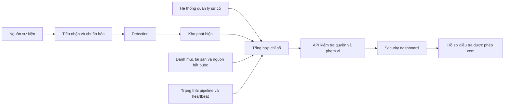

# Security dashboard

## 1. Dashboard bảo mật cần trả lời điều gì?

Security dashboard là giao diện tổng hợp trạng thái bảo mật, tín hiệu phát hiện và tình trạng xử lý để người có trách nhiệm đưa ra quyết định. Giá trị của dashboard nằm ở việc giúp người dùng xác định **rủi ro nào cần chú ý, bằng chứng có đáng tin không, ai cần hành động và hành động trong thời hạn nào**.

Trong chương **Monitoring và detection** của module yêu cầu bảo mật, mục tiêu không dừng ở việc chọn biểu đồ. Người đặc tả cần chuyển mục tiêu an toàn thông tin và mô hình đe dọa thành các yêu cầu cụ thể, đo được, kiểm chứng được đối với dữ liệu, chỉ số, quyền truy cập và hành vi của dashboard.

Một màn hình có nhiều số liệu vẫn có thể dẫn đến quyết định sai nếu:

- Tổng số cảnh báo giảm vì nguồn log bị mất, nhưng màn hình lại hiển thị màu xanh.
- Hai cảnh báo cho cùng một sự kiện bị đếm thành hai sự cố độc lập.
- Người quản trị chỉ nhìn thấy tenant của mình ở bảng chi tiết, nhưng biểu đồ tổng hợp lại chứa dữ liệu tenant khác.
- Chỉ số phản ứng nhanh lên vì những sự cố chưa xử lý bị loại khỏi mẫu tính.
- Người xem biết có vấn đề nhưng không biết ai chịu trách nhiệm hoặc mở hồ sơ xử lý ở đâu.

Vì vậy, dashboard phải được đặc tả như một phần của hệ thống kiểm soát bảo mật: có đầu vào, quy tắc tính toán, giới hạn độ tin cậy, quyền truy cập và tiêu chí nghiệm thu.

### Mục tiêu học tập

Sau bài này, người học có thể:

1. Liên kết từng thành phần dashboard với rủi ro và quyết định cần hỗ trợ.
2. Định nghĩa chỉ số có đơn vị, mẫu số, phạm vi và quy tắc xử lý dữ liệu thiếu.
3. Viết yêu cầu về độ mới, độ đầy đủ và tính nhất quán của dữ liệu.
4. Đặc tả phân quyền, bảo vệ dữ liệu và nhật ký kiểm toán cho dashboard.
5. Xây dựng tiêu chí kiểm thử cho trạng thái bình thường, trạng thái suy giảm và truy cập trái quyền.

## 2. Phân biệt dashboard, detection và điều phối xử lý

Các thành phần này có liên hệ nhưng đảm nhiệm những trách nhiệm khác nhau:

| Thành phần | Trách nhiệm chính | Câu hỏi điển hình |
|---|---|---|
| Thu thập và lưu trữ sự kiện | Nhận, chuẩn hóa, giữ bằng chứng theo chính sách | Sự kiện nào đã xảy ra và nguồn có gửi đầy đủ không? |
| Detection | Đánh giá sự kiện theo quy tắc hoặc mô hình để tạo phát hiện | Hành vi này có dấu hiệu vi phạm hay tấn công không? |
| Dashboard | Tổng hợp và trình bày bằng chứng phục vụ quyết định | Rủi ro nào đang tồn tại, dữ liệu có mới không và cần làm gì? |
| Thông báo và điều phối | Chuyển tín hiệu đến người trực, quản lý phân công và thời hạn | Ai phải nhận và xác nhận xử lý? |
| Quản lý sự cố | Theo dõi điều tra, khống chế, phục hồi và kết luận | Vấn đề được giải quyết ra sao và còn việc gì tồn đọng? |

Một dashboard có thể cung cấp thao tác xác nhận, phân công hoặc mở hồ sơ sự cố. Nếu có, các thao tác đó cần yêu cầu phân quyền và kiểm toán riêng. Việc một cảnh báo xuất hiện trên dashboard không chứng minh rằng người trực đã nhận thông báo, cũng không chứng minh rằng sự cố đã được xử lý.

Tương tự, dashboard hiển thị ít cảnh báo không đủ để kết luận hệ thống an toàn. Có thể chưa có hành vi đáng ngờ, nhưng cũng có thể detection không bao phủ rủi ro hoặc chuỗi thu thập đang hỏng.

## 3. Bắt đầu từ rủi ro và quyết định

Giả sử một nền tảng SaaS phục vụ nhiều tenant, có tài khoản quản trị, API xuất dữ liệu và dịch vụ quản lý khóa. Mô hình đe dọa đã xác định các rủi ro sau:

| Rủi ro | Bằng chứng cần quan sát | Quyết định dashboard cần hỗ trợ |
|---|---|---|
| Chiếm đoạt tài khoản quản trị | Chuỗi đăng nhập đáng ngờ, thay đổi MFA, phiên có đặc quyền | Điều tra tài khoản nào trước; có cần khống chế phiên không? |
| Lạm dụng quyền xuất dữ liệu | Tác vụ xuất bất thường và kết quả thực thi | Có cần dừng tác vụ, xác minh mục đích hoặc mở sự cố không? |
| Thay đổi đặc quyền ngoài quy trình | Sự kiện cấp quyền, người thực hiện, hồ sơ phê duyệt | Thay đổi nào cần được xác minh hoặc thu hồi? |
| Mất khả năng quan sát | Heartbeat, lỗi thu thập, độ trễ, nguồn bắt buộc bị thiếu | Đang có khoảng mù ở đâu và đội nào phải phục hồi nguồn? |
| Phản ứng chậm với sự cố | Mốc phát hiện, phân công, xác nhận và khống chế | Hồ sơ nào đã vượt thời hạn và cần được nâng cấp xử lý? |

Mỗi thành phần trên màn hình nên có câu trả lời rõ cho bốn câu hỏi:

1. **Hỗ trợ rủi ro nào?** Liên kết đến mã rủi ro hoặc kịch bản đe dọa.
2. **Ai sử dụng?** Người trực vận hành bảo mật, chủ dịch vụ, quản trị tenant hay người quản lý.
3. **Hỗ trợ hành động nào?** Điều tra, khôi phục nguồn, phân công hoặc đánh giá ưu tiên.
4. **Dựa vào bằng chứng gì?** Nguồn dữ liệu, quy tắc tính và giới hạn quan sát.

Nếu không xác định được quyết định cần hỗ trợ, chỉ số đó thường chưa đủ cơ sở để trở thành yêu cầu bắt buộc.

## 4. Xác định người dùng và phạm vi quan sát

Không phải mọi vai trò đều cần cùng một màn hình hay cùng mức chi tiết.

| Vai trò | Nội dung cần thấy | Giới hạn điển hình |
|---|---|---|
| Nhân sự SOC đang trực | Phát hiện cần xử lý, tuổi cảnh báo, mức ưu tiên, sức khỏe nguồn | Chỉ truy cập phạm vi tổ chức và tenant được giao |
| Chủ dịch vụ | Rủi ro, nguồn lỗi, công việc quá hạn của dịch vụ mình | Không mặc nhiên xem dữ liệu dịch vụ khác |
| Quản trị tenant | Tín hiệu và trạng thái xử lý thuộc tenant mình | Không được suy ra số liệu của tenant khác |
| Người quản lý bảo mật | Xu hướng, mức bao phủ, tiến độ khắc phục và tồn đọng | Dữ liệu tổng hợp; xem chi tiết nhạy cảm cần quyền riêng |
| Kiểm toán viên | Bằng chứng lịch sử, định nghĩa chỉ số và dấu vết thay đổi | Quyền đọc giới hạn thời gian, không có quyền điều hành |

Phạm vi phải áp dụng đồng nhất cho số tổng, biểu đồ, bộ lọc, danh sách gợi ý, dữ liệu tải xuống và trang chi tiết. Che một cột trên giao diện không tạo ra ranh giới phân quyền nếu API vẫn trả dữ liệu đó.

Ngoài vai trò, cần xác định môi trường được quan sát. Số liệu production, staging và môi trường thử nghiệm không nên được trộn mà thiếu nhãn hoặc bộ lọc rõ ràng. Các tín hiệu từ diễn tập cũng cần được nhận diện để không làm sai đánh giá vận hành thực tế.

## 5. Thiết kế các lớp thông tin

Một bố cục hữu ích thường gồm các lớp sau, được điều chỉnh theo vai trò:

### 5.1. Phạm vi và chất lượng dữ liệu

Hiển thị tổ chức, tenant, môi trường, dịch vụ, cửa sổ thời gian, múi giờ, thời điểm tính gần nhất và trạng thái dữ liệu. Người xem cần thấy ngay mình đang nhìn phạm vi nào và dữ liệu có đủ mới để hành động hay không.

Thông báo “cập nhật lúc 10:05” phải nói rõ đó là lúc giao diện tải lại, lúc phép tổng hợp hoàn tất hay lúc nguồn gửi dữ liệu. Ba mốc này có ý nghĩa khác nhau.

### 5.2. Những việc cần hành động

Ưu tiên các phát hiện đang mở, chưa được phân công, vượt hạn hoặc có ảnh hưởng lớn. Mỗi dòng cần đủ ngữ cảnh để định tuyến công việc: loại rủi ro, đối tượng bị ảnh hưởng, người phụ trách, tuổi phát hiện, thời hạn và liên kết đến hồ sơ.

Mức độ nghiêm trọng của phát hiện và mức ưu tiên xử lý nên được phân biệt nếu tổ chức dùng cả hai. Mức ưu tiên có thể còn phụ thuộc vào độ quan trọng của tài sản và trạng thái khai thác. Dashboard phải sử dụng cùng định nghĩa với hệ thống xử lý, tránh tự tính một mức khác mà không công bố quy tắc.

### 5.3. Tình trạng kiểm soát và độ bao phủ

Cho biết tài sản nào đã có nguồn sự kiện, nguồn nào đang khỏe, detection nào hoạt động và khoảng mù nào chưa được xử lý. Không gộp mọi dạng bao phủ thành một tỷ lệ duy nhất rồi gọi là “mức an toàn”.

### 5.4. Xu hướng và hiệu quả phản ứng

Trình bày xu hướng theo cửa sổ thời gian nhất quán, kèm kích thước mẫu và các thay đổi có ảnh hưởng. Ví dụ, số cảnh báo tăng sau khi bổ sung nguồn mới cần được phân biệt với số cảnh báo tăng trên cùng một tập tài sản.

### 5.5. Đường dẫn đến bằng chứng

Cho phép đi từ số tổng hợp đến tập phát hiện tương ứng, rồi đến hồ sơ hoặc sự kiện được phép xem. Bộ lọc và ngữ cảnh thời gian phải được giữ khi chuyển trang. Không đưa toàn bộ payload nhạy cảm lên màn hình tổng quan chỉ để thuận tiện điều tra.

## 6. Viết hợp đồng cho từng chỉ số

Tên chỉ số chưa phải là đặc tả. Ví dụ “số cảnh báo nghiêm trọng” chưa nói rõ đếm cảnh báo đang mở hay mọi cảnh báo được tạo, có gộp trùng không và thuộc phạm vi nào.

Mỗi chỉ số cần có tối thiểu:

| Thuộc tính | Nội dung phải làm rõ |
|---|---|
| Mục đích | Rủi ro và quyết định được hỗ trợ |
| Đơn vị đếm | Sự kiện, phát hiện, tài khoản, tài sản hay hồ sơ sự cố |
| Phạm vi | Tenant, dịch vụ, môi trường và quyền của người xem |
| Công thức | Tử số, mẫu số, quy tắc làm tròn và đơn vị |
| Cửa sổ thời gian | Theo thời điểm xảy ra, tiếp nhận, tạo phát hiện hay đóng hồ sơ |
| Nguồn | Hệ thống có thẩm quyền và phiên bản định nghĩa |
| Dữ liệu ngoại lệ | Trùng lặp, đến muộn, thiếu mốc thời gian, trạng thái chưa kết thúc |
| Chất lượng | Độ mới tối đa, điều kiện đầy đủ và cách hiển thị khi suy giảm |
| Hành động | Chủ sở hữu và liên kết điều tra hoặc xử lý |

### 6.1. Đếm phát hiện đang mở

Ví dụ định nghĩa:

> Tại thời điểm chụp trạng thái T, đếm số `finding_id` duy nhất có mức nghiêm trọng High hoặc Critical, chưa ở trạng thái kết thúc, thuộc phạm vi được phép xem của người dùng. Phát hiện đã bị gộp vào bản ghi khác không được đếm lần thứ hai.

Đây là chỉ số tồn đọng tại thời điểm T. Nó khác với “số phát hiện được tạo trong 24 giờ qua”, vốn là chỉ số dòng phát sinh. Với chỉ số tồn đọng, cần nói rõ các phát hiện cũ hơn cửa sổ biểu đồ có còn được tính hay không; nếu loại chúng, số tồn đọng có thể bị giảm giả tạo.

### 6.2. Đo độ bao phủ nguồn log

Một công thức ví dụ:

```text
required_sources = tập nguồn bắt buộc trong phạm vi tại thời điểm T
healthy_sources  = các nguồn trong required_sources thỏa điều kiện khỏe

coverage_percent = 100 × count(healthy_sources) / count(required_sources)
```

Điều kiện “khỏe” phải được đặc tả riêng. Chẳng hạn, nguồn đã được xác thực, có heartbeat trong giới hạn quy định, không bị báo lỗi thu thập và có độ trễ nằm trong ngưỡng cho phép. Các ngưỡng phụ thuộc loại nguồn và mục tiêu vận hành.

Nếu mẫu số bằng 0, hiển thị **không áp dụng** hoặc **chưa xác định**, tùy lý do. Không tự hiển thị 100%. Nếu danh mục nguồn bắt buộc không tải được, đó là trạng thái thiếu dữ liệu, không phải tập nguồn rỗng hợp lệ.

Các nguồn được miễn tạm thời cần có người phê duyệt, lý do và ngày hết hạn. Nếu chính sách cho phép loại khỏi mẫu số, dashboard vẫn phải hiển thị riêng số nguồn đang được miễn để người xem hiểu tỷ lệ.

### 6.3. Tách các dạng bao phủ

- **Bao phủ tài sản:** bao nhiêu tài sản thuộc phạm vi đã được đưa vào danh mục và có chủ sở hữu?
- **Bao phủ telemetry:** bao nhiêu nguồn bắt buộc đang cung cấp dữ liệu theo hợp đồng?
- **Bao phủ detection:** bao nhiêu kịch bản đe dọa yêu cầu đã có cơ chế phát hiện được kiểm thử?

Một nguồn có dữ liệu không chứng minh rằng kịch bản tấn công đã có detection hiệu quả. Tương tự, một quy tắc được bật không chứng minh rằng dữ liệu đầu vào của nó đang đầy đủ.

### 6.4. Đo thời gian phát hiện và phản ứng

Các thuật ngữ như MTTD hoặc MTTR dễ gây hiểu nhầm nếu không chỉ rõ hai mốc bắt đầu và kết thúc. “Phản ứng” có thể nghĩa là xác nhận, phân công, khống chế hoặc phục hồi; các mốc này không thay thế nhau.

Ví dụ hợp đồng chỉ số:

```text
detection_delay = detected_at - first_relevant_event_at
ack_delay       = first_acknowledged_at - detected_at
containment_age = contained_at - detected_at
```

Trong đó:

- `first_relevant_event_at` là mốc sự kiện liên quan sớm nhất đã xác định được trong điều tra, không mặc nhiên là lúc cuộc tấn công thật sự bắt đầu.
- `detected_at` là lúc hệ thống có thẩm quyền tạo phát hiện, không phải lúc dashboard tải bản ghi.
- `first_acknowledged_at` là lần xác nhận hợp lệ đầu tiên theo quy trình.
- `contained_at` là mốc khống chế được ghi nhận theo tiêu chí của loại sự cố.

Khi hiển thị trung bình hoặc p95, phải cho biết cửa sổ lấy mẫu, số mẫu hợp lệ và quy tắc chọn tập hồ sơ. Ví dụ chọn các hồ sơ được phát hiện trong tuần, tính thời gian khống chế cho phần đã khống chế tại thời điểm chốt, đồng thời trình bày riêng số hồ sơ chưa khống chế và tuổi của chúng.

Nếu bỏ toàn bộ hồ sơ chưa hoàn tất mà không công bố, chỉ số có thể đẹp lên dù tồn đọng tăng. Nếu không có mẫu hợp lệ, hiển thị “chưa đủ dữ liệu”, không hiển thị 0 giây. Các khoảng thời gian âm do lệch đồng hồ phải được đánh dấu lỗi dữ liệu và đưa vào thống kê chất lượng, không âm thầm sửa thành 0.

Chỉ số từ các trường hợp đã phát hiện cũng không đo được những hành vi tấn công chưa từng được phát hiện. Đây là giới hạn cần được nêu khi diễn giải hiệu quả detection.

## 7. Đặc tả thời gian, độ mới và tính nhất quán

### 7.1. Phân biệt các mốc thời gian

Một chuỗi xử lý thường có nhiều mốc:

```text
event_time → received_at → normalized_at → detected_at → aggregated_at → viewed_at
```

Các mốc giúp phân biệt độ trễ của nguồn, pipeline, detection, phép tổng hợp và giao diện. Nếu chỉ lưu thời điểm tải trang, không thể xác định tại sao người dùng đang nhìn thấy dữ liệu cũ.

Yêu cầu cần quy định cách lưu và hiển thị múi giờ. Một lựa chọn là lưu mốc thời gian theo UTC, hiển thị múi giờ được chọn kèm nhãn rõ ràng. Bộ lọc thời gian cần được hiểu nhất quán giữa dashboard, trang chi tiết và file xuất.

Cửa sổ tổng hợp nên có quy tắc biên rõ ràng, ví dụ `[start, end)`: bao gồm `start`, không bao gồm `end`. Nhờ đó, một bản ghi ở đúng ranh giới hai cửa sổ không bị đếm hai lần.

### 7.2. Tách độ mới của giao diện khỏi độ mới của nguồn

Tự tải lại mỗi 30 giây không có nghĩa dữ liệu chỉ trễ 30 giây. Giao diện có thể tải thành công một phép tổng hợp đã cũ hàng giờ.

Một bộ yêu cầu minh họa có thể quy định:

- Trong điều kiện tải đã định nghĩa, p95 thời gian từ khi API tiếp nhận phát hiện hợp lệ đến khi phát hiện có thể truy vấn trên dashboard không vượt quá 120 giây, đo trên cửa sổ vận hành 24 giờ và công bố số mẫu.
- Nếu phép tổng hợp gần nhất cũ hơn 5 phút, widget phải hiển thị “dữ liệu cũ”, kèm thời điểm tính gần nhất.
- Nguồn mất heartbeat quá giới hạn của loại nguồn phải được đánh dấu suy giảm, kể cả khi dashboard vẫn truy vấn thành công.

Các con số trên là ví dụ đặc tả, không phải ngưỡng chuẩn áp dụng cho mọi hệ thống. Khi đưa vào dự án, cần chọn chúng theo rủi ro, tốc độ hành động cần thiết và khả năng của kiến trúc.

### 7.3. Xử lý dữ liệu đến muộn và trùng lặp

Với dữ liệu đến muộn, cần xác định:

1. Cửa sổ nào được tính lại và trong bao lâu.
2. Số liệu được coi là tạm thời hay đã chốt ở thời điểm nào.
3. Người xem nhận biết việc hiệu chỉnh lịch sử bằng cách nào.
4. Bản xuất trước đó có còn là ảnh chụp lịch sử hay được tạo lại theo dữ liệu mới.

Với bản ghi trùng, cần khóa định danh và quy tắc hợp nhất. Không mặc nhiên khử trùng theo nội dung thông điệp, vì hai sự kiện độc lập có thể có cùng nội dung. Nếu nguồn không có định danh đáng tin cậy, phải nêu giới hạn của phương pháp thay thế.

Các widget liên quan nên dùng cùng thời điểm chụp trạng thái hoặc công bố chênh lệch. Nếu thẻ tổng hiển thị 18 phát hiện nhưng danh sách có 20 do thời điểm truy vấn khác nhau, người xem cần được biết đây là cập nhật mới hay lỗi không nhất quán.

## 8. Mô hình dữ liệu và luồng kiến trúc

Một luồng khái quát:



Sơ đồ mô tả trách nhiệm logic, không bắt buộc phải triển khai thành từng dịch vụ riêng. Tuy nhiên, đặc tả cần xác định hệ thống nào có thẩm quyền cho từng loại dữ liệu:

| Loại dữ liệu | Nguồn có thẩm quyền cần xác định |
|---|---|
| Mức nghiêm trọng và trạng thái phát hiện | Hệ thống quản lý phát hiện |
| Phân công, xác nhận, khống chế và đóng hồ sơ | Hệ thống điều phối hoặc quản lý sự cố |
| Tài sản trong phạm vi và chủ sở hữu | Danh mục tài sản đã được phê duyệt |
| Nguồn bắt buộc và ngoại lệ | Danh mục nguồn cùng hồ sơ phê duyệt |
| Sức khỏe pipeline | Giám sát pipeline và cơ chế heartbeat |
| Quyền xem và thao tác | Hệ thống danh tính và chính sách phân quyền |

Hợp đồng dữ liệu tối thiểu thường cần định danh ổn định, tenant, môi trường, nguồn, các mốc thời gian liên quan, trạng thái, phiên bản schema và tham chiếu bằng chứng. Các trường cụ thể phụ thuộc loại bản ghi. Không yêu cầu lưu tràn lan dữ liệu cá nhân hoặc nội dung bí mật chỉ để làm dashboard.

Dashboard không nên tự tạo bản sao trạng thái có thể chỉnh sửa độc lập với hệ thống xử lý mà thiếu quy tắc đồng bộ và giải quyết xung đột. Nếu một người xác nhận cảnh báo trong hệ thống điều phối, dashboard cần phản ánh trạng thái đó theo giới hạn độ trễ đã cam kết.

## 9. Dashboard cũng là một bề mặt cần bảo vệ

### 9.1. Xác thực và quản lý phiên

Đặc tả cần liên kết dashboard với chính sách danh tính hiện hành: điều kiện đăng nhập, yêu cầu MFA theo vai trò hoặc mức rủi ro, thời hạn phiên và phản ứng khi tài khoản bị thu hồi quyền.

Nếu có thao tác nhạy cảm như xuất bằng chứng diện rộng hoặc thay đổi ngưỡng, cần xác định có yêu cầu xác thực lại hay không. Không chỉ yêu cầu “dashboard có đăng nhập” rồi bỏ ngỏ các phiên đã tồn tại sau khi quyền thay đổi.

### 9.2. Phân quyền ở phía máy chủ

Phạm vi truy vấn phải được xác định từ danh tính và quyền đã xác minh. Các tham số `tenant_id`, `service_id`, `finding_id` do client gửi chỉ là đầu vào yêu cầu, không phải bằng chứng về quyền sở hữu.

Yêu cầu phân quyền phải áp dụng cho:

- API tổng hợp, API chi tiết và cơ chế truy vấn tùy biến nếu có.
- Tìm kiếm, gợi ý bộ lọc, phân trang và liên kết truy cập trực tiếp.
- Dữ liệu lưu trong cache, tác vụ tạo báo cáo và file tải xuống.
- Kênh cập nhật trực tiếp hoặc tác vụ nền tiếp tục chạy sau khi quyền thay đổi.

Khóa cache phải phân biệt đầy đủ các yếu tố ảnh hưởng đến quyền xem. Khi quyền bị thu hồi, hành vi vô hiệu hóa phiên, cache và bản tải xuống phải tuân theo yêu cầu đã định nghĩa. Với báo cáo tạo bất đồng bộ, cần kiểm tra quyền khi nhận yêu cầu và khi cấp quyền tải kết quả.

### 9.3. Tối thiểu hóa dữ liệu

Màn hình tổng quan có thể chỉ cần mã định danh tài khoản, loại sự kiện, dịch vụ và mức ưu tiên. Email đầy đủ, địa chỉ IP, vị trí hoặc nội dung truy vấn chỉ nên xuất hiện khi phục vụ nhu cầu đã xác định và người dùng có quyền tương ứng.

Không đưa mật khẩu, token truy cập, khóa bí mật hoặc dữ liệu xác thực thô vào dashboard. Dữ liệu dùng để điều tra cần có quy tắc che, thời hạn giữ, nơi lưu và cách thu hồi truy cập. Nhãn “nội bộ” không thay thế những yêu cầu này.

File xuất cần được kiểm soát như một sản phẩm dữ liệu riêng: trường được phép xuất, giới hạn phạm vi, thời hạn liên kết tải, người được tải và dấu vết kiểm toán. Nếu hỗ trợ định dạng bảng tính, nội dung do nguồn không tin cậy cung cấp phải được xử lý để không bị thực thi như công thức khi mở bằng ứng dụng bảng tính.

### 9.4. Coi nội dung log là đầu vào không tin cậy

Tên tài khoản, user-agent, URL hoặc mô tả sự kiện có thể chứa nội dung do đối tượng bên ngoài kiểm soát. Giao diện phải hiển thị chúng bằng cơ chế mã hóa đầu ra phù hợp, không thực thi HTML hoặc script được chèn trong sự kiện.

Liên kết đến bằng chứng phải được tạo theo quy tắc cho phép, không mặc nhiên biến mọi chuỗi trong log thành liên kết có thể mở. Truy vấn và bộ lọc cũng cần được kiểm soát để tránh đầu vào làm thay đổi ngữ nghĩa truy vấn hoặc vượt phạm vi dữ liệu.

### 9.5. Kiểm toán thao tác nhạy cảm

Cần xác định các hành động bắt buộc ghi audit, ví dụ thay đổi cấu hình chỉ số, sửa ngưỡng, thay đổi quyền, xem bằng chứng nhạy cảm, tạo báo cáo và tải file xuất. Mỗi bản ghi cần cho biết ai, thực hiện hành động gì, trên phạm vi nào, lúc nào, kết quả và mã liên kết yêu cầu.

Chính sách phải xác định trường hợp bắt buộc dừng thao tác nếu không ghi được audit, và trường hợp có thể ghi bù qua hàng đợi bền vững. Không tuyên bố “mọi thao tác đều có audit” nếu chưa đặc tả hành vi khi nơi lưu audit mất kết nối.

## 10. Trạng thái lỗi phải có ý nghĩa bảo mật

Một widget nên phân biệt ít nhất các trạng thái sau:

| Trạng thái | Ý nghĩa | Cách trình bày cần có |
|---|---|---|
| Có dữ liệu hợp lệ | Có kết quả trong phạm vi và đạt điều kiện chất lượng | Giá trị, phạm vi, thời điểm tính |
| Không có phát hiện | Phép tính thành công và bằng chứng đủ cho kết luận trong phạm vi đó | Giá trị 0 kèm trạng thái chất lượng |
| Chưa có dữ liệu | Chưa thu được dữ liệu cần thiết | Lý do và bước cấu hình hoặc điều tra |
| Dữ liệu cũ | Có kết quả trước đó nhưng quá giới hạn độ mới | Nhãn cũ, mốc cập nhật cuối và ảnh hưởng |
| Dữ liệu một phần | Chỉ một phần nguồn hoặc phạm vi có kết quả | Phần bị thiếu và phạm vi còn quan sát được |
| Truy vấn lỗi | Không tính được kết quả | Trạng thái lỗi và cách thử lại hoặc liên hệ |
| Không có quyền | Người dùng không được xem nội dung | Thông báo theo chính sách, tránh tiết lộ đối tượng nhạy cảm |

Một nguồn ít phát sinh sự kiện có thể hoạt động bình thường dù lâu chưa có sự kiện nghiệp vụ mới. Vì vậy, đánh giá sức khỏe nguồn nên dựa trên hợp đồng heartbeat, tín hiệu pipeline hoặc cơ chế kiểm tra phù hợp; không chỉ dựa vào mốc sự kiện cuối cùng.

Nếu nhiều widget dùng cùng một nguồn bị lỗi, có thể hiển thị thông báo chung, nhưng vẫn phải đánh dấu các chỉ số chịu ảnh hưởng. Không thay giá trị lỗi bằng 0 và không giữ màu xanh mà thiếu nhãn dữ liệu cũ.

Khi phục hồi sau gián đoạn, dashboard cần cho biết khoảng thời gian đã được nạp bù hay còn thiếu. Việc trang tải được trở lại không chứng minh rằng mọi sự kiện trong thời gian mất kết nối đã được khôi phục.

## 11. Bộ yêu cầu minh họa có thể kiểm chứng

Các yêu cầu dưới đây áp dụng cho hệ thống SaaS giả định ở phần trước. Mã và ngưỡng dùng để minh họa cách đặc tả; khi áp dụng cần liên kết tới rủi ro, chính sách và năng lực thực tế của dự án.

| Mã | Yêu cầu | Bằng chứng nghiệm thu chính |
|---|---|---|
| SD-01 | Dashboard phải hiển thị tenant, môi trường, cửa sổ thời gian, múi giờ và thời điểm tính cho dữ liệu đang xem | Kiểm tra giao diện và đối chiếu bộ lọc với truy vấn |
| SD-02 | Mọi API, cache và kết quả xuất phải giới hạn dữ liệu theo quyền hiện hành; không trả số tổng hoặc bản ghi ngoài phạm vi | Kiểm thử hai tenant qua API, liên kết trực tiếp, cache và xuất dữ liệu |
| SD-03 | Số phát hiện đang mở phải đếm `finding_id` duy nhất, dùng tập trạng thái kết thúc đã công bố và giữ các hồ sơ cũ chưa đóng trong tổng tồn đọng | Bộ dữ liệu có bản ghi trùng, hồ sơ cũ, hồ sơ đã gộp và hồ sơ đã đóng |
| SD-04 | Widget bao phủ nguồn phải dùng danh mục nguồn bắt buộc tại thời điểm chụp; hiển thị riêng nguồn miễn trừ và không trả 100% khi không xác định được mẫu số | Đối chiếu danh mục, ngoại lệ còn hạn, hết hạn và lỗi tải danh mục |
| SD-05 | Widget có phép tổng hợp cũ hơn 5 phút phải hiển thị nhãn dữ liệu cũ và thời điểm thành công cuối; nguồn mất heartbeat phải có trạng thái suy giảm | Ngắt luồng dữ liệu trong môi trường kiểm thử và quan sát chuyển trạng thái |
| SD-06 | Chỉ số thời gian phải hiển thị số mẫu hợp lệ, số hồ sơ chưa kết thúc và định nghĩa hai mốc đo | Đối chiếu tập mẫu có hồ sơ mở, thiếu mốc và đồng hồ lệch |
| SD-07 | Liên kết từ chỉ số tới danh sách chi tiết phải giữ phạm vi và ngữ nghĩa thời gian; số lượng phải khớp trong cùng ảnh chụp dữ liệu | Đối chiếu tổng, phân trang và bản xuất trên một snapshot |
| SD-08 | Nội dung sự kiện phải được hiển thị như dữ liệu; payload chứa HTML hoặc script không được thực thi | Kiểm thử đầu vào có ký tự đặc biệt tại mọi vị trí trình bày liên quan |
| SD-09 | Thao tác sửa cấu hình, xuất dữ liệu và xem bằng chứng nhạy cảm phải có audit theo hợp đồng; hành vi khi audit lỗi phải được xác định | Đối chiếu audit với thao tác thành công, bị từ chối và lỗi ghi audit |
| SD-10 | Sau khi phục hồi nguồn, dashboard phải biểu thị phần dữ liệu đã nạp bù và khoảng thiếu còn lại trước khi xác nhận phạm vi đã đầy đủ | Diễn tập gián đoạn, nạp bù và đối chiếu tập sự kiện đã biết |

Yêu cầu hiệu năng cũng cần dữ liệu tải cụ thể. Ví dụ “dashboard tải dưới 3 giây” chỉ có thể kiểm chứng nếu quy định số người dùng đồng thời, quy mô dữ liệu, bộ lọc, phân vị, điểm bắt đầu và điểm kết thúc phép đo. Tốc độ hiển thị không được đạt bằng cách bỏ kiểm tra quyền hoặc bỏ nhãn dữ liệu một phần.

## 12. Liên kết yêu cầu với rủi ro, kiến trúc và kiểm thử

Một ma trận truy vết giúp giải thích vì sao yêu cầu tồn tại và kiểm soát nào chịu trách nhiệm thực hiện:

| Kịch bản rủi ro | Yêu cầu liên quan | Điểm thực thi trong kiến trúc | Kiểm thử cần có |
|---|---|---|---|
| Tenant A nhìn thấy số liệu tenant B | SD-02, SD-07 | API, lớp chính sách, cache và xuất báo cáo | Thay tham số, dùng lại cache, truy cập liên kết trực tiếp |
| Nguồn log bị tắt nhưng màn hình vẫn báo bình thường | SD-04, SD-05 | Heartbeat, giám sát pipeline và lớp tổng hợp | Mất nguồn, lỗi danh mục, dữ liệu cũ và nguồn yên lặng hợp lệ |
| Tồn đọng bị đánh giá thấp | SD-03, SD-06 | Kho phát hiện, hệ thống sự cố và công thức chỉ số | Trùng lặp, hồ sơ cũ chưa đóng, hồ sơ mở lại và thiếu mốc |
| Nội dung log chiếm quyền trình duyệt người trực | SD-08 | Thành phần hiển thị và bộ tạo liên kết | Payload không tin cậy ở bảng, tooltip và trang chi tiết |
| Thay đổi ngưỡng làm che khuất tình trạng xấu | SD-09 | Cấu hình có phiên bản và hệ thống audit | Thay đổi có quyền, trái quyền và lỗi lưu audit |
| Phục hồi thiếu dữ liệu nhưng báo cáo vẫn được coi là đầy đủ | SD-05, SD-10 | Kho dữ liệu, cơ chế nạp bù và trạng thái chất lượng | Gián đoạn có khoảng thiếu đã biết và nạp bù từng phần |

Việc một yêu cầu có nhiều điểm thực thi không làm trách nhiệm trở nên tự động rõ ràng. Cần ghi chủ sở hữu yêu cầu và đội chịu trách nhiệm từng phần, đặc biệt với quyền truy cập xuyên qua API, cache và file xuất.

## 13. Ví dụ tiêu chí nghiệm thu

### 13.1. Cách ly tenant ở số tổng và chi tiết

```gherkin
Given người dùng chỉ có quyền xem tenant A
And snapshot dữ liệu chứa 3 phát hiện đang mở của A và 7 của B
When người dùng mở dashboard cho tenant A
Then thẻ tổng phát hiện đang mở hiển thị 3
And danh sách chi tiết chỉ chứa 3 phát hiện của A
And API không trả các bản ghi hoặc số tổng của B

When người dùng gửi trực tiếp yêu cầu cho tenant B
Then yêu cầu bị từ chối theo hợp đồng phân quyền
And phản hồi không cung cấp dữ liệu bảo mật của B
```

Lặp lại kịch bản với cache đã được làm nóng bằng người dùng có quyền khác, tác vụ xuất bất đồng bộ và liên kết đến một phát hiện cụ thể. Kiểm tra giao diện đơn thuần chưa đủ chứng minh cách ly dữ liệu.

### 13.2. Không biến mất dữ liệu thành số 0

```gherkin
Given widget đã tính thành công lúc 10:00 UTC
And giới hạn độ mới của phép tổng hợp là 5 phút
And nguồn dữ liệu sau đó không cập nhật được
When người dùng xem widget lúc 10:06 UTC
Then widget hiển thị nhãn dữ liệu cũ
And hiển thị thời điểm tính thành công cuối là 10:00 UTC
And không trình bày giá trị cũ như kết quả hiện tại còn hợp lệ
And không thay lỗi dữ liệu bằng giá trị 0
```

Thêm trường hợp một nguồn không phát sinh sự kiện nghiệp vụ nhưng heartbeat vẫn hợp lệ để xác minh hệ thống không nhầm “yên lặng” với “hỏng”.

### 13.3. Tính đúng bao phủ nguồn

```text
Danh mục đã xác minh: 10 nguồn bắt buộc, không có miễn trừ.
Tại snapshot T: 8 nguồn khỏe, 2 nguồn mất heartbeat.
Kết quả mong đợi: 8/10 = 80%, kèm danh sách 2 nguồn suy giảm.

Ở lần truy vấn sau, danh mục nguồn không tải được.
Kết quả mong đợi: báo không xác định được mẫu số hoặc dữ liệu cũ;
không coi danh mục lỗi là 0 nguồn để hiển thị 100%.
```

### 13.4. Chỉ số phản ứng có hồ sơ chưa kết thúc

```text
Tập hồ sơ được phát hiện trong cửa sổ đã chọn: 5 hồ sơ.
Tại thời điểm chốt: 3 hồ sơ đã khống chế, 2 hồ sơ chưa khống chế.
Thời gian từ phát hiện đến khống chế của 3 hồ sơ: 10, 20, 30 phút.

Kết quả mong đợi:
- Trung bình của nhóm đã khống chế: 20 phút, số mẫu 3.
- Hiển thị riêng 2 hồ sơ chưa khống chế cùng tuổi hiện tại.
- Nhãn chỉ số công bố rõ phép tính chỉ áp dụng cho nhóm đã khống chế.
```

Không dùng 20 phút để khẳng định rằng cả 5 hồ sơ đều đã được khống chế trong khoảng thời gian đó. Nếu chỉ số dùng một cohort khác, tiêu chí nghiệm thu phải thay đổi tương ứng.

### 13.5. Biên thời gian, trùng lặp và dữ liệu đến muộn

Tạo dữ liệu kiểm thử có bản ghi đúng tại `start`, đúng tại `end`, một bản gửi lại cùng định danh và một bản đến muộn. Xác minh quy tắc `[start, end)`, khử trùng và tính lại cửa sổ đã công bố. Các kết quả phải khớp giữa số tổng và drill-down khi dùng cùng snapshot.

## 14. Các lỗi đặc tả thường gặp

| Cách đặc tả dễ gây lỗi | Vấn đề | Cách làm rõ |
|---|---|---|
| “Dashboard phải hiển thị thời gian thực” | Không có điểm đo hoặc giới hạn độ trễ | Chỉ rõ mốc bắt đầu, mốc kết thúc, phân vị, tải và cửa sổ đo |
| “Mọi chỉ số phải xanh khi không có cảnh báo” | Có thể che khuất mất telemetry | Tách trạng thái rủi ro khỏi trạng thái chất lượng dữ liệu |
| “Tỷ lệ bảo mật đạt 95%” | Không rõ mẫu số và ý nghĩa | Đặt tên theo đúng đại lượng đo; công bố tài sản, nguồn hoặc kịch bản trong phạm vi |
| “Chỉ quản trị viên thấy nút xuất” | API xuất vẫn có thể bị gọi trực tiếp | Yêu cầu kiểm tra quyền phía máy chủ và kiểm tra quyền tải kết quả |
| “Giảm cảnh báo nghĩa là detection tốt hơn” | Có thể do mất nguồn hoặc thay quy tắc | Hiển thị thay đổi nguồn, phạm vi, phiên bản quy tắc và chất lượng dữ liệu |
| “MTTR giảm nên phản ứng đã tốt lên” | Có thể bỏ hồ sơ chưa đóng hoặc đổi cách chọn mẫu | Định nghĩa cohort, mốc đo, số mẫu và phần tồn đọng |
| “Không cần lưu lịch sử định nghĩa chỉ số” | Báo cáo các kỳ có thể không so sánh được | Gắn phiên bản và đánh dấu các thay đổi phá vỡ khả năng so sánh |
| “Màn hình khôi phục được là dữ liệu đã đầy đủ” | Có thể còn khoảng thiếu sau gián đoạn | Đối chiếu nạp bù và hiển thị độ đầy đủ theo thời gian |

Một lỗi khác là cho phép người quản trị tự đổi ngưỡng ngay trên dashboard mà không ghi phiên bản hoặc audit. Khi đó, một vấn đề vẫn tồn tại nhưng cách phân loại đã thay đổi. Yêu cầu quản trị cấu hình cần quy định người được sửa, phạm vi ảnh hưởng, thời điểm hiệu lực và cách giải thích thay đổi trên chuỗi xu hướng.

## 15. Đưa dashboard vào vòng đời phát triển

Ở giai đoạn phân tích, xuất phát từ tài sản quan trọng, kịch bản đe dọa và quyết định vận hành. Ghi rõ đối tượng sử dụng, phạm vi xem và chủ sở hữu từng chỉ số.

Ở giai đoạn thiết kế, hoàn thiện hợp đồng dữ liệu, nguồn có thẩm quyền, công thức, ngữ nghĩa thời gian, ranh giới phân quyền và trạng thái suy giảm. Kiến trúc cần hỗ trợ những yêu cầu này thay vì để giao diện tự suy luận từ dữ liệu rời rạc.

Ở giai đoạn triển khai, liên kết thành phần giao diện và truy vấn với mã yêu cầu. Duy trì phiên bản của định nghĩa chỉ số, schema và quy tắc tổng hợp để có thể giải thích sự khác biệt giữa các lần phát hành.

Ở giai đoạn nghiệm thu, dùng tập dữ liệu biết trước kết quả, kiểm thử phân quyền xuyên suốt và chủ động tạo gián đoạn. Đối chiếu số tổng, chi tiết, export và audit trong cùng phạm vi đo.

Ở giai đoạn vận hành, theo dõi chính sức khỏe dashboard: lỗi truy vấn, tuổi phép tổng hợp, nguồn thiếu, lỗi tính chỉ số và thất bại ghi audit. Một dashboard bảo mật có thể cần cơ chế giám sát độc lập để người trực vẫn biết khi chính dashboard mất khả năng cung cấp thông tin.

Khi thêm tài sản, đổi nguồn hoặc điều chỉnh quy trình sự cố, cần đánh giá lại mẫu số, thời hạn, quyền truy cập và khả năng so sánh lịch sử. Những thay đổi này có thể làm ý nghĩa chỉ số thay đổi dù giao diện không thay đổi.

## 16. Bài tập tự kiểm tra

Một dashboard báo “0 cảnh báo Critical” và “100% nguồn hoạt động”. Trong cùng thời điểm, dịch vụ xuất dữ liệu mất kết nối gửi log đã 20 phút; danh mục nguồn mới cũng chưa được đồng bộ vào phép tổng hợp.

Hãy viết đặc tả trả lời các câu hỏi:

1. Hai con số trên có đủ bằng chứng để được hiển thị như kết quả hiện tại hợp lệ không?
2. Nguồn có thẩm quyền nào xác định tập nguồn bắt buộc? Dashboard xử lý danh mục cũ ra sao?
3. Những widget nào bị ảnh hưởng khi mất log từ dịch vụ xuất dữ liệu?
4. Người trực cần nhìn thấy thời điểm nào, khoảng thiếu nào và liên kết xử lý nào?
5. Làm thế nào chứng minh trạng thái được phục hồi sau khi kết nối trở lại và dữ liệu được nạp bù?
6. Quản trị viên của một tenant được thấy phần thông tin nào trong sự cố này?

Một hướng trả lời hợp lý phải tách “không có phát hiện trong dữ liệu quan sát được” khỏi “đã có đủ dữ liệu để đánh giá phạm vi yêu cầu”. Nó cũng phải chỉ rõ điều kiện thoát trạng thái suy giảm, thay vì chỉ đổi màu khi lần truy vấn kế tiếp thành công.

Security dashboard phục vụ tốt việc quản lý rủi ro khi mỗi con số có định nghĩa, mỗi kết luận có giới hạn bằng chứng và mỗi trạng thái đáng chú ý dẫn đến một hành động có chủ sở hữu. Đây là cơ sở để biến nhu cầu quan sát bảo mật thành yêu cầu gắn được với kiến trúc và kiểm thử trong vòng đời phát triển.
