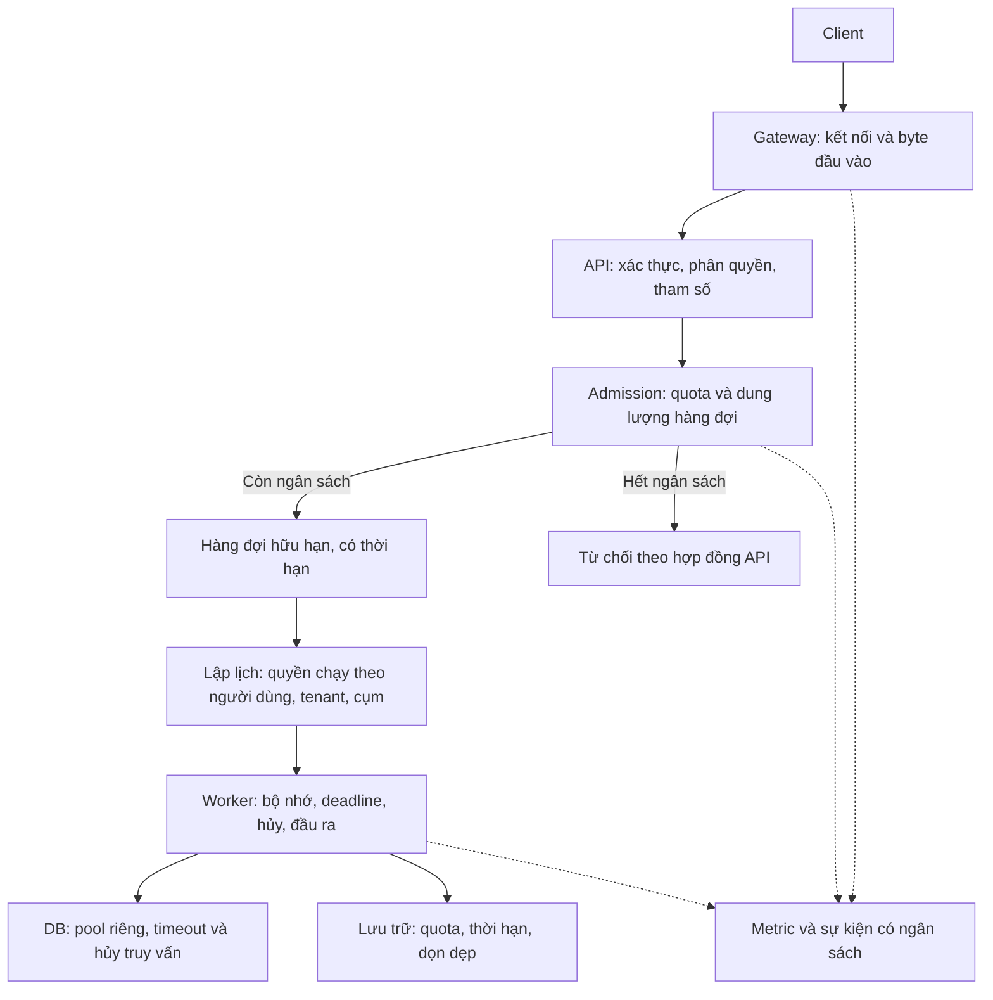

# Resource limit

## 1. Mục tiêu của yêu cầu giới hạn tài nguyên

**Resource limit** là giới hạn được thực thi đối với lượng tài nguyên mà một yêu cầu, tác vụ, danh tính hoặc nhóm khách hàng được phép sử dụng. Tài nguyên có thể là CPU, bộ nhớ, kết nối, luồng xử lý, dung lượng lưu trữ, băng thông hoặc số lần gọi dịch vụ có tính phí.

Trong chương **Availability và resilience**, resource limit giúp hệ thống duy trì khả năng phục vụ khi tải tăng, một thành phần bị chậm hoặc có hành vi lạm dụng. Một yêu cầu đã xác thực và có quyền hợp lệ vẫn có thể tiêu thụ tài nguyên quá mức. Vì vậy, yêu cầu xác thực và phân quyền cần đi cùng yêu cầu về mức sử dụng tài nguyên được chấp nhận.

Sau bài học, người học có thể:

- Xác định tài nguyên có nguy cơ cạn kiệt từ luồng dữ liệu và mô hình đe dọa.
- Viết giới hạn với đơn vị, phạm vi, vị trí thực thi và hành vi khi vượt ngưỡng.
- Liên kết yêu cầu với cô lập tải, logging, phục hồi và tiêu chí kiểm thử.
- Phân biệt giới hạn của từng yêu cầu với giới hạn tổng thể của dịch vụ.

Câu “hệ thống phải chống quá tải” chưa đủ để triển khai hoặc nghiệm thu. Đặc tả phải trả lời: **ai bị giới hạn, giới hạn tài nguyên nào, đo ở đâu, trong khoảng nào, vượt ngưỡng thì làm gì và bằng chứng nào chứng minh yêu cầu được đáp ứng**.

## 2. Chuyển rủi ro thành yêu cầu

### 2.1. Tình huống xuyên suốt: xuất báo cáo đa tenant

Giả sử một nền tảng cho phép khách hàng tạo báo cáo từ dữ liệu của tổ chức mình. Mỗi tổ chức là một **tenant**; một tenant có thể có nhiều người dùng và nhiều API key. Tác vụ xuất báo cáo đọc cơ sở dữ liệu, dựng nội dung và ghi tệp kết quả.

Một tenant gửi nhiều yêu cầu xuất hợp lệ có thể gây ra chuỗi tác động:

1. Hàng đợi tăng nhanh hơn tốc độ xử lý.
2. Worker giữ nhiều bộ nhớ và kết nối cơ sở dữ liệu.
3. Yêu cầu đọc dữ liệu thông thường phải chờ tài nguyên dùng chung.
4. Client hết thời gian chờ và gửi lại yêu cầu.
5. Số tác vụ tiếp tục tăng, khiến hệ thống khó phục hồi.

Nguồn gây quá tải có thể là kẻ tấn công, lỗi lặp trong tích hợp, một báo cáo quá lớn hoặc tác vụ nền chạy sai lịch. Yêu cầu bảo mật cần kiểm soát tác động mà không phụ thuộc vào việc xác định động cơ của người gửi.

OWASP phân loại việc tiêu thụ tài nguyên không được kiểm soát là rủi ro API4:2023; tác động có thể gồm từ chối dịch vụ và tăng chi phí vận hành. [Nguồn: OWASP API4:2023](https://api-security.owasp.org/editions/2023/en/0xa4-unrestricted-resource-consumption/).

### 2.2. Chuỗi truy vết

| Thành phần | Ví dụ trong dịch vụ xuất báo cáo |
| --- | --- |
| Tài sản | Khả năng phục vụ API tương tác, dữ liệu tenant và ngân sách hạ tầng |
| Rủi ro | Một tenant chiếm phần lớn worker và kết nối cơ sở dữ liệu |
| Mục tiêu | Hạn chế ảnh hưởng của tenant gây tải và duy trì dịch vụ cho tenant khác |
| Yêu cầu | Mỗi tenant có tối đa hai tác vụ xuất đang chạy trên toàn cụm |
| Kiểm soát kiến trúc | Admission control theo tenant, pool worker riêng, cơ chế cấp quyền chạy dùng chung |
| Bằng chứng | Kiểm thử đồng thời qua nhiều replica và số đo tác vụ thực tế đang chạy |

Admission control là bước quyết định hệ thống có thể nhận hoặc bắt đầu thêm công việc hay không dựa trên ngân sách còn lại.

Tên sản phẩm hoặc đoạn cấu hình không thay thế yêu cầu. Chẳng hạn, “dùng gateway” chưa cho biết gateway phải bảo vệ tài nguyên nào, đường gọi nội bộ có chịu giới hạn hay không và giới hạn có giữ nguyên khi tăng số replica hay không.

## 3. Các chiều cần giới hạn

| Loại giới hạn | Câu hỏi được trả lời | Ví dụ |
| --- | --- | --- |
| Mỗi yêu cầu | Một yêu cầu được lớn hoặc phức tạp đến đâu? | Tối đa 1 MiB nội dung sau giải nén |
| Rate limit | Được bắt đầu bao nhiêu thao tác trong một khoảng thời gian? | Giới hạn tốc độ gửi yêu cầu tạo báo cáo |
| Concurrency limit | Bao nhiêu thao tác được chạy cùng lúc? | Hai tác vụ xuất đang chạy mỗi tenant |
| Quota tích lũy | Được sử dụng tổng cộng bao nhiêu trong một kỳ? | 1.000 lượt bắt đầu xử lý mỗi tenant mỗi ngày UTC |
| Hàng đợi | Được giữ bao nhiêu công việc chưa xử lý? | Tối đa 200 tác vụ chờ trên toàn cụm |
| Timeout hoặc deadline | Một thao tác được giữ tài nguyên bao lâu? | Tối đa 120 giây thực thi |
| Tài nguyên thực thi | Một vùng xử lý được chiếm bao nhiêu tài nguyên? | 128 MiB bộ nhớ được tính cho một vùng xử lý tác vụ |
| Ngân sách chi phí | Được phát sinh tối đa bao nhiêu chi phí? | Dừng gọi nhà cung cấp sau khi hết ngân sách đã cấp |

Rate limit không đủ để bảo vệ trước một yêu cầu đơn lẻ rất đắt. Giới hạn kích thước mỗi yêu cầu cũng không ngăn được hàng nghìn yêu cầu nhỏ chạy đồng thời. Số HTTP request không luôn bằng số thao tác nghiệp vụ: một request dạng batch có thể kích hoạt nhiều thao tác con.

Timeout của client chỉ kết thúc thời gian chờ tại client. Tác vụ phía server có thể tiếp tục chạy nếu không có cơ chế hủy và thu hồi tài nguyên. Tăng số replica cũng có thể làm tăng tổng kết nối đến một cơ sở dữ liệu có năng lực hữu hạn.

**Hard limit** là mức phải được thực thi; **soft limit** là mức cảnh báo hoặc kích hoạt điều tiết. Cảnh báo gửi sau khi vượt ngân sách chưa tạo thành giới hạn chi phí cứng.

### 3.1. Kiểm kê theo đường xử lý

| Tài nguyên | Nguy cơ cạn kiệt | Điều cần đặc tả |
| --- | --- | --- |
| CPU | Tìm kiếm đắt, xử lý ảnh, dựng báo cáo | Độ phức tạp, số thao tác con, thời gian thực thi, mức cô lập |
| Bộ nhớ | Nạp toàn bộ tệp, tập kết quả lớn, giải nén quá mức | Byte thực đọc, dữ liệu sau giải nén, trạng thái mỗi job và số job đồng thời |
| Luồng, tiến trình, file descriptor | Giữ nhiều kết nối hoặc sinh tiến trình con | Tổng số được mở, thời gian giữ và vòng đời thu hồi |
| Kết nối cơ sở dữ liệu | Worker giữ truy vấn hoặc transaction lâu | Ngân sách kết nối, thời gian chờ pool, timeout truy vấn và transaction |
| Hàng đợi | Producer nhanh hơn consumer | Số phần tử, tổng dung lượng, tuổi tác vụ và hành vi khi đầy |
| Đĩa và lưu trữ | Tệp tạm, báo cáo hoặc log tăng liên tục | Dung lượng mỗi tác vụ, tổng dung lượng, thời hạn lưu và dọn dẹp |
| Băng thông | Upload, download hoặc stream kéo dài | Kích thước, số stream, thời gian giữ kết nối và yêu cầu tốc độ truyền phù hợp |
| Dịch vụ ngoài | Gửi email, SMS hoặc gọi tác vụ tính phí quá nhiều | Ngân sách theo chủ thể và toàn hệ thống, số retry, hành vi khi hết hạn mức |
| Hệ thống quan sát | Log lớn hoặc nhãn metric tăng không kiểm soát | Ngân sách log, giới hạn độ dài và số lượng giá trị nhãn |

Với dữ liệu nén, kích thước tệp nén chưa phản ánh bộ nhớ cần sau giải nén. Với ảnh, số byte chưa phản ánh đầy đủ số pixel phải giải mã. Đặc tả cần giới hạn cả biểu diễn đầu vào lẫn công việc thực tế phát sinh.

## 4. Phạm vi và danh tính dùng để tính hạn mức

### 4.1. Ghép nhiều tầng giới hạn

Đối với tác vụ xuất báo cáo, một chính sách có thể đồng thời yêu cầu:

- Mỗi người dùng chỉ có một tác vụ đang chạy.
- Mỗi tenant chỉ có hai tác vụ đang chạy, cộng mọi người dùng và API key.
- Toàn cụm chỉ có 20 tác vụ đang chạy.
- Mỗi worker vẫn tuân thủ ngân sách bộ nhớ và kết nối cục bộ.

Một tác vụ chỉ được bắt đầu khi thỏa mãn tất cả giới hạn liên quan. Giới hạn tenant hỗ trợ công bằng; giới hạn toàn cụm bảo vệ tổng năng lực; giới hạn cục bộ bảo vệ từng điểm thực thi.

Khóa tenant phải lấy từ ngữ cảnh đã xác thực và được kiểm tra quyền. Không dùng trực tiếp một header do client tự khai báo để quyết định tenant được tính quota. Tạo thêm API key hoặc đổi thiết bị không được làm tăng hạn mức tenant.

Endpoint công khai cần bảo vệ trước xác thực. Chỉ dựa vào IP dễ ảnh hưởng người dùng chung NAT và không bao phủ mọi nguồn phân tán. Header địa chỉ nguồn chỉ được tin cậy khi đến từ proxy đã được cấu hình là đáng tin cậy.

Đường gọi nội bộ, tác vụ định kỳ và API quản trị cũng phải nằm trong ngân sách phù hợp. Nếu cần ngoại lệ cho quản trị, phải xác định phạm vi, thời hạn và người có quyền cấp ngoại lệ; giới hạn tổng thể vẫn phải bảo vệ được hệ thống.

### 4.2. Giới hạn phân tán

Nếu mỗi replica cho phép hai tác vụ theo tenant, bốn replica có thể cho tenant chạy tám tác vụ. Đây là giới hạn cục bộ, chưa đáp ứng “hai tác vụ trên toàn cụm”.

Với trần toàn cụm, việc kiểm tra và giữ quyền chạy phải tránh tranh chấp giữa các replica. Có thể điều phối tập trung hoặc phân bổ trước các phần ngân sách có tổng không vượt trần. Yêu cầu phải mô tả hành vi khi bộ điều phối mất kết nối.

Ví dụ: ngừng cấp quyền chạy mới cho tác vụ xuất khi không xác minh được ngân sách dùng chung; công việc đã được cấp quyền hợp lệ tiếp tục theo deadline. API đọc có thể tiếp tục trên pool độc lập nếu kiến trúc cho phép.

Nếu dùng lease có thời hạn, lease hết hạn không chứng minh worker cũ đã ngừng tiêu thụ tài nguyên. Cần phối hợp gia hạn và dừng worker cũ trước khi tái cấp phần tài nguyên đó. Không chỉ xóa bộ đếm rồi xem tài nguyên đã được giải phóng.

Nếu cơ chế phân tán cho phép vượt tạm thời, đặc tả phải công bố cận vượt và kiểm thử cận đó. Không mô tả một bộ đếm gần đúng như một giới hạn tuyệt đối.

## 5. Chọn ngưỡng có căn cứ

Ngưỡng cần dựa trên nhu cầu nghiệp vụ, kết quả đo và ngân sách tài nguyên. Phải xét dữ liệu thông thường, đầu vào xấu nhưng hợp lệ, tải đỉnh và năng lực khi mất một thành phần.

**Các con số trong bài là ví dụ để học cách viết đặc tả, không phải giá trị mặc định cho mọi hệ thống.**

### 5.1. Ước tính theo bộ nhớ

Một phép tính sơ bộ cho một vùng thực thi:

```text
C_memory <= floor((M_total - M_base - M_reserve) / M_job)

M_total   = tổng bộ nhớ có thể sử dụng
M_base    = bộ nhớ nền của runtime và thành phần dùng chung
M_reserve = phần dự phòng cho dao động và hoạt động thiết yếu
M_job     = ngân sách bộ nhớ tăng thêm cho một tác vụ đồng thời
```

Ví dụ, với 4.096 MiB tổng bộ nhớ, 1.024 MiB bộ nhớ nền, 512 MiB dự phòng và 128 MiB cho mỗi tác vụ:

```text
C_memory <= floor((4096 - 1024 - 512) / 128) = 20
```

Đây chỉ là ràng buộc theo bộ nhớ. Số tác vụ được chạy còn phụ thuộc CPU, kết nối cơ sở dữ liệu, I/O và tài nguyên chia sẻ khác. Bộ nhớ native, tiến trình con, bộ đệm và chi phí runtime phải được tính đúng theo mô hình thực thi; chỉ nhìn heap chưa phản ánh toàn bộ mức sử dụng.

Giả sử cơ sở dữ liệu cấp cho dịch vụ ngân sách 120 kết nối. Nếu ít nhất 24 kết nối phải được giữ cho API tương tác, tổng các pool còn lại không được chiếm quá 96 kết nối. Tăng số replica vẫn phải giữ tổng ngân sách này hoặc được cấp ngân sách mới sau khi kiểm chứng năng lực.

Pool riêng không tự cô lập CPU, khóa dữ liệu hoặc I/O của cơ sở dữ liệu. Những tài nguyên dùng chung vẫn cần kiểm thử tải.

### 5.2. Hàng đợi và thời gian chờ

Trong trạng thái ổn định, định luật Little mô tả quan hệ trung bình `L = λ × W`, với `L` là số công việc trong hệ thống, `λ` là tốc độ hoàn thành và `W` là thời gian công việc ở trong hệ thống. Quan hệ giúp nhận diện tác động khi thời gian xử lý tăng; nó không tự xác định ngưỡng an toàn cho burst hoặc đuôi độ trễ.

Khi tốc độ nhận việc liên tục cao hơn tốc độ hoàn thành, kéo dài hàng đợi chỉ trì hoãn thời điểm hết tài nguyên. Cần hàng đợi hữu hạn, thời gian chờ tối đa và **backpressure**: từ chối hoặc yêu cầu bên gửi giảm tốc khi không còn khả năng tiếp nhận.

## 6. Khung đặc tả có thể nghiệm thu

| Mục | Nội dung phải làm rõ |
| --- | --- |
| Mã yêu cầu | Định danh ổn định để nối rủi ro, thiết kế và kiểm thử |
| Rủi ro, mục tiêu | Tài nguyên có thể cạn và chức năng cần được bảo vệ |
| Đối tượng, phạm vi | Người dùng, tenant, endpoint, job, replica hay toàn cụm |
| Đại lượng, đơn vị | Byte, MiB, số tác vụ, giây hoặc đơn vị ngân sách |
| Ngưỡng, kỳ tính | Giá trị tối đa, cửa sổ thời gian, múi giờ và quy tắc làm tròn |
| Điểm thực thi | Trước cấp phát, khi đọc stream hoặc trước khi gọi phụ thuộc |
| Hành vi vượt ngưỡng | Từ chối, hủy hoặc xếp hàng hữu hạn theo quy tắc rõ ràng |
| Hoạt động khi lỗi | Khi mất bộ đếm, worker chết, mở rộng cụm hoặc phụ thuộc chậm |
| Quan sát | Metric, sự kiện và dữ liệu được phép ghi |
| Nghiệm thu | Tải, điều kiện môi trường, kết quả đạt và bằng chứng |
| Chủ sở hữu | Nhóm quyết định chính sách và nhóm vận hành điểm thực thi |

Có thể dùng cấu trúc:

> Khi [điều kiện], hệ thống phải giới hạn [đại lượng] của [đối tượng] ở [ngưỡng và phạm vi], thực thi tại [điểm kiểm soát]. Khi vượt giới hạn, hệ thống phải [hành vi] và thu hồi [tài nguyên] trong [thời gian]. Việc đáp ứng được xác minh bằng [kiểm thử và số đo].

Điểm thực thi phải nằm trước thao tác tốn tài nguyên tương ứng. Kiểm tra số bản ghi sau khi đã nạp toàn bộ kết quả không bảo vệ được bộ nhớ. Kiểm tra dung lượng sau khi đã ghi đầy đĩa không bảo vệ được lưu trữ.

## 7. Bộ yêu cầu mẫu cho dịch vụ xuất báo cáo

Trong ví dụ này, `1 MiB = 1.048.576 byte`. “Toàn cụm” bao gồm mọi replica và worker thuộc dịch vụ. Các giới hạn áp dụng sau khi kiểm tra quyền truy cập dữ liệu; chúng không tạo thêm quyền cho người gửi.

### RL-001 — Đầu vào và độ phức tạp

API tạo báo cáo phải đáp ứng đồng thời:

- Nội dung HTTP trước giải nén không vượt 512 KiB; nội dung sau giải nén không vượt 1 MiB.
- Chỉ chấp nhận nội dung không nén hoặc gzip theo hợp đồng API; dạng mã hóa không hỗ trợ bị từ chối trước xử lý nghiệp vụ.
- JSON có độ sâu lồng tối đa 32; mảng `record_ids` có tối đa 1.000 phần tử; `page_size` thuộc khoảng từ 1 đến 200.
- Số byte được kiểm tra trong quá trình đọc và giải nén, kể cả khi không có `Content-Length`. Không nạp toàn bộ nội dung vượt trần rồi mới kiểm tra.
- Khi vượt kích thước, dừng đọc hoặc xử lý theo khả năng của giao thức, giải phóng bộ đệm và trả `413`. Vi phạm phạm vi trường hoặc độ sâu theo hợp đồng trả `400` kèm mã lỗi ứng dụng ổn định.

Giới hạn bao gồm chính ngưỡng: đúng 1 MiB sau giải nén vẫn có thể được nhận nếu thỏa mãn các điều kiện khác. Không âm thầm cắt danh sách đầu vào vì có thể làm sai báo cáo. Quy tắc đếm độ sâu JSON phải thống nhất giữa bộ kiểm tra và hồ sơ kiểm thử.

### RL-002 — Số tác vụ đồng thời

Một người dùng có tối đa một tác vụ xuất đang chạy; một tenant có tối đa hai; toàn cụm có tối đa 20. Tác vụ chỉ chuyển sang chạy khi giữ được tất cả quyền chạy cần thiết và worker còn đủ ngân sách cục bộ.

Bộ đếm tính cả công việc đang hủy nhưng còn tiêu thụ tài nguyên. Khi mất worker, chỉ cấp quyền theo năng lực thực tế còn lại; trần 20 không có nghĩa luôn phải chạy đủ 20 tác vụ.

Nhiều API key, nhiều replica hoặc restart replica không được làm tăng trần. Nếu không xác minh được ngân sách chung, ngừng cấp quyền chạy mới cho nhóm tác vụ này và phát sự kiện vận hành.

### RL-003 — Hàng đợi hữu hạn

Khi chưa thể chạy ngay, chỉ nhận vào hàng đợi nếu còn chỗ theo tenant và toàn cụm:

- Mỗi tenant tối đa 20 tác vụ chờ; toàn cụm tối đa 200 tác vụ chờ.
- Mỗi thông điệp tối đa 10 KiB, chứa tham chiếu và tham số đã kiểm tra; không nhúng tệp dữ liệu lớn.
- Thời gian chờ tối đa 30 giây từ lúc hệ thống xác nhận tiếp nhận.
- Tác vụ quá hạn phải chuyển sang trạng thái kết thúc. Worker không được chạy thông điệp quá hạn dù thông điệp vẫn còn trong broker.

Nếu hàng đợi đầy, từ chối ngay theo hợp đồng lỗi. Chỉ trả `202` sau khi tác vụ thực sự được lưu vào nơi tiếp nhận bền vững theo hợp đồng dịch vụ.

Kiểm tra dung lượng và ghi nhận tác vụ phải được phối hợp để các producer tranh chỗ cuối không làm vượt trần. Cơ chế lấy việc cần tránh một tenant độc chiếm các lượt xử lý, đồng thời vẫn tuân thủ giới hạn tài nguyên.

### RL-004 — Thời gian, bộ nhớ và hủy

Mỗi tác vụ có tối đa 120 giây thực thi từ khi bắt đầu chạy. Tổng thời gian từ tiếp nhận đến kết thúc xử lý nghiệp vụ không vượt 150 giây, bao gồm tối đa 30 giây chờ.

Deadline được truyền xuống thao tác con. Truy vấn cơ sở dữ liệu có timeout riêng tối đa 15 giây và không được vượt phần thời gian còn lại của tác vụ.

Vùng thực thi cô lập cho một tác vụ có giới hạn bộ nhớ 128 MiB theo cách hạch toán đã công bố, gồm bộ nhớ ngoài heap và tiến trình con nếu thuộc tác vụ. Nếu nền tảng chỉ giới hạn theo tiến trình, phải cô lập tương ứng hoặc mô tả rõ ngân sách của nhóm tác vụ; không gọi giới hạn toàn tiến trình là giới hạn riêng từng job.

Khi hết deadline, vượt bộ nhớ hoặc nhận hủy:

1. Dừng phát sinh công việc mới và gửi tín hiệu hủy trong hai giây.
2. Dừng phần thực thi còn lại, thu hồi kết nối, bộ đệm và quyền chạy trong năm giây từ sự kiện hủy, kể cả bằng cách dừng vùng thực thi nếu cần.
3. Rollback transaction chưa hoàn tất; không để tiến trình con chạy mồ côi.
4. Ghi trạng thái kết thúc phù hợp, ngăn công bố tệp chưa hoàn chỉnh.

Khoảng thu hồi sau deadline dùng cho dọn dẹp, không cho tiếp tục xử lý nghiệp vụ. Chỉ giảm bộ đếm đang chạy khi công việc tương ứng thực sự đã dừng.

### RL-005 — Kết quả và lưu trữ

Một báo cáo có tối đa 100.000 dòng dữ liệu và 100 MiB nội dung kết quả. Nếu tạo thêm dữ liệu sẽ vượt một trong hai ngưỡng, tác vụ kết thúc với mã `EXPORT_RESULT_TOO_LARGE`; không công bố báo cáo bị cắt mà không thông báo.

Vùng lưu trữ tạm có ngân sách cứng 2 GiB trên phạm vi lưu trữ dùng chung đã xác định. Giữ ngân sách trước khi ghi thêm, tính cả tệp đang tạo và tệp chờ dọn. Nếu dữ liệu tạm nằm trên nhiều node, cần thêm trần cục bộ và cách phân bổ để tổng không vượt ngân sách chung.

Tệp tạm của tác vụ thất bại hoặc bị hủy phải được dọn trong mười phút. Tệp chưa dọn vẫn được tính vào ngân sách; lỗi dọn phải được theo dõi.

Kết quả hoàn chỉnh có thời hạn truy cập 24 giờ. Sau thời điểm hết hạn, từ chối truy cập; việc xóa vật lý hoàn tất trong một giờ tiếp theo. Kho kết quả cần ngân sách riêng, không được xem là đã được bảo vệ bởi trần vùng tạm.

### RL-006 — Quota tích lũy, retry và idempotency

Mỗi tenant có tối đa 1.000 lượt bắt đầu xử lý tác vụ xuất trong một ngày UTC. Hệ thống giữ trước một đơn vị quota khi nhận job mới. Nếu job bị hủy hoặc hết hạn trước khi bắt đầu thì trả lại phần giữ trước; khi đã bắt đầu, đơn vị được tiêu thụ kể cả tác vụ thất bại.

Nếu thực thi lại, mỗi lần bắt đầu mới phải giữ và tiêu thụ một đơn vị mới. Trong ví dụ này, mỗi tác vụ được thử lại tự động tối đa một lần, chỉ với lỗi tạm thời thuộc danh sách cho phép và khi còn deadline, quota cùng quyền chạy. Lỗi vượt kích thước, hết quota hoặc dữ liệu không hợp lệ không được retry tự động.

Khoản giữ được gắn với kỳ UTC tại thời điểm giữ và đối soát đúng kỳ đó. Xử lý qua nửa đêm không được làm tiêu thụ hai lần hoặc hoàn nhầm vào kỳ mới.

Idempotency key có hiệu lực trong phạm vi tenant, người dùng và thao tác đã định nghĩa. Cùng khóa và cùng nội dung trong cửa sổ 24 giờ phải trả kết quả tiếp nhận trước đó, không tạo job hoặc giữ quota mới. Dùng lại khóa với nội dung khác bị từ chối. Kho idempotency có thời hạn và ngân sách riêng; cần giới hạn cả số key mới để tránh biến kho này thành điểm cạn tài nguyên.

Quota theo số tác vụ chưa tự bảo đảm trần chi phí tiền tệ. Nếu job gọi nhà cung cấp tính phí, cần thêm ngân sách chi phí, giữ trước theo chi phí dự kiến và đối soát. Cảnh báo chi phí phải được phân biệt với cơ chế thực sự ngăn phát sinh chi phí mới.

### RL-007 — Bảo vệ dịch vụ chính và phục hồi

Tác vụ xuất dùng pool worker và ngân sách kết nối riêng. Trong 120 kết nối cấp cho dịch vụ, ít nhất 24 được giữ riêng cho API tương tác; workload khác không được mượn hết phần này.

Điều kiện nghiệm thu minh họa:

- Cố định cấu hình, phiên bản và tập dữ liệu trong hồ sơ kiểm thử.
- Tenant A gửi 200 yêu cầu tạo báo cáo mỗi giây trong mười phút, với đầu vào hợp lệ và dữ liệu tạo báo cáo nặng theo hồ sơ.
- Các tenant khác gửi tổng cộng 50 yêu cầu đọc hợp lệ mỗi giây tới endpoint cần bảo vệ; phụ thuộc hoạt động bình thường.
- Trong mười phút đó, ít nhất 99% yêu cầu đọc hợp lệ hoàn thành thành công; p95 độ trễ của yêu cầu đọc thành công không vượt 500 ms.
- Sau khi dừng tải lạm dụng, hàng đợi xuất trở về tối đa năm tác vụ chờ và số kết nối đang dùng trở về mức nền cộng không quá 10%, trong hai phút. Mức nền được đo trong năm phút trước phép thử.

Tỷ lệ thành công tính trên toàn bộ yêu cầu đọc hợp lệ đã gửi trong khoảng đo; không bỏ yêu cầu bị từ chối do quá tải. Độ trễ yêu cầu thất bại phải được ghi riêng để tránh che khuất tác động qua p95 của tập thành công.

Phép thử mất worker cần hồ sơ năng lực suy giảm riêng. Khi mất worker, kiểm tra không cấp vượt năng lực còn lại, không nhận trùng công việc và không nới kiểm tra phân quyền để giảm chi phí xử lý.

## 8. Ánh xạ vào kiến trúc và vòng đời tác vụ



Gateway giúp hạn chế dữ liệu trước khi vào ứng dụng. Ứng dụng cần kiểm tra tenant, số bản ghi và độ phức tạp nghiệp vụ. Worker kiểm tra lại thời hạn và ngân sách lúc chạy vì job có thể đã chờ lâu hoặc được giao lại.

Việc giữ quota và ghi job cần giao dịch hoặc giao thức có thể phục hồi. Nếu tiến trình chết giữa hai bước, hệ thống phải đối soát ngân sách đang giữ và trạng thái job. Không được vừa trả quota vừa để job vẫn có thể bắt đầu chạy.

Vòng đời tối thiểu cần phân biệt: đã tiếp nhận, đang chờ, đang chạy, đang hủy và đã kết thúc. Trạng thái kết thúc phải cho biết thành công, lỗi, hết hạn hay hủy. Mỗi chuyển trạng thái cần có quy tắc giữ hoặc trả tài nguyên tương ứng.

Khi dùng broker có thể giao lại thông điệp, worker phải tránh hai lần thực thi có hiệu lực cùng một job. Khóa nghiệp vụ hoặc cơ chế fencing cần phối hợp với vòng đời quyền chạy; thông điệp được giao lại không được tự động coi là có quyền chạy mới.

## 9. Hợp đồng lỗi và hành vi client

| Tình huống | Hợp đồng HTTP minh họa | Hành vi client |
| --- | --- | --- |
| Nội dung yêu cầu vượt ngưỡng byte | `413 Content Too Large` | Giảm kích thước hoặc đổi phương án gửi |
| Vượt tốc độ hoặc quota theo chủ thể | `429 Too Many Requests` | Chờ theo chính sách và giảm tần suất |
| Dịch vụ tạm hết khả năng tiếp nhận | `503 Service Unavailable` | Retry hữu hạn nếu thao tác cho phép |
| Tham số ngoài phạm vi đặc tả | `400 Bad Request` | Sửa yêu cầu trước khi gửi lại |

Ý nghĩa của `413` và `503` được mô tả trong [RFC 9110, mục 15.5.14](https://www.rfc-editor.org/rfc/rfc9110.html#section-15.5.14) và [mục 15.6.4](https://www.rfc-editor.org/rfc/rfc9110.html#section-15.6.4). Với cạn chỗ theo tenant hoặc trần đồng thời, API cần công bố cách ánh xạ lỗi; không mặc định mọi kiểu thiếu tài nguyên có cùng nguyên nhân.

`429` được định nghĩa cho việc gửi quá nhiều yêu cầu trong một khoảng thời gian; phản hồi có thể có `Retry-After`. Với quota theo ngày, chỉ đưa thời gian chờ khi xác định được thời điểm cấp lại. [Nguồn: RFC 6585, mục 4](https://www.rfc-editor.org/rfc/rfc6585.html#section-4).

Ví dụ tenant hết quota ngày và còn 60 giây đến kỳ mới:

```http
HTTP/1.1 429 Too Many Requests
Content-Type: application/json
Retry-After: 60
Cache-Control: no-store

{
  "code": "EXPORT_DAILY_QUOTA_EXCEEDED",
  "message": "Đã hết hạn mức xuất báo cáo trong kỳ hiện tại.",
  "requestId": "req-7d2f"
}
```

Giá trị 60 chỉ đúng theo điều kiện ví dụ, không phải thời gian chờ cố định cho mọi lỗi quota.

Client cần backoff, độ trễ ngẫu nhiên và tổng số lần thử hữu hạn. Với thao tác tạo báo cáo, dùng idempotency để tránh sinh tác vụ trùng khi mất phản hồi tiếp nhận. Retry ở nhiều tầng phải chia sẻ ngân sách để tránh số lần thực thi tăng theo cấp số nhân.

Phản hồi không được lộ trạng thái tenant khác, kích thước pool, câu truy vấn nội bộ hoặc chi tiết bộ đếm. Kiểm tra xác thực và phân quyền vẫn bắt buộc khi quá tải.

## 10. Logging và giám sát có ngân sách

Để chứng minh yêu cầu đang được thực thi, cần quan sát quyết định tiếp nhận và mức dùng thực tế:

| Nhóm số đo | Thông tin cần có |
| --- | --- |
| Tiếp nhận | Số lần nhận, từ chối, lý do theo nhóm chính sách |
| Thực thi | Số job thực tế đang chạy, chờ, quá hạn, hủy và retry |
| Tài nguyên | Bộ nhớ, CPU, kết nối, byte lưu tạm và đầu ra |
| Thu hồi | Thời gian từ yêu cầu hủy đến lúc tài nguyên được giải phóng |
| Dịch vụ chính | Tỷ lệ thành công, độ trễ các endpoint cần bảo vệ |
| Điều phối | Lỗi bộ đếm, lease mất hiệu lực, chênh lệch quyền chạy và job thực tế |

Sự kiện từ chối có thể chứa thời gian, request ID, mã yêu cầu như `RL-003`, phiên bản chính sách, loại giới hạn và mã đối tượng theo chính sách dữ liệu. Không ghi access token, toàn bộ payload hoặc dữ liệu nhạy cảm của báo cáo chỉ để giải thích việc từ chối.

Không dùng request ID, chuỗi đầu vào tùy ý hoặc hàng triệu tenant ID trực tiếp làm nhãn metric. Số lượng giá trị nhãn không kiểm soát có thể làm hệ thống giám sát cạn tài nguyên. Chọn chiều tổng hợp hữu hạn; đưa chi tiết có kiểm soát vào log phù hợp.

Khi bị flood, phải có ngân sách log từ chối và cơ chế tổng hợp đếm. Nếu lấy mẫu log chẩn đoán, vẫn cần số đếm tổng và số sự kiện bị bỏ. Sự kiện bắt buộc lưu theo chính sách kiểm toán cần đường xử lý và dung lượng riêng, không bị mất âm thầm do lấy mẫu chung.

Cảnh báo cần phân biệt tải hợp lệ tăng, một tenant vượt hạn mức, phụ thuộc chậm và lỗi cơ chế giới hạn để nhóm vận hành chọn cách xử lý phù hợp.

## 11. Kiểm thử và bằng chứng nghiệm thu

Chỉ kiểm tra HTTP status chưa chứng minh mục tiêu availability. Phải quan sát mức tiêu thụ, tác động lên tenant khác và quá trình thu hồi sau đó.

| Mã | Yêu cầu | Kịch bản | Kết quả cần chứng minh |
| --- | --- | --- | --- |
| T-01 | RL-001 | Byte ngay dưới, đúng và trên ngưỡng; gzip nở lớn; không có `Content-Length` | Đúng quyết định tại biên; dừng đọc; bộ nhớ có giới hạn |
| T-02 | RL-001 | Mảng 1.000 và 1.001 phần tử; độ sâu 32 và 33; tham số âm hoặc rất lớn | Đúng hợp đồng; không cắt dữ liệu âm thầm |
| T-03 | RL-002 | Cùng tenant qua nhiều replica và API key | Số job thực tế không vượt các trần người dùng, tenant, cụm, worker |
| T-04 | RL-003 | Queue đầy; nhiều producer tranh chỗ cuối; giao thông điệp hết hạn | Không vượt số lượng và dung lượng; không chạy job quá hạn |
| T-05 | RL-004 | DB chậm; client ngắt; job không hợp tác hủy hoặc vượt bộ nhớ | Deadline có hiệu lực phía server; thu hồi đúng thời hạn |
| T-06 | RL-005 | Kết quả vượt dòng hoặc byte; đĩa gần đầy; dọn tệp thất bại | Không công bố tệp thiếu; không vượt ngân sách; tệp tồn vẫn được tính |
| T-07 | RL-006 | Gửi lại khóa; mất phản hồi; retry nội bộ; qua mốc UTC | Không tạo job trùng; hạch toán đúng lần thực thi và kỳ |
| T-08 | RL-002, RL-007 | Mất bộ điều phối, worker chết, tăng replica | Không cấp vượt ngân sách; không thực thi trùng; giữ cô lập tải |
| T-09 | RL-007 | Tenant A gây tải cùng tải đọc tenant khác | Đạt tỷ lệ thành công, độ trễ và thời gian phục hồi |
| T-10 | Logging | Nhiều từ chối; đầu vào chứa chuỗi tùy ý | Log, metric có ngân sách; không lộ dữ liệu; số đếm tổng còn đúng |

Phép thử cạnh tranh phải dùng danh tính và tenant hợp lệ để đi được tới admission. Nếu tất cả request đã bị chặn ở xác thực thì chưa kiểm chứng hạn mức sau xác thực.

Bằng chứng cần có cấu hình môi trường, phiên bản chính sách, dữ liệu, tải đưa vào, số liệu tài nguyên, log quyết định, thời gian hủy và trạng thái sau thử nghiệm. Đối chiếu số job thực tế với bộ đếm admission vì lỗi vòng đời có thể làm hai số khác nhau.

### Những đặc tả dễ gây hiểu nhầm

| Đặc tả thiếu | Hệ quả | Cách làm rõ |
| --- | --- | --- |
| “Giới hạn 100 request” | Không biết đối tượng, kỳ tính hoặc burst | Ghi khóa, cửa sổ, cách đếm và hành vi vượt ngưỡng |
| “Mỗi request 1 MiB” | Không biết trước hay sau giải nén | Đặc tả cả hai đại lượng và thời điểm kiểm tra |
| “Mỗi instance hai job” trong khi mục tiêu là toàn cụm | Tăng replica làm tăng hạn mức | Ghi phạm vi toàn cụm và cách phối hợp ngân sách |
| Chỉ có timeout reverse proxy | Worker tiếp tục giữ tài nguyên | Truyền deadline, hủy và đo thu hồi |
| Queue không giới hạn | Tăng độ trễ và công việc hết giá trị | Trần số lượng, dung lượng, tuổi và chính sách từ chối |
| Chỉ đặt trần RAM container | Một tenant vẫn có thể làm container chết | Admission, cô lập workload và kiểm thử tác động |
| Chỉ bật autoscaling | Phụ thuộc và chi phí vẫn có thể vượt năng lực | Ràng buộc tổng ngân sách, kiểm chứng khi mở rộng |
| Hoàn quota mọi lỗi | Tác vụ lỗi vẫn tốn tài nguyên nhưng không hao quota | Quy tắc giữ, tiêu thụ, hoàn gắn với trạng thái thực thi |
| Ghi mọi payload bị chặn | Log làm cạn đĩa và lộ dữ liệu | Giới hạn log, ẩn dữ liệu nhạy cảm, giữ số đếm tổng |

## 12. Duy trì yêu cầu trong vòng đời phát triển

**Phân tích:** dùng luồng nghiệp vụ và mô hình đe dọa để tìm điểm khuếch đại công việc và tài nguyên dùng chung. Chủ sở hữu nghiệp vụ xác nhận giới hạn vẫn cho phép hoàn thành tác vụ hợp lệ quan trọng.

**Thiết kế:** phân bổ ngân sách giữa gateway, API, worker, cơ sở dữ liệu và lưu trữ. Ghi quyết định về bộ đếm phân tán, cơ chế hủy, hành vi khi điều phối lỗi và quyền thay đổi chính sách. Mỗi ngưỡng và điểm thực thi phải có nhóm chịu trách nhiệm.

**Triển khai:** quản lý giới hạn bằng cấu hình có phiên bản và kiểm tra tính hợp lệ. Không nhận giá trị âm, tràn số hoặc vô hạn ngoài chủ đích thiết kế. Khi đổi cấu hình, phải biết job đang chạy tiếp tục theo ngân sách cũ hay được điều chỉnh theo chính sách mới.

**Kiểm thử:** nối mã yêu cầu với kiểm thử biên, cạnh tranh và phục hồi. Khi đổi dữ liệu, tăng replica hoặc thêm bước gọi dịch vụ ngoài, đánh giá lại ngân sách liên quan.

**Vận hành:** theo dõi mức dùng, từ chối và dấu hiệu chặn nhầm. Trước khi nâng ngưỡng, kiểm chứng năng lực và ảnh hưởng tới tenant khác. Ngoại lệ khẩn cấp cần phạm vi, thời hạn và khả năng thu hồi; không âm thầm trở thành chính sách lâu dài.

Một bộ yêu cầu có thể kiểm chứng khi nối được **rủi ro → tài nguyên cần bảo vệ → ngưỡng có phạm vi → điểm thực thi → hành vi vượt ngưỡng → bằng chứng thu hồi và phục hồi**. Liên kết này biến giới hạn tài nguyên thành một phần của thiết kế bảo mật có thể vận hành và nghiệm thu.
