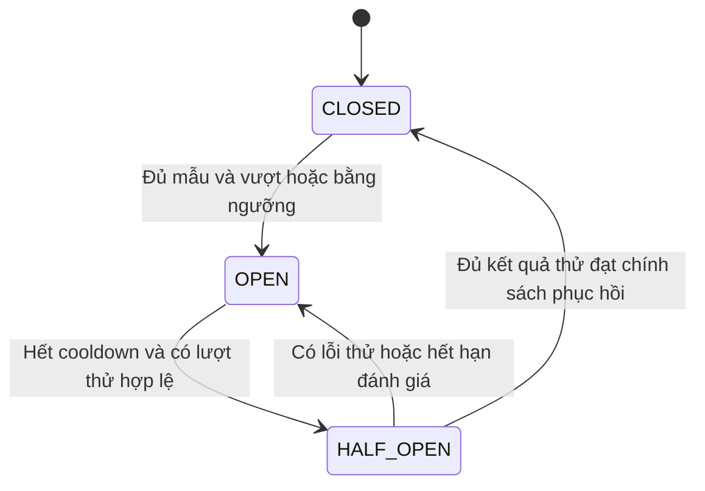

# Circuit breaker

## 1. Từ mục tiêu sẵn sàng đến yêu cầu bảo mật

Circuit breaker là cơ chế tạm ngừng chuyển thêm lời gọi tới một dependency đang có dấu hiệu lỗi, sau đó cho phép thử lại có giới hạn để đánh giá khả năng phục hồi. Nó giúp một sự cố ở dịch vụ bên ngoài không tiếp tục tiêu hao tài nguyên của dịch vụ gọi. Mô hình thường có ba trạng thái: `CLOSED` cho phép gọi, `OPEN` chặn gọi và `HALF_OPEN` cho phép một số lần thử. Đây là phần cốt lõi của [Circuit Breaker pattern trong Azure Architecture Center](https://learn.microsoft.com/en-us/azure/architecture/patterns/circuit-breaker).

Trong chương Availability và resilience của module yêu cầu bảo mật, mục tiêu học tập là chuyển câu “hệ thống phải chịu được sự cố dependency” thành hợp đồng rõ ràng về phạm vi, thời gian, tài nguyên, quyết định bảo mật và bằng chứng kiểm thử. Cài một thư viện rồi giữ nguyên cấu hình mặc định chưa xác định được hợp đồng đó.

Một circuit breaker có thể bảo vệ tính sẵn sàng, nhưng fallback của nó cũng có thể tạo đường vượt kiểm soát. Nếu dịch vụ kiểm tra quyền bị chậm và ứng dụng trả về `ALLOW` để tránh lỗi, ứng dụng đã biến một sự cố hạ tầng thành khả năng đọc dữ liệu trái phép. Nếu ứng dụng trả nhanh nhưng đã gửi giao dịch thanh toán hai lần, tính toàn vẹn cũng bị ảnh hưởng.

Yêu cầu hoàn chỉnh phải trả lời được:

- Dependency và thao tác nào được bảo vệ? Ranh giới lỗi có trùng với ranh giới tenant, vùng và tài nguyên không?
- Lỗi nào được ghi nhận? Cần bao nhiêu mẫu, trong khoảng nào, dùng phép so sánh nào để mở mạch?
- Khi mạch mở, người dùng nhận kết quả gì và tác vụ nào thực sự được thực hiện?
- Timeout, concurrency, retry và hàng đợi được giới hạn ra sao trước khi mạch kịp mở?
- Điều kiện nào cho phép trở lại trạng thái bình thường? Tổng lưu lượng thử từ nhiều instance là bao nhiêu?
- Có thể chứng minh rằng quá trình suy giảm không cấp thêm quyền, làm mất dữ liệu hoặc che giấu sự cố bằng cách nào?

Các con số, mã yêu cầu và chính sách dưới đây là ví dụ thiết kế cho một nền tảng học tập giả định. Chúng cần được hiệu chỉnh theo đo đạc và chấp nhận rủi ro của hệ thống cụ thể; không phải ngưỡng chuẩn áp dụng cho mọi dịch vụ.

## 2. Kịch bản xuyên suốt và các rủi ro cần kiểm soát

Nền tảng học tập có API phục vụ nhiều tổ chức. Khi tải một bài học, API kiểm tra quyền truy cập qua dịch vụ policy. Trang chủ gọi dịch vụ gợi ý nội dung. Khi nhận bài tập, hệ thống gọi dịch vụ quét mã độc trước khi cho giảng viên tải tệp. Một số thao tác quản trị yêu cầu MFA qua nhà cung cấp định danh.

Giả sử dịch vụ gợi ý ngừng trả lời trong 20 giây. Nếu mỗi request giữ một luồng và một kết nối trong suốt thời gian chờ, trang chủ có thể chiếm hết pool mà API đăng nhập cũng cần. Mặt khác, khi policy không trả lời, tiếp tục phục vụ tài liệu riêng tư sẽ vi phạm điều kiện truy cập. Cùng một kiểu lỗi mạng nhưng kết quả suy giảm được phép khác nhau.

| Mã rủi ro | Diễn biến | Tài sản hoặc thuộc tính bị ảnh hưởng | Hướng yêu cầu |
|---|---|---|---|
| R-CB-01 | Dependency treo làm cạn pool dùng chung | Sẵn sàng của API khác | Timeout, bulkhead, circuit theo phạm vi lỗi |
| R-CB-02 | Fallback của policy tự cho phép | Dữ liệu riêng tư, phân tách tenant | Không thực hiện thao tác khi thiếu quyết định quyền hợp lệ |
| R-CB-03 | Retry và probe từ nhiều instance dồn cùng lúc | Khả năng phục hồi của dependency | Ngân sách retry, probe, jitter và tăng tải có giới hạn |
| R-CB-04 | Một tenant tạo nhiều lỗi để mở circuit chung | Sẵn sàng của tenant còn lại | Phân loại lỗi, giới hạn lạm dụng, phạm vi circuit phù hợp |
| R-CB-05 | Timeout sau khi tác vụ đã được xử lý, sau đó gửi lại | Toàn vẹn giao dịch, cấp phát hoặc ghi nhận học phí | Idempotency và đối soát kết quả không xác định |
| R-CB-06 | Fallback cache dùng nhầm tenant hoặc quyền đã thu hồi | Bí mật và phân quyền | Ràng buộc cache, độ mới, thao tác được phép |
| R-CB-07 | Force-close hoặc sửa ngưỡng không được kiểm soát | Kiểm soát vận hành, tài nguyên | Phân quyền, audit và thời hạn override |
| R-CB-08 | Dashboard chỉ ghi nhận phản hồi fallback thành công | Khả năng phát hiện và điều tra sự cố | Tách kết quả dependency, fallback và kết quả nghiệp vụ |

Threat model cần xét cả lỗi vô ý lẫn hành vi cố tình gây lỗi. Một người dùng có thể gửi yêu cầu sai để tạo `403`; bên vận hành có thể cấu hình timeout quá lớn; một dependency bị xâm nhập có thể trả dữ liệu sai nhưng vẫn dùng HTTP `200`. Circuit breaker quan sát tín hiệu kỹ thuật được cấu hình, không chứng minh tính đúng đắn hay độ tin cậy của mọi kết quả.

## 3. Hợp đồng trạng thái và ý nghĩa của việc mở mạch

Cần phân biệt hai cách dùng từ “open”. Circuit `OPEN` nghĩa là ngừng gửi lời gọi tới dependency. Trong bảo mật, “fail open” thường nói tới việc vẫn cho phép một hành động khi cơ chế kiểm soát bị lỗi. Một circuit mở hoàn toàn có thể đi cùng chính sách không cho truy cập tài nguyên được bảo vệ.

Sơ đồ sau là hợp đồng minh họa của bài, không áp đặt nguyên xi cho mọi thư viện:



| Trạng thái | Quyền gọi dependency | Kết quả với request không được gọi | Điều kiện cần đặc tả |
|---|---|---|---|
| `CLOSED` | Được xét tiếp theo deadline, quota và bulkhead | Có thể bị chặn bởi kiểm soát khác | Cách lấy mẫu, ghi nhận kết quả và chuyển trạng thái |
| `OPEN` | Không bắt đầu lời gọi mới qua circuit này | Fallback được phép hoặc lỗi tạm thời | Thời gian giữ mở, timer, request nào kích hoạt bước thử |
| `HALF_OPEN` | Chỉ các lượt có permit thử | Không chờ vô hạn để xin permit | Số lượt, concurrency, thời hạn và tiêu chí đóng/mở lại |

Mở mạch thường không thu hồi các lời gọi đã bắt đầu. Vì vậy, tiêu chí “không có request nào tới dependency sau thời điểm mở” là quá rộng nếu nó tính cả request đang bay. Yêu cầu nên đo số lần **bắt đầu lời gọi mới sau khi circuit từ chối cấp permit**, đồng thời quy định timeout và cách giải phóng tài nguyên cho các lời gọi cũ.

Cũng cần định nghĩa cách xử lý kết quả đến muộn. Kết quả của một request bắt đầu trong thế hệ trạng thái cũ không được tùy tiện khiến circuit đang mở hoặc đang thử chuyển về `CLOSED`. Đây là yêu cầu về race condition và đồng bộ của triển khai, cần kiểm tra với công cụ được chọn.

`CLOSED` chỉ nói rằng cơ chế đang cho phép thử gọi theo chính sách. Nó không có nghĩa dependency chắc chắn khỏe. `OPEN` chỉ phản ánh chính sách của circuit và dữ liệu quan sát tại nơi đó. Nó không tự chứng minh cả cụm dependency đã ngừng hoạt động.

## 4. Đặt circuit theo ranh giới lỗi và ranh giới tin cậy

Trước khi chọn ngưỡng, hãy lập danh mục dependency. Mỗi dòng cần nêu người sở hữu, thao tác, phạm vi lỗi, kiểu dữ liệu, quyết định fallback và các giới hạn tài nguyên liên quan.

| Dependency và thao tác | Phạm vi minh họa | Khi circuit mở | Bất biến bảo mật |
|---|---|---|---|
| Gợi ý nội dung công khai | Provider, vùng, loại thao tác đọc | Trả danh sách phổ biến đã duyệt hoặc bỏ phần gợi ý | Không đưa nội dung riêng tư vào fallback chung |
| Policy cho thao tác sửa quyền | Policy cluster, vùng, nhóm thao tác nhạy cảm | Trả lỗi dịch vụ tạm thời; không sửa quyền | Không tạo quyết định `ALLOW` thay cho kết quả còn thiếu |
| Quét tệp bài tập | Scanner pool và vùng lưu trữ | Giữ tệp ở trạng thái chờ quét, nếu kho cách ly còn khả năng tiếp nhận | Tệp chưa đạt kiểm tra không được tải qua đường phục vụ thông thường |
| Gửi email thông báo thường | Provider và quota account | Có thể giữ trong hàng đợi bền vững, có giới hạn | Không ghi nhận đã giao email chỉ vì đã xếp hàng |
| Xác minh MFA cho quản trị | Issuer/provider và vùng phù hợp | Không hoàn tất step-up khi không có kết quả hợp lệ | Không bỏ qua MFA hoặc tự tạo bằng chứng xác minh |

Không dùng một circuit duy nhất cho toàn bộ HTTP client nếu các đích không cùng miền lỗi. Lỗi của dịch vụ gợi ý không nên tự chặn dịch vụ policy. Ngược lại, tạo circuit cho từng URL chứa tham số người dùng có thể làm bùng nổ số đối tượng trong bộ nhớ.

Khóa circuit nên được xây dựng từ tập thuộc tính hữu hạn, do hệ thống kiểm soát, chẳng hạn `dependency + region + operation_class + quota_domain`. Không lấy nguyên URL, token, email hoặc header do client tự đặt làm tên circuit. Nếu cần tách tenant, phải có cách giới hạn số circuit, khởi tạo, thu hồi và xử lý tenant mới. Đừng biến cơ chế cô lập thành điểm cạn bộ nhớ do cardinality không giới hạn.

Tách circuit theo tenant chỉ có ích khi đúng với cách lỗi và quota phát sinh. Một outage chung vẫn có thể ảnh hưởng mọi tenant. Ngược lại, một tenant hết quota riêng không phải bằng chứng mọi tenant đều hết quota. Cần mô tả cả lớp kiểm soát chung của provider và lớp cô lập theo quota, thay vì giả định một chiều phân tách luôn đủ.

Phân quyền đối với tài nguyên vẫn phải diễn ra ở đúng vị trí trong cả đường chính lẫn fallback. [OWASP Authorization Cheat Sheet](https://cheatsheetseries.owasp.org/cheatsheets/Authorization_Cheat_Sheet.html#deny-by-default) khuyến nghị từ chối mặc định và kiểm tra quyền trên mọi request. Trong thiết kế này, quy tắc đó dẫn tới yêu cầu cụ thể: circuit không được trở thành lý do bỏ qua kiểm tra quyền hoặc đổi một kết quả chưa biết thành cho phép.

## 5. Phân loại kết quả trước khi tính ngưỡng

Yêu cầu “mở sau năm lỗi” chưa đủ vì từ “lỗi” có thể gồm nhiều tình huống không phản ánh sức khỏe dependency. Cần có bảng ánh xạ từ kết quả kỹ thuật/nghiệp vụ sang cách ghi nhận của circuit và hành động ở tầng ứng dụng.

| Kết quả quan sát | Chính sách minh họa cho circuit | Hành động khác cần có |
|---|---|---|
| Hết deadline khi đang gọi, kết nối bị reset, upstream `503` | Ghi nhận lỗi availability theo adapter đã định nghĩa | Kết thúc chờ, giải phóng tài nguyên và chọn fallback hợp lệ |
| Dependency trả lời chậm nhưng hợp lệ | Ghi nhận mẫu thành công; đánh dấu slow nếu vượt ngưỡng slow | Theo dõi độ trễ và nguy cơ bão hòa |
| Đăng nhập sai mật khẩu, token người dùng không hợp lệ | Không ghi vào mẫu availability trong chính sách ví dụ | Theo dõi xác thực và chống lạm dụng bằng chỉ số riêng |
| Policy trả quyết định `DENY` hợp lệ | Không coi là lỗi availability; bài này loại khỏi cửa sổ minh họa | Áp dụng từ chối; ghi nhận nghiệp vụ bảo mật phù hợp |
| Client gửi payload sai và bị chặn trước outbound | Không có mẫu lời gọi dependency | Trả lỗi validation theo hợp đồng API |
| Circuit tự từ chối request | Không ghi lại như một lỗi dependency mới | Tăng bộ đếm short-circuit riêng |
| Bulkhead/quota cục bộ từ chối trước khi gọi | Không gán thành lỗi của dependency | Theo dõi local saturation hoặc quota |
| `429` từ quota riêng của một account/tenant | Xử lý theo phạm vi quota đã xác định | Dừng tăng tải, tôn trọng thời điểm được phép thử lại theo hợp đồng provider |
| Chứng chỉ TLS không hợp lệ hoặc sai danh tính đích | Không hạ yêu cầu TLS; chặn kết nối, cảnh báo bảo mật | Có thể ngắt đường gọi theo chính sách; không retry mù để tìm đích kém an toàn |
| Phản hồi `200` nhưng sai schema hoặc thiếu chữ ký bắt buộc | Từ chối dữ liệu; phân loại lỗi protocol/integrity riêng | Điều tra, giữ kiểm tra toàn vẹn và áp dụng fallback phù hợp |

Không thể kết luận chỉ từ mã HTTP. `401` do credential của service hết hiệu lực khác với người dùng nhập sai mật khẩu. `404` là kết quả bình thường của một thao tác tìm kiếm khác với lỗi route do cấu hình sai. Adapter cần hiểu hợp đồng của từng dependency và không cho dữ liệu không tin cậy tự chọn nhãn phân loại.

Có ba lựa chọn khác nhau: ghi nhận là lỗi, ghi nhận là thành công, hoặc bỏ qua khỏi cả tử số lẫn mẫu số. Ví dụ, loại hàng nghìn quyết định `DENY` khỏi cửa sổ availability giúp không làm loãng tỷ lệ lỗi của những lời gọi thuộc nhóm đo. Nhưng một thiết kế khác có thể dùng phản hồi `DENY` hợp lệ như bằng chứng dependency còn trả lời. Phải ghi rõ lựa chọn; không vừa mô tả “bỏ qua” vừa để thư viện tính là thành công.

Tài liệu [Resilience4j CircuitBreaker](https://resilience4j.readme.io/docs/circuitbreaker#failure-rate-and-slow-call-rate-thresholds) phân biệt lỗi được ghi nhận với exception bị bỏ qua; cửa sổ cũng không phải giới hạn concurrency. Đây là lý do phải ánh xạ chính sách sang đúng hành vi thư viện, thay vì suy từ tên cấu hình. Các bảng trong bài là yêu cầu thiết kế của ví dụ, không phải mặc định của Resilience4j.

Các tín hiệu có chủ đích gây tải hoặc gây từ chối cần được phân tích ở lớp bảo mật riêng. Circuit breaker không thay rate limiting, chống credential stuffing, xác thực input hoặc giám sát hành vi. Một request bị bỏ qua khỏi cửa sổ circuit vẫn có thể tiêu tốn CPU và vẫn phải được giới hạn.

## 6. Định nghĩa cửa sổ đo và ngưỡng có thể kiểm chứng

Với cửa sổ thời gian `W`, định nghĩa:

```text
N = số lời gọi đã hoàn tất và được nhận vào cửa sổ W
F = số lời gọi trong N được phân loại là lỗi availability
S = số lời gọi trong N có thời lượng vượt ngưỡng slow

failure_rate = F / N       khi N > 0
slow_rate    = S / N       khi N > 0

Chỉ xét mở tự động theo tỷ lệ nếu N >= minimum_samples.
Mở nếu failure_rate >= failure_threshold
     hoặc slow_rate >= slow_threshold.
```

Một lời gọi vừa chậm vừa lỗi có thể thuộc cả `F` và `S`. Không cộng hai tỷ lệ này thành “tổng tỷ lệ lỗi”. Mẫu bị bỏ qua không thuộc `N`; request không được gọi vì circuit mở cũng không thuộc `N`. Khi chưa đủ mẫu, chỉ số cần thể hiện “chưa đủ dữ liệu”, tránh hiển thị `0%` như bằng chứng không có lỗi.

Ví dụ yêu cầu cho dependency gợi ý: cửa sổ trượt 30 giây; tối thiểu 20 mẫu; ngưỡng lỗi 50%; slow khi thời lượng outbound lớn hơn 400 ms; ngưỡng slow 60%; deadline mỗi attempt 800 ms. Kết quả của lời gọi được đưa vào cửa sổ theo thời điểm hoàn tất. Hệ thống phải mô tả độ chính xác của bucket và thời điểm áp dụng quyết định để người kiểm thử không giả định độ phân giải không tồn tại.

Một bộ mẫu ban đầu độc lập có 20 kết quả, trong đó 10 lỗi availability, phải làm circuit đủ điều kiện mở tại ranh giới 50%. Với 20 mẫu nhưng chỉ 9 lỗi và 11 mẫu slow, cả hai tỷ lệ còn dưới ngưỡng. Với 12 mẫu slow trên 20, ngưỡng slow đã đạt dù không có lỗi. Với 19 mẫu đều lỗi, điều kiện tỷ lệ vẫn chưa đủ số mẫu theo chính sách này. Các trường hợp này cần dựng từ cửa sổ sạch và thứ tự hoàn tất xác định, tránh vô tình mở mạch sớm trong quá trình chuẩn bị dữ liệu.

Tối thiểu 20 mẫu cũng có nghĩa ở lưu lượng thấp cơ chế có thể chưa mở trong thời gian mong muốn. Không khắc phục bằng cách tuyên bố circuit luôn bảo vệ được. Timeout và bulkhead vẫn phải hoạt động; nếu cần chính sách mở nhanh sau lỗi nghiêm trọng hoặc số lỗi liên tiếp, hãy đặc tả nó như điều kiện riêng, có phạm vi và kiểm thử riêng.

Trong lưu lượng cao, nhiều request có thể được cấp permit trước khi các kết quả lỗi đầu tiên hoàn tất. Vì vậy không thể dùng `minimum_samples` làm giới hạn số request đang chạy. Số kết nối và số tác vụ còn phải có giới hạn độc lập. Khi xác định thời gian phát hiện, cần xét độ trễ thu được mẫu, lịch xử lý, độ phân giải cửa sổ và phân bố tải thực tế.

Chọn ngưỡng từ phân vị độ trễ, error budget, chi phí fallback và khả năng chịu tải của dependency. Ngưỡng quá nhạy gây từ chối không cần thiết; quá chậm làm mất tác dụng cô lập. Thay ngưỡng là thay hành vi vận hành, phải có phiên bản cấu hình và khả năng truy vết tới lý do điều chỉnh.

## 7. Ràng buộc thời gian, tài nguyên và retry

Circuit breaker chỉ quyết định có nên thử gọi ở thời điểm hiện tại. Timeout giới hạn thời gian chờ; bulkhead giới hạn tài nguyên đồng thời; rate limiter giới hạn tốc độ nhận thêm việc; hàng đợi hấp thụ một lượng công việc có giới hạn. Những cơ chế này cần được mô tả thành một ngân sách thống nhất.

Giả sử endpoint trang chủ có ngân sách end-to-end 1.200 ms và cho phép tối đa hai attempt tới dịch vụ gợi ý. Một phân bổ minh họa là 150 ms cho công việc cục bộ, mỗi attempt tối đa 400 ms, một lần backoff tối đa 100 ms và 150 ms để tạo phản hồi. Đây là giới hạn lập kế hoạch, chưa chứng minh hệ thống sẽ đạt SLO. Thời gian chờ bulkhead, DNS, TLS và truyền/đọc dữ liệu phải nằm trong deadline có hiệu lực; retry không được tự đặt lại toàn bộ ngân sách.

Với một pool riêng, yêu cầu có thể là tối đa 32 lời gọi đồng thời mỗi instance, không xếp hàng chờ permit, deadline outbound 800 ms cho đường gọi không retry. Tại tải chuẩn của bài kiểm thử, request bị circuit từ chối phải qua nhánh xử lý cục bộ trong p99 không quá 50 ms, đo từ lúc vào adapter tới lúc có kết quả adapter, không tính RTT của client. Nếu fallback tự gọi thêm mạng, nó cần ngân sách và cơ chế bảo vệ riêng; không được gán thời gian đó bằng 0.

Timeout ở tầng chờ không bảo đảm tác vụ nền đã dừng. Yêu cầu phải nêu cancellation của client thực tế làm gì, khi nào connection/permit được trả, và trần số tác vụ còn chạy sau khi request phía trên đã kết thúc. Không trả semaphore quá sớm rồi tiếp tục tạo thêm tác vụ nền chưa kết thúc để vượt giới hạn concurrency thực.

[Timeouts, retries, and backoff with jitter của AWS](https://aws.amazon.com/builders-library/timeouts-retries-and-backoff-with-jitter/) nhấn mạnh rằng timeout không chứng minh tác dụng phụ chưa xảy ra, retry có thể làm tăng tải và jitter giúp phân tán các đợt gọi lại. Áp dụng vào ví dụ này: chỉ retry thao tác đã được chứng minh an toàn, đặt trần attempt, kiểm tra deadline còn lại và dừng retry khi circuit không cho gọi.

Thứ tự bao bọc thay đổi ý nghĩa đo lường:

```text
Retry bên ngoài Circuit:
  Một request có thể tạo nhiều attempt.
  Mỗi attempt được circuit cấp phép và ghi nhận riêng.

Circuit bên ngoài Retry:
  Circuit có thể nhìn thấy kết quả của cả chuỗi attempt.
  Thời lượng và tỷ lệ lỗi quan sát khác với đo từng attempt.
```

Bài này chọn hợp đồng đo **mỗi attempt outbound được chấp nhận**, với retry bên ngoài circuit khi retry được phép. Trước mỗi attempt đều xét deadline và permit mới. Rejection của circuit không được retry ngay lập tức. Kết quả short-circuit là một nhánh kết thúc hoặc fallback, không phải tín hiệu để chuyển sang một client khác gọi thẳng cùng đích.

Cần kiểm kê retry ở SDK, HTTP client, gateway, service mesh và worker. Nếu ba tầng đều cho tối đa ba attempt, một request có thể tạo tới 27 attempt trong trường hợp mọi tầng đều thử hết, chưa kể probe và công việc nền. Chọn một nơi chịu trách nhiệm retry cho luồng cụ thể và đo số outbound thật. Mô tả số attempt phải nói rõ có tính lần đầu hay chỉ tính các lần gọi lại.

## 8. Thiết kế fallback giữ nguyên bất biến bảo mật

Fallback là một hành vi nghiệp vụ cần được phê duyệt theo rủi ro, không đơn thuần là khối `catch`. Trước khi cho phép fallback, hãy mô tả dữ liệu đầu vào, phạm vi người dùng, nguồn dữ liệu thay thế, độ mới tối đa, tác dụng phụ và cách hiển thị trạng thái cho người gọi.

Với dịch vụ gợi ý, có thể bỏ phần cá nhân hóa và chỉ trả danh sách bài học công khai đã duyệt. Phản hồi vẫn phải qua kiểm tra dữ liệu đầu ra; không lấy danh sách riêng tư của một tenant khác vì cache đó đang sẵn. Kết quả có thể là thành công ở mức endpoint nhưng cần đánh dấu nội bộ rằng đã dùng fallback để đo chất lượng dịch vụ thực.

Với dịch vụ policy cho thao tác sửa quyền, ví dụ này không cho phép dùng quyết định cache. Nếu không nhận được quyết định quyền hợp lệ, ứng dụng không sửa dữ liệu, không phát lệnh xuống worker và trả lỗi tạm thời theo hợp đồng API. Không trả `401` với ý nghĩa người dùng nhập sai thông tin chỉ vì policy timeout; cũng không ghi nhận một lần đăng nhập sai để khóa tài khoản. Trạng thái “không xác minh được” phải tách khỏi “đã xác minh và bị từ chối”.

| Tình huống | Fallback được phép trong ví dụ | Hành vi bị cấm |
|---|---|---|
| Không lấy được gợi ý công khai | Ẩn widget hoặc dùng danh sách công khai đã kiểm duyệt | Trả nội dung riêng tư từ cache chung |
| Không xác minh được quyền sửa vai trò | Dừng thao tác, trả lỗi tạm thời không lộ chi tiết nội bộ | Cho phép vì người dùng từng có quyền |
| Không hoàn tất MFA quản trị | Giữ phiên ở mức xác thực hiện có, không cho hành động yêu cầu step-up | Tạo claim MFA thành công hoặc bỏ qua step-up |
| Scanner không sẵn sàng | Nhận vào kho cách ly nếu còn quota và đã có kiểm soát tương ứng | Đánh dấu tệp sạch hoặc cung cấp link tải bình thường |
| Không gửi được thông báo thường | Xếp hàng bền vững nếu thiết kế cho phép; hiển thị đang chờ | Khẳng định người nhận đã nhận email |
| Không ghi được audit bắt buộc của thao tác nhạy cảm | Áp dụng hợp đồng audit: ghi bền vững được chứng minh hoặc dừng thao tác | Mặc định bỏ sự kiện để tăng tỷ lệ thành công |

Nếu một chức năng đọc ít nhạy cảm được phép dùng cache, yêu cầu phải định nghĩa chính xác khóa gồm tenant, chủ thể hoặc nhóm truy cập, tài nguyên, thao tác và phiên bản policy liên quan. Nêu tuổi tối đa, cơ chế vô hiệu khi thu hồi quyền, cách kiểm tra tính toàn vẹn và phản ứng khi không xác định được độ mới. “TTL ngắn” không chứng minh quyền đã thu hồi sẽ bị chặn ngay trong TTL đó. Nếu rủi ro đòi hỏi thu hồi tức thời mà không có kênh kiểm chứng đáp ứng, không dùng cache làm quyết định cho phép.

Đường fallback phải tiếp tục giới hạn lưu lượng, kích thước dữ liệu, logging và truy cập tài nguyên. Không dùng tài khoản quản trị chung để gọi dịch vụ dự phòng. Không tắt kiểm tra TLS, đổi sang HTTP hoặc chuyển dữ liệu qua vùng chưa được chấp thuận nhằm tăng khả năng gọi thành công. Circuit bảo vệ đường chính nhưng bản thân đường dự phòng cũng cần được đánh giá lỗi và giới hạn tài nguyên.

Dữ liệu đầu ra cho client nên dùng mã lỗi ổn định như `DEPENDENCY_TEMPORARILY_UNAVAILABLE`, request ID phù hợp và hướng dẫn thử lại có giới hạn. Đừng trả tên circuit, hostname nội bộ, stack trace, credential của provider hoặc trạng thái tenant khác. Nếu API dùng HTTP `503`, cần kiểm tra toàn bộ hợp đồng và hành vi client; code này không tự bảo đảm mọi client sẽ backoff đúng.

## 9. Phục hồi có kiểm soát và bài toán nhiều instance

Ví dụ profile cho dependency policy quy định cooldown ngẫu nhiên từ 15 đến 20 giây cho mỗi lần mở mạch. Sau cooldown, request đủ điều kiện tiếp theo mới có thể kích hoạt `HALF_OPEN`. Không có request thì không có lời gọi tổng hợp chỉ để tạo đủ mẫu. Nếu hệ thống có probe chủ động, probe phải được đặc tả như một nguồn lưu lượng riêng và tuân theo ngân sách chung.

Trong một lần đánh giá `HALF_OPEN`, profile cho phép tối đa ba attempt thử, nhiều nhất một attempt đang chạy trên mỗi instance. Chỉ đóng khi cả ba kết quả đạt tiêu chí kỹ thuật đã định nghĩa; một lỗi availability, một lời gọi vượt ngưỡng slow hoặc hết thời hạn đánh giá năm giây làm mở lại. Một kết quả bị loại khỏi mẫu không được coi là thành công để đóng circuit; bộ đếm permit vẫn có giới hạn và khi không thu đủ ba kết quả hợp lệ phải chờ đến hạn rồi mở lại. Chính sách này cố ý bảo thủ và cần adapter/thư viện hỗ trợ đúng hoặc có cơ chế bổ sung được kiểm chứng.

Probe cho thao tác nhạy cảm phải có ngữ nghĩa an toàn. Không tạo giao dịch thật hoặc sửa quyền thật chỉ để kiểm tra. Có thể dùng request được phép trong luồng thực tế hoặc một thao tác đọc được thiết kế riêng. Endpoint health trả `200` chỉ là bằng chứng cho phần nó kiểm tra; nó không chứng minh đường xác minh policy, dữ liệu và quyền truy cập thực đã phục hồi đầy đủ.

Với tối đa 20 instance cùng gọi một miền dependency, ba probe mỗi instance có thể tạo tới 60 attempt thử trong một chu kỳ đồng thời; concurrency thử có thể lên tới 20 dù mỗi instance chỉ giữ một permit. Autoscaling thêm instance có thể làm số này tăng. Do đó, yêu cầu phải gắn với số instance tối đa hoặc có cơ chế ngân sách ở cấp miền lỗi.

Có thể chọn một trong các hướng triển khai, nhưng phải nêu hệ quả:

- Giới hạn probe cục bộ kết hợp trần instance và jitter; chứng minh tổng tải cực đại vẫn nằm trong ngân sách dependency.
- Phân bổ ngân sách probe cho nhóm instance; quy định cách thu hồi permit và tránh nhân đôi khi scale/restart.
- Điều phối bằng cơ chế chia sẻ nếu thực sự cần; dependency của bộ điều phối cũng cần timeout, bảo vệ truy cập và chính sách khi mất kết nối.

Không mặc định circuit cục bộ của một process đại diện cho trạng thái toàn cụm. Hai instance có thể nhìn thấy đường mạng khác nhau và chuyển trạng thái khác nhau. Đồng bộ một cờ `OPEN` toàn cục thiếu phạm vi có thể lan truyền tác động của sự cố cục bộ sang vùng còn khỏe; để mọi instance tự phục hồi không giới hạn lại có thể tạo bão probe. Quyết định phải dựa trên miền lỗi đã mô hình hóa.

Sau khi đóng circuit, toàn bộ lưu lượng bình thường có thể quay lại ngay nếu không có kiểm soát khác. Nếu dependency chỉ hồi phục từng phần, cần một kế hoạch tăng tải riêng, chẳng hạn quota tăng từng bước dựa trên tỷ lệ lỗi và saturation. Việc đặt `CLOSED` không tự tạo ramp-up. Phải tính cả request mới, retry, worker và backlog trong tốc độ phục hồi.

Thời hạn dùng cho cooldown và deadline cần đo bằng nguồn thời gian thích hợp, tránh phụ thuộc vào việc đồng hồ lịch bị chỉnh lùi. Dấu thời gian UTC phục vụ audit có vai trò khác. Kiểm thử cần có trường hợp nhảy đồng hồ và kết quả đến muộn; không cho một timer cũ hoặc kết quả của chu kỳ trước đóng circuit của chu kỳ mới.

## 10. Bảo vệ tác dụng phụ và kết quả chưa xác định

Circuit breaker không phải cơ chế transaction và không tự hoàn tác công việc từ xa. Ví dụ API gọi hệ thống học phí để tạo một khoản thu. Provider đã ghi nhận khoản thu nhưng phản hồi bị mất. API quan sát timeout, còn kết quả nghiệp vụ thực tế chưa biết. Fallback “tạo lại ở provider dự phòng” có thể gây thu hai lần.

Hợp đồng cho thao tác có tác dụng phụ phải bổ sung:

1. Khóa idempotency gắn với chủ thể được phép, tenant và thao tác nghiệp vụ; cùng khóa nhưng payload khác phải được phát hiện theo hợp đồng.
2. Cách lưu trạng thái bền vững, thời hạn giữ khóa và quyền đọc kết quả, bao phủ khoảng retry/replay có thể xảy ra.
3. Trạng thái `PENDING` hoặc `UNKNOWN` khi chưa xác định kết quả; không tự báo thất bại cuối cùng nếu có khả năng đã thực hiện.
4. Kênh đối soát bằng định danh nghiệp vụ phù hợp; không gửi lại tác vụ không idempotent chỉ vì circuit đã đóng.
5. Kiểm tra quyền và chính sách cần thiết tại thời điểm thực hiện lại, đặc biệt khi quyền có thể đã thu hồi trong thời gian chờ.

Nếu chọn hàng đợi khi circuit mở, “đã chấp nhận” chỉ có nghĩa công việc đã được lưu theo bảo đảm của hệ thống hàng đợi, không có nghĩa dependency đã thực hiện. Chỉ trả trạng thái chấp nhận bất đồng bộ khi việc ghi bền vững thực sự thành công và giao thức API có ngữ nghĩa đó. Cần quota, thời hạn công việc, trần backlog, chống trùng, thứ tự nếu cần, quyền hủy, mã hóa và chính sách xử lý công việc hết hạn.

Backlog không được xả hết ngay khi nhận một lần probe thành công. Worker phải có rate limit và deadline riêng, tuân theo circuit phù hợp, không cạnh tranh vô hạn với request tương tác. Khi storage chờ đã đầy hoặc không bảo đảm tính bền vững, phải phản hồi đúng sự thật thay vì tiếp tục “chấp nhận” rồi làm mất công việc.

Đối với tệp chờ quét, trạng thái bền vững tối thiểu cần phân biệt `QUARANTINED`, `SCANNING`, `CLEAN`, `REJECTED` và trạng thái lỗi/chờ thử lại theo thiết kế. Mở hoặc đóng circuit chỉ ảnh hưởng quyết định gọi scanner; không trực tiếp biến tệp thành `CLEAN`. Đường tải tệp phải kiểm tra trạng thái và quyền ngay cả khi worker đang phục hồi.

## 11. Luồng xử lý và điểm đặt kiểm soát

Đoạn sau là giả mã mô tả hợp đồng, không phải API của một thư viện Java và không phải bản cài đặt circuit breaker để đưa vào production:

```text
handle(request):
    validateRequestAndAdmissionLimits(request)
    establishRequiredLocalIdentityContext(request)
    # Kiểm tra quyền đúng chính sách ở nơi nghiệp vụ yêu cầu.
    # Nếu chính dependency là policy service, ALLOW phải đến từ kết quả hợp lệ.

    deadline = inheritedDeadlineOrConfiguredLimit(request)
    dependency = resolveFromTrustedBoundedConfiguration(request)

    if deadline.hasInsufficientBudget():
        return permittedFallbackOrTemporaryFailure(request)

    permit = circuit.tryAcquire(dependency)
    if permit.isRejected():
        observeShortCircuitWithoutDependencyFailureSample()
        return permittedFallbackOrTemporaryFailure(request)

    outcome = NOT_EXECUTED
    bulkheadLease = NONE
    startedAt = NONE
    try:
        bulkheadLease = bulkhead.tryAcquireWithoutWaiting(dependency)
        if bulkheadLease.isRejected():
            observeLocalSaturation()
            return permittedFallbackOrTemporaryFailure(request)

        if deadline.hasInsufficientBudget():
            return permittedFallbackOrTemporaryFailure(request)

        startedAt = monotonicNow()
        result = outboundCallWithEnforcedDeadline(dependency, request, deadline)
        validateRequiredResponseProperties(result)
        outcome = classifyForCircuit(result)
        return applyBusinessAndSecurityDecision(result)
    catch error:
        outcome = classifyExecutedAttemptOrLocalFailure(error, startedAt)
        return handleWithoutFabricatingAuthorizationOrCompletion(error)
    finally:
        # Hoàn tất permit đúng một lần theo API thực tế.
        # NOT_EXECUTED phải hủy/hoàn trả permit, không tạo mẫu thành công giả.
        # Thời lượng attempt chỉ tính phần đã đặc tả cho outbound.
        circuit.finishOnce(permit, outcome, measuredAttemptDuration(startedAt))
        releaseResourcesWhenUnderlyingAttemptActuallyEnds(bulkheadLease)
```

Mã triển khai cần giữ riêng lỗi của outbound, lỗi validation phản hồi, lỗi xử lý cục bộ và lỗi fallback. Nếu trả lỗi khi serialize phản hồi sau một lời gọi dependency thành công, không được tự ghi dependency thất bại. Nếu fallback ném lỗi, cũng không được ghi thành một lỗi outbound nữa. Adapter nên chốt kết quả của attempt ngay khi có đủ thông tin, tránh để một khối `catch` quá rộng làm sai thống kê.

Với retry, mỗi attempt đi qua bước kiểm tra deadline, circuit và bulkhead theo thứ tự đã chọn. Permit thử không được bị rò khi request bị hủy, không gọi được outbound hoặc bị local saturation. Ngược lại, trả permit tài nguyên trước khi tác vụ nền thực sự dừng có thể làm giới hạn concurrency chỉ còn là số trên dashboard.

Luồng này phải có khả năng quan sát được số lần gọi thực tế. Một unit test chỉ kiểm tra hàm fallback đã được gọi chưa đủ chứng minh không có HTTP request phát sinh ở nơi khác. Kiểm thử tích hợp cần quan sát tại server giả lập hoặc điểm egress, tính cả SDK retry, tác vụ nền và đường gọi dự phòng.

## 12. Logging, chỉ số và quyền vận hành

Quan sát circuit phải phục vụ cả độ tin cậy lẫn điều tra bảo mật. Tách ít nhất các kết quả: dependency thành công, dependency lỗi, dependency chậm, short-circuit, local rejection, fallback được dùng, fallback lỗi và kết quả nghiệp vụ. Không gộp tất cả phản hồi `200` của endpoint thành dependency khỏe.

Sự kiện chuyển trạng thái minh họa:

```json
{
  "event_type": "circuit_state_changed",
  "occurred_at": "2026-11-27T04:00:00Z",
  "service": "learning-api",
  "dependency_id": "policy-primary",
  "operation_class": "sensitive-write-authorization",
  "region": "region-a",
  "instance_id": "api-07",
  "previous_state": "CLOSED",
  "new_state": "OPEN",
  "reason": "failure_rate_threshold",
  "window_seconds": 30,
  "eligible_completed_calls": 20,
  "failed_calls": 10,
  "config_version": "cb-policy-v3"
}
```

Bản ghi này không cần chứa access token, cookie, payload bài tập, email hoặc URL có query bí mật. Định danh tenant nếu thực sự cần điều tra phải theo chính sách dữ liệu và quyền truy cập log; không mặc định đưa tenant hoặc user ID vào mọi nhãn metric. Nhãn metric nên có cardinality hữu hạn để không tạo thêm điểm cạn bộ nhớ.

Chỉ số cần trả lời được: có bao nhiêu request bị từ chối vì circuit; có bao nhiêu attempt thật; thời gian ở từng trạng thái; lý do mở; số probe; số instance đang mở; độ trễ end-to-end; số request dùng fallback; tỷ lệ thao tác nhạy cảm dừng an toàn; backlog và tài nguyên đang dùng. Cửa sổ chưa đủ mẫu, telemetry mất và lưu lượng bằng không phải được phân biệt.

Trong ví dụ, cảnh báo cần phát khi circuit của policy giữ mở liên tục 60 giây hoặc lặp mở ba lần trong năm phút. Nội dung phải cho phép tìm dependency, phạm vi và phiên bản cấu hình. Ngưỡng này là quy tắc cảnh báo minh họa; không trì hoãn phản ứng với một sự cố nghiêm trọng chỉ vì chưa đủ 60 giây. Cảnh báo cũng cần được gom nhóm để một outage không tạo vô hạn thông báo theo request.

Quyền force-open, force-close, reset, đổi ngưỡng hoặc tắt circuit chỉ dành cho vai trò vận hành được cấp rõ. Mọi override phải có người thực hiện, lý do, phạm vi, thời điểm bắt đầu, thời hạn và kết quả audit. Ví dụ chỉ cho override tối đa 15 phút trước khi hết hiệu lực hoặc phải gia hạn qua quy trình. Endpoint quản trị không được mở công khai hay dùng chung quyền với người gọi API nghiệp vụ.

Force-close không phải biện pháp sửa dependency. Nó có thể xóa thống kê và đưa tải trở lại ngay. Sau khi restart hoặc redeploy, circuit cục bộ cũng có thể bắt đầu với dữ liệu trống. Phải quy định hành vi khởi động và cách giới hạn burst, thay vì mặc định rằng trạng thái bảo vệ cũ vẫn tồn tại.

## 13. Viết đặc tả có truy vết tới rủi ro

Một yêu cầu tốt nêu chủ thể, điều kiện, hành vi, phạm vi, giới hạn đo được và bằng chứng. “Hệ thống phải có circuit breaker” mới là lựa chọn cơ chế; chưa xác định hệ thống phải làm gì khi cơ chế hoạt động.

| ID | Yêu cầu kiểm chứng được trong ví dụ | Rủi ro chính | Bằng chứng dự kiến |
|---|---|---|---|
| CB-01 | Chỉ tạo circuit từ danh mục dependency và operation class đã quản lý; số circuit mỗi instance có trần cấu hình và hành vi khi đạt trần | R-CB-01, R-CB-04 | Danh mục, kiểm tra input, kiểm thử cardinality |
| CB-02 | Adapter phân loại từng kết quả theo bảng đã duyệt; short-circuit và local rejection không tạo mẫu lỗi dependency | R-CB-04, R-CB-08 | Bộ trường hợp phân loại và số mẫu quan sát |
| CB-03 | Với profile policy, cửa sổ 30 giây và tối thiểu 20 mẫu; mở khi lỗi đạt 50% hoặc slow đạt 60%, slow khi lớn hơn 400 ms | R-CB-01 | Kiểm thử biên ngưỡng và cửa sổ |
| CB-04 | Khi policy circuit không cấp permit, không bắt đầu lời gọi policy mới qua adapter và không thực hiện thao tác sửa quyền do thiếu quyết định hợp lệ | R-CB-02 | Egress count và trạng thái dữ liệu sau thử nghiệm |
| CB-05 | Mỗi attempt policy có deadline 800 ms, tối đa 32 attempt thực đang chạy mỗi instance, không chờ bulkhead | R-CB-01 | Đo tải, thời gian chờ và tài nguyên còn chạy |
| CB-06 | Profile policy không tự retry; đường khác muốn retry phải có ngân sách attempt và deadline riêng, không retry rejection của circuit | R-CB-03, R-CB-05 | Số outbound và cấu hình retry ở mọi tầng liên quan |
| CB-07 | HALF_OPEN theo profile có tối đa ba attempt, concurrency một, thời hạn năm giây; không đóng nếu thiếu kết quả hợp lệ hoặc có kết quả lỗi/chậm | R-CB-03 | Kiểm thử phục hồi, hủy và kết quả đến muộn |
| CB-08 | Với trần 20 instance của deployment ví dụ, một chu kỳ thử đồng thời có tối đa 60 attempt; thay trần instance phải đánh giá lại ngân sách | R-CB-03 | Diễn tập nhiều instance và cấu hình scale |
| CB-09 | Fallback chỉ thực hiện hành vi trong ma trận đã duyệt; không bỏ xác thực, MFA, quyền hay trạng thái cách ly | R-CB-02, R-CB-06 | Test ở từng nhánh fallback và kiểm tra dữ liệu trả về |
| CB-10 | Ghi tác dụng phụ phải có hợp đồng idempotency/đối soát riêng; không replay chỉ vì circuit đóng | R-CB-05 | Kịch bản phản hồi mất sau commit và kiểm đếm nghiệp vụ |
| CB-11 | Trạng thái, short-circuit, fallback, config version và telemetry thiếu được quan sát riêng; dữ liệu bí mật bị loại khỏi log/metric | R-CB-08 | Bản ghi mẫu, dashboard và kiểm tra dữ liệu nhạy cảm |
| CB-12 | Override được phân quyền, audit và hết hạn; khởi động/reset có giới hạn tải được kiểm chứng | R-CB-07, R-CB-03 | Kiểm thử quyền quản trị, hết hạn và restart |

Đặc tả một yêu cầu trọng tâm có thể viết bằng YAML như sau. Đây là mẫu tài liệu yêu cầu, không phải file cấu hình để nạp vào Resilience4j hoặc Spring Boot:

```yaml
id: CB-04
scope: sensitive-role-change
risk_refs: [R-CB-02]
preconditions:
  - identity_context_established_by_required_local_controls
  - policy_decision_required_for_requested_action
trigger:
  - policy_circuit_permit_rejected
required_behavior:
  - do_not_start_policy_outbound_attempt_for_this_request
  - do_not_create_or_modify_role_assignment
  - do_not_enqueue_a_role_change_command
  - do_not_substitute_cached_or_default_allow
  - return_temporary_dependency_failure_per_api_contract
  - emit_short_circuit_metric_without_sensitive_request_data
measurement:
  boundary: policy_adapter_entry_to_adapter_result
  local_rejection_latency_p99_ms_max: 50
  api_contract: sensitive-write-v2
acceptance:
  - protected_state_unchanged_for_all_test_requests
  - new_policy_outbound_attempts_for_rejected_permits_equal_zero
  - request_results_distinguish_unavailable_from_valid_policy_deny
load_profile:
  fixture: documented_in_verification_plan
owner: learning_api_team
```

Trường `fixture` phải được điền trong kế hoạch kiểm chứng thật: số instance, concurrency, phần cứng, phân bố request, thời gian warm-up, cách tiêm lỗi và phương pháp lấy mẫu. Một yêu cầu p99 thiếu điều kiện tải và ranh giới đo sẽ khó nghiệm thu. Các giới hạn local cần đi kèm phép đo end-to-end và mức phục vụ nghiệp vụ; trả lỗi nhanh không đủ chứng minh tính sẵn sàng của toàn chức năng.

## 14. Kế hoạch kiểm thử từ nhánh đơn đến sự cố toàn luồng

Kế hoạch kiểm thử phải chứng minh trạng thái dữ liệu, tài nguyên và số outbound thực, không chỉ một biến trạng thái trong bộ nhớ. Dùng server dependency giả lập có khả năng trả chậm, treo kết nối, trả lỗi, mất phản hồi và ghi nhận request. Thiết lập môi trường và dữ liệu kiểm thử không chứa dữ liệu cá nhân thật.

| Ca kiểm thử | Kích thích | Kết quả cần chứng minh |
|---|---|---|
| T01 — Bình thường | Kết quả hợp lệ, độ trễ dưới ngưỡng | Không chuyển OPEN; kết quả nghiệp vụ đúng |
| T02 — Chưa đủ mẫu | 19 mẫu lỗi trong cửa sổ sạch của profile policy | Chưa mở theo tỷ lệ; timeout/bulkhead vẫn có hiệu lực |
| T03 — Ranh giới lỗi | Mẫu thứ 20 làm tỷ lệ lỗi bằng 50% | Chuyển OPEN theo thời điểm/độ phân giải đã quy định |
| T04 — Ranh giới slow | 20 mẫu không lỗi, 12 mẫu lớn hơn 400 ms | Mở theo slow rate; mẫu đúng 400 ms không bị coi là lớn hơn |
| T05 — Mẫu hết cửa sổ | Kết quả cũ rời khỏi cửa sổ 30 giây | Tỷ lệ và số mẫu cập nhật đúng; không trộn dữ liệu cũ vô hạn |
| T06 — Kết quả nghiệp vụ | Nhiều DENY hợp lệ hoặc input sai | Không mở vì nhóm lỗi đã loại; chống lạm dụng vẫn hoạt động |
| T07 — OPEN | Gửi nhiều request khi circuit từ chối permit | Không bắt đầu outbound mới qua nhánh bị chặn; phản hồi đúng fallback |
| T08 — Lời gọi đang bay | Mở circuit khi một số attempt đã chạy | Phân biệt attempt cũ với attempt mới; tài nguyên cũ kết thúc theo giới hạn |
| T09 — HALF_OPEN khỏe | Đủ ba kết quả thử hợp lệ, không chậm | Đóng theo profile, không vượt concurrency thử |
| T10 — HALF_OPEN lỗi/chậm | Một probe lỗi hoặc vượt ngưỡng slow | Mở lại; không có probe vô hạn để tìm kết quả thành công |
| T11 — Thiếu kết quả | Probe treo, bị hủy hoặc kết quả bị bỏ qua | Không kẹt HALF_OPEN vô hạn; hết thời hạn đánh giá xử lý đúng |
| T12 — Race condition | Kết quả cũ về sau reset hoặc sau chu kỳ mới | Không đóng sai circuit hoặc ghi mẫu hai lần |
| T13 — Tài nguyên | Dependency treo và tải đồng thời cao | Attempt thực, pool, hàng đợi và tác vụ nền không vượt trần đã định |
| T14 — Retry | Bật cấu hình retry ở các thành phần dự kiến | Số outbound đúng ngân sách; rejection không kích hoạt vòng retry |
| T15 — Tenant/quota | Một tenant tạo lỗi hoặc bị quota riêng | Không làm sai phạm vi circuit của tenant khác; số circuit hữu hạn |
| T16 — Fallback quyền | Policy không sẵn sàng ở thao tác nhạy cảm | Không cấp quyền, không enqueue lệnh, dữ liệu bảo vệ không bị sửa |
| T17 — Cache/cách ly | Cache sai tenant, hết hạn; scanner ngừng hoạt động | Không lộ dữ liệu chéo tenant và không phục vụ tệp chưa sạch |
| T18 — Kết quả chưa biết | Provider commit nhưng mất phản hồi | Không tạo tác dụng phụ trùng; có trạng thái và đường đối soát đúng |
| T19 — Nhiều instance | Tối đa 20 instance mở rồi cùng đủ điều kiện thử | Probe không vượt ngân sách; retry và backlog không gây bão phục hồi |
| T20 — Vận hành | Người không có quyền override; override hết hạn; restart | Quyền bị chặn đúng, audit đầy đủ, không tạo burst ngoài giới hạn |
| T21 — Quan sát | Telemetry mất hoặc endpoint trả fallback 200 | Không báo dependency khỏe giả; phân biệt fallback và dữ liệu thiếu |

Ngoài ca xác định, diễn tập một chuỗi: dịch vụ gợi ý chậm dần, policy mất kết nối cục bộ tại một vùng, một tenant tăng lưu lượng, sau đó dependency hồi phục trong lúc backlog còn lớn. Đo thời gian phát hiện, thời gian ở trạng thái suy giảm, mức ảnh hưởng tới chức năng khác, số tác vụ đang chạy, số thao tác nhạy cảm bị thực hiện sai và tổng tải khi hồi phục.

Tiêu chí bảo mật quan trọng là **không có thao tác nhạy cảm nào được cho phép chỉ vì kiểm soát phụ thuộc đang lỗi**. Tiêu chí resilience còn phải xét mức phục vụ còn lại, thời gian khôi phục và giới hạn tài nguyên. Không dùng tỷ lệ trả `503` nhanh làm bằng chứng chức năng vẫn đáp ứng nhu cầu người dùng.

Bằng chứng nghiệm thu nên gồm phiên bản ứng dụng/cấu hình, môi trường, dấu thời gian, kịch bản tiêm lỗi, số request thật tại dependency, trạng thái dữ liệu trước/sau và chỉ số tài nguyên. Kiểm thử tải hoặc diễn tập sự cố phải có phạm vi được phép và tiêu chí dừng; các ca này là kế hoạch xác minh yêu cầu, không phải tuyên bố đã chạy thành công trong tài liệu học.

## 15. Duy trì yêu cầu trong vòng đời phát triển

Trong giai đoạn yêu cầu, xác định dependency quan trọng, rủi ro, bất biến bảo mật và kết quả suy giảm được phép. Trong thiết kế, chọn miền circuit, phân loại kết quả, budget tài nguyên, chính sách nhiều instance và đường phục hồi. Trong triển khai, ánh xạ hợp đồng đó sang thư viện/client thực tế và kiểm tra thứ tự decorator, timeout, cancellation, retry ẩn cùng vòng đời đối tượng circuit.

Khi triển khai vận hành, giữ phiên bản cấu hình và người sở hữu dependency, theo dõi tỷ lệ fallback và thử nghiệm phục hồi trong môi trường phù hợp. Khi thay provider, đổi topology, thêm tenant, tăng trần autoscaling, thêm SDK retry hoặc thay đổi quyền truy cập, cần xem lại các giả định của đặc tả. Một ngưỡng từng hợp lý có thể không còn bảo vệ cùng miền lỗi sau thay đổi đó.

Những lỗi thiết kế dễ bỏ sót gồm: dùng OPEN như tín hiệu bỏ kiểm tra quyền; đếm mọi exception thành lỗi dependency; coi kích thước cửa sổ là số luồng tối đa; đặt timeout ở tầng chờ nhưng để tác vụ nền tiếp tục vô hạn; mở circuit chung vì quota riêng; dùng health ping để kết luận nghiệp vụ đã khỏe; reset circuit để xóa cảnh báo; và đóng circuit rồi xả toàn bộ backlog cùng lúc.

Một đặc tả có giá trị phải cho người kiểm thử biết cần gây ra điều kiện gì, quan sát ở đâu và kết quả nào được xem là vi phạm. Với circuit breaker, câu hỏi xuyên suốt là: khi dependency bất thường, hệ thống có giới hạn được tác động, giữ nguyên các điều kiện bảo mật bắt buộc và phục hồi với tải có kiểm soát hay không. Cơ chế chỉ hoàn thành vai trò khi cả ba phần đó được mô tả và có bằng chứng tương ứng.