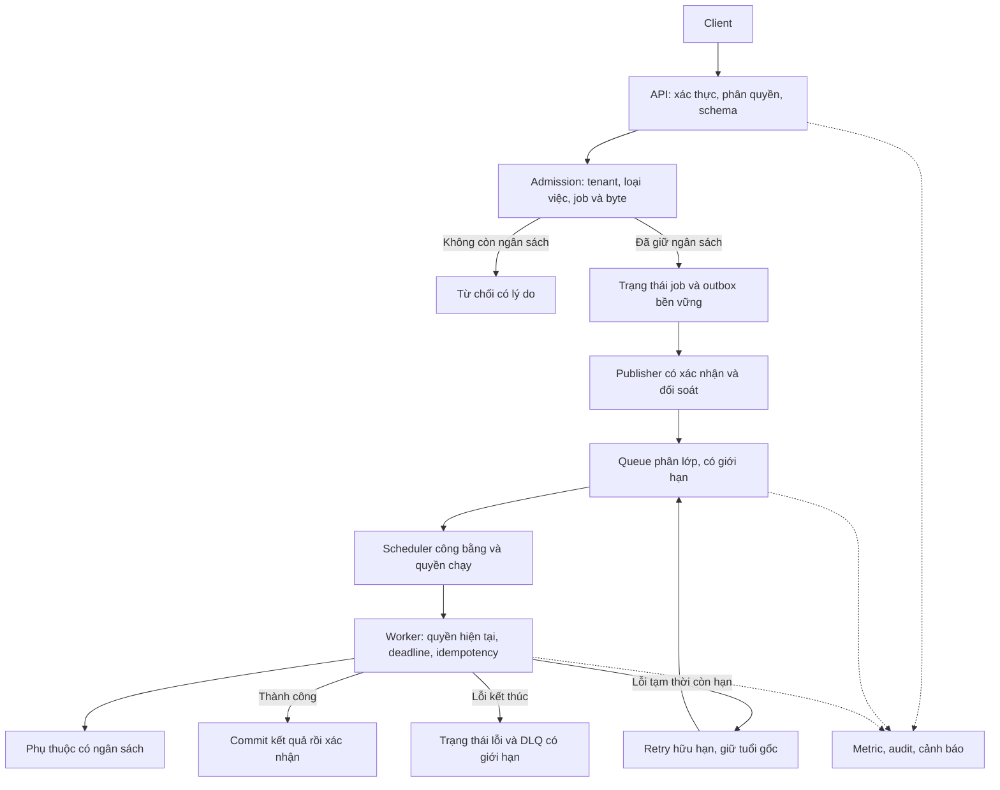

# Queue protection

## 1. Mục tiêu bảo vệ hàng đợi

**Queue protection** là tập yêu cầu bảo mật nhằm bảo vệ hàng đợi và toàn bộ đường xử lý bất đồng bộ trước việc quá tải, lạm dụng, giả mạo thông điệp hoặc thực thi sai. Mục tiêu gồm duy trì khả năng phục vụ, giới hạn thiệt hại giữa các tenant, bảo vệ dữ liệu và phục hồi mà không làm mất hoặc nhân đôi tác động nghiệp vụ ngoài chính sách.

Hàng đợi giúp tách tốc độ gửi việc khỏi tốc độ xử lý, nhưng không làm tài nguyên trở nên vô hạn. Nếu công việc đến nhanh hơn khả năng hoàn thành, hệ thống đang tích lũy một khoản nợ xử lý. Nhận yêu cầu thành công tại API chưa có nghĩa công việc được hoàn thành đúng hạn.

Tài liệu của Amazon về backlog chỉ ra rằng hàng đợi có thể kéo dài thời gian phục hồi khi công việc tiếp tục tích lũy trong sự cố; kết quả xử lý quá muộn cũng có thể không còn giá trị. [Nguồn: Avoiding insurmountable queue backlogs](https://aws.amazon.com/builders-library/avoiding-insurmountable-queue-backlogs/).

Trong chương **Availability và resilience**, bài học này hướng đến việc chuyển các rủi ro đó thành yêu cầu có thể đo và kiểm chứng. Sau bài học, người học có thể:

- Xác định các điểm tích lũy công việc và tài nguyên phải bảo vệ.
- Đặc tả admission control, backpressure, công bằng giữa tenant và năng lực phục hồi.
- Quy định xác thực, phân quyền, vòng đời thông điệp, retry và xử lý thông điệp lỗi.
- Nối yêu cầu với kiến trúc, số đo và kiểm thử lỗi.

**Các ngưỡng số dưới đây chỉ là ví dụ đặc tả.** Khi áp dụng, cần chọn lại dựa trên nghiệp vụ, dữ liệu đo và năng lực phụ thuộc.

## 2. Mô hình đe dọa cho xử lý bất đồng bộ

### 2.1. Tình huống xuyên suốt

Một nền tảng đa tenant dùng hàng đợi để xử lý báo cáo dung lượng lớn và một nhóm tác vụ tương tác có mức ưu tiên cao hơn. Người dùng gửi yêu cầu qua API; dịch vụ tiếp nhận tạo job; worker lấy job, đọc dữ liệu và tạo kết quả.

Tenant là ranh giới tổ chức: một tenant có nhiều người dùng, nhiều API key và có thể phát sinh tải qua nhiều replica của API.

Các tình huống cần đưa vào mô hình đe dọa:

| Tình huống | Hậu quả cần ngăn |
| --- | --- |
| Một tenant liên tục gửi yêu cầu hợp lệ | Tenant khác bị đói tài nguyên hoặc chờ quá lâu |
| Producer bị lỗi lặp hoặc bị chiếm quyền | Backlog, chi phí lưu trữ và lượng retry tăng nhanh |
| Consumer hoặc cơ sở dữ liệu bị chậm | Hàng đợi tăng, worker giữ kết nối, sự cố lan sang chức năng khác |
| Thông điệp chứa dữ liệu không hợp lệ hoặc làm handler luôn lỗi | Một thông điệp bị xử lý lặp và chặn công việc phía sau |
| Mất phản hồi tiếp nhận hoặc mất xác nhận xử lý | Producer gửi lại hoặc broker giao lại, dẫn đến thực thi trùng |
| Thông điệp cũ được phát lại | Tác động nghiệp vụ xảy ra sau khi yêu cầu đã hết giá trị |
| Client tự khai báo tenant hoặc mức ưu tiên | Vượt hạn mức hoặc chiếm phần tài nguyên được bảo vệ |
| Người dùng mất quyền sau khi job được nhận | Worker vẫn truy cập dữ liệu bằng quyền không còn hợp lệ |
| DLQ hoặc log không có giới hạn | Sự cố được chuyển sang một kho lưu trữ khác thay vì được kiểm soát |

**Poison message** là thông điệp có dữ liệu hoặc đặc tính khiến quá trình xử lý thất bại lặp lại. **DLQ**, viết tắt của dead-letter queue, là nơi cách ly thông điệp không thể tiếp tục xử lý theo chính sách.

### 2.2. Chuỗi truy vết mẫu

| Thành phần | Ví dụ |
| --- | --- |
| Rủi ro | Tenant A làm đầy hàng đợi báo cáo, ảnh hưởng luồng ưu tiên cao |
| Mục tiêu bảo mật | Hạn chế ảnh hưởng của tenant A và bảo vệ khả năng hoàn thành tác vụ quan trọng |
| Yêu cầu | Giới hạn job chưa kết thúc theo tenant và loại tác vụ; giữ riêng ngân sách cho luồng ưu tiên cao |
| Thiết kế | Admission control dùng chung, phân lớp queue, scheduler công bằng, pool worker riêng |
| Tiêu chí kiểm thử | Gây tải từ tenant A và đo việc tiếp nhận, hoàn thành, độ trễ của luồng cần bảo vệ |

Câu “dùng message broker để chống quá tải” chưa phải yêu cầu nghiệm thu. Cần chỉ ra trần tài nguyên, phạm vi đếm, điều kiện từ chối và cách xác minh khi thành phần gặp lỗi.

## 3. Xác định đúng phạm vi cần bảo vệ

Một hệ thống thường có nhiều hàng chờ ngoài broker:

```text
API buffer
    -> outbox chưa publish
    -> broker: ready
    -> consumer: đã nhận nhưng chưa xử lý xong
    -> retry chờ lịch
    -> DLQ
    -> kho lưu kết quả và trạng thái job
```

- **Outbox** là nơi lưu ý định phát thông điệp cùng trạng thái nghiệp vụ theo một cơ chế nhất quán; publisher chuyển tiếp thông điệp sau đó.
- **Ready** là công việc đang chờ được giao cho consumer.
- **In-flight** là công việc đã được giao nhưng chưa hoàn tất theo cơ chế xác nhận của hệ thống.
- **Retry chờ lịch** là công việc sẽ được thực thi lại sau thời điểm quy định.

Nếu broker có trần nhưng API chuyển mọi việc dư thừa vào outbox không giới hạn, nguy cơ cạn lưu trữ vẫn tồn tại. Nếu consumer lấy trước quá nhiều thông điệp, queue trên broker có thể trông ngắn trong khi backlog đang nằm trong RAM của worker.

Cần tách hai loại ngân sách:

1. **Ngân sách job logic:** mỗi job chưa kết thúc được tính một lần, dù đang ở outbox, ready, retry hay in-flight.
2. **Ngân sách lưu trữ vật lý:** tính các bản sao thông điệp, dữ liệu đang chờ xác nhận, outbox và phần lưu trữ phụ trợ theo phạm vi được công bố.

Một job có thể tạm thời có nhiều bản sao trong quá trình bàn giao. Đếm một job logic không có nghĩa chỉ có một bản ghi vật lý. Dung lượng message body cũng không bằng tổng RAM hoặc đĩa của broker vì còn metadata, chỉ mục, bản sao và chi phí vận hành.

Cần công bố cách chuyển trạng thái và hạch toán để tránh vừa đếm trùng vừa bỏ sót. Chỉ chuyển job sang trạng thái kết thúc khi đã ghi nhận kết quả thành công, lỗi, hủy hoặc hết hạn theo chính sách.

## 4. Chọn đại lượng và ngưỡng

### 4.1. Các chiều phải đặc tả

| Đại lượng | Ý nghĩa | Lưu ý khi đo |
| --- | --- | --- |
| Tốc độ tiếp nhận | Số job mới được nhận mỗi giây | Cần phạm vi tenant, loại tác vụ và cửa sổ tính |
| Số job chưa kết thúc | Tổng công việc hệ thống còn trách nhiệm xử lý | Bao gồm các trạng thái chờ và đang chạy đã quy định |
| Số byte được giữ | Dung lượng thông điệp và dữ liệu phụ trợ | Nêu có tính header, bản sao, dữ liệu nén và outbox hay không |
| Tuổi job | Thời gian từ lúc tiếp nhận đầu tiên | Không đặt lại tuổi khi retry hoặc chuyển queue |
| Thời gian chờ | Thời gian trước khi bắt đầu thực thi | Phân biệt chờ lần đầu với chờ retry |
| Số job in-flight | Công việc đã giao nhưng chưa hoàn tất | Theo consumer, tenant và toàn cụm |
| Tỷ lệ hoàn thành có ích | Job hoàn thành thành công trong hạn | Không thay bằng tỷ lệ publish thành công |
| Lượng retry | Số lần thực thi lại và phần tải do retry | Tính qua mọi tầng xử lý |
| Backlog DLQ | Số lượng, byte, tuổi và tốc độ vào DLQ | DLQ cần chính sách lưu và khả năng xử lý riêng |

Một ngưỡng cảnh báo là soft limit. Hard limit phải thực sự ngăn tiếp nhận hoặc tiêu thụ thêm tài nguyên theo quy tắc đã công bố. Không dùng metric lấy mẫu có độ trễ làm cơ chế duy nhất cho trần cứng.

### 4.2. Năng lực và thời gian phục hồi

Gọi `λ` là tốc độ job đến, `μ` là tốc độ hoàn thành bền vững khi tài nguyên và phụ thuộc vẫn nằm trong ngân sách. Khi `λ > μ` trong một khoảng, backlog tăng.

Một ước tính đơn giản cho thời gian rút backlog:

```text
T_drain ≈ B / (μ - λ_new), với μ > λ_new

B      = số job tồn cần xử lý
λ_new  = tốc độ tiếp nhận job mới trong giai đoạn phục hồi
μ      = năng lực xử lý bền vững trong điều kiện phục hồi
```

Ví dụ, còn 1.200 job, năng lực an toàn là 40 job/giây và vẫn nhận 30 job/giây mới thì thời gian ước tính là 120 giây. Nếu tiếp tục nhận từ 40 job/giây trở lên, phép tính này không cho thấy khả năng rút backlog.

Đây là mô hình gần đúng khi các job có chi phí tương tự. Nếu chi phí khác nhau nhiều, phải phân lớp hoặc dùng đơn vị công việc có trọng số. Không lấy tốc độ xử lý một loại job nhẹ để dự đoán phục hồi cho job nặng.

Tăng consumer chỉ có tác dụng khi CPU, cơ sở dữ liệu, dịch vụ ngoài và bộ điều phối còn năng lực. Khi phụ thuộc đã quá tải, tăng consumer có thể làm phục hồi chậm hơn.

## 5. Xác thực, phân quyền và bảo vệ dữ liệu trong thông điệp

### 5.1. Quyền của producer và consumer

Mỗi workload phải có danh tính dịch vụ và quyền tối thiểu. Producer chỉ được phát vào đích được phép; consumer chỉ được đọc và xác nhận nhóm thông điệp của mình. Quyền thay topology, sửa chính sách lưu, xóa queue, đọc DLQ hoặc replay cần được tách khỏi quyền xử lý thông thường.

Xác thực dịch vụ với broker không chứng minh nội dung thông điệp đã được người dùng ủy quyền. Worker vẫn cần kiểm tra ngữ cảnh nghiệp vụ. Không tin trực tiếp `tenantId`, loại thao tác hoặc mức ưu tiên do client tự gửi.

Tại API, phải xác thực người dùng và kiểm tra quyền tạo job trên dữ liệu được yêu cầu. Tại worker, phải kiểm tra lại ranh giới tenant, phạm vi tài nguyên và quy tắc quyền tại thời điểm thực thi.

Nếu quyền bị thu hồi trong lúc job chờ, chính sách phải nêu rõ: kiểm tra quyền hiện tại hay sử dụng một ủy quyền đã cấp có thời hạn. Với dữ liệu nhạy cảm trong ví dụ này, worker kiểm tra quyền hiện tại; nếu không xác minh được quyền thì không truy cập dữ liệu.

### 5.2. Envelope tối thiểu

Ví dụ cấu trúc khái niệm:

```json
{
  "schemaVersion": 1,
  "jobId": "job-74f2",
  "tenantId": "tenant-12",
  "subjectRef": "user-31",
  "operation": "REPORT_EXPORT",
  "resourceRef": "report-definition-27",
  "acceptedAt": "2026-11-27T08:00:00Z",
  "expiresAt": "2026-11-27T08:10:00Z",
  "traceId": "trace-b9c1"
}
```

Những trường danh tính, thời điểm tiếp nhận, hạn dùng và loại tác vụ phải được dịch vụ đáng tin cậy xác lập hoặc xác minh. Message body tự chứa các trường này chưa chứng minh tính xác thực.

Chỉ chấp nhận schema và loại thao tác thuộc danh sách cho phép. Không chọn tùy ý lớp thực thi, tên hàm hoặc câu lệnh từ dữ liệu thông điệp. Tham chiếu tài nguyên phải được kiểm tra quyền; không cho phép thông điệp chỉ định URL hoặc đường dẫn tùy ý để worker dùng đặc quyền truy cập.

Không đặt access token của người dùng, mật khẩu hoặc dữ liệu báo cáo đầy đủ vào message nếu có thể dùng tham chiếu có kiểm soát. Mã hóa kênh truyền và lưu trữ theo phân loại dữ liệu; quyền đọc DLQ, bản sao lưu và công cụ quan sát phải được xét cùng quyền đọc queue chính.

Thông điệp có chữ ký cũng chưa tự giải quyết được phát lại, phân quyền hoặc backlog. Cần kiểm tra thời hạn, danh tính và ngân sách riêng.

## 6. Admission control, backpressure và công bằng

### 6.1. Quyết định trước khi nhận trách nhiệm

Admission control cần thực hiện trước khi hệ thống xác nhận đã nhận job. Quyết định dựa trên ngân sách theo tenant, loại công việc, toàn cụm, số byte và trạng thái phụ thuộc liên quan.

Thao tác kiểm tra và giữ ngân sách phải tránh tranh chấp giữa các replica. Với trần cứng, không để nhiều producer đồng thời cùng nhìn thấy chỗ cuối rồi đều nhận việc.

Nếu dùng outbox, việc giữ ngân sách, tạo trạng thái job và ghi outbox cần giao dịch hoặc giao thức phục hồi có thể kiểm chứng. Outbox cũng nằm trong ngân sách, không phải nơi chứa vô hạn khi broker bị lỗi.

Chỉ xác nhận đã tiếp nhận khi đã có bản ghi bền vững theo hợp đồng. Nếu mất phản hồi sau khi đã ghi nhận, client có thể gửi lại với idempotency key; hệ thống phải trả lại kết quả tiếp nhận trước đó thay vì tạo job mới.

### 6.2. Hành vi khi không còn chỗ

Đặc tả phải lựa chọn rõ hành vi theo loại nghiệp vụ:

| Chính sách | Khi có thể phù hợp | Điều phải bảo đảm |
| --- | --- | --- |
| Từ chối job mới | Công việc có thể gửi lại hoặc giảm tốc | Báo lỗi rõ, không xác nhận tiếp nhận rồi bỏ âm thầm |
| Chờ có giới hạn tại producer | Giao tiếp nội bộ hỗ trợ backpressure | Có deadline và trần bộ đệm chờ |
| Gộp cập nhật | Nghiệp vụ chỉ cần trạng thái mới nhất | Có khóa gộp và quy tắc không làm mất sự kiện bắt buộc |
| Bỏ công việc ít giá trị | Dữ liệu được phép mất theo hợp đồng | Có tiêu chí, số đếm và thông tin cho bên chịu ảnh hưởng |
| Chuyển sang lớp xử lý khác | Đã có năng lực dự phòng được kiểm chứng | Không chuyển sang một queue không giới hạn |

Trong ví dụ báo cáo, chính sách là từ chối job mới khi hết ngân sách; không đẩy bỏ job cũ đã nhận để nhường chỗ. Hợp đồng API cần phân biệt hết hạn mức tenant và tạm hết năng lực của dịch vụ, kèm hướng dẫn gửi lại khi phù hợp.

### 6.3. Công bằng không chỉ là thứ tự FIFO

FIFO toàn cục có thể để job của một tenant che lấp tenant khác. Priority tuyệt đối có thể khiến công việc ưu tiên thấp không bao giờ chạy.

Cần phối hợp hạn mức theo tenant, phân lớp công việc, cách chia lượt và trần đồng thời. Mức ưu tiên phải do dịch vụ quyết định dựa trên chính sách đã kiểm tra quyền; client không được tự nâng hạng.

Nếu nghiệp vụ yêu cầu thứ tự trong một khóa, cần xác định tác động của poison message và việc chuyển DLQ. Bỏ qua một thông điệp lỗi rồi chạy tiếp có thể phá vỡ thứ tự nghiệp vụ. Hệ thống phải chọn cách tạm dừng khóa đó, khôi phục trạng thái hoặc xử lý khác theo hợp đồng, thay vì mặc định bỏ qua luôn an toàn.

## 7. Bảo vệ consumer, xử lý trùng và hủy

### 7.1. Không kéo toàn bộ backlog vào worker

Consumer phải giới hạn số thông điệp nhận trước và chưa hoàn tất. Cần giới hạn cả số lượng và bộ nhớ thực tế, tính qua mọi channel hoặc consumer của một worker.

Ví dụ, nếu một worker chỉ xử lý đồng thời tám job thì cấu hình nhận trước hàng nghìn thông điệp có thể giữ việc quá lâu và làm tăng RAM. Nhận trước là công cụ điều tiết giao nhận, không thay thế giới hạn đồng thời ở cấp toàn cụm.

Khi phụ thuộc chậm, giảm hoặc tạm dừng nhận thêm theo ngưỡng; không tiếp tục lấy việc rồi giữ kết nối vô hạn. Job đang chạy phải có deadline và khả năng hủy xuống truy vấn, lời gọi mạng và tiến trình con.

### 7.2. Xác nhận tiếp nhận khác xác nhận hoàn tất

Publisher confirmation phản ánh trao đổi giữa producer và broker. Consumer acknowledgement phản ánh việc giao nhận và xử lý ở phía consumer theo cơ chế của broker. Hai cơ chế không thay thế nhau; tài liệu RabbitMQ cũng phân biệt rõ hai phạm vi này. [Nguồn: Consumer Acknowledgements and Publisher Confirms](https://www.rabbitmq.com/docs/confirms).

Về yêu cầu nghiệp vụ, cần xác định điểm hoàn tất: tác động đã được commit, hoặc trạng thái cùng ý định chuyển tiếp đã được lưu bền vững theo giao thức phục hồi. Không xác nhận hoàn tất chỉ vì handler bắt đầu chạy.

Một tình huống quan trọng:

1. Worker commit kết quả nghiệp vụ.
2. Worker chết trước khi broker nhận acknowledgement.
3. Thông điệp được giao lại.
4. Worker mới phải nhận biết kết quả trước đó và không lặp tác động nghiệp vụ.

Idempotency cần được thực thi tại ranh giới tác động, thường bằng khóa nghiệp vụ ổn định và ràng buộc duy nhất trong nơi lưu trạng thái. Cache trong RAM của một worker không đủ sau restart hoặc khi đổi replica.

Không dùng cùng một khóa để gộp những thao tác nghiệp vụ thực sự khác nhau. Phạm vi khóa cần bao gồm tenant và loại thao tác phù hợp; với cùng khóa nhưng nội dung khác phải từ chối hoặc xử lý xung đột theo chính sách.

### 7.3. Thu hồi sau hủy hoặc mất worker

Việc hết thời gian giữ quyền xử lý không có nghĩa worker cũ đã dừng. Cần phối hợp heartbeat, dừng thực thi, fencing hoặc cơ chế ngăn tác động trùng tại nơi commit trước khi giao quyền có hiệu lực cho worker khác.

Job bị hủy hoặc hết hạn phải ngừng tạo tác động mới. Kết nối, quyền chạy và bộ đệm chỉ được coi là đã thu hồi khi phần thực thi tương ứng đã dừng. Nếu worker không hợp tác, cần có cách dừng vùng thực thi hoặc cách ly nó theo thời hạn đã đặc tả.

## 8. Retry, tuổi thông điệp và DLQ

### 8.1. Retry có ngân sách chung

Retry cần trả lời đủ:

- Lỗi nào được thử lại, lỗi nào kết thúc ngay?
- Tối đa bao nhiêu lần thực thi, tính cả lần đầu?
- Khoảng chờ, độ trễ ngẫu nhiên và deadline còn lại là gì?
- Job retry được tính vào ngân sách nào?
- Khi hết ngân sách, trạng thái job và dữ liệu đi đâu?

Lỗi schema, thao tác không hỗ trợ, sai tenant hoặc không có quyền không được thử lại tự động với cùng nội dung. Lỗi tạm thời chỉ được retry khi vẫn còn ngân sách và thời gian hữu ích.

Không requeue ngay lập tức vô hạn. Điều này có thể tạo vòng lặp dùng CPU, mạng và log trong khi không tạo kết quả. Nếu có retry ở broker, worker và thư viện gọi phụ thuộc, phải phối hợp để tổng số lần thực thi không bị nhân lên ngoài dự kiến.

### 8.2. Hạn dùng không được đặt lại

`acceptedAt` là thời điểm tiếp nhận đầu tiên; `expiresAt` là hạn dùng do hệ thống xác lập. Chuyển sang retry, giao lại hoặc chuyển qua queue khác không được làm mới hai giá trị này.

TTL của broker hỗ trợ quản lý lưu giữ nhưng chưa thay thế kiểm tra hạn nghiệp vụ ở worker. Hạn lưu giữ và thời điểm xóa vật lý cũng có thể khác nhau tùy cơ chế. Worker phải kiểm tra hạn ngay trước tác động và dùng deadline không vượt phần thời gian còn lại.

Không được chạy lại một yêu cầu đã hết giá trị chỉ vì thông điệp vẫn còn trên đĩa. Nếu nghiệp vụ cần thực hiện lại, phải tạo một yêu cầu mới được ủy quyền và tính ngân sách lại theo chính sách.

### 8.3. DLQ là vùng cách ly có giới hạn

DLQ cần có trần số thông điệp, số byte, thời gian lưu, quyền đọc và chủ sở hữu xử lý. Cần ghi lý do cách ly, số lần thực thi, tuổi gốc, schema và phiên bản handler; không nhân bản toàn bộ dữ liệu nhạy cảm vào log.

Đường chuyển vào DLQ cũng có thể gặp lỗi. Không coi việc khai báo một đích dead-letter là bằng chứng rằng mọi thông điệp lỗi đã được lưu an toàn. Tài liệu RabbitMQ mô tả các điều kiện và cơ chế định tuyến dead-letter; khi sử dụng một broker cụ thể, phải kiểm chứng hành vi với cấu hình và phiên bản được triển khai. [Nguồn: Dead Letter Exchanges](https://www.rabbitmq.com/docs/dlx).

Nếu DLQ đầy hoặc không ghi được, hệ thống phải có hành vi đã chọn: lưu trạng thái lỗi tối thiểu vào nơi bền vững có ngân sách dự phòng, ngừng nhận mới hoặc tạm dừng consumer. Không xóa thông điệp rồi báo đã cách ly thành công khi chưa có bằng chứng.

Replay từ DLQ là thao tác có quyền riêng. Cần kiểm tra nguyên nhân lỗi đã được xử lý, hạn dùng, quyền hiện tại, idempotency và năng lực còn lại. Replay theo lô nhỏ có tốc độ giới hạn; không đẩy toàn bộ DLQ vào queue chính ngay sau sự cố.

## 9. Bộ yêu cầu có thể kiểm chứng

Trong bộ ví dụ sau, `1 KiB = 1.024 byte`, `1 MiB = 1.048.576 byte`. “Toàn cụm” bao gồm mọi replica của producer, scheduler và worker thuộc dịch vụ.

### QP-001 — Hợp đồng thông điệp và danh tính

Mỗi message có tối đa 8 KiB tính trên envelope đã serialize bằng UTF-8, bao gồm các trường metadata nghiệp vụ. Không cho phép dạng nén trong hợp đồng message này. Schema và operation phải thuộc danh sách hỗ trợ.

Tenant, subject và loại tác vụ phải được producer đáng tin cậy xác minh. Worker kiểm tra lại quyền truy cập tài nguyên tại thời điểm chạy. Thông điệp không hợp lệ kết thúc với lý do ổn định, không retry tự động và không làm handler khác mất khả năng xử lý.

Ngưỡng byte này chưa bao gồm overhead của broker; nhóm vận hành phải có ngân sách RAM và đĩa riêng cho overhead, bản sao và dữ liệu quản trị.

### QP-002 — Ngân sách job và dung lượng

Toàn cụm có tối đa 2.000 job logic chưa kết thúc, chia thành:

- Tối đa 1.800 job báo cáo, mỗi tenant tối đa 100 job báo cáo chưa kết thúc.
- Tối đa 200 job ưu tiên cao, mỗi tenant tối đa 20 job thuộc nhóm này.

Nhóm báo cáo không được dùng phần 200 job dành cho nhóm ưu tiên cao. Job trong outbox, ready, retry và in-flight đều tính vào nhóm tương ứng đến khi có trạng thái kết thúc bền vững.

Tổng byte envelope vật lý của đường xử lý đang hoạt động không vượt 20 MiB: tối đa 18 MiB cho báo cáo và 2 MiB cho nhóm ưu tiên cao. Tính cả các bản sao tạm trong outbox, broker và retry theo cơ chế hạch toán đã công bố. Chạm trần số lượng hoặc byte nào trước đều phải dừng nhận thêm trong nhóm đó.

Việc tăng số replica không được tăng các trần này. Cấp ngân sách phải nhất quán với giới hạn cứng; nếu bộ cấp ngân sách không khả dụng, không nhận thêm job khi chưa có phần ngân sách đã được cấp trước hợp lệ.

### QP-003 — Tiếp nhận bền vững và quá tải

Chỉ trả kết quả tiếp nhận thành công sau khi trạng thái job và thông điệp hoặc outbox đã được lưu bền vững theo thiết kế.

Trong trường hợp còn chỗ nhưng không thể hoàn thành giao thức tiếp nhận trong một giây, API trả lỗi và cung cấp cơ chế tra cứu hoặc gửi lại theo idempotency key. Một phản hồi lỗi do hết thời gian chờ không được hiểu là chắc chắn chưa tạo job.

Khi hết ngân sách, từ chối job mới trong tối đa một giây trên môi trường nghiệm thu. Không loại bỏ job cũ đã nhận để nhường chỗ. Không chuyển việc bị từ chối sang bộ đệm không giới hạn.

### QP-004 — Tuổi, deadline và retry

Mỗi job có hạn dùng tối đa mười phút từ lần tiếp nhận đầu tiên. Job báo cáo chưa bắt đầu sau 60 giây phải chuyển sang hết hạn theo hợp đồng và được phản ánh qua API trạng thái; không được để chờ vô hạn.

Mỗi lần thực thi tối đa 30 giây và không vượt `expiresAt`. Tối đa ba lần thực thi tổng cộng, gồm lần đầu và hai lần retry. Hai khoảng chờ cơ sở lần lượt là một giây và bốn giây; thêm độ trễ ngẫu nhiên từ không đến một giây cho mỗi khoảng. Chỉ retry khi lỗi được phép và còn đủ deadline để bắt đầu theo chính sách.

Số lần thực thi lưu ở trạng thái đáng tin cậy, không dựa riêng vào trường đếm do producer tùy ý sửa. Hết hạn, hết số lần hoặc bị hủy thì không tạo thêm retry.

Worker phải dừng công việc và thu hồi kết nối, bộ đệm cùng quyền chạy trong năm giây sau hủy hoặc hết deadline; khoảng này chỉ phục vụ dọn dẹp, không tiếp tục xử lý nghiệp vụ.

### QP-005 — Cô lập và đồng thời

Pool báo cáo có tối đa 40 job thực thi đồng thời trên toàn cụm và tối đa hai job báo cáo mỗi tenant. Pool ưu tiên cao có tối đa 20 job chạy đồng thời; báo cáo không được mượn pool này.

Ngân sách consumer nhận trước phải có giới hạn theo worker và được tính qua mọi channel của worker. Tổng giới hạn nhận trước không được làm vượt ngân sách job, bộ nhớ hoặc giới hạn xử lý đồng thời. Trước khi mở rộng worker, phải xác nhận ngân sách phụ thuộc vẫn được giữ.

Trong phép thử cố định cấu hình và tập dữ liệu, tenant A gửi 200 job báo cáo mỗi giây trong mười phút; các tenant khác gửi tổng cộng mười job ưu tiên cao hợp lệ mỗi giây. Ít nhất 99% job ưu tiên cao đã gửi trong khoảng đo phải được nhận và hoàn thành thành công trong năm giây tính từ lúc gửi. Job bị từ chối do quá tải vẫn tính là không đạt cho chỉ tiêu này.

### QP-006 — Trùng lặp và commit

Khi mất xác nhận sau commit và thông điệp được giao lại, hệ thống không được tạo thêm tác động nghiệp vụ cho cùng khóa idempotency.

Trạng thái chống trùng phải bền vững, có phạm vi tenant và operation; thời hạn giữ phải bao phủ mọi khoảng mà chính sách còn cho phép giao lại hoặc replay. Nếu dọn trạng thái chống trùng sớm hơn, các đường thực thi phải bảo đảm từ chối thông điệp cũ thay vì thực thi lại.

Đối với lời gọi phụ thuộc không hỗ trợ idempotency, phải có biện pháp đối soát hoặc quy trình xử lý trạng thái chưa rõ. Không tuyên bố tác động chỉ xảy ra một lần chỉ dựa vào cơ chế giao nhận của broker.

### QP-007 — Cách ly và replay

DLQ có tối đa 500 thông điệp và 4 MiB envelope trên phạm vi đã xác định; thời hạn lưu tối đa bảy ngày. Thông điệp đến hạn lưu phải được xử lý theo chính sách dữ liệu và bằng chứng sự cố, không tự chuyển về queue chính.

Trạng thái lỗi tối thiểu của job phải được lưu bền vững trước khi hoàn tất loại thông điệp khỏi đường xử lý. Nếu không ghi được cả DLQ lẫn trạng thái cần thiết, tạm dừng nhận và xử lý mới của nhóm bị ảnh hưởng theo quy trình; không tạo vòng requeue liên tục.

Replay cần quyền riêng và ghi kiểm toán. Tốc độ replay tối đa năm job mỗi giây, đồng thời không vượt ngân sách nhóm và tenant. Giữ nguyên thời điểm gốc; job hết hạn không được replay để tạo tác động. Nếu cần yêu cầu mới, phải được ủy quyền và tạo job mới với liên kết kiểm toán tới job cũ.

### QP-008 — Quan sát và phục hồi

Phát cảnh báo trong 60 giây khi ngân sách job hoặc byte của một nhóm đạt 80%, hoặc tuổi job báo cáo chưa chạy vượt 30 giây. Đây là ngưỡng cảnh báo, không thay thế hard limit.

Trong hồ sơ tải của QP-005, sau khi dừng tải lạm dụng, backlog báo cáo chưa kết thúc phải xuống dưới 20 job trong hai phút và không tạo spike vượt ngân sách phụ thuộc. Job bị hết hạn không được tính là hoàn thành thành công; báo cáo phục hồi phải phân biệt xử lý xong, hủy và hết hạn.

Năng lực khi mất worker hoặc broker node phải được đo trong hồ sơ riêng. Khi năng lực suy giảm, giảm tiếp nhận và cấp quyền tương ứng; không giữ tốc độ cũ bằng cách bỏ kiểm tra bảo mật hoặc nới trần tài nguyên chưa được kiểm chứng.

## 10. Kiến trúc tham chiếu và logic tiếp nhận



Logic khái niệm tại điểm tiếp nhận:

```text
authenticate_and_authorize(request)
validate_schema_and_serialized_size(request)

if idempotency_key_has_matching_job():
    return previous_acceptance
if idempotency_key_conflicts():
    return conflict

begin_consistent_admission()
    reserve_job_and_byte_budgets(tenant, server_selected_class)
    create_job_with_original_times()
    persist_outbox_and_idempotency_record()
commit_consistent_admission()

return accepted(job_id)
```

Đây là mô tả bất biến cần giữ, không phải mã có thể triển khai trực tiếp. Nếu quota, job store và outbox không cùng transaction, thiết kế phải mô tả giao thức bù trừ, đối soát và cách tránh dùng lại phần ngân sách trong khi job vẫn có thể chạy.

Hệ thống cần theo dõi cả outbox chưa publish. Khi broker lỗi, publisher lùi nhịp có giới hạn; admission dừng khi ngân sách outbox hoặc nhóm bị chạm. Khi broker phục hồi, tăng tốc chuyển tiếp theo năng lực downstream, không xả toàn bộ công việc cùng lúc.

## 11. Logging, kiểm thử và bằng chứng

### 11.1. Quan sát theo vòng đời

Cần metric cho tốc độ nhận và từ chối; số job ở từng trạng thái; tuổi job lâu nhất theo định nghĩa đã công bố; byte đang giữ; số job in-flight; số lần retry; tốc độ vào DLQ; lỗi publish, commit và acknowledgement; thời gian hoàn thành có ích.

Không chỉ theo dõi số phần tử ready. Queue ready ngắn vẫn có thể đi kèm nhiều in-flight bị treo hoặc nhiều retry chờ lịch. Chỉ tiêu hoàn thành phải gắn với thời điểm gửi hoặc tiếp nhận ban đầu, không tính từ lần retry cuối.

Sự kiện vận hành nên có job ID, mã yêu cầu như `QP-004`, loại tác vụ, lý do từ chối hoặc kết thúc, phiên bản chính sách và trace ID. Không ghi token, payload nhạy cảm hoặc nội dung báo cáo. DLQ cũng chịu chính sách phân loại dữ liệu và thời hạn lưu.

Không dùng job ID hoặc giá trị đầu vào tùy ý làm nhãn metric. Với số tenant lớn, dùng metric tổng hợp có số chiều hữu hạn và log có kiểm soát cho điều tra chi tiết. Log từ chối cần ngân sách và số đếm tổng; việc lấy mẫu log chẩn đoán không được làm mất âm thầm audit bắt buộc.

### 11.2. Ma trận nghiệm thu

| Kiểm thử | Yêu cầu | Kịch bản | Bằng chứng cần có |
| --- | --- | --- | --- |
| T-01 | QP-001 | Message ngay dưới, đúng và trên 8 KiB; schema lạ; tenant giả mạo | Từ chối đúng trước tác động; không retry lỗi dữ liệu |
| T-02 | QP-002 | Nhiều producer tranh chỗ cuối qua nhiều replica | Job và byte không vượt trần cứng; không rò ngân sách |
| T-03 | QP-002, QP-003 | Broker dừng, API vẫn nhận tải | Outbox có giới hạn; dừng nhận đúng; không có buffer ẩn vô hạn |
| T-04 | QP-003, QP-006 | Mất phản hồi sau khi job đã lưu; gửi lại cùng khóa | Một job logic, hạch toán một lần; trả lại kết quả tiếp nhận |
| T-05 | QP-004 | Worker chậm; job hết hạn trong retry; chuyển qua queue khác | Giữ tuổi gốc; không chạy quá hạn; thu hồi đúng thời gian |
| T-06 | QP-004, QP-007 | Poison message, lỗi quyền và lỗi tạm thời | Phân loại lỗi đúng; số lần thực thi hữu hạn; không requeue nóng |
| T-07 | QP-005 | Tenant A gây tải cùng tải ưu tiên cao | Đạt chỉ tiêu hoàn thành có ích; giữ ngân sách pool và phụ thuộc |
| T-08 | QP-006 | Worker chết sau commit trước acknowledgement | Giao lại không tạo tác động trùng; trạng thái nhất quán |
| T-09 | QP-001 | Thu hồi quyền khi job đang chờ; thay đổi quyền tài nguyên | Worker không truy cập dữ liệu vượt quyền hiện tại |
| T-10 | QP-007 | DLQ đầy hoặc không khả dụng; replay hàng loạt | Không mất âm thầm; backpressure có hiệu lực; replay có quyền và trần tốc độ |
| T-11 | QP-005, QP-008 | Mất worker; tăng replica; broker phục hồi | Không tăng trần theo replica; phục hồi không làm quá tải downstream |
| T-12 | QP-008 | Dừng tải lạm dụng và quan sát đến trạng thái ổn định | Phân biệt job thành công, lỗi, hết hạn; đạt mục tiêu phục hồi |

Phép thử cần dùng danh tính hợp lệ để đi tới đúng điểm kiểm soát. Nếu tất cả yêu cầu bị chặn ở xác thực, chưa kiểm chứng được giới hạn hàng đợi sau xác thực.

Ghi cấu hình, phiên bản, topology, dữ liệu, tải, thời gian tiêm lỗi, trạng thái job, số đo tài nguyên và kết quả đối soát. Kiểm tra trạng thái sau phục hồi, không chỉ trong lúc có tải: job bị kẹt, quota không được trả hoặc tiến trình con mồ côi có thể xuất hiện muộn.

## 12. Sai lầm thường gặp và duy trì yêu cầu

| Sai lầm | Hệ quả | Điều cần bổ sung |
| --- | --- | --- |
| Chỉ giới hạn queue ready | Outbox hoặc in-flight tiếp tục phình | Kiểm kê toàn đường và ngân sách liên trạng thái |
| Chỉ đếm số message | Vài message lớn làm cạn RAM hoặc đĩa | Trần byte và kích thước từng message |
| Ack ngay khi nhận | Worker chết có thể làm mất công việc chưa hoàn tất | Điểm hoàn tất bền vững và cơ chế chống trùng |
| Xem publisher confirm là hoàn thành nghiệp vụ | Báo thành công trước khi worker xử lý | Trạng thái job và chỉ tiêu hoàn thành có ích |
| Requeue mọi lỗi | Poison message tiêu thụ tài nguyên vô hạn | Phân loại lỗi, trần retry, DLQ có giới hạn |
| Đặt lại TTL khi retry | Công việc cũ sống mãi | Hạn dùng gốc bất biến và kiểm tra tại worker |
| Mọi tenant chung FIFO không có hạn mức | Một tenant chiếm backlog và lượt xử lý | Hạn mức tenant, phân lớp và lập lịch công bằng |
| Tăng consumer khi DB đang quá tải | Làm lỗi lan rộng và khó phục hồi | Ngân sách phụ thuộc, backpressure và tăng tải có kiểm soát |
| Tin tenant hoặc priority trong body | Vượt phạm vi dữ liệu hoặc chiếm tài nguyên ưu tiên | Danh tính tin cậy và kiểm tra quyền |
| Replay toàn bộ DLQ | Tạo làn sóng lỗi và tác động cũ | Quyền replay, kiểm tra hạn, idempotency và tốc độ hữu hạn |

Ở bước phân tích, lấy luồng nghiệp vụ và mô hình đe dọa để tìm điểm khuếch đại tải, ranh giới tenant và công việc không còn giá trị sau một khoảng chờ.

Ở bước thiết kế, phân bổ ngân sách và ghi rõ bất biến giữa tiếp nhận, chuyển queue, chạy, retry và kết thúc. Chủ sở hữu nghiệp vụ xác nhận chính sách hết hạn, gộp, bỏ hoặc thực hiện lại; nhóm nền tảng xác nhận cơ chế broker thực sự đáp ứng yêu cầu.

Ở bước triển khai, quản lý cấu hình có phiên bản và quyền thay đổi riêng. Không để producer thông thường sửa topology, đặt ưu tiên đặc quyền hoặc xóa audit. Quy định rõ chính sách mới áp dụng thế nào với job đang chờ và đang chạy.

Ở bước kiểm thử và vận hành, nối từng yêu cầu với phép thử biên, tranh chấp, tiêm lỗi và phục hồi. Khi thay schema, loại job, số replica hoặc phụ thuộc, đánh giá lại ngân sách và ngưỡng cảnh báo.

Một yêu cầu queue protection đầy đủ phải nối được **rủi ro → phạm vi công việc và dữ liệu → ngân sách → quyết định tiếp nhận → thực thi có quyền và thời hạn → kết thúc có thể đối soát → bằng chứng phục hồi**. Nhờ đó, hàng đợi trở thành cơ chế tăng khả năng phục hồi với giới hạn rõ ràng và có thể nghiệm thu.
