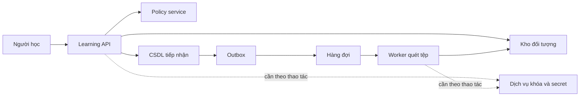
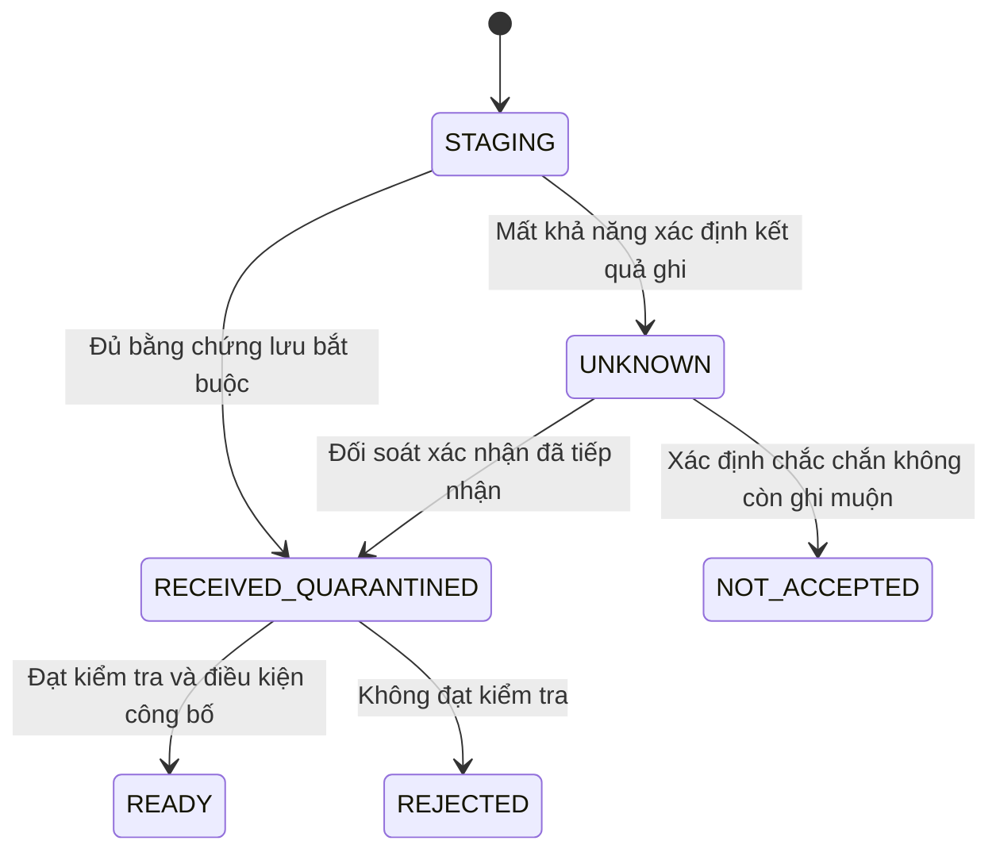

# Dependency failure

## 1. Biến sự cố phụ thuộc thành một phần của đặc tả

Dependency failure là tình huống một thành phần mà hệ thống cần không cung cấp được kết quả theo hợp đồng: không kết nối được, trả quá chậm, trả dữ liệu thiếu hoặc sai, không thực hiện được thao tác, hoặc không còn đủ cơ sở để tin cậy. Dependency có thể là cơ sở dữ liệu, dịch vụ định danh, kho đối tượng, hàng đợi, DNS, hệ thống quản lý khóa, API bên thứ ba hay một thành phần nội bộ.

Trong chương Availability và resilience của module yêu cầu bảo mật, mục tiêu không dừng ở việc dự phòng một máy chủ. Người đặc tả cần chuyển mục tiêu bảo vệ dữ liệu và mô hình đe dọa thành hành vi rõ ràng khi một điều kiện tiên quyết của nghiệp vụ bị thiếu. Hệ thống có thể tiếp tục phục vụ một số chức năng, trì hoãn công việc khác và dừng thao tác nhạy cảm; mỗi quyết định phải có điều kiện và tiêu chí kiểm chứng.

Ví dụ, dịch vụ gợi ý nội dung không trả lời thì nền tảng có thể bỏ phần cá nhân hóa. Dịch vụ kiểm tra quyền sửa điểm không trả lời thì nền tảng không được tự cấp quyền sửa. Kho lưu trữ báo timeout khi nhận bài tập thì chưa đủ cơ sở để khẳng định đã lưu hoặc chưa lưu. Ba trường hợp đều liên quan dependency nhưng cần ba hợp đồng khác nhau.

Câu “ứng dụng phải xử lý được lỗi bên thứ ba” còn thiếu ít nhất: lỗi nào, ảnh hưởng tới luồng nào, có thể chờ bao lâu, giữ bao nhiêu tài nguyên, được phép dùng dữ liệu thay thế nào, trạng thái dữ liệu sau lỗi là gì và phục hồi được chứng minh bằng cách nào. Bài này xây dựng các thành phần đó bằng một nền tảng học tập giả định. Mọi con số và mã yêu cầu là ví dụ thiết kế, cần hiệu chỉnh theo dữ liệu đo và mức rủi ro được chấp nhận.

## 2. Lập bản đồ dependency theo luồng nghiệp vụ

Một danh sách tên dịch vụ chưa cho thấy thành phần nào thực sự cần thiết đối với một thao tác. Cần mô tả dependency theo luồng, điểm gọi, loại thao tác đọc/ghi, giai đoạn sử dụng và ranh giới tin cậy. Một dịch vụ có thể không cần để phục vụ phiên đang chạy nhưng lại bắt buộc để khởi động instance mới hoặc khôi phục sau sự cố.

[Hướng dẫn failure mode analysis của Microsoft](https://learn.microsoft.com/en-us/azure/well-architected/reliability/failure-mode-analysis) đề xuất phân tích các bước của luồng quan trọng, dependency và phạm vi ảnh hưởng của từng dạng lỗi. Áp dụng vào bài này, mỗi bản ghi dependency phải gắn với kết quả người dùng và kiểm soát bảo mật cụ thể.

| Luồng | Dependency trực tiếp | Phụ thuộc gián tiếp hoặc dùng chung | Kết quả cần bảo vệ |
|---|---|---|---|
| Đọc bài học riêng tư | Policy, kho nội dung | DNS, mạng, danh tính dịch vụ, khóa mã hóa | Chỉ người đủ quyền đọc được đúng nội dung |
| Nộp tệp bài tập | Kho đối tượng, cơ sở dữ liệu tiếp nhận | Quota, khóa mã hóa, credential, mạng | Biên nhận phản ánh đúng trạng thái lưu bền vững |
| Quét tệp và cho phép tải | Hàng đợi, scanner, kho cách ly | Worker, chữ ký/cấu hình scanner, metadata | Tệp chưa đạt điều kiện không đi vào đường tải thông thường |
| Sửa điểm hoặc sửa vai trò | Policy, cơ sở dữ liệu, audit theo hợp đồng | MFA, identity, thời gian, secret | Không thực hiện khi thiếu điều kiện bắt buộc |
| Gửi thông báo thường | Hàng đợi, nhà cung cấp email | DNS, quota account, secret provider | Không làm tắc luồng tiếp nhận đã hoàn thành |
| Mở rộng hoặc phục hồi instance | Control plane, image registry, cấu hình, secret | IAM, mạng quản trị, hệ thống triển khai | Có thể khởi động an toàn trong kịch bản cần phục hồi |

Sơ đồ nhỏ giúp thấy một số đường phụ thuộc chung:



Sơ đồ không chứng minh các dependency độc lập. API và policy có thể dùng cùng DNS; kho chính và kho dự phòng có thể cùng tài khoản quản trị; hai vùng có thể dùng cùng dịch vụ cấp credential. Những quan hệ này phải được ghi lại dưới dạng giả định cần xác minh.

Với mỗi dependency, nên có định danh ổn định, chủ sở hữu, người liên hệ, phạm vi tenant/vùng, loại dữ liệu, giao thức, giới hạn tải, timeout, quota, cách cấp credential, điều kiện phục hồi và nguồn bằng chứng. Danh mục dùng trong đặc tả không chứa secret thực. Khi thêm SDK, proxy hoặc sidecar, phải xét các dependency mới mà chúng tạo ra.

## 3. Phân loại dạng lỗi và mức tin cậy của kết quả

“Dependency down” thường chỉ gợi một lỗi kết nối hoàn toàn. Trên thực tế, lỗi từng phần và kết quả không xác định khó xử lý hơn. Yêu cầu cần tách quan sát tại client khỏi kết luận về tình trạng toàn bộ provider.

| Dạng lỗi | Quan sát có thể có | Điều không được tự suy ra | Câu hỏi đặc tả |
|---|---|---|---|
| Không truy cập được | DNS lỗi, connect timeout, reset | Mọi vùng/provider đều ngừng hoạt động | Phạm vi mạng nào bị ảnh hưởng và deadline kết thúc ở đâu? |
| Chậm hoặc treo | Kết nối còn nhưng kết quả quá hạn | Tác vụ từ xa đã bị hủy | Tài nguyên nào còn bị giữ và giải phóng khi nào? |
| Lỗi từng phần | Một shard, tenant, API hoặc vùng lỗi | Toàn bộ dependency cùng hỏng | Có cô lập được phạm vi mà không gây ảnh hưởng chéo? |
| Quota hoặc quá tải | `429`, hàng đợi dài, pool đầy | Tăng retry sẽ giúp phục hồi | Quota thuộc tenant, account hay cả provider? |
| Sai giao thức/dữ liệu | `200` nhưng schema sai, thiếu trường, checksum sai | Thành công HTTP là thành công nghiệp vụ | Dữ liệu nào được tin và khi nào phải loại bỏ? |
| Dữ liệu cũ hoặc không nhất quán | Replica chậm, cache hết hạn, quyền thu hồi chưa lan | Dữ liệu còn tồn tại là dữ liệu còn hợp lệ | Giới hạn độ cũ và yêu cầu nhất quán nào cần giữ? |
| Kết quả ghi chưa xác định | Timeout hoặc mất phản hồi sau khi gửi | Ghi thất bại chắc chắn và có thể làm lại | Có idempotency, truy vấn trạng thái và đối soát không? |
| Danh tính hoặc toàn vẹn không đạt | Chứng chỉ sai, chữ ký không hợp lệ, issuer lạ | Có thể bỏ kiểm tra để tiếp tục phục vụ | Khi nào cô lập đường gọi và kích hoạt điều tra bảo mật? |
| Credential/cấu hình không hợp lệ | Service bị `401`/`403`, secret hết hiệu lực | Người dùng hiện tại nhập sai mật khẩu | Ai chịu trách nhiệm xoay khóa, rollback và phục hồi? |

Một quyết định quyền `DENY` hợp lệ hoặc lỗi validation của người dùng không tự thể hiện dependency hỏng. Ngược lại, `401` do credential của service bị thu hồi là một vấn đề khác với người dùng chưa đăng nhập. Bảng phân loại phải dựa trên hợp đồng từng đích, không dùng một quy tắc chung rằng mọi mã `4xx` là do client và mọi mã `5xx` đều retry được.

Khi có dấu hiệu dependency bị xâm nhập, việc chuyển sang endpoint khác vẫn cần đánh giá độ tin cậy. Dữ liệu sai có thể đã được sao chép sang nơi dự phòng. Phục hồi tính sẵn sàng không tự khôi phục tính toàn vẹn; cần biết nguồn dữ liệu và phiên bản cấu hình nào còn được tin cậy.

## 4. Gắn dạng lỗi với rủi ro và bất biến bảo mật

Bất biến là điều phải tiếp tục đúng trong cả đường bình thường, suy giảm và phục hồi. Trong nền tảng ví dụ, tenant A không được đọc dữ liệu tenant B; sửa điểm phải có quyết định quyền hợp lệ; không cấp trạng thái tệp sạch khi chưa có bằng chứng quét; biên nhận nộp bài phải có cơ sở lưu bền vững theo hợp đồng.

| Rủi ro | Chuỗi diễn biến | Bất biến cần bảo vệ |
|---|---|---|
| R-DEP-01 — Lỗi lan truyền | Gợi ý treo, chiếm hết pool, kéo theo đăng nhập và nộp bài | Chức năng ít quan trọng không chiếm vô hạn tài nguyên của luồng ưu tiên |
| R-DEP-02 — Vượt quyền khi suy giảm | Policy lỗi, ứng dụng dùng default allow | Thiếu kết quả quyền không tạo thêm quyền |
| R-DEP-03 — Mất hoặc trùng dữ liệu | Timeout sau commit, client gửi lại hoặc ứng dụng báo đã nhận sai | Trạng thái nghiệp vụ và tác dụng phụ được kiểm soát theo định danh ổn định |
| R-DEP-04 — Mất cách ly dữ liệu | Failover/cache dùng sai tenant hoặc sai vùng được phép | Ranh giới dữ liệu giữ nguyên ở đường thay thế |
| R-DEP-05 — Hỏng niềm tin | Bỏ TLS/chữ ký hoặc dùng dữ liệu sai để tăng tỷ lệ thành công | Nguồn và tính toàn vẹn dữ liệu vẫn được kiểm tra |
| R-DEP-06 — Phục hồi gây outage mới | Mọi instance retry, xả backlog và mở lại kết nối cùng lúc | Tổng tải phục hồi không vượt ngân sách đã xác định |
| R-DEP-07 — Không thể tự khôi phục | Muốn scale nhưng control plane, secret hoặc image registry cũng lỗi | Kịch bản phục hồi nêu đủ dependency và điều kiện thực hiện |
| R-DEP-08 — Mù quan sát | Logging chung bị nghẽn, fallback `200` che lỗi thật | Trạng thái suy giảm và khoảng trống bằng chứng được nhận biết |

Threat model cần xét tác nhân cố ý khai thác những chuỗi này: tạo tải vào endpoint rẻ để chiếm tài nguyên downstream đắt; tạo lỗi quota của một tenant để ảnh hưởng tenant khác; cố ép fallback dùng dữ liệu cũ; hoặc chờ thời điểm kiểm soát không sẵn sàng để thực hiện thao tác nhạy cảm. Không cần khẳng định mọi outage là tấn công; thiết kế phải giữ kiểm soát khi chưa biết nguyên nhân.

Bất biến nên kiểm chứng trên dữ liệu và tác dụng phụ, không chỉ trên mã phản hồi. Trả `503` nhưng đã ghi điểm hoặc đã phát lệnh sửa vai trò vẫn là vi phạm. Ngược lại, trả `202` chỉ có ý nghĩa đúng nếu API thực sự hỗ trợ nhận bất đồng bộ và công việc đã được lưu với bảo đảm tương ứng.

## 5. Chọn hành vi khi mất dependency theo từng thao tác

Đặc tả phải đưa ra quyết định nghiệp vụ cho từng cặp thao tác và dạng lỗi. Có thể dùng dữ liệu thay thế đã duyệt, trả kết quả giới hạn, trì hoãn một tác vụ đã lưu bền vững hoặc dừng thao tác. Nhãn “critical” của cả dịch vụ chưa đủ để quyết định mọi endpoint trong đó.

| Thao tác | Khi dependency không đáp ứng | Điều kiện tiếp tục | Hành vi không được phép |
|---|---|---|---|
| Gợi ý bài học công khai | Bỏ cá nhân hóa hoặc trả danh sách công khai đã duyệt | Không chứa nội dung riêng tư, tài nguyên fallback có giới hạn | Lấy dữ liệu riêng tư từ cache chung |
| Đọc nội dung riêng tư | Phải có quyền được xác minh theo policy đã chọn | Có đủ bằng chứng xác thực và quyền hợp lệ cho request hiện tại | Cho phép vì kho nội dung vẫn truy cập được |
| Sửa điểm/sửa vai trò | Dừng khi không xác minh được quyền bắt buộc | Chỉ thực hiện sau quyết định hợp lệ; ví dụ này không dùng cached allow | Gán quyền mặc định để giảm lỗi |
| Nộp bài có biên nhận | Chỉ xác nhận sau các bước lưu bắt buộc | Có định danh tiếp nhận, nội dung và metadata đã lưu theo hợp đồng | Nói đã nộp khi dữ liệu chỉ còn trong RAM |
| Tệp đã lưu nhưng chờ scanner | Giữ cách ly, trả trạng thái chờ kiểm tra | Kho cách ly, quota và chính sách nhận chờ còn hợp lệ | Cho tải như tệp sạch |
| Gửi thông báo thường | Có thể gửi sau từ hàng đợi bền vững | Đã ghi công việc, có hạn chờ và quota | Khẳng định đã giao email chỉ vì đã enqueue |
| Audit của thao tác nhạy cảm | Theo hợp đồng audit của thao tác đó | Có cơ chế ghi bền vững được chấp thuận hoặc dừng thực hiện | Bỏ sự kiện một cách âm thầm |

[OWASP Authorization Cheat Sheet](https://cheatsheetseries.owasp.org/cheatsheets/Authorization_Cheat_Sheet.html#deny-by-default) khuyến nghị từ chối mặc định và xác minh quyền trên mọi request. Trong kịch bản này, thiếu kết quả policy là tình trạng không xác minh được điều kiện thực hiện. Nó không được chuyển thành `ALLOW`, cũng không nên bị ghi sai thành người dùng có credential không hợp lệ.

Xác thực token bằng khóa công khai đã tin cậy tại chỗ là một trường hợp cần nêu rõ điều kiện. Nếu chính sách cho phép hoạt động khi dịch vụ tải khóa tạm thời không truy cập được, hệ thống vẫn phải kiểm tra chữ ký, issuer, audience, thời hạn và các điều kiện bắt buộc khác. Phải có giới hạn sử dụng khóa/cấu hình đã cache, xử lý khóa lạ, thay đổi khóa khẩn cấp và yêu cầu thu hồi tương ứng. Không thể chỉ nói “token còn hạn nên mọi quyền đều còn hiệu lực”. Thao tác cần trạng thái thu hồi mới mà không kiểm chứng được phải tuân theo chính sách dừng đã định.

Mọi fallback có dữ liệu cache cần ràng buộc tenant, chủ thể/phạm vi truy cập, tài nguyên, thao tác, phiên bản dữ liệu/policy và độ mới tối đa. TTL không bảo đảm phản ánh ngay một lần thu hồi quyền xảy ra trong TTL. Nếu không xác định được độ mới hoặc nguồn cache không đạt kiểm tra toàn vẹn, không sử dụng nó như bằng chứng cho phép.

## 6. Đặt ngân sách thời gian và tài nguyên trước khi xảy ra lỗi

Khi dependency chậm, số request đang chờ và lượng tài nguyên bị giữ tăng. Một mô hình đơn giản trong trạng thái ổn định là `L = λ × W`, với `L` là số công việc trung bình trong hệ thống, `λ` là tốc độ công việc và `W` là thời gian trung bình tồn tại của công việc trong cùng phạm vi đo. Ví dụ, 200 attempt/giây và thời gian giữ trung bình hai giây tương ứng khoảng 400 attempt đang tồn tại. Đây là mô hình trung bình với giả định nhất quán, không phải trần concurrency khi tải bùng phát.

Mỗi luồng cần có deadline end-to-end; mỗi lần gọi cần có ngân sách nằm trong thời gian còn lại. Thời gian đợi admission, DNS, kết nối, TLS, gửi dữ liệu, đọc dữ liệu, backoff và tạo phản hồi phải được tính đúng theo client thực tế. Không đặt lại toàn bộ deadline mỗi khi retry hoặc chuyển endpoint.

Ví dụ profile cho widget gợi ý: endpoint có ngân sách 1.200 ms; tối đa hai attempt outbound, mỗi attempt không quá 300 ms; chỉ một khoảng backoff ngẫu nhiên tối đa 100 ms; ngân sách local 200 ms và admission tối đa 100 ms. Tổng phân bổ là 1.000 ms, còn 200 ms dự phòng. Adapter không bắt đầu attempt nếu thời gian còn lại không đủ. Các con số là hợp đồng minh họa, cần kiểm tra bằng phép đo thực tế.

Giới hạn tài nguyên cho profile có thể là 16 attempt đang thực sự chạy mỗi instance, không có hàng đợi chờ permit của widget, và trần 20 instance ở deployment được kiểm chứng. Trần lý thuyết của riêng lớp này là 320 attempt đồng thời; phải cộng worker, probe, SDK và client khác trước khi so với năng lực downstream. Scale thêm instance làm thay đổi ngân sách toàn hệ thống.

Yêu cầu cần bao phủ cả lời gọi đã timeout ở tầng trên nhưng tác vụ nền chưa kết thúc. Cancellation có thể chỉ dừng chờ, không dừng xử lý ở provider. Phải giới hạn số tác vụ còn chạy, thời gian giữ connection và cơ chế thu hồi tài nguyên. Không trả permit sớm rồi tiếp tục tạo tác vụ nền để vượt giới hạn thực.

Tách pool và quota theo lớp chức năng giúp widget không làm cạn tài nguyên của nộp bài. Nếu dùng chung pool thì phải chứng minh cơ chế ưu tiên hoặc phần tài nguyên dự trữ đáp ứng được yêu cầu. Hàng đợi vô hạn, thread pool tự tăng không giới hạn và buffer phản hồi không có trần đều làm suy yếu ngân sách đã đặc tả.

## 7. Cô lập lỗi và kiểm soát lượng công việc phát sinh

Retry, circuit breaker, bulkhead, rate limiting và load shedding tác động lên những phần khác nhau của luồng. Chọn tổ hợp theo rủi ro, rồi đặc tả bằng kết quả quan sát được; tên pattern không tự tạo một giới hạn bảo đảm.

| Cơ chế | Yêu cầu mà nó có thể hỗ trợ | Điều kiện phải bổ sung |
|---|---|---|
| Timeout/deadline | Giới hạn thời gian chờ | Phạm vi timer, cancellation và tài nguyên còn chạy |
| Bulkhead | Cô lập lượng công việc đồng thời | Pool nào, trần bao nhiêu, admission và thời gian trả permit |
| Circuit breaker | Ngừng gọi thêm khi lỗi đạt chính sách | Phạm vi, cách phân loại mẫu, trạng thái thử và hành vi khi bị chặn |
| Rate limit/quota | Giới hạn tốc độ theo chủ thể hoặc miền tài nguyên | Burst, tenant, quota provider và hành vi khi hết quota |
| Retry có giới hạn | Khắc phục một số lỗi tạm thời | Idempotency, tổng attempt, deadline, backoff và jitter |
| Load shedding | Giữ hệ thống còn khả năng phục vụ | Ưu tiên nghiệp vụ, phản hồi và chống lạm dụng |
| Hàng đợi bền vững | Tách thời điểm nhận việc và xử lý | Dung lượng, tuổi việc, tính bền vững, replay và trạng thái người dùng |

Chương [Addressing Cascading Failures của Google SRE](https://sre.google/sre-book/addressing-cascading-failures/) mô tả cách một phần bị quá tải có thể đẩy thêm tải sang phần còn lại và gây lỗi lan truyền. Trong nền tảng ví dụ, yêu cầu phát sinh là giảm lượng công việc khi dependency suy yếu, đồng thời bảo vệ các luồng ưu tiên và kiểm soát tải phục hồi.

Retry chỉ được áp dụng cho lỗi và thao tác được xác định an toàn. Quy định số **attempt tổng cộng**, có tính lần đầu hay không; một nơi chịu trách nhiệm retry cho luồng; và cách xử lý chỉ dẫn chờ của provider theo hợp đồng. Không retry ngay một rejection do circuit hoặc quota cục bộ. Kiểm kê retry ẩn ở SDK, mesh, gateway và worker bằng số outbound thật.

Phạm vi cô lập phải khớp miền lỗi. Một tenant hết quota riêng không nên làm ngừng tất cả tenant; một outage chung của provider không thể giải quyết chỉ bằng chia circuit theo user. Không tạo không giới hạn đối tượng circuit/pool theo URL hoặc header do client điều khiển. Các khóa và nhãn quan sát phải xuất phát từ danh mục có cardinality được kiểm soát.

Khi ưu tiên nộp bài hơn gợi ý hoặc xử lý thống kê nền, cần mô tả cách admission thực thi ưu tiên. Giới hạn lạm dụng vẫn áp dụng cho luồng ưu tiên, nếu không kẻ tấn công có thể giả dạng request quan trọng để chiếm toàn bộ năng lực. Cơ chế cô lập phải được kiểm tra khi tài nguyên CPU, bộ nhớ hoặc mạng dùng chung cùng bão hòa.

## 8. Xử lý kết quả ghi chưa xác định và tiếp nhận bất đồng bộ

Kịch bản nộp bài cần phân biệt “request lỗi”, “chưa nhận bài” và “đã nhận nhưng phản hồi không tới client”. Nếu API gửi lệnh ghi rồi timeout, thao tác từ xa có thể vẫn đang chạy hoặc đã commit. Tự sinh submission ID mới và gửi lại có thể tạo hai lần nộp; trả biên nhận thành công trước khi lưu bền vững có thể làm mất bài của người học.

Một hợp đồng minh họa cho nền tảng:

1. Client dùng định danh idempotency cho một lần nộp; server gắn nó với tenant, người nộp, bài tập và dấu vết nội dung theo hợp đồng.
2. Nội dung được ghi vào kho được chấp thuận với kiểm tra kích thước/toàn vẹn; chỉ có dữ liệu trong buffer RAM chưa được coi là đã lưu.
3. Cơ sở dữ liệu ghi metadata tiếp nhận, tham chiếu nội dung và outbox trong cùng transaction của cơ sở dữ liệu. Điều này không biến việc ghi kho đối tượng và transaction thành một giao dịch nguyên tử chung.
4. Chỉ khi xác định các điều kiện lưu bắt buộc đã đạt, hệ thống trả biên nhận `RECEIVED_QUARANTINED` với submission ID. Trạng thái này nghĩa là đã tiếp nhận để kiểm tra, không có nghĩa tệp đã sạch hay bài đã được chấm.
5. Worker chuyển việc quét từ outbox qua hàng đợi theo cơ chế chống trùng phù hợp. Nếu broker ngừng hoạt động, biên nhận vẫn đúng chỉ khi hợp đồng đã cho phép chờ từ outbox bền vững và hệ thống còn trong giới hạn backlog.
6. Nếu commit chưa xác định do mất kết nối, cùng định danh idempotency được dùng để tra cứu/đối soát. Không khẳng định thất bại cuối cùng chỉ từ một lần truy vấn không thấy dữ liệu trên replica chậm.

Sơ đồ trạng thái tiếp nhận giản lược:



Muốn kết luận `NOT_ACCEPTED`, thiết kế phải giải quyết được khả năng commit đến muộn, thứ tự thực hiện và tính nhất quán của nguồn trạng thái. Khi chưa có cơ sở đó, giữ trạng thái chưa xác định và hướng dẫn tra cứu phù hợp. Endpoint tra cứu cũng phải xác thực và phân quyền; biết submission ID không tự cho phép xem nội dung hoặc trạng thái của người khác.

Nếu đã ghi object nhưng transaction metadata không thành công, có thể còn object mồ côi. Cần cơ chế đối soát và dọn dẹp với thời hạn, tránh xóa nhầm nội dung của một transaction còn có thể commit hoặc một phiên nộp hợp lệ. Khi retention của khóa idempotency kết thúc, phải quy định cách xử lý request rất cũ; không tuyên bố chống trùng vô thời hạn nếu dữ liệu cần để phát hiện đã bị xóa.

Đối với hàng đợi, đặc tả cần trần dung lượng, tuổi công việc, hạn xử lý, retry, dead-letter/quarantine, quyền truy cập và cơ chế phục hồi. “Giao ít nhất một lần” có thể dẫn tới xử lý lặp; tác dụng phụ phải chống trùng tại nơi thực hiện hoặc qua cơ chế tương đương. Nhãn “exactly once” của một thành phần không tự chứng minh toàn bộ chuỗi object, metadata, scanner và thông báo chỉ có một tác dụng phụ.

Cần định nghĩa quyền tại thời điểm replay. Một yêu cầu từng được chấp nhận không luôn đủ để thực hiện một thao tác nhạy cảm sau nhiều giờ nếu quyền đã thu hồi hoặc đối tượng đã thay đổi. Hợp đồng phải nêu thuộc tính nào được chốt lúc nhận, thuộc tính nào phải xác minh lại lúc thực hiện và điều gì xảy ra khi không xác minh được.

## 9. Failover phải bảo toàn quyền, dữ liệu và năng lực phục vụ

Chuyển endpoint chỉ là một bước định tuyến. Trước khi cho failover, cần xác định đích được chấp thuận, credential có quyền tối thiểu, danh tính đích hợp lệ, trạng thái dữ liệu, năng lực còn lại và cơ chế quay về. Đường dự phòng phải đáp ứng cùng điều kiện bảo mật của thao tác hoặc chỉ cung cấp tập chức năng giới hạn đã duyệt.

| Điều kiện | Câu hỏi phải trả lời | Tiêu chí minh họa |
|---|---|---|
| Tin cậy và định danh | Có xác minh được dịch vụ dự phòng đúng là đích được phép? | Không hạ TLS, bỏ chữ ký hay dùng credential quản trị chung |
| Ranh giới dữ liệu | Đích có đúng tenant, vùng và chính sách lưu trữ được chấp thuận? | Không sao chép dữ liệu nhạy cảm ra đích chưa được duyệt |
| Độ mới và toàn vẹn | Replica có dữ liệu đủ mới và nguồn còn đáng tin? | Không dùng replica cũ để cấp quyền ghi hoặc che mất bài đã nhận |
| Quyền ghi | Khi partition, ai còn được ghi? | Cơ chế fencing/quorum hoặc tương đương ngăn ghi trái phép từ chủ cũ |
| Công suất | Đích chịu được bao nhiêu lưu lượng tăng thêm? | Có admission và quota dựa trên năng lực đã đo |
| Lỗi chung | Đích có dùng chung DNS, KMS, IAM, account hoặc pipeline lỗi? | Các giả định độc lập được xác minh, không suy từ tên provider |
| Quay về | Làm sao hợp nhất dữ liệu, kết thúc chủ ghi và giảm tải? | Có điều kiện, người chịu trách nhiệm và bằng chứng trước failback |

Với dữ liệu có một chủ ghi, thay đổi định tuyến không đủ ngăn chủ cũ tiếp tục nhận ghi sau partition. Cơ chế kiểm soát chủ ghi phải có hiệu lực tại nơi chấp nhận ghi, và được kiểm thử với mất kết nối, lease hết hạn, kết quả muộn và failback. Nếu thiết kế không giữ được bất biến cần thiết, dừng ghi có thể là hành vi an toàn hơn cho thao tác đó.

Sao lưu hỗ trợ phục hồi nhưng không tự là bản sao trực tuyến có thể failover ngay. Dữ liệu khôi phục có thể thiếu thay đổi mới, secret có thể hết hạn và khóa giải mã có thể vẫn phụ thuộc nơi đang lỗi. Cần kiểm tra khả năng đọc, giải mã và sử dụng dữ liệu sau khôi phục bằng đúng quyền của dịch vụ.

Hai provider vẫn có thể cùng phụ thuộc nhà cung cấp DNS, một credential broker hoặc một pipeline cấu hình. Hai vùng có thể cùng nhận một cấu hình sai. Tách vendor hoặc thêm replica làm thay đổi rủi ro chứ không mặc nhiên loại bỏ lỗi tương quan; phân tích phải chỉ ra những điều kiện chung còn tồn tại.

Failover tự động chỉ được dùng trong tập điều kiện có thể quyết định an toàn. Khi nghi ngờ dữ liệu bị giả mạo, quyền ghi không xác định hoặc trạng thái replication chưa đạt, quy trình có thể cần cô lập và đánh giá trước. Không lấy mục tiêu giảm thời gian gián đoạn để bỏ điều kiện toàn vẹn đã cam kết.

## 10. Kiểm tra dependency của chính đường phục hồi

Một kế hoạch “khi thiếu năng lực thì tự scale” còn phụ thuộc vào khả năng cấp máy, tải image, lấy secret, tải cấu hình và đăng ký vào hạ tầng mạng. Nếu cùng outage làm các bước đó không hoạt động, kế hoạch có thể không đạt thời gian phục hồi dù ứng dụng cũ còn chạy được.

Bài [Static stability using Availability Zones của AWS](https://builder.aws.com/content/3K9SiqiJ369TGkkGzqPM95BuYWI/static-stability-using-availability-zones) mô tả cách chuẩn bị để phần đang hoạt động tiếp tục phục vụ khi dependency suy yếu, thay vì buộc phải cấp thêm tài nguyên ngay lúc sự cố. Áp dụng vào kịch bản này, cần đánh giá riêng các đường phục vụ đang chạy, khởi động mới và thay đổi cấu hình.

Ví dụ, nếu nền tảng cam kết duy trì một mức tiếp nhận khi mất một miền lỗi, phải đo năng lực còn lại đã sẵn sàng hoặc chứng minh kịch bản cấp thêm tài nguyên thực sự khả thi. Nếu chỉ phiên đang chạy dùng được khóa đã cache, instance mới vẫn có thể không giải mã được dữ liệu; không gộp hai trạng thái vào một kết luận “KMS outage không ảnh hưởng”.

Secret và khóa có thời hạn, phiên bản, giới hạn sử dụng và chính sách thu hồi. Sự cố dependency không cho phép kéo dài vô hạn credential hết hạn, ghi secret ra file tạm tùy ý hay giải mã và lưu plaintext để né KMS. Nếu chấp thuận cache vật liệu khóa, phải có giới hạn, bảo vệ bộ nhớ/lưu trữ, cơ chế vô hiệu và rủi ro được ghi rõ.

Cần kiểm tra thao tác khôi phục khi kênh quản trị chính gặp sự cố. Nếu có đường truy cập khẩn cấp, nó phải được chuẩn bị trước với quyền hạn hẹp, xác minh danh tính, audit và thời hạn phù hợp. Một runbook không thể dựa vào công cụ duy nhất đang nằm trong cùng miền lỗi mà không có phương án được xác minh.

## 11. Phát hiện, thông báo và giữ bằng chứng khi suy giảm

Quan sát phải liên kết lỗi dependency với kết quả người dùng. Các chỉ số chính gồm tỷ lệ hoàn tất nghiệp vụ, độ trễ end-to-end, thời gian chờ từng dependency, timeout, outbound thật, retry, circuit rejection, saturation, độ cũ dữ liệu, backlog và tuổi công việc. Đếm phản hồi HTTP `200` không đủ khi payload chỉ là fallback hoặc chức năng chính không hoàn thành.

Cần phân biệt “không có lỗi quan sát được”, “không có request” và “mất telemetry”. Khi logging chung bị nghẽn, ứng dụng không nên giữ request vô hạn để chờ gửi log. Riêng audit bắt buộc của thao tác nhạy cảm phải có hợp đồng ghi bền vững hoặc dừng thao tác đã nêu; không âm thầm bỏ audit theo cùng chính sách với log chẩn đoán thông thường.

Bản ghi tối thiểu có thể gồm dependency ID, operation class, phạm vi vùng, loại lỗi, deadline hiệu lực, số attempt, trạng thái kết quả nghiệp vụ, phiên bản cấu hình và correlation ID thích hợp. Token, mật khẩu, khóa, cookie, nội dung bài tập và URL có query bí mật không được đưa vào log chỉ để debug outage. Nhãn metric cần cardinality hữu hạn; liên kết tenant ở nguồn điều tra có kiểm soát nếu có nhu cầu, không mặc định biến mọi user ID thành nhãn.

Thông báo cho người dùng phải phản ánh đúng ngữ nghĩa. “Đã nhận, đang kiểm tra tệp” khác “đã nộp thành công và hợp lệ”; “chưa xác định kết quả, hãy tra cứu bằng mã này” khác “thất bại, hãy tạo lần nộp mới”. Client cần biết trạng thái nào retry được, dùng lại định danh nào và khoảng chờ nào được phép. Không công bố topology, secret hoặc trạng thái tenant khác trong lỗi API.

Kiểm tra liveness cần tránh cơ chế restart hàng loạt chỉ vì một dependency chung tạm lỗi nếu restart không giải quyết được nguyên nhân. Readiness cần phản ánh loại lưu lượng instance có thể phục vụ và cách cân bằng tải thật sự sử dụng tín hiệu đó. Không loại tất cả instance khỏi mọi luồng nếu chúng vẫn phục vụ được những luồng được phép, trừ khi chính sách an toàn của hệ thống yêu cầu dừng toàn bộ.

Cảnh báo phải gắn với ảnh hưởng và điều kiện hành động. Ví dụ cảnh báo nếu luồng nộp bài không thể xác nhận tiếp nhận liên tục 60 giây, hoặc tuổi công việc quét lâu nhất vượt 10 phút trong tải đã định. Đây là ngưỡng minh họa; sự kiện toàn vẹn hoặc cấp quyền trái phép cần phản ứng theo mức độ nghiêm trọng, không chờ đủ ngưỡng availability. Ghi nhận khoảng trống telemetry để không coi thời gian thiếu dữ liệu là thời gian hệ thống khỏe.

## 12. Định nghĩa mục tiêu phục vụ và phục hồi có thể đo

SLO cần xác định luồng, tập request đủ điều kiện, kết quả thành công, cửa sổ đo và nguồn dữ liệu. Với nộp bài, thành công có thể là tạo được biên nhận dựa trên các bước lưu bắt buộc; với xử lý tệp, còn có mục tiêu thời gian từ tiếp nhận tới kết quả kiểm tra. Tách hai mục tiêu để không che độ trễ xử lý sau một phản hồi tiếp nhận nhanh.

Không suy SLO của luồng chỉ từ SLA của provider. Trong mô hình nối tiếp đơn giản, nếu một request cần đồng thời bốn dependency và giả sử các sự kiện thành công độc lập, mỗi dependency có xác suất đáp ứng 99,9%, tích là `0,999^4 ≈ 99,6006%`. Đây chỉ là mô hình xác suất có giả định rõ; SLA theo tháng, lỗi tương quan, pattern lưu lượng và fallback khiến số liệu thực tế không thể được suy trực tiếp bằng phép nhân đó.

Mục tiêu phục hồi cần có mốc bắt đầu và kết thúc. Ví dụ thời gian khôi phục luồng nộp bài được đo từ lúc tiêm lỗi tới lúc hệ thống đạt trở lại mức tiếp nhận đã quy định trong một khoảng duy trì liên tục, đồng thời các kiểm soát và dữ liệu đạt điều kiện. Một probe thành công hoặc dashboard đổi màu chưa đủ là mốc kết thúc.

RTO là mục tiêu thời gian khôi phục; RPO diễn tả mức mất dữ liệu chấp nhận được theo điểm phục hồi, thường biểu diễn theo thời gian. Phải ghi rõ phạm vi dữ liệu và kịch bản. Ngoài RPO, luồng nộp bài có thể đặt bất biến riêng rằng mọi biên nhận đã xác nhận đều đối chiếu được với dữ liệu còn sử dụng được trong mô hình lỗi được cam kết. Không biến một bất biến có phạm vi thành tuyên bố chống mất dữ liệu trong mọi thảm họa.

| ID | Yêu cầu minh họa | Rủi ro liên quan | Bằng chứng cần có |
|---|---|---|---|
| DEP-01 | Mỗi luồng ưu tiên có danh mục dependency trực tiếp, gián tiếp và dependency lúc khởi động/phục hồi | R-DEP-01, R-DEP-07 | Sơ đồ luồng, danh mục có chủ sở hữu |
| DEP-02 | Mỗi dạng lỗi trong ma trận có phân loại kết quả, hành vi và bất biến được ghi rõ | R-DEP-02, R-DEP-03, R-DEP-05 | Ma trận theo thao tác và adapter |
| DEP-03 | Profile gợi ý tuân deadline 1.200 ms, tối đa hai attempt và ngân sách thành phần đã định ở mục 6 | R-DEP-01, R-DEP-06 | Đo adapter và end-to-end trong fixture đã công bố |
| DEP-04 | Widget không vượt 16 attempt thực đang chạy mỗi instance; trần instance và các nguồn outbound được kiểm kê | R-DEP-01 | Metric tài nguyên và số request tại dependency |
| DEP-05 | Khi không xác minh được policy cho sửa điểm/vai trò, không ghi dữ liệu và không phát lệnh thực hiện; không dùng default/cached allow | R-DEP-02 | Kiểm tra trạng thái trước/sau và queue/outbox liên quan |
| DEP-06 | Biên nhận nộp bài chỉ được xác nhận sau điều kiện lưu nội dung, metadata và outbox của hợp đồng tiếp nhận | R-DEP-03 | Bản ghi receipt, kiểm tra nội dung và transaction |
| DEP-07 | Mất phản hồi sau ghi dẫn tới tra cứu/đối soát cùng định danh; không tạo lần nộp mới tự động | R-DEP-03 | Fault injection tại điểm commit/ack và kiểm đếm nghiệp vụ |
| DEP-08 | Tệp chờ quét vẫn cách ly; mọi đường tải thông thường kiểm tra trạng thái và quyền | R-DEP-02, R-DEP-05 | Test URL/API tải trong lúc scanner lỗi |
| DEP-09 | Failover chỉ tới đích đã duyệt, đạt điều kiện danh tính, dữ liệu, quyền ghi và năng lực | R-DEP-04, R-DEP-05 | Kịch bản partition, dữ liệu cũ và kiểm tra đích |
| DEP-10 | Hàng đợi/outbox có trần dung lượng và tuổi; khi đạt giới hạn, ngừng nhận theo hợp đồng thay vì báo thành công giả | R-DEP-01, R-DEP-03 | Test đầy hàng đợi và phép đo tuổi backlog |
| DEP-11 | Tải replay, retry và phục hồi nằm trong ngân sách toàn miền dependency; không chỉ đo từng instance | R-DEP-06 | Diễn tập nhiều instance có backlog |
| DEP-12 | Log, audit và metric phân biệt trạng thái chưa biết, fallback và telemetry thiếu; không ghi secret | R-DEP-08 | Bản ghi mẫu và test mất kênh quan sát |
| DEP-13 | Kế hoạch phục hồi được kiểm tra cả khi control plane, secret hoặc image registry không sẵn sàng | R-DEP-07 | Runbook và bằng chứng diễn tập theo kịch bản |
| DEP-14 | Thay provider, topology, quota, SDK retry hoặc chính sách quyền phải cập nhật các giả định và tiêu chí liên quan | Tất cả | Phiên bản đặc tả, cấu hình và hồ sơ thay đổi |

Những trường chưa có số liệu thật phải trở thành hạng mục cần quyết định với chủ sở hữu và hạn hoàn thành, thay vì tự điền bằng con số mặc định rồi coi là đã nghiệm thu. SLO, mục tiêu phục hồi và bất biến an toàn có vai trò bổ sung: đạt độ trễ nhưng cấp quyền sai vẫn vi phạm yêu cầu.

## 13. Mẫu đặc tả một hành vi trọng tâm

Một yêu cầu nên đủ cụ thể để người kiểm thử biết điều kiện kích hoạt, tác dụng phụ được phép và không được phép, cùng nguồn bằng chứng. Mẫu sau là tài liệu yêu cầu minh họa; không phải cấu hình framework:

```yaml
id: DEP-05
scope: sensitive-grade-or-role-write
risk_refs: [R-DEP-02]
preconditions:
  - request_has_passed_required_local_identity_and_input_checks
  - operation_requires_a_current_valid_policy_decision
failure_conditions:
  - policy_deadline_exceeded
  - policy_connection_unavailable
  - policy_response_fails_required_integrity_or_schema_checks
  - policy_call_rejected_by_local_resilience_controls
required_behavior:
  - do_not_modify_protected_grade_or_role_state
  - do_not_publish_or_persist_a_command_that_would_bypass_the_missing_check
  - do_not_substitute_default_allow_or_cached_allow
  - distinguish_unverified_policy_from_valid_deny_in_internal_outcome
  - return_temporary_failure_per_api_contract_without_internal_secrets
  - emit_a_correlatable_event_under_the_approved_data_policy
acceptance:
  - protected_business_state_is_unchanged_for_all_injected_failure_cases
  - no_unauthorized_effect_is_triggered_by_fallback_or_late_completion
  - public_response_does_not_claim_a_bad_password_for_policy_outage
verification:
  - observe_database_state_and_relevant_outbox_or_queue
  - test_delayed_policy_results_after_the_api_deadline
  - test_direct_api_worker_and_fallback_entry_points
owner: learning_api_team
```

Phần “kết quả đến muộn” quan trọng: một callback sau deadline không được tiếp tục ghi điểm nếu request đã kết thúc theo nhánh thiếu điều kiện. Cần thiết kế vòng đời tác vụ, transaction và lệnh bất đồng bộ sao cho điều kiện bảo mật được thực thi ở nơi tạo tác dụng phụ, không chỉ ở controller ban đầu.

Mẫu này còn phải liên kết tới policy version, API contract, môi trường và fixture kiểm chứng của hệ thống thật. Ví dụ fixture cần nêu số instance, concurrency, payload, dữ liệu tenant, thời gian warm-up, điểm tiêm lỗi, nguồn đo và cách dọn dữ liệu. Một nhãn `PASS` không có ranh giới đo hoặc trạng thái dữ liệu đối chiếu sẽ khó được dùng làm bằng chứng.

## 14. Ma trận kiểm thử và diễn tập phục hồi

Kiểm thử cần bao phủ cả không trả lời, trả sai và trả muộn. Dùng dependency giả lập hoặc môi trường được phép tiêm lỗi có khả năng quan sát request thật, điều khiển thời gian và vị trí mất phản hồi. Dữ liệu kiểm thử phải phù hợp phạm vi được phép; các trường hợp sau là kế hoạch nghiệm thu, không phải tuyên bố đã được chạy trong tài liệu học.

| Ca | Kích thích | Điều cần chứng minh |
|---|---|---|
| T01 — Mất kết nối | DNS/connect lỗi tới một dependency | Kết thúc theo deadline; xác định đúng phạm vi; không bỏ kiểm tra tin cậy |
| T02 — Treo kết quả | Kết nối mở nhưng không trả body/kết quả | Tài nguyên và tác vụ còn chạy có trần; cancellation được quan sát |
| T03 — Lỗi từng phần | Một tenant/shard/vùng bị lỗi | Không chặn sai phạm vi còn khỏe; không lộ dữ liệu tenant khác |
| T04 — Quota riêng | Một account nhận `429` theo hợp đồng provider | Retry và admission tuân giới hạn, không mở rộng lỗi sang mọi account |
| T05 — Sai dữ liệu | HTTP thành công nhưng schema/checksum không đạt | Không sử dụng dữ liệu như thành công nghiệp vụ |
| T06 — Sai danh tính | TLS/chữ ký/issuer không hợp lệ | Không hạ kiểm tra để tiếp tục; có dấu vết phân loại bảo mật |
| T07 — Policy mất | Mọi nhánh sửa điểm/vai trò gặp lỗi policy | Không ghi, không phát lệnh và không default allow |
| T08 — Credential service hết hạn | Outbound bị từ chối do danh tính service | Không ghi sai thành lỗi mật khẩu của người dùng; không kéo dài secret trái chính sách |
| T09 — Cache cũ | Cache hết tuổi, sai tenant hoặc quyền đã thu hồi | Đúng giới hạn sử dụng; không cấp quyền dựa trên cache không đủ điều kiện |
| T10 — Kho không lưu | Ghi object thất bại trước khi có bằng chứng bền vững | Không trả biên nhận tiếp nhận sai |
| T11 — Mất phản hồi sau commit | Metadata/outbox đã commit nhưng client thấy timeout | Tra cứu cùng định danh, không tạo tác dụng phụ trùng |
| T12 — Ghi muộn | Truy vấn trạng thái diễn ra trước một commit đến muộn | Không kết luận chưa nhận quá sớm hoặc xóa object hợp lệ |
| T13 — Broker ngừng | Object và transaction tiếp nhận đã đạt, broker không nhận | Outbox giữ công việc trong giới hạn; receipt đúng nghĩa chờ xử lý |
| T14 — Scanner ngừng | Tệp đã nhận, chưa quét | Tệp cách ly, không có đường tải vượt trạng thái |
| T15 — Backlog đầy | Dung lượng hoặc tuổi công việc đạt ngưỡng | Admission và thông báo đúng; không mất việc âm thầm |
| T16 — Tải dồn | Nhiều client/SDK/worker retry đồng thời | Tổng attempt và tài nguyên không vượt ngân sách đã đặc tả |
| T17 — Failover/partition | Đích cũ và mới cùng có thể nhận kết nối | Quyền ghi, fencing hoặc cơ chế tương đương giữ được bất biến |
| T18 — Replica cũ | Đích dự phòng thiếu dữ liệu/quyền vừa thay đổi | Không báo phục hồi đầy đủ hoặc cấp quyền sai |
| T19 — Lỗi chung | Mất DNS/KMS/IAM được dùng bởi cả chính và dự phòng | Phương án không dựa vào giả định độc lập sai |
| T20 — Khởi động mới | Instance cũ còn chạy, nhưng image/secret/control plane lỗi | Đo riêng khả năng phục vụ hiện tại và mở rộng/phục hồi |
| T21 — Mất telemetry | Log/metric transport bị chặn | Không deadlock request; thiếu bằng chứng được nhận biết; audit đúng hợp đồng |
| T22 — Phục hồi có backlog | Dependency trở lại trong lúc có nhiều việc chờ | Replay có trần, request tương tác còn năng lực và không tạo burst mất kiểm soát |
| T23 — Quyền thay đổi lúc chờ | Thu hồi quyền trước khi công việc được replay | Áp dụng đúng chính sách quyền tại thời điểm thực hiện |
| T24 — Failback | Chuyển lại đích chính sau đối soát | Dữ liệu, chủ ghi, credential và quota vẫn hợp lệ; không đảo trạng thái sai |

Một diễn tập toàn luồng có thể bắt đầu bằng tải nộp bài bình thường, sau đó làm broker không sẵn sàng, khiến scanner chậm, tạo backlog, rồi mất một miền lưu trữ trong khi vài request đang commit. Khi đưa dependency trở lại, tiếp tục tải tương tác và quan sát cách replay. Mục đích là phát hiện tương tác giữa các cơ chế, không chỉ kiểm tra chúng riêng lẻ.

Bộ bằng chứng gồm phiên bản ứng dụng/cấu hình, topology, thời điểm và điểm tiêm lỗi, lưu lượng đủ điều kiện, số outbound tại đích, trạng thái receipt/nội dung/metadata, tuổi backlog, tài nguyên đang dùng và mốc đạt điều kiện phục hồi. Với phản hồi thành công, đối chiếu xem dữ liệu thực sự còn truy cập được bởi đúng người có quyền. Với phản hồi thất bại hoặc chưa xác định, kiểm tra tác dụng phụ và khả năng đối soát.

Thử nghiệm cần có phạm vi, người chịu trách nhiệm, điều kiện dừng và cách khôi phục dữ liệu kiểm thử. Sau một lần kiểm chứng đạt, chỉ mở rộng hoặc lặp lại khi có thay đổi, lỗi hay giả định chưa được giải quyết; chất lượng bằng chứng quan trọng hơn số lần chạy cùng một tình huống.

## 15. Đưa yêu cầu vào vòng đời phát triển

Ở giai đoạn yêu cầu, xác định luồng ưu tiên, tài sản, dạng lỗi, bất biến và kết quả suy giảm được phép. Ở thiết kế, nối chúng với topology, miền lỗi, budget tài nguyên, độ nhất quán và đường phục hồi. Ở triển khai, kiểm tra cách client/thư viện thực thi timeout, retry, cancellation, cache và quyền tại nơi tạo tác dụng phụ.

Khi nghiệm thu và vận hành, dùng cùng ngữ nghĩa thành công đã đặc tả, giữ bằng chứng phiên bản và quan sát cả giai đoạn suy giảm lẫn phục hồi. Chủ sở hữu nghiệp vụ cần quyết định mức phục vụ tối thiểu, giới hạn chờ và trạng thái thông báo; đội nền tảng cần cung cấp giới hạn hạ tầng; đội bảo mật xác định điều kiện không được nới lỏng. Một SLA của provider không thay các quyết định nội bộ đó.

Những thay đổi cần xem lại yêu cầu gồm thêm provider, chuyển vùng, thay quota, tăng autoscaling, sửa SDK, thêm retry ở gateway, thay cách cấp khóa, thay retention của idempotency hoặc thay chính sách quyền. Mỗi thay đổi có thể làm mất hiệu lực một giả định từng đúng về miền lỗi, tải hay độ mới dữ liệu.

Các dấu hiệu của đặc tả còn thiếu là: “retry khi lỗi” không có trần; “dùng cache” không có tenant và giới hạn độ mới; “failover tự động” không xét quyền ghi; “đã nhận” không có bằng chứng lưu; “khôi phục xong” chỉ dựa trên health ping; hoặc “không mất dữ liệu” không chỉ ra tập dữ liệu và mô hình sự cố. Mỗi câu cần được đổi thành điều kiện, hành vi và nguồn kiểm chứng.

Dependency failure là một phần bình thường phải được dự kiến trong thiết kế. Đặc tả đạt mục đích khi người đọc xác định được chức năng nào còn phục vụ, điều kiện bảo mật nào tiếp tục bắt buộc, dữ liệu nào đã được cam kết và bằng chứng nào cho phép kết luận đã phục hồi.