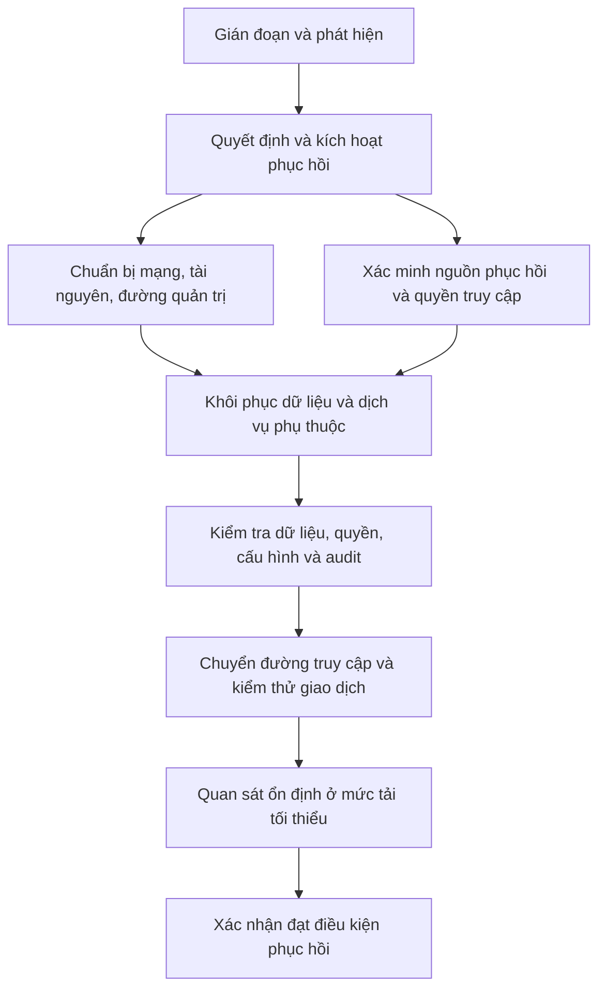

# Recovery time objective

## 1. RTO là yêu cầu phục hồi nào?

**Recovery time objective (RTO)** là mục tiêu thời gian để khôi phục một hệ thống hoặc chức năng sau gián đoạn về mức hoạt động đã được thỏa thuận. Một RTO có thể kiểm chứng phải gắn với chức năng cụ thể, kịch bản sự cố, mốc bắt đầu, điều kiện hoàn tất và các giả định về tài nguyên, nhân sự, phụ thuộc.

NIST mô tả RTO trong bối cảnh khoảng thời gian thành phần hệ thống có thể ở giai đoạn phục hồi trước khi ảnh hưởng bất lợi đến nhiệm vụ hoặc quy trình nghiệp vụ. Khi đưa vào đặc tả, tổ chức cần công bố rõ cách đo phù hợp với phạm vi của mình. [Nguồn: NIST Glossary — Recovery Time Objective](https://csrc.nist.gov/glossary/term/recovery_time_objective).

Trong bài này, **RTO của dịch vụ được quy ước đo từ lúc chức năng bị gián đoạn theo tiêu chí đã định nghĩa đến lúc chức năng đạt điều kiện phục hồi và hoàn tất cửa sổ xác nhận ổn định**. Thời gian phát hiện, ra quyết định, phê duyệt và kiểm tra an toàn đều nằm trong khoảng đó. Đây là quy ước đặc tả của ví dụ, không phải cách ngầm hiểu cho mọi tài liệu sử dụng thuật ngữ RTO.

Ví dụ “RTO = 60 phút” chưa cho biết:

- Cần khôi phục đăng nhập, đọc dữ liệu, ghi dữ liệu hay toàn bộ hệ thống?
- Sự cố là hỏng một tiến trình, mất một vùng triển khai hay dữ liệu bị phá hoại?
- Đồng hồ bắt đầu lúc dịch vụ hỏng, lúc có cảnh báo hay lúc đội trực nhận việc?
- Máy chủ khởi động xong đã đủ chưa, hay còn phải xác minh dữ liệu và quyền?
- Mức tải tối thiểu và thời gian quan sát ổn định là bao nhiêu?

Trong chương **Availability và resilience**, RTO là cầu nối giữa tác động nghiệp vụ, rủi ro an toàn thông tin, kiến trúc phục hồi và tiêu chí nghiệm thu.

Sau bài học, người học có thể chọn và đặc tả RTO có căn cứ; phân biệt RTO với các chỉ tiêu liên quan; phân bổ ngân sách thời gian cho chuỗi phục hồi; và thiết kế bằng chứng chứng minh chức năng đã trở lại một cách an toàn.

## 2. Từ tác động nghiệp vụ đến mục tiêu phục hồi

### 2.1. Bắt đầu bằng chức năng, không bắt đầu bằng công nghệ

Giả sử một nền tảng quản lý hồ sơ đa tenant có các chức năng:

- Đăng nhập và kiểm tra quyền truy cập hồ sơ.
- Tạo, cập nhật và đọc hồ sơ đang xử lý.
- Tìm kiếm lịch sử trên chỉ mục có thể tái tạo.
- Xuất báo cáo tổng hợp và chạy tác vụ nền.

Tenant là ranh giới tổ chức; người dùng của tenant này không được đọc hoặc sửa dữ liệu của tenant khác.

Nếu mọi chức năng đều được ghi “RTO 15 phút” chỉ vì nền tảng có cơ chế failover, yêu cầu có thể vừa thiếu căn cứ vừa không khả thi. Phân tích tác động nghiệp vụ, thường gọi là **business impact analysis (BIA)**, cần chỉ ra hậu quả khi từng chức năng gián đoạn theo thời gian.

| Nội dung phân tích | Câu hỏi cần trả lời |
| --- | --- |
| Tác động | Dừng chức năng gây chậm công việc, mất dữ liệu hay ảnh hưởng an toàn thông tin nào? |
| Thời gian | Hậu quả thay đổi ra sao sau 15 phút, một giờ hoặc một ngày? |
| Phương án thay thế | Có thể làm thủ công hoặc phục vụ ở mức giảm chức năng trong bao lâu? |
| Phụ thuộc | Chức năng cần định danh, khóa mã hóa, mạng, dữ liệu và nhà cung cấp nào? |
| Năng lực tối thiểu | Cần phục vụ loại thao tác, nhóm người dùng và mức tải nào để nghiệp vụ tiếp tục? |
| Giới hạn chịu đựng | Đến thời điểm nào tác động trở nên không chấp nhận được? |
| Người quyết định | Ai có thẩm quyền chấp nhận tác động và phê duyệt mục tiêu? |

### 2.2. Chọn theo mức quan trọng

Bảng minh họa cho cùng một kịch bản mất vùng triển khai chính:

| Nhóm chức năng | Mức hoạt động cần phục hồi | RTO ví dụ |
| --- | --- | --- |
| Luồng hồ sơ chính | Đăng nhập, phân quyền, đọc và ghi hồ sơ hợp lệ | 60 phút |
| Tìm kiếm lịch sử | Chỉ mục phục vụ truy vấn lịch sử theo phạm vi quyền | Bốn giờ |
| Báo cáo tổng hợp | Nhận và xử lý báo cáo theo ngân sách tác vụ nền | 24 giờ |

Các giá trị phải được nghiệp vụ và nhóm kỹ thuật xác nhận. Phân nhóm không cho phép bỏ kiểm tra phân quyền ở chức năng phục hồi sau, cũng không làm mất nghĩa vụ đối với dữ liệu đã được hệ thống tiếp nhận.

Nếu giới hạn chịu đựng gián đoạn của luồng hồ sơ chính là bốn giờ, chọn RTO một giờ tạo khoảng dư cho bất định và công việc còn lại. Không nên dùng hết giới hạn chịu đựng chỉ cho việc dựng máy chủ rồi mới bắt đầu kiểm tra nghiệp vụ.

**Mọi con số trong bài là ví dụ học cách đặc tả, không phải ngưỡng mặc định hoặc cam kết cho một hệ thống thực tế.**

## 3. Phân biệt RTO với các chỉ tiêu liên quan

| Khái niệm | Câu hỏi được trả lời | Điểm cần phân biệt |
| --- | --- | --- |
| RTO | Cần khôi phục chức năng trong bao lâu? | Mục tiêu thời gian theo phạm vi và kịch bản |
| Thời gian phục hồi thực đo | Lần phục hồi này thực tế mất bao lâu? | Kết quả đo để đối chiếu với RTO |
| RPO | Có thể chấp nhận mất dữ liệu lùi về xa đến đâu? | Mục tiêu điểm phục hồi dữ liệu, không phải thời gian chạy restore |
| MTD hoặc MTPD | Gián đoạn có thể kéo dài đến đâu trước khi tác động không còn chấp nhận được? | Ranh giới chịu đựng nghiệp vụ; cần dùng đúng định nghĩa tổ chức chọn |
| WRT | Còn cần bao lâu để nghiệp vụ thực sự tiếp tục sau bước khôi phục kỹ thuật? | Có thể gồm đối soát hoặc xử lý tồn đọng, tùy quy ước |
| MTTR | Trung bình mất bao lâu để sửa hoặc phục hồi theo định nghĩa đang dùng? | Giá trị trung bình không chứng minh mỗi sự cố đều đạt RTO |
| SLO hoặc SLA về availability | Mức sẵn sàng trong một kỳ được đặt mục tiêu hoặc cam kết thế nào? | Không thay thế giới hạn cho một lần gián đoạn cụ thể |

### 3.1. RTO và RPO là hai chiều độc lập

Giả sử chức năng bị gián đoạn lúc 10:00. Hệ thống trở lại đủ điều kiện phục vụ lúc 10:55 và dữ liệu được khôi phục tới điểm nhất quán 09:57.

Theo quy ước của ví dụ:

```text
Thời gian phục hồi thực đo = 10:55 - 10:00 = 55 phút
Khoảng lùi điểm dữ liệu    = 10:00 - 09:57 = 3 phút
```

Nếu mục tiêu là RTO 60 phút và RPO năm phút, hai số này có thể đáp ứng yêu cầu, nhưng còn cần chứng minh điểm 09:57 thực sự nhất quán và các điều kiện phục hồi khác đã đạt.

Phép trừ thời gian trên chỉ phù hợp khi đã xác định được mốc mất dữ liệu và một điểm phục hồi nhất quán tương ứng. Với lỗi dữ liệu lan dần hoặc tấn công kéo dài, cần đánh giá riêng phần dữ liệu thiếu, sai và cần đối soát; không chỉ nhìn timestamp của một tệp backup.

Một bản sao lưu hoàn tất gần sự cố chưa chắc đạt RPO nếu chứa dữ liệu hỏng hoặc không thể giải mã. Ngược lại, có bản sao dữ liệu rất mới vẫn chưa bảo đảm đạt RTO nếu quá trình khôi phục quá lâu.

### 3.2. Không cộng trùng hoặc bỏ sót thời gian nghiệp vụ

Một số tổ chức tách RTO khôi phục kỹ thuật khỏi WRT tái lập hoạt động nghiệp vụ. Khi dùng cách đó, phải bảo đảm tổng các phần cần thiết vẫn nằm trong giới hạn chịu đựng.

Trong bài này, RTO dịch vụ đã bao gồm kiểm tra nghiệp vụ và cửa sổ ổn định theo tiêu chí kết thúc. Không cộng lại đúng các bước đó dưới tên WRT. Công việc đối soát hoặc xử lý tồn đọng còn lại phải có mục tiêu riêng nếu chưa nằm trong điều kiện phục hồi tối thiểu.

Availability theo tháng cũng không đủ để suy ra RTO. Một kỳ có ít sự cố vẫn có thể chứa một lần gián đoạn vượt xa mục tiêu phục hồi.

## 4. Định nghĩa đồng hồ đo

### 4.1. Mốc bắt đầu

Mốc bắt đầu `t0` cần gắn với việc chức năng không đáp ứng tiêu chí đã công bố. Ví dụ trong diễn tập, đó là thời điểm bộ điều khiển gây mất vùng triển khai và đầu dò giao dịch xác nhận gián đoạn.

Trong sự cố thực tế, thời điểm ảnh hưởng có thể được xác định sau bằng log, metric và phản ánh người dùng. Đặc tả cần quy định cách tổng hợp bằng chứng và xử lý bất định.

Không mặc định lấy lúc mở ticket hoặc lúc người trực bắt đầu restore làm `t0`; cách đó loại bỏ phần thời gian người dùng đã chịu gián đoạn. Thời điểm cảnh báo, xác nhận sự cố và kích hoạt phục hồi vẫn cần ghi riêng để tìm nguyên nhân chậm.

Nếu chỉ xác định được một khoảng thời điểm bắt đầu, báo cáo khoảng sai số hoặc dùng mốc bảo thủ đã quy định. Không chọn mốc thuận lợi nhất chỉ để kết luận đạt.

### 4.2. Mốc kết thúc

Mốc `t_end` chỉ được ghi khi đạt mọi điều kiện trong phạm vi phục hồi:

- Luồng nghiệp vụ bắt buộc hoạt động qua đường truy cập thực tế của người dùng.
- Xác thực, phân quyền và ranh giới tenant đúng.
- Điểm dữ liệu được chấp nhận, quan hệ dữ liệu nhất quán và phần mất dữ liệu được xác định.
- Khóa mã hóa, chứng thư và secret cần thiết sử dụng được, có nguồn tin cậy.
- Audit và các kiểm soát bắt buộc đã hoạt động.
- Năng lực tối thiểu và độ trễ nằm trong hồ sơ tải đã thỏa thuận.
- Hoàn tất cửa sổ quan sát ổn định và quyết định mở dịch vụ theo thẩm quyền.

`HTTP 200` từ health check hoặc trạng thái “database available” chưa đủ chứng minh các điều kiện trên.

Trong ví dụ, cửa sổ ổn định là năm phút và được tính vào RTO. Nếu cửa sổ có vi phạm tiêu chí, phải bắt đầu lại cửa sổ theo quy tắc nghiệm thu; không cộng những đoạn đạt rời rạc thành năm phút liên tục.

### 4.3. Công thức và timeline

```text
T_recovery = t_end - t0
Đạt yêu cầu thời gian khi T_recovery <= RTO_target
```

Các dấu thời gian dùng UTC và nguồn thời gian đồng bộ. Trong cùng một tiến trình đo, nên dùng đồng hồ đo khoảng thời gian phù hợp; khi ghép dữ liệu nhiều hệ thống, cần lưu sai lệch thời gian đã biết.

Ví dụ timeline:

| Mốc | Thời gian | Ý nghĩa |
| --- | --- | --- |
| t0 | 10:00 | Chức năng bị gián đoạn |
| Phát hiện | 10:02 | Cảnh báo và đầu dò ghi nhận |
| Kích hoạt phục hồi | 10:07 | Phân loại, quyết định và cấp quyền cần thiết |
| Nền tảng dự phòng sẵn sàng | 10:17 | Mạng, định danh, khóa và tài nguyên phục vụ phục hồi |
| Dữ liệu sẵn sàng | 10:37 | Khôi phục và đồng bộ theo điểm dữ liệu được chọn |
| Kiểm tra trước mở dịch vụ đạt | 10:45 | Kiểm tra dữ liệu, quyền và cấu hình |
| Đường truy cập được chuyển | 10:50 | Người dùng đi được tới hệ thống dự phòng |
| t_end | 10:55 | Hoàn tất cửa sổ ổn định năm phút |

Thời gian thực đo là 55 phút, còn năm phút dự phòng so với mục tiêu 60 phút. Bắt đầu đo từ 10:07 sẽ che khuất bảy phút đã tiêu tốn trước khi chạy phục hồi.

## 5. Phạm vi kịch bản và các giả định

Một RTO chung cho mọi kiểu sự cố dễ tạo cảm giác bảo đảm quá mức. Phải liệt kê các kịch bản nằm trong phạm vi và yêu cầu bảo mật tương ứng.

| Kịch bản | Điểm khác biệt khi phục hồi |
| --- | --- |
| Hỏng tiến trình hoặc một node | Có thể thay node nếu dữ liệu và mặt phẳng điều khiển còn tin cậy |
| Mất một vùng triển khai | Cần tài nguyên, dữ liệu, định tuyến và năng lực tại vùng khác |
| Xóa nhầm hoặc làm hỏng dữ liệu | Replica có thể đã nhận cùng lỗi; cần chọn điểm khôi phục đúng |
| Cấu hình triển khai sai | Cần cấu hình và artifact tốt đã biết, không chỉ rollback dữ liệu |
| Mã độc hoặc tài khoản quản trị bị chiếm | Cần xác lập lại độ tin cậy, cô lập và kiểm tra quyền truy cập phục hồi |
| Mất định danh hoặc khóa mã hóa | Dữ liệu còn nguyên vẫn có thể không truy cập được |
| Mất quyền truy cập nhà cung cấp | Quy trình phục hồi phụ thuộc kênh quản trị, danh tính và hỗ trợ bên ngoài |

RTO 60 phút cho mất vùng không tự chứng minh mục tiêu tương tự cho sự cố tài khoản quản trị bị chiếm. Nếu kịch bản sau chưa được thiết kế hoặc kiểm thử, phải báo là chưa có bằng chứng đạt; không suy rộng từ một lần failover hạ tầng.

Các giả định phải cụ thể, ví dụ:

- Vùng dự phòng và bản sao dữ liệu nằm ngoài phạm vi sự cố mất vùng chính.
- Có nhân sự trực và người có quyền kích hoạt trong mọi khung giờ cam kết.
- Định danh phục hồi, tài liệu và khóa cần thiết truy cập được qua đường độc lập đã kiểm chứng.
- Khối lượng dữ liệu, phiên bản ứng dụng và mức tải không vượt hồ sơ kiểm thử.
- Những dịch vụ ngoài bắt buộc có phương án phục hồi hoặc cam kết phù hợp.

Giả định không phải nơi giấu phụ thuộc khó. Nếu chức năng bắt buộc cần một nhà cung cấp nhưng nhà cung cấp không đáp ứng thời gian yêu cầu, đó là khoảng trống phải xử lý hoặc chấp nhận rủi ro theo thẩm quyền.

## 6. Phân bổ ngân sách thời gian và thiết kế kiến trúc

### 6.1. Tính cả chuỗi phục hồi

Với chuỗi tuần tự, có thể lập ngân sách:

```text
T_recovery =
    T_detect
  + T_decide
  + T_prepare
  + T_restore
  + T_validate
  + T_route
  + T_stabilize
```

Trong timeline trên, các phần lần lượt là 2, 5, 10, 20, 8, 5 và 5 phút, tổng 55 phút.

Nếu các bước chạy song song, phải xét đường găng của đồ thị phụ thuộc. Không cộng tất cả thời gian một cách máy móc; cũng không lấy bước dài nhất nếu các bước đó không thể thực sự bắt đầu cùng lúc.



Ngân sách thành phần phải để lại chỗ cho kiểm tra an toàn, thao tác con người và bất định. Nếu chỉ thời gian restore lý tưởng đã bằng RTO dịch vụ, thiết kế chưa có cơ sở cho cam kết.

### 6.2. Dung lượng dữ liệu giới hạn tốc độ phục hồi

Một ước tính thấp nhất cho bước sao chép dữ liệu:

```text
T_copy >= D / B_effective

D           = lượng dữ liệu thực tế phải đọc và ghi
B_effective = thông lượng hiệu dụng của cả đường phục hồi
```

Với 2 TiB dữ liệu và 200 MiB/giây thông lượng hiệu dụng, riêng sao chép đã mất khoảng 175 phút, chưa tính giải mã, replay log, dựng chỉ mục và kiểm tra. Thiết kế này không thể đáp ứng RTO 60 phút bằng cách chỉ thay một con số trong tài liệu.

Thông lượng hiệu dụng bị giới hạn bởi nguồn backup, mạng, đích lưu trữ, CPU giải nén hoặc giải mã và khả năng áp dụng log. Tốc độ danh nghĩa của một đường mạng chưa đủ làm bằng chứng.

Các phương án có thể gồm bản sao sẵn dùng, khôi phục gia tăng, dựng sẵn tài nguyên, giảm tập dữ liệu cần phục hồi ban đầu hoặc phân cấp chức năng. Mỗi lựa chọn có chi phí và rủi ro riêng cần đo.

### 6.3. Phụ thuộc chung và thứ tự phục hồi

Cơ sở dữ liệu khôi phục trong 20 phút chưa giúp dịch vụ đạt RTO nếu còn phải chờ định danh, KMS, DNS hoặc kho cấu hình. Cần xác định phụ thuộc nào bắt buộc trước khi mở chức năng và phụ thuộc nào có thể tạm hoãn theo chế độ giảm chức năng.

Tài liệu phục hồi không được chỉ nằm trong chính hệ thống đang cần phục hồi. Tài khoản khẩn cấp, kênh liên lạc, công cụ điều phối và quyền truy cập backup phải có đường sử dụng đã được kiểm chứng khi hệ thống chính mất.

Năng lực dự phòng cần đủ cho mức dịch vụ đã cam kết. Một cụm nhỏ chỉ chạy được health check không chứng minh có thể tiếp nhận tải người dùng.

## 7. Phục hồi nhanh phải đi cùng phục hồi an toàn

### 7.1. Nguồn phục hồi đáng tin cậy

Trong sự cố an toàn thông tin, bản sao mới nhất chưa chắc là bản sao nên dùng. Cần xác định nguồn, quyền sửa xóa, tính toàn vẹn và khả năng bản sao đã chứa thay đổi độc hại.

NIST CSF 2.0 nêu việc xác minh tính toàn vẹn của backup trước khi dùng và xác minh tài sản đã phục hồi, cùng tiêu chí xác nhận kết thúc phục hồi. Đây là cơ sở để đưa các kiểm tra đó vào điều kiện hoàn tất. [Nguồn: NIST CSF 2.0, RC.RP-03, RC.RP-05 và RC.RP-06](https://nvlpubs.nist.gov/nistpubs/CSWP/NIST.CSWP.29.pdf).

Checksum khớp chứng minh dữ liệu khớp với giá trị đối chiếu; nó không tự chứng minh nội dung không có mã độc hoặc chưa bị sửa trước lúc tạo backup. Cần phân biệt toàn vẹn bản sao với độ tin cậy của trạng thái được sao lưu.

Nếu không thể xác nhận nguồn phục hồi đáp ứng chính sách, phải tiếp tục cách ly hoặc sử dụng phương án khác và ghi nhận nguy cơ không đạt RTO. Không bỏ kiểm tra chỉ để đạt mục tiêu thời gian.

### 7.2. Không khôi phục lại quyền đã bị thu hồi

Restore cơ sở dữ liệu định danh cũ có thể làm sống lại tài khoản, API key hoặc quyền đã bị thu hồi sau thời điểm backup. Vì vậy, kế hoạch phải nêu cách áp dụng lại trạng thái thu hồi, xoay khóa hoặc yêu cầu xác thực lại phù hợp.

Các kiểm tra tối thiểu cần bao gồm:

- Quyền truy cập giữa tenant và các vai trò nhạy cảm.
- Tài khoản bị vô hiệu hóa, token bị thu hồi và các thay đổi quyền gần sự cố.
- Secret, khóa và chứng thư có nguy cơ bị lộ.
- Quyền của công cụ phục hồi và tài khoản khẩn cấp.
- Audit cho các thay đổi quyền hoặc thao tác dữ liệu trong quá trình phục hồi.

Không dùng cache quyền cũ hoặc bỏ xác thực vì dịch vụ định danh chưa phục hồi. Nếu không đủ điều kiện kiểm tra quyền, chức năng liên quan phải ở trạng thái không cho phép thao tác đó.

### 7.3. Nhất quán dữ liệu và tác động nghiệp vụ

Dữ liệu của một chức năng có thể nằm ở nhiều nơi: cơ sở dữ liệu, object storage, queue, cache và chỉ mục. Restore từng nơi riêng biệt tới những mốc khác nhau có thể tạo hồ sơ tham chiếu tệp không tồn tại hoặc job được chạy lại dù đã hoàn thành.

Cần có điểm phục hồi nhất quán hoặc quy trình đối soát để:

- Xác minh liên kết metadata và phiên bản tệp.
- Phân biệt công việc đã commit với công việc cần chạy lại.
- Ngăn lặp tác động khi replay thông điệp.
- Loại bỏ cache hoặc chỉ mục không còn phù hợp với dữ liệu nguồn.
- Ghi nhận phần dữ liệu thiếu để nghiệp vụ xử lý theo chính sách RPO.

Phục hồi đọc được dữ liệu nhưng cho phép ghi sai trạng thái chưa đáp ứng mục tiêu khôi phục luồng đọc và ghi.

### 7.4. Kiểm soát failover và failback

Chuyển sang hệ thống dự phòng phải tránh hai bên đồng thời ghi không được điều phối. Cần xác định nguồn ghi có thẩm quyền, cơ chế fencing hoặc quy tắc giải quyết xung đột phù hợp.

Failback là chuyển hoạt động trở lại môi trường mong muốn sau khi đã phục hồi. Việc này có thể thực hiện sau mốc đạt RTO nếu điều kiện phục hồi đã được đáp ứng ở hệ thống dự phòng. Tuy nhiên, failback vẫn cần kế hoạch, quyền phê duyệt, đối soát và tiêu chí rollback riêng.

Nếu failback gây gián đoạn mới, phải ghi nhận tác động đó theo chính sách đo lường. Không xem phần gián đoạn bổ sung là miễn tính vì “sự cố chính đã xong”.

## 8. Mẫu yêu cầu RTO có thể nghiệm thu

| Trường | Nội dung cần ghi |
| --- | --- |
| Mã yêu cầu | Định danh để truy vết rủi ro, thiết kế và kiểm thử |
| Chức năng | Luồng nghiệp vụ và phạm vi người dùng hoặc tenant |
| Kịch bản | Loại sự cố nằm trong phạm vi |
| Mục tiêu thời gian | Giá trị, đơn vị và quy tắc làm tròn nếu có |
| Mốc đo | Điều kiện t0, điều kiện t_end, cửa sổ ổn định |
| Mức phục vụ tối thiểu | Thao tác, tải, tỷ lệ thành công, độ trễ và giới hạn backlog |
| Dữ liệu | RPO liên quan, điểm nhất quán và quy tắc đối soát |
| Điều kiện bảo mật | Quyền, khóa, nguồn phục hồi, audit và kiểm tra bắt buộc |
| Giả định | Nhân sự, dữ liệu, năng lực, phụ thuộc và quyền quản trị |
| Bằng chứng | Timeline, giao dịch đầu dò, log, số đo và kết quả kiểm tra |
| Chủ sở hữu | Người quyết định tác động nghiệp vụ, nhóm thực hiện và người xác nhận mở dịch vụ |

Khung phát biểu:

> Với [chức năng] trong [kịch bản và điều kiện], hệ thống phải phục hồi đến [mức phục vụ cùng điều kiện an toàn] trong [RTO], đo từ [t0] đến [t_end]. Việc đạt yêu cầu được xác minh bằng [phép thử, hồ sơ tải và bằng chứng]. RPO và các ngoại lệ liên quan được quy định riêng.

Không nên chỉ ghi “đảm bảo RTO theo SLA” nếu SLA không chứa đủ phạm vi đo và tiêu chí phục hồi.

## 9. Bộ yêu cầu mẫu cho nền tảng hồ sơ

### RTO-001 — Mục tiêu và phạm vi

Đối với kịch bản mất hoàn toàn vùng triển khai chính, luồng đăng nhập, đọc, tạo và cập nhật hồ sơ phải được phục hồi trong tối đa 60 phút.

Phạm vi gồm mọi tenant nằm trong hồ sơ năng lực phục hồi đã phê duyệt, dữ liệu hồ sơ cần thiết và đường truy cập từ phía người dùng. Tìm kiếm lịch sử và báo cáo tổng hợp có mục tiêu riêng, không phải điều kiện để dừng đồng hồ của luồng chính.

Giả định vùng dự phòng, đường quản trị và các tài sản phục hồi không cùng bị xâm phạm. Kịch bản dữ liệu bị phá hoại hoặc danh tính quản trị bị chiếm phải có yêu cầu và diễn tập riêng; không được suy luận đã đạt từ phép thử mất vùng.

### RTO-002 — Đo toàn bộ thời gian gián đoạn

Trong diễn tập, t0 là thời điểm bộ điều khiển gây mất vùng và đầu dò xác nhận luồng chính mất khả năng phục vụ. Ghi riêng độ trễ giữa tiêm lỗi và đầu dò để không bỏ sót ảnh hưởng.

Trong sự cố thực tế, t0 được đối soát từ bằng chứng ảnh hưởng sớm nhất đã xác minh theo quy trình sự cố. Việc chờ cấp quyền, phê duyệt hoặc hỗ trợ nhà cung cấp không làm dừng đồng hồ.

t_end chỉ được ghi sau khi hoàn tất cửa sổ ổn định năm phút và các điều kiện của RTO-003 đến RTO-005. Mọi mốc và nguồn bằng chứng phải được lưu trong hồ sơ phục hồi.

### RTO-003 — Mức dịch vụ tối thiểu

Trong cửa sổ ổn định, hệ thống dự phòng phải phục vụ 100 yêu cầu nghiệp vụ hợp lệ mỗi giây theo tỷ lệ 80% đọc và 20% tạo hoặc cập nhật đã định nghĩa trong hồ sơ tải.

Ít nhất 99% yêu cầu hợp lệ đã gửi trong cửa sổ phải hoàn thành thành công; p95 độ trễ của tập yêu cầu thành công không vượt một giây. Yêu cầu bị từ chối do thiếu năng lực vẫn tính là không thành công. Độ trễ và nguyên nhân của yêu cầu thất bại được ghi riêng.

Hồ sơ phải xác định số tenant, kích thước hồ sơ, phân bố truy cập, khối lượng dữ liệu, đường mạng và phụ thuộc. Không thay dữ liệu hoặc bỏ thao tác ghi để làm phép thử dễ hơn mà vẫn kết luận cùng phạm vi.

### RTO-004 — Dữ liệu và quyền

RPO của luồng chính là tối đa năm phút theo mốc mất dữ liệu được xác định trong hồ sơ kịch bản. Điểm phục hồi phải nhất quán giữa metadata hồ sơ và nội dung tệp liên quan; các giao dịch thiếu hoặc chưa rõ kết quả phải được đối soát theo quy trình.

Trước khi mở phục vụ, bộ kiểm tra bắt buộc phải xác minh người dùng hợp lệ truy cập được đúng dữ liệu; người dùng sai tenant hoặc bị thu hồi quyền không được truy cập. Không bỏ qua lỗi định danh hoặc dùng quyền rộng hơn trong chế độ phục hồi.

Phần dữ liệu mất trong giới hạn RPO vẫn phải được ghi nhận và xử lý theo chính sách nghiệp vụ. “Đạt RPO” không có nghĩa có thể giấu việc mất dữ liệu đã được chấp nhận trong hợp đồng.

### RTO-005 — Cổng kiểm tra an toàn

Trước t_end phải có bằng chứng:

- Nguồn phục hồi được chọn và kiểm tra theo chính sách.
- Artifact và cấu hình triển khai có nguồn được chấp nhận.
- Khóa và secret sử dụng được, không tiếp tục dùng giá trị được xác định có nguy cơ bị lộ.
- Quyền truy cập và trạng thái thu hồi đã được xử lý.
- Audit bắt buộc ghi nhận được các thao tác cần kiểm toán.
- Nguồn ghi có thẩm quyền được xác định, tránh hai môi trường ghi không được điều phối.

Nếu một kiểm tra bắt buộc không đạt, trạng thái là chưa phục hồi an toàn, dù thời gian đang gần 60 phút. Ghi nhận nguy cơ hoặc thực tế vượt mục tiêu và thực hiện phương án xử lý sự cố theo thẩm quyền.

### RTO-006 — Sẵn sàng vận hành

Runbook phải nêu thứ tự bước, điều kiện đầu vào, tiêu chí thành công, người thực hiện, cách cấp quyền, điểm dừng và phương án xử lý khi một bước thất bại.

Tài liệu, kênh liên lạc và quyền khẩn cấp cần thiết phải truy cập được khi vùng chính không hoạt động. Quyền khẩn cấp phải giới hạn phạm vi, thời hạn và ghi audit; không dựa vào tài khoản quản trị dùng chung không thể truy vết.

Ngân sách thời gian gồm cả thao tác con người. Nếu chỉ có thể đạt mục tiêu khi một cá nhân cụ thể có mặt, đó là phụ thuộc cần giải quyết, không phải bằng chứng sẵn sàng trong mọi ca trực.

### RTO-007 — Diễn tập và quản lý thay đổi

Mỗi quý thực hiện ít nhất một diễn tập đầy đủ cho kịch bản trong phạm vi cam kết, và đánh giá lại khi thay đổi ảnh hưởng đáng kể tới dữ liệu, kiến trúc, quyền, phụ thuộc hoặc cách phục hồi.

Đơn vị chịu trách nhiệm phải lưu mọi kết quả không đạt và hành động khắc phục. Sau thay đổi khắc phục, chạy lại kịch bản liên quan trước khi tuyên bố đã có bằng chứng đáp ứng.

Kiểm thử riêng rằng lệnh restore chạy được hoặc chỉ thảo luận trên bàn không thay thế được phép thử đầu cuối có đo thời gian, tải và điều kiện an toàn.

## 10. Kiểm thử RTO và bằng chứng cần giữ

### 10.1. Các lớp kiểm chứng

| Lớp | Mục đích | Giới hạn |
| --- | --- | --- |
| Rà soát runbook | Tìm bước thiếu, quyền thiếu và phụ thuộc vòng | Chưa chứng minh thời gian thực tế |
| Tabletop | Kiểm tra vai trò, quyết định và luồng phối hợp | Không đo được tốc độ restore dữ liệu |
| Restore thành phần | Đo dữ liệu, khóa, cấu hình và thao tác kỹ thuật | Chưa chứng minh chức năng đầu cuối |
| Diễn tập failover hoặc khôi phục đầy đủ | Đo chuỗi phục hồi với đường truy cập và tải đại diện | Cần công bố môi trường và sai khác so với thực tế |
| Sự cố thực tế | Thu bằng chứng hoạt động trong điều kiện thật | Không dùng việc chưa có sự cố để suy ra đạt RTO |

Môi trường diễn tập phải cô lập được tác động và dữ liệu nhạy cảm. Các hành động thực hiện trong một hệ thống sản xuất cần quy trình điều phối phù hợp; trong bài học, bảng dưới đây chỉ mô tả yêu cầu kiểm thử.

### 10.2. Ma trận nghiệm thu

| Mã | Yêu cầu liên quan | Kịch bản | Kết quả cần chứng minh |
| --- | --- | --- | --- |
| T-01 | RTO-001, RTO-002 | Mất vùng chính, không cho dùng tài nguyên đã giả định bị mất | Timeline đầy đủ; khôi phục đúng phạm vi trong 60 phút |
| T-02 | RTO-002 | Cảnh báo chậm hoặc kích hoạt ngoài giờ | Đồng hồ vẫn tính từ ảnh hưởng; thao tác con người được đo |
| T-03 | RTO-003 | Tải đọc và ghi trong suốt cửa sổ ổn định | Đạt thông lượng, tỷ lệ thành công, độ trễ; không dừng đo ở health check |
| T-04 | RTO-004 | Điểm backup và log ở các thời điểm khác nhau | Chọn điểm nhất quán; xác định RPO và phần cần đối soát |
| T-05 | RTO-004, RTO-005 | Tài khoản bị thu hồi sau thời điểm backup | Không làm sống lại quyền đã thu hồi |
| T-06 | RTO-005 | Bản sao không giải mã được hoặc không đạt kiểm tra toàn vẹn | Không dùng nguồn không đạt; báo ảnh hưởng tới mục tiêu thời gian |
| T-07 | RTO-006 | Dịch vụ tài liệu hoặc định danh chính không truy cập được | Runbook và quyền phục hồi có đường truy cập thực tế |
| T-08 | RTO-005 | Vùng cũ quay lại khi vùng dự phòng đang ghi | Không có hai nguồn ghi không được điều phối |
| T-09 | RTO-003, RTO-007 | Dữ liệu ở quy mô lớn nhất trong hồ sơ cam kết | Năng lực và thời gian được đo ở quy mô đã công bố |
| T-10 | RTO-006, RTO-007 | Chuyển ca trực hoặc một bước phục hồi thất bại | Nhóm khác tiếp tục được; không phụ thuộc thao tác không ghi trong runbook |
| T-11 | Mục tiêu failback riêng | Đồng bộ và chuyển trở lại | Không mất hoặc nhân đôi tác động; ghi nhận gián đoạn bổ sung |

Không được kết luận đạt một kịch bản nếu đã bỏ qua chính thành phần được giả định mất. Ví dụ, dùng khóa chỉ truy cập được qua vùng chính trong một bài “mất toàn vùng” làm sai giả định phép thử.

### 10.3. Hồ sơ bằng chứng

Một lần nghiệm thu cần giữ:

- Mã kịch bản, phiên bản yêu cầu và runbook.
- Cấu hình, quy mô dữ liệu, phiên bản ứng dụng và phụ thuộc.
- Thời điểm gây lỗi, phát hiện, quyết định, từng bước phục hồi và t_end.
- Bằng chứng chọn điểm dữ liệu, RPO, đối soát và kiểm tra toàn vẹn.
- Kết quả kiểm tra quyền, audit, khóa và nguồn ghi có thẩm quyền.
- Giao dịch đầu dò, tải, tỷ lệ thành công, độ trễ và cửa sổ ổn định.
- Sai lệch so với kế hoạch, bước thủ công phát sinh và người xác nhận kết quả.

Dữ liệu chứng minh cần được bảo vệ theo chính sách log và kiểm toán; không lưu secret hoặc toàn bộ hồ sơ nhạy cảm chỉ để làm bằng chứng.

Nếu lần đo vượt RTO, báo rõ phần nào tiêu tốn thời gian, tác động còn lại và kế hoạch khắc phục. Giá trị trung bình của nhiều lần diễn tập không được dùng để che một kịch bản bắt buộc vẫn không đạt.

## 11. Những cách đặc tả dễ gây hiểu nhầm

| Cách ghi | Vấn đề | Cách làm rõ |
| --- | --- | --- |
| “RTO toàn hệ thống một giờ” | Không biết chức năng, mức tải hoặc kịch bản | Chia phạm vi và điều kiện phục hồi |
| “Đo từ khi bắt đầu restore” | Bỏ thời gian phát hiện và quyết định theo quy ước đầu cuối | Nêu t0 và ghi các mốc trung gian |
| “Health check xanh là xong” | Chưa chứng minh người dùng thực hiện được nghiệp vụ | Kiểm thử giao dịch, dữ liệu, quyền và năng lực |
| “Backup mỗi năm phút nên RTO năm phút” | Nhầm điểm dữ liệu với thời gian phục hồi | Đặc tả RPO và đo restore riêng |
| “Có replica nên mọi sự cố đều phục hồi nhanh” | Replica có thể sao chép cả lỗi hoặc bị ảnh hưởng cùng miền | Nêu failure domain và kịch bản dữ liệu hỏng |
| “RTO không tính thời gian chờ phê duyệt” | Có thể loại phần đáng kể của gián đoạn | Công bố cách đo; đưa phê duyệt vào ngân sách đầu cuối |
| “Tắt MFA hoặc audit để kịp RTO” | Khôi phục chức năng bằng cách tăng rủi ro không được chấp nhận | Có đường quản trị khẩn cấp an toàn và kiểm chứng trước |
| “Restore thử trên dữ liệu nhỏ đã đạt” | Không đại diện thời gian tại quy mô cam kết | Đo dữ liệu, throughput và phụ thuộc thực tế |
| “MTTR thấp nên mọi RTO đều đạt” | Trung bình che sự cố kéo dài | Đối chiếu từng kịch bản với tiêu chí riêng |
| “Failover xong không cần failback plan” | Có thể gây gián đoạn hoặc mất nhất quán khi chuyển lại | Mục tiêu, quyền và bằng chứng riêng cho failback |

## 12. Duy trì RTO trong vòng đời phát triển

Ở bước phân tích, liên kết chức năng với tác động nghiệp vụ, kịch bản đe dọa và giới hạn chịu đựng. Chủ sở hữu nghiệp vụ quyết định mức tác động chấp nhận; nhóm kỹ thuật cung cấp chi phí và khả năng đáp ứng.

Ở bước thiết kế, lập đồ thị phụ thuộc và ngân sách thời gian. Xác định nguồn dữ liệu, quyền phục hồi, miền sự cố, năng lực dự phòng và các kiểm tra an toàn cần hoàn thành trước khi mở dịch vụ.

Ở bước triển khai, tạo cấu hình và quy trình phục hồi có phiên bản. Hạn chế các bước chỉ tồn tại trong trí nhớ cá nhân. Kiểm tra quyền truy cập thực tế của tài khoản phục hồi thay vì chỉ liệt kê tên quyền trên tài liệu.

Ở bước kiểm thử, gắn mã yêu cầu với bài diễn tập đầu cuối. Theo dõi dữ liệu tăng, thời gian restore, replay, kiểm tra và thao tác con người để biết giả định ban đầu còn đúng hay không.

Ở bước vận hành, dùng kết quả diễn tập và sự cố để điều chỉnh kiến trúc hoặc mục tiêu qua đúng thẩm quyền. Nếu hệ thống không còn đủ khả năng đáp ứng mục tiêu đã phê duyệt, phải ghi nhận khoảng trống; không âm thầm sửa mốc đo để báo đạt.

Một yêu cầu RTO có thể nghiệm thu cần nối được **tác động nghiệp vụ → kịch bản → mức phục vụ cần khôi phục → đồng hồ đo → dữ liệu và điều kiện an toàn → năng lực kiến trúc → bằng chứng diễn tập**. Khi các mắt xích này rõ ràng, RTO trở thành yêu cầu bảo mật có thể thực hiện và kiểm chứng.
