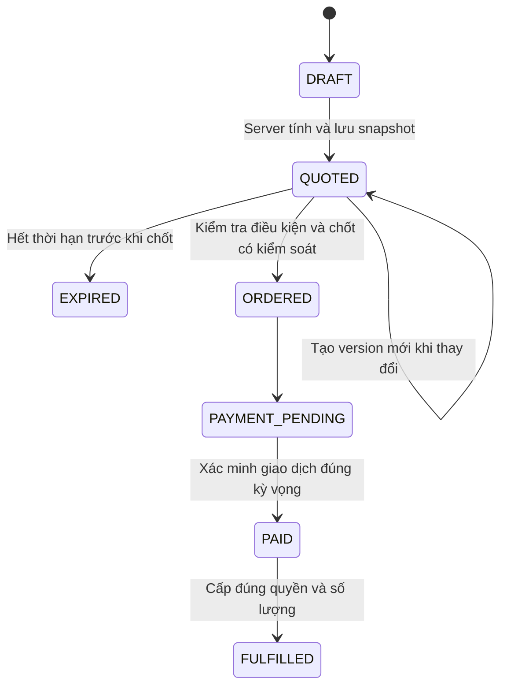

# Price và quantity validation

## 1. Mục tiêu bảo mật của kiểm tra giá và số lượng

Price và quantity validation là tập yêu cầu bảo đảm giá, số lượng, ưu đãi và tổng tiền của một giao dịch phù hợp với chính sách nghiệp vụ được phép tại thời điểm thực hiện. Một request đúng JSON và một con số dương vẫn có thể tạo giao dịch sai: mua suất học ngoài tenant, dùng giá cũ không còn hiệu lực, tách dòng để vượt giới hạn hoặc thanh toán đúng số tiền cho một sản phẩm khác.

Trong chương Business logic security của module yêu cầu bảo mật, mục tiêu là mô tả điều kiện và bằng chứng để hệ thống giữ được tính toàn vẹn giao dịch. Cần nối rủi ro với nguồn dữ liệu, mô hình quyền, trạng thái báo giá/đơn hàng, tính toán và tiêu chí nghiệm thu. Quy tắc phải có hiệu lực ở API, worker và các điểm tích hợp tạo tác dụng phụ, kể cả khi giao diện người dùng chỉ cho nhập một tập lựa chọn nhỏ.

Một nền tảng học tập có thể bán quyền học cá nhân, gói nhiều suất cho tổ chức và chỗ học trong lớp có sức chứa giới hạn. Số lượng của ba loại sản phẩm mang ý nghĩa khác nhau. Một quyền học cá nhân có thể chỉ được mua một lần cho một người; gói tổ chức có thể bán nhiều suất; chỗ trong lớp còn phụ thuộc sức chứa thực tế. Không thể áp dụng duy nhất quy tắc `quantity > 0` cho tất cả.

[OWASP WSTG — Test Business Logic Data Validation](https://owasp.github.io/www-project-web-security-testing-guide/stable/4-Web_Application_Security_Testing/10-Business_Logic_Testing/01-Test_Business_Logic_Data_Validation) nhấn mạnh việc kiểm tra tính hợp lệ theo nghiệp vụ ở backend và tại các điểm chuyển giao. Trong bài này, điều đó được cụ thể hóa thành các bất biến về nguồn giá, hạn mức, tiền tệ và tác dụng phụ.

Mọi sản phẩm, mức giá, giới hạn và mã yêu cầu dưới đây là ví dụ giả định. Chúng minh họa cách viết đặc tả đo được, không phải chính sách giá, quy tắc thuế hoặc ngưỡng mặc định cho mọi hệ thống.

## 2. Xác định nguồn sự thật và ranh giới tin cậy

Client gửi ý định mua: offer nào, số lượng nào, người hoặc tổ chức nhận quyền, mã ưu đãi nếu có. Server xác định offer có tồn tại, có được bán cho chủ thể hiện tại, đơn giá hợp lệ, tiền tệ, điều kiện ưu đãi và số tiền phải trả. Một trường nằm trong hidden input, local storage, ứng dụng mobile hoặc request từ frontend chính thức vẫn do client có thể tác động.

Ví dụ request tạo báo giá của nền tảng:

```json
{
  "items": [
    {
      "offerId": "course-team-seat-01",
      "quantity": 2,
      "beneficiaryGroupId": "team-17"
    }
  ],
  "promotionCode": "LEARN10"
}
```

Danh tính người mua và tenant được xác định từ ngữ cảnh xác thực và kiểm tra quyền. `beneficiaryGroupId` là đối tượng cần kiểm tra quyền sử dụng; biết ID không đủ để mua hoặc cấp quyền vào nhóm đó. Nếu API cho chọn tiền tệ, giá trị lựa chọn phải thuộc tập được phép cho offer và thị trường; nó không cho client quyền tự đổi số tiền bằng cách thay mã tiền tệ.

| Dữ liệu | Nguồn có thẩm quyền trong ví dụ | Kiểm tra cần đặc tả |
|---|---|---|
| Offer, loại quyền, đơn vị bán | Catalog/offer service được quản lý | Trạng thái bán, tenant/thị trường, phiên bản và quyền mua |
| Đơn giá, bậc giá | Price list hoặc hợp đồng hợp lệ ở server | Đúng offer, chủ thể, thời điểm và tiền tệ |
| Số lượng yêu cầu | Client gửi theo schema | Kiểu dữ liệu, giới hạn đơn vị, hạn mức tổng và sức chứa |
| Điều kiện/mức ưu đãi | Promotion policy tại server | Đối tượng, thời hạn, phạm vi, trần và số lần dùng |
| Phí và cấu phần tính tiền khác | Policy đã được duyệt | Thứ tự tính, cơ sở tính, rounding và version |
| Tổng tiền thanh toán | Pricing service hoặc module tính tiền phía server | Tính lại từ nguồn tin cậy và gắn với đơn cụ thể |
| Kết quả thanh toán | Kênh provider đã xác minh theo hợp đồng | Đúng tài khoản merchant, đơn, amount, currency và trạng thái |

Trong API tạo báo giá minh họa, các trường `unitPrice`, `discountAmount`, `total`, `paid` và `overridePrice` không nằm trong allowlist và bị từ chối. Nếu một API khác cần nhận số tiền client đã nhìn thấy để phát hiện giá thay đổi, trường đó chỉ là điều kiện so sánh kỳ vọng; nó không thay nguồn giá server.

Giá ký bởi server hoặc một quote ID khó đoán hỗ trợ bảo vệ tính toàn vẹn nhưng chưa thay phân quyền và kiểm tra trạng thái. Báo giá của tenant khác, báo giá hết hạn, phiên bản đã thay đổi hoặc báo giá đã tiêu thụ vẫn cần được xử lý theo chính sách. Không để một đối tượng từng hợp lệ trở thành quyền mua vô thời hạn.

## 3. Đặc tả cú pháp, kiểu dữ liệu và chuẩn hóa

[OWASP Input Validation Cheat Sheet](https://cheatsheetseries.owasp.org/cheatsheets/Input_Validation_Cheat_Sheet.html) phân biệt kiểm tra cú pháp với kiểm tra ngữ nghĩa. Với giá và số lượng, schema cần chỉ rõ cả hai: số biểu diễn theo cách nào và giá trị đó có hợp lệ cho thao tác hiện tại hay không.

Profile mua suất học trong bài chọn `quantity` là JSON number có biểu diễn số nguyên dương, không có phần thập phân hoặc số mũ; mỗi dòng từ 1 đến 10. Chuỗi `"2"`, `null`, boolean, mảng, `2.0`, `2e0`, số âm và số vượt giới hạn bị từ chối. Đây là lựa chọn hợp đồng của profile, dù một số bộ phân tích có thể coi `2.0` tương đương số nguyên về giá trị. Nếu cần kiểm tra biểu diễn token, adapter phải giữ đủ thông tin và không ép kiểu trước khi kiểm tra.

| Đầu vào | Kết quả theo profile | Lý do |
|---|---|---|
| `2` | Có thể đi tiếp kiểm tra nghiệp vụ | Đúng kiểu và trong miền sơ bộ |
| `0`, `-1`, `11` | Từ chối | Ngoài miền 1..10 của một dòng |
| `1.5`, `2.0`, `2e0` | Từ chối | Không đúng dạng token mà hợp đồng chấp nhận |
| `"2"`, `true`, `null` | Từ chối | Không đúng kiểu; không tự coercion |
| Số có hàng nghìn chữ số | Từ chối trước thao tác tính đắt tiền | Vượt giới hạn kích thước token/request |
| Hai field `quantity` cùng tên | Từ chối ở parser theo cấu hình được kiểm chứng | Không để tầng này lấy giá trị đầu và tầng khác lấy giá trị cuối |

Nếu dùng form/query, cần chính sách riêng cho tham số lặp; không để `quantity=1&quantity=10` được diễn giải khác nhau giữa gateway và backend. Mỗi API chọn một kiểu dữ liệu có tài liệu; không ngầm chấp nhận đồng thời số, chuỗi chứa số, dấu phân cách hàng nghìn và kiểu theo locale.

Định dạng hiển thị như `299.000` trên giao diện không nên được dùng trực tiếp làm giao thức số tiền. Phải quy định chuỗi thập phân chuẩn hoặc số nguyên theo đơn vị thanh toán được chọn, kèm mã tiền tệ. Cấm hoặc giới hạn số mũ, precision, scale và độ dài trước khi tạo đối tượng số có chi phí lớn. Không nhận `NaN`, infinity hoặc giá trị không hữu hạn qua bất kỳ adapter nào.

Giới hạn phải bao phủ request tổng thể: ví dụ tối đa 64 KiB body, 20 dòng trước chuẩn hóa, 100 đơn vị tổng cộng và độ dài mã offer/ưu đãi hữu hạn. Các số này chỉ là profile minh họa. Reject input không hợp lệ phải xảy ra trước khi giữ chỗ, tiêu hao voucher hoặc gọi provider thanh toán.

Chuẩn hóa chỉ thực hiện theo quy tắc đã công bố. Không tự lấy trị tuyệt đối của số âm, cắt phần thập phân, chuyển giá trị lỗi thành 0 hoặc clamp số lượng vượt trần về trần rồi coi là người dùng đã đồng ý. Nếu giao diện đề nghị điều chỉnh, server trả kết quả rõ để người dùng xác nhận lại.

## 4. Số lượng phải gắn với đơn vị bán và phạm vi hạn mức

Mỗi offer cần định nghĩa đơn vị: một quyền học, một suất trong gói, một lớp, một tháng hay một gói có số suất cố định. `quantity = 2` không có ý nghĩa đầy đủ nếu không biết đang nhân hai đơn vị nào. Với gói 5 suất, mua hai gói có thể tạo 10 suất; hạn mức theo suất phải xét số suất sau chuyển đổi, không chỉ số gói.

| Loại offer giả định | Miền số lượng | Kiểm tra bổ sung |
|---|---|---|
| Quyền học cá nhân không chuyển nhượng | Đúng 1 cho mỗi người/khóa theo policy | Quyền đã có, trạng thái đăng ký và người thụ hưởng |
| Suất học cho tổ chức | 1..10 mỗi dòng trong profile bán lẻ | Nhóm nhận quyền, tổng suất theo tổ chức và điều kiện hợp đồng |
| Gói cố định 5 suất | Số gói nguyên trong miền của offer | Quy đổi suất và trần tổng theo cùng phạm vi nghiệp vụ |
| Lớp có sức chứa | Số nguyên trong miền offer | Số chỗ còn lại, hold còn hạn và cạnh tranh đồng thời |
| Offer miễn phí được phép | Theo policy loại quyền | Giá 0 do server xác định; không tự suy từ số lượng 0 |

Giới hạn có thể áp dụng theo dòng, giỏ, đơn, người nhận quyền, account, tenant, chương trình hoặc khoảng thời gian. Cần ghi chính xác phạm vi, nguồn thống kê, thời điểm tính và trạng thái nào tiêu hao hạn mức. “Mỗi người tối đa 10” phải chỉ ra “người” là account đã xác minh nào, có tính các đơn chờ hay chỉ đơn hoàn thành, và việc hủy có hoàn lại hạn mức không.

Không kiểm tra riêng từng dòng rồi bỏ qua tổng. Hai dòng cùng một offer có số lượng 6 và 6 đều dưới trần dòng 10 nhưng có thể vượt trần offer 10 trong giỏ. Cần khóa nhóm nghiệp vụ chuẩn, chẳng hạn offer + kỳ quyền + phạm vi thụ hưởng, rồi cộng số lượng bằng phép tính có kiểm soát. Trường không ảnh hưởng chính sách như nhãn hiển thị hoặc `lineId` do client đặt không được tách nhóm để né hạn mức.

Không phải mọi dòng có cùng offer đều được gộp theo cùng cách. Hai người thụ hưởng khác nhau có thể có điều kiện khác nhau; giá theo bậc có thể tính theo tổ chức hoặc theo người. Đặc tả phải nêu quy tắc gom nhóm cho định giá và quy tắc gom nhóm cho hạn mức. Hai quy tắc có thể dùng khóa khác nhau nhưng phải cùng dựa trên danh tính/quan hệ được server xác minh.

Các endpoint thêm, cập nhật, giảm, xóa và đặt lại giỏ cần giữ cùng bất biến. Nếu thao tác giảm nhận `delta`, số âm của delta không được vô tình tăng số lượng; nếu xóa dòng dùng quantity 0 thì đó là ngữ nghĩa endpoint riêng, không biến 0 thành đầu vào hợp lệ cho tạo đơn mua. Kiểm tra cả giỏ sau thay đổi và trước khi chốt.

## 5. Biểu diễn tiền, giới hạn số và quy tắc làm tròn

Tiền phải đi kèm currency và quy tắc đơn vị. Có thể dùng số nguyên theo đơn vị nhỏ nhất được hệ thống chấp nhận hoặc số thập phân chính xác với scale/quantum đã quy định. Không giả định mọi đồng tiền hoặc mọi nghiệp vụ đều có hai chữ số thập phân. Khi tích hợp provider, cần adapter ánh xạ đơn vị rõ ràng và kiểm tra hai chiều.

Profile ví dụ dùng VND với quantum 1 do chính sách ứng dụng quy định. Giá catalog, trần giảm giá và số tiền cuối cùng trong các ví dụ đều theo quantum đó. Đây là lựa chọn cho tình huống học, không phải mô tả đầy đủ mọi quy tắc tiền tệ hay thanh toán liên quan VND.

Nếu dùng số nguyên, kiểm tra tràn ở nhân `unitPrice × quantity`, cộng các dòng và quy đổi gói. Không để tràn số tạo thành tổng nhỏ hoặc âm. Nếu dùng `BigDecimal`, vẫn cần giới hạn precision, scale, độ dài và giá trị; kiểu chính xác không loại bỏ rủi ro tiêu hao tài nguyên hoặc số tiền phi lý.

Theo [Java BigDecimal API](https://docs.oracle.com/en/java/javase/25/docs/api/java.base/java/math/BigDecimal.html), constructor từ `double` giữ giá trị nhị phân được biểu diễn, có thể khác số thập phân người dùng dự định. Khi đầu vào là dữ liệu thập phân, dùng dạng thập phân chính xác theo hợp đồng. `compareTo` so sánh giá trị số; `equals` còn xét scale. Vì vậy, quy tắc chuẩn hóa và so sánh tiền cần được xác định riêng.

Yêu cầu rounding phải nêu:

- Làm tròn ở đơn giá, discount, dòng, tổng hay từng cấu phần nào.
- Quantum/scale đích và rounding mode của mỗi bước.
- Cách phân bổ ưu đãi cấp đơn về dòng khi cần đối soát hoặc hoàn tiền.
- Cách giữ tổng các phần đã phân bổ bằng tổng ưu đãi/tiền của đơn.
- Cách xử lý phần dư và quy tắc thứ tự ổn định, tránh client chọn thứ tự để hưởng thêm.

Ví dụ ba dòng mỗi dòng 1 đơn vị tiền được giảm 50% có thể cho tổng khác nhau nếu làm tròn từng dòng hay làm tròn tổng. Không có một câu “dùng HALF_UP” nào tự quyết định được nơi làm tròn. Đặc tả cần chọn chính sách và kết quả mẫu; các service phải dùng cùng version của chính sách đó.

Giới hạn số tiền phải nêu cho đơn giá, dòng, tổng giỏ và giao dịch provider. Với offer trả phí của ví dụ Java phía sau, đơn giá tối đa 1.000.000.000 và subtotal của phép tính một dòng tối đa 10.000.000.000. Các giá trị cao hơn bị từ chối hoặc đưa qua luồng khác đã đặc tả; không tự thu nhỏ để vừa kiểu dữ liệu.

## 6. Tính lại giá và ưu đãi theo một quy trình xác định

Một mô hình minh họa cho giỏ cùng tiền tệ:

```text
gross_i = trusted_unit_price_i × validated_quantity_i
subtotal = sum(gross_i)

eligible_base = cơ sở được policy ưu đãi chọn từ các dòng đủ điều kiện
discount = giá trị tính theo policy, có trần và rounding đã quy định
fees_and_other_components = các cấu phần hợp lệ theo policy đã duyệt
payable = subtotal - discount + fees_and_other_components
```

Cần làm rõ công thức cho từng loại offer. Giá bậc thang có thể áp cho toàn bộ số lượng hoặc chỉ phần trong từng bậc; bundle có thể tính theo gói; discount có thể áp trước/sau cấu phần khác. Không để UI, pricing service và payment adapter tự chọn một cách diễn giải riêng.

Ví dụ một offer suất học có đơn giá 299.000, quantity 2. Chương trình `LEARN10` giảm 10% trên subtotal của các suất đủ điều kiện nhưng tối đa 50.000 cho đơn. Trong kịch bản này, các cấu phần phí khác bằng 0 theo dữ liệu test:

```text
subtotal        = 299.000 × 2 = 598.000
raw_discount    = 598.000 × 0,10 = 59.800
capped_discount = min(59.800, 50.000) = 50.000
payable         = 598.000 - 50.000 = 548.000
```

Đơn giá và policy do server lấy. Client thay `total` thành 1 hoặc gửi `discountAmount` lớn hơn không làm thay đổi kết quả hợp lệ; trong schema ví dụ, các field đó bị từ chối. Giảm giá bằng 100% chỉ hợp lệ khi chính sách server cho phép, không vì payable bị tính âm rồi được clamp về 0.

Promotion phải có chủ sở hữu, scope, thời gian hiệu lực, đối tượng đủ điều kiện, loại offer, số lần sử dụng, trần và quy tắc kết hợp. Ví dụ voucher dùng một lần cần có cơ chế giữ/tiêu thụ theo trạng thái; kiểm tra còn lượt tại thời điểm báo giá chưa đủ để bảo đảm còn lượt lúc chốt. Hủy hoặc hết hạn hold có hoàn lại lượt hay không phải là quyết định có tài liệu.

Định nghĩa chính xác `0 <= discount <= eligible_base` cho profile giảm giá thông thường, cùng giới hạn payable theo loại giao dịch. Credit, trợ cấp hoặc hoàn tiền có thể có mô hình riêng; không trộn một dòng âm tùy ý vào giỏ mua để tạo số dư. Nếu policy trả kết quả ngoài miền hợp lệ, dừng tạo giao dịch và ghi lỗi cấu hình, thay vì sửa âm thầm.

Với ưu đãi cấp đơn, hạn mức dùng theo account hoặc tổ chức không được đặt lại mỗi lần client tách dòng. Nếu một chương trình có giới hạn mỗi đơn và cho phép nhiều đơn thì đó là chính sách thật; nếu mục tiêu là giới hạn mỗi người trong ngày, phải đặc tả và kiểm tra ở đúng phạm vi đó. Rate limit hỗ trợ chống lạm dụng nhưng không thay sổ hạn mức nghiệp vụ.

## 7. Báo giá phải gắn với phiên bản, chủ thể và thời điểm

Một quote nên chứa hoặc tham chiếu tới snapshot do server quản lý: chủ thể mua, tenant, offer và quyền thụ hưởng, số lượng chuẩn hóa, currency, các thành phần giá, promotion, policy version, thời điểm tạo, thời hạn, trạng thái và điều kiện giá được giữ. Quote ID không chứa secret thanh toán và chỉ được đọc/sử dụng bởi chủ thể có quyền.

Ví dụ chính sách: quote có thời hạn 10 phút; giá được khóa trong thời hạn đó nếu các điều kiện eligibility và quota còn đạt tại lúc chốt. Thay số lượng, nhóm nhận quyền hoặc mã ưu đãi làm phát sinh quote version mới. Client phải xác nhận số tiền tương ứng trước khi tạo order. Đây là lựa chọn của ví dụ; hệ thống khác có thể tính lại hoàn toàn khi chốt nhưng phải thông báo và xin xác nhận lại khi điều kiện giá thay đổi.

Một quote hợp lệ về thời gian không tự giữ chỗ học hoặc giữ lượt voucher. Nếu cần reservation, phải có đối tượng giữ chỗ riêng với phạm vi và thời hạn, liên kết tới quote/order. Nếu chính sách không giữ chỗ, phản hồi phải nói đúng và bước chốt phải xử lý tình huống hết chỗ.



Sơ đồ chỉ mô tả đường chính. Thất bại, hủy, kết quả chưa xác định và hoàn tiền cần trạng thái/luồng riêng. Giá đã gắn với order không được thay khi callback thanh toán quay về chỉ vì catalog hiện tại vừa cập nhật; đối soát payment dựa trên kỳ vọng đã chốt của order và hợp đồng xử lý điều chỉnh.

Quote có chữ ký cần ký đúng tập trường, version và ngữ cảnh sử dụng; không chỉ ký `total` rồi để client đổi offer hoặc người nhận. Khi dùng snapshot lưu server, vẫn kiểm tra quyền, version và trạng thái tại lúc chuyển đổi. Chữ ký không tự chống replay, double-submit hoặc dùng quote của account khác.

## 8. Chốt số lượng và ưu đãi an toàn khi có cạnh tranh

Hai request cùng vượt qua bước kiểm tra “còn một chỗ” có thể cùng tạo đơn. Hai lần chốt quote cùng thấy voucher chưa dùng có thể cùng áp giảm giá. Kiểm tra trước rồi cập nhật sau bằng các thao tác tách rời không giữ được hạn mức khi request chạy đồng thời.

Yêu cầu cần xác định điểm mà hạn mức được giữ hoặc tiêu thụ và cơ chế đảm bảo tại điểm đó. Với dữ liệu cùng cơ sở dữ liệu, có thể dùng transaction, cập nhật có điều kiện, khóa hoặc ràng buộc phù hợp. Điều cần nghiệm thu là bất biến cuối cùng và trạng thái của các request cạnh tranh, không phải chỉ sự xuất hiện của một từ khóa transaction trong mã.

Ví dụ cho lớp có sức chứa cố định:

```text
confirmed_seats + active_reserved_seats <= class_capacity

Mỗi suất được tính ở đúng một nhóm tại một thời điểm.
Chuyển reservation thành confirmed không tính cùng suất hai lần.
Reservation hết hạn hoặc bị hủy được giải phóng theo quy tắc có kiểm soát.
```

Giới hạn voucher dùng một lần cần có cùng tính chất: số lần đã tiêu thụ cộng số lượt đang được giữ hợp lệ không vượt hạn mức trong phạm vi policy. Không chỉ khóa theo session của browser; nhiều session, thiết bị, worker và instance phải chịu cùng ràng buộc ở nguồn có thẩm quyền.

Nếu quota, inventory và đơn hàng nằm ở các hệ thống khác nhau, một transaction cục bộ không tự làm chúng nguyên tử chung. Cần giao thức reservation/commit/compensation hoặc thiết kế tương đương, với trạng thái trung gian và đối soát. Không phát hành quyền học vượt số suất đã được chấp thuận chỉ vì thanh toán đã thành công trong một bước trước đó.

Idempotency hỗ trợ double-click và retry nhưng không thay giới hạn nghiệp vụ. Cùng khóa và cùng nội dung phải trả cùng kết quả nghiệp vụ theo hợp đồng; cùng khóa nhưng payload khác phải bị phát hiện. Khóa cần scope theo chủ thể/tenant và thao tác, liên kết với quote version hoặc order phù hợp, có dữ liệu lưu bền vững và thời hạn đủ cho cửa sổ retry thực tế.

Hai khóa idempotency khác nhau vẫn có thể tranh cùng chỗ hoặc voucher. Vì vậy cần cả chống trùng theo định danh lẫn kiểm soát cập nhật hạn mức chung. Nếu một quote chỉ được đổi thành một order trong profile này, trạng thái/quan hệ đó cũng phải được bảo đảm khi hai lần submit dùng hai khóa khác nhau.

Trường hợp timeout sau commit cần truy vấn hoặc đối soát order/payment theo định danh ổn định. Không mặc định tạo order mới, thả reservation hay trả voucher chỉ vì client chưa thấy phản hồi. Mọi cơ chế hết hạn phải xử lý được kết quả đến muộn để không giải phóng tài nguyên đang thuộc giao dịch hợp lệ.

## 9. Gắn giá và số lượng đã chốt với thanh toán và cấp quyền

Giá do server tính chỉ bảo vệ được đến bước tạo order. Nếu bước xác minh thanh toán tin `success=true` từ URL quay về hoặc chỉ kiểm tra có một payment thành công bất kỳ, kẻ lạm dụng có thể thanh toán cho order rẻ rồi yêu cầu cấp quyền của order đắt.

[OWASP Third Party Payment Gateway Integration Cheat Sheet](https://cheatsheetseries.owasp.org/cheatsheets/Third_Party_Payment_Gateway_Integration_Cheat_Sheet.html) khuyến nghị tính tổng ở backend, xác minh kết quả thanh toán tại server và khớp amount, currency, order ID. Với nền tảng ví dụ, payment được liên kết thêm với đúng merchant/account/provider và snapshot order đã chốt.

Các điều kiện để ghi nhận thanh toán hợp lệ cần gồm:

- Kênh/kết quả provider được xác minh tính xác thực theo hợp đồng tích hợp; tham số browser redirect chỉ hỗ trợ điều hướng, không tạo bằng chứng đã trả tiền.
- Định danh giao dịch thuộc đúng payment intent/order, đúng account merchant và không bị gán cho một order khác trái hợp đồng.
- Currency và đơn vị tiền được chuyển đổi đúng. Amount phải khớp chính xác kỳ vọng của profile thanh toán một lần; không tự coi trả thiếu một chút là đủ vì sai số số thực.
- Trạng thái provider đạt bước đủ điều kiện nghiệp vụ, chẳng hạn đã thu tiền theo hợp đồng. `created`, `pending` hoặc một authorization chưa đáp ứng điều kiện không tự tương đương đã thanh toán hoàn tất.
- Quy trình cập nhật order, phát sự kiện và cấp quyền chống lặp theo định danh bền vững, kể cả khi callback được gửi lại.

Payload có chữ ký hợp lệ vẫn cần kiểm tra ngữ nghĩa. Provider có thể gửi sự kiện đúng nhưng thuộc một order khác, một currency khác hoặc trạng thái không phải điều kiện cấp quyền. Với partial payment hoặc nhiều lần thu, cần ledger cộng dồn và điều kiện riêng; không đưa vào profile một lần bằng cách so sánh `paidAmount >= expected` mà không xử lý phần dư và nguồn tiền.

Số quyền hoặc suất được cấp phải xuất phát từ các dòng order đã chốt, không từ quantity trong redirect/callback do client cung cấp. Khi fulfillment nhận sự kiện, nó kiểm tra order và trạng thái phù hợp, không chỉ nhân số suất theo một trường tùy ý trong message. Nếu có chuyển đổi gói sang suất, dùng đúng version quy tắc đã lưu cùng order.

Quote hết hạn cho việc tạo giao dịch mới không có nghĩa mọi thông báo thanh toán đến muộn đều vô hiệu. Cần đối soát payment thực và quyết định hoàn tất, hoàn tiền hoặc đưa vào xử lý ngoại lệ theo trạng thái hiện tại. Không cấp quyền hai lần do sự kiện sai thứ tự, và không bỏ qua một khoản tiền thực sự đã nhận chỉ vì webhook tới sau màn hình timeout.

## 10. Tách ngữ nghĩa mua, xóa dòng, miễn phí và hoàn tiền

Giá âm hoặc quantity âm trong giỏ mua thường tạo đường trừ tiền hoặc tăng số dư trái phép. Luồng hoàn tiền cần đối tượng, quyền và ledger riêng. Không dùng một dòng sản phẩm `quantity = -1` để diễn tả hoàn tiền trong API mua rồi kỳ vọng các quy tắc mua bảo vệ được toàn bộ nghiệp vụ.

| Nghiệp vụ | Nguồn số tiền/số lượng | Điều kiện đặc thù |
|---|---|---|
| Tạo đơn mua | Giá và policy server, quantity hợp lệ | Quyền mua, offer đang bán, hạn mức và điều kiện chốt |
| Xóa dòng giỏ | Định danh dòng thuộc giỏ của người dùng | Không tác động trực tiếp ledger thanh toán |
| Miễn phí/tài trợ | Policy miễn phí hoặc hỗ trợ được duyệt | Bằng chứng đủ điều kiện; vẫn kiểm soát quyền và số lượng |
| Hủy trước thanh toán | Order/payment/reservation hiện tại | Xử lý race với thanh toán đến muộn và giải phóng đúng một lần |
| Hoàn tiền sau thanh toán | Khoản đã thu và policy hoàn tương ứng | Không vượt phần còn được hoàn, có quyền và đối soát |
| Điều chỉnh thủ công | API/quy trình quản trị được phân quyền | Lý do, phạm vi, phê duyệt nếu policy yêu cầu và audit |

Với một order trong cùng currency, bất biến hoàn tiền có thể là tổng refund đã hoàn tất cộng các khoản đang được giữ để hoàn không vượt số đã thu được phép hoàn. Hai nhóm phải rời nhau để không tính cùng khoản hai lần. Các request hoàn cạnh tranh cần bảo đảm bất biến này tại nơi quyết định hoặc giữ hạn mức, không chỉ kiểm tra ở màn hình quản trị.

Nếu hoàn một phần số lượng, cần biết đơn vị nào được hoàn, quyền nào bị thu hồi và discount cấp đơn đã phân bổ ra sao. Không hoàn theo đơn giá catalog mới khi giá order cũ khác, trừ khi có chính sách điều chỉnh riêng. Tổng các phần phân bổ phải giữ quan hệ đối soát với số tiền đã chốt; rounding không tạo số tiền hoặc số quyền thêm sau nhiều lần hoàn nhỏ.

Giao dịch payable bằng 0 có thể hợp lệ với khóa học miễn phí hoặc ưu đãi đầy đủ. Chỉ cho phép khi server xác định đúng loại giao dịch và điều kiện tương ứng; không tạo payment giả để gán `PAID`. Có thể dùng trạng thái đã thỏa nghĩa vụ bằng ưu đãi/miễn phí theo mô hình nghiệp vụ, với bằng chứng riêng.

Quyền override giá phải tách khỏi API người mua thông thường. Nhân viên được sửa catalog không mặc nhiên được hoàn tiền hoặc cấp quyền miễn phí. Mỗi quyền quản trị cần có scope tenant/sản phẩm, giới hạn, lịch sử thay đổi và khả năng truy vết. Không bind request công khai trực tiếp vào entity có field `adminPrice`, `discountApproved` hoặc `paid`.

## 11. Ví dụ Java cho một phép tính có miền dữ liệu rõ

Đoạn Java dưới đây minh họa phép tính **một dòng đủ điều kiện LEARN10** của profile trả phí: quantity 1..10, tiền VND theo quantum 1, giảm 10% nhưng tối đa 50.000 và làm tròn discount một lần ở quantum 1 bằng `HALF_UP`. Giá truyền vào phải được lấy từ catalog đã kiểm tra quyền, trạng thái, currency, precision và giới hạn lưu trữ; hàm không tải catalog hoặc kiểm tra eligibility thay hệ thống.

```java
import java.math.BigDecimal;
import java.math.RoundingMode;

public final class ExamplePricing {
    private static final BigDecimal MAX_UNIT_PRICE =
            new BigDecimal("1000000000");
    private static final BigDecimal MAX_LINE_SUBTOTAL =
            new BigDecimal("10000000000");
    private static final BigDecimal RATE = new BigDecimal("0.10");
    private static final BigDecimal DISCOUNT_CAP = new BigDecimal("50000");

    public record Amounts(
            BigDecimal subtotal,
            BigDecimal discount,
            BigDecimal payable) {}

    // Adapter chỉ gọi với token JSON number gốc.
    // Chuỗi JSON, boolean, null và duplicate field bị chặn ở parser/schema.
    public static int parseQuantityToken(String rawNumericToken) {
        if (rawNumericToken == null
                || rawNumericToken.length() > 2
                || !rawNumericToken.matches("[1-9][0-9]?")) {
            throw new IllegalArgumentException("INVALID_QUANTITY_FORMAT");
        }
        int quantity = Integer.parseInt(rawNumericToken);
        if (quantity > 10) {
            throw new IllegalArgumentException("QUANTITY_OUT_OF_RANGE");
        }
        return quantity;
    }

    public static Amounts quoteEligibleLine(
            BigDecimal trustedCatalogPrice, int quantity) {
        if (quantity < 1 || quantity > 10) {
            throw new IllegalArgumentException("QUANTITY_OUT_OF_RANGE");
        }
        if (trustedCatalogPrice == null
                || trustedCatalogPrice.signum() <= 0
                || trustedCatalogPrice.compareTo(MAX_UNIT_PRICE) > 0) {
            throw new IllegalArgumentException("INVALID_CATALOG_PRICE");
        }

        // Catalog đã giới hạn precision/scale trước bước này.
        BigDecimal unitPrice = trustedCatalogPrice.setScale(
                0, RoundingMode.UNNECESSARY);
        BigDecimal subtotal = unitPrice.multiply(
                BigDecimal.valueOf(quantity));
        if (subtotal.compareTo(MAX_LINE_SUBTOTAL) > 0) {
            throw new IllegalArgumentException("LINE_AMOUNT_LIMIT");
        }

        BigDecimal discount = subtotal.multiply(RATE)
                .min(DISCOUNT_CAP)
                .setScale(0, RoundingMode.HALF_UP);
        if (discount.signum() < 0 || discount.compareTo(subtotal) > 0) {
            throw new IllegalStateException("INVALID_DISCOUNT_RESULT");
        }
        BigDecimal payable = subtotal.subtract(discount)
                .setScale(0, RoundingMode.UNNECESSARY);
        if (payable.signum() <= 0) {
            throw new IllegalStateException("INVALID_PAID_OFFER_TOTAL");
        }
        return new Amounts(subtotal, discount, payable);
    }
}
```

Với giá `new BigDecimal("299000")` và quantity 2, kết quả là subtotal 598.000, discount 50.000, payable 548.000. Với số lượng có token `2.0`, adapter của profile phải từ chối trước khi ép về `int`. Nếu chỉ nhận một đối tượng đã bị framework coercion thành `2`, hàm parse token không thể khôi phục biểu diễn đầu vào để kiểm tra.

Một mức giá phân số không theo quantum làm `setScale(..., UNNECESSARY)` thất bại; ở hệ thống thật cần phân loại đó là lỗi dữ liệu/configuration từ catalog, không tự đổi thành giá 0 hoặc một lỗi mật khẩu của người dùng. Boundary của dịch vụ phải chuyển exception thành phản hồi ổn định, không lộ stack trace hoặc toàn bộ dữ liệu nội bộ.

Hàm trên không cộng nhiều dòng và không triển khai discount cấp đơn. Không gọi nó riêng cho mỗi dòng rồi áp trần 50.000 nhiều lần nếu policy thật quy định trần cả đơn. Chương trình tổng thể cần gom đúng scope, tính và phân bổ discount một lần theo policy, kiểm tra tổng tiền, rồi lưu snapshot. Các phần reservation, transaction, idempotency và payment verification vẫn cần thực hiện ở luồng chốt.

## 12. Phản hồi lỗi, audit và xử lý thiếu dữ liệu định giá

Lỗi phải giúp client sửa request mà không tạo đường làm lộ giá hợp đồng hoặc dữ liệu tenant khác. Ví dụ mã công khai có thể là `INVALID_QUANTITY`, `OFFER_NOT_AVAILABLE`, `QUOTE_EXPIRED`, `QUOTE_VERSION_CONFLICT` hoặc `CHECKOUT_TEMPORARILY_UNAVAILABLE`, theo hợp đồng API. Không trả toàn bộ price list nội bộ khi người dùng thử một offer không có quyền xem.

Không âm thầm sửa quantity hoặc tổng tiền rồi tạo payment với giá người dùng chưa xác nhận. Khi cần tính lại vì quote hết hạn hoặc điều kiện thay đổi, trả quote mới và yêu cầu xác nhận theo luồng đã định. Nếu request bị từ chối vì validation, không giữ chỗ, không tiêu hao lượt voucher và không phát hành quyền như một tác dụng phụ còn sót lại.

Khi catalog, promotion hoặc quota service không sẵn sàng, không dùng giá client làm fallback hoặc mặc định giá 0. Có thể sử dụng snapshot/quote còn hợp lệ nếu chính sách đã cho phép và còn đủ điều kiện kiểm chứng; nếu không, dừng chốt tạm thời. Nguồn dữ liệu không xác minh được phải được phân biệt với offer thực sự miễn phí.

Audit nên cho phép nối quote, order, payment, fulfillment và refund bằng định danh có kiểm soát. Ghi phiên bản price list/promotion, kết quả kiểm tra, trạng thái thay đổi, định danh tác nhân và lý do override. Các mốc quan trọng gồm thay cấu hình giá, giữ/tiêu thụ hạn mức, chốt order, xác minh payment, cấp quyền và hoàn tiền.

Không ghi credential provider, cookie, token, dữ liệu thẻ hoặc toàn bộ body callback vào log mặc định. Dữ liệu giá hợp đồng và định danh người mua cũng cần quyền truy cập/retention phù hợp. Chỉ số nên dùng nhãn cardinality hữu hạn; request ID hoặc order ID có thể nằm trong trace/log được quản lý, không biến thành hàng triệu nhãn metric.

Cảnh báo hữu ích gồm amount/currency không khớp kỳ vọng, tổng âm hoặc ngoài miền, nhiều lần cố thay field giá, fulfillment không có căn cứ thanh toán/miễn phí hợp lệ và số quyền cấp vượt số lượng order. Nhãn cảnh báo không tự chứng minh gian lận; cần đối soát cả lỗi cấu hình, lỗi adapter và hành vi người dùng.

## 13. Liên kết rủi ro với yêu cầu kiểm chứng được

Có thể dùng bộ rủi ro sau cho mô hình nền tảng học tập:

| Mã | Rủi ro |
|---|---|
| R-PQ-01 | Client sửa giá, currency hoặc tổng để trả thiếu hoặc đổi sản phẩm |
| R-PQ-02 | Số lượng sai miền, sai đơn vị hoặc tách dòng/đơn để vượt hạn mức |
| R-PQ-03 | Rounding, coercion, precision hoặc overflow làm lệch số tiền |
| R-PQ-04 | Quote cũ, sai chủ thể hoặc sai version được dùng để chốt |
| R-PQ-05 | Request cạnh tranh dùng vượt chỗ, voucher hoặc tạo order trùng |
| R-PQ-06 | Payment/callback không gắn đúng order dẫn tới cấp quyền sai hoặc lặp |
| R-PQ-07 | Refund/override tạo tiền hoặc quyền ngoài phạm vi được duyệt |
| R-PQ-08 | Lỗi nguồn định giá hoặc audit thiếu làm giao dịch sai không được phát hiện |

| ID | Yêu cầu minh họa | Rủi ro | Bằng chứng nghiệm thu |
|---|---|---|---|
| PQ-01 | API tạo quote chỉ nhận field trong schema; giá và tổng do server tính từ nguồn có thẩm quyền | R-PQ-01 | Gửi field giá/total/paid trực tiếp và quan sát không tạo tác dụng phụ |
| PQ-02 | Quantity đúng kiểu token của profile, 1..10 mỗi dòng; duplicate field và coercion bị chặn | R-PQ-02, R-PQ-03 | Bộ biên số và parser/schema test |
| PQ-03 | Giỏ tối đa 20 dòng trước chuẩn hóa và 100 đơn vị; hạn mức offer/tenant xét trên scope nghiệp vụ sau gom nhóm | R-PQ-02 | Test split line, khác lineId và nhiều request |
| PQ-04 | Mọi phép tính dùng biểu diễn chính xác, có trần và rounding/version được ghi rõ | R-PQ-03 | Kết quả tham chiếu và kiểm tra overflow/scale |
| PQ-05 | Promotion được kiểm tra eligibility, thời hạn, phạm vi, trần và số lượt tại điểm tiêu thụ | R-PQ-01, R-PQ-05 | Test mã sai scope và tranh voucher cuối |
| PQ-06 | Quote gắn chủ thể, tenant, dữ liệu chuẩn hóa và version; thời hạn profile là 10 phút | R-PQ-04 | Test quote sai chủ thể, hết hạn và sửa version |
| PQ-07 | Thay số lượng/người nhận/ưu đãi không giữ nguyên quote version để chốt dữ liệu khác | R-PQ-01, R-PQ-04 | Replay quote sau thay giỏ, kiểm tra order snapshot |
| PQ-08 | Chốt giữ bất biến capacity/quota với mọi request cạnh tranh; idempotency không thay khóa hạn mức | R-PQ-05 | Kiểm đếm reservation/confirmed và số order |
| PQ-09 | Payment đạt điều kiện nghiệp vụ, đúng amount/currency/order và merchant trước khi cấp quyền | R-PQ-06 | Callback giả, payment của order khác và trả thiếu |
| PQ-10 | Fulfillment dùng số lượng của order đã chốt và chống lặp bền vững | R-PQ-06 | Callback lặp/sai thứ tự, kiểm đếm quyền được cấp |
| PQ-11 | Free/refund/override có luồng và quyền riêng; không diễn tả refund bằng quantity âm của giỏ mua | R-PQ-07 | Test mua âm, free trái policy và quyền quản trị |
| PQ-12 | Refund hoàn tất và đang giữ hạn mức không vượt số được hoàn; cập nhật cạnh tranh được kiểm soát | R-PQ-07 | Hai refund đồng thời và đối soát ledger |
| PQ-13 | Khi nguồn giá không đạt điều kiện, không dùng client price hoặc mặc định 0 để chốt | R-PQ-08 | Tiêm lỗi catalog/promotion/quota và kiểm tra order |
| PQ-14 | Audit nối được phiên bản giá, order và tác dụng phụ; không chứa credential/dữ liệu thanh toán không cần thiết | R-PQ-08 | Bản ghi mẫu và đối chiếu một giao dịch toàn luồng |

Một đặc tả chi tiết cho kiểm soát số lượng có thể viết như sau. Đây là mẫu tài liệu yêu cầu, không phải cấu hình framework:

```yaml
id: PQ-08
scope: limited-capacity-class-checkout
risk_refs: [R-PQ-02, R-PQ-05]
preconditions:
  - buyer_and_beneficiary_scope_authorized
  - quote_and_policy_version_valid_for_checkout
  - quantity_valid_for_offer_unit_and_aggregate_limits
required_behavior:
  - reserve_or_consume_capacity_at_an_authoritative_controlled_update
  - keep_confirmed_plus_active_reserved_within_class_capacity
  - do_not_count_one_seat_in_both_groups
  - bind_reservation_to_the_correct_quote_or_order_and_tenant
  - prevent_multiple_orders_from_one_single_use_quote
  - reconcile_unknown_results_before_releasing_or_recreating_work
acceptance:
  - with_one_remaining_seat_and_twenty_simultaneous_distinct_attempts
    at_most_one_attempt_gets_a_new_valid_one_seat_reservation
  - rejected_attempts_create_no_payment_or_fulfillment_side_effects
  - retry_with_the_same_idempotency_context_does_not_consume_again
verification:
  - observe_authoritative_capacity_and_reservation_records
  - include_multiple_instances_and_independent_sessions
  - inject_timeout_after_the_reservation_commit
owner: commerce_domain_team
```

Trong tài liệu yêu cầu thật, fixture “20 attempt” cần định nghĩa điểm đồng bộ, số instance, cùng lớp/phạm vi, thời điểm reservation hết hạn và trạng thái ban đầu. Cần chứng minh kết quả ở nguồn có thẩm quyền, không chỉ đếm response thành công ở client.

## 14. Ma trận kiểm thử từ dữ liệu đến tác dụng phụ

Kiểm thử phải đi qua mọi điểm có thể thay đổi giỏ, quote, order, payment hoặc quyền được cấp. Dùng tài khoản và provider sandbox theo phạm vi được phép. Các ca dưới đây là kế hoạch xác minh yêu cầu, không phải tuyên bố đã chạy thành công trong bài học.

| Ca | Dữ liệu hoặc thao tác | Kết quả cần chứng minh |
|---|---|---|
| T01 — Giá client | Thêm unitPrice, total, discountAmount hoặc paid vào tạo quote | Reject theo schema; không tạo order hay quyền |
| T02 — Biên quantity | 0, -1, 1, 10, 11 cho profile dòng 1..10 | Đúng miền và không clamp âm thầm |
| T03 — Kiểu quantity | Chuỗi số, null, boolean, mảng, 2.0, 2e0 | Không coercion hoặc mất dấu vết token trước kiểm tra |
| T04 — Trùng tham số | Duplicate JSON key hoặc tham số query/form lặp | Không khác cách hiểu giữa các tầng |
| T05 — Kích thước | Token quá dài, body quá giới hạn, quá 20 dòng | Chặn trước tính toán/giữ chỗ đắt tiền |
| T06 — Đơn vị bán | Mua gói, suất và quyền cá nhân bằng cùng quantity | Áp đúng quy đổi và policy từng loại |
| T07 — Tách dòng | Hai dòng 6+6 cùng scope hạn mức 10, khác lineId | Không vượt hạn mức nhờ tách dòng |
| T08 — Tổng giỏ | Nhiều offer hợp lệ riêng nhưng vượt 100 đơn vị tổng | Chặn theo giới hạn tổng đã đặc tả |
| T09 — Sai chủ thể | Offer/nhóm nhận quyền/quote của tenant khác | Không đọc giá riêng hoặc chốt/cấp quyền trái phép |
| T10 — Tiền tệ/đơn vị | Đổi mã currency hoặc gửi amount khác đơn vị provider | Không so sánh sai hoặc thanh toán sai kỳ vọng |
| T11 — Precision/overflow | Giá rất lớn, nhiều chữ số, scale không hợp lệ | Không wrap, làm tròn ngầm hoặc cạn tài nguyên |
| T12 — Ví dụ số chuẩn | Giá 299.000, quantity 2, LEARN10 của ví dụ | Subtotal 598.000, discount 50.000, payable 548.000 |
| T13 — Rounding/phân bổ | Số nhỏ sát nửa quantum, nhiều dòng và hoàn một phần | Kết quả đúng policy; tổng phân bổ bảo toàn số tiền |
| T14 — Ưu đãi | Hết hạn, sai người, sai offer, trần, kết hợp không được phép | Không áp ưu đãi chỉ vì mã tồn tại |
| T15 — Quote thay đổi | Sửa quantity/người nhận/promotion sau khi có quote | Version cũ không chốt dữ liệu mới |
| T16 — Quote hết hạn | Chốt trước/sau đúng ranh giới 10 phút theo clock policy | Hành vi đúng thời hạn; re-quote không tự tạo payment |
| T17 — Một chỗ cuối | 20 request từ nhiều instance tranh một chỗ | Không vượt capacity, đúng trạng thái request thua |
| T18 — Voucher cuối | Nhiều request tranh một lượt dùng | Không tiêu thụ vượt scope hạn mức |
| T19 — Double-submit | Cùng quote với cùng và khác idempotency key | Không tạo order trùng hoặc tiêu hao lặp |
| T20 — Timeout sau commit | Mất phản hồi sau tạo order/giữ chỗ | Đối soát cùng định danh; không giải phóng hoặc tạo lại sai |
| T21 — Redirect giả | Browser gửi success=true hoặc quantity lớn hơn | Không ghi PAID/cấp quyền từ dữ liệu redirect |
| T22 — Payment khác | Payment hợp lệ nhưng sai order, merchant, amount hoặc currency | Không cấp quyền; có trạng thái đối soát phù hợp |
| T23 — Webhook lặp/muộn | Callback lặp, sai thứ tự, tới sau quote expiry | Không fulfillment lặp; tiền thực được đối soát đúng |
| T24 — Free trái phép | Client tạo payable 0 hoặc quantity 0 | Không thành đơn miễn phí nếu thiếu policy tương ứng |
| T25 — Refund cạnh tranh | Hai lần hoàn cùng tranh phần còn được hoàn | Không vượt tiền/quyền còn hợp lệ theo ledger |
| T26 — Override | User thường gửi field admin hoặc gọi API điều chỉnh | Không thay giá; quyền quản trị được kiểm tra và audit |
| T27 — Nguồn định giá lỗi | Catalog/promotion/quota timeout hoặc trả dữ liệu ngoài miền | Không fallback sang giá client hoặc 0 |
| T28 — Fulfillment | Message dùng quantity khác snapshot order hoặc được replay | Chỉ cấp đúng quyền/số lượng từ nguồn đã chốt |

Ngoài ca cụ thể, có thể dùng các thuộc tính để sinh dữ liệu kiểm chứng: input bị từ chối không tạo tác dụng phụ; mỗi order có currency thống nhất theo profile; tổng phân bổ bằng tổng đã chốt; fulfillment không vượt quyền/suất hợp lệ của order; refund không vượt phần còn được hoàn. Với phần không có ưu đãi hoặc bậc giá, có thể kiểm tra `subtotal = unitPrice × quantity` trên miền hợp lệ.

Không mặc định tổng payable luôn tăng khi tăng quantity: chương trình mua theo bậc hoặc ưu đãi có ngưỡng có thể tạo quy tắc khác. Chỉ dùng thuộc tính đơn điệu khi policy đã cam kết nó. Tương tự, đổi thứ tự dòng chỉ phải cho cùng kết quả nếu quy tắc phân bổ và gom nhóm xác định giỏ là không phụ thuộc thứ tự.

Bằng chứng toàn luồng nên nối request đầu vào đã làm sạch, quote/order snapshot, phiên bản policy, dữ liệu reservation/voucher, payment kỳ vọng và thực tế, số quyền được cấp và refund ledger. Khi test song song, quan sát kết quả cuối cùng và trạng thái trung gian cần thiết tại nguồn có thẩm quyền. Chỉ kiểm tra status HTTP hoặc nội dung hiển thị trên giao diện sẽ bỏ sót nhiều vi phạm.

## 15. Duy trì chính sách trong vòng đời phát triển

Ở giai đoạn yêu cầu, chủ sở hữu nghiệp vụ xác định đơn vị bán, miền số lượng, điều kiện miễn phí, giảm giá, chốt giá và hoàn tiền. Đội bảo mật chuyển các khả năng lạm dụng thành bất biến và abuse case; đội kỹ thuật xác định nơi thực thi và bằng chứng. Mỗi quy tắc cần chủ sở hữu và phiên bản để giải thích được vì sao một giao dịch được tính theo mức giá đó.

Trong thiết kế và triển khai, liên kết validation ở boundary với pricing, reservation, order, payment và fulfillment. Ràng buộc dữ liệu ở một nơi không miễn kiểm tra quyền và trạng thái ở điểm tạo tác dụng phụ. Dùng một định nghĩa policy hoặc cơ chế chia sẻ/version rõ ràng để tránh mỗi service tính một tổng khác nhau.

Khi thay sản phẩm, thêm currency/provider, đổi rounding, thêm gói nhiều suất, mở ưu đãi hoặc thay scope hạn mức, cập nhật ví dụ tham chiếu và tiêu chí nghiệm thu tương ứng. Chính dữ liệu catalog/promotion do nhân viên cấu hình cũng phải được kiểm tra miền, quyền thay đổi và hiệu lực; dữ liệu nội bộ có thể sai do lỗi vận hành hoặc tài khoản bị lạm dụng.

Các dấu hiệu đặc tả chưa đủ gồm “giá phải dương” không nói nguồn giá; “quantity tối đa 10” không nói đơn vị và scope; “tổng do backend tính” không nói version và rounding; “payment thành công” không khớp amount/currency/order; hoặc “dùng idempotency” không bảo vệ quota chung. Mỗi câu cần bổ sung điều kiện, phạm vi, trạng thái và bằng chứng.

Kiểm tra giá và số lượng đạt mục tiêu khi mọi đường tạo giao dịch đều giữ được cùng quy tắc: đúng chủ thể, đúng sản phẩm và đơn vị, đúng điều kiện giá, đúng số lượng được phép và đúng tác dụng phụ đã đối soát. Những quy tắc đó phải tiếp tục đúng khi có request trực tiếp, dữ liệu cũ, retry, cạnh tranh và sự cố tích hợp.