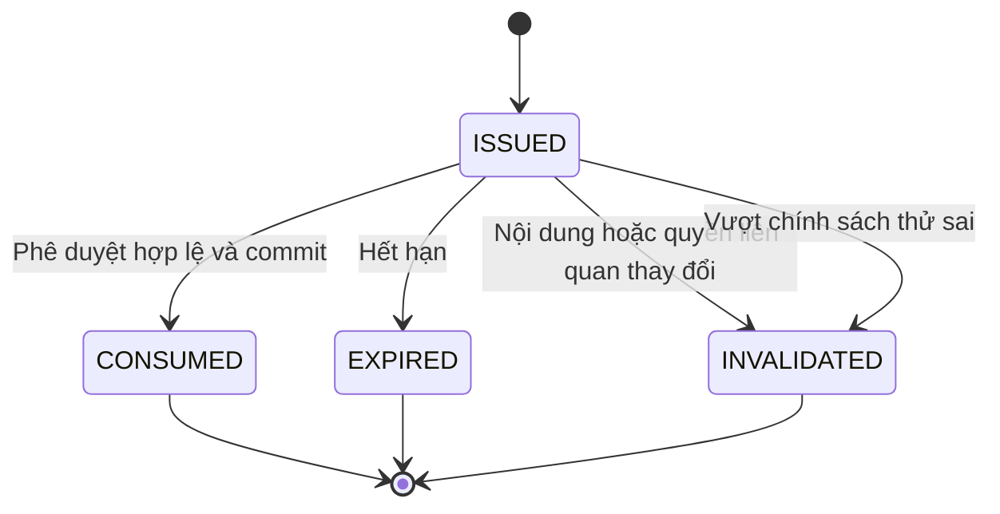
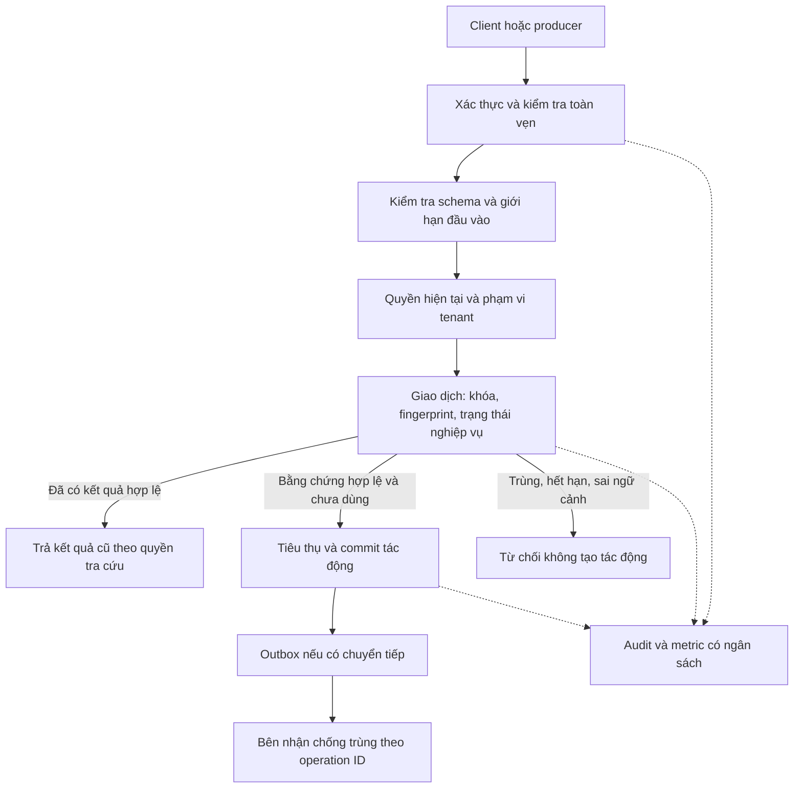

# Replay protection

## 1. Mục tiêu bảo vệ trước hành vi phát lại

**Replay protection** là khả năng nhận biết và xử lý việc một yêu cầu, thông điệp hoặc bằng chứng ủy quyền đã được dùng trước đó bị gửi lại, nhằm ngăn tạo thêm tác động nghiệp vụ ngoài ý định đã được cho phép.

Một yêu cầu có thể đã từng hoàn toàn hợp lệ: đúng người dùng, đúng chữ ký, đúng dữ liệu và đúng quyền tại thời điểm ban đầu. Nếu gửi lại yêu cầu đó vẫn tạo thêm quyền truy cập, gia hạn hiệu lực hoặc thực hiện lại một thao tác nhạy cảm, hệ thống có thể mắc lỗi business logic dù không có lỗi cú pháp hay mã hóa.

Trong chương **Business logic security**, yêu cầu cần bảo vệ không chỉ là “request không được trùng”. Điều cần đặc tả là:

> Một ý định nghiệp vụ đã được ủy quyền không được tạo thêm tác động khi cùng bằng chứng hoặc cùng thao tác được gửi lại ngoài quy tắc cho phép.

Sau bài học, người học có thể:

- Phân biệt replay, retry, idempotency và ràng buộc trạng thái nghiệp vụ.
- Chọn phạm vi chống trùng, thời hạn và ngữ cảnh cần ràng buộc.
- Viết yêu cầu kiểm tra và tiêu thụ bằng chứng theo cách nguyên tử.
- Liên kết yêu cầu với kiến trúc, logging, kiểm thử đồng thời và phục hồi.

**Các ngưỡng thời gian và số lượng trong bài là ví dụ đặc tả, không phải giá trị mặc định cho mọi hệ thống.**

## 2. Tình huống xuyên suốt: phê duyệt cấp quyền

### 2.1. Luồng nghiệp vụ

Một nền tảng đa tenant cho phép người quản lý phê duyệt phiếu cấp quyền đọc một tập dữ liệu. Tenant là ranh giới tổ chức; dữ liệu và quyền của các tenant phải được cô lập.

Phiếu cần chứa người nhận quyền, tài nguyên, vai trò, thời hạn và phiên bản nội dung. Trước khi phê duyệt, người quản lý xem lại nội dung và nhận một challenge dùng một lần, do server cấp cho đúng thao tác đó.

Ví dụ:

```text
Tenant:          tenant-12
Phiếu:           req-81
Vòng phê duyệt:  cycle-3
Phiên bản:       7
Người phê duyệt: manager-9
Người nhận:      user-31
Tài nguyên:      dataset-27
Vai trò:         READER
Thời hạn quyền:  24 giờ
```

Vòng phê duyệt được server quản lý. Client không được tự đổi mã vòng để biến việc gửi lại thành một thao tác mới.

### 2.2. Lỗi có thể xảy ra

Sau lần phê duyệt đầu, một request cũ được gửi lại. Hệ thống có thể:

- Tạo thêm một bản cấp quyền.
- Đặt lại thời điểm hết hạn thành “24 giờ kể từ bây giờ”, vô tình kéo dài quyền.
- Gửi lại lệnh cấp quyền tới dịch vụ khác.
- Chấp nhận lại challenge cho một tài nguyên hoặc phiên bản phiếu khác.
- Tạo thêm tác động dù request dùng idempotency key mới.

Vì vậy, kiểm tra “đã có dòng quyền chưa” chưa chắc đủ. Một tác động lặp có thể là cập nhật thời gian, gửi lệnh hoặc chuyển trạng thái, không nhất thiết là thêm một dòng dữ liệu.

### 2.3. Bất biến cần bảo vệ

Trong ví dụ này:

1. Mỗi vòng phê duyệt của một phiếu chỉ có tối đa một lần chuyển trạng thái phê duyệt có hiệu lực.
2. Bằng chứng ủy quyền chỉ dùng cho đúng tenant, người phê duyệt, phiếu, vòng, phiên bản và nội dung đã xác nhận.
3. Gửi lại không được gia hạn quyền hoặc tạo thêm tác động.
4. Khi nội dung quan trọng thay đổi, bằng chứng cũ không còn cho phép phê duyệt phiên bản mới.
5. Mỗi lần quyết định vẫn phải đáp ứng quyền hiện tại và quy tắc nghiệp vụ.

OWASP nhấn mạnh việc thực thi ủy quyền ở server, kiểm soát chuyển trạng thái và giới hạn bằng chứng cho từng thao tác. Tài liệu cũng lưu ý tính duy nhất và thời hạn chưa đủ nếu bằng chứng vẫn được chấp nhận nhiều lần. [Nguồn: Transaction Authorization Cheat Sheet](https://cheatsheetseries.owasp.org/cheatsheets/Transaction_Authorization_Cheat_Sheet.html).

## 3. Phân biệt replay với những khái niệm gần nhau

| Khái niệm | Bản chất | Yêu cầu liên quan |
| --- | --- | --- |
| Replay có chủ đích | Gửi lại dữ liệu hoặc bằng chứng cũ để tạo tác động ngoài ý định | Phát hiện bằng chứng đã dùng, hết hạn hoặc sai ngữ cảnh |
| Retry hợp lệ | Client gửi lại vì mất phản hồi hoặc lỗi tạm thời | Không tạo tác động trùng; có cách tra cứu kết quả |
| Idempotency | Nhiều lần thực hiện cùng thao tác không làm tăng tác động so với một lần theo hợp đồng | Khóa ổn định, nội dung tương ứng, trạng thái và kết quả bền vững |
| Xác thực | Chứng minh danh tính hoặc nguồn yêu cầu | Danh tính hợp lệ vẫn có thể gửi lại yêu cầu cũ |
| Phân quyền | Kiểm tra chủ thể được thực hiện hành động trên tài nguyên hay không | Quyền phải đúng tại thời điểm quyết định |
| Chống CSRF | Ngăn một số yêu cầu bị ép gửi qua ngữ cảnh trình duyệt | Không tự tạo cơ chế tiêu thụ bằng chứng một lần |
| Kiểm tra trạng thái nghiệp vụ | Chỉ cho phép chuyển trạng thái phù hợp | Ngăn đổi khóa hoặc nonce để thực hiện lại cùng ý định |
| Rate limit | Giới hạn tốc độ | Một lần phát lại vẫn có thể gây tác động nghiêm trọng |

Server thường không thể biết chắc một request trùng là do kẻ tấn công hay client mất mạng. Thiết kế nên dựa trên kết quả có thể cho phép: trả lại trạng thái đã có, từ chối bằng chứng đã dùng hoặc yêu cầu xác nhận mới mà không tạo tác động thêm.

Idempotency không thay thế phân quyền. Một idempotency key cũng không phải mật khẩu cho phép người biết khóa đọc kết quả của người khác.

## 4. Mô hình đe dọa và phạm vi chống phát lại

### 4.1. Những dữ liệu có thể bị gửi lại

Cần kiểm kê các bề mặt:

- API thay đổi dữ liệu hoặc phê duyệt thao tác nhạy cảm.
- Token xác nhận, liên kết dùng một lần và phản hồi challenge.
- Webhook có chữ ký.
- Message được broker giao lại.
- Lệnh giữa các dịch vụ.
- Tác vụ vận hành replay hoặc phục hồi dữ liệu.
- Request được lưu tạm tại client, proxy hoặc hệ thống tích hợp.

Nguồn có thể là người dùng hợp lệ, lỗi retry, thiết bị bị chiếm, log bị lộ hoặc một producer bị lỗi. Bảo vệ kênh truyền vẫn cần thiết, nhưng không loại bỏ việc một bên ở đầu cuối gửi lại yêu cầu.

Nếu đối phương đã chiếm được khóa ký hoặc thông tin đăng nhập có quyền tạo thao tác mới, họ có thể tạo bằng chứng mới. Đây là rủi ro vượt quá việc chỉ nhận biết request cũ; cần thêm bảo vệ khóa, xác thực phù hợp, phân quyền và kiểm soát nghiệp vụ.

### 4.2. Các chiều của phạm vi

Một định danh chống trùng phải có phạm vi rõ ràng. Ví dụ khóa nghiệp vụ:

```text
(tenant_id, request_id, approval_cycle_id, operation_type)
```

Khóa idempotency có thể có phạm vi:

```text
(tenant_id, authenticated_subject_id, operation_type, idempotency_key)
```

Khóa sử dụng challenge cần gắn với challenge do server cấp và ngữ cảnh đã lưu. Không lấy tenant hoặc subject do client tự khai báo làm nguồn tin cậy.

Các yêu cầu phải nói rõ:

- Nhiều replica có dùng chung trạng thái không?
- Hai vùng triển khai có thể cùng tiếp nhận không?
- API cũ, API quản trị và worker có cùng ràng buộc không?
- Thay API key hoặc xoay khóa ký có làm mất phạm vi chống trùng không?
- Khôi phục từ backup có thể làm sống lại bằng chứng đã dùng không?

Một bộ nhớ “nonce đã dùng” nằm trong RAM từng node không đủ để bảo vệ toàn hệ thống khi request chuyển node hoặc tiến trình khởi động lại.

## 5. Các lớp kiểm soát phải phối hợp

### 5.1. Tính xác thực và toàn vẹn

Chữ ký hoặc MAC có thể giúp xác minh nguồn và các thành phần được bảo vệ. Một request có chữ ký hợp lệ vẫn có thể được gửi lại nguyên vẹn.

RFC 9421 mô tả rủi ro signature replay và việc kết hợp phạm vi thành phần được ký, nonce cùng thông tin thời gian. Chữ ký chỉ có ích theo chính sách xác minh đầy đủ của ứng dụng. [Nguồn: RFC 9421, mục 7.2.2](https://www.rfc-editor.org/rfc/rfc9421.html#section-7.2.2).

Đối với API có chữ ký, hồ sơ giao thức phải xác định những nội dung ảnh hưởng đến ý nghĩa:

- Phương thức và đích nhận, gồm đường dẫn hoặc tham số có ý nghĩa.
- Loại thao tác và đối tượng nghiệp vụ.
- Nội dung hoặc digest nội dung thực sự được đối chiếu với dữ liệu nhận.
- Tenant, chủ thể hoặc quan hệ tới danh tính khóa đã được xác minh.
- Nonce, thời điểm tạo, hạn dùng và thông tin phiên bản giao thức.

Không chỉ kiểm chữ ký của một trường digest rồi bỏ qua việc tính và so sánh digest với body. Không tin một header tenant không được bảo vệ chỉ vì trường khác trong request có chữ ký.

Quy tắc xử lý proxy, đường dẫn và biểu diễn nội dung phải thống nhất. Sử dụng giao thức và thư viện đã được xác định thay vì tự ghép một chuỗi ký mơ hồ.

### 5.2. Độ mới theo thời gian

Timestamp hoặc thời hạn giúp giới hạn khoảng request có thể được chấp nhận. Chúng không ngăn gửi lại nhiều lần bên trong khoảng đó.

Đặc tả cần ghi:

- Nguồn thời gian có thẩm quyền.
- Tuổi tối đa và độ lệch đồng hồ cho phép.
- Quy tắc với timestamp tương lai.
- Biên bao gồm hay không bao gồm thời điểm hết hạn.
- Hành vi khi không tin cậy được đồng hồ.

Trong luồng challenge của ví dụ, server cấp thời điểm phát hành và hết hạn; client không được tự kéo dài. Challenge hợp lệ khi thời gian server tại điểm quyết định còn nhỏ hơn thời điểm hết hạn. Đúng thời điểm hết hạn cũng bị từ chối.

### 5.3. Tính duy nhất và tiêu thụ một lần

**Nonce** là giá trị dùng để phân biệt một lần trao đổi hoặc bằng chứng. Nonce không tạo bảo vệ chỉ bằng việc xuất hiện trong request. Server phải kiểm tra nó thuộc ngữ cảnh nào, còn hợp lệ không và đã được dùng chưa.

Với challenge bí mật do server cấp, ví dụ chính sách yêu cầu ít nhất 128 bit ngẫu nhiên từ bộ sinh phù hợp cho mục đích mật mã. Không dùng timestamp hoặc số thứ tự dễ đoán như một secret. Tính ngẫu nhiên và cơ chế tiêu thụ là hai yêu cầu khác nhau.

Nếu chỉ thực hiện:

```text
if nonce chưa tồn tại:
    thực thi
    lưu nonce
```

hai request đồng thời có thể cùng vượt kiểm tra. Cần ràng buộc duy nhất, cập nhật có điều kiện hoặc cơ chế phối hợp tương đương để chỉ một bên được giành quyền có hiệu lực.

### 5.4. Ngữ cảnh và trạng thái nghiệp vụ

Challenge phải ràng buộc nội dung người dùng đã xác nhận. Với phiếu cấp quyền, gồm người nhận, tài nguyên, vai trò, thời hạn, phiên bản và vòng phê duyệt.

Nếu người nhận đổi từ user-31 sang user-72 hoặc vai trò đổi từ READER sang ADMIN, challenge cũ không được tiếp tục hợp lệ.

Sau khi phiếu đã được phê duyệt, một nonce mới hoặc idempotency key mới cũng không được làm phiếu phê duyệt thêm lần nữa. Đây là lớp ràng buộc nghiệp vụ, độc lập với phát hiện request trùng.

### 5.5. Idempotency để hỗ trợ retry an toàn

Client cần một khóa ổn định cho cùng ý định trong khoảng được phép retry. Server lưu fingerprint của nội dung nghiệp vụ và kết quả tương ứng.

Fingerprint nên chứa các dữ liệu làm thay đổi tác động: phiếu, vòng, phiên bản, người nhận, tài nguyên, vai trò và thời hạn. Metadata có thể thay đổi khi retry, như chữ ký mới hoặc timestamp vận chuyển mới, không nên làm biến đổi fingerprint của cùng ý định.

Quy tắc chuẩn hóa fingerprint cần có phiên bản và không mơ hồ về kiểu dữ liệu. Từ chối JSON có khóa trùng hoặc biểu diễn không được hợp đồng chấp nhận, thay vì để hai parser hiểu khác nhau.

Cùng khóa và cùng fingerprint có thể trả trạng thái cũ nếu người gọi hiện tại được phép xem. Cùng khóa nhưng nội dung khác phải bị từ chối, không cập nhật âm thầm nội dung đã gắn với khóa.

## 6. Đặc tả vòng đời challenge và thao tác

### 6.1. Cấp challenge

Trước khi cấp challenge, server phải xác thực và kiểm tra quyền yêu cầu phê duyệt. Dữ liệu cần xác nhận được lấy từ trạng thái server, không chỉ từ bản sao do client gửi.

Challenge cần gắn với:

```text
tenant + approver + request + cycle + expected_version
+ beneficiary + resource + role + duration
+ purpose + issued_at + expires_at
```

Có thể lưu ngữ cảnh ở server hoặc bảo vệ bằng một cấu trúc đã xác định. Nếu cấu trúc tự chứa chỉ có chữ ký và hạn dùng, vẫn cần cơ chế tiêu thụ một lần khi yêu cầu nghiệp vụ đòi hỏi.

Việc cấp challenge không tự cấp quyền truy cập dữ liệu cho người nhận. Tác động chỉ xảy ra sau bước phê duyệt hợp lệ.

### 6.2. Các trạng thái tối thiểu



Mô hình này giả định tiêu thụ và tác động trong cùng transaction. Nếu kiến trúc cần trạng thái đang xử lý, phải bổ sung trạng thái bền vững và quy tắc phục hồi. Không xóa cờ đang xử lý rồi cho chạy lại khi chưa biết tác động đã xảy ra hay chưa.

### 6.3. Khi request thất bại

Đặc tả phải phân biệt:

- Thất bại trước tác động, transaction đã rollback hoàn toàn.
- Tác động đã commit nhưng phản hồi bị mất.
- Kết quả chưa rõ vì lỗi giữa các hệ thống.
- Dữ liệu hoặc quyền không còn hợp lệ.
- Bằng chứng sai do thử đoán hoặc sửa nội dung.

Không coi mọi HTTP lỗi là “chưa thực hiện”. Client cần dùng khóa cũ hoặc endpoint tra cứu để phân biệt kết quả.

Trong ví dụ, rollback toàn bộ tác động cho phép retry với cùng ý định nếu challenge vẫn hợp lệ và chưa bị vô hiệu hóa. Tác động đã commit phải được nhận diện qua bản ghi kết quả, không được chạy lại.

Lượt thử sai bằng chứng cần được tính và giới hạn theo chính sách riêng. Không để request chưa xác thực tùy ý tiêu thụ challenge của người khác bằng cách chỉ biết định danh công khai.

## 7. Nguyên tử, đồng thời và tác động ngoài hệ thống

### 7.1. Đường xử lý trong một cơ sở dữ liệu

Một thiết kế có thể dùng transaction để gắn các thay đổi:

- Bản ghi idempotency.
- Trạng thái challenge đã tiêu thụ.
- Phiếu chuyển từ PENDING sang APPROVED.
- Quyền được cấp với thời điểm bắt đầu và kết thúc cố định.
- Kết quả nghiệp vụ và ý định phát thông báo nếu có.

Logic khái niệm:

```text
authenticate_current_caller()
validate_request_schema_and_transport_proof()
authorize_operation_or_result_lookup()

begin_transaction()
    lock_relevant_rows_in_defined_order()

    if matching_idempotency_result_exists():
        verify_same_fingerprint()
        return_existing_result_without_new_effect()

    verify_current_authorization_and_business_rules()
    verify_request_is_pending_for_expected_cycle_and_version()
    verify_challenge_binding_unused_and_unexpired()

    create_idempotency_record_with_unique_scope()
    consume_challenge_conditionally()
    transition_request_conditionally()
    create_grant_with_unique_business_operation()
    persist_result_and_outbox_if_required()
commit_transaction()

return_result()
```

Đây là mô tả bất biến, không phải mã có thể chạy trực tiếp. Thiết kế phải xử lý tranh chấp, timeout và rollback thật sự theo công nghệ được chọn.

Kiểm tra quyền hoặc phiên bản ở ngoài transaction có thể bị thay đổi trước lúc ghi. Cần ràng buộc việc quyết định với trạng thái được bảo vệ tại thời điểm thực thi, thay vì chỉ kiểm tra một lần ở đầu request.

### 7.2. Ràng buộc độc lập với idempotency key

Ngoài khóa idempotency, cần ràng buộc duy nhất theo ý định nghiệp vụ, chẳng hạn:

```text
UNIQUE (tenant_id, request_id, approval_cycle_id, operation_type)
```

Ràng buộc này ngăn tạo nhiều tác động cho một vòng phê duyệt khi người gửi thay idempotency key. Cập nhật trạng thái có điều kiện còn phải ngăn dùng phiên bản cũ hoặc chuyển trạng thái không được phép.

Một quyền có thể chỉ có một dòng nhưng vẫn bị gia hạn nhiều lần. Vì vậy, các trường như thời điểm hết hạn phải lấy từ kết quả commit đầu tiên; retry không được tính lại từ thời gian hiện tại.

### 7.3. Khi gọi một dịch vụ khác

Nếu sau phê duyệt phải gọi hệ thống cấp quyền bên ngoài, không thể suy ra “chỉ một lần” từ transaction cục bộ.

Có thể lưu ý định gọi trong outbox cùng transaction, sau đó chuyển tiếp bằng operation ID ổn định. Bên nhận phải chống trùng tác động theo operation ID, hoặc có giao thức đối soát xử lý trạng thái chưa rõ.

Nếu nhà cung cấp không hỗ trợ idempotency và không thể tra cứu kết quả chắc chắn, yêu cầu phải nêu giới hạn và cách xử lý thủ công hoặc bù trừ. Không tự gửi lại vô hạn sau một timeout có thể đã tạo tác động.

### 7.4. Nhiều replica, nhiều vùng và sự cố kho trạng thái

Trạng thái chống phát lại phải bảo vệ mọi điểm có thể tạo tác động. Nếu hai vùng đều chấp nhận một challenge mà chưa chia sẻ trạng thái tiêu thụ, hai tác động có thể xảy ra.

Với thao tác nhạy cảm, lựa chọn có thể là kho nhất quán phù hợp, một vùng có thẩm quyền xử lý hoặc cơ chế phối hợp tương đương. Khi không xác minh được trạng thái, không thực thi mới theo giả định rằng challenge chưa dùng.

Nếu phục hồi từ backup làm mất bản ghi tiêu thụ nhưng giữ lại tác động bên ngoài, challenge cũ có thể có vẻ chưa dùng. Quy trình phục hồi cần đối soát trạng thái nghiệp vụ và nguồn tác động, không chỉ nạp lại cache nonce.

## 8. Thời hạn lưu và tác động của việc dọn dữ liệu

Có ba khoảng khác nhau:

| Khoảng | Mục đích |
| --- | --- |
| Thời hạn bằng chứng | Giới hạn thời gian được dùng để ủy quyền lần đầu |
| Cửa sổ idempotency | Khoảng hỗ trợ gửi lại và trả kết quả cũ theo hợp đồng |
| Thời hạn dấu vết nghiệp vụ | Giữ ràng buộc thao tác đã hoàn tất, audit và chống tái thực hiện |

Ví dụ challenge có hạn hai phút; khóa idempotency hỗ trợ retry 24 giờ. Điều đó không có nghĩa sau 24 giờ có thể phê duyệt lại vòng cũ.

Khi dọn bản ghi idempotency, trạng thái phiếu và ràng buộc tác động vẫn phải ngăn thực hiện lại. Challenge hết hạn phải bị từ chối dù bản ghi chi tiết đã được dọn; không xem “không tìm thấy” là “chưa dùng và hợp lệ”.

Với nonce trong request có chữ ký, thời hạn giữ phải bao phủ toàn bộ khoảng mà request đó còn có thể được chấp nhận, cộng sai lệch và cơ chế đồng bộ đã công bố. Xóa nonce sớm hơn trong khi chữ ký vẫn hợp lệ sẽ mở lại cơ hội replay.

Không tái sử dụng ID của phiếu hoặc vòng phê duyệt đã kết thúc. Nếu chính sách dữ liệu yêu cầu xóa nội dung nhạy cảm, có thể cần dấu vết tối thiểu hoặc thiết kế định danh không thể hồi sinh thao tác; phải phân tích riêng để không giữ dữ liệu vượt nhu cầu.

## 9. Các trường hợp mở rộng thường gặp

### 9.1. Webhook và giao lại thông điệp

Đối với webhook, cần phân biệt:

- Định danh sự kiện nghiệp vụ.
- Định danh một lần giao.
- Chữ ký, nonce và timestamp của lần giao.

Một sự kiện có thể được giao lại bằng chữ ký mới hoặc timestamp mới. Chống trùng chỉ theo chữ ký sẽ không ngăn xử lý lại cùng sự kiện.

Định danh sự kiện phải được nguồn đã xác thực bảo vệ và có phạm vi issuer, subscription hoặc tenant phù hợp. Không để một bên chưa được xác thực gửi trước event ID giả rồi chiếm bản ghi chống trùng của sự kiện hợp lệ.

Consumer cần lưu việc nhận và tác động theo giao thức bền vững. Khi broker giao lại sau khi commit nhưng trước acknowledgement, phải trả về trạng thái đã xử lý mà không tạo thêm tác động.

### 9.2. Token dùng một lần và token truy cập

Một token có thời hạn hoặc trường định danh duy nhất chưa tự trở thành token dùng một lần. Muốn dùng một lần phải có trạng thái hoặc giao thức xác nhận đã tiêu thụ phù hợp.

Token truy cập thông thường có thể được thiết kế cho nhiều request. Không áp dụng quy tắc tiêu thụ một lần cho mọi token rồi xem đó là cùng một yêu cầu. Cần xác định loại token, mục đích và tác động cần giới hạn.

Chống replay bằng chứng cũ cũng không bảo đảm người dùng hợp lệ thắng trong một cuộc đua với bên đã lấy được bằng chứng. Giới hạn một lần chỉ bảo đảm số lần có hiệu lực theo thiết kế; cần bảo vệ secret và ràng buộc ngữ cảnh để giảm nguy cơ dùng trái phép trước.

### 9.3. Counter hoặc sequence number

Số thứ tự có thể hỗ trợ phát hiện thông điệp cũ nhưng phải có quy tắc đồng thời, mất gói, sai thứ tự và khôi phục trạng thái.

Chỉ chấp nhận số lớn hơn giá trị cuối có thể loại nhầm thông điệp đến trễ hợp lệ. Nếu dùng cửa sổ chống phát lại, cần định nghĩa kích thước cửa sổ, cách đánh dấu số đã nhận và điều kiện hết cửa sổ. Không áp dụng tùy tiện cơ chế của một giao thức sang quy trình nghiệp vụ có ngữ nghĩa khác.

### 9.4. TLS early data

TLS bảo vệ đường truyền, nhưng HTTP được gửi trong early data có rủi ro replay riêng. RFC 8470 mô tả vấn đề và cơ chế xử lý early data trong HTTP. [Nguồn: RFC 8470 — Using Early Data in HTTP](https://www.rfc-editor.org/rfc/rfc8470.html).

Với endpoint phê duyệt trong ví dụ, chính sách là không thực thi thao tác thay đổi quyền từ early data. Cần bảo đảm thông tin về early data được xử lý đúng qua các proxy đáng tin cậy; client không được tự khai báo header để quyết định đường bảo mật.

Kiểm soát ở tầng truyền không thay thế các bất biến chống lặp tác động trong ứng dụng.

## 10. Bộ yêu cầu mẫu có thể nghiệm thu

### RP-001 — Phạm vi và tác động

Mọi đường phê duyệt, gồm API công khai, API nội bộ, worker và công cụ quản trị, phải bảo đảm một vòng phê duyệt chỉ tạo tối đa một tác động cấp quyền có hiệu lực.

Tác động gồm tạo quyền, đặt thời điểm hết hạn và phát lệnh cấp quyền sang hệ thống khác. Gửi lại không được gia hạn hoặc nhân đôi bất kỳ phần nào đã nằm trong thao tác được phê duyệt.

### RP-002 — Challenge và ràng buộc nội dung

Challenge được cấp sau xác thực và kiểm tra quyền; có ít nhất 128 bit ngẫu nhiên theo chính sách ví dụ; thời hạn tối đa 120 giây từ lúc server cấp.

Challenge ràng buộc tenant, người phê duyệt, phiếu, vòng, phiên bản, người nhận, tài nguyên, vai trò, thời hạn và mục đích. Client không được sửa thời hạn hoặc đổi một trường có ý nghĩa mà vẫn dùng bằng chứng cũ.

Khi nội dung quan trọng thay đổi, challenge cũ bị vô hiệu hóa. Challenge không tồn tại, đã tiêu thụ, hết hạn hoặc sai ngữ cảnh không được tạo tác động mới.

### RP-003 — Điểm kiểm tra thời gian và quyền

Quyền hiện tại, trạng thái phiếu và hạn challenge được kiểm tra tại điểm quyết định nguyên tử gắn với chuyển trạng thái, không chỉ tại lúc HTTP request bắt đầu.

Challenge phải còn hạn ở điểm quyết định đó; thời điểm bằng đúng hạn bị từ chối. Không kéo dài thời hạn vì request đã xếp hàng hoặc đã vượt qua một bước kiểm tra trước.

Nếu chưa thể xác minh quyền, thời gian hoặc trạng thái tiêu thụ đáng tin cậy, không phê duyệt mới. Cần có phản hồi ổn định và metric lý do từ chối, thay vì tạm bỏ kiểm tra để duy trì thông lượng.

### RP-004 — Retry và idempotency

Endpoint hỗ trợ idempotency key tối đa 128 ký tự ASCII theo định dạng đã công bố và cửa sổ tra cứu kết quả 24 giờ.

Cùng khóa trong cùng phạm vi và cùng fingerprint phải trả trạng thái tương ứng với thao tác cũ, không tạo tác động mới. Cùng khóa nhưng fingerprint khác phải trả lỗi xung đột theo hợp đồng.

Nhánh trả kết quả cũ là nhánh tra cứu, vẫn yêu cầu xác thực hợp lệ và quyền hiện tại để xem kết quả. Challenge đã tiêu thụ hoặc hết hạn không được dùng để ủy quyền thêm; việc trả kết quả cũ không gia hạn challenge hay quyền đã cấp.

Nếu request đang xử lý chưa có kết quả cuối, trả trạng thái đang xử lý hoặc cho phép tra cứu theo hợp đồng; không tạo một lần thực thi song song khác.

### RP-005 — Nguyên tử và đồng thời

Kiểm tra chưa dùng, tiêu thụ challenge, chuyển trạng thái phiếu, tạo tác động cục bộ và lưu kết quả phải nằm trong cùng transaction hoặc giao thức có bất biến tương đương đã được chứng minh.

Với 100 request đồng thời qua ít nhất ba replica cho cùng một vòng phê duyệt, chỉ một lần chuyển trạng thái và một tác động được commit. Điều này phải giữ cả khi request dùng cùng khóa lẫn nhiều idempotency key khác nhau.

Với lỗi sau commit trước phản hồi, gửi lại phải nhận diện kết quả trước đó. Với rollback hoàn toàn trước tác động, chính sách retry phải không tạo trạng thái tiêu thụ mồ côi không thể phục hồi.

### RP-006 — Ranh giới hệ thống và lưu giữ

Bản ghi chống trùng có hiệu lực trên mọi replica và đường thực thi. Nếu hai vùng không thể phối hợp để giữ bất biến, chỉ vùng có thẩm quyền được tạo tác động hoặc thao tác phải bị từ chối theo chính sách sự cố.

Không dọn trạng thái bảo vệ khi bằng chứng còn có thể được chấp nhận. Sau khi hết cửa sổ idempotency, ràng buộc nghiệp vụ vẫn ngăn thực hiện lại vòng cũ.

Sau restart, failover và restore, không được coi bằng chứng đã dùng là bằng chứng mới. Bài kiểm thử phải gồm đối soát tác động cục bộ và bên ngoài nếu có.

### RP-007 — Lỗi, giới hạn và quan sát

API dùng mã lỗi ứng dụng ổn định cho bằng chứng hết hạn, sai ngữ cảnh, xung đột idempotency, trạng thái nghiệp vụ không phù hợp và kho kiểm tra không khả dụng. Ánh xạ HTTP phải được công bố; không tiết lộ trạng thái của tenant khác hoặc sự tồn tại của challenge ngoài phạm vi quyền.

Ví dụ chính sách giới hạn tối đa năm lần thử bằng chứng sai cho một challenge của chủ thể đã xác thực trước khi vô hiệu hóa; việc cấp challenge mới cũng phải có hạn mức. Không cho request vô danh tùy ý đốt hạn mức của challenge người khác.

Ghi sự kiện về từ chối replay, xung đột fingerprint, tranh chấp đồng thời và lỗi kho trạng thái. Không ghi raw token, secret, toàn bộ challenge hoặc chữ ký có thể bị lợi dụng lại. Sự kiện chẩn đoán có thể tổng hợp theo ngân sách, trong khi audit bắt buộc phải được lưu theo chính sách riêng.

## 11. Kiến trúc kiểm soát và bằng chứng kiểm thử

### 11.1. Các điểm kiểm soát



Thứ tự tối ưu hóa có thể thay đổi, nhưng không được làm mất bất biến. Ví dụ, có thể kiểm tra hình dạng đầu vào sớm để giảm chi phí; không được trả một kết quả nhạy cảm từ cache idempotency trước xác thực và phân quyền.

### 11.2. Ma trận nghiệm thu

| Mã | Yêu cầu | Kịch bản | Kết quả cần chứng minh |
| --- | --- | --- | --- |
| T-01 | RP-001, RP-004 | Gửi lại request đã thành công với cùng khóa | Không thêm tác động, không thay thời hạn quyền |
| T-02 | RP-001, RP-005 | Cùng ý định nhưng nhiều nonce hoặc khóa mới | Bất biến vòng phê duyệt vẫn giữ |
| T-03 | RP-002 | Đổi tenant, người nhận, tài nguyên, vai trò, thời hạn hoặc phiên bản | Bằng chứng cũ không áp dụng cho nội dung mới |
| T-04 | RP-003 | Ngay trước, đúng và sau hạn; request chờ đến khi hết hạn | Quyết định tại đúng điểm kiểm tra cuối, không theo thời điểm nhận ban đầu |
| T-05 | RP-004 | Cùng khóa nhưng fingerprint khác | Từ chối xung đột, không ghi đè thao tác cũ |
| T-06 | RP-005 | 100 request đồng thời qua nhiều replica | Một tác động commit; các request còn lại không chạy tác động mới |
| T-07 | RP-005 | Tiến trình chết trước commit, sau commit trước phản hồi | Rollback hoặc tra cứu kết quả đúng; không mất dấu tiêu thụ |
| T-08 | RP-003, RP-004 | Thu hồi quyền sau khi cấp challenge; đọc kết quả bằng danh tính khác | Không phê duyệt hoặc lộ kết quả vượt quyền |
| T-09 | RP-006 | Kho trạng thái lỗi, phân vùng mạng, failover | Không mở đường chấp nhận không kiểm soát |
| T-10 | RP-006 | Dọn idempotency, restart và restore bản sao cũ | Không hồi sinh vòng hoặc challenge đã dùng |
| T-11 | Phạm vi webhook | Giao lại cùng event ID bằng chữ ký hoặc lần giao mới | Không tạo thêm tác động nghiệp vụ |
| T-12 | Toàn vẹn thông điệp | Chữ ký đúng nhưng body không khớp digest, sai đích nhận hoặc phương thức | Từ chối trước tác động |
| T-13 | Early data | Request phê duyệt đi qua đường early data và proxy | Không thực thi thay đổi quyền từ đường bị cấm |
| T-14 | RP-007 | Flood khóa mới hoặc thử challenge sai | Hạn mức có hiệu lực; log không làm cạn tài nguyên hoặc lộ bằng chứng |

Đếm số HTTP thành công không đủ để chứng minh chống replay. Cần kiểm tra số lần chuyển trạng thái, số quyền tạo ra, thời hạn cuối, số lệnh outbox và tác động tại bên nhận.

Hồ sơ kiểm thử cần giữ phiên bản chính sách, topology, danh tính thử, dữ liệu đầu vào đã ẩn phần nhạy cảm, thời điểm, lỗi được tiêm và trạng thái trước sau. Đối chiếu log với dữ liệu commit để phát hiện request bị báo lỗi nhưng đã tạo tác động.

## 12. Sai lầm thường gặp và duy trì yêu cầu

| Sai lầm | Vì sao thiếu | Điều cần bổ sung |
| --- | --- | --- |
| “Có HTTPS nên không replay được” | Đầu cuối, producer hoặc đường retry vẫn có thể gửi lại | Ràng buộc tác động trong ứng dụng |
| “Chữ ký đúng là cho chạy” | Chữ ký cũ có thể vẫn đúng | Hạn dùng, ngữ cảnh, tiêu thụ một lần và trạng thái |
| “Timestamp trong năm phút là đủ” | Có thể replay nhiều lần trong cửa sổ | Nonce hoặc cơ chế chống trùng phù hợp |
| “Nonce ngẫu nhiên nên không cần lưu” | Tính ngẫu nhiên không chứng minh chưa dùng | Trạng thái tiêu thụ và kiểm tra nguyên tử |
| “Idempotency key mới là thao tác mới” | Người gửi có thể đổi khóa để vượt ràng buộc | Khóa nghiệp vụ và chuyển trạng thái hợp lệ |
| “GET kiểm tra rồi POST thực hiện” | Trạng thái có thể đổi giữa hai bước | Kiểm tra lại gắn với thời điểm tạo tác động |
| “Cache hết TTL thì coi là mới” | Có thể hồi sinh bằng chứng hoặc ý định cũ | Hạn dùng và dấu vết nghiệp vụ độc lập |
| “Webhook đổi chữ ký thì không trùng” | Cùng sự kiện có thể được ký lại | Định danh sự kiện ổn định và nguồn đáng tin |
| “HTTP lỗi nghĩa là chưa thực hiện” | Commit có thể xảy ra trước lúc mất phản hồi | Tra cứu kết quả và xử lý trạng thái chưa rõ |
| “Bật lại bỏ kiểm tra khi kho lỗi” | Sự cố hạ tầng trở thành đường vượt bảo mật | Chính sách từ chối hoặc điều phối an toàn đã định nghĩa |

Ở bước phân tích, liệt kê thao tác nhạy cảm và bất biến phải giữ khi request hoặc event xuất hiện nhiều lần. Xác định cả tác động phụ như gia hạn, thông báo và lệnh sang hệ thống khác.

Ở bước thiết kế, chốt phạm vi khóa, nội dung được ràng buộc, thời hạn, giao thức nguyên tử, quyền tra cứu và hành vi khi mất kho trạng thái. Không để API cũ hoặc công cụ vận hành trở thành đường bỏ qua cùng bất biến.

Ở bước triển khai, quản lý cấu hình và phiên bản chuẩn hóa, kiểm tra quyền ở server, ràng buộc duy nhất tại nơi commit và dữ liệu phục hồi có thể đối soát. Thay đổi khóa ký không được xóa lịch sử thao tác đã có hiệu lực.

Ở bước kiểm thử và vận hành, theo dõi replay bị từ chối, xung đột và trạng thái đang xử lý lâu. Dùng kiểm thử đồng thời, lỗi giữa các bước và phục hồi để chứng minh kết quả; không chỉ thử gửi cùng request hai lần tuần tự.

Một yêu cầu replay protection đầy đủ cần nối được **rủi ro → ý định nghiệp vụ → bằng chứng và ngữ cảnh → thời hạn → tiêu thụ nguyên tử → tác động chỉ theo chính sách → bằng chứng kiểm thử và phục hồi**. Liên kết này giúp hệ thống hỗ trợ retry hợp lệ mà vẫn ngăn bằng chứng cũ tạo thêm quyền hoặc tác động ngoài ý định.
