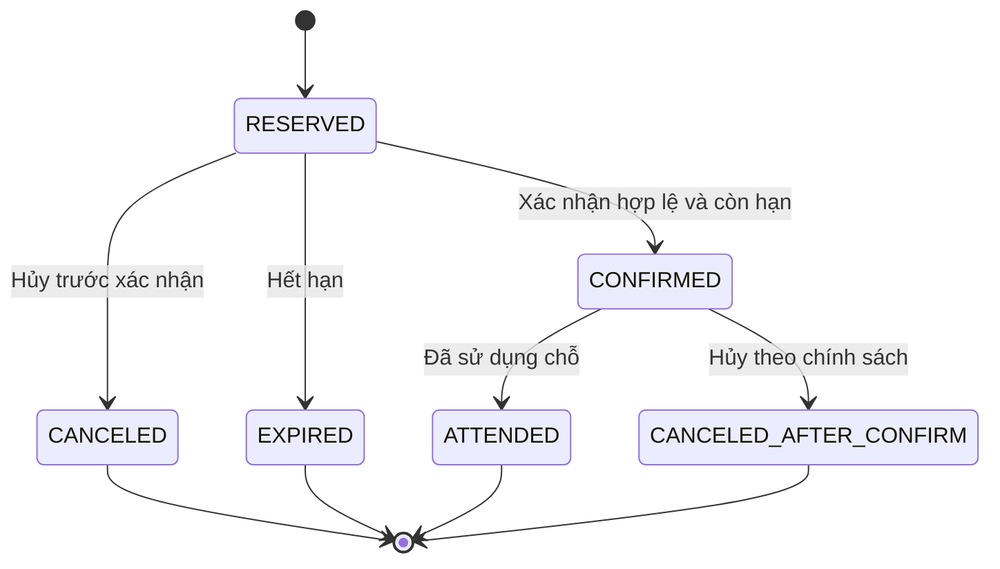
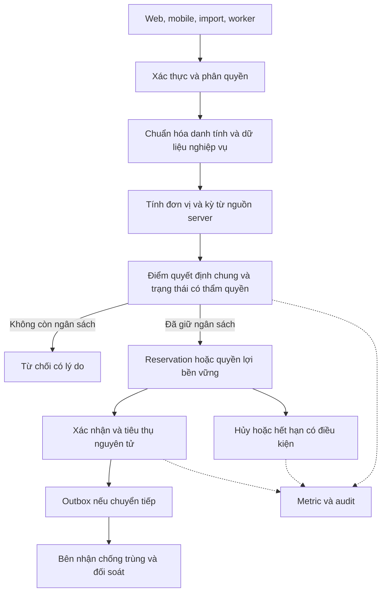

# Limit bypass

## 1. Limit bypass trong bảo mật logic nghiệp vụ

**Limit bypass** là tình huống hệ thống có một hạn mức theo chính sách, nhưng người dùng hoặc một luồng xử lý có thể vượt mức đó do kiểm soát không đầy đủ, không nhất quán hoặc không đúng đối tượng.

Ví dụ: mỗi học viên chỉ được kích hoạt gói học thử một lần trong một chiến dịch, nhưng API di động và API web dùng hai bộ đếm riêng. Người dùng thực hiện một lần qua mỗi API và nhận hai quyền lợi, dù từng API đều báo đang áp dụng giới hạn.

Trong chương **Business logic security**, điều cần bảo vệ là **ý nghĩa của hạn mức trên toàn bộ nghiệp vụ**. Giới hạn số HTTP request chỉ là một phần có thể hỗ trợ.

Một lần vượt hạn mức có thể làm sai quyền lợi, chiếm chỗ của người khác hoặc tạo chi phí, ngay cả khi hệ thống không quá tải. OWASP API6:2023 mô tả rủi ro khi các luồng nghiệp vụ nhạy cảm được truy cập quá mức mà không có hạn chế phù hợp. [Nguồn: OWASP API6:2023](https://api-security.owasp.org/editions/2023/en/0xa6-unrestricted-access-to-sensitive-business-flows/).

Sau bài học, người học có thể:

- Xác định đúng đối tượng, đơn vị và chu kỳ của hạn mức.
- Nhận diện đường đi thay thế, thao tác đồng thời và lỗi vòng đời có thể làm vượt mức.
- Đặc tả giữ chỗ, tiêu thụ, hoàn trả và ngoại lệ.
- Liên kết yêu cầu với ràng buộc kiến trúc, logging và kiểm thử có thể nghiệm thu.

**Các con số dưới đây là ví dụ để học cách viết yêu cầu, không phải giá trị mặc định cho mọi sản phẩm.**

## 2. Tình huống xuyên suốt: gói học thử và đặt chỗ

Một nền tảng đào tạo đa tenant mở chiến dịch trải nghiệm. Tenant là một tổ chức sử dụng nền tảng; chiến dịch, học viên và buổi học thuộc phạm vi tổ chức tương ứng.

### 2.1. Hai nhóm chính sách độc lập

**Chính sách A — Kích hoạt gói học thử:**

- Mỗi hồ sơ học viên đủ điều kiện được kích hoạt tối đa một lần trong một chiến dịch.
- Một chiến dịch có tối đa 1.000 lượt kích hoạt.
- Kích hoạt thành công không được hoàn lại chỉ bằng thao tác hủy tài khoản hoặc đổi API key.

**Chính sách B — Đặt chỗ buổi thực hành:**

- Mỗi hồ sơ học viên được phân bổ tối đa hai lượt đặt chỗ trong một ngày theo múi giờ Asia/Ho_Chi_Minh.
- Mỗi buổi học có tối đa 30 chỗ được giữ hoặc đã xác nhận còn hiệu lực.
- Mỗi reservation có hạn 120 giây trước khi xác nhận.
- Lượt được ghi vào ngày server tạo reservation. Xác nhận sau nửa đêm vẫn dùng ngày đã giữ ban đầu.
- Hủy hoặc hết hạn trước xác nhận có thể trả lượt đang giữ. Sau xác nhận, không hoàn hạn mức ngày, dù có thể trả lại chỗ vật lý theo quy tắc hủy buổi học.

Hai chính sách kiểm soát những tài nguyên nghiệp vụ khác nhau. Kích hoạt một gói không đồng nghĩa được đặt chỗ không giới hạn. Ngược lại, có hạn mức ngày không thay thế được điều kiện một lần trong chiến dịch.

### 2.2. Điều cần tránh

Các yêu cầu phải ngăn những kết quả như:

- Một học viên nhận gói nhiều lần qua nhiều kênh.
- Hai request cùng lấy lượt cuối của chiến dịch.
- Một batch chứa nhiều thao tác nhưng chỉ bị tính một lượt.
- Hủy lặp làm bộ đếm tăng thêm hoặc giảm xuống âm.
- Worker cấp quyền thành công nhưng dịch vụ hoàn quota vì phản hồi bị mất.
- Đổi múi giờ hoặc phiên bản chính sách làm xuất hiện một ngân sách mới ngoài ý định.
- Dùng tenant hoặc learner ID do client tự khai báo để chọn bộ đếm có lợi.

Những tình huống này cần được chuyển thành bất biến và tiêu chí kiểm thử, thay vì chỉ yêu cầu “không cho lách giới hạn”.

## 3. Phân biệt các kiểu giới hạn

| Loại | Đại lượng kiểm soát | Ví dụ |
| --- | --- | --- |
| Rate limit | Tốc độ trong một khoảng thời gian | Số request tạo reservation mỗi phút |
| Quota tích lũy | Tổng lượng theo kỳ | Hai lượt đặt chỗ mỗi ngày phân bổ |
| Giới hạn đồng thời | Số hoạt động có hiệu lực cùng lúc | Số reservation đang giữ |
| Giới hạn một lần | Một quyền lợi chỉ được cấp một lần trong phạm vi | Một gói học thử mỗi học viên mỗi chiến dịch |
| Giới hạn tổng nghiệp vụ | Tổng tài nguyên có thể phân phối | 1.000 lượt kích hoạt của chiến dịch |
| Giới hạn tài nguyên kỹ thuật | CPU, RAM, kết nối, byte hoặc số worker | Bộ nhớ tối đa của tác vụ |
| Quy tắc trạng thái | Chuyển trạng thái nào còn được phép | Không xác nhận reservation đã hết hạn |

Rate limit có thể làm chậm một luồng lạm dụng nhưng không chứng minh quota được thực thi. Một người vẫn có thể dùng nhiều request nhỏ trong thời gian dài để vượt tổng hạn mức.

Một request đơn lẻ cũng có thể chứa batch nhiều thao tác. Vì vậy, số request và số đơn vị quyền lợi không được mặc định là một.

CWE-799 mô tả việc kiểm soát số lượng hoặc tần suất tương tác không phù hợp. CWE-837 tập trung vào trường hợp một hành động phải là duy nhất nhưng không được thực thi đúng. Đây là các khái niệm hữu ích khi phân loại nguyên nhân, không phải nhãn chung cho mọi lỗi hạn mức. [CWE-799](https://cwe.mitre.org/data/definitions/799.html), [CWE-837](https://cwe.mitre.org/data/definitions/837.html).

## 4. Đặc tả hạn mức bằng các thành phần rõ ràng

Một yêu cầu cần trả lời đủ các câu hỏi sau:

| Thành phần | Câu hỏi |
| --- | --- |
| Đối tượng | Tài khoản, hồ sơ học viên, tenant, chiến dịch hay người thực tế? |
| Hành động | Kích hoạt, tạo reservation, xác nhận hay tham dự? |
| Đơn vị | Request, lượt, số chỗ, tín chỉ hay đơn vị dung lượng? |
| Phạm vi | Một API, mọi kênh, một node hay toàn cụm? |
| Chu kỳ | Ngày lịch, cửa sổ trượt, toàn chiến dịch hay suốt vòng đời? |
| Thời điểm ghi nhận | Lúc tiếp nhận, giữ chỗ, xác nhận hay hoàn thành? |
| Điều kiện hoàn | Trạng thái nào được trả lại và trả tối đa bao nhiêu? |
| Ngoại lệ | Ai được cấp thêm, trong thời gian nào, có trần nào? |
| Khi lỗi | Mất bộ đếm hoặc kết quả chưa rõ thì hệ thống làm gì? |
| Bằng chứng | Số đo và trạng thái nào chứng minh không vượt? |

### 4.1. Chọn đúng đối tượng

“Một tài khoản một lần” khác “một người một lần”. Nếu sản phẩm chỉ xác minh tài khoản mà cho phép một người tạo nhiều tài khoản, không được tuyên bố đã bảo đảm giới hạn theo người thực tế.

Trong ví dụ, chính sách áp dụng cho **hồ sơ học viên được server quản lý**. Nhiều cách đăng nhập hoặc API key liên kết cùng hồ sơ phải dùng chung hạn mức.

Nếu nghiệp vụ cần giới hạn theo người thực tế, tổ chức phải xác định cơ chế nhận diện phù hợp, sai số, quyền riêng tư và quy trình xử lý khi nhận diện nhầm. Không tự coi IP hoặc thiết bị là định danh duy nhất của một người.

### 4.2. Chọn đúng đơn vị

Nếu một batch đặt ba buổi học, cần tính ba đơn vị đặt chỗ theo chính sách, không phải một request.

Số lượng phải là số nguyên dương trong phạm vi cho phép; từ chối số âm, số không nếu không có nghĩa hợp lệ, số quá lớn và kiểu dữ liệu không được hỗ trợ. Phép cộng hoặc nhân để tính chi phí phải được kiểm tra tràn số.

Nếu nghiệp vụ dùng điểm hoặc giá trị chia nhỏ, phải quy định đơn vị nhỏ nhất, kiểu số chính xác và cách làm tròn tại đâu. Làm tròn riêng từng phần có thể khác làm tròn tổng; chia nhỏ giao dịch không được làm tổng quyền lợi vượt chính sách.

### 4.3. Chọn đúng chu kỳ

Ví dụ hạn mức ngày dùng khoảng:

```text
[start_of_day, start_of_next_day)
Múi giờ chính sách: Asia/Ho_Chi_Minh
Nguồn thời gian: server có thẩm quyền
```

Thời điểm đúng đầu ngày mới thuộc kỳ mới. Client không được đổi kỳ bằng timestamp, múi giờ thiết bị hoặc header tùy ý.

Trong chính sách B, kỳ được gắn lúc giữ lượt. Điều này cho phép một reservation của ngày trước được xác nhận sau nửa đêm trong thời hạn 120 giây. Cùng ngày xác nhận có thể có thêm reservation thuộc kỳ mới mà không vi phạm chính sách đã nêu.

Nếu mục tiêu thật sự là “không quá hai lần xác nhận trong một ngày”, phải thiết kế đếm theo ngày xác nhận. Hai định nghĩa không thể dùng thay thế nhau.

## 5. Mô hình bất biến cho quota

Với mỗi khóa hạn mức k, đặt:

```text
C_k = số đơn vị đã tiêu thụ theo chính sách
R_k = số đơn vị đang được giữ
L_k = hạn mức cơ sở
A_k = phần cấp thêm đã được phê duyệt, còn hiệu lực

0 <= C_k
0 <= R_k
C_k + R_k <= L_k + A_k
```

Một thao tác mới có chi phí q chỉ được giữ ngân sách khi:

```text
q > 0
C_k + R_k + q <= L_k + A_k
```

Phải kiểm tra mọi khóa liên quan. Một reservation vừa dùng ngân sách ngày của học viên, vừa chiếm một chỗ của buổi học. Còn hạn mức cá nhân không có nghĩa buổi học vẫn còn chỗ.

### 5.1. Giữ, tiêu thụ và trả

- Tạo reservation: tăng phần đang giữ.
- Xác nhận: chuyển phần đã giữ sang tiêu thụ; không tính thêm lần thứ hai.
- Hết hạn trước xác nhận: trả đúng phần đã giữ nếu reservation chưa tạo tác động.
- Hủy trước xác nhận: tương tự, theo quy tắc được phép.
- Hủy sau xác nhận: trong ví dụ không giảm quota ngày đã tiêu thụ; có thể giải phóng chỗ buổi học theo chính sách riêng.

Không dùng cùng một bộ đếm để biểu diễn cả “lượt trong ngày đã dùng” và “số chỗ hiện đang chiếm”. Hai tài nguyên có quy tắc hoàn khác nhau.

### 5.2. Bất biến cho quyền lợi một lần

Đối với gói học thử:

```text
Số lần kích hoạt có hiệu lực
cho (tenant, campaign, learner) <= 1
```

Bộ đếm chiến dịch bảo vệ trần 1.000. Ràng buộc duy nhất theo học viên bảo vệ một lần mỗi người học. Cần cả hai; chỉ một trong hai không chứng minh được chính sách còn lại.

Việc đổi idempotency key không tạo quyền nhận thêm. Xóa dữ liệu đăng nhập cũng không tự làm quyền lợi đã nhận trở thành chưa nhận.

## 6. Những đường có thể làm vượt hạn mức

### 6.1. Chỉ kiểm tra trên giao diện

Nút bấm bị khóa hoặc thông báo “đã hết lượt” không ngăn API được gọi trực tiếp. Hạn mức phải được thực thi ở server trước khi tạo tác động.

Client không được tự gửi các trường có thẩm quyền như remainingQuota, premiumTier hoặc bypassLimit để quyết định quyền nhận lợi ích.

### 6.2. Nhiều kênh và phiên bản API

Web, mobile, import, webhook, worker và công cụ quản trị có thể thực hiện cùng hành động bằng nhiều đường. Nếu mỗi đường có logic riêng, một đường thiếu kiểm tra sẽ làm mất hiệu lực chính sách chung.

Cần ánh xạ mọi entry point tới cùng hành động nghiệp vụ và cùng ngân sách. Phiên bản API cũ không được duy trì một cơ chế đếm yếu hơn cho cùng quyền lợi.

### 6.3. Danh tính và biểu diễn không thống nhất

Một người học có thể đăng nhập bằng nhiều phương thức nhưng vẫn là cùng hồ sơ. Ngược lại, hai người chung một IP không nên bị coi là cùng danh tính chỉ vì tiện cho bộ đếm.

ID nghiệp vụ cần được chuẩn hóa theo quy tắc đã công bố trước khi tạo khóa đếm. Đối với mã ưu đãi không phân biệt hoa thường, mọi điểm xử lý phải quy về cùng ID chiến dịch. Đối với token hoặc khóa phân biệt từng byte, không tự đổi hoa thường.

Không áp dụng quy tắc bỏ dấu chấm hoặc hậu tố email của một nhà cung cấp cho mọi email. Chuẩn hóa quá mức có thể gộp nhầm người dùng; chuẩn hóa thiếu có thể chia một đối tượng thành nhiều bộ đếm.

### 6.4. Đồng thời và kiểm tra trước khi ghi

Hai request có thể cùng đọc remaining = 1, cùng được chấp nhận rồi cùng ghi giảm. Dù bộ đếm cuối hiển thị không âm, hai quyền lợi có thể đã được tạo.

Bảo vệ phải gắn kiểm tra với giữ hoặc tiêu thụ bằng transaction, cập nhật có điều kiện hoặc cơ chế có bất biến tương đương. Sau khi tạo lợi ích rồi mới tăng bộ đếm không đủ.

### 6.5. Batch và nhiều thao tác con

Một HTTP request có thể chứa nhiều phần tử hoặc nhiều lời gọi con. Cần tính tổng chi phí nghiệp vụ sau khi kiểm tra dữ liệu.

Chính sách phải nói rõ batch là toàn bộ cùng thành công hay trả kết quả từng phần. Nếu thành công từng phần, mỗi phần cần quyết định quota riêng; không được trả thành công cho nhiều phần hơn số đã giữ ngân sách.

### 6.6. Hủy, hoàn và đảo trạng thái

Nếu mỗi lần hủy đều cộng lại một lượt mà không kiểm tra phần đã giữ còn tồn tại, gửi hủy lặp có thể làm tăng quota.

Nếu sau xác nhận hệ thống đã cấp quyền nhưng callback lỗi dẫn đến hoàn lượt, người dùng có thể vừa giữ lợi ích vừa có quota để nhận thêm.

Việc trả ngân sách phải gắn với một reservation hoặc khoản tiêu thụ cụ thể và chỉ xảy ra theo chuyển trạng thái hợp lệ. Đối soát phải dựa vào tác động đã xảy ra, không chỉ vào HTTP status.

### 6.7. Chính sách, gói dịch vụ và ngoại lệ

Không đưa policy_version vào khóa ngân sách theo cách khiến mỗi lần cập nhật cấu hình tạo một số dư mới cho cùng kỳ. Phiên bản nên giúp truy vết quyết định; việc reset chỉ xảy ra khi chính sách thật sự cho phép.

Nâng hoặc hạ gói cần quy tắc với phần đã dùng, không mặc định đếm lại từ đầu. Khi hạn mức giảm thấp hơn lượng đã tiêu thụ, hệ thống có thể dừng cấp thêm theo chính sách, thay vì làm mất dấu lượng đã dùng.

Một ngoại lệ quản trị hợp lệ khác với bypass trái chính sách. Ngoại lệ phải có phạm vi, giá trị, thời hạn và người chịu trách nhiệm, không phải cờ vô hạn tồn tại mãi.

### 6.8. Lỗi, failover và restore

Nếu mất kho quota mà mọi API đều cho qua để “giữ trải nghiệm”, sự cố hạ tầng trở thành đường vượt giới hạn.

Restore một bản sao cũ có thể làm mất lượt đã tiêu thụ trong khi quyền lợi bên ngoài vẫn còn. Cần khôi phục hoặc đối soát sổ ghi nhận với tác động thực tế trước khi cấp mới.

Bộ đếm gần đúng dùng cho thống kê không tự đáp ứng trần cứng. Nếu cho phép vượt tạm thời, phải công bố mức vượt tối đa và cơ sở chấp nhận, thay vì gọi đó là giới hạn tuyệt đối.

## 7. Thiết kế điểm thực thi chung

### 7.1. Khóa và dữ liệu có thẩm quyền

Ví dụ các khóa nghiệp vụ:

```text
Kích hoạt một lần:
(tenant_id, campaign_id, learner_id)

Tổng chiến dịch:
(tenant_id, campaign_id, ACTIVATION_TOTAL)

Hạn mức ngày:
(tenant_id, learner_id, policy_day, TRIAL_BOOKING)

Sức chứa buổi:
(tenant_id, session_id, SESSION_CAPACITY)
```

Tenant và learner lấy từ ngữ cảnh đã xác thực hoặc quan hệ được server kiểm tra quyền. Campaign và session phải thuộc đúng tenant; không chọn bộ đếm chỉ dựa vào ID client đưa lên.

Một API key mới liên kết cùng learner vẫn dùng các khóa tương ứng. Đổi replica hoặc vùng triển khai không tạo ngân sách riêng ngoài chính sách.

### 7.2. Transaction tại ranh giới tạo lợi ích

Logic khái niệm cho đặt chỗ:

```text
authenticate_and_authorize()
validate_and_normalize_business_input()
determine_server_time_bucket()
resolve_idempotency_scope_and_business_cost()

begin_transaction()
    lock_budget_and_target_rows_in_defined_order()

    if matching_operation_already_exists():
        verify_same_business_fingerprint()
        return_existing_result_without_new_reservation()

    verify_eligibility_and_session_state()
    reserve_daily_budget_conditionally()
    reserve_session_capacity_conditionally()
    create_reservation_with_original_bucket_and_expiry()
    persist_operation_result()
commit_transaction()

return_reservation()
```

Đây là mô tả yêu cầu bất biến, không phải mã triển khai trực tiếp. Cần có thứ tự khóa, xử lý deadlock, rollback và quyền tra cứu kết quả phù hợp.

Nếu một bước thất bại, không được để lại một reservation có lợi ích nhưng không bị tính quota, hoặc giữ quota mồ côi không thể phục hồi.

### 7.3. Giữ chỗ không được tự biến mất chỉ vì TTL

TTL hoặc thời hạn 120 giây là quy tắc nghiệp vụ. Việc xóa vật lý có thể diễn ra sau. Tại xác nhận, server phải kiểm tra reservation còn hạn và còn ở trạng thái cho phép.

Worker dọn hết hạn và request xác nhận có thể tranh chấp. Chỉ một chuyển trạng thái được có hiệu lực:



Nếu reservation đã CONFIRMED, tác vụ dọn đến muộn không được trả quota ngày như thể reservation chưa dùng. Nếu đã EXPIRED, request xác nhận đến muộn không được cấp chỗ.

### 7.4. Qua nhiều dịch vụ

Khi cấp quyền lợi nằm ở một dịch vụ khác, cần một giao thức giữ và tiêu thụ có khả năng phục hồi. Có thể dùng outbox để lưu ý định cùng trạng thái cục bộ, rồi chuyển tiếp bằng operation ID ổn định.

Bên nhận phải chống trùng tác động hoặc có khả năng tra cứu, đối soát. Không hoàn ngân sách chỉ vì timeout nếu chưa biết dịch vụ kia đã cấp lợi ích hay chưa.

Nếu dùng phân bổ ngân sách trước cho nhiều vùng, tổng phần được cấp phải không vượt trần và mỗi phần chỉ có một nơi có thẩm quyền tiêu thụ tại một thời điểm. Failover không được cấp lại cùng phần ngân sách trong khi nơi cũ còn có thể sử dụng.

## 8. Bộ yêu cầu mẫu có thể nghiệm thu

### LB-001 — Danh mục hạn mức và phạm vi

Mọi luồng tạo quyền lợi phải có mã chính sách, đối tượng, hành động, đơn vị, chu kỳ, thời điểm ghi nhận và quy tắc hoàn. Chính sách áp dụng trên toàn cụm qua mọi kênh thực thi cùng nghiệp vụ.

Các nhóm sản phẩm và kỹ thuật phải duy trì danh sách API, worker, import và công cụ quản trị liên quan. Thêm entry point mới không được mặc định tạo một quota riêng.

### LB-002 — Danh tính và điều kiện đủ

Giới hạn theo học viên dùng learner ID do server quản lý trong tenant đã xác thực. Đổi phiên đăng nhập, API key, thiết bị hoặc kênh gọi không làm thay đổi learner được tính.

Server kiểm tra điều kiện đủ và gói hiện tại từ nguồn có thẩm quyền. Không tin trường phân hạng hoặc số dư do client gửi.

Hệ thống chỉ cam kết theo hồ sơ học viên đã xác định. Nếu chưa có cơ chế liên kết nhiều hồ sơ của cùng một người, rủi ro đó phải được ghi nhận, không báo đã đạt giới hạn theo người thực tế.

### LB-003 — Kích hoạt một lần và trần chiến dịch

Mỗi bộ tenant, campaign và learner chỉ có tối đa một lần kích hoạt có hiệu lực. Tổng lượt kích hoạt của campaign không vượt 1.000.

Kiểm tra trần chiến dịch, ràng buộc duy nhất theo học viên và tạo quyền lợi phải được phối hợp nguyên tử hoặc bằng giao thức tương đương. Đổi idempotency key hoặc API không cho phép kích hoạt thêm.

Hủy tài khoản, đổi thông tin đăng nhập hoặc dọn cache không reset trạng thái đã nhận của cùng learner. Trường hợp hợp nhất hoặc xóa hồ sơ cần quy tắc dữ liệu và đối soát riêng.

### LB-004 — Hạn mức ngày và xác định kỳ

Mỗi learner có tối đa hai đơn vị đang giữ hoặc đã tiêu thụ trong ngày phân bổ theo Asia/Ho_Chi_Minh. Kỳ do server xác định khi tạo reservation và không đổi khi xác nhận, retry hoặc chuyển worker.

Ngày dùng khoảng đầu ngày bao gồm, đầu ngày kế tiếp không bao gồm. Client không được điều khiển kỳ bằng timestamp hoặc timezone.

Cùng ngày xác nhận có thể có reservation của hai ngày phân bổ khác nhau trong giới hạn đã quy định; hồ sơ kiểm thử phải phản ánh đúng ngữ nghĩa này.

### LB-005 — Số lượng và batch

Mỗi phần tử đặt một chỗ cho một buổi học và tính một đơn vị. Batch tối đa mười phần tử sau kiểm tra schema; tổng chi phí bằng tổng số thao tác thực sự sẽ được tạo.

Trong ví dụ này, batch là toàn bộ cùng thành công hoặc toàn bộ bị từ chối. Nếu learner chỉ còn một đơn vị nhưng batch yêu cầu hai đơn vị, không tạo reservation nào và không giữ quota mồ côi.

Từ chối phần tử trùng cùng learner và session trong cùng batch hoặc trùng với reservation đang có hiệu lực theo chính sách. Số lượng ngoài miền, tràn số hoặc dữ liệu mơ hồ bị từ chối trước cấp quyền lợi.

### LB-006 — Giữ, xác nhận và hoàn

Reservation còn hạn khi thời gian server tại điểm quyết định nhỏ hơn expiresAt. Đúng expiresAt hoặc muộn hơn thì không xác nhận được.

Giữ ngân sách ngày và chỗ buổi học khi tạo reservation; xác nhận chuyển phần đang giữ sang tiêu thụ mà không tính thêm. Hủy hoặc hết hạn trước xác nhận trả tối đa đúng phần còn đang giữ.

Sau xác nhận, quota ngày không được hoàn trong chính sách ví dụ. Nếu hủy hợp lệ trước thời điểm buổi học bắt đầu, chỗ vật lý có thể được giải phóng đúng một lần; không giải phóng chỗ đã ATTENDED. Quyền truy cập nội dung buổi học nếu có phải được thu hồi hoặc xử lý theo cùng quyết định hủy.

Lặp yêu cầu hủy, worker dọn đến muộn hoặc callback trùng không làm số dư tăng ngoài mức cho phép.

### LB-007 — Đồng thời và idempotency

Thao tác kiểm tra và cấp đơn vị phải bảo vệ bất biến trước tranh chấp giữa mọi replica.

Khi campaign chỉ còn một lượt, 100 request hợp lệ đồng thời qua ít nhất ba replica chỉ được tạo thêm tối đa một kích hoạt. Khi một learner chỉ còn một đơn vị ngày, 100 request cho nhiều buổi khác nhau chỉ được giữ thêm tối đa một đơn vị.

Cùng idempotency key và nội dung trong phạm vi đã định nghĩa phải trả kết quả trước đó, không tính lại. Cùng khóa nhưng nội dung khác trả lỗi xung đột theo hợp đồng. Quyền xem kết quả vẫn được kiểm tra.

Khóa mới không cho vượt bất biến nghiệp vụ. Số lần tác động thực tế, ledger và số dư phải được đối chiếu sau phép thử.

### LB-008 — Sự cố và phục hồi

Khi không xác minh được số dư đáng tin cậy, ngừng cấp quyền lợi mới cần dùng ngân sách đó. Không coi lỗi đọc hoặc không tìm thấy do timeout là số dư đầy.

Lỗi sau commit trước phản hồi phải có đường tra cứu kết quả hoặc retry an toàn. Lỗi giữa dịch vụ cấp quyền lợi và dịch vụ quota phải giữ trạng thái chưa rõ để đối soát, không tự hoàn rồi cho nhận tiếp.

Sau restart, failover và restore, bất biến một lần và trần tổng phải còn hiệu lực. Nếu nguồn trạng thái bị lùi so với tác động thực tế, thực hiện đối soát hoặc cách ly đường cấp mới trước khi tiếp tục.

### LB-009 — Ngoại lệ và thay đổi chính sách

Quyền cấp thêm hạn mức phải tách khỏi quyền sử dụng thông thường. Mỗi ngoại lệ có người phê duyệt, lý do, phạm vi, giá trị, thời hạn và audit.

Thay phiên bản cấu hình không tự tạo kỳ mới hoặc xóa phần đã dùng. Khi đổi gói, áp dụng quy tắc đã công bố cho phần đã tiêu thụ và reservation đang tồn tại.

Một ngoại lệ không được làm vượt trần vật lý như 30 chỗ nếu chưa có thay đổi sức chứa đã được phê duyệt riêng. Hết hạn ngoại lệ phải có hành vi rõ với phần đã dùng và phần còn giữ, thay vì tự tạo số dư âm hoặc cấp thêm vô hạn.

### LB-010 — Phản hồi và quan sát

API dùng mã lỗi ổn định cho không đủ điều kiện, hết quota, hết chỗ, reservation hết hạn, xung đột nội dung và kho quyết định không khả dụng. Cách ánh xạ HTTP được công bố; lỗi nghiệp vụ không được đồng nhất với mọi kiểu quá tải kỹ thuật.

Chỉ trả remainingQuota hoặc thời điểm cấp lại khi có quyền xem và có cơ sở tính đáng tin cậy. Không lộ số dư hoặc danh tính tenant khác. Nếu số dư hiển thị là gần đúng, giao diện phải không coi đó là quyết định cấp cuối.

Log và audit ghi mã chính sách, phiên bản, operation ID, bucket, đơn vị yêu cầu, phần giữ hoặc tiêu thụ và lý do quyết định theo chính sách dữ liệu. Không ghi token hoặc toàn bộ dữ liệu nhạy cảm.

## 9. Kiến trúc tham chiếu và số đo



Gateway có thể áp rate limit để bảo vệ hệ thống tiếp nhận, nhưng điểm quyết định nghiệp vụ phải hiểu đối tượng và đơn vị thực sự. Worker không được tự tạo quyền lợi từ một message chưa có ngân sách hoặc trạng thái hợp lệ.

Các số đo cần có:

| Nhóm | Thông tin |
| --- | --- |
| Quyết định | Chấp nhận, từ chối và lý do theo chính sách |
| Ngân sách | Đã dùng, đang giữ, được cấp thêm, hoàn và điều chỉnh |
| Vòng đời | Reservation quá hạn, bị hủy, xác nhận hoặc chưa rõ |
| Nhất quán | Chênh lệch ledger, số dư và quyền lợi thực tế |
| Đường đi | Quyết định theo loại entry point và phiên bản API |
| Sự cố | Lỗi đọc quota, tranh chấp, đối soát và failover |
| Ngoại lệ | Số ngoại lệ đang hiệu lực, hết hạn và mức sử dụng |

Không dùng learner ID hoặc operation ID tùy ý làm nhãn metric có số lượng giá trị không giới hạn. Metric nên tổng hợp theo chiều hữu hạn; chi tiết điều tra nằm trong log được phân quyền và có thời hạn lưu.

Log từ chối cũng cần ngân sách để không biến kiểm soát hạn mức thành nguồn cạn tài nguyên. Số đếm tổng cần còn phản ánh tải; audit bắt buộc không bị mất âm thầm do lấy mẫu log chẩn đoán.

## 10. Ma trận kiểm thử chống vượt hạn mức

Kiểm thử cần được thực hiện trên hệ thống và dữ liệu được phép. Mục tiêu là chứng minh bất biến và hành vi biên của yêu cầu, không chỉ xem API có trả lỗi hay không.

| Mã | Yêu cầu | Kịch bản | Kết quả cần chứng minh |
| --- | --- | --- | --- |
| T-01 | LB-003, LB-004 | Ngay dưới, đúng và vượt hạn mức một đơn vị | Đúng quyết định; không có tác động vượt trần |
| T-02 | LB-001, LB-003 | Cùng learner qua web, mobile, API cũ, import và worker | Cùng một phạm vi ngân sách và quyền lợi |
| T-03 | LB-002 | Đổi API key hoặc phương thức đăng nhập của cùng hồ sơ | Không nhận ngân sách mới |
| T-04 | LB-002 | Tenant ID hoặc learner ID không thuộc quyền hiện tại | Từ chối trước khi đọc hoặc dùng ngân sách ngoài phạm vi |
| T-05 | LB-005 | Batch hai phần tử khi chỉ còn một đơn vị; phần tử trùng | Không tạo kết quả một phần ngoài hợp đồng, không rò quota |
| T-06 | LB-005 | Số âm, số không, số quá lớn, kiểu sai, tổng có nguy cơ tràn | Từ chối trước cấp lợi ích |
| T-07 | LB-007 | 100 request đồng thời tranh lượt cuối qua nhiều replica | Tối đa một tác động mới; số dư và ledger khớp |
| T-08 | LB-004 | Trước và sau nửa đêm; đổi timezone client; xác nhận qua ngày | Tính đúng kỳ server và quy tắc ngày phân bổ |
| T-09 | LB-006 | Hủy lặp, dọn hết hạn lặp, xác nhận tranh với hết hạn | Chỉ một chuyển trạng thái; hoàn đúng tối đa phần còn giữ |
| T-10 | LB-006 | Xác nhận rồi hủy; quyền lợi đã được dùng | Không hoàn quota ngày; chỗ và quyền liên quan xử lý đúng chính sách |
| T-11 | LB-007, LB-008 | Mất phản hồi sau commit; retry cùng hoặc khác khóa | Không cấp trùng; khóa mới vẫn chịu bất biến |
| T-12 | LB-008 | Kho quota lỗi, phân vùng mạng, restart và restore cũ | Không cho qua khi chưa biết số dư; đối soát trước cấp mới |
| T-13 | LB-009 | Đổi gói, đổi policy version và ngoại lệ hết hạn | Không reset ngoài chính sách; không vượt trần vật lý |
| T-14 | LB-003 | Hủy hoặc liên kết lại tài khoản trong khi quyền lợi còn tồn tại | Không hồi sinh quyền kích hoạt của cùng learner |
| T-15 | LB-010 | Nhiều từ chối, log chứa định danh hoặc đầu vào tùy ý | Không lộ dữ liệu; metric và log có ngân sách |

Cần kiểm tra ở nơi tác động được tạo: số quyền lợi, reservation, chỗ được xác nhận, lệnh gửi bên ngoài và phần ngân sách còn lại. Hai request bị báo khác nhau nhưng cùng tạo lợi ích vẫn là lỗi.

Hồ sơ bằng chứng nên gồm phiên bản chính sách, topology, trạng thái trước sau, tải đồng thời, thời điểm, lỗi được tiêm, bản ghi ledger và kết quả đối soát. Không loại bỏ những request bị timeout khỏi phân tích chỉ vì client không thấy thành công.

## 11. Những đặc tả dễ gây hiểu nhầm

| Cách ghi thiếu | Vấn đề | Cách làm rõ |
| --- | --- | --- |
| “Mỗi người hai lần” | Không biết người, tài khoản hay hồ sơ; không biết kỳ | Định nghĩa đối tượng, đơn vị và kỳ |
| “Giới hạn ở frontend” | API và worker có thể bỏ qua | Thực thi tại server và ranh giới tác động |
| “Mỗi API có bộ đếm riêng” | Cùng quyền lợi được nhận qua nhiều đường | Khóa nghiệp vụ chung cho mọi entry point |
| “Một request tính một lượt” | Batch chứa nhiều thao tác | Tính chi phí nghiệp vụ từng phần và tổng |
| “Còn lượt thì xử lý rồi cập nhật” | Tranh chấp đọc trước ghi sau | Kiểm tra và giữ ngân sách nguyên tử |
| “Lỗi thì hoàn quota” | Tác động có thể đã commit | Phân biệt chưa xảy ra, đã xảy ra và chưa rõ |
| “Hủy luôn cộng một lượt” | Hủy lặp có thể tạo số dư | Hoàn có điều kiện theo reservation cụ thể |
| “Cache không có thì coi như chưa dùng” | Dọn hoặc restart reset giới hạn | Nguồn bền vững và đối soát |
| “Cập nhật policy thì dùng key mới” | Tạo ngân sách mới ngoài ý định | Tách phiên bản truy vết khỏi định danh kỳ |
| “Chặn IP là chặn một người” | NAT và nhiều tài khoản làm sai phạm vi | Định danh phù hợp và ghi nhận giới hạn nhận diện |

## 12. Đưa yêu cầu vào vòng đời phát triển

Ở bước phân tích, chủ sở hữu nghiệp vụ xác định quyền lợi cần bảo vệ, phạm vi đối tượng và quy tắc hoàn. Nhóm bảo mật bổ sung các tình huống nhiều kênh, danh tính thay đổi, chia nhỏ thao tác, đồng thời và lỗi giữa các bước.

Ở bước thiết kế, lập danh sách entry point và đồ thị tác động. Chọn nguồn trạng thái có thẩm quyền, bất biến, quy tắc transaction hoặc đối soát, cùng hành vi khi mất kết nối. Tách quota khỏi số đo gần đúng dùng cho giao diện.

Ở bước triển khai, dùng cấu hình có phiên bản và quyền thay đổi phù hợp. Bảo vệ bộ đếm, ledger, dữ liệu nhận diện và ngoại lệ. API mới, worker mới hoặc cơ chế retry mới phải đi qua cùng chính sách.

Ở bước kiểm thử, nối mỗi yêu cầu với trường hợp biên, tranh chấp, đổi chu kỳ và phục hồi. Kiểm tra cả người dùng hợp lệ bị chặn nhầm, đặc biệt khi chuẩn hóa định danh hoặc áp tín hiệu chống lạm dụng.

Ở bước vận hành, theo dõi chênh lệch giữa số dư và tác động thực tế, ngoại lệ tồn tại lâu, reservation chưa rõ và đường đi có tỷ lệ từ chối bất thường. Điều chỉnh hạn mức qua đúng thẩm quyền; không bỏ kiểm tra âm thầm khi có sự cố.

Một yêu cầu chống limit bypass đầy đủ cần nối được **quyền lợi và rủi ro → đối tượng → đơn vị và kỳ → mọi đường thực thi → giữ, tiêu thụ, hoàn nguyên tử → ngoại lệ có kiểm soát → bằng chứng bất biến sau lỗi và phục hồi**. Nhờ đó, hạn mức được thực thi theo ý nghĩa nghiệp vụ trên toàn hệ thống.
