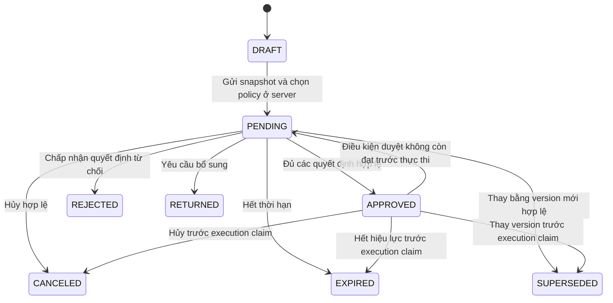

# Approval workflow

## 1. Phê duyệt là điều kiện thực hiện một hành động cụ thể

Approval workflow là quy trình xác định ai được đề nghị một thay đổi, ai được quyết định, điều kiện nào làm quyết định có hiệu lực và hệ thống được thực hiện thay đổi đó ra sao. Trong bảo mật logic nghiệp vụ, phê duyệt phải gắn với một hành động và nội dung xác định; một nút “Approve” hoặc trường `approved = true` chưa đủ mô tả điều kiện an toàn.

Ví dụ, nền tảng học tập yêu cầu hai người độc lập duyệt việc sửa điểm đã công bố. Nếu người đề nghị có thể đổi người học hoặc điểm mới sau khi đủ phiếu, quy trình vẫn có hai lượt bấm nhưng không còn kiểm soát đúng thay đổi. Nếu worker chỉ tin một message `approved=true`, người gọi có thể tìm đường thực hiện không đi qua bước phê duyệt.

Trong module yêu cầu bảo mật, mục tiêu là chuyển rủi ro đó thành các điều kiện có thể kiểm chứng: đúng chủ thể, đúng phạm vi, đúng nội dung và phiên bản, đủ quyết định hợp lệ, đúng trạng thái và chỉ có tác dụng phụ được phép. Cần liên kết chúng với kiến trúc thực thi, bằng chứng audit và kế hoạch kiểm thử trong vòng đời phát triển.

[CWE-841 — Improper Enforcement of Behavioral Workflow](https://cwe.mitre.org/data/definitions/841.html) mô tả nhóm điểm yếu khi hệ thống không bảo đảm các bước cần thiết xảy ra theo thứ tự hoặc thời hạn yêu cầu. Approval workflow có thể gặp nhóm điểm yếu này qua bỏ bước, dùng lại quyết định, sửa trạng thái hoặc thực hiện ở thời điểm không còn đủ điều kiện.

Bài sử dụng nền tảng học tập nhiều tenant với tình huống chính là sửa điểm đã công bố. Mã vai trò, số người duyệt, thời hạn và ngưỡng trong bài là chính sách giả định để minh họa đặc tả; chúng cần được quyết định theo rủi ro và tổ chức thực tế.

## 2. Xác định hành động nhạy cảm, tài sản và chuỗi lạm dụng

Không nên bắt đầu bằng câu “mọi thao tác đều cần hai cấp duyệt”. Trước tiên cần xác định tác động, người hưởng lợi, khả năng đảo ngược và ai có thể lạm dụng quyền hiện có. Một hành động có thể cần phê duyệt nội dung; hành động khác cần xác minh danh tính bổ sung hoặc kiểm soát tự động theo chính sách. Mỗi cơ chế giải quyết một điều kiện khác nhau.

| Hành động trong nền tảng | Nội dung quan trọng cần duyệt | Tác động cần bảo vệ |
|---|---|---|
| Sửa điểm đã công bố | Người học, lớp, điểm cũ/mới, lý do, căn cứ và phiên bản bản ghi | Toàn vẹn kết quả học tập |
| Hoàn học phí theo ngoại lệ | Khoản thu, số tiền, currency, người nhận, lý do | Toàn vẹn giao dịch và hạn mức được phép |
| Xuất dữ liệu học viên | Tenant, tập người học, trường dữ liệu, đích nhận, mục đích, hạn sử dụng | Bí mật dữ liệu và đúng phạm vi chia sẻ |
| Cấp vai trò quản trị | Chủ thể nhận quyền, tenant/tài nguyên, tập quyền, thời hạn | Ngăn leo thang đặc quyền |
| Công bố tài liệu đặc biệt | Phiên bản nội dung, phạm vi công bố và điều kiện sử dụng | Không công bố nhầm dữ liệu hoặc nội dung chưa được chấp thuận |

Các rủi ro xuyên suốt:

| Mã | Chuỗi lạm dụng hoặc lỗi | Bất biến cần giữ |
|---|---|---|
| R-APP-01 | Người tạo dùng tài khoản khác hoặc nhiều vai trò để tự duyệt | Các vị trí cần độc lập không do cùng một chủ thể đảm nhận |
| R-APP-02 | Đổi payload, đối tượng hoặc tệp căn cứ sau khi duyệt | Quyết định chỉ áp dụng cho đúng nội dung và phiên bản đã xem |
| R-APP-03 | Gọi thẳng API thực thi hoặc sửa trạng thái từ client | Mọi tác dụng phụ đi qua điều kiện phê duyệt bắt buộc |
| R-APP-04 | Dùng lại phiếu, callback hoặc message để thực hiện lặp | Một quyết định không tạo quyền thực hiện ngoài phạm vi hoặc số lần được phép |
| R-APP-05 | Approve/cancel/edit chạy đồng thời tạo trạng thái mâu thuẫn | Chuyển trạng thái và quyền thực hiện có thứ tự nhất quán |
| R-APP-06 | Vai trò bị thu hồi, yêu cầu hết hạn hoặc policy thay đổi nhưng vẫn thực hiện | Final gate áp dụng đúng điều kiện hiệu lực hiện tại theo hợp đồng |
| R-APP-07 | Delegation, escalation hoặc override bỏ yêu cầu độc lập | Đường ngoại lệ có điều kiện, phạm vi và bằng chứng riêng |
| R-APP-08 | Log thiếu hoặc bị sửa; màn hình duyệt che dữ liệu quan trọng | Có thể đối chiếu ai duyệt nội dung gì và kết quả thực tế |

Phê duyệt nhiều người giảm một số khả năng lạm dụng đơn lẻ nhưng không loại bỏ thông đồng, chiếm quyền nhiều tài khoản hoặc việc bấm duyệt thiếu xem xét. Threat model cần ghi rõ phần rủi ro còn lại, cùng các kiểm soát về danh tính, phân quyền, hiển thị nội dung và điều tra.

## 3. Tách vai trò và xác định mức độc lập cần thiết

Các vai trò thường gồm requester tạo đề nghị, approver ra quyết định, executor thực hiện tác vụ, policy administrator quản lý quy tắc và auditor đọc bằng chứng. Một người có thể giữ nhiều vai trò trong tổ chức nhưng không nhất thiết được dùng tất cả vai trò đó trên cùng yêu cầu.

[AC-5 trong NIST SP 800-53 Rev. 5](https://nvlpubs.nist.gov/nistpubs/SpecialPublications/NIST.SP.800-53r5.pdf#page=63) yêu cầu tổ chức xác định những nhiệm vụ cần phân tách và quyền truy cập hỗ trợ phân tách đó. Áp dụng vào thiết kế ở đây, cần chỉ ra cặp nhiệm vụ xung đột và cách kiểm tra trên một yêu cầu cụ thể; không suy ra một con số người duyệt chung từ tên control.

| Vai trò | Quyền minh họa | Giới hạn trên yêu cầu sửa điểm |
|---|---|---|
| Người đề nghị | Tạo, sửa draft, gửi và yêu cầu hủy theo trạng thái | Không góp phiếu duyệt cho yêu cầu mình đề nghị |
| Giám sát học vụ | Duyệt căn cứ chuyên môn trong lớp/tenant được giao | Không tự duyệt yêu cầu mình tạo; không thay vai kiểm soát còn lại bằng cùng danh tính |
| Kiểm soát hồ sơ | Duyệt tính hợp lệ về hồ sơ và quy trình | Là người khác giám sát học vụ và người đề nghị |
| Service thực thi | Áp dụng đúng lệnh đã đủ điều kiện | Không tạo phiếu duyệt con người; không được đổi payload đã duyệt |
| Quản trị policy | Đề xuất/triển khai thay đổi quy tắc theo quy trình riêng | Không tự hạ quorum cho một yêu cầu rồi dùng đường đó để vượt kiểm soát |
| Auditor | Đọc hồ sơ trong phạm vi được giao | Không sửa quyết định hoặc thay trạng thái thực thi |

Cần xác định “hai người khác nhau” bằng chủ thể có định danh đáng tin cậy. Hai username có thể thuộc cùng một nhân viên; một account có thể được ủy quyền từ người đề nghị. Nếu tổ chức yêu cầu phân tách theo con người, hệ thống cần liên kết account với subject phù hợp và kiểm soát vòng đời liên kết. Không dùng tên hiển thị, email tự nhập hoặc claim do client tự gửi để quyết định độc lập.

Phân tách tĩnh có thể ngăn một chủ thể đồng thời được gán hai vai trò xung đột. Phân tách động có thể cho phép giữ nhiều vai trò nhưng không cho dùng chúng trong cùng giao dịch. Profile sửa điểm dùng phân tách động trên từng yêu cầu: người đề nghị và hai người duyệt phải là ba subject khác nhau; một subject có cả hai vai trò duyệt chỉ được tính vào một vị trí.

Phạm vi quyền cũng bắt buộc: có vai trò học vụ tại tenant A không đủ để duyệt tenant B, lớp khác hoặc loại thay đổi vượt thẩm quyền. Người được phân công task chưa chắc có quyền duyệt tại thời điểm hành động. Assignment hỗ trợ điều phối; authorization quyết định có được thực hiện hành động hay không.

Service account không tự trở thành một “người thứ hai” chỉ vì có ID khác. Nếu tổ chức cho phép quyết định tự động với một tập điều kiện, phải gọi đúng đó là policy tự động, chỉ ra nguồn dữ liệu, phạm vi và audit; không dùng nó để làm đủ số người độc lập mà đặc tả đã yêu cầu.

## 4. Đóng băng nội dung cần duyệt và quản lý phiên bản

Một yêu cầu được gửi duyệt cần snapshot chứa dữ liệu có ý nghĩa với quyết định. Với sửa điểm, đó là tenant, lớp, người học, đối tượng điểm, giá trị hiện tại kỳ vọng, giá trị đề nghị, lý do và căn cứ. Những tham chiếu quan trọng cần trỏ tới đúng phiên bản nội dung, không chỉ tới URL có thể thay đổi.

Ví dụ snapshot server quản lý:

```json
{
  "requestId": "apr-731",
  "requestVersion": 3,
  "tenantId": "tenant-a",
  "operation": "CHANGE_PUBLISHED_GRADE",
  "requesterSubjectId": "staff-21",
  "target": {
    "gradeRecordId": "grade-918",
    "classId": "class-12",
    "expectedRecordVersion": 52
  },
  "change": {
    "expectedCurrentGrade": "7.0",
    "proposedGrade": "8.0",
    "reasonCode": "RECHECK_RESULT"
  },
  "evidenceRefs": [
    {
      "documentId": "review-report-44",
      "documentVersion": 2
    }
  ],
  "approvalPolicyVersion": "grade-policy-v5"
}
```

Giá trị điểm và thang điểm ở đây chỉ là dữ liệu minh họa. Server phải lấy và xác minh dữ liệu nền; client không được tự khai `requesterSubjectId`, tenant hoặc phiên bản policy để giành quyền. Nếu API nhận ID target hoặc phiên bản kỳ vọng, đó là dữ liệu cần đối chiếu và kiểm tra quyền.

Snapshot cần có quy tắc chuẩn hóa và bảo vệ lưu trữ. Digest có thể giúp đối chiếu nội dung, nhưng một hash đặt cạnh payload ở nơi cùng bị sửa không tự chứng minh tính toàn vẹn. Nếu dùng chữ ký, cần quản lý khóa và xác minh đúng ngữ cảnh; nếu dùng kho server, cần phân quyền, kiểm soát sửa đổi và lịch sử phù hợp. Chọn cơ chế theo rủi ro và kiến trúc thực tế.

Mọi thay đổi có ý nghĩa với quyết định phải tạo version mới và không kế thừa phiếu version cũ. Ví dụ đổi người học, điểm mới, lý do nghiệp vụ, căn cứ, đích nhận dữ liệu hay số tiền đều làm thay đổi nội dung được duyệt. Profile này cho phép sửa một số metadata trình bày không ảnh hưởng quyết định chỉ theo allowlist riêng và vẫn có audit; không mặc định rằng mọi trường tên “note” đều vô hại.

Khi yêu cầu đã gửi cần sửa, version cũ được giữ nguyên và được đánh dấu không còn là version có thể thực hiện theo chuyển trạng thái hợp lệ. Tạo draft version mới rồi gửi lại. Sau khi đã bắt đầu thực thi, thay đổi kết quả cần một quy trình điều chỉnh hoặc bù trừ mới; không viết lại lịch sử yêu cầu cũ để trông như đã duyệt nội dung khác.

Tệp căn cứ cũng cần quyền truy cập, kiểm soát nội dung và version. Một tài liệu có cùng ID nhưng được thay bản khác không được tự mang theo các phiếu đã dựa trên bản cũ. Không yêu cầu người duyệt mở macro hoặc tải nội dung có thể thực thi chỉ để hoàn thành phê duyệt.

## 5. Đặc tả máy trạng thái và chuyển trạng thái hợp lệ

Tách trạng thái xét duyệt khỏi trạng thái thực thi giúp không nhầm “đủ điều kiện duyệt” với “đã thực hiện thành công”. Profile ví dụ dùng các trạng thái xét duyệt theo version như sau:

| Trạng thái | Ý nghĩa | Hành động chính được phép |
|---|---|---|
| `DRAFT` | Đang soạn, chưa có phiếu hợp lệ | Sửa theo quyền; gửi để tạo snapshot xét duyệt |
| `PENDING` | Đang nhận quyết định cho snapshot hiện tại | Approve/reject/return theo quyền, hủy/hết hạn theo guard |
| `APPROVED` | Đã đạt policy xét duyệt tại thời điểm đánh giá | Được xét final gate; chưa khẳng định có tác dụng phụ |
| `RETURNED` | Đã yêu cầu bổ sung nội dung | Tạo version mới để chỉnh và gửi lại |
| `REJECTED` | Đã nhận quyết định từ chối có hiệu lực | Không thực hiện version này |
| `CANCELED` | Đã hủy thành công trước điểm không còn hủy theo hợp đồng | Không bắt đầu tác dụng phụ mới từ version này |
| `EXPIRED` | Đã hết hiệu lực trước khi được nhận thực thi | Không bắt đầu thực hiện; cần gửi lại theo policy |
| `SUPERSEDED` | Đã có version thay thế theo thao tác được phép | Không dùng phiếu version cũ để thực hiện version mới |



Sau `RETURNED` hoặc `SUPERSEDED`, việc sửa tạo version mới; không chuyển một version đã đóng trở lại draft rồi thay nội dung trong lịch sử. Quản lý vòng đời toàn request có thể hiển thị version hiện hành, nhưng dữ liệu và phiếu phải được phân biệt theo version.

Trạng thái thực thi riêng có thể gồm `NOT_STARTED`, `QUEUED`, `RUNNING`, `SUCCEEDED`, `FAILED_FINAL` và `UNKNOWN`. `QUEUED` chỉ nói đã lưu công việc theo hợp đồng, không chứng minh đủ điều kiện ở thời điểm worker chạy. `UNKNOWN` nói chưa xác định được tác dụng phụ, không tự tương đương thất bại an toàn để làm lại.

Mỗi chuyển trạng thái cần actor, trạng thái nguồn, quyền, version, điều kiện dữ liệu và tác dụng phụ được phép. Client không được chọn trạng thái đích bằng cách patch entity tổng quát. API `approve` cũng không được bỏ qua kiểm tra chỉ vì một request trước đó đã trả đủ quyền.

Phải định nghĩa race giữa các quyết định. Trong profile, approve/reject thông thường chỉ được chấp nhận khi `PENDING`. Nếu một reject đã commit trước, approve tiếp theo bị từ chối. Nếu quyết định cuối đã chuyển sang `APPROVED`, reject đến sau không được âm thầm sửa lịch sử; có thể cần hành động thu hồi/dừng riêng trước execution claim. Không hứa “mọi reject luôn thắng” mà không có thứ tự và điểm quyết định cụ thể.

## 6. Quy tắc đủ phiếu, thứ tự bước và hiệu lực policy

Policy phê duyệt phải trả lời được cần ai, bao nhiêu người độc lập, theo trình tự nào, phạm vi nào và trong bao lâu. “Hai cấp” có thể là hai nhóm vai trò khác nhau; “hai phiếu” có thể là hai subject bất kỳ đủ quyền trong một nhóm. Hai ý nghĩa đó không được dùng thay nhau.

Profile sửa điểm đã công bố quy định một quyết định đồng ý từ giám sát học vụ và một quyết định đồng ý từ kiểm soát hồ sơ. Cả hai thuộc đúng tenant/lớp, khác người đề nghị và khác nhau. Hai vai trò được duyệt song song; mỗi subject chỉ chiếm một vị trí, dù có cả hai vai trò. Nếu nghiệp vụ muốn bước sau phải xem quyết định bước trước, phải chuyển sang policy tuần tự và kiểm tra điều kiện đó tại server.

```text
eligible_decision(d, request_version, now) đòi hỏi:
  đúng request, version và policy tương thích;
  đúng snapshot nội dung;
  actor được phép trong scope theo policy;
  actor không xung đột với requester hoặc các vị trí đã chọn;
  quyết định chưa bị thu hồi/vô hiệu và còn trong thời hạn;
  phương thức xác thực/step-up đáp ứng yêu cầu khi quyết định.

quorum_met đòi hỏi tồn tại hai quyết định APPROVE hợp lệ:
  một cho vai học vụ và một cho vai kiểm soát hồ sơ;
  do hai subject độc lập;
  không có trạng thái kết thúc hoặc chặn theo policy.
```

Không chỉ đếm số dòng `APPROVE` trong bảng. Retry có thể tạo nhiều sự kiện cho một chủ thể; một người có nhiều account; hai quyết định có thể thuộc hai version khác nhau. Bộ đếm chỉ có ý nghĩa sau khi lọc eligibility và ràng buộc độc lập theo cùng snapshot/policy.

Policy version được chọn ở server khi gửi yêu cầu và lưu để giải thích lịch sử. Ví dụ này vẫn kiểm tra các điều kiện an toàn hiện hành trước thực thi: phiên bản policy cũ không được tiếp tục nếu đã có yêu cầu vô hiệu khẩn cấp hoặc không còn nằm trong tập policy được phép dùng. Khi policy đổi, phải có quy tắc cho yêu cầu đang chờ: giữ policy cũ có giới hạn, chuyển sang policy mới và duyệt lại, hoặc hủy. Không tự đoán dựa trên thời điểm client mở màn hình.

Ngưỡng theo tiền, loại dữ liệu hoặc mức đặc quyền phải dùng dữ liệu đã xác minh và xét khả năng chia nhỏ yêu cầu để né ngưỡng. Nếu kiểm soát nhằm tổng các thay đổi liên quan trong một khoảng thời gian, scope tổng hợp cần được đặc tả; một ngưỡng trên từng request không tự bảo vệ tổng của nhiều request.

Trường hợp không còn approver hợp lệ phải có trạng thái vận hành và người chịu trách nhiệm. Không tự giảm quorum hoặc tự cho requester duyệt chỉ vì đang thiếu nhân sự. Quy tắc ngoại lệ cần có định danh và kiểm soát riêng, thay vì trở thành một nhánh mặc định không được ghi nhận.

## 7. Quyết định phải gắn với danh tính và dữ liệu người duyệt đã xem

Màn hình duyệt cần hiển thị những thuộc tính quyết định tác động: ai bị thay đổi, thay đổi gì, trong phạm vi nào, giá trị trước/sau, lý do, căn cứ và version. Không chỉ hiện một tiêu đề có thể do requester tự đặt. Dữ liệu quan trọng phải được lấy từ snapshot server; phần mô tả tự nhập cần được hiển thị an toàn, tránh nội dung đánh lừa hoặc script.

[OWASP Transaction Authorization Cheat Sheet](https://cheatsheetseries.owasp.org/cheatsheets/Transaction_Authorization_Cheat_Sheet.html) nêu các nguyên tắc ràng buộc quyết định với dữ liệu quan trọng, thực thi kiểm soát ở server và có bước kiểm tra cuối trước tác dụng phụ. Áp dụng cho profile này, người duyệt gửi quyết định cho request ID/version cụ thể; server xác minh lại phạm vi, trạng thái và dữ liệu liên quan.

Ví dụ yêu cầu decision API chỉ nhận:

```json
{
  "requestVersion": 3,
  "decision": "APPROVE",
  "reasonCode": "EVIDENCE_CHECKED",
  "expectedWorkflowVersion": 18
}
```

Request ID nằm trong đường dẫn hoặc ngữ cảnh API theo schema. Subject, tenant, vai trò thực tế và mức xác thực lấy từ ngữ cảnh đáng tin cậy và policy, không từ field `approverId` hoặc `isAdmin` do client gửi. `expectedWorkflowVersion` là điều kiện chống cập nhật từ màn hình cũ, cần đối chiếu ở server; nó không tự cấp quyền.

Profile thao tác nhạy cảm có thể yêu cầu step-up còn mới trong năm phút tại thời điểm quyết định. Cần xác định phương thức được chấp thuận và cách ràng buộc đúng hành động; một phiên đăng nhập có MFA trước đó không tự chứng minh người dùng đã đồng ý với nội dung này. Hết thời hạn hoặc không xác minh được thì không ghi nhận phiếu hợp lệ.

Nếu dùng cookie session, decision endpoint cần chống CSRF theo kiến trúc; mọi phương thức phải chống giả mạo actor và kiểm tra quyền ở server. Không làm approve/reject bằng GET có tác dụng phụ. Email link nên đưa người nhận tới trang xem/xác thực; bot quét link hoặc browser preview không được vô tình tạo quyết định.

Nếu một thiết kế cho phép quyết định bằng token chuyên biệt, token phải có scope, thời hạn, ràng buộc request/version/action/chủ thể và cơ chế chống dùng lại theo hợp đồng. Không đặt dữ liệu nhạy cảm trong URL hoặc để token của yêu cầu A duyệt yêu cầu B. Thông báo “đã giao task” hay email đã gửi không phải bằng chứng quyết định.

Bulk approval cần kiểm tra từng yêu cầu, từng version và phạm vi; phản hồi phải nói rõ mục nào được chấp nhận. Không cho một checkbox “approve all” áp vào tập kết quả tìm kiếm thay đổi sau khi màn hình mở mà không có điều kiện đối chiếu. Nội dung và cách xác nhận phải đủ để người duyệt biết tập hành động mình đang quyết định.

## 8. Kiểm soát đồng thời, thời hạn và thu hồi quyền

Workflow phải giữ được điều kiện an toàn khi nhiều request cùng tác động. Có thể dùng transaction, khóa, cập nhật có điều kiện theo version hoặc cơ chế tương đương; tiêu chí nghiệm thu là các quyết định và tác dụng phụ có thứ tự nhất quán tại nguồn có thẩm quyền.

| Cạnh tranh | Kết quả cần đặc tả |
|---|---|
| Hai lần approve cùng subject/version | Không tăng số người duyệt; retry không kéo dài hiệu lực |
| Hai approver cập nhật từ cùng workflow version cũ | Không ghi đè quyết định; xung đột được trả rõ hoặc được xử lý bằng cơ chế hợp nhất an toàn |
| Approve và sửa payload | Phiếu không áp dụng vào payload/version khác; version cũ không tiếp tục thực hiện sau supersede hợp lệ |
| Quyết định cuối và reject | Kết quả theo thứ tự chuyển trạng thái đã xác định; không có vừa rejected vừa được bắt đầu thực hiện |
| Hủy và worker nhận thực thi | Có điểm quyết định hủy còn được chấp nhận; không trả hủy thành công rồi bắt đầu tác dụng phụ mới |
| Hai worker nhận cùng công việc | Chỉ một quyền thực hiện hợp lệ; retry không tạo thay đổi lần hai |

Profile minh họa chọn thời hạn chờ duyệt tối đa 24 giờ kể từ khi gửi. Khi đạt đủ phiếu, quyền bắt đầu thực thi có hiệu lực tới mốc sớm hơn giữa hạn chờ ban đầu và 30 phút sau quyết định cuối tạo quorum. Ở ranh giới `now == expiresAt`, không còn được bắt đầu thực thi. Các mốc do server xác định và được lưu bền vững; không dùng timestamp do browser khai báo.

Trong profile kiểm chứng này, quyết định sửa điểm yêu cầu step-up hợp lệ có tuổi không quá năm phút lúc ra quyết định. Quyền bắt đầu thực thi 30 phút không có nghĩa người dùng phải bấm MFA liên tục trong toàn bộ giai đoạn chờ; đó là hai điều kiện khác nhau. Nếu policy muốn xác thực lại khi thực hiện, phải thêm điều kiện tương ứng và xác định actor phải thực hiện nó.

Job đánh dấu hết hạn có thể chạy trễ; final gate vẫn phải so sánh thời gian thực với hạn đã lưu. Một row còn ghi `APPROVED` không đủ nếu đã hết hạn. Đồng hồ lịch phục vụ hạn bền vững cần nguồn và độ lệch được kiểm soát; phép đo thời gian xử lý nội bộ có thể dùng đồng hồ đơn điệu. Kế hoạch kiểm thử phải nêu nguồn clock và sai số có thể chấp nhận.

Profile cũng yêu cầu đánh giá lại scope quyền của người đề nghị và các approver trước khi bắt đầu thực thi. Khi một approver đã mất vai trò có hiệu lực trước final gate, phiếu lịch sử vẫn được giữ làm bằng chứng nhưng không được tính vào quorum có hiệu lực; request trở lại chờ đánh giá theo policy. Không xóa phiếu để che thay đổi, cũng không tiếp tục dựa vào JWT chứa vai trò cũ mà không đáp ứng hợp đồng về độ mới.

Cần xác định rõ thời điểm thu hồi có hiệu lực trong kiến trúc. Nếu quyền được đồng bộ bất đồng bộ, không thể hứa chặn ngay tại mọi service chỉ bằng một bước kiểm tra cache. Muốn bảo đảm thu hồi đã có hiệu lực trước final gate thì gate phải dùng trạng thái/epoch có thẩm quyền hoặc cơ chế tương đương với ranh giới nhất quán đã thiết kế. Nếu chỉ đạt một cửa sổ trễ có giới hạn, yêu cầu phải nêu giới hạn đó và rủi ro được chấp nhận.

Một final gate đã chấp nhận thực hiện không tự hoàn tác tác vụ vì role thay đổi ngay sau đó. Cần phân biệt “không cho bắt đầu sau khi thu hồi có hiệu lực” với “thu hồi cả tác vụ đã bắt đầu”. Loại sau có thể cần fencing, cancellation tại đích hoặc quy trình bù trừ. Profile sửa điểm đặt điểm quyết định gần cập nhật dữ liệu và không tuyên bố có rollback xuyên hệ thống tự động.

## 9. Đặt final gate ở nơi tạo tác dụng phụ

Worker, API nội bộ, cron và công cụ quản trị đều có thể là đường thực hiện. Nếu chỉ controller công khai kiểm tra phê duyệt, một đường khác có thể bỏ qua. Thành phần tạo tác dụng phụ cần xác minh quyền thực hiện đúng request/version và điều kiện hiện tại; thông báo từ workflow không được thay bằng chứng có thẩm quyền.

Trước khi sửa điểm, final gate của profile kiểm tra ít nhất:

1. Request/version là version có thể thực hiện, đúng tenant, đúng loại thao tác và snapshot còn nguyên vẹn.
2. Trạng thái xét duyệt, thời gian và các điều kiện chặn còn cho phép; chưa hủy, supersede, reject hoặc hết hạn trước điểm chấp nhận thực hiện.
3. Có đủ các phiếu đúng snapshot/policy, đúng scope và các subject độc lập; điều kiện thu hồi/policy hiện hành đã được đánh giá theo hợp đồng.
4. Bản ghi điểm còn ở version và giá trị hiện tại kỳ vọng. Nếu đã có sửa đổi khác, không áp một quyết định vốn dựa trên dữ liệu cũ vào trạng thái mới.
5. Executor có quyền tối thiểu cho đúng đích và hành động; không dùng client-supplied target thay target của snapshot.
6. Quyền thực hiện/khóa idempotency chưa bị dùng theo cách tạo tác dụng phụ lặp; audit bắt buộc có thể được lưu đúng bảo đảm.

Với request, grade record và audit/outbox cùng cơ sở dữ liệu, có thể thiết kế một transaction liên kết kiểm tra điều kiện, cập nhật có điều kiện điểm, ghi kết quả thực thi và bản ghi bằng chứng. Phải kiểm chứng mức cô lập và cách xử lý xung đột; một câu “có transaction” không tự ngăn lost update nếu các thao tác bên trong vẫn sai.

Nếu grade record đã chuyển từ version 52 sang 53 do một thay đổi hợp lệ khác, yêu cầu đang nhắm version 52 phải dừng và được đối chiếu/duyệt lại theo policy. Không tự thay `expectedRecordVersion` thành 53 rồi thực hiện cùng phiếu. Đây là thay đổi ngữ cảnh có ý nghĩa với quyết định.

Với đích bên ngoài, transaction trong workflow database không bao phủ tác dụng phụ từ xa. Cần command có định danh, phạm vi, nội dung được bảo vệ, thời hạn thực hiện và cơ chế chống trùng tại đích hoặc đối soát tương đương. Consumer không chỉ kiểm chữ ký message rồi tin mọi trạng thái đã lưu lâu trước đó. Đường thực hiện cần giữ đúng hợp đồng final gate và điểm mà quyền thực hiện được nhận.

Thông báo đã enqueue không đồng nghĩa đã thực hiện. Một outbox có thể bảo đảm ý định gửi được lưu cùng trạng thái nội bộ, nhưng không tự tạo exactly-once cho mọi dịch vụ. Nếu mất phản hồi sau khi tác vụ từ xa có thể đã hoàn tất, lưu `UNKNOWN`, truy vấn/đối soát theo định danh ổn định và không phát lại bằng định danh mới chỉ để “thử cho chắc”.

Hủy thành công được định nghĩa trước execution claim có hiệu lực. Nếu worker đã thắng ở điểm claim và hợp đồng không còn cho hủy, API phải trả quá muộn hoặc trạng thái cần xử lý tiếp, không trả `CANCELED` giả. Khi cần dừng sau claim, thiết kế thêm cancellation/fencing và kiểm chứng hiệu lực tại đích. Tác dụng phụ đã xảy ra cần quy trình điều chỉnh riêng, không sửa lịch sử thành “chưa từng thực hiện”.

## 10. Delegation, escalation và ngoại lệ khẩn cấp

Delegation cần là một quyền có phạm vi: ai ủy quyền cho ai, trong tenant/loại yêu cầu nào, hạn mức nào, thời gian nào và có được ủy quyền tiếp hay không. Việc một nhân viên đang nghỉ không cho phép mọi người trong nhóm dùng danh tính của họ hoặc dùng chung phiên đăng nhập để duyệt thay.

Khi người được ủy quyền quyết định, lưu actor thực tế và căn cứ delegation. Kiểm tra cả hiệu lực delegation lẫn xung đột lợi ích theo policy. Không để requester ủy quyền cho tài khoản khác của mình rồi tính thành người duyệt độc lập. Nếu cùng người ủy quyền đại diện cho hai vai trò cần độc lập, phải xác định policy có cho phép hai đại diện cùng nguồn thẩm quyền đó không; profile sửa điểm không mặc định chấp nhận.

Chuyển giao task không được sao chép phiếu của người cũ sang người mới. Một phiếu đã ghi là quyết định lịch sử của actor ban đầu; việc còn hiệu lực khi actor hoặc delegation thay đổi phải theo quy tắc đã công bố. Chỉ cập nhật người được giao việc mà không đánh giá eligibility sẽ tạo khoảng trống giữa điều phối và quyền hạn.

Escalation thường là nhắc việc, đổi người được giao sang người vẫn đủ điều kiện hoặc chuyển cấp quản lý theo policy. Hết SLA không được tự trở thành đồng ý. Nếu sau 18 giờ trong cửa sổ chờ 24 giờ chưa đủ phiếu, ví dụ hệ thống có thể cảnh báo và phân công lại; thời hạn gốc và quorum không tự bị nới.

Ngoại lệ khẩn cấp cần một loại quy trình rõ: tập hành động được phép, người có quyền kích hoạt, điều kiện xác minh, scope hẹp, thời hạn, bằng chứng và đánh giá sau đó. Chẳng hạn đường khôi phục vận hành không nhất thiết cho phép sửa điểm hoặc xuất toàn bộ dữ liệu. Không dùng một field `emergency=true` từ requester để bỏ kiểm soát.

Đánh giá sau sự kiện giúp phát hiện và xử lý nhưng không thay tác dụng ngăn chặn của phê duyệt trước. Nếu tổ chức chấp nhận một quy trình khẩn cấp ít phiếu hơn, phải ghi đúng đó là ngoại lệ có rủi ro riêng, không báo cáo như đã đáp ứng quorum thông thường. Không cho administrator âm thầm đổi trực tiếp row sang `APPROVED` để né quy trình.

Quy trình quản trị policy, gán vai trò và cấp delegation cũng cần phân quyền và audit. Một người có thể vượt cơ chế hai người nếu được tự cấp cả vai trò, sửa policy và xóa lịch sử mà không có kiểm soát nào khác. Phạm vi bảo vệ phải xét chuỗi quản trị, không chỉ endpoint ghi phiếu.

## 11. Audit, quyền đọc hồ sơ và khả năng vận hành

Hồ sơ cần cho phép trả lời: ai đề nghị, nội dung version nào, ai thấy và quyết định điều gì, theo policy nào, có delegation/step-up nào, khi nào đủ điều kiện, executor đã làm gì và kết quả nào còn chưa xác định. Một dòng log “approved” thiếu request version và actor không đủ để đối chiếu.

Một bản ghi quyết định minh họa:

```json
{
  "eventType": "approval_decision_accepted",
  "eventId": "evt-9921",
  "occurredAt": "2026-11-27T09:00:00Z",
  "tenantId": "tenant-a",
  "requestId": "apr-731",
  "requestVersion": 3,
  "workflowVersionBefore": 18,
  "workflowVersionAfter": 19,
  "policyVersion": "grade-policy-v5",
  "actorSubjectId": "staff-32",
  "approvalSlot": "academic-supervision",
  "decision": "APPROVE",
  "reasonCode": "EVIDENCE_CHECKED",
  "snapshotDigestRef": "protected-snapshot-record-731-v3",
  "delegationRef": null,
  "authenticationEvidenceRef": "auth-context-551"
}
```

Định danh bằng chứng xác thực không phải raw OTP, cookie, access token hoặc dữ liệu sinh trắc. Hồ sơ chỉ lưu thông tin cần thiết theo chính sách; dữ liệu học viên, điểm, tài liệu và lý do cá nhân cần quyền đọc và retention phù hợp. Danh sách request, màn hình tìm kiếm, thông báo, export audit và link tệp đều phải giữ phân tách tenant và phạm vi vai trò.

Ghi sự kiện được bảo vệ khỏi sửa/xóa trái quyền, có thể đối chiếu với trạng thái có thẩm quyền. Hash chain hoặc chữ ký có thể hỗ trợ phát hiện thay đổi nếu khóa/anchor và quyền quản trị được bảo vệ; chúng không tự chứng minh actor đã xem xét kỹ hoặc dữ liệu đầu vào đúng sự thật. Không gọi mọi bản ghi có hash là bằng chứng không thể chối bỏ.

Audit bắt buộc của quyết định và tác dụng phụ cần được lưu bền vững theo hợp đồng. Nếu dùng outbox để chuyển sang kho audit, bản ghi ý định audit phải được lưu với điều kiện phù hợp; transport tạm lỗi không đồng nghĩa được bỏ sự kiện. Nếu không thể tạo bằng chứng bắt buộc, profile này không tiếp tục chuyển trạng thái nhạy cảm hoặc thực thi âm thầm.

Chỉ số vận hành nên tách số yêu cầu theo trạng thái, tuổi yêu cầu, số thiếu approver hợp lệ, xung đột version, phiếu bị từ chối do quyền, tác vụ chờ thực thi, trạng thái `UNKNOWN` và thời gian giải quyết. Đừng coi nhiều approve nhanh là dấu hiệu an toàn duy nhất; nó cũng có thể phản ánh tự động hóa hoặc thiếu xem xét.

Cảnh báo nên phát hiện sự kiện thực thi không có bằng chứng hợp lệ, nhiều nỗ lực tự duyệt, thay đổi policy gần thời điểm giao dịch và công việc kẹt chưa đối soát. Sự cố notification không làm thay đổi quyết định đã lưu. Khi identity/policy service không đủ dữ liệu để kiểm chứng điều kiện bắt buộc, không default approve; yêu cầu ở trạng thái chờ hoặc lỗi tạm thời có thể xử lý.

## 12. Viết yêu cầu có điều kiện, phạm vi và bằng chứng

Một đặc tả “cần hai người duyệt” cần được triển khai thành nhiều yêu cầu liên kết. Bảng dưới đây dùng cùng profile sửa điểm của bài:

| ID | Yêu cầu kiểm chứng được | Rủi ro chính | Bằng chứng |
|---|---|---|---|
| APP-01 | Mọi đường sửa điểm đã công bố kiểm tra request/version đủ điều kiện tại nơi thực hiện | R-APP-03 | Test API công khai, nội bộ, worker và tác dụng phụ dữ liệu |
| APP-02 | Snapshot chứa đúng target, thay đổi, căn cứ và version; sửa trường có ý nghĩa tạo version mới, không dùng phiếu cũ | R-APP-02 | Đối chiếu snapshot/decision và test sửa sau duyệt |
| APP-03 | Requester, approver học vụ và approver hồ sơ là ba subject độc lập trong cùng scope; một subject không lấp hai vị trí | R-APP-01 | Test nhiều account, nhiều vai trò và delegation |
| APP-04 | Server tính quorum từ phiếu hợp lệ theo snapshot/policy, không từ tổng số sự kiện hoặc field client | R-APP-01, R-APP-04 | Replay phiếu, trộn version và giả tham số trạng thái |
| APP-05 | Decision chỉ được ghi ở chuyển trạng thái cho phép, đúng expected version và quyền hiện tại | R-APP-03, R-APP-05 | Kiểm thử thứ tự bước và cập nhật từ màn hình cũ |
| APP-06 | Decision nhạy cảm của profile yêu cầu step-up có tuổi không quá năm phút lúc quyết định | R-APP-01 | Test ngữ cảnh xác thực thiếu, hết tuổi và sai actor/action |
| APP-07 | Chờ duyệt tối đa 24 giờ; quyền bắt đầu thực thi hết ở mốc sớm hơn của hạn đó và 30 phút sau quorum | R-APP-06 | Clock-controlled test tại trước, bằng và sau hạn |
| APP-08 | Hủy/supersede và execution claim có thứ tự tại nguồn có thẩm quyền; hủy thành công không cho tác dụng phụ mới | R-APP-05 | Race nhiều instance và kiểm tra trạng thái target |
| APP-09 | Thu hồi có hiệu lực trước final gate làm phiếu không còn eligible theo profile; lịch sử vẫn giữ | R-APP-06 | Test revocation theo ranh giới nhất quán đã công bố |
| APP-10 | Final gate kiểm target version và snapshot; target đã đổi phải dừng để xử lý lại | R-APP-02, R-APP-06 | Hai request hợp lệ cùng sửa một grade record |
| APP-11 | Retry/message lặp không tạo sửa điểm lần hai; kết quả chưa biết được đối soát bằng định danh ổn định | R-APP-04 | Timeout sau commit, replay worker và callback |
| APP-12 | Delegation/escalation không tự giảm quorum; ngoại lệ khẩn cấp có policy và audit riêng | R-APP-07 | Test delegation hết hạn, thiếu người và emergency parameter |
| APP-13 | Audit quyết định/thực thi được lưu bền vững, liên kết version và bảo vệ quyền đọc/sửa | R-APP-08 | Test mất audit transport và truy cập chéo tenant |
| APP-14 | Thay policy/quyền quản trị có version, hiệu lực với hồ sơ đang chờ và khả năng truy vết | R-APP-06, R-APP-07 | Diễn tập policy migration và thay vai trò |

Một yêu cầu trọng tâm có thể viết thành tài liệu YAML như sau; đây không phải cấu hình để nạp vào workflow engine:

```yaml
id: APP-01
scope: change_published_grade
risk_refs: [R-APP-02, R-APP-03, R-APP-06]
preconditions:
  - execution_targets_a_specific_request_and_request_version
required_checks_at_execution_gate:
  - authoritative_request_is_executable_and_not_previously_consumed
  - snapshot_and_target_match_the_approved_version
  - two_required_approval_slots_have_distinct_eligible_subjects
  - requester_is_not_an_approver_for_this_request
  - current_scope_and_revocation_conditions_meet_the_policy_contract
  - now_is_strictly_before_effective_execution_expiry
  - target_grade_record_matches_expected_version
  - executor_authority_and_required_durable_audit_are_available
on_failed_check:
  - do_not_modify_grade
  - do_not_publish_a_command_that_bypasses_the_failed_check
  - record_the_outcome_without_exposing_sensitive_data
acceptance:
  - every_successful_grade_change_has_a_matching_authoritative_execution_record
  - rejected_or_expired_or_canceled_versions_produce_no_new_grade_change
  - stale_target_or_payload_does_not_inherit_old_decisions
verification:
  - observe_request_decisions_target_state_and_execution_ledger
  - include_direct_worker_and_internal_api_paths
  - define_the_revocation_and_cancellation_linearization_boundary
owner: academic_domain_team
```

Tiêu chí cần nêu dữ liệu và môi trường kiểm chứng: cùng tenant/lớp nào, số instance, danh tính và vai trò, mốc thời gian, version ban đầu, điểm tiêm lỗi và nguồn quan sát. Không dùng nhãn `PASS` từ màn hình để thay bằng chứng ở grade record và execution ledger.

## 13. Minh họa luồng ghi quyết định và thực hiện

Giả mã sau mô tả các ràng buộc, không phải một bản cài đặt đầy đủ hoặc API của framework cụ thể. Giả định bước sửa điểm và ledger nằm trong cùng cơ sở dữ liệu; quyền/epoch được đánh giá theo ranh giới đã thiết kế, không suy rằng transaction cục bộ khóa được cả identity service từ xa.

```text
acceptDecision(actor, requestId, requestVersion, command):
    requireAuthenticatedContextAndRequestProtection(actor)
    validateDecisionSchema(command)
    requirePermissionToAccessThisRequest(actor, requestId)

    transaction:
        request = loadAuthoritativeRequestForUpdate(requestId, requestVersion)
        if sameCommandAlreadyCommitted(actor, command.id):
            return permittedViewOfOriginalOutcomeWithoutExtendingExpiry()

        requireCurrentState(request, PENDING)
        requireMatchingWorkflowVersion(command.expectedWorkflowVersion)
        requireSnapshotIntactAndVersionCurrent(request)
        requireBeforeDecisionDeadline(authoritativeNow(), request)
        requireEligibleActorScopeAndIndependence(actor, request)
        requireStepUpContextIfPolicyRequires(actor, request)

        appendDecisionOnce(actor, request, command)
        evaluateRequiredSlotsFromEligibleDecisions(request)
        applyOnlyPermittedStateTransition(request)
        appendRequiredAuditAndOutboxRecords()
    commit

executeGradeChange(requestId, requestVersion, executionCommandId):
    requireAuthorizedExecutorAndTrustedCommandContext()

    transaction:
        request = loadAuthoritativeRequestForUpdate(requestId, requestVersion)
        if executionAlreadySucceededForThisOperation(request):
            return existingExecutionOutcome()

        grade = loadTargetGradeForUpdate(request.snapshot.target)
        requireCurrentApprovedStateAndNoCancellationOrSupersession(request)
        requireValidQuorumScopePolicyAndRevocationGuard(request)
        requireBeforeEffectiveExecutionExpiry(authoritativeNow(), request)
        requireExpectedTargetVersionAndAllowedGradeChange(grade, request)
        requireUnusedExecutionAuthority(request, executionCommandId)

        # Điểm quyết định thực thi và cập nhật được liên kết trong transaction.
        claimExecutionAuthority(request, executionCommandId)
        applyExactApprovedChangeWithConditionalUpdate(grade, request.snapshot)
        recordExecutionSuccessAndConsumeAuthority(request)
        appendRequiredAuditAndOutboxRecords()
    commit
```

`command.id` trong giả mã là định danh idempotency của lệnh quyết định, không phải bằng chứng đủ quyền. Schema HTTP minh họa ở trên có thể truyền định danh này qua cơ chế request metadata riêng theo API contract. Cần bind khóa với actor/request/version và phát hiện cùng khóa nhưng nội dung khác. Khi trả lại kết quả cũ, vẫn giữ quyền đọc phù hợp; không dùng idempotency để lộ hồ sơ của người khác.

Nếu commit thành công rồi kết nối tới caller mất, retry phải tìm thấy trạng thái đã ghi. Nếu transaction rollback, điểm và ledger không được rơi vào tình trạng một bên thành công một bên thất bại trong phạm vi bảo đảm đã cam kết. Khi gọi dịch vụ khác ngoài transaction, cần luồng trạng thái/đối soát bổ sung thay vì giả định đoạn giả mã vẫn tạo nguyên tử xuyên hệ thống.

BPMN gateway, human task hoặc rule engine có thể hỗ trợ điều phối nhưng không tự bao phủ phân quyền target, tính toàn vẹn snapshot và tác dụng phụ nghiệp vụ. Adapter và service domain vẫn phải thực thi các guard đã đặc tả. Việc admin bấm “complete task” trong công cụ engine cần chịu cùng quyền và audit tương ứng.

## 14. Kiểm thử abuse case và kiểm chứng toàn luồng

[OWASP WSTG — Circumvention of Work Flows](https://wstg.owasp.org/latest/14-Business_Logic/06-Circumvention_of_Work_Flows/) hướng dẫn thử bỏ bước, đổi thứ tự, dùng lại trạng thái và thao tác song song để tìm đường vượt workflow. Với profile này, cần quan sát quyết định có thẩm quyền và thay đổi điểm thực tế, không chỉ giao diện xét duyệt.

| Ca | Kích thích | Kết quả cần chứng minh |
|---|---|---|
| T01 — Đường hợp lệ | Ba subject độc lập tạo và duyệt đúng hai vai trò | Đủ quorum cho đúng version; chỉ sửa đúng một target theo snapshot |
| T02 — Tự duyệt | Requester gọi decision API bằng cùng subject | Không có phiếu hợp lệ, không tiến tới thực hiện |
| T03 — Nhiều account | Hai account được ánh xạ cùng subject cố điền hai vị trí | Không đếm thành hai người độc lập |
| T04 — Nhiều vai trò | Một subject có cả hai vai trò duyệt | Không lấp đồng thời cả hai slot trong profile |
| T05 — Chéo scope | Approver đúng vai trò nhưng sai tenant/lớp | Không đọc hoặc duyệt ngoài phạm vi |
| T06 — Sửa client | Gửi approved, approverId, state hoặc policyVersion giả | Không đổi kết quả/phạm vi bằng field client |
| T07 — Bỏ bước | Gọi execute trực tiếp khi draft hoặc pending | Không sửa điểm, kể cả qua worker/API nội bộ |
| T08 — Trộn phiếu | Một phiếu version 2 và một phiếu version 3 | Không tạo quorum cho version nào bằng cách trộn |
| T09 — Sửa payload | Đổi target/điểm/lý do/căn cứ sau một hoặc hai phiếu | Version mới không kế thừa phiếu cũ; bản cũ không thực hiện sau supersede hợp lệ |
| T10 — Tệp thay đổi | Giữ document ID nhưng thay document version | Không coi là đúng căn cứ đã duyệt |
| T11 — Decision replay | Gửi lại cùng phiếu nhiều lần | Không tăng số subject, không gia hạn hiệu lực |
| T12 — Màn hình cũ | Hai người thao tác với expectedWorkflowVersion cũ | Không mất phiếu hoặc chuyển trạng thái sai; xung đột được xử lý rõ |
| T13 — Approve/reject | Đồng bộ hai lệnh để tranh điểm chuyển trạng thái | Kết quả theo thứ tự đã định, không thực hiện từ version đã rejected |
| T14 — Hủy/execute | Hủy và worker chạy đồng thời trên nhiều instance | Hủy thành công chặn tác dụng phụ mới; quá muộn không báo hủy giả |
| T15 — Hai worker | Cùng job được giao lặp hoặc hai execution command | Không sửa điểm hai lần hoặc dùng quyền thực hiện ngoài phạm vi |
| T16 — Step-up | Thiếu, sai ngữ cảnh hoặc quá năm phút | Không ghi quyết định hợp lệ theo profile |
| T17 — Thời hạn | Trước, bằng và sau mốc chờ/thực thi | Đúng điều kiện now < expiresAt, không dựa vào expiry job chạy đúng giờ |
| T18 — Thu hồi | Approver mất role có hiệu lực trước final gate | Không dùng phiếu đó để đạt quorum theo hợp đồng độ mới |
| T19 — Thu hồi sau gate | Role đổi sau điểm đã chấp nhận thực hiện | Kết quả đúng ranh giới cam kết, không tuyên bố rollback không có thật |
| T20 — Target đổi | Hai request đã duyệt cùng nhắm record version 52 | Không áp yêu cầu dựa trên version cũ vào record đã thay đổi |
| T21 — Policy đổi | Vô hiệu policy cũ hoặc migration khi đang chờ | Không chọn policy ít nghiêm hơn từ client; xử lý đúng yêu cầu tồn |
| T22 — Delegation | Hết hạn, sai scope, requester hoặc alias nhận ủy quyền | Không vượt độc lập, lưu actor và căn cứ thực tế |
| T23 — Escalation | Không ai duyệt, SLA quá hạn, emergency=true | Không tự approve/giảm quorum; ngoại lệ theo đúng policy riêng |
| T24 — Email/CSRF | Bot mở GET link, request giả từ nguồn khác | Không tạo decision trái ý chí hoặc bỏ xác minh request |
| T25 — Bulk approval | Danh sách có request đổi version/sai scope | Guard từng mục, phản hồi rõ và không duyệt tập ngoài nội dung xác nhận |
| T26 — Lỗi dependency | Identity/policy/audit không đáp ứng điều kiện | Không default approve hoặc tạo tác dụng phụ thiếu căn cứ |
| T27 — Mất phản hồi | Timeout sau commit hoặc kết quả từ xa chưa biết | Retry/đối soát cùng định danh, không thực hiện lặp |
| T28 — Bằng chứng/quyền đọc | Truy cập log/tệp chéo tenant, cố sửa audit | Không lộ/sửa ngoài quyền; đối chiếu được snapshot tới kết quả |

Có thể bổ sung kiểm thử mô hình trạng thái hoặc sinh chuỗi hành động để tìm tổ hợp bỏ sót. Các thuộc tính quan trọng là: không tác dụng phụ từ version không đủ điều kiện tại gate; mọi quyết định có actor/version/policy; không subject nào lấp hai vị trí độc lập; thay đổi nội dung không kế thừa quyết định; và kết quả thành công có ledger/bằng chứng tương ứng.

Kiểm thử đồng thời cần barrier hoặc cơ chế đồng bộ để các lệnh thực sự tranh cùng dữ liệu, trên topology có ý nghĩa. Hai lệnh gửi liên tiếp không chứng minh race đã được kiểm soát. Ca revocation cần chỉ rõ mốc thu hồi có hiệu lực, nguồn quyền và độ trễ tối đa; không chỉ sửa một biến cache trong unit test rồi kết luận toàn hệ thống chặn ngay.

Một diễn tập toàn luồng có thể gồm gửi yêu cầu, nhận phiếu đầu, thay đổi quyền của approver, nhận phiếu khác, đồng thời sửa target bằng quy trình hợp lệ và gây mất phản hồi ở worker. Sau đó đối soát request, decisions, grade record, execution ledger, outbox và audit để chứng minh không có thay đổi ngoài nội dung được phép.

Bằng chứng cần kèm phiên bản ứng dụng/policy, môi trường, actor và scope giả lập, trạng thái/version ban đầu, mốc thời gian, chuỗi lệnh và dữ liệu trước/sau. Các ca trong bài là kế hoạch nghiệm thu với dữ liệu và môi trường được phép, không phải xác nhận đã chạy thử trên một hệ thống thực tế.

## 15. Duy trì workflow trong vòng đời phát triển

Ở giai đoạn yêu cầu, chủ sở hữu nghiệp vụ xác định quyết định nào cần người độc lập, dữ liệu nào quan trọng và trường hợp nào có thể đảo ngược. Đội bảo mật chuyển rủi ro thành bất biến về quyền, nội dung, trạng thái và bằng chứng. Đội kỹ thuật xác định nguồn có thẩm quyền, điểm final gate và bảo đảm trong/ngoài transaction.

Trong thiết kế và triển khai, liên kết mỗi chuyển trạng thái với guard, API, worker và dữ liệu được cập nhật. Kiểm tra cả công cụ quản trị workflow engine, migration, import dữ liệu, script vận hành và đường sửa khẩn cấp; một đường ghi ngoài quy trình có thể làm toàn bộ điều kiện duyệt mất tác dụng.

Khi thay cơ cấu nhân sự, mô hình subject/account, delegation, số cấp duyệt, tenant scope, thời hạn, MFA hoặc policy, cập nhật quy tắc cho yêu cầu đang tồn tại và tiêu chí kiểm thử. Giữ version lịch sử để giải thích quyết định cũ nhưng không duy trì vô hạn một policy đã bị vô hiệu vì sự cố bảo mật.

Những dấu hiệu đặc tả còn thiếu là: “hai người duyệt” không xác định độc lập theo ai; “duyệt xong mới chạy” không có gate tại tác dụng phụ; “không sửa sau duyệt” nhưng tệp căn cứ vẫn đổi; “hủy thành công” không xét worker đã claim; hoặc “retry an toàn” không có ledger và đối soát. Mỗi câu cần được chuyển thành điều kiện, ranh giới và bằng chứng cụ thể.

Một approval workflow có giá trị bảo mật khi hệ thống chứng minh được rằng tác dụng phụ đúng nội dung đã được những chủ thể có thẩm quyền quyết định, theo policy có hiệu lực tại ranh giới đã cam kết. Việc điều phối task, hiển thị trạng thái và gửi thông báo cần phục vụ chuỗi bằng chứng đó trong cả vận hành bình thường lẫn khi có cạnh tranh, thu hồi và lỗi hệ thống.