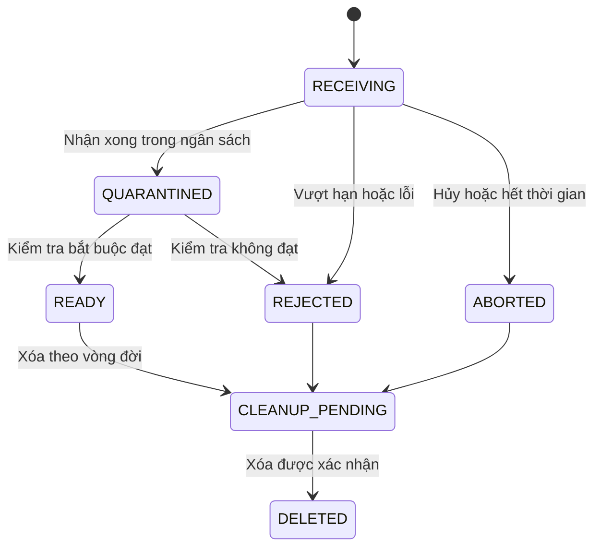
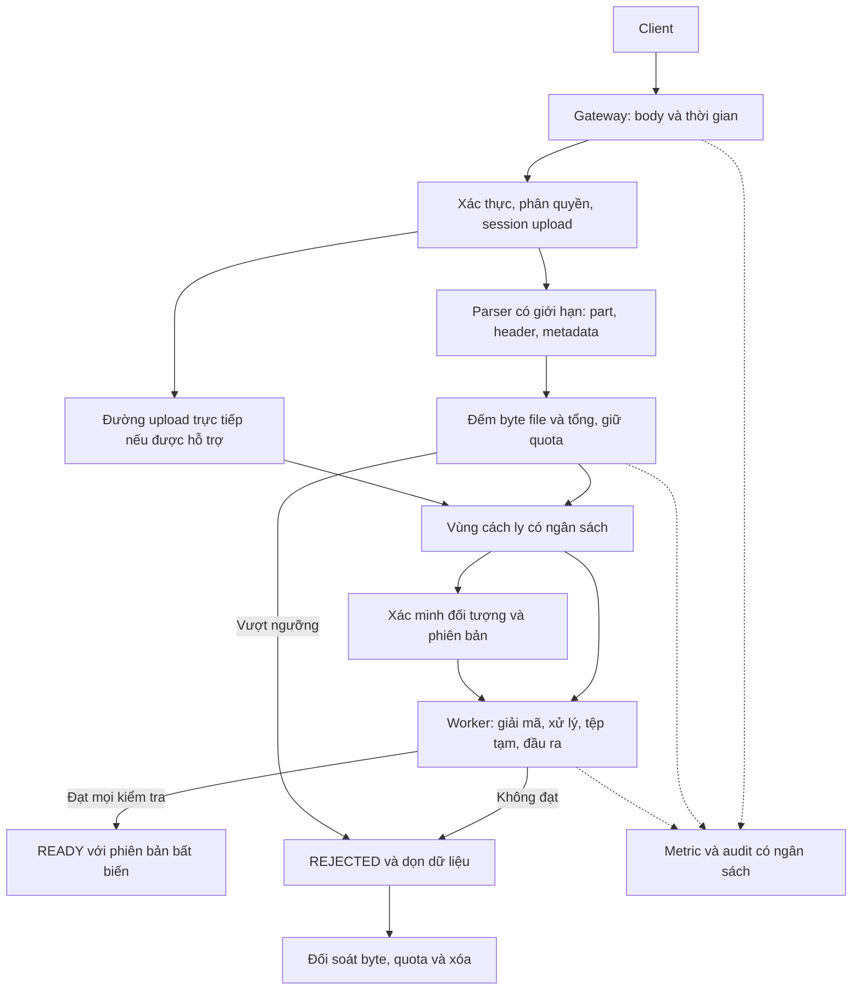

# File size limit

## 1. Mục tiêu của yêu cầu giới hạn kích thước tệp

**File size limit** là giới hạn được thực thi đối với số byte của tệp hoặc một biểu diễn cụ thể của tệp tại một điểm trong vòng đời xử lý. Yêu cầu cần xác định rõ đang giới hạn dữ liệu nào, đo ở đâu, vào lúc nào và hệ thống làm gì khi vượt ngưỡng.

Trong chương **File và resource security**, giới hạn kích thước giúp bảo vệ bộ nhớ, đĩa tạm, kho lưu trữ, băng thông và khả năng xử lý. Một tệp quá lớn có thể làm cạn tài nguyên trước khi bước quét hoặc xử lý nội dung bắt đầu.

Tuy nhiên, “tệp không quá 10 MB” chưa phải đặc tả đủ để triển khai. Cần trả lời:

- MB là 1.000.000 byte hay đơn vị khác?
- Đang nói từng tệp, tổng các tệp hay toàn HTTP request?
- Đếm trước hay sau giải mã, giải nén và chuyển đổi?
- Nếu client không khai báo kích thước thì kiểm tra thế nào?
- Dữ liệu vượt ngưỡng đã được ghi tạm hoặc chuyển sang dịch vụ khác chưa?
- Upload trực tiếp vào object storage có chịu cùng chính sách không?

Sau bài học, người học có thể chuyển các rủi ro này thành yêu cầu đo được, liên kết với kiến trúc và xây dựng tiêu chí kiểm thử tại biên, trong tải đồng thời và khi có lỗi.

**Các ngưỡng số trong bài là ví dụ đặc tả, không phải giá trị mặc định cho mọi hệ thống.**

## 2. Tình huống và mô hình đe dọa

Giả sử một nền tảng quản lý hồ sơ đa tenant cho phép người dùng đính kèm nhiều tệp. Tenant là ranh giới tổ chức; người dùng chỉ được tải tệp lên hồ sơ mà mình có quyền chỉnh sửa.

Tệp được nhận, lưu tại vùng cách ly, kiểm tra theo chính sách rồi mới được gắn vào hồ sơ và cho phép truy cập.

| Tình huống | Tác động cần ngăn |
| --- | --- |
| Một tệp lớn hơn khả năng xử lý | Cạn bộ nhớ hoặc giữ worker quá lâu |
| Nhiều tệp vừa đủ ngưỡng riêng | Tổng request hoặc tổng lưu trữ vượt ngân sách |
| Client khai báo kích thước thấp hơn dữ liệu thực | Vượt kiểm tra dựa trên metadata |
| Request không có độ dài biết trước | Đọc hoặc ghi không có giới hạn |
| Tệp nén nhỏ nhưng dữ liệu mở ra rất lớn | Cạn tài nguyên khi giải nén hoặc phân tích |
| Ảnh có ít byte nhưng rất nhiều pixel | Bộ nhớ giải mã lớn hơn nhiều kích thước tệp |
| Chia nhỏ tệp thành nhiều lần upload | Mỗi phần hợp lệ nhưng tệp ghép vượt ngưỡng |
| Upload thẳng vào kho lưu trữ | Bỏ qua kiểm tra tại API |
| Tệp bị thay sau khi kiểm tra | Công bố một phiên bản chưa được xác minh |
| Tệp bị từ chối không được dọn | Dung lượng tạm và quota tiếp tục tăng |

OWASP khuyến nghị đặt giới hạn upload và xem xét kích thước sau giải nén nếu hệ thống xử lý tệp nén. Kích thước là một lớp trong bảo vệ upload, cần phối hợp với kiểm tra nội dung, quyền và lưu trữ. [Nguồn: OWASP File Upload Cheat Sheet](https://cheatsheetseries.owasp.org/cheatsheets/File_Upload_Cheat_Sheet.html).

### Chuỗi truy vết mẫu

| Thành phần | Ví dụ |
| --- | --- |
| Rủi ro | Một request nhiều tệp làm đầy đĩa tạm trước khi controller chạy |
| Mục tiêu | Không cho dữ liệu upload vượt ngân sách nhận và lưu tạm |
| Yêu cầu | Giới hạn từng tệp, tổng tệp, toàn request và số upload đồng thời |
| Thiết kế | Giới hạn ở gateway và multipart parser; bộ đếm stream; vùng cách ly có quota |
| Bằng chứng | Thử dữ liệu vượt biên và đo byte thực ghi, bộ nhớ, dung lượng còn tồn |

Tên một middleware không thay thế được yêu cầu. Cần biết middleware đo đại lượng nào và có đọc hoặc ghi toàn bộ request trước khi phát hiện vi phạm hay không.

## 3. Đơn vị và các lớp kích thước

### 3.1. Ghi số byte chính xác

Trong bộ ví dụ này:

```text
1 KiB = 1.024 byte
1 MiB = 1.048.576 byte
1 GiB = 1.073.741.824 byte

10 MiB = 10.485.760 byte
10 MB  = 10.000.000 byte
```

Nếu sản phẩm hiển thị “10 MB” nhưng backend dùng 10 MiB, cần làm rõ hợp đồng và thông báo cho người dùng. Không để gateway, ứng dụng và kho lưu trữ tự hiểu cùng một chuỗi cấu hình theo các đơn vị khác nhau.

Mọi phép tính tổng hoặc chuyển đơn vị phải dùng kiểu số đủ lớn và kiểm tra tràn. Không chuyển kích thước không tin cậy sang kiểu số nhỏ rồi mới so với giới hạn.

### 3.2. Phân biệt các đại lượng

| Đại lượng | Nội dung được tính |
| --- | --- |
| Kích thước toàn request body | Nội dung HTTP sau loại bỏ framing truyền tải, trước phân tích multipart |
| Kích thước từng file part | Byte nội dung tệp, không gồm boundary và header của part |
| Tổng nội dung các tệp | Tổng byte của tất cả file part được nhận |
| Metadata multipart | Tên trường, tên tệp, header và giá trị trường theo phạm vi quy định |
| Dữ liệu sau giải mã | Ví dụ byte tệp nhị phân sau Base64 |
| Dữ liệu sau giải nén | Byte thực sinh ra khi mở nội dung nén |
| Biểu diễn xử lý | Pixel, trang, cấu trúc parse hoặc bộ đệm giải mã |
| Kết quả và tệp tạm | Preview, bản chuyển đổi, bản sao và dữ liệu trung gian |
| Dung lượng tích lũy | Tổng tệp đang lưu, cách ly, chờ xóa và phần ngân sách đang giữ |

Một giới hạn không tự bao phủ các lớp còn lại.

Ví dụ, ba tệp 10 MiB đáp ứng tổng nội dung tệp 30 MiB nhưng toàn request multipart lớn hơn 30 MiB do boundary, header và metadata.

Multipart là cấu trúc nhiều part; một trường có thể chứa nhiều tệp được biểu diễn bằng các part riêng. Vì vậy, phải đếm mọi file part theo hợp đồng, không chỉ tên trường đầu tiên mà controller sử dụng. [Nguồn: RFC 7578, mục 4](https://www.rfc-editor.org/rfc/rfc7578.html#section-4).

### 3.3. Byte khác ký tự

Kích thước một chuỗi theo ký tự không bằng số byte UTF-8. Với trường văn bản hoặc tên tệp có Unicode, phải định nghĩa giới hạn theo đúng đơn vị mà parser và hệ thống lưu trữ cần bảo vệ.

Giới hạn byte của metadata không thay thế việc kiểm tra tên tệp an toàn hoặc quyền truy cập. Các yêu cầu đó cần tồn tại riêng.

## 4. Bộ chính sách mẫu cho upload đính kèm

Giả sử endpoint nhận multipart không nén ở tầng HTTP:

| Thành phần | Ngưỡng ví dụ |
| --- | --- |
| Số tệp mỗi request | Tối đa năm |
| Nội dung mỗi tệp | Lớn hơn 0 và không vượt 10 MiB |
| Tổng nội dung các tệp | Không vượt 30 MiB |
| Toàn request body | Không vượt 32 MiB, gồm multipart framing và metadata |
| Trường văn bản | Tối đa tám trường, mỗi trường tối đa 4 KiB |
| Tổng giá trị trường văn bản | Không vượt 16 KiB |
| Header của từng multipart part | Không vượt 2 KiB |
| Tổng header multipart | Không vượt 16 KiB |
| Thời gian nhận request | Tối đa 120 giây theo hồ sơ mạng nghiệm thu |
| Upload đang hoạt động | Hai request mỗi người dùng, mười mỗi tenant, 100 toàn cụm |

Giới hạn body trên không tính header HTTP bên ngoài hay overhead của TLS và mạng. Các lớp đó có ngân sách riêng. Endpoint không chấp nhận HTTP Content-Encoding nén; nếu bổ sung hỗ trợ sau này, phải đặc tả thêm giới hạn trước và sau giải nén HTTP.

Các điều kiện áp dụng đồng thời. Năm tệp 8 MiB bị từ chối vì tổng là 40 MiB dù từng tệp còn dưới 10 MiB.

Đúng ngưỡng được phép tiếp tục nếu đáp ứng các điều kiện khác. Một tệp đúng 10 MiB không bị coi là quá lớn; tệp 10 MiB cộng một byte thì bị từ chối.

Request có tệp rỗng được xử lý theo quy tắc dữ liệu đầu vào của ví dụ, không mặc định là lỗi vượt kích thước. Các lỗi cần có mã phân biệt.

## 5. Đo dữ liệu thực khi nhận stream

### 5.1. Metadata chỉ giúp từ chối sớm

Nếu một độ dài khai báo đáng tin cậy ở tầng giao thức đã lớn hơn trần, hệ thống có thể từ chối sớm. Nhưng tên tệp, trường fileSize, kích thước client gửi hoặc riêng Content-Length không thay thế việc thực thi giới hạn tại đường nhận thực tế.

Request hợp lệ có thể không có độ dài biết trước tùy giao thức và cách truyền. Bộ nhận vẫn cần đếm byte từ stream.

Nếu thông điệp có framing hoặc khai báo độ dài không hợp lệ, HTTP stack phải xử lý theo quy tắc giao thức. Ứng dụng không tự suy đoán phần dữ liệu thừa rồi tiếp tục trên một kết nối có trạng thái không rõ.

### 5.2. Giới hạn trước khi ghi thêm

Logic khái niệm cho nội dung một file part:

```text
file_bytes = 0

while còn dữ liệu:
    chunk = read_at_most(64 KiB)
    n = chunk.length

    if n > per_file_limit - file_bytes:
        reject_and_cleanup()

    if n > request_file_budget - total_file_bytes:
        reject_and_cleanup()

    ensure_storage_budget_before_write(n)
    write_to_quarantine(chunk)

    file_bytes += n
    total_file_bytes += n
```

Phép so với phần còn lại tránh cộng tràn khi dữ liệu đầu vào hoặc bộ đếm có vấn đề. Vẫn cần kiểm tra miền giá trị và giới hạn của kiểu số.

Đây là pseudocode mô tả bất biến, không phải thư viện upload hoàn chỉnh. Bộ đếm toàn request, số part, header và metadata phải nằm tại lớp có thể quan sát đúng dữ liệu tương ứng.

Khi đã đọc đúng ngưỡng, cần xác định EOF hoặc phát hiện dữ liệu tiếp theo. Không được từ chối tệp đúng ngưỡng chỉ vì chưa biết còn byte hay không.

### 5.3. Dữ liệu vượt ngưỡng có thể đã vào bộ đệm

Nhận theo stream không có nghĩa hệ thống chưa từng thấy một byte vượt mức. Để phát hiện, có thể đã đọc thêm tối đa một chunk hoặc lượng đệm có giới hạn.

Trong ví dụ, phần code nhận nội dung chỉ đọc thêm tối đa một chunk 64 KiB tại điểm phát hiện; chunk làm vượt ngưỡng không được ghi vào tệp cách ly. Bộ đệm của proxy, framework, socket và TLS phải được tính riêng theo kiến trúc.

Không được tuyên bố “streaming nên không tốn RAM” nếu gateway vẫn buffer toàn request hoặc framework tạo một mảng byte đầy đủ trước khi controller chạy.

### 5.4. Phát hiện sớm tại nhiều lớp

- Gateway giới hạn body trước khi chuyển quá nhiều dữ liệu vào ứng dụng.
- HTTP server và multipart parser giới hạn body, số part, header và metadata.
- Logic upload kiểm tra từng tệp, tổng tệp và quota tenant.
- Kho lưu trữ hoặc đường ghi giới hạn byte được giữ.
- Worker giới hạn biểu diễn sau giải mã, dữ liệu tạm và đầu ra.

Nếu một đường gọi nội bộ bỏ qua gateway, các yêu cầu còn lại vẫn phải bảo vệ hệ thống. Không dựa vào một lớp duy nhất để bao phủ mọi entry point.

## 6. Giải mã, giải nén và xử lý nội dung

### 6.1. Base64 làm tăng kích thước biểu diễn

Nếu bổ sung một API JSON chứa Base64, phải giới hạn cả chuỗi đầu vào và byte tệp sau giải mã.

Với Base64 thông thường có padding:

```text
encoded_length = 4 × ceil(binary_length / 3)
```

Tệp nhị phân 10 MiB cần 13.981.016 ký tự Base64, chưa tính JSON và metadata. Vì vậy, không thể lấy giới hạn request body 10 MiB để hỗ trợ trọn vẹn tệp nhị phân 10 MiB theo cách biểu diễn này.

Bộ giải mã phải có giới hạn đầu vào và đầu ra, từ chối dạng không hợp lệ theo hợp đồng. Không giải mã toàn bộ vào RAM rồi mới kiểm tra số byte thu được.

API Base64 mới cũng không được trở thành đường cho phép tệp nhị phân lớn hơn endpoint multipart.

### 6.2. Kích thước nén không phải kích thước giải nén

Đường đính kèm trong ví dụ không tự giải nén archive. Nếu sản phẩm có endpoint import ZIP riêng, cần một hồ sơ giới hạn riêng, chẳng hạn:

- Archive đầu vào tối đa 10 MiB.
- Tổng byte được giải nén tối đa 100 MiB.
- Từng entry tối đa 10 MiB.
- Tối đa 1.000 entry theo quy tắc đếm đã công bố.
- Không giải nén archive lồng trong hồ sơ ví dụ.
- Có ngân sách CPU, bộ nhớ, thời gian và dung lượng tạm.

Đếm byte thực sinh ra trong lúc giải nén; không chỉ tin kích thước khai báo trong metadata archive.

Tỷ lệ nén có thể là tín hiệu bổ sung nhưng không thay thế trần tuyệt đối. Cần xử lý trường hợp dữ liệu nén rỗng hoặc rất nhỏ mà không gây chia cho không hoặc bỏ kiểm tra.

Một archive 10 MiB mở ra 2 GiB không đáp ứng hồ sơ trên. Phải dừng trước khi ghi toàn bộ 2 GiB, không chờ hoàn tất để báo lỗi.

Giới hạn kích thước cũng không thay thế kiểm tra đường dẫn entry, liên kết hoặc quyền ghi. Chúng là yêu cầu khác cùng bảo vệ bước giải nén.

### 6.3. Tệp nhỏ có thể cần bộ nhớ lớn

Một ảnh nhiều pixel có thể có ít byte nén. Ví dụ, 20 triệu pixel ở biểu diễn bốn byte mỗi pixel đã cần khoảng 80 triệu byte chỉ cho một vùng pixel, chưa tính bản sao và cấu trúc của thư viện.

Vì vậy, bước tạo preview cần thêm giới hạn số pixel, kích thước chiều, số frame hoặc trang, bộ nhớ và thời gian. Phép nhân chiều rộng với chiều cao phải kiểm tra tràn trước khi cấp phát.

Tương tự, PDF hoặc định dạng tài liệu có cấu trúc nén bên trong có thể tạo nhiều đối tượng hoặc trang khi parse. Giới hạn byte tệp đầu vào không chứng minh parser có ngân sách an toàn.

Một hồ sơ xử lý phải công bố các ngưỡng này theo loại nội dung được hỗ trợ và kết quả đo. Không suy ra rằng mọi tệp dưới 10 MiB đều an toàn cho worker.

### 6.4. Giới hạn đầu ra và tệp trung gian

Preview, ảnh chuyển đổi, bản xuất và file tạm cũng có thể vượt xa đầu vào. Cần hạn mức cho:

- Một tệp đầu ra.
- Tổng đầu ra của một tác vụ.
- Tổng dung lượng tạm đang giữ.
- Số tác vụ xử lý đồng thời.
- Thời hạn giữ dữ liệu thất bại và dữ liệu chờ dọn.

Nếu đầu ra vượt trần, dừng và kết thúc tác vụ theo hợp đồng. Không công bố tệp bị cắt chỉ để làm vừa giới hạn.

## 7. Upload nhiều phần, tiếp tục và upload trực tiếp

### 7.1. Chunk nhỏ không chứng minh tệp ghép nhỏ

Trong upload có thể tiếp tục, từng chunk có thể hợp lệ nhưng tổng tệp logic vẫn quá lớn. Cần xác định upload session thuộc ai, tệp đích nào, kích thước tối đa và thời điểm hết hạn.

Các yêu cầu cần bao gồm:

- Trần từng chunk, số chunk và tổng byte của một upload session.
- Quy tắc thứ tự, offset, phần thiếu và phần chồng lấn.
- Xử lý retry cùng một chunk mà không tính hai lần vào kích thước logic.
- Hạch toán bản sao hoặc phiên bản chunk thực sự chiếm lưu trữ.
- Kiểm tra đối tượng hoàn chỉnh trước công bố.
- Dọn session không hoàn tất và các phần còn sót.

Nếu tệp hoàn chỉnh có trần 10 MiB, mười một chunk 1 MiB không được tạo thành một tệp hợp lệ 11 MiB.

Kích thước tổng do client khai báo có thể hỗ trợ giữ ngân sách, nhưng kích thước thực được lưu và đối tượng hoàn chỉnh vẫn phải được kiểm tra.

### 7.2. Upload trực tiếp vào object storage

Khi API chỉ cấp URL hoặc quyền upload, dữ liệu có thể không đi qua ứng dụng. Giới hạn của controller không bảo vệ đường đó.

Luồng cần có:

1. Xác thực người dùng, quyền sửa hồ sơ và tenant.
2. Tạo upload session gắn với khóa đối tượng do server chọn, giới hạn và thời hạn.
3. Giữ ngân sách lưu trữ phù hợp.
4. Upload vào vùng riêng tư hoặc cách ly.
5. Xác minh kích thước từ nguồn lưu trữ có thẩm quyền, cùng phiên bản và dữ liệu cần thiết.
6. Chỉ gắn vào hồ sơ hoặc cấp quyền đọc sau khi mọi kiểm tra bắt buộc đạt.
7. Dọn phần không được chấp nhận và đối soát ngân sách.

Nếu cơ chế kho lưu trữ hỗ trợ chặn kích thước tại lúc ghi, cần cấu hình và kiểm thử cơ chế đó. Nếu chỉ phát hiện ở bước hoàn tất, hệ thống có thể ngăn công bố nhưng đã phải trả tài nguyên nhận và lưu đối tượng quá lớn.

Vì vậy, không cam kết rằng vùng cách ly không thể chứa tệp quá ngưỡng nếu đường ghi không thực thi điều đó. Cần giới hạn vùng cách ly, session, phần chưa hoàn tất hoặc dùng đường nhận có thể cưỡng chế trần trước khi ghi thêm.

### 7.3. Ràng buộc đúng phiên bản đã kiểm tra

Kiểm tra một đối tượng rồi cho phép client ghi đè cùng key tạo khoảng trống giữa kiểm tra và sử dụng.

Đối tượng công bố phải là đúng phiên bản hoặc nội dung bất biến đã được kiểm tra. Có thể dùng version ID, đường ghi không cho sửa sau hoàn tất hoặc cơ chế tương đương đã xác định.

URL upload có thời hạn không mặc nhiên là quyền dùng một lần. Quy trình cần kiểm soát việc dùng lại và thay đổi đối tượng theo khả năng thực tế của nền tảng lưu trữ.

## 8. Dung lượng tích lũy và vòng đời tệp

### 8.1. Một tệp nhỏ không ngăn hết dung lượng

Một nghìn tệp dưới 10 MiB vẫn có thể chiếm gần 10 GiB. Cần thêm quota theo người dùng, tenant và kho lưu trữ, cùng giới hạn upload đồng thời hoặc tốc độ nhận.

Ví dụ quota tenant:

```text
used_bytes + reserved_bytes <= 10 GiB
```

Trong đó phạm vi used phải nói rõ có tính vùng cách ly, phiên bản cũ, tệp chờ xóa và upload chưa hoàn tất hay không.

Trong bộ yêu cầu ví dụ, mọi byte đối tượng thuộc tenant đang thực sự được giữ đều phải được hạch toán theo loại kho; bản sao vật lý cần ngân sách hạ tầng riêng nếu quota sản phẩm chỉ tính tệp logic. Không dùng một con số quota để ngầm đại diện cả hai.

Nếu chưa biết độ dài tệp, có thể giữ ngân sách theo trần được phép hoặc cấp thêm theo từng bước trước khi ghi. Cách cấp thêm phải tránh tranh chấp giữa các upload song song.

### 8.2. Dữ liệu chưa dọn vẫn chiếm tài nguyên

Khi tệp bị từ chối, có thể thu hồi quyền truy cập ngay nhưng việc xóa vật lý xảy ra sau. Phần chưa xóa không được coi là đã giải phóng trong ngân sách cần bảo vệ lưu trữ.

Ví dụ mục tiêu dọn là mười phút. Nếu xóa thất bại, ghi nhận vi phạm thời hạn, cảnh báo và tiếp tục tính dung lượng; không chỉ trả quota rồi bỏ quên đối tượng.

Đĩa tạm trên node cũng cần hard limit và phần dự phòng. Không để các tệp dở dang làm đầy phân vùng chứa log, runtime hoặc thành phần khác.

### 8.3. Trạng thái có ý nghĩa bảo mật



Tệp chỉ được sử dụng theo trạng thái phù hợp. Nhận xong dữ liệu chưa đồng nghĩa tệp đã an toàn hoặc đã được công bố.

## 9. Bộ yêu cầu mẫu có thể nghiệm thu

### FS-001 — Hợp đồng byte và miền dữ liệu

Endpoint áp dụng các ngưỡng tại mục 4. Cấu hình và tài liệu phải biểu diễn bằng số byte chính xác; hiển thị đơn vị cho người dùng nhất quán với backend.

Từng tệp phải lớn hơn 0 và không vượt 10.485.760 byte. Tổng nội dung tệp không vượt 31.457.280 byte. Toàn request body không vượt 33.554.432 byte theo phạm vi đã định nghĩa.

HTTP Content-Encoding nén không thuộc hợp đồng của endpoint này. Dữ liệu hoặc kiểu mã hóa không hỗ trợ bị từ chối trước xử lý nghiệp vụ theo mã lỗi phù hợp.

### FS-002 — Cưỡng chế khi nhận

Giới hạn phải có hiệu lực kể cả khi không có độ dài biết trước. Hệ thống đếm byte thực ở lớp nhận và parser, không dựa riêng vào thông tin client khai báo.

Tại đường ghi file part, chunk làm vượt trần không được ghi vào vùng cách ly. Kích thước chunk đọc của đoạn nhận nội dung tối đa 64 KiB. Mọi bộ đệm ở gateway hoặc framework phải được cấu hình, đo và nằm trong ngân sách đã công bố.

Tổng bộ đệm nội dung phục vụ nhận và parse không vượt 1 MiB mỗi request trong hồ sơ ví dụ; phần framework buffer toàn body cũng thuộc phạm vi này. Chi phí runtime, TLS và socket cần được đo trong ngân sách node riêng.

### FS-003 — Multipart và nhiều tệp

Áp dụng đồng thời giới hạn số file, số trường, byte từng file, tổng file, metadata và body. Phải đếm cả những file part mà logic nghiệp vụ sẽ không sử dụng; không cho dữ liệu dư trở thành đường lưu tạm vô hạn.

Trong ví dụ, request đính kèm là toàn bộ cùng thành công hoặc toàn bộ bị từ chối. Nếu tệp thứ năm vượt ngưỡng, các tệp trước đó không được âm thầm gắn vào hồ sơ.

Dữ liệu riêng tư đã nhận có thể tạm còn để dọn nhưng không được truy cập như tệp READY. Quá trình rollback và dọn vẫn được hạch toán.

### FS-004 — Quyền và ngân sách lưu trữ

Người dùng phải có quyền tạo đính kèm trên hồ sơ và tenant đích. Danh tính tenant dùng tính quota lấy từ ngữ cảnh đã xác thực và kiểm tra quyền.

Trước khi ghi thêm, hệ thống giữ được ngân sách tương ứng. Quota tenant trong ví dụ là 10 GiB theo các loại dữ liệu đã công bố; upload đồng thời không được vượt trần do cùng đọc một số dư cũ.

Vùng tạm mỗi node có ngân sách cứng 5 GiB dành riêng cho workload này và có phần dự phòng hạ tầng ngoài ngân sách đó. Khi không xác minh được ngân sách, không tiếp tục nhận dữ liệu theo giả định còn chỗ.

### FS-005 — Các đường upload tương đương

Web, mobile, API nội bộ, import, upload có thể tiếp tục và upload trực tiếp phải có chính sách tương ứng cho cùng loại tệp nghiệp vụ.

Chia nhỏ không làm tăng trần tệp hoàn chỉnh. Metadata hoặc callback hoàn tất không được tự xác nhận kích thước; phải kiểm chứng từ đối tượng thực hoặc nguồn lưu trữ đáng tin cậy.

Chỉ công bố đúng phiên bản đã kiểm tra, không cho ghi đè làm thay nội dung sau xác minh mà không quay lại quy trình kiểm tra.

### FS-006 — Xử lý sau upload

Mỗi loại xử lý nội dung phải có hồ sơ riêng về dữ liệu sau giải mã hoặc giải nén, số đối tượng, bộ nhớ, thời gian, dung lượng tạm và đầu ra.

Nếu không có hồ sơ xử lý được hỗ trợ, không tự giải nén hoặc chuyển đổi tệp trong luồng chung. Kích thước đầu vào dưới ngưỡng không miễn các kiểm tra sau đó.

Vượt ngân sách xử lý phải kết thúc có kiểm soát, không công bố đầu ra thiếu và không để tiến trình con chạy tiếp không giới hạn.

### FS-007 — Thời gian và thu hồi

Request nhận dữ liệu tối đa 120 giây trong hồ sơ mạng đã phê duyệt. Có giới hạn thời gian chờ không có dữ liệu theo cấu hình đã kiểm chứng; giới hạn byte không thay thế giới hạn giữ kết nối.

Khi phát hiện vượt ngưỡng hoặc nhận hủy, dừng tạo dữ liệu và chuyển trạng thái trong phạm vi có thể thực thi an toàn; thu hồi bộ đệm ứng dụng và quyền upload hoạt động trong năm giây.

Dữ liệu tạm của upload thất bại phải được dọn trong mười phút. Nếu chưa xóa được, tiếp tục tính byte, ghi lỗi và áp backpressure khi cần. Không đánh dấu đã giải phóng chỉ vì đã gửi yêu cầu xóa.

### FS-008 — Hợp đồng lỗi

Nếu nội dung HTTP vượt khả năng nhận theo giới hạn kích thước, API sử dụng 413 theo hợp đồng. RFC 9110 mô tả 413 Content Too Large cho trường hợp server từ chối vì nội dung lớn hơn mức sẵn sàng hoặc có thể xử lý. [Nguồn: RFC 9110, mục 15.5.14](https://www.rfc-editor.org/rfc/rfc9110.html#section-15.5.14).

Mã lỗi ứng dụng phải phân biệt vượt mỗi tệp, tổng tệp, body, metadata, quota lưu trữ và ngân sách xử lý sau upload. Không mặc định mọi lỗi đều là cùng một loại 413.

Hệ thống dừng hoặc kết thúc luồng theo quy tắc giao thức. Không cố đọc hết dữ liệu quá lớn chỉ để trả lỗi; cũng không tiếp tục tái sử dụng một kết nối có framing chưa được xử lý an toàn. Khả năng client nhận được phản hồi cụ thể phụ thuộc trạng thái kết nối và phải được ghi trong hợp đồng.

Không tự cắt tệp cho vừa ngưỡng. Với trần cố định, client phải giảm dữ liệu hoặc chọn phương án khác; gửi lại cùng nội dung không tự giải quyết được vi phạm.

### FS-009 — Quan sát và thay đổi chính sách

Ghi mã chính sách, phiên bản, loại giới hạn, ngưỡng byte, byte quan sát tại điểm từ chối, upload ID và request ID theo chính sách dữ liệu.

Không log nội dung tệp, token upload hoặc URL có thông tin xác thực. Tên tệp do người dùng nhập cần được xử lý an toàn và giới hạn độ dài nếu được ghi.

Thay đổi ngưỡng phải đánh giá gateway, parser, bộ nhớ, quota, worker và kho lưu trữ. Không tăng giới hạn giao diện rồi để một tầng phía sau áp ngưỡng khác ngoài hợp đồng.

## 10. Kiến trúc tham chiếu



Đường upload trực tiếp cần được cấu hình để không bỏ qua kiểm tra kích thước và vùng cách ly. Các thành phần có thể khác sơ đồ, nhưng điểm quyết định phải nằm trước tác động tài nguyên mà nó có trách nhiệm ngăn.

Metric nên phân biệt byte nhận, byte ghi, byte đang giữ, upload bị từ chối, lỗi dọn, thời gian nhận và thời gian xử lý. Số byte quan sát lúc từ chối không nhất thiết là kích thước toàn tệp vì hệ thống chủ động dừng sớm.

Không dùng tên tệp, upload ID hoặc giá trị đầu vào tùy ý làm nhãn metric có số lượng giá trị không giới hạn. Giữ chi tiết cần điều tra trong log được phân quyền và có thời hạn lưu.

## 11. Kiểm thử và bằng chứng nghiệm thu

Kiểm thử cần dùng file và môi trường được phép, có cấu hình tài nguyên được ghi lại. Chỉ kiểm tra một HTTP status chưa chứng minh dữ liệu không làm đầy bộ nhớ hoặc đĩa.

| Mã | Yêu cầu | Kịch bản | Bằng chứng cần có |
| --- | --- | --- | --- |
| T-01 | FS-001, FS-002 | Tệp ngay dưới, đúng và trên 10 MiB một byte | Quyết định đúng biên; byte vượt không được ghi |
| T-02 | FS-003 | Từng tệp hợp lệ nhưng tổng vượt 30 MiB | Từ chối toàn request theo hợp đồng |
| T-03 | FS-003 | Nội dung file chưa vượt nhưng multipart làm body vượt 32 MiB | Giới hạn body hoạt động độc lập |
| T-04 | FS-002 | Luồng không có độ dài biết trước | Bộ đếm thực có hiệu lực; không đọc hoặc ghi vô hạn |
| T-05 | FS-003 | Nhiều part, header lớn, trường văn bản lớn hoặc trùng tên | Parser từ chối sớm, bộ nhớ và đĩa có giới hạn |
| T-06 | FS-001, FS-006 | API mã hóa khác được hỗ trợ; dữ liệu giải mã hoặc giải nén vượt trần | Kiểm tra cả đầu vào lẫn biểu diễn sinh ra |
| T-07 | FS-006 | Tệp nhỏ nhưng nhiều pixel, trang hoặc cấu trúc xử lý | Worker giữ ngân sách, dừng có kiểm soát |
| T-08 | FS-005 | Mỗi chunk hợp lệ nhưng tệp ghép quá lớn; chunk lặp hoặc chồng | Không công bố tệp vượt; hạch toán logic và byte vật lý đúng |
| T-09 | FS-005 | Upload trực tiếp quá ngưỡng; callback khai báo thấp hơn thực tế | Đối tượng không được READY; nhận diện chi phí vùng cách ly |
| T-10 | FS-005 | Đổi nội dung cùng key sau khi đã kiểm tra | Không công bố phiên bản chưa được xác minh |
| T-11 | FS-004 | Nhiều upload tranh dung lượng quota cuối | Không vượt ngân sách do race; byte và reservation khớp |
| T-12 | FS-007 | Client ngắt, upload chậm, worker chết hoặc xóa thất bại | Thu hồi đúng hạn; dữ liệu tồn vẫn được tính |
| T-13 | FS-003, FS-008 | File cuối trong batch vượt giới hạn | Không gắn một phần ngoài hợp đồng, không giữ tệp công khai dở dang |
| T-14 | FS-009 | Các tầng có cấu hình khác nhau; log từ chối tăng cao | Hợp đồng lỗi rõ; metric và log không làm cạn tài nguyên |

Với trường hợp không có Content-Length, dùng cách truyền hợp lệ của giao thức đang kiểm thử. Trường hợp framing sai là bài kiểm tra HTTP stack riêng; không trộn kết quả để suy ra stream hợp lệ đã được giới hạn.

Hồ sơ nghiệm thu cần giữ cấu hình từng tầng, phiên bản parser, dữ liệu thử, kích thước thực, byte đã nhận và ghi, mức bộ nhớ, đĩa tạm, đối tượng còn tồn và thời gian dọn. Đối chiếu trạng thái upload với kho lưu trữ sau khi phép thử kết thúc.

Nếu upload bị trả lỗi nhưng tệp vẫn truy cập được hoặc không còn bị tính quota, yêu cầu chưa đạt dù phản hồi có đúng mã 413.

## 12. Sai lầm thường gặp và duy trì yêu cầu

| Sai lầm | Hệ quả | Cách làm rõ |
| --- | --- | --- |
| “Tối đa 10 MB” không định nghĩa đơn vị | Các tầng áp giá trị khác nhau | Ghi byte chính xác và phạm vi |
| Chỉ kiểm fileSize từ client | Kích thước khai báo không chứng minh dữ liệu thực | Đếm stream hoặc xác minh kho có thẩm quyền |
| Đọc toàn tệp rồi kiểm tra | Bộ nhớ đã bị tiêu thụ trước khi từ chối | Giới hạn parser, buffer và đường ghi |
| Chỉ giới hạn từng tệp | Nhiều tệp hợp lệ làm tổng quá lớn | Trần số tệp, tổng nội dung và request |
| Chỉ giới hạn kích thước nén | Dữ liệu mở ra có thể rất lớn | Trần sau giải nén và ngân sách xử lý |
| Chỉ giới hạn từng chunk | Tệp ghép vượt trần | Upload session và kiểm tra đối tượng hoàn chỉnh |
| URL upload trực tiếp bỏ qua API | Tầng nhận thực không áp giới hạn | Chính sách tại kho, cách ly và xác minh hoàn tất |
| Kiểm một phiên bản, dùng phiên bản khác | Nội dung sau kiểm tra chưa được tin cậy | Ràng buộc phiên bản hoặc đối tượng bất biến |
| Trả quota ngay khi yêu cầu xóa | Byte chưa xóa có thể làm đầy lưu trữ | Giữ hạch toán đến khi xác nhận giải phóng |
| Cắt tệp thay vì từ chối | Công bố dữ liệu hỏng hoặc thiếu | Lỗi rõ, không tạo tệp READY không đầy đủ |

Ở bước phân tích, xác định nhu cầu tệp hợp lệ và rủi ro tài nguyên trên toàn vòng đời. Chọn phạm vi file, request, biểu diễn xử lý và dung lượng tích lũy theo chức năng nghiệp vụ.

Ở bước thiết kế, phân bổ ngưỡng tại gateway, parser, ứng dụng, kho lưu trữ và worker. Ghi rõ điểm đếm byte, khả năng buffer, đường upload trực tiếp, quota và cơ chế dọn.

Ở bước triển khai, dùng cấu hình có phiên bản và giá trị byte nhất quán. Kiểm tra giới hạn của thư viện trước controller và tránh API làm nạp toàn bộ dữ liệu ngoài ngân sách.

Ở bước kiểm thử, nối yêu cầu với biên chính xác, nhiều tệp, stream không biết độ dài, xử lý mở rộng và lỗi vòng đời. Khi thay cơ chế upload hoặc thư viện xử lý, đánh giá lại đường đo và bộ đệm.

Ở bước vận hành, theo dõi upload bị từ chối, dung lượng cách ly, lỗi dọn và nhu cầu hợp lệ bị chặn. Trước khi nâng trần, kiểm chứng năng lực của mọi tầng liên quan thay vì chỉ sửa thông báo trên giao diện.

Một yêu cầu file size limit có thể nghiệm thu phải nối được **rủi ro → biểu diễn được đo → đơn vị và ngưỡng → điểm cưỡng chế → hành vi dừng và dọn → đối tượng được công bố → bằng chứng tài nguyên và kiểm thử**. Liên kết này biến một con số kích thước thành kiểm soát bảo mật thực sự trong vòng đời tệp.
