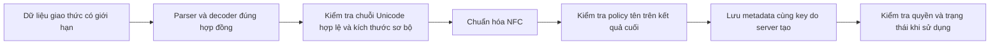

# Filename normalization

## 1. Mục tiêu bảo mật của chuẩn hóa tên tệp

Filename normalization là quá trình đưa tên tệp về một biểu diễn xác định theo chính sách, để các thành phần có thể lưu, so sánh và hiển thị nhất quán. Trong thiết kế yêu cầu bảo mật, cần xác định cả dữ liệu đầu vào, phép biến đổi, tiêu chí chấp nhận và cách sử dụng kết quả. “Làm sạch tên tệp” chưa cho biết những điều đó.

Một nền tảng học tập nhận bài tập và tài liệu bằng tiếng Việt. Người học có thể tải lên tên chứa dấu, tên trùng với bài trước hoặc một chuỗi trông như đường dẫn. Nếu ứng dụng ghép tên người dùng vào thư mục lưu, một lỗi tên có thể thành ghi ngoài phạm vi, ghi đè hoặc truy cập nhầm tài nguyên. Nếu chỉ bỏ dấu để tạo tên lưu, nhiều tên khác nhau có thể trở thành cùng một tên.

Chuẩn hóa cần đi cùng kiểm tra hợp lệ, định danh tài nguyên, phân quyền và thao tác lưu an toàn. Tên hiển thị hợp lệ chưa chứng minh nội dung tệp an toàn; một tên đã được NFC chưa trở thành đường dẫn được phép; một ID khó đoán cũng chưa thay kiểm tra quyền.

[OWASP File Upload Cheat Sheet](https://cheatsheetseries.owasp.org/cheatsheets/File_Upload_Cheat_Sheet.html#filename-safety) khuyến nghị dùng tên lưu do ứng dụng tạo và đặt giới hạn cho tên người dùng. Bài này cụ thể hóa lựa chọn đó thành yêu cầu cho upload, đổi tên, xử lý nền, download và export trong module File và resource security.

Các quy tắc và con số dưới đây là profile giả định cho tài liệu bài tập. Chúng minh họa cách chuyển rủi ro thành điều kiện đo được, không phải bộ quy tắc tên tệp phổ quát cho mọi hệ điều hành hoặc mọi sản phẩm.

## 2. Phân biệt tên người dùng, nhãn hiển thị và định danh lưu trữ

Một trường `filename` duy nhất thường bị dùng cho quá nhiều mục đích. Thiết kế nên xác định các giá trị riêng và nguồn tạo của chúng:

| Giá trị | Nguồn | Vai trò và giới hạn |
|---|---|---|
| Tên nhận qua giao thức | Client hoặc hệ thống nhập liệu | Dữ liệu không tin cậy, còn phụ thuộc parser/encoding của kênh |
| `displayName` | Server chuẩn hóa và kiểm tra theo policy | Nhãn cho người dùng; không quyết định vị trí lưu hoặc quyền truy cập |
| `assetId` | Server tạo | Định danh bản ghi tài nguyên, dùng trong kiểm tra quyền và API |
| `storageKey` | Server tạo từ định danh và cấu trúc nội bộ | Địa chỉ object/tệp thực, không ghép trực tiếp từ displayName |
| `downloadName` | Server chọn theo policy đầu ra | Gợi ý tên tải xuống, phải tương thích loại nội dung và cách encode header |
| Tên entry trong archive | Bộ export/import theo hợp đồng riêng | Có ngữ nghĩa đường dẫn tương đối, cần kiểm tra theo từng entry |

Ví dụ metadata sau kiểm tra có thể là:

```json
{
  "assetId": "asset-7e41",
  "tenantId": "tenant-a",
  "ownerSubjectId": "student-18",
  "displayName": "Bài tập tuần 1.pdf",
  "namePolicyVersion": "assignment-name-v2",
  "metadataVersion": 4,
  "storageKey": "objects/7e/7e41b9c0a2604df78921456d1d0075a8",
  "resourceState": "QUARANTINED"
}
```

Các ID và key chỉ minh họa cấu trúc. Tenant, owner và key phải xuất phát từ ngữ cảnh được xác minh, không để client khai một `storageKey` nhằm ghi vào tài nguyên có sẵn. Asset ID có thể không bí mật; server luôn kiểm tra người gọi có quyền trên asset đó.

Đổi tên hiển thị không cần di chuyển blob hoặc thay khóa vật lý trong thiết kế này. Một tài nguyên giữ cùng asset ID/storage key và có metadata version mới. Thay nội dung cần quy trình version nội dung riêng, tránh biến đổi tên thành một cách ghi đè không kiểm soát.

Tên gốc nếu cần lưu để hỗ trợ điều tra phải có giới hạn, quyền đọc và biểu diễn an toàn. Không mặc định ghi toàn bộ header hoặc tên chưa kiểm tra vào log. Khi không có nhu cầu giữ nguyên đầu vào, không tạo thêm bản sao dữ liệu cá nhân chỉ vì thuận tiện debug.

## 3. Chốt hợp đồng giải mã ở từng boundary

Tên có thể đến qua multipart, JSON, URL, hàng đợi hoặc archive. Mỗi kênh có quy tắc parse/encoding riêng. Cần biết adapter đã làm gì trước khi gọi hàm chuẩn hóa: giải mã ký tự, xử lý quoting, escape hoặc chuyển dạng tham số nào. Không áp một chuỗi `URL decode` chung cho mọi nguồn.

Một pipeline minh họa:



Với JSON, escape như `\u002f` trong biểu diễn giao thức cần được parser xử lý theo đúng số lớp của JSON. Hàm tên nhận giá trị chuỗi sau parse và phải từ chối ký tự slash nếu profile không cho phép. Nó không được tự giải mã tiếp những chuỗi có vẻ là escape chỉ vì thấy dấu phần trăm hoặc dấu gạch chéo ngược trong dữ liệu.

Ví dụ, chuỗi giá trị JSON chứa ký tự literal `%2F` không tự có nghĩa slash ở lớp metadata. Profile của bài không cho phép `%`, nên từ chối tên đó theo allowlist, không biến nó thành đường dẫn rồi cắt lấy phần cuối. Nếu một sản phẩm cần dấu `%` trong nhãn, phải giữ nghĩa literal và kiểm chứng rằng downstream không tự decode lại.

Tên được URL-encode trong một API dùng path/query cần được xử lý theo hợp đồng của route; ứng dụng phải biết framework đã decode hay chưa. Nếu một tầng kiểm tra trước decode còn tầng lưu dùng sau decode, hai tầng có thể hiểu khác nhau. Quy tắc chính là một chuỗi biến đổi xác định và kiểm tra trên biểu diễn thực sự được dùng, không phải “decode càng nhiều càng an toàn”.

Đầu vào không giải mã được phải có kết quả rõ. Profile yêu cầu decoder nghiêm ngặt cho kênh được cấu hình, không âm thầm thay byte lỗi bằng ký tự thay thế rồi coi là cùng tên. JSON escape có thể tạo surrogate không ghép cặp trong một số thư viện, nên vẫn cần kiểm tra chuỗi Unicode sau parse.

Quy định cả tham số trùng hoặc mâu thuẫn. Nếu cùng một part có nhiều nguồn tên mà adapter không thể xác định duy nhất theo hợp đồng, từ chối thay vì để validator lấy giá trị đầu còn storage lấy giá trị cuối. Không dùng nguyên parser cho Content-Disposition response làm quy tắc mặc định của multipart upload.

## 4. Chọn chuẩn Unicode và xác định ý nghĩa tương đương

Một ký tự có dấu có thể được biểu diễn bằng ký tự dựng sẵn hoặc chuỗi ký tự cơ sở cộng dấu kết hợp. Với nhãn tiếng Việt, profile chọn NFC để có biểu diễn thống nhất cho các dạng tương đương chính tắc, đồng thời giữ dấu và chữ gốc.

[Unicode UAX #15](https://www.unicode.org/reports/tr15/) phân biệt NFC/NFD dựa trên tương đương chính tắc với NFKC/NFKD có thêm ánh xạ tương thích. Vì ánh xạ tương thích có thể thay đổi khác biệt mang ý nghĩa trong văn bản, cần lựa chọn theo mục đích thay vì dùng NFKC như một hàm “an toàn hóa” chung.

Ví dụ được viết bằng escape để thấy rõ dữ liệu:

```text
"B\u00E0i.pdf"        -> NFC -> "B\u00E0i.pdf"
"Ba\u0300i.pdf"       -> NFC -> "B\u00E0i.pdf"

NFC không tự biến một ký tự trông giống slash thành ASCII slash.
Một pipeline khác dùng NFKC có thể tạo dấu câu ASCII từ ký tự tương thích.
Mọi phép biến đổi tiếp theo phải nằm trong hợp đồng và được kiểm tra lại.
```

NFC không tự chuyển hoa/thường, bỏ dấu, phát hiện mọi ký tự nhìn giống nhau hoặc xác định quyền sở hữu tệp. `Bài.pdf` và `Bai.pdf` là hai nhãn khác trong profile. Chữ Latin và chữ từ hệ chữ khác có hình gần nhau không được đồng nhất chỉ vì người xem thấy giống.

Nếu cần khóa so sánh không phân biệt hoa/thường, hãy định nghĩa nó là giá trị riêng với thuật toán, locale/version và phạm vi rõ. Không dùng locale của máy chạy để tự lowercase tùy nơi. Không lấy việc hai nhãn có cùng comparison key làm lý do cho phép ghi đè tài nguyên của người khác.

Các kiểm soát hiển thị cần xét ký tự điều khiển hướng và ký tự không nhìn thấy. Profile tài liệu bài tập chọn không chấp nhận ký tự format vô hình hoặc điều khiển bidi trong nhãn; đây là lựa chọn giới hạn bộ ký tự của sản phẩm. Nó vẫn cho phép chữ và dấu kết hợp thông thường trong tập được hỗ trợ. Với sản phẩm phục vụ hệ chữ cần quy tắc khác, phải điều chỉnh policy và cách trình bày thay vì xóa bừa mọi ký tự ngoài ASCII.

Giới hạn cần được kiểm tra cả trước và sau chuẩn hóa. Độ dài theo code point, UTF-16 code unit, byte UTF-8 và độ dài người dùng nhìn thấy không giống nhau. Một giới hạn ghi “120 ký tự” phải chỉ rõ cách đếm; không lấy `String.length()` của Java làm số ký tự hiển thị trong mọi trường hợp.

## 5. Định nghĩa profile tên có thể nghiệm thu

Profile `assignment-name-v2` của bài áp dụng cho nhãn tài liệu bài tập với phần mở rộng cuối thuộc `pdf`, `png`, `jpg`, `txt`. Upload nội dung được kiểm tra riêng; việc tên đạt allowlist không mở quyền phục vụ file ngay.

| Thuộc tính | Quy tắc profile minh họa |
|---|---|
| Dữ liệu đầu vào cho hàm | Một chuỗi đã parse đúng giao thức; không null/rỗng, không surrogate lẻ |
| Giới hạn sơ bộ | Tối đa 1.024 UTF-16 code unit sau parse; giới hạn header/body ở adapter được đặt riêng |
| Unicode normalization | NFC, thực hiện tại server bằng thư viện được quản lý version |
| Giới hạn sau NFC | Tối đa 120 Unicode code point và 240 byte khi encode UTF-8 |
| Ký tự được phép | Chữ Unicode, chữ số thập phân Unicode, dấu kết hợp Mn/Mc; ASCII space, `_`, `-`, `.` |
| Ký tự đầu | Chữ hoặc chữ số; không mở đầu bằng dấu chấm, dấu gạch ngang hoặc khoảng trắng |
| Kết thúc | Không ASCII space hoặc dấu chấm cuối; không tự trim để nhận |
| Dấu chấm | Không nhận chuỗi `..`; được dùng dấu chấm đơn cho nhãn phiên bản và suffix |
| Phần mở rộng | Có stem không rỗng và suffix cuối ASCII thuộc allowlist, so sánh không phân biệt hoa/thường |
| Tên dành riêng | Từ chối nhóm device name Windows của policy, kể cả khi kèm suffix |
| Path/control | Không `/`, `\`, colon, NUL, CR/LF hoặc ký tự ngoài allowlist |
| Tác dụng khi reject | Không tạo tài nguyên truy cập được, không ghi đè và không “sửa giúp” thành tên khác |

Giới hạn 240 byte là giới hạn ứng dụng, không phải khẳng định mọi filesystem có cùng giới hạn. Tên vật lý của profile do server tạo và có trần riêng nhỏ hơn khả năng đã kiểm chứng của nơi lưu. Khi export, độ dài toàn đường dẫn và phần thư mục cũng cần được xét.

Profile cho `bai-tap.v1.pdf`, `Bài tập tuần 1.PDF` hoặc `ghi_chu.txt` đi tiếp kiểm tra khác. `../ghi_chu.txt`, `.hidden.pdf`, `ghi_chu.pdf.`, `ghi_chu.pdf ` và tên chứa ký tự ngoài tập bị từ chối. Không xóa slash, gộp dấu chấm hoặc cắt bớt đuôi để làm tên nguy hiểm thành có vẻ hợp lệ.

Không phải mọi profile cần cấm `..` nằm giữa một basename; ở đây đó là chính sách đơn giản và bảo thủ. Điều bảo vệ việc ghi vẫn là tên lưu do server kiểm soát và thao tác lưu đúng scope. Việc cấm một mẫu chuỗi không thay kiểm soát đường dẫn nếu một luồng khác vẫn nhận path do người dùng chọn.

Tên thiếu có thể được một API khác thay bằng nhãn server như `document-<assetId>.pdf` nếu hợp đồng cho phép. Trong profile tạo nhãn này, tên rỗng bị từ chối. Cần phân biệt quyết định sản phẩm có chủ ý với hành vi mặc định của thư viện khi parse lỗi.

## 6. Xét tên đặc biệt và khác biệt nền tảng

Tên chạy được trên một máy Linux không bảo đảm an toàn khi tải về Windows, đóng ZIP hoặc đưa qua phần mềm khác. [Microsoft Naming Files, Paths, and Namespaces](https://learn.microsoft.com/en-us/windows/win32/fileio/naming-a-file) mô tả ký tự dành riêng, tên thiết bị, cách diễn giải path và khác biệt hoa/thường. Profile của bài áp dụng một tập tương thích bảo thủ ở lớp nhãn và dùng key độc lập cho lưu trữ.

| Nhóm | Ví dụ đầu vào để kiểm thử | Kết quả theo profile |
|---|---|---|
| Đường dẫn tương đối | `..\report.pdf`, `folder/report.pdf` | Từ chối separator/path thay vì lấy basename âm thầm |
| Đường dẫn có ổ hoặc gốc | `C:\report.pdf`, `C:report.pdf`, `/tmp/report.pdf` | Từ chối; không được chọn namespace/vị trí lưu |
| UNC/device namespace | `\\server\share\a.pdf`, `\\?\C:\a.pdf` | Từ chối từ lớp nhãn |
| Alternate data stream | `report.pdf:extra` | Từ chối colon, không tạo stream hoặc suffix phụ |
| Device name | `NUL.txt`, `CON.pdf`, `COM1.txt` | Từ chối theo danh mục tên dành riêng |
| Đuôi không ổn định | `report.pdf.`, `report.pdf ` | Từ chối, không phụ thuộc việc tầng sau loại bỏ đuôi |
| Khác hoa/thường | `Report.pdf`, `report.pdf` | Không được gây overwrite; policy trùng nhãn được xác định riêng |

Danh mục Windows còn có các tên như `COM¹`, `COM²`, `COM³` và nhóm LPT tương ứng. Trong allowlist ký tự của profile, chữ số superscript không phải chữ số thập phân nên đã không được nhận; kiểm tra tên dành riêng vẫn cần được quản lý rõ nếu policy ký tự thay đổi.

Để so tên device, profile dùng phần trước dấu chấm đầu tiên, bỏ ASCII space ở cuối phần đó chỉ cho mục đích phát hiện tên cấm và so ASCII không phân biệt hoa/thường. Đây là phép kiểm bảo thủ, không phải quy tắc đổi tên hiển thị. Nó từ chối `CON .pdf` thay vì trim rồi lưu dưới một tên khác.

Không giả định đường dẫn chỉ nguy hiểm khi bắt đầu bằng `..`. Namespace có gốc, tên ổ tương đối, alias ngắn hoặc link có thể tạo cách tham chiếu khác. Tên lưu được server sinh loại bỏ quyền chọn những tham chiếu này từ client; mọi API đọc/ghi bằng asset ID tiếp tục kiểm tra scope tài nguyên.

Không dùng con số giới hạn path của một môi trường làm chuẩn cho tất cả. Provider, filesystem, cấu hình, archive tool và phần mềm người nhận có thể khác nhau. Những đích được sản phẩm hỗ trợ cần nằm trong danh sách môi trường kiểm chứng.

## 7. Trùng tên, canonical equivalence và chống ghi đè

Hai tên gốc khác byte có thể trở thành cùng displayName sau NFC. Hai tên khác hoa/thường có thể va chạm tại một nơi export không phân biệt case. Hai tên bị cắt hoặc bỏ dấu cũng có thể trở thành cùng chuỗi. Chính sách phải xác định điều gì xảy ra thay vì để hành vi overwrite của storage quyết định.

Profile cho phép hai asset có cùng nhãn trong một bài nộp nếu nghiệp vụ cho phép; mỗi asset có ID/key khác nhau. Nếu một thư mục ảo yêu cầu nhãn duy nhất, cần unique constraint trên khóa so sánh và scope đúng, cùng thao tác kiểm tra/ghi có kiểm soát khi request chạy đồng thời. Không chỉ query “chưa thấy tên” rồi ghi bằng tên đó.

Các lựa chọn có thể gồm từ chối với lỗi trùng nhãn, đề nghị một tên mới hoặc tạo nhãn có hậu tố định danh. Nếu tự tạo tên thay thế, trả lại tên thực tế và kiểm tra lại toàn bộ giới hạn, suffix và tính duy nhất sau khi thêm hậu tố. Không cắt hậu tố bảo mật hoặc phần mở rộng để vừa độ dài.

Lưu object dùng thao tác tạo mới có điều kiện hoặc bảo đảm tương đương, không tự ghi đè key đã tồn tại. Collision của ID ngẫu nhiên hiếm không phải lý do bỏ kiểm soát. Khi xung đột, sinh lại key hoặc trả lỗi theo thiết kế; quyền thay nội dung phải là thao tác riêng có quyền và version.

Đổi displayName dùng metadata version/điều kiện cập nhật để không mất thay đổi khi hai request rename cùng lúc. Rename không thay owner, tenant, quyền truy cập, trạng thái kiểm tra nội dung hay storage key. Không reset tệp đang cách ly thành sẵn sàng chỉ vì tên mới có suffix được phép.

Với export nhiều tài nguyên, có thể dùng dạng `assetId-safe-label.ext` hoặc tên server ngắn trong archive kèm manifest ánh xạ ID sang nhãn. Chính sách cần giữ tên entry duy nhất trên tập đích hỗ trợ, kể cả case và Unicode equivalence. Không gộp hai asset chỉ vì tên người dùng nhìn giống nhau.

## 8. Kiểm soát vị trí ghi và tên entry trong archive

Chuẩn hóa tên và chuẩn hóa đường dẫn là hai thao tác khác nhau. Trong thiết kế dùng storage key server tạo, adapter storage chỉ nhận cấu trúc key được quản lý. Nó không nhận một displayName rồi tự resolve vào thư mục. Tenant prefix cũng cần được xác định ở server, không cho client thay để chọn không gian tài nguyên khác.

Khi có thành phần buộc phải ghi local file, yêu cầu phải bao phủ root được phép, quyền thư mục, link/reparse point, cách tạo mới và cạnh tranh giữa kiểm tra với mở file. Chỉ so sánh prefix chuỗi có thể nhầm `/uploads` với `/uploads-other`. So sánh theo thành phần đường dẫn cải thiện kiểm tra cú pháp nhưng vẫn cần giải quyết filesystem thực tế.

[Java Path API](https://docs.oracle.com/en/java/javase/25/docs/api/java.base/java/nio/file/Path.html#normalize()) nêu rằng `normalize()` không truy cập filesystem; loại bỏ `..` có thể đổi ý nghĩa nếu có symbolic link. Vì vậy, `resolve(...).normalize()` không tự bảo đảm thao tác I/O ở trong root, và `toRealPath()` rồi mở ở một bước sau cũng cần xét race.

Yêu cầu ở đây là mọi lần tạo/đọc/xóa phải nằm trong vùng được phép tại thời điểm I/O, với cơ chế phù hợp nền tảng: root và thư mục cha không bị chủ thể không tin cậy thay đổi, thao tác được neo vào đối tượng thư mục đáng tin cậy nếu API hỗ trợ, và không follow link ngoài policy. Chế độ tạo mới tránh overwrite nhưng không tự giải quyết link trong thư mục cha. Các bảo đảm cần được kiểm chứng trên môi trường thực tế.

Archive có ngữ nghĩa khác nhãn upload. Entry `chapter1/report.pdf` có thể hợp lệ theo cấu trúc gói, nhưng không thể đưa nguyên chuỗi đó vào hàm chỉ nhận basename. Cần hợp đồng riêng: separator được hỗ trợ, giới hạn độ sâu/entry/độ dài, chính sách dot segment, tên thiết bị và collision sau mọi biến đổi áp dụng cho nơi giải nén.

Profile nhập gói giả định từ chối entry có gốc, ổ, namespace đặc biệt, dot segment `.`/`..`, backslash nếu chỉ hỗ trợ separator `/`, hoặc link không được phép. Không normalize `a/../report.pdf` rồi coi đó là một entry vô hại mà bỏ qua việc đầu vào đã vi phạm cấu trúc. Khi tạo file, vẫn giữ containment và kiểm soát link tại I/O.

Giải nén vào vùng cách ly chưa được phục vụ, không ghi trực tiếp vào thư mục ứng dụng. Collision của hai entry sau chuẩn hóa phải được phát hiện trước khi chúng ghi đè lẫn nhau; nếu xử lý streaming, thiết kế cơ chế staging/commit hoặc bảo đảm tương đương. Giới hạn dung lượng giải nén, số entry và thời gian là yêu cầu bổ sung, không được suy từ giới hạn tên tệp.

## 9. Phần mở rộng và nội dung tệp cần được đối chiếu riêng

Tên `report.pdf` chỉ là lời khai về nhãn. Phần mở rộng allowlist giúp áp chính sách nhưng không chứng minh file thực là PDF hợp lệ, không chứa nội dung nguy hiểm hoặc được phép truy cập. `Content-Type` do client gửi cũng không tạo bằng chứng đó.

Profile kiểm tra suffix sau khi parse và NFC, lấy phần sau dấu chấm ASCII cuối, so với tập `pdf`, `png`, `jpg`, `txt` bằng quy tắc xác định. Case của nhãn có thể được giữ; suffix phục vụ so sánh dùng dạng ASCII quy ước. Không kiểm tra bằng `contains(".pdf")` hoặc cắt chuỗi trước NUL.

| Tên | Kết quả lớp tên | Điều còn phải kiểm tra |
|---|---|---|
| `report.v1.pdf` | Có thể hợp lệ theo profile | Nội dung, quyền và trạng thái kiểm tra |
| `report.pdf.exe` | Từ chối do suffix cuối không được phép | Không chuyển thành `.pdf` bằng cách cắt đuôi |
| `report.exe.pdf` | Có thể hợp lệ về cú pháp tên | Không coi nhãn là bằng chứng nội dung; có thể có policy bổ sung chống gây hiểu nhầm |
| `report.PDF` | So suffix theo quy tắc profile | Đối chiếu với loại nội dung đã xác minh |
| Tên chứa NUL hoặc CR/LF | Từ chối | Không để tầng native/header hiểu một tên bị cắt khác |

Nếu nội dung không phù hợp loại được phép, reject hoặc giữ cách ly theo luồng upload. Không tự gắn đuôi an toàn rồi cho phục vụ nội dung chưa kiểm tra. Nếu hệ thống chuyển đổi nội dung, bản dẫn xuất có ID/version, loại nội dung và downloadName tương ứng, không âm thầm thay ý nghĩa bản gốc.

Preview/converter cần nhận key server kiểm soát, chạy với quyền/tài nguyên phù hợp và không ghép displayName vào shell command. Một basename không chứa slash vẫn có thể có ý nghĩa đặc biệt với công cụ dòng lệnh nếu bị dùng sai. Không dùng chuẩn hóa tên để thay các kiểm soát thực thi và sandbox cần thiết.

## 10. Tạo tên tải xuống và hiển thị theo đúng ngữ cảnh

Tên xuất hiện trong HTML, JSON, log, URL và HTTP header cần cách biểu diễn khác nhau. Một hàm đã tạo NFC không tự tạo HTML-safe hoặc header-safe string. Đầu ra phải được encode bằng cơ chế đúng ngữ cảnh, sau khi đã kiểm tra dữ liệu và quyền.

[RFC 6266, mục 4.3](https://www.rfc-editor.org/rfc/rfc6266.html#section-4.3) mô tả filename trong Content-Disposition response là thông tin gợi ý, cùng các nguy cơ từ path, suffix và ký tự gây nhầm lẫn. RFC này không định nghĩa cách parse Content-Disposition của part multipart upload. Cần tách hai boundary trong đặc tả và lựa chọn thư viện.

Một response minh họa cho PDF đã đạt điều kiện phục vụ có thể dùng:

```http
Content-Type: application/pdf
Content-Disposition: attachment; filename="download-7e41.pdf"; filename*=UTF-8''B%C3%A0i.pdf
X-Content-Type-Options: nosniff
```

Ở đây `filename` là fallback ASCII server tạo, còn `filename*` biểu diễn tên Unicode bằng cơ chế encoding của tham số mở rộng. Cả hai phải tương ứng cùng tài nguyên và suffix được chấp thuận. Ví dụ chỉ minh họa header; không thay việc kiểm tra quyền, trạng thái file hoặc chính sách xử lý nội dung của browser.

Dùng header builder/thư viện có hợp đồng rõ, không nối raw filename vào chuỗi response. Không cho CR/LF tạo header thứ hai, không sinh duplicate parameter mâu thuẫn và không dùng URL form encoding như một thay thế mặc định cho encoding của filename parameter. Kiểm thử header thực phát ra qua gateway/CDN và hành vi client được hỗ trợ.

Trong giao diện, render tên bằng text/context encoder, không dùng raw HTML. Hiển thị loại file và trạng thái dựa trên metadata đã xác minh, không chỉ icon suy từ một nhãn gây nhầm lẫn. Khi rút gọn tên dài để trình bày, người dùng vẫn cần cách xem đủ tên và suffix; thao tác truncate UI không được đổi định danh tải xuống.

Tên lưu server, đường dẫn nội bộ và secret trong signed URL không được lộ chỉ vì response lỗi. URL hoặc API dùng asset ID cần kiểm tra quyền tại truy cập hoặc có cơ chế capability được đặc tả. Việc chấp nhận cùng tên hiển thị giữa hai tenant không được làm cache hoặc router trả nhầm file.

## 11. Ví dụ Java cho lớp chuẩn hóa nhãn

Ví dụ sau triển khai phần lõi của profile nhãn `assignment-name-v2`. Nó nhận chuỗi đã parse theo hợp đồng, trả displayName NFC và không làm I/O, decode URL, xác minh nội dung, phân quyền hay tạo storage key. Các kiểm soát đó thuộc boundary/luồng tài nguyên tương ứng.

```java
import java.nio.charset.StandardCharsets;
import java.text.Normalizer;
import java.util.Locale;
import java.util.Set;

public final class ExampleFilenamePolicy {
    private static final Set<String> EXTENSIONS =
            Set.of("pdf", "png", "jpg", "txt");
    private static final Set<String> BASIC_DEVICES =
            Set.of("CON", "PRN", "AUX", "NUL");

    public static String normalizeDisplayName(String decodedName) {
        if (decodedName == null || decodedName.isEmpty()
                || decodedName.length() > 1024) {
            throw invalid("INVALID_NAME_INPUT");
        }
        // codePoints() vẫn cho thấy surrogate lẻ như một giá trị trong dải này.
        if (decodedName.codePoints()
                .anyMatch(cp -> cp >= 0xD800 && cp <= 0xDFFF)) {
            throw invalid("INVALID_UNICODE");
        }

        String name = Normalizer.normalize(decodedName, Normalizer.Form.NFC);
        if (name.isEmpty()
                || name.codePointCount(0, name.length()) > 120
                || name.getBytes(StandardCharsets.UTF_8).length > 240) {
            throw invalid("NAME_LENGTH_LIMIT");
        }
        if (!Character.isLetterOrDigit(name.codePointAt(0))
                || name.endsWith(" ")
                || name.endsWith(".")
                || name.contains("..")) {
            throw invalid("INVALID_NAME_STRUCTURE");
        }
        if (name.codePoints().anyMatch(cp -> !allowedCodePoint(cp))) {
            throw invalid("INVALID_NAME_CHARACTER");
        }

        int firstDot = name.indexOf('.');
        int lastDot = name.lastIndexOf('.');
        if (firstDot < 1 || lastDot == name.length() - 1) {
            throw invalid("MISSING_OR_INVALID_SUFFIX");
        }
        String extension = name.substring(lastDot + 1).toLowerCase(Locale.ROOT);
        if (!EXTENSIONS.contains(extension)) {
            throw invalid("SUFFIX_NOT_ALLOWED");
        }

        // Chỉ bỏ ASCII space cuối stem trong phép phát hiện tên cấm.
        // Không thay đổi name được trả về để âm thầm nhận một tên khác.
        String deviceStem = name.substring(0, firstDot)
                .replaceFirst(" +$", "")
                .toUpperCase(Locale.ROOT);
        if (BASIC_DEVICES.contains(deviceStem)
                || deviceStem.matches("(?:COM|LPT)[1-9¹²³]")) {
            throw invalid("RESERVED_NAME");
        }
        return name;
    }

    private static boolean allowedCodePoint(int cp) {
        int category = Character.getType(cp);
        return Character.isLetter(cp)
                || Character.isDigit(cp)
                || category == Character.NON_SPACING_MARK
                || category == Character.COMBINING_SPACING_MARK
                || cp == ' ' || cp == '_' || cp == '-' || cp == '.';
    }

    private static IllegalArgumentException invalid(String reason) {
        return new IllegalArgumentException(reason);
    }
}
```

`Normalizer.normalize` là API chuẩn hóa Unicode của Java; thư viện không tự cung cấp chính sách tên tệp của sản phẩm. [Java Normalizer API](https://docs.oracle.com/en/java/javase/25/docs/api/java.base/java/text/Normalizer.html) mô tả chức năng này. Bộ ký tự mà `Character` nhận biết phụ thuộc runtime/version cần được quản lý trong môi trường triển khai và bộ dữ liệu kiểm chứng.

Allowlist loại bỏ slash, backslash, colon, dấu phần trăm, control, format và ký tự không thuộc profile. Một chữ hoặc dấu được Unicode cho phép nhưng runtime chưa nhận diện theo version đang dùng có thể không qua policy; ứng dụng cần thông báo giới hạn được hỗ trợ thay vì xử lý khác nhau giữa instance. Emoji không nằm trong profile minh họa này.

Hàm giữ case của displayName; nó chỉ dùng lowercase cho suffix và uppercase với `Locale.ROOT` trong kiểm tra tên cấm. Không bỏ dấu, không trim nhãn và không lấy basename để che path đầu vào. Gọi lại với kết quả đã chấp nhận phải giữ cùng nhãn theo cùng policy/runtime.

Hàm cũng chưa kiểm tra trùng nhãn. Nếu thư mục ảo yêu cầu duy nhất, thực hiện kiểm tra/ghi bằng khóa so sánh và scope đã định tại nguồn có thẩm quyền. Nếu tự thêm hậu tố hoặc tạo downloadName, kiểm tra kết quả cuối theo policy đầu ra; ghép các phần đã kiểm tra riêng không tự bảo đảm mọi điều kiện của tên hoàn chỉnh.

## 12. Lỗi, logging và thay đổi policy

Mã lỗi có thể tách `INVALID_NAME_CHARACTER`, `NAME_LENGTH_LIMIT`, `RESERVED_NAME`, `SUFFIX_NOT_ALLOWED` và xung đột metadata. Thông báo chỉ cần giúp người dùng đổi tên, không lộ root lưu trữ, bucket riêng, stack trace hoặc tên tài nguyên của người khác. Không chèn lại raw tên nguy hiểm vào HTML/log để giải thích lỗi.

Nếu đã nhận một phần nội dung trước khi phát hiện tên không hợp lệ, cần staging và cleanup có kiểm soát. Nội dung đó không được trở thành asset có thể tải xuống; cleanup không được dựa vào raw filename để chọn file cần xóa. Định danh nội bộ, thời hạn staging và quota phải đủ để tránh rò dung lượng khi client lặp request lỗi.

Audit nên lưu asset ID, actor/tenant theo chính sách, operation, metadata version, name policy version và reason code. Chỉ lưu tên khi cần, được giới hạn và encode an toàn. Với control/bidi trong đầu vào bị từ chối, biểu diễn escape hoặc thông tin phân loại tốt hơn việc để ký tự đó thay đổi dòng log và cách người điều tra nhìn sự kiện.

Tên file có thể chứa tên người, mã học viên hoặc nội dung cá nhân. Quyền đọc log, dữ liệu hỗ trợ và retention cần xét loại thông tin đó. Không dùng displayName làm nhãn metric có cardinality không giới hạn hoặc để toàn bộ filename đi theo mọi trace ngoài phạm vi cần thiết.

Policy thay đổi cần version và kế hoạch migration. Nếu chuyển từ không NFC sang NFC, hoặc đổi case comparison key, trước tiên xác định tập collision trong phạm vi được phép. Không chạy đổi tên hàng loạt rồi ghi đè. Có thể giữ nhãn lịch sử để hiển thị có bảo vệ, chặn các thao tác mới chưa đạt và yêu cầu người có quyền đổi tên theo quy trình.

Tên cũ không đạt policy mới không được biến thành lý do dùng raw name để truy cập nội dung. Asset ID/storage key tiếp tục là nguồn định danh. Khi export một tên lịch sử, dùng policy đầu ra hiện hành để tạo tên an toàn và giữ ánh xạ phù hợp, thay vì bỏ qua guard vì tài nguyên đã tồn tại lâu.

## 13. Liên kết rủi ro với yêu cầu có bằng chứng

| Mã rủi ro | Diễn biến cần kiểm soát |
|---|---|
| R-FN-01 | Tên hoặc entry được diễn giải thành path/namespace ngoài phạm vi |
| R-FN-02 | Hai dạng tên va chạm sau chuẩn hóa, case mapping hoặc rút gọn và gây overwrite |
| R-FN-03 | NFC/suffix được kiểm tra ở một dạng nhưng tầng sau decode/biến đổi sang dạng khác |
| R-FN-04 | Tên đánh lừa UI, header hoặc log để che loại file hay chèn nội dung |
| R-FN-05 | Tên gây lỗi trên Windows/client/export hoặc tham chiếu tài nguyên đặc biệt |
| R-FN-06 | Tên hợp lệ được dùng để bỏ kiểm tra quyền/nội dung hoặc thoát trạng thái cách ly |
| R-FN-07 | Chuỗi rất dài, tổ hợp dấu hoặc thao tác lỗi làm cạn tài nguyên |
| R-FN-08 | Rename/migration/cleanup tạo mất dữ liệu hoặc thiếu bằng chứng |

| ID | Yêu cầu của profile minh họa | Rủi ro | Bằng chứng nghiệm thu |
|---|---|---|---|
| FN-01 | DisplayName không tham gia chọn storage key/path hoặc quyền truy cập; key do server tạo | R-FN-01, R-FN-06 | Quan sát metadata và storage trong upload/rename |
| FN-02 | Adapter có hợp đồng parse/decode duy nhất, giới hạn dữ liệu và xử lý tham số mâu thuẫn | R-FN-03, R-FN-07 | Test theo multipart/JSON/URL thực được hỗ trợ |
| FN-03 | Từ chối Unicode lỗi; dùng NFC ở server và lưu name policy version | R-FN-03 | Cặp dữ liệu dựng sẵn/kết hợp, surrogate lẻ và decoder lỗi |
| FN-04 | Sau NFC không quá 120 code point và 240 byte UTF-8; giới hạn sơ bộ 1.024 UTF-16 code unit | R-FN-07 | Test từng ranh giới và nhiều byte/code point |
| FN-05 | Thực thi allowlist, cấu trúc, suffix và reserved-name policy của mục 5–6; không sửa âm thầm để nhận | R-FN-01, R-FN-04, R-FN-05 | Bộ tên nguy hiểm và tên tiếng Việt hợp lệ |
| FN-06 | Mọi biến đổi tạo tên đầu ra được kiểm tra trên kết quả cuối; không decode lại ngoài hợp đồng | R-FN-03 | Test downstream, header và export |
| FN-07 | Tạo key có kiểm soát collision; không overwrite tài nguyên hiện có bằng upload mới | R-FN-02 | Hai upload cùng nhãn và collision key giả lập |
| FN-08 | Rename kiểm quyền/version, không đổi key, tenant, owner hoặc trạng thái quét | R-FN-06, R-FN-08 | Test rename cạnh tranh và asset cách ly |
| FN-09 | I/O local và giải nén giữ containment/link policy tại thời điểm thao tác | R-FN-01 | Test path, link/reparse và race trên môi trường hỗ trợ |
| FN-10 | Suffix không thay kiểm tra nội dung; file chưa đạt không được phục vụ từ nhánh rename/download | R-FN-06 | Tên PDF với nội dung sai và trạng thái quarantine |
| FN-11 | Content-Disposition được tạo bằng encoding đúng; không raw concatenation, CR/LF hoặc tham số mâu thuẫn | R-FN-04 | Header thật qua proxy và client trong phạm vi |
| FN-12 | Export phát hiện tên entry trùng theo profile đích và không ghi đè khi giải nén | R-FN-02, R-FN-05 | Bộ collision Unicode/case và nhiều asset cùng nhãn |
| FN-13 | Log/UI không diễn giải tên như lệnh/markup/control; raw tên có giới hạn và quyền đọc phù hợp | R-FN-04, R-FN-07 | Test log injection, HTML và dữ liệu nhạy cảm |
| FN-14 | Migration/cleanup dùng ID/key được quản lý, có kế hoạch collision và bằng chứng | R-FN-08 | Diễn tập policy version mới, lỗi giữa chừng và đối soát |

Một đặc tả cụ thể cho upload có thể viết như sau; đây là tài liệu yêu cầu, không phải cấu hình framework:

```yaml
id: FN-01
scope: assignment_resource_create_and_rename
risk_refs: [R-FN-01, R-FN-02, R-FN-06]
preconditions:
  - actor_is_authenticated_and_authorized_for_the_target_assignment
required_behavior:
  - parse_and_validate_name_under_assignment_name_v2
  - generate_asset_identity_and_storage_key_on_the_server
  - never_resolve_client_display_name_as_a_storage_path
  - create_new_content_without_implicit_overwrite
  - preserve_storage_key_owner_tenant_and_scan_state_on_rename
on_invalid_name:
  - expose_no_new_downloadable_asset
  - modify_no_existing_asset_or_content
  - return_a_stable_error_without_internal_paths
acceptance:
  - traversal_and_reserved_name_inputs_create_no_file_outside_allowed_storage
  - two_accepted_equal_display_names_never_overwrite_each_other
  - renamed_quarantined_assets_remain_quarantined
verification:
  - observe_authoritative_metadata_and_storage_objects
  - include_concurrent_uploads_and_renames
  - test_all_supported_ingress_and_export_adapters
owner: learning_resource_team
```

Muốn nghiệm thu cần ghi rõ parser/runtime version, OS/filesystem hoặc object store, proxy, client và công cụ export được hỗ trợ. Những giả định đó là phần của bằng chứng; một test chạy trên filesystem phân biệt case không tự chứng minh export an toàn trên đích không phân biệt case.

## 14. Ma trận kiểm thử cho tên và chuỗi sử dụng tài nguyên

Dữ liệu thử nên dùng escape/code point để người đọc không vô tình bị ký tự control hoặc bidi đánh lừa. Không tạo tệp nguy hiểm ở vị trí thật ngoài môi trường được phép; quan sát server giả lập hoặc kho cách ly theo kế hoạch. Các ca sau là kế hoạch xác minh yêu cầu, không phải xác nhận đã chạy trên hệ thống thực tế.

| Ca | Dữ liệu/tình huống | Kết quả cần chứng minh |
|---|---|---|
| T01 — Nhãn hợp lệ | Tên tiếng Việt, khoảng trắng giữa tên, suffix đúng | Giữ dấu/case theo policy, NFC đúng và key độc lập |
| T02 — Canonical equivalence | `B\u00E0i.pdf` và `Ba\u0300i.pdf` | Cùng dạng NFC; collision được xử lý theo scope, không overwrite |
| T03 — Không bỏ dấu | `Bài.pdf` và `Bai.pdf` | Không bị gộp do hàm bỏ dấu ngoài hợp đồng |
| T04 — Khác case | `Report.pdf` và `report.pdf` | Không ghi đè; export/unique-label policy đúng đích |
| T05 — Separator | `../a.pdf`, `..\a.pdf`, `dir/a.pdf` | Reject nhãn, không tự lấy phần cuối rồi lưu |
| T06 — Gốc/namespace | Drive, drive-relative, UNC, device prefix | Không chọn root hoặc namespace do client điều khiển |
| T07 — ADS/device | `a.pdf:stream`, `NUL.txt`, `CON .pdf`, `COM1.txt` | Reject theo cấu trúc/danh mục, không tạo stream/device |
| T08 — Device tương thích | `COM¹.txt` và biến thể LPT trong danh mục | Không lọt qua khi mở rộng charset hoặc đổi validator |
| T09 — Đuôi | Dấu chấm cuối, ASCII space cuối/đầu | Reject, không trim hoặc để filesystem tự đổi |
| T10 — Dot structure | `.hidden.pdf`, `a..pdf`, `a.v1.pdf` | Đúng quy tắc profile, phân biệt nhãn hợp lệ và path |
| T11 — Percent | `%2F`, `%252e` trong chuỗi metadata | Không decode thêm; profile từ chối dấu phần trăm |
| T12 — Unicode escape | Separator sau parse JSON và chuỗi escape literal | Chỉ parse đúng lớp; không có diễn giải khác ở storage |
| T13 — Unicode lỗi | Byte encoding sai hoặc surrogate lẻ | Reject ổn định, không thay ký tự âm thầm |
| T14 — Ký tự vô hình | NUL, CR/LF, bidi control, zero-width format | Reject theo allowlist; log vẫn giữ cấu trúc |
| T15 — Tương thích hình thức | Fullwidth slash/dot, ký tự nhìn gần separator | Không sinh separator do transform muộn; đúng profile ký tự |
| T16 — Giới hạn | 120/121 code point, 240/241 byte, vượt giới hạn sơ bộ | Áp đúng từng ranh giới sau/trước NFC |
| T17 — Dấu kết hợp | Chuỗi nhiều combining mark trong giới hạn và vượt giới hạn | Thời gian/bộ nhớ được giới hạn, kết quả nhất quán |
| T18 — Parser mâu thuẫn | Nhiều tham số tên hoặc khác cách giải mã giữa adapter | Reject hoặc xử lý duy nhất theo hợp đồng đã chọn |
| T19 — Suffix | `.PDF`, `.pdf.exe`, `.exe.pdf`, thiếu suffix | Đúng kiểm tra tên; không bỏ content gate |
| T20 — Nội dung sai | Tên `.pdf` nhưng payload không đạt điều kiện PDF | Không phục vụ chỉ vì tên hợp lệ |
| T21 — Upload trùng | Hai request đồng thời cùng nhãn/collision key giả lập | Không overwrite, metadata và blob đối chiếu đúng |
| T22 — Rename | Sai tenant/quyền, version cũ, rename file cách ly | Guard đầy đủ; không đổi key/quyền/trạng thái quét |
| T23 — Containment/link | Link hoặc reparse point thay đổi khi I/O | Không ra ngoài root theo bảo đảm nền tảng |
| T24 — Archive | Path traversal, link entry, case/NFC collision | Không thoát vùng, không overwrite giữa entry |
| T25 — Header/UI | Tên có dấu, tên dài, payload control/markup | Header đúng encoding, UI/log không thực thi hoặc bị chèn dòng |
| T26 — Downstream | Proxy/CDN/worker/export/client xử lý cùng asset | Không decode/normalize khác làm đổi đích hoặc quyền |
| T27 — Migration | Policy mới tạo collision ở tên lịch sử | Không gộp/mất nội dung, có version và ánh xạ |
| T28 — Lỗi giữa chừng | Upload/metadata/cleanup thất bại hoặc retry | Không asset truy cập được ngoài hợp đồng, không xóa nhầm nội dung |

Các thuộc tính có thể kiểm chứng thêm gồm tính lặp ổn định `N(N(x)) = N(x)` với đầu vào đã được chấp nhận dưới cùng policy, tính xác định trên các instance cùng version, không I/O trong hàm chuẩn hóa nhãn, và mọi tên được chấp nhận đáp ứng giới hạn khi encode lại đúng charset. Không yêu cầu `N(x)` duy nhất cho mọi đầu vào vì tương đương chính tắc có chủ ý tạo cùng kết quả.

Kiểm thử toàn luồng cần quan sát tên nhận sau parser, displayName, asset ID/key, quyền truy cập, trạng thái kiểm tra nội dung, header thực phát ra và entry export. Không chỉ gọi unit test trên hàm NFC rồi kết luận mọi boundary an toàn. Khi kiểm containment/race, cần môi trường tương ứng provider/OS chứ không mô phỏng tất cả bằng so chuỗi.

Bằng chứng nghiệm thu gồm phiên bản policy/runtime/parser, topology và client đích, dữ liệu thử bằng escape, kết quả dự kiến/thực tế và trạng thái storage trước/sau. Những ca về filesystem hoặc browser phải chỉ rõ phạm vi hỗ trợ và giới hạn quan sát; không chuyển một kết quả local thành bảo đảm cho mọi phần mềm người nhận.

## 15. Duy trì yêu cầu trong vòng đời phát triển

Ở giai đoạn yêu cầu, xác định nhu cầu ngôn ngữ, cách người dùng đặt/đổi tên, môi trường nhận file và những boundary có thể diễn giải tên. Threat model nối các boundary đó với path traversal, collision, UI/header/log confusion và truy cập sai tài nguyên. Mỗi quy tắc cần có phạm vi và người sở hữu.

Trong thiết kế, giữ định danh/key độc lập, chọn Unicode normalization và policy so sánh, phân biệt nhãn với path entry, đồng thời xác định bảo đảm tại I/O. Trong triển khai, ánh xạ hợp đồng vào parser, thư viện Unicode, database constraint, storage adapter và header builder thực tế. Đặt policy/version nhất quán giữa API và worker.

Khi đổi runtime, thư viện multipart, OS, object store, proxy, browser hỗ trợ hoặc công cụ ZIP, chạy lại những ca có giả định liên quan. Mở rộng charset, đổi giới hạn hoặc đổi case comparison có thể ảnh hưởng collision và dữ liệu lịch sử; cần kế hoạch thay đổi cụ thể trước khi migration.

Các dấu hiệu đặc tả còn thiếu là “bỏ ký tự nguy hiểm” không nói tập nào; “chuẩn hóa path” không xét link/race; “120 ký tự” không định nghĩa cách đếm; “giữ nguyên tên gốc” không phân biệt header và storage; hoặc “không cho trùng tên” không nói scope và concurrency. Mỗi câu cần chuyển thành biểu diễn đầu vào, phép biến đổi, điều kiện chấp nhận và bằng chứng.

Filename normalization đạt mục tiêu khi toàn bộ chuỗi sử dụng tên có cách hiểu xác định, không trao cho client quyền chọn tài nguyên hoặc vị trí lưu, và giữ được dữ liệu hợp lệ của người dùng trong các ngôn ngữ được hỗ trợ. Việc nhận tên, lưu nội dung, đổi metadata và phát tên ra ngoài cần cùng tuân theo các ranh giới đó.