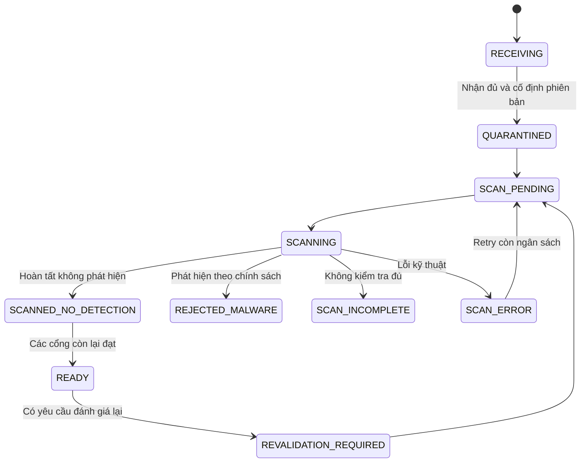
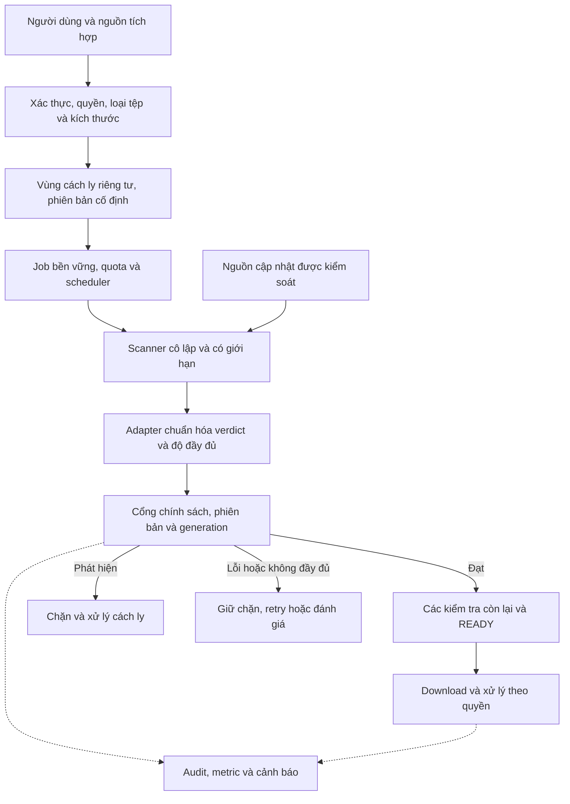

# Virus scanning

## 1. Mục tiêu của yêu cầu quét mã độc

**Virus scanning** trong bảo vệ tệp là bước sử dụng công cụ chống mã độc để kiểm tra nội dung trước khi cho phép sử dụng theo chính sách. Trong thực tế, phạm vi có thể bao gồm nhiều dạng malware ngoài virus, tùy khả năng của engine và cấu hình.

Một yêu cầu có thể nghiệm thu không chỉ ghi “tệp upload phải được quét virus”. Cần xác định:

- Tệp nào và những đường tiếp nhận nào phải được quét?
- Tệp nằm ở đâu và ai được truy cập trước kết quả?
- Kết quả nào đủ điều kiện tiếp tục xử lý?
- Timeout, tệp mã hóa hoặc quét bị giới hạn được xử lý thế nào?
- Kết quả có gắn đúng nội dung và phiên bản tệp được sử dụng không?
- Engine, cơ sở dữ liệu nhận diện và cấu hình cần đáp ứng điều kiện gì?
- Bằng chứng nào chứng minh tệp chưa đạt không bị tải xuống hoặc xử lý sớm?

Trong chương **File và resource security**, mục tiêu là giảm nguy cơ phát tán mã độc qua chức năng tệp, đồng thời bảo vệ dữ liệu và tài nguyên của chính hệ thống quét.

OWASP đặt antivirus hoặc sandbox trong một tập kiểm soát upload có nhiều lớp, cùng kiểm tra loại tệp, kích thước, quyền và lưu trữ. Một kết quả quét không thay thế toàn bộ các kiểm soát đó. [Nguồn: OWASP File Upload Cheat Sheet](https://cheatsheetseries.owasp.org/cheatsheets/File_Upload_Cheat_Sheet.html).

Sau bài học, người học có thể viết yêu cầu quét có phạm vi, mô hình trạng thái, điều kiện công bố và tiêu chí kiểm thử; liên kết các yêu cầu với mô hình đe dọa, kiến trúc và vận hành.

**Các ngưỡng số trong bài chỉ là ví dụ đặc tả, cần được kiểm chứng theo hệ thống thực tế.**

## 2. Tình huống xuyên suốt và mô hình đe dọa

Giả sử một nền tảng quản lý hồ sơ đa tenant nhận tệp từ người dùng, API tích hợp và import. Tenant là ranh giới tổ chức; chỉ người có quyền trên hồ sơ mới được gửi hoặc truy cập tệp.

Tệp được lưu riêng tư, quét, kiểm tra thêm theo loại nội dung rồi mới được tải xuống, tạo preview, đưa vào chỉ mục hoặc chuyển cho hệ thống khác.

| Tình huống | Rủi ro cần kiểm soát |
| --- | --- |
| Tệp có nội dung mã độc được upload | Người dùng hoặc hệ thống sau đó tiếp xúc với nội dung nguy hiểm |
| Tệp được tải xuống trong lúc đang chờ quét | Quét sau không ngăn được lần phát tán trước |
| Scanner lỗi nhưng ứng dụng xem như không phát hiện | Lỗi vận hành trở thành đường vượt kiểm tra |
| Archive hoặc tài liệu mã hóa không được kiểm tra đầy đủ | Hệ thống gán kết quả tốt cho phần nội dung chưa được quan sát |
| Đối tượng bị thay sau khi quét | Tệp được sử dụng khác tệp đã có kết quả |
| Callback quét bị giả mạo hoặc gửi lại | Một nguồn không có thẩm quyền chuyển tệp sang trạng thái cho phép |
| Worker preview hoặc OCR đọc tệp trước quét | Parser không thuộc vùng quét phải xử lý dữ liệu chưa được chấp nhận |
| Nhiều tệp phức tạp làm scanner quá tải | Hàng đợi và vùng cách ly tăng, ảnh hưởng khả năng phục vụ |
| Nội dung nhạy cảm được gửi đến dịch vụ công khai | Lộ dữ liệu hoặc metadata cho bên ngoài |
| Scanner bị khai thác qua định dạng tệp | Quyền của worker quét bị sử dụng để truy cập tài nguyên khác |

### Chuỗi truy vết mẫu

| Thành phần | Ví dụ |
| --- | --- |
| Rủi ro | Tệp chưa có kết quả được phát qua đường tải xuống trực tiếp |
| Mục tiêu | Không cho người dùng hoặc thành phần nghiệp vụ sử dụng tệp chưa đạt chính sách |
| Yêu cầu | Chỉ trạng thái READY của đúng phiên bản được cấp quyền đọc qua cổng tài nguyên |
| Thiết kế | Vùng cách ly riêng tư, bộ điều phối quét, điều kiện chuyển trạng thái nguyên tử |
| Bằng chứng | Gọi đường download, preview và export trong mọi trạng thái chưa đạt |

Tên sản phẩm antivirus hoặc việc cài daemon trên máy chủ chưa chứng minh mục tiêu đã đạt. Cần kiểm tra điểm chặn trong luồng ứng dụng.

## 3. Hiểu đúng ý nghĩa kết quả quét

### 3.1. Không phát hiện khác với an toàn tuyệt đối

Kết quả không phát hiện có nghĩa công cụ không tìm thấy dấu hiệu theo engine, bộ nhận diện, cấu hình và nội dung mà nó đã kiểm tra. Đây không phải bằng chứng rằng tệp không thể chứa mối nguy chưa được biết hoặc gây hại theo cách khác.

Ví dụ, một tệp không có signature mã độc vẫn có thể chứa liên kết lừa đảo, nội dung chủ động ngoài chính sách hoặc dữ liệu không phù hợp nghiệp vụ. Cần kiểm tra loại tệp, quyền, cấu hình phục vụ nội dung và các quy tắc chuyên biệt khác.

Không đặc tả “phát hiện 100% mọi virus” nếu không có một phạm vi mẫu và tiêu chí đo hữu hạn. Một yêu cầu khả thi phải mô tả khả năng cần có, bộ kiểm thử được chấp nhận và xử lý phần chưa biết.

### 3.2. Chuẩn hóa kết quả theo chính sách ứng dụng

| Kết quả chuẩn hóa | Ý nghĩa | Hành vi mặc định trong ví dụ |
| --- | --- | --- |
| NO_DETECTION_COMPLETE | Quét hoàn tất trong phạm vi bắt buộc, không phát hiện | Cho phép đi tiếp qua các cổng kiểm tra còn lại |
| MALWARE_DETECTED | Có dấu hiệu được chính sách coi là mã độc | Chặn sử dụng, ghi nhận và xử lý cách ly |
| SCAN_INCOMPLETE | Bỏ qua nội dung, vượt giới hạn, không đọc được hoặc không hỗ trợ | Không công bố; xử lý theo nguyên nhân |
| SCAN_ERROR | Lỗi kỹ thuật như timeout, mất kết nối hoặc engine hỏng | Không công bố; retry hữu hạn nếu phù hợp |
| PENDING | Chưa có kết quả hợp lệ | Giữ cách ly |

Không ánh xạ “không thấy chuỗi phát hiện trong log” thành NO_DETECTION_COMPLETE. Mã thoát, phản hồi giao thức, cảnh báo giới hạn và thông tin hoàn tất phải được adapter diễn giải theo hợp đồng đã kiểm thử.

Khi có nhiều engine bắt buộc, ví dụ chính sách yêu cầu tất cả đều hoàn tất không phát hiện. Một engine phát hiện thì chặn; một engine lỗi hoặc quét không đầy đủ thì chưa được coi là đạt, dù engine khác không phát hiện.

Việc thêm nhiều engine không tự bảo đảm phát hiện mọi mã độc; còn tăng chi phí, độ trễ và khả năng có kết quả khác nhau. Quy tắc tổng hợp cần được chủ sở hữu rủi ro phê duyệt.

## 4. Cách ly trước khi sử dụng

### 4.1. Quarantine là trạng thái được cưỡng chế

**Quarantine**, hay cách ly, nghĩa là tệp chưa được phép đi qua các đường sử dụng thông thường. Không chỉ đổi tên thư mục hoặc thêm một trường trạng thái mà không kiểm tra tại lúc truy cập.

Trong ví dụ, tệp mới nhận phải:

- Được lưu trong vùng không công khai.
- Có quyền chỉ đủ cho dịch vụ tiếp nhận, điều phối và quét.
- Không được gắn vào đường download thông thường.
- Không được tạo preview, OCR, chỉ mục, gửi email hoặc export trước khi đạt điều kiện tương ứng.
- Không được cấp URL truy cập trực tiếp có thể bỏ qua trạng thái.

Phân loại định dạng và đọc metadata tối thiểu có thể là một phần của cổng kiểm tra, nhưng phải chạy trong môi trường có giới hạn và được coi là đang xử lý nội dung chưa tin cậy. Không dùng tên “đọc metadata” để bỏ qua mô hình rủi ro của parser.

### 4.2. On-access scanning chưa chắc là điểm chặn của ứng dụng

Quét khi truy cập có thể hỗ trợ bảo vệ máy chủ, nhưng phải xác minh chế độ thực tế. Ví dụ, tài liệu ClamAV nêu chế độ on-access mặc định có thể chỉ thông báo, không chặn đọc hoặc ghi. Vì vậy, việc đã có cảnh báo không chứng minh ứng dụng đã ngăn sử dụng. [Nguồn: ClamAV — Scanning](https://docs.clamav.net/manual/Usage/Scanning.html).

Yêu cầu của nền tảng vẫn phải đặt cổng quyết định tại nơi công bố và sử dụng tệp. Nếu chọn quét đồng bộ ngay trên đường truy cập, cần đo tác động tới độ trễ và xử lý khi scanner không sẵn sàng.

### 4.3. Upload trực tiếp và các đường nhập khác

Tệp đi thẳng vào object storage vẫn phải vào vùng cách ly. Callback “upload hoàn tất” chỉ chứng minh một bước tiếp nhận, không phải kết quả quét.

Import, API cũ, công cụ quản trị, tệp nhận từ email và bản sao từ hệ thống khác phải nằm trong danh mục đường tiếp nhận. Nếu một đường được miễn, phải có cơ sở và phạm vi rõ ràng; không miễn chỉ vì nguồn nằm trong mạng nội bộ.

## 5. Ràng buộc kết quả với đúng nội dung

### 5.1. Định danh đối tượng được quét

Một bản ghi quét nên chứa ít nhất:

```text
tenant_id
file_id
object_key
object_version hoặc định danh nội dung bất biến
content_digest và thuật toán
content_length
scan_job_id
scan_generation
engine_version
signature_database_revision
scan_profile_version
policy_version
started_at, completed_at
verdict, completeness, reason
```

Digest giúp đối chiếu nội dung nhưng không thay thế quyền truy cập hoặc chứng minh tệp lành tính. Thuật toán và nguồn tính digest phải được xác định; không tin trực tiếp một hash do client khai báo để gắn kết quả cho đối tượng khác.

Kết quả cần áp dụng cho đúng phiên bản scanner thực sự đã đọc. Nếu đường xử lý stream có thể bị cắt giữa chừng, phải xác minh scanner đã nhận đủ nội dung theo hợp đồng.

### 5.2. Tránh thay tệp giữa kiểm tra và sử dụng

Nếu quét object A rồi client ghi đè cùng key thành B, kết quả của A không cho phép công bố B.

Thiết kế có thể dùng version ID, đối tượng không thể sửa sau khi tiếp nhận hoặc bản sao đã được xác minh vào vùng có quyền ghi được kiểm soát. Trong mọi trường hợp, metadata công bố và đường download phải tham chiếu đúng nội dung đã đạt.

Chỉ chuyển trạng thái khi file version, scan generation và policy vẫn khớp. Kết quả đến muộn của phiên bản cũ không được mở phiên bản mới.

### 5.3. Cache kết quả quét

Nếu tái sử dụng kết quả, cache key cần bao gồm định danh nội dung và ngữ cảnh ảnh hưởng đến kết luận, chẳng hạn engine, revision nhận diện, profile và chính sách.

Kết quả cũ không tự phù hợp khi profile thay đổi hoặc cơ sở nhận diện cũ bị ngừng chấp nhận. Cần thời hạn và quy tắc vô hiệu hóa riêng.

Tái sử dụng nội bộ cũng không được làm lộ việc tenant khác đã upload cùng tệp. Không trả thông tin tồn tại hoặc kết quả ngoài phạm vi quyền chỉ vì hash trùng.

## 6. Engine, cơ sở nhận diện và độ đầy đủ

### 6.1. Engine chạy được chưa đủ

Cần theo dõi độc lập:

- Tiến trình hoặc dịch vụ có hoạt động không.
- Có đọc được tệp cần quét không.
- Engine và cấu hình nào thực sự được sử dụng.
- Cơ sở nhận diện nào đã được nạp.
- Bản nạp có còn được chính sách chấp nhận không.
- Một phép quét kiểm tra kiểm soát có đi qua và cho kết quả đúng không.

Đối với ClamAV, công cụ cập nhật cơ sở nhận diện và engine quét là các phần cần được quản lý đúng. Tài liệu chính thức mô tả FreshClam cho cập nhật cơ sở signature; việc tải về không thay thế bằng chứng worker đã nạp bản tương ứng. [Nguồn: Updating Signature Databases](https://docs.clamav.net/manual/Usage/SignatureManagement.html).

Không dùng thời gian sửa tệp trên đĩa làm bằng chứng duy nhất cho độ mới. Cần revision, nguồn phát hành hoặc metadata đáng tin cậy và xác nhận bản đang hoạt động.

### 6.2. Ngưỡng độ mới là quyết định rủi ro

Ví dụ một chính sách yêu cầu kiểm tra nguồn cập nhật ít nhất mỗi giờ và chỉ cho phép kết quả mới đi qua cổng công bố khi revision đang được sử dụng còn trong ngưỡng 24 giờ từ mốc phát hành đáng tin cậy.

Đây là ngưỡng minh họa, không phải mặc định của antivirus hoặc bảo đảm rằng trong 24 giờ không có mối đe dọa mới. Sản phẩm phải đánh giá tác động nếu không có bản mới hoặc hệ thống cập nhật ngừng hoạt động.

Nếu không đạt ngưỡng, không tự đổi kết quả thành tốt. Có thể giữ tệp mới ở trạng thái chờ hoặc tạm ngừng nhận thêm theo ngân sách. Chính sách với tệp đã công bố cần được xác định riêng; không ngầm cho rằng mọi tệp cũ đều phải mở hoặc đều phải đóng.

Khi một revision gặp lỗi hoặc tăng false positive, cần quy trình đánh giá, rollback có kiểm soát và bằng chứng. Không để người vận hành tùy ý tắt quét trên toàn hệ thống.

### 6.3. Tệp không thể quét đầy đủ

Các trường hợp cần phân loại rõ:

| Trường hợp | Yêu cầu chính sách |
| --- | --- |
| Archive có mật khẩu hoặc tài liệu mã hóa | Không gán hoàn tất nếu nội dung bắt buộc chưa được quan sát |
| Định dạng không hỗ trợ | Từ chối hoặc đi qua quy trình riêng đã phê duyệt |
| Vượt giới hạn giải nén, số entry hoặc độ sâu | Đánh dấu không đầy đủ, giữ chặn |
| Engine bỏ qua phần quá lớn | Không coi phần không được quét là đạt |
| Timeout hoặc hết bộ nhớ | Lỗi hoặc không đầy đủ theo adapter; không công bố |
| Không đọc được object hoặc stream thiếu | Không phát sinh verdict cho toàn bộ tệp |
| Phát hiện cần người đánh giá | Tiếp tục cách ly cho đến quyết định hợp lệ |

Nếu nghiệp vụ phải nhận nội dung mã hóa, cần quy trình riêng về giải mã, quyền, secret và môi trường xử lý. Việc người dùng nói “tệp này an toàn” không thay thế bằng chứng.

## 7. Bảo vệ chính hệ thống quét và dữ liệu

### 7.1. Scanner là điểm xử lý nội dung không tin cậy

Scanner có thể chứa parser cho nhiều định dạng. Cần giảm phạm vi tác động nếu một lỗi xuất hiện:

- Chạy với quyền tối thiểu trong vùng thực thi được cô lập.
- Chỉ đọc object thuộc job; không có quyền đọc tùy ý mọi tệp của mọi tenant.
- Chỉ ghi vùng tạm cần thiết, có quota và thời hạn dọn.
- Không có quyền công bố tệp hoặc sửa verdict theo đường ngoài giao thức.
- Hạn chế kết nối mạng từ worker theo nhu cầu; đường cập nhật được kiểm soát riêng.
- Không thực thi nội dung upload như chương trình nghiệp vụ.

Sandbox phân tích hành vi, nếu sử dụng, là một thành phần có mô hình cô lập riêng. Không đồng nhất nó với việc gọi một antivirus thông thường.

Không ghép tên tệp do người dùng nhập vào câu lệnh shell. Truyền tham số theo API an toàn và xử lý phản hồi có cấu trúc. Không tìm chuỗi “OK” trong log tự do rồi coi đó là bằng chứng quét đạt.

### 7.2. Bảo vệ giao thức scanner và callback

Ứng dụng phải xác thực nguồn kết quả và kiểm tra nguồn đó được phép trả lời cho job nào. Cần bảo vệ kênh truyền, danh tính dịch vụ, tương quan job và giới hạn thông điệp.

Một scanner chỉ lắng nghe trong mạng nội bộ không tự có xác thực. Ví dụ, tài liệu ClamAV cảnh báo TCP socket của clamd không tự bảo vệ hoặc xác thực lưu lượng; kiến trúc dùng nó phải bổ sung ranh giới mạng hoặc lớp bảo vệ phù hợp. [Nguồn: ClamAV — Scanning](https://docs.clamav.net/manual/Usage/Scanning.html).

Không cho người gửi chọn URL tùy ý để scanner tải dữ liệu bằng quyền nội bộ. Job nên tham chiếu object mà dịch vụ đã xác minh, không biến scanner thành công cụ truy cập tài nguyên ngoài phạm vi.

Callback cũ, trùng hoặc sai generation không được ghi đè một quyết định mới. Phát hiện mã độc không được tự xóa chỉ vì một phản hồi không phát hiện đến muộn hơn.

### 7.3. Dịch vụ quét bên ngoài

Trước khi chuyển tệp sang nhà cung cấp, cần xác định phân loại dữ liệu, nơi xử lý, quyền truy cập, thời hạn lưu, khả năng chia sẻ mẫu và cơ chế xóa theo chính sách của tổ chức.

Không gửi tệp nhạy cảm hoặc hash sang dịch vụ công khai chỉ vì dịch vụ hỗ trợ quét nhiều engine. Hash cũng có thể là metadata nhạy cảm trong một số bối cảnh.

Việc sử dụng dịch vụ bên ngoài cần được thiết kế và cho phép trong luồng sản phẩm. Bài học không yêu cầu tải bất kỳ tệp người dùng nào lên một dịch vụ quét.

## 8. Vòng đời, retry và tính sẵn sàng

### 8.1. Mô hình trạng thái tham chiếu



SCANNED_NO_DETECTION chưa đồng nghĩa READY. Kiểm tra loại tệp, quyền, tính toàn vẹn hoặc xử lý nội dung khác vẫn có thể không đạt.

Các trạng thái không đạt cần đường xử lý và dọn dữ liệu; sơ đồ trên không diễn tả toàn bộ vòng đời xóa hoặc bảo toàn bằng chứng.

### 8.2. Không công bố khi chưa có kết quả hợp lệ

Trong ví dụ, scanner không khả dụng thì tệp mới tiếp tục cách ly. Điều này không có nghĩa API phải giữ kết nối vô hạn.

API có thể trả kết quả đã tiếp nhận cùng file ID và trạng thái đang kiểm tra. Client tra cứu qua endpoint có phân quyền. Trạng thái “đã upload” phải được phân biệt với “được phép sử dụng”.

Nếu hàng đợi hoặc vùng cách ly chạm ngân sách, ngừng nhận thêm theo chính sách backpressure. Không chuyển sang chế độ tự cho qua để giảm backlog.

### 8.3. Retry hữu hạn

Chỉ retry lỗi kỹ thuật được phép. Tệp mã hóa không đọc được hoặc vượt hồ sơ giải nén thường không tự tốt lên bằng cách chạy lại cùng engine và cấu hình.

Mỗi lần thực thi và thời gian chờ phải được giới hạn; giữ nguyên tuổi gốc của job. Khi worker chết, job có thể được giao lại nhưng chỉ một kết quả hiện hành được quyền chuyển trạng thái.

Ví dụ:

- Mỗi lần quét tối đa 30 giây.
- Tối đa ba lần thực thi tổng cộng.
- Hai khoảng chờ retry cơ sở là năm giây và 15 giây, có độ trễ ngẫu nhiên trong giới hạn đã công bố.
- Tổng thời gian từ tiếp nhận job đến kết quả cuối tối đa năm phút, gồm chờ và retry.
- Hết thời hạn thì chuyển sang lỗi kết thúc hoặc quy trình đánh giá, vẫn không READY.

### 8.4. Hàng đợi và lưu trữ có giới hạn

Ví dụ toàn cụm có tối đa 500 job chưa kết thúc, tối đa 50 job mỗi tenant. Scheduler phải có chính sách chia lượt để một tenant không độc chiếm khả năng xử lý.

Vùng cách ly có trần năm GiB toàn cụm và 500 MiB mỗi tenant trong hồ sơ ví dụ, tính cả tệp bị chặn còn giữ. Giới hạn byte độc lập với số job: một job đã kết thúc vẫn có thể để lại tệp cần hạch toán.

Tệp không đạt cần thời hạn lưu theo phân loại dữ liệu. Ví dụ giữ tối đa bảy ngày, trừ trường hợp bảo toàn bằng chứng được phê duyệt; việc giữ vẫn phải có ngân sách. Hết thời hạn không đồng nghĩa đã xóa vật lý nếu thao tác xóa thất bại.

## 9. Bộ yêu cầu mẫu có thể nghiệm thu

### VS-001 — Phạm vi và cách ly

Mọi tệp mới từ các đường tiếp nhận trong danh mục phải vào vùng cách ly riêng tư trước sử dụng. Ví dụ hồ sơ upload nhận tệp tối đa 10 MiB; cấu hình scanner phải hỗ trợ hoặc phân loại rõ toàn bộ miền đầu vào được sản phẩm cho phép.

Chỉ tệp ở trạng thái READY của đúng phiên bản mới được truy cập theo quyền nghiệp vụ. Download, preview, OCR, index, email và export không được sử dụng phiên bản chưa đạt.

Nếu một thành phần cần đọc nội dung để kiểm tra trước READY, thành phần đó phải thuộc ranh giới xử lý nội dung chưa tin cậy đã được thiết kế.

### VS-002 — Điều kiện kết quả

Chỉ NO_DETECTION_COMPLETE của mọi engine bắt buộc, với profile và revision được chấp nhận, mới cho phép đi tiếp qua cổng kiểm tra.

MALWARE_DETECTED, SCAN_INCOMPLETE, SCAN_ERROR hoặc không có phản hồi không được ánh xạ thành đạt. Adapter phải có bảng ánh xạ từng loại phản hồi, lỗi và trường hợp bỏ qua nội dung của engine đã chọn.

Tệp mã hóa, hỏng hoặc không hỗ trợ phải có mã lý do riêng để vận hành và người dùng xử lý; không báo nhầm là đã phát hiện mã độc nếu chỉ chưa thể kiểm tra.

### VS-003 — Nội dung, phiên bản và trạng thái

Mỗi verdict gắn với tenant, file ID, object version hoặc nội dung bất biến, độ dài, digest đáng tin cậy, scan job và generation.

Khi ghi kết quả, kiểm tra có điều kiện rằng tệp chưa bị xóa, thay phiên bản hoặc chuyển sang generation khác. Chỉ bộ điều phối có quyền thực hiện chuyển trạng thái tương ứng.

Phản hồi cũ hoặc trùng không tạo lại quyền công bố. Một kết quả không phát hiện của job cũ không ghi đè phát hiện hoặc quyết định thu hồi hiện hành.

### VS-004 — Độ mới và cấu hình đang chạy

Worker công bố engine version, revision cơ sở nhận diện và profile thực sự đang dùng. Kiểm tra nguồn cập nhật ít nhất mỗi giờ; chính sách ví dụ chỉ chấp nhận revision trong ngưỡng 24 giờ từ mốc phát hành đáng tin cậy cho quyết định công bố mới.

Nếu không đủ điều kiện, giữ chặn và phát cảnh báo. Không chỉ dựa vào việc updater trả thành công hoặc tệp trên đĩa có timestamp mới.

Thay engine, profile hoặc revision cần kiểm tra vận hành và khả năng tương thích theo quy trình. Kết quả của job đang chạy phải được đối chiếu chính sách tại cổng công bố.

### VS-005 — Giới hạn quét và độ đầy đủ

Hồ sơ ví dụ cho phép tối đa 100 MiB nội dung giải nén, 1.000 entry và độ sâu container tối đa ba theo quy tắc đếm đã công bố. Những giới hạn này cần được đo và đối chiếu khả năng engine.

Nếu giới hạn khiến một phần nội dung bắt buộc không được kiểm tra, kết quả là không đầy đủ hoặc trạng thái chặn theo chính sách, không phải hoàn tất không phát hiện.

Mỗi lần quét có deadline 30 giây. Bộ nhớ của worker phải có trần trong hồ sơ năng lực, tính cả engine, cơ sở nhận diện đã nạp và dữ liệu tạm; không đặt một con số chỉ dựa vào kích thước upload.

### VS-006 — Lỗi, retry và thu hồi

Áp dụng tối đa ba lần thực thi và deadline đầu cuối năm phút như mô tả tại mục 8. Không retry tự động lỗi dữ liệu không đổi mà không có phương án xử lý mới.

Khi timeout hoặc hủy, dừng phần thực thi và thu hồi tài nguyên của job trong năm giây theo cơ chế cô lập đã chọn. Nếu cần dừng worker để đạt mục tiêu, phải bảo đảm job khác được phục hồi đúng và không công bố sai.

Tệp vẫn cách ly khi hết retry. Dữ liệu tạm mỗi lần quét phải được dọn trong mười phút; phần chưa dọn vẫn tính vào ngân sách và lỗi dọn phải được theo dõi.

### VS-007 — Năng lực và backpressure

Áp dụng trần job và byte tại mục 8 trên toàn cụm, không nhân trần khi tăng replica. Khi hết ngân sách, từ chối tiếp nhận mới hoặc tạm dừng producer theo hợp đồng đã công bố.

Trong hồ sơ tải hợp lệ đã cố định, ví dụ một tệp mỗi giây, ít nhất 95% job hoàn tất quét trong 60 giây. Hồ sơ phải xác định loại tệp, kích thước, cấu trúc, cấu hình máy và revision; không chỉ dùng một tệp văn bản nhỏ để đại diện mọi nội dung.

Chỉ tiêu thời gian không cho phép chuyển tệp sang READY khi thiếu kết quả. Báo cáo cần phân biệt hoàn tất không phát hiện, phát hiện, không đầy đủ và lỗi.

### VS-008 — Dữ liệu, danh tính dịch vụ và audit

Scanner chỉ đọc đối tượng của job được cấp quyền; kết quả chỉ được tiếp nhận từ danh tính có thẩm quyền. Callback phải được đối chiếu job, generation và schema.

Không chuyển nội dung hoặc metadata ra dịch vụ bên ngoài ngoài phạm vi đã được chính sách dữ liệu cho phép. Không log nội dung tệp, secret, URL upload có thông tin xác thực hoặc dữ liệu nhạy cảm không cần thiết.

Audit gồm danh tính dịch vụ, tenant, file ID, version, thời điểm, phiên bản engine, revision, profile, verdict và lý do theo quyền truy cập phù hợp. Bản ghi cần đủ để đối chiếu tệp đã được phục vụ với bằng chứng kiểm tra.

### VS-009 — Đánh giá lại và thu hồi

Khi có thông tin mới yêu cầu chặn một tập tệp đã xác định, bộ điều phối chuyển các phiên bản liên quan sang trạng thái không cho truy cập mới và tạo nhiệm vụ đánh giá lại.

Trong kiến trúc ví dụ, download đi qua cổng kiểm tra trạng thái và quyền; không có kho public hoặc URL trực tiếp bỏ qua cổng. Mục tiêu chặn yêu cầu truy cập mới là trong 60 giây từ khi quyết định thu hồi có hiệu lực.

Nếu bổ sung CDN hoặc URL truy cập trực tiếp, phải đưa TTL, cache và khả năng thu hồi vào cùng phép đo trước khi giữ cam kết này. Dữ liệu đã được tải xuống trước đó không thể được thu hồi chỉ bằng đổi trạng thái trên server.

Phản hồi cũ không tự mở lại tệp bị thu hồi. Khôi phục quyền sử dụng cần quyết định hiện hành và bằng chứng phù hợp.

### VS-010 — False positive và ngoại lệ

Phát hiện có thể sai; người dùng cần cách nhận thông tin và yêu cầu xem xét mà không được tự bỏ quét.

Quy trình xem xét có người có quyền, bằng chứng, phạm vi nội dung và thời hạn quyết định. Nếu được cho phép theo ngoại lệ, phải ghi rõ đây là quyết định ngoại lệ, không sửa lịch sử thành “engine không phát hiện”.

Không whitelist theo tên tệp, đường dẫn rộng hoặc toàn tenant chỉ để xử lý một mẫu. Tệp được sửa hoặc thay nội dung phải được đánh giá lại theo chính sách.

## 10. Kiến trúc tham chiếu và logic công bố



Logic khái niệm:

```text
receive_authenticated_scan_result()
validate_result_schema_and_job_scope()
normalize_engine_verdict_and_completeness()

begin_state_transition()
    verify_current_file_version_and_scan_generation()
    verify_engine_profile_and_revision_are_accepted()

    if detection:
        persist_detection_and_block()
    else if complete_no_detection:
        persist_scan_evidence()
        evaluate_all_other_required_gates()
        mark_ready_only_if_all_gates_pass()
    else:
        persist_incomplete_or_error_and_keep_blocked()
commit_state_transition()
```

Đây là mô tả bất biến, không phải mã triển khai trực tiếp. Tạo job và lưu trạng thái tệp cần giao thức bền vững để không có tệp “đã nhận nhưng không bao giờ có job”. Có thể dùng outbox hoặc cơ chế đối soát tương đương.

Nếu job được giao lại, kết quả phải có tính idempotent theo job và generation. Quyền download phải kiểm tra trạng thái hiện hành, không chỉ dựa vào một thông báo đã nhận trước đó.

## 11. Kiểm thử bằng mẫu kiểm soát và tiêm lỗi

### 11.1. Vai trò của EICAR

EICAR cung cấp mẫu kiểm thử để kiểm tra phản ứng của phần mềm chống mã độc mà không dùng một virus thật. Có thể dùng nó để kiểm tra engine được gọi và luồng chặn hoạt động. [Nguồn: EICAR Anti-Malware Testfile](https://www.eicar.org/download-anti-malware-testfile/).

Phát hiện EICAR không chứng minh khả năng nhận diện mọi malware hoặc mối nguy mới. Cần tách kiểm tra dây chuyền tích hợp khỏi đánh giá năng lực phát hiện trên tập mẫu được quản lý.

Nếu allowlist loại tệp chặn mẫu ngay trước scanner, kết quả đó chỉ chứng minh cổng loại tệp hoạt động. Bài kiểm thử scanner cần test harness có quyền trong môi trường kiểm thử để mẫu thực sự đến engine; không nới allowlist sản xuất chỉ để chạy một bài test.

Các tình huống timeout, callback giả hoặc kết quả không đầy đủ có thể dùng giả lập và tiêm lỗi có kiểm soát. Không cần đưa mã độc thật vào môi trường người dùng để kiểm chứng các bất biến này.

### 11.2. Ma trận nghiệm thu

| Mã | Yêu cầu | Kịch bản | Kết quả cần chứng minh |
| --- | --- | --- | --- |
| T-01 | VS-001 | Tệp ở RECEIVING, PENDING hoặc SCANNING; gọi download, preview, OCR, export | Không có đường sử dụng thông thường vượt cách ly |
| T-02 | VS-002 | Mẫu EICAR thực sự đi qua scanner trong môi trường kiểm thử | Engine có phát hiện; tệp không READY; audit và phản hồi đúng |
| T-03 | VS-002 | Tệp hợp lệ không phát hiện nhưng cổng loại tệp khác không đạt | Không đồng nhất kết quả quét với READY |
| T-04 | VS-002, VS-005 | Tệp mã hóa, hỏng, không hỗ trợ hoặc phần bị bỏ qua | Không gán hoàn tất không phát hiện cho nội dung chưa kiểm tra |
| T-05 | VS-003 | Thay nội dung cùng key, version mới hoặc stream không đủ | Verdict cũ không áp dụng cho đối tượng mới hoặc thiếu dữ liệu |
| T-06 | VS-003, VS-008 | Callback giả, sai job, trùng hoặc đến muộn | Chỉ nguồn có quyền và generation hiện hành thay đổi trạng thái |
| T-07 | VS-004 | Updater lỗi, revision cũ, worker chưa nạp bản mới | Cổng công bố dùng trạng thái thực, giữ chặn khi không đạt |
| T-08 | VS-005 | Vượt byte giải nén, số entry, độ sâu hoặc bộ nhớ | Dừng có kiểm soát; không xem giới hạn bị chạm là đạt |
| T-09 | VS-006 | Engine ngừng, mất mạng, worker chết hoặc timeout | Retry hữu hạn, thu hồi tài nguyên, tệp vẫn cách ly |
| T-10 | VS-007 | Một tenant gây nhiều job; queue hoặc vùng cách ly đầy | Có backpressure và chia lượt; không chuyển sang cho qua |
| T-11 | VS-008 | Worker cố đọc đối tượng khác hoặc chuyển dữ liệu ra đích không được phép | Quyền tối thiểu và ranh giới dữ liệu được cưỡng chế |
| T-12 | VS-009 | Thu hồi tệp đã READY; cache hoặc yêu cầu cũ còn tồn | Chặn truy cập mới trong phạm vi thời gian đã cam kết |
| T-13 | VS-010 | Đánh giá false positive và thay nội dung sau ngoại lệ | Ngoại lệ có audit, không mở rộng ngầm hoặc che lịch sử |
| T-14 | VS-003, VS-006 | Restore hoặc phát lại job sau sự cố | Không mất ràng buộc version và không hồi sinh quyết định cũ |

Cần quan sát quyền truy cập thật, object version, trạng thái, job, tài nguyên và audit. Một thông báo “đã chặn virus” trên giao diện chưa chứng minh URL tải trực tiếp không hoạt động.

Hồ sơ nghiệm thu giữ cấu hình, engine, revision, profile, tập dữ liệu thử, thời gian, lỗi được tiêm, verdict gốc và verdict chuẩn hóa. Dữ liệu nhạy cảm cần được ẩn hoặc thay bằng fixture phù hợp; không ghi toàn bộ mẫu vào log.

## 12. Những sai lầm thường gặp và vận hành dài hạn

| Cách làm thiếu | Hệ quả | Điều cần làm rõ |
| --- | --- | --- |
| Quét sau khi đã cho tải xuống | Tệp có thể đã phát tán | Cách ly và cổng truy cập trước sử dụng |
| Timeout được xem là sạch | Lỗi hệ thống mở đường bỏ kiểm tra | Kết quả lỗi tách biệt, giữ chặn |
| Không có phát hiện nghĩa là quét đủ | Nội dung có thể đã bị bỏ qua | Kiểm tra độ đầy đủ và cảnh báo giới hạn |
| Tin tên hoặc MIME để quyết định khỏi quét | Dữ liệu client khai báo không đáng tin | Chính sách và kiểm tra nội dung phù hợp |
| Chỉ cài antivirus trên host | Chế độ thông báo có thể không chặn ứng dụng | Kiểm thử đường công bố thực tế |
| Quét một version, phục vụ version khác | Bằng chứng không gắn với nội dung | Định danh bất biến và chuyển trạng thái có điều kiện |
| Chỉ theo dõi tiến trình sống | Revision hoặc quyền đọc có thể sai | Theo dõi khả năng quét thực và bản đang nạp |
| Gửi mọi tệp lên dịch vụ công khai | Có thể lộ nội dung và metadata | Phân loại dữ liệu và quyền sử dụng nhà cung cấp |
| Xóa mọi tệp phát hiện ngay lập tức | Có thể mất bằng chứng hoặc xử lý sai false positive | Chính sách cách ly, lưu và phê duyệt |
| Bỏ quét khi backlog cao | Tải cao trở thành bypass | Quota, backpressure và mở rộng có kiểm chứng |

Ở bước phân tích, xác định ai có thể nhận, mở hoặc xử lý tệp và tác động nếu nội dung nguy hiểm đi qua. Chọn loại tệp được hỗ trợ và rủi ro còn lại mà nghiệp vụ chấp nhận.

Ở bước thiết kế, đặt vùng cách ly, định danh phiên bản, mô hình verdict, điểm công bố và hành vi khi không có kết quả. Phân bổ ngân sách cho scanner, queue, dữ liệu tạm và bằng chứng.

Ở bước triển khai, quản lý engine, profile và cập nhật có phiên bản; tách quyền scanner khỏi quyền công bố. Kiểm chứng cấu hình thực thay vì chỉ kiểm tra có cài phần mềm.

Ở bước kiểm thử, nối yêu cầu với mẫu kiểm soát, sai phiên bản, kết quả giả, nội dung không kiểm tra được và sự cố hạ tầng. Kiểm tra cả mọi consumer của tệp và những đường truy cập vòng ngoài ứng dụng.

Ở bước vận hành, theo dõi tỷ lệ phát hiện, không đầy đủ, lỗi, độ mới revision, tuổi hàng đợi, false positive và lỗi dọn. Khi có thông tin mới, đánh giá lại đúng tập tệp bị ảnh hưởng và thực hiện thu hồi theo chính sách.

Một yêu cầu virus scanning có thể nghiệm thu phải nối được **rủi ro → phạm vi tệp và đường nhập → cách ly → quét đủ với phiên bản được chấp nhận → verdict của đúng nội dung → cổng công bố → bằng chứng chặn, lỗi và phục hồi**. Nhờ đó, quét mã độc trở thành một kiểm soát có thể vận hành và kiểm chứng trong vòng đời tệp.
