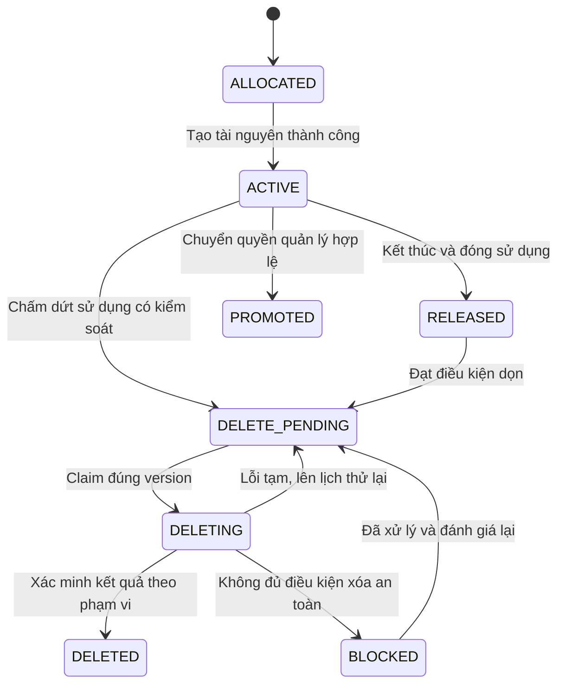

# Temporary file cleanup

## 1. Dọn tệp tạm là một yêu cầu bảo mật có vòng đời

Temporary file cleanup là quá trình kết thúc quyền sử dụng, thu hồi khả năng truy cập và loại bỏ những bản dữ liệu trung gian không còn cần thiết theo hợp đồng. Tệp tạm có thể là phần upload chưa hoàn tất, tệp giải nén, ảnh preview, đầu ra converter, bản export hoặc một object trung gian trên storage từ xa.

Trong module yêu cầu bảo mật, mục tiêu không dừng ở “chạy cron xóa thư mục tmp”. Cần chứng minh dữ liệu không tồn tại hoặc còn truy cập lâu hơn phạm vi đã chấp thuận, việc dọn không xóa dữ liệu hợp lệ và hệ thống vẫn hoạt động khi cleanup gặp lỗi. Điều này liên quan đồng thời tới bí mật, toàn vẹn, tính sẵn sàng và bằng chứng vận hành.

Ví dụ một nền tảng học tập tạo ZIP chứa dữ liệu học viên cho người có quyền. Link tải hết hạn sau 15 phút nhưng ZIP còn nằm ở thư mục public thì dữ liệu chưa được thu hồi đúng. Một job khác vừa hoàn tất chuyển bài nộp sang kho chính thức; nếu sweeper vẫn coi cùng object là tệp tạm, nó có thể xóa bài đã được xác nhận tiếp nhận.

[CWE-459 — Incomplete Cleanup](https://cwe.mitre.org/data/definitions/459.html) mô tả lớp điểm yếu khi tài nguyên không được dọn đầy đủ sau khi sử dụng. Với tệp tạm, yêu cầu cần bao phủ cả đường thành công, exception, hủy, timeout, process chết và khởi động lại; một nhánh `finally` chỉ giải quyết được một phần vòng đời đó.

Bài dùng nền tảng học tập nhiều tenant và các ngưỡng giả định để minh họa đặc tả. Thời hạn, quota và cách xử lý ngoại lệ phải được quyết định theo độ nhạy dữ liệu, nghiệp vụ và storage thực tế, không suy từ tên thư mục hoặc cấu hình mặc định của hệ điều hành.

## 2. Kiểm kê dữ liệu tạm và rủi ro ở từng nơi

Một file mang hậu tố `.tmp` chưa chắc được phép xóa; một file `.zip` có thể chỉ tồn tại tạm vài phút. Phân loại dựa trên nguồn tạo, mục đích, owner, vòng đời và nghĩa vụ giữ dữ liệu, thay vì chỉ dựa vào phần mở rộng hoặc `mtime`.

| Loại dữ liệu | Nguồn tạo | Khi có thể kết thúc nhu cầu | Điều cần bảo vệ |
|---|---|---|---|
| Upload staging | API, proxy multipart, SDK | Upload hủy/hết hạn hoặc nội dung đã được chốt vào luồng bền vững | Không mất bài đã nhận; không giữ part bỏ dở vô hạn |
| Scratch của scanner/converter | Worker, thư viện xử lý | Worker đã kết thúc sử dụng và đóng tài nguyên | Không lộ nội dung, không xóa khi worker còn dùng |
| Thư mục giải nén | Import job | Đã hoàn tất/không còn dùng hoặc job bị chấm dứt có kiểm soát | Không thoát root, không để link dẫn cleanup ra ngoài phạm vi |
| ZIP/CSV export | Dịch vụ xuất dữ liệu | Hết cửa sổ tải và kết thúc reader theo policy | Thu hồi truy cập, xóa bản sao dữ liệu cá nhân |
| Preview trung gian | Image/document pipeline | Đã tạo bản dẫn xuất chính thức hoặc công việc thất bại | Không nhầm bản trung gian với asset phục vụ lâu dài |
| Multipart object chưa hoàn tất | Object storage | Upload bị hủy hoặc vượt thời hạn được phép | Dọn cả part và upload session, không chỉ object hoàn chỉnh |
| Bản sao ở cache/snapshot | Proxy, volume, nền tảng backup | Theo policy riêng của bản sao | Không tuyên bố hết dữ liệu chỉ từ xóa file nguồn |

Mỗi nơi cần người sở hữu và cơ chế kiểm chứng. Framework upload có thể ghi spool file trước khi ứng dụng tạo bản ghi job; thư viện preview có thể tạo tệp phụ hoặc dump khi lỗi. Danh mục phải bao phủ những bản sao này, cùng cấu hình và điểm cleanup của thư viện tương ứng.

| Mã rủi ro | Diễn biến | Bất biến cần giữ |
|---|---|---|
| R-TMP-01 | Tệp tạm nhạy cảm tồn tại hoặc còn truy cập quá lâu | Có thời hạn truy cập và loại bỏ được đo bằng bằng chứng |
| R-TMP-02 | Cleanup chọn nhầm path, tenant hoặc asset đã promote | Chỉ xóa đúng tài nguyên tạm thuộc phạm vi được giao |
| R-TMP-03 | Sweeper xóa khi worker/reader vẫn hoạt động | Vòng đời sử dụng và quyền dọn có thứ tự được kiểm soát |
| R-TMP-04 | Crash bỏ lại tệp không có đường thu hồi | Có cơ chế phát hiện orphan và tiếp tục dọn độc lập process cũ |
| R-TMP-05 | Backlog cleanup hoặc upload bỏ dở làm đầy storage | Quota, admission và năng lực cleanup có giới hạn rõ |
| R-TMP-06 | Link/path bị thay giữa kiểm tra và xóa | Thao tác I/O giữ containment và đúng identity tại thời điểm thực hiện |
| R-TMP-07 | Xóa tên file nhưng bản sao/handle/phiên bản còn dữ liệu | Mức hoàn tất được định nghĩa theo đúng phạm vi, không báo xóa sạch giả |
| R-TMP-08 | Lỗi xóa bị bỏ qua hoặc audit làm lộ nội dung | Có trạng thái lỗi, cảnh báo và bằng chứng tối thiểu được bảo vệ |

Threat model xét cả lỗi vô ý lẫn lạm dụng: tạo nhiều upload rồi bỏ, cố làm cleanup retry vô hạn, gửi path/link vào archive, hoặc khai thác tài khoản vận hành có quyền xóa quá rộng. Quy trình cleanup có quyền tác động dữ liệu nên bản thân nó là một thành phần cần được phân quyền và kiểm chứng.

## 3. Mô hình trạng thái tách sử dụng, truy cập và xóa

Không dùng một boolean `deleted` để diễn tả toàn bộ vòng đời. Ít nhất cần biết tài nguyên có được tạo chưa, ai còn dùng, đã ngừng cấp quyền truy cập mới chưa, cleanup đang chờ hay đã kiểm chứng kết quả tại storage.

| Trạng thái quản lý | Ý nghĩa trong profile | Điều cần kiểm tra |
|---|---|---|
| `ALLOCATED` | Đã lưu ý định cấp vùng tạm, có thể chưa tạo nội dung | Crash giữa các bước vẫn đối soát được phạm vi cấp |
| `ACTIVE` | Producer hoặc reader đang sử dụng theo lease hợp lệ | Hạn dùng tối đa, generation và quyền truy cập |
| `RELEASED` | Nhu cầu sử dụng đã kết thúc, tài nguyên liên quan đã đóng theo hợp đồng | Có đủ điều kiện dọn và không có tham chiếu cần giữ |
| `DELETE_PENDING` | Đã ngừng nhận sử dụng mới; cần dọn | Hạn dọn, quyền sở hữu, ngoại lệ retention và retry |
| `DELETING` | Một cleaner đã claim tác vụ dọn | Claim có thời hạn, version, scope và bảo vệ race |
| `DELETED` | Đã xác minh không còn bản cần xóa trong active store theo phạm vi cam kết | Bằng chứng đích/version, không đồng nghĩa media sanitization |
| `BLOCKED` | Chưa thể dọn an toàn hoặc không đạt điều kiện | Nguyên nhân, người xử lý, cảnh báo và lịch đối soát |
| `PROMOTED` | Tài nguyên đã chuyển quyền quản lý sang dữ liệu bền vững | Không còn là mục tiêu của cleanup tạm theo bản ghi cũ |



Hạn truy cập nên là thuộc tính độc lập, ví dụ `accessExpiresAt`, vì một object còn tồn tại có thể đã bị chặn tải mới. `DELETED` chỉ được dùng đúng nghĩa mà hợp đồng nêu; nếu backend chỉ tiếp nhận yêu cầu xóa, trạng thái còn là pending verification. Không lấy HTTP thành công của API quản lý làm bằng chứng mọi bản sao vật lý đã bị triệt tiêu.

Retention exception hoặc hold là điều kiện chặn cần có owner, lý do, phạm vi và thời hạn/đánh giá lại, không phải cờ tùy ý do client đặt để giữ dữ liệu mãi. Có thể quản lý nó bằng thuộc tính riêng để không trộn với trạng thái sử dụng. Dữ liệu được giữ theo ngoại lệ vẫn phải bị chặn truy cập ngoài mục đích được duyệt.

## 4. Metadata tối thiểu để dọn đúng tài nguyên

Một cleanup record cần định danh nội bộ và vị trí do server quản lý. Không cho API cleanup nhận raw path từ người dùng rồi xóa với quyền của service. Người yêu cầu chỉ được tác động job/asset trong scope đã được xác minh.

```json
{
  "temporaryResourceId": "tmp-741",
  "tenantId": "tenant-a",
  "ownerJobId": "export-92",
  "purpose": "student-export-archive",
  "storageLocationRef": "managed-temp-zone-a",
  "storageKey": "jobs/92/741/working-object",
  "storageGeneration": "gen-6",
  "state": "ACTIVE",
  "stateVersion": 12,
  "createdAt": "2026-11-27T08:00:00Z",
  "readyAt": "2026-11-27T08:02:00Z",
  "accessExpiresAt": "2026-11-27T08:17:00Z",
  "leaseOwner": "worker-07",
  "leaseEpoch": 4,
  "leaseUntil": "2026-11-27T08:03:00Z",
  "retentionPolicyVersion": "temporary-export-v3",
  "cleanupDueAt": "2026-11-27T08:32:00Z",
  "cleanupAttemptCount": 0,
  "nextAttemptAt": null,
  "retentionExceptionRef": null
}
```

Các giá trị chỉ minh họa. `storageGeneration` có thể là version ID, định danh object/file phù hợp hoặc một token quản lý được backend hỗ trợ; không coi chuỗi tùy ý là cơ chế bảo đảm đúng đối tượng. Tên zone/key phải được tạo và kiểm tra ở server. Thời gian tạo/hết hạn do nguồn thời gian được quản lý xác lập.

Metadata cần sống đủ lâu để đối soát sau crash. Có thể lưu intent `ALLOCATED` trước khi tạo một namespace tạm riêng cho job, rồi ghi identity của tài nguyên đã tạo. Khi crash giữa hai bước, reconciler có căn cứ đối chiếu vùng cấp đó. Không giả định filesystem create và database commit là một transaction chung.

Cần biết các tệp con/bản dẫn xuất do cùng job tạo, bytes đã dùng và vị trí chứa. Nếu converter tự sinh tên ngoài danh sách dự kiến, ghi nhận qua cơ chế quản lý hoặc kiểm kê trong namespace riêng có quyền được kiểm soát. Một root dùng chung với dữ liệu không được nhận diện không cho phép sweeper xóa mọi thứ chỉ vì tên trông cũ.

`mtime` hoặc thời điểm object được liệt kê có thể hỗ trợ kiểm kê nhưng không thay thời hạn nghiệp vụ và lease. Producer có thể cập nhật file liên tục; công cụ copy có thể giữ timestamp cũ; metadata từ client có thể không tin cậy. Không để thay timestamp tùy ý gia hạn giữ bản export nhạy cảm.

## 5. Định nghĩa thời hạn truy cập và thời hạn cleanup riêng

Cần phân biệt lúc dừng cho phép tải mới, lúc producer/reader phải kết thúc và lúc dọn đạt mức kiểm chứng. Một TTL duy nhất thường che cả ba thời điểm, khiến yêu cầu không thể đo rõ.

Profile export minh họa chọn các mốc sau:

```text
readyAt              = lúc export đã sẵn sàng theo hợp đồng
accessExpiresAt      = readyAt + 15 phút
latestReaderEnd      = accessExpiresAt + 5 phút
cleanupDueAt         = latestReaderEnd + 10 phút

Không tạo lượt tải mới khi now >= accessExpiresAt.
Lượt tải đang chạy phải kết thúc hoặc bị dừng theo policy trước latestReaderEnd.
Trong điều kiện fixture đã định, cleanup active store hoàn tất trước cleanupDueAt.
```

Đây là policy tải qua dịch vụ có khả năng thực thi các mốc đó. Nếu dùng direct signed URL/provider khác, phải kiểm chứng lại cách provider xử lý request đã bắt đầu trước khi URL hết hạn. Link hết hạn không tự thu hồi byte đã gửi hoặc dừng mọi luồng đang chạy. Không tuyên bố kiểm soát điều mà đường phục vụ thực tế không hỗ trợ.

Scratch của converter có hợp đồng khác: dọn trong 10 phút sau khi job kết thúc và đã đóng sử dụng; thời gian hoạt động tối đa của producer là một giờ trong profile. Khi chạm trần hoạt động, hệ thống phải dừng/fence producer theo thiết kế và đưa vào dọn hoặc trạng thái chặn có owner. Không gia hạn lease vô hạn để biến tệp tạm thành kho giữ lâu dài.

Với multipart bỏ dở, ứng dụng có thể đặt thời hạn hoạt động tối đa và ngưỡng không tiến triển riêng. Hết ngưỡng là điều kiện đánh giá/hủy có kiểm soát, không phải bằng chứng rằng producer đã ngừng. Quy tắc lifecycle của provider là lớp hỗ trợ và phải được phân biệt với deadline tính bằng phút của ứng dụng.

Định nghĩa SLO cleanup cần nêu tập tài nguyên đủ điều kiện, tỷ lệ hoàn tất, độ trễ, phạm vi bản sao và trường hợp ngoại lệ được báo riêng. Ví dụ đo số resource vượt cleanupDueAt và số byte tồn quá hạn trong active store. Không loại toàn bộ lỗi permission hoặc locked file khỏi mẫu để dashboard luôn đạt.

Nếu retention exception được duyệt, ghi rõ deadline nào được thay bằng policy giữ riêng. Báo cáo số resource ngoại lệ và tuổi của chúng; không gộp vào `DELETED`. Job cleanup chết hoặc storage unavailable không làm thời gian tồn dữ liệu ngừng có ý nghĩa; đó là vi phạm hoặc rủi ro phải được phát hiện và xử lý.

## 6. Tạo vùng tạm đủ an toàn để cleanup có phạm vi rõ

Nền tảng nên cấp namespace tạm riêng theo service/job/generation với quyền tối thiểu, tên do server tạo và quota. Không đặt dữ liệu học viên vào webroot hoặc một share công khai chỉ vì sẽ xóa sau vài phút. Bảo mật trong thời gian tồn tại vẫn là điều kiện bắt buộc.

Tạo file phải tránh tách “chọn tên chưa tồn tại” và “mở để ghi” theo cách cho phép bên khác chèn vào giữa. Quyền file/thư mục cần có hiệu lực từ lúc tạo hoặc thông qua một cơ chế tương đương được kiểm chứng. Tạo xong rồi mới siết permission có thể để lộ dữ liệu trong khoảng giữa.

Với Java, [Files API](https://docs.oracle.com/en/java/javase/25/docs/api/java.base/java/nio/file/Files.html#createTempFile(java.nio.file.Path,java.lang.String,java.lang.String,java.nio.file.attribute.FileAttribute...)) hỗ trợ tạo tệp tạm trong thư mục chỉ định và nhận thuộc tính khi tạo. Cần chọn thư mục, provider và permission/ACL đúng môi trường; tên API không tự bảo đảm cùng một bộ quyền trên mọi nền tảng.

Nếu dùng permission POSIX ở một provider không hỗ trợ hoặc ACL không áp được theo yêu cầu, không âm thầm fallback sang vùng tạm rộng quyền hơn. Profile cần xác định hành vi thất bại, môi trường được hỗ trợ và cách kiểm tra quyền thực tế. Process cleanup chỉ có quyền trong các zone được giao, không cần quyền quản trị toàn máy để thực hiện dọn thường xuyên.

Tách các lớp dữ liệu có thời hạn khác nhau. Bài nộp đã nhận, audit, tệp cần giữ theo ngoại lệ và scratch không nên nằm cùng một cây để một lệnh xóa đệ quy bao phủ tất cả. Nếu cần cùng backend vật lý, ranh giới key/namespace và quyền vẫn phải đủ rõ để áp policy khác nhau.

Không để người dùng hoặc worker không tin cậy đổi root cleanup, cấu hình exclude hoặc `cleanupDueAt` tùy ý. Prefix server tạo cũng cần gắn với record có thẩm quyền; trùng tên prefix không tự chứng minh owner. Khi root/zone không xác minh được hoặc cấu hình bị thiếu, cleaner phải dừng phạm vi đó và cảnh báo, không tự chọn thư mục hiện tại làm mặc định.

## 7. Lease, reader và chuyển quyền quản lý phải được kiểm soát

Không xóa dựa trên tuổi file khi công việc vẫn dùng nó. Cần giao thức giữa producer, reader và cleaner: ai có lease, có được cấp sử dụng mới không, cách gia hạn, trần sống và thời điểm cleaner có quyền nhận dọn.

Một lease hết hạn không chứng minh process cũ đã dừng. Worker có thể bị pause rồi tiếp tục hoặc đang giữ handle local. Khi thu hồi, cần cơ chế ngăn worker cũ publish/ghi theo generation cũ, và với tài nguyên local cần đóng hoặc chấm dứt các bên sử dụng theo bảo đảm đã chọn. Token epoch trong database không tự chặn mọi ghi trực tiếp qua file descriptor đã mở.

| Cạnh tranh | Điều cần giữ |
|---|---|
| Worker gia hạn và cleaner claim | Chỉ một phía thắng theo state/version/generation có thẩm quyền |
| Reader mới và hết hạn truy cập | Không cấp reader mới sau điểm hết hạn; reader cũ có hạn kết thúc |
| Worker cũ trở lại sau mất lease | Không tạo kết quả hợp lệ hoặc khôi phục quyền dùng bằng lease cũ |
| Promote và delete | Tài nguyên đã được chuyển quyền quản lý không còn bị record tạm cũ nhắm tới |
| Hai cleaner cùng nhận job | Tác vụ idempotent, không đổi đích hoặc xóa một generation mới |
| Xóa xong nhưng chưa ghi trạng thái | Retry/đối soát xác nhận đúng mục tiêu đã vắng, không coi là lỗi cần mở rộng phạm vi |

Nếu không chứng minh được resource đã ngừng dùng hoặc không thể fence an toàn, chuyển `BLOCKED`, tiếp tục chặn truy cập mới và điều tra. Đừng giải quyết xung đột bằng cách chạy xóa mạnh hơn với quyền rộng hơn. Mục tiêu cleanup phải đi cùng bất biến không mất dữ liệu hợp lệ.

Khi promote upload thành bài nộp chính thức, cần điểm chuyển quyền quản lý rõ. Một thiết kế có thể copy vào đích bền vững, xác minh nội dung/điều kiện lưu, commit tham chiếu chính thức rồi dọn bản staging độc lập. Một thiết kế chuyển cùng object cần bảo đảm record tạm không còn quyền xóa object đã promote. Không giả định move xuyên filesystem và commit metadata luôn nguyên tử.

Không dọn nguồn chỉ vì đã gửi lệnh copy. Cần đủ bằng chứng đích đạt bảo đảm lưu của hợp đồng tiếp nhận. Nếu kết quả copy/commit chưa xác định, đối soát bằng ID/version phù hợp; không đánh dấu đã promote hoặc xóa cả hai bản để làm sạch trạng thái.

## 8. Cleanup trong luồng bình thường và giới hạn của cơ chế Java

Luồng xử lý phải kết thúc việc dùng tài nguyên và yêu cầu dọn trên cả đường thành công lẫn lỗi. Nếu đã tạo vùng tạm nhưng bước kế tiếp thất bại, trách nhiệm dọn vẫn tồn tại. Đừng chỉ đặt cleanup sau câu lệnh cuối của đường thành công.

Giả mã dùng một bộ quản lý tài nguyên của domain:

```text
processJob(job):
    allocation = persistAllocationIntent(job, trustedTemporaryZone)
    workspace = NONE
    primaryOutcome = NOT_STARTED
    try:
        workspace = createManagedPrivateWorkspace(allocation)
        lease = acquireBoundedProducerLease(allocation)
        try:
            runWithManagedHandlesAndResourceLimits(workspace, lease)
            commitRequiredBusinessResultBeforeReleasingStaging()
            primaryOutcome = SUCCESS
        finally:
            stopAcceptingNewLocalUsersForThisJob()
            closeOrTerminateManagedProducersAndReaders()
            recordLeaseReleaseOrUnresolvedUseState(allocation)
    catch error:
        primaryOutcome = classifyBusinessFailure(error)
        preservePrimaryErrorForTheCaller()
    finally:
        persistOrReconcileCleanupObligation(allocation, workspace)
        exposeCleanupPendingOrFailureToOperations()
```

Các hàm trong giả mã là hợp đồng cần triển khai, không phải API chuẩn của Java. Nếu registry không ghi được, allocation intent/namespace đã có phải cho reconciler phát hiện phần việc còn lại. Một hàm tên `persistCleanup` không được coi là bảo đảm khi process có thể chết trước hoặc trong lần ghi đó.

Cần tách kết quả nghiệp vụ khỏi kết quả cleanup. Export có thể tạo thành công nhưng cleanup đang pending; conversely job nghiệp vụ đã lỗi và cleanup cũng lỗi. Không để lỗi xóa che mất nguyên nhân nghiệp vụ ban đầu, đồng thời không nuốt lỗi xóa như chưa từng xảy ra. Trả kết quả đúng hợp đồng cho caller và lưu tình trạng dọn riêng để xử lý tiếp.

| Cơ chế trong Java | Có thể hỗ trợ | Giới hạn đối với yêu cầu cleanup |
|---|---|---|
| `try-with-resources` | Đóng stream/channel/resource có vòng đời được quản lý | Đóng handle không tự đồng nghĩa xóa file hoặc hết mọi bản sao |
| `finally` | Chạy nhánh kết thúc khi control flow thông thường/exception đi qua | Không phải bảo đảm khi process bị chấm dứt đột ngột, máy mất nguồn hoặc node biến mất |
| `DELETE_ON_CLOSE` | Yêu cầu implementation cố gắng xóa khi đóng | Là best effort; phải có cách kiểm chứng và thu hồi phần còn lại |
| Shutdown hook/`deleteOnExit` | Hỗ trợ khi vòng đời JVM kết thúc theo điều kiện cơ chế đó | Không đáp ứng riêng deadline cho JVM chạy dài và không thay reconciler sau crash |
| Cleaner/sweeper độc lập | Thu hồi công việc bị bỏ lại | Cần scope, identity, lease, retry và bằng chứng; không chỉ quét tuổi file |

[StandardOpenOption.DELETE_ON_CLOSE](https://docs.oracle.com/en/java/javase/25/docs/api/java.base/java/nio/file/StandardOpenOption.html#DELETE_ON_CLOSE) mô tả nỗ lực best effort của implementation. Khi chọn cơ chế này, yêu cầu không được ghi “luôn xóa chắc chắn khi process chết” nếu chưa có bảo đảm bổ sung từ môi trường và cách kiểm chứng phù hợp.

Cần kiểm kê handle của thư viện, subprocess và tác vụ bất đồng bộ. Handler HTTP kết thúc không nhất thiết làm converter con hoặc upload SDK dừng ngay. Nếu luồng mới vẫn có thể mở lại file theo path cũ, việc close một handle của caller chưa đủ kết thúc nhu cầu sử dụng.

## 9. Dọn sau crash bằng reconciler có phạm vi

Reconciler là đường phục hồi độc lập với lời hứa cleanup của process đã tạo dữ liệu. Nó đối chiếu allocation/job registry, storage namespace và trạng thái runtime để xác định tài nguyên nào còn dùng, đã promote, đủ điều kiện dọn hoặc chưa đủ bằng chứng.

Một chu kỳ có thể gồm:

1. Lấy trang các record tới hạn từ registry theo cursor ổn định và ngân sách xử lý.
2. Đối chiếu lease, generation, trạng thái job, truy cập mới, hold và tham chiếu bền vững tại nguồn có thẩm quyền.
3. Với tài nguyên chưa rõ, đánh dấu cần điều tra hoặc fence job theo hợp đồng; không suy “không heartbeat” thành “được xóa”.
4. Claim cleanup bằng cập nhật có điều kiện và giao cho adapter đúng zone/đích.
5. Ghi kết quả, lịch retry hoặc trạng thái chặn; tiếp tục từ cursor khi bị gián đoạn.
6. Định kỳ kiểm kê phần storage thuộc các allocation namespace được quản lý để phát hiện orphan không còn được truy vấn trực tiếp từ đường chính.

Phải xử lý cửa sổ crash: có intent chưa tạo file, đã tạo file chưa ghi xong identity, đã dọn file chưa ghi `DELETED`, hoặc đã promote nhưng callback hoàn thành chưa tới. Mỗi trường hợp cần một cách đối soát; không sửa tất cả thành `DELETE_PENDING` mà bỏ qua trạng thái dữ liệu chính thức.

Namespace được cấp theo allocation ID giúp giới hạn nơi tìm, nhưng cleaner vẫn cần bảo vệ cấu hình root và nhận diện loại entry. Tài nguyên không nhận diện được phải có trạng thái báo cáo và owner xử lý. Không tự nhận ownership của file lạ trong một thư mục dùng chung chỉ vì ngày sửa đổi đã cũ.

Danh sách storage có thể phân trang, lỗi giữa chừng hoặc thiếu một phần kết quả theo API/provider. Reconciler cần ghi phạm vi đã quét và lỗi, không đánh dấu “không còn orphan” khi mới đọc một trang. Lỗi permission, timeout và vùng storage không truy cập được khác với kết quả xác nhận mục tiêu không tồn tại.

Lease của cleaner cũng cần hạn và cơ chế phục hồi. Nếu cleaner chết sau khi claim, cleaner khác chỉ tiếp quản theo version/generation phù hợp. Khóa cũ không được dùng để xóa object mới ở cùng key; profile tránh tái sử dụng key/namespace của allocation đã đóng và vẫn đối chiếu identity backend khi thao tác.

Startup sweep hoặc job theo lịch có thể bổ sung, nhưng không nên để mỗi lần pod khởi động đều quét toàn bộ storage và gây bão I/O. Phân trang, giới hạn concurrency, backoff và phân vùng công việc phải nằm trong kế hoạch năng lực. Dọn sau crash cần tiến triển được ngay cả khi producer ban đầu không quay lại.

## 10. Xóa đúng mục tiêu trên filesystem và object storage

Cleaner là một thành phần có khả năng phá hủy dữ liệu. Trước mỗi tác vụ cần xác định root/zone tuyệt đối được phép, bản ghi sở hữu, identity/generation, trạng thái đủ điều kiện, hạn claim và các điều kiện ngăn xóa. Mọi thao tác phải giới hạn vào target đã được xác minh; không lấy path tùy ý từ payload hoặc log lỗi.

[CWE-367 — TOCTOU Race Condition](https://cwe.mitre.org/data/definitions/367.html) mô tả nguy cơ đối tượng thay đổi giữa kiểm tra và sử dụng. Với cleanup, kiểm `realPath` hoặc `isFile` rồi xóa bằng path ở bước sau chưa tự giải quyết được việc thư mục cha/link bị đổi. Cần bảo đảm tại thời điểm thao tác, bằng quyền thư mục, handle/relative operation phù hợp, namespace bất biến hoặc cơ chế tương đương đã kiểm chứng.

Trên filesystem, không follow symlink/junction/reparse point ngoài policy. Không biến thao tác xóa một file thành xóa đệ quy khi gặp lỗi “is directory”. Nếu cần xóa cây workspace, chỉ được đi trong cây allocation được quản lý, có giới hạn depth/entry/thời gian, nhận diện entry bất ngờ và không mở rộng sang sibling/root khác.

[Files.delete và deleteIfExists](https://docs.oracle.com/en/java/javase/25/docs/api/java.base/java/nio/file/Files.html#delete(java.nio.file.Path)) có hành vi và lỗi phụ thuộc provider; một file đang mở có thể chưa xóa được trên một số hệ điều hành. Không coi mọi exception là “đã biến mất”. `deleteIfExists` trả false do mục tiêu không có là trường hợp khác với permission/I/O error cần xử lý.

Quy trình logic minh họa:

```text
cleanupOne(resourceId):
    record = loadAuthoritativeResource(resourceId)
    claim = claimByStateVersionAndGenerationIfEligible(record)
    if claim.rejected:
        return NO_DELETE

    target = resolveOnlyFromManagedZoneAndImmutableAllocation(claim)
    requireNoPromotionOrHoldConflictUnderTheCleanupContract(claim)
    requireNoNewUsersAndResolvedPriorUse(claim)

    result = storageAdapter.removeExactManagedTargetWithoutScopeExpansion(target)
    if result.isConfirmedAbsentWithinDeclaredScope:
        commitDeletedEvidenceIfClaimStillMatches(claim, result)
    else:
        recordRetryableOrBlockedOutcome(claim, result)
```

Hàm adapter trong giả mã là yêu cầu để xây dựng và kiểm chứng, không phải một lời gọi có tên an toàn sẽ tự giải quyết race. Nếu hold/promotion được phép cập nhật đồng thời, phải định nghĩa điểm mà cleanup đã claim quyền không còn đảo ngược và cách trả kết quả xung đột. Không chấp nhận hold thành công giả sau khi tác vụ xóa đã vượt điểm đó.

Với object storage, định rõ bucket/container, key, version/generation và thao tác áp dụng. Một delete marker hoặc việc không lấy được current object không tự chứng minh noncurrent versions đã hết. Nếu hợp đồng cleanup bao phủ nhiều phiên bản, cần policy và kiểm chứng đúng tập phiên bản đó, cùng quyền quản lý thích hợp.

Tài liệu [Amazon S3 Lifecycle configuration elements](https://docs.aws.amazon.com/AmazonS3/latest/userguide/intro-lifecycle-rules.html) phân biệt expiration, noncurrent version expiration và hành động abort incomplete multipart upload; expiration thông thường không dọn upload chưa hoàn tất. Vì vậy, danh mục kiểm chứng của ứng dụng phải có các loại tài nguyên riêng, không chỉ danh sách object hoàn chỉnh.

Lifecycle của provider có thể là lớp thu hồi bổ sung theo đơn vị/thời điểm của provider, không phải bộ hẹn giờ chính xác cho mọi SLO tính bằng phút. Nếu ứng dụng cam kết abort/dọn sớm hơn, cần đường chủ động và đối soát tương ứng. Những part hoặc request còn đang xử lý phải được quản lý theo hợp đồng backend, không chỉ coi việc gửi abort là bằng chứng mọi byte đã được giải phóng ngay.

## 11. Phân biệt xóa logic, giải phóng dung lượng và sanitization

Có nhiều mức “đã xóa” khác nhau:

| Mức | Bằng chứng cần có | Điều chưa được suy ra |
|---|---|---|
| Ngừng truy cập mới | Gate quyền/thời hạn đã có hiệu lực trên đường phục vụ | Reader cũ hoặc byte đã tải không còn tồn tại |
| Xóa khỏi active namespace | Target/version không còn theo API/contract đã chọn | Mọi handle, phiên bản, replica hoặc bản sao đã biến mất |
| Giải phóng dung lượng | Chỉ số backend/hệ điều hành phản ánh phần dữ liệu được thu hồi theo phạm vi | Dữ liệu trên mọi media không thể phục hồi |
| Kết thúc lưu ở các bản sao được quản lý | Bằng chứng policy cho cache, version, snapshot, backup liên quan | Không còn bản sao ngoài phạm vi kiểm soát hoặc byte người dùng đã nhận |
| Media sanitization | Quy trình và validation phù hợp loại storage/độ nhạy | Một lệnh delete hoặc ghi đè ứng dụng đơn lẻ tự đạt mọi bảo đảm |

[NIST SP 800-88 Rev. 2](https://csrc.nist.gov/pubs/sp/800/88/r2/final) định nghĩa media sanitization theo việc làm khả năng truy cập dữ liệu mục tiêu không khả thi ở mức nỗ lực xác định. Đây là mục tiêu khác với xóa một tên file. Đặc tả cleanup phải nêu mức nó thực sự cam kết và liên kết tới chương trình xử lý storage thích hợp khi cần bảo đảm mạnh hơn.

Đừng mặc định ghi đè file nhiều lần sẽ xóa mọi dữ liệu trên storage có snapshot, copy-on-write hoặc các lớp trừu tượng khác. Cần hiểu khả năng backend và cách quản lý bản sao. Với cloud/object store, ứng dụng thường quan sát được API và policy của provider chứ không trực tiếp điều khiển từng block vật lý.

Mã hóa giảm rủi ro dữ liệu còn lại nhưng không làm cleanup trở nên tùy chọn. Cryptographic erase cần các điều kiện về khóa và bản sao khóa; không thể chỉ xóa một tham chiếu khóa trong database rồi kết luận mọi plaintext/key copy đều không còn. Không phá một khóa dùng chung cho dữ liệu chính thức của nhiều job chỉ để dọn một workspace.

Nếu backup chứa tệp tạm, policy phải xác định retention và quyền phục hồi của những bản sao đó. Nếu chủ đích loại vùng tạm khỏi backup/snapshot, cần kiểm chứng cấu hình và các lớp khác như spool, dump hoặc cache. Sau khôi phục backup, hệ thống phải áp lại trạng thái hết hạn/cleanup để không làm sống lại một export đã bị thu hồi.

Không thể thu hồi byte người nhận đã tải bằng việc xóa file nguồn. Điều có thể cam kết là đường phục vụ, bản sao do hệ thống quản lý và bằng chứng tương ứng. Truyền thông trong API/audit cần giữ đúng giới hạn đó; không báo “đã xóa mọi dấu vết” khi mới hoàn thành active-store cleanup.

## 12. Quota, lỗi dọn và quan sát tiến độ thực tế

Cleanup là một phần của quản lý tài nguyên, nhưng admission không được chờ đến khi đĩa đầy mới hành động. Đặt quota theo job, tenant và zone; giới hạn số workspace, bytes tạm, dung lượng giải nén và số export đồng thời. Những bản đang chờ xóa nhưng còn chiếm tài nguyên vẫn phải nằm trong phép tính phù hợp.

Một mô hình dung lượng đơn giản là `bytes_pending(t+1) = bytes_pending(t) + bytes_created - bytes_actually_reclaimed` trong cùng phạm vi đo. Xóa tên nhưng file còn handle hoặc version còn được giữ có thể chưa làm phần reclaimed tăng như kỳ vọng. Chỉ số đếm request delete thành công không thay số liệu tồn dữ liệu/dung lượng.

Profile vận hành có thể cảnh báo khi zone đạt 70%, hạn chế nhận tác vụ tạm lớn từ 85% và kích hoạt xử lý sự cố khi tới 95%, với mức cụ thể được hiệu chỉnh bằng thử tải. Đây là ngưỡng minh họa. Khi áp lực cao, ưu tiên dọn đúng tập đã đủ điều kiện và dừng nhận thêm việc theo hợp đồng, không xóa bài nộp chính thức hoặc dữ liệu đang dùng chỉ vì nó cũ.

Phân loại lỗi tối thiểu gồm: mục tiêu đã vắng đúng scope, sharing/locked handle, permission, transient I/O, storage unavailable, identity mismatch, record đã promote và hold. Lỗi tạm có backoff/jitter, trần concurrency và lịch retry. Identity/scope mismatch cần chặn và điều tra, không tự sửa ACL hoặc nâng quyền toàn service để thử lại.

Số lần thử tối đa không có nghĩa bỏ obligation. Khi chuyển sang hàng chờ lỗi hoặc `BLOCKED`, tài nguyên vẫn có owner, deadline bị vượt vẫn được tính/báo theo policy và cần lịch đối soát. Worker restart không được đặt lại tuổi tài nguyên hoặc xóa sạch số lần lỗi để che backlog.

Chỉ số cần gồm số lượng/bytes theo trạng thái và zone, tuổi tài nguyên quá hạn lớn nhất, độ trễ từ eligible đến verified deletion, tỷ lệ lỗi theo nguyên nhân, số orphan chưa nhận diện, số hold và thời gian quét phủ hết tập. Phân biệt không có tài nguyên quá hạn với không thu thập được telemetry hoặc không quét được storage.

Audit cleanup nên có resource ID, scope/zone được quản lý, generation, policy version, claim/actor, thời điểm, kết quả và error category. Không ghi nội dung tệp, token tải, credential storage hoặc raw filename nhạy cảm nếu không cần. Đối soát bằng identity cần thiết, không dùng việc đọc toàn bộ dữ liệu nhạy cảm để chứng minh nó đã bị xóa.

Ví dụ cảnh báo khi một resource vượt cleanupDueAt hoặc cleaner không tiến triển qua hai chu kỳ theo lịch, kèm zone và nguyên nhân. Cảnh báo không thay retry/owner, và việc gửi được thông báo không được dùng làm tiêu chí cleanup đã hoàn tất.

## 13. Viết yêu cầu gắn với rủi ro và tiêu chí nghiệm thu

| ID | Yêu cầu minh họa | Rủi ro | Bằng chứng |
|---|---|---|---|
| TMP-01 | Mọi lớp dữ liệu tạm có owner, purpose, zone, policy thời hạn và đường cleanup/reconcile | R-TMP-01, R-TMP-04 | Danh mục và kiểm kê các producer/thư viện |
| TMP-02 | Tạo namespace/key ở server, quyền tối thiểu từ lúc tạo; không nhận raw path để xóa | R-TMP-02, R-TMP-06 | Test tạo và quyền trên môi trường thực |
| TMP-03 | Intent/identity/version cho phép đối soát sau crash ở mọi điểm giữa tạo storage và ghi registry | R-TMP-04 | Tiêm crash và đối chiếu allocation/storage |
| TMP-04 | Export ngừng nhận tải mới tại readyAt + 15 phút; reader cũ kết thúc trước mốc đó + 5 phút | R-TMP-01, R-TMP-03 | Clock-controlled test và phép đo reader thực |
| TMP-05 | Trong fixture export không hold, active-store cleanup hoàn tất trong 10 phút sau latestReaderEnd | R-TMP-01 | Bằng chứng đích/generation đã vắng trước cleanupDueAt |
| TMP-06 | Scratch được dọn trong 10 phút sau kết thúc/đóng sử dụng; producer có trần hoạt động một giờ trong profile | R-TMP-01, R-TMP-05 | Test job dài, cancel và resource handle |
| TMP-07 | Lease hết hạn không đủ quyền xóa; worker cũ phải bị fence/chấm dứt theo bảo đảm backend trước khi dọn | R-TMP-03 | Pause/resume producer và kiểm tra ghi/publish cũ |
| TMP-08 | Promote và cleanup không cùng có quyền xóa một asset đã chính thức; nguồn chỉ dọn sau đủ bằng chứng chuyển giao | R-TMP-02 | Race promote/delete, copy/commit timeout |
| TMP-09 | Cleaner claim theo state version/generation; retry/tiếp quản không xóa generation mới hoặc tài nguyên đã đổi scope | R-TMP-02, R-TMP-06 | Hai cleaner và key/generation mismatch |
| TMP-10 | I/O cleanup giữ containment, link policy và giới hạn đệ quy tại thao tác; không tự mở rộng phạm vi khi lỗi | R-TMP-06 | Symlink/reparse/race và entry bất ngờ |
| TMP-11 | Registry chỉ ghi DELETED khi có bằng chứng đúng active-store scope; error/partial list không được coi là vắng | R-TMP-07, R-TMP-08 | Mock/provider fault và inventory phân trang |
| TMP-12 | Multipart, version, cache và bản sao có policy kiểm chứng riêng; mức cleanup không bị gọi nhầm là media sanitization | R-TMP-07 | Đối soát từng loại tài nguyên và cấu hình backend |
| TMP-13 | Quota/admission giữ hoạt động khi cleanup chậm; lỗi có retry/owner/cảnh báo, không bỏ obligation sau hết attempt | R-TMP-05, R-TMP-08 | Test backlog, hết quota và dead-letter cleanup |
| TMP-14 | Audit giữ identity/policy/kết quả tối thiểu; không lộ payload, credential hoặc link tải nhạy cảm | R-TMP-08 | Bản ghi mẫu và quyền đọc log |
| TMP-15 | Hold/retention exception có quyền, scope và owner; khôi phục dữ liệu không tái mở tài nguyên hết hạn | R-TMP-01, R-TMP-07 | Hold race và diễn tập restore |

Một đặc tả cleanup trọng tâm có thể viết như sau. Đây là tài liệu yêu cầu, không phải cấu hình nạp vào một scheduler cụ thể:

```yaml
id: TMP-11
scope: managed_temporary_active_store_cleanup
risk_refs: [R-TMP-02, R-TMP-06, R-TMP-07, R-TMP-08]
preconditions:
  - resource_identity_and_managed_zone_are_known
  - new_use_has_been_closed_and_prior_use_resolved_under_the_contract
  - no_effective_hold_or_promotion_conflict_exists
required_behavior:
  - claim_cleanup_using_current_state_version_and_storage_generation
  - remove_only_the_exact_managed_target_within_the_allowed_zone
  - never_expand_to_parent_siblings_or_other_tenants_on_error
  - distinguish_confirmed_absence_from_access_or_transport_failure
  - mark_deleted_only_after_verification_for_the_declared_scope
  - retain_retry_or_blocked_obligation_when_verification_is_incomplete
acceptance:
  - stale_claims_cannot_delete_a_new_or_promoted_resource
  - injected_permission_timeout_and_partial_inventory_errors_never_report_deleted
  - repeated_cleanup_of_an_already_absent_exact_target_is_safe_and_auditable
verification:
  - inspect_authoritative_registry_and_backend_results
  - test_claim_crash_recovery_and_concurrent_promotion
  - document_provider_specific_identity_and_deletion_guarantees
owner: learning_resource_platform_team
```

Fixture cần nêu topology, số resource/bytes, tốc độ tạo, concurrency reader/producer/cleaner, lịch quét, loại storage, lỗi tiêm và nguồn clock. Nếu SLO yêu cầu dọn trong 10 phút, phải chứng minh năng lực quét/xóa đủ với fixture và backlog đã cam kết. Chạy cron mỗi phút chưa chứng minh hoàn tất trong một phút khi có hàng triệu target.

## 14. Ma trận kiểm thử từ kết thúc bình thường tới phục hồi sự cố

Kiểm thử cần quan sát trạng thái truy cập, registry và backend, không chỉ lời gọi hàm `delete`. Dùng namespace riêng và dữ liệu giả lập trong môi trường được phép; các ca sau là kế hoạch kiểm chứng, không phải tuyên bố đã thực hiện trên storage thật.

| Ca | Kích thích | Kết quả cần chứng minh |
|---|---|---|
| T01 — Kết thúc bình thường | Job hoàn thành, đóng mọi sử dụng | Có obligation, dọn đúng target trong hạn và có bằng chứng |
| T02 — Exception | Lỗi ở bước ghi/xử lý sau khi đã cấp workspace | Không rơi mất obligation, không che lỗi nghiệp vụ chính |
| T03 — Client hủy | Upload/download ngắt giữa chừng | Producer/reader còn lại có vòng đời giới hạn; cleanup đúng sau kết thúc |
| T04 — Timeout caller | Caller kết thúc nhưng converter/SDK còn chạy | Không nhầm timeout với đã đóng tài nguyên; có trần/fencing |
| T05 — Crash lúc cấp | Chết trước/sau create và trước ghi identity đầy đủ | Intent/namespace cho phép nhận diện và thu hồi an toàn |
| T06 — Crash lúc dọn | Chết sau delete, trước commit DELETED | Retry xác minh đúng mục tiêu đã vắng, không mở rộng phạm vi |
| T07 — Restart/node loss | Process cũ không trở lại hoặc volume còn lại | Reconciler độc lập tiếp tục phát hiện và dọn |
| T08 — Hết hạn tải | Trước, bằng, sau accessExpiresAt | Không cấp tải mới ở hoặc sau hạn; không dựa vào sweeper chạy đúng lúc |
| T09 — Reader kéo dài | Reader mở trước expiry và cố đọc quá latestReaderEnd | Thực thi giới hạn thực tế; không chỉ xóa tên trong lúc handle vẫn dùng |
| T10 — Lease cạnh tranh | Renewal và cleanup claim đồng thời | Thứ tự nhất quán, không xóa workspace còn được dùng hợp lệ |
| T11 — Worker cũ | Pause, lease hết, tiếp quản rồi worker cũ resume | Epoch cũ không publish/ghi ngoài hợp đồng; cleanup không coi lease đơn lẻ là đủ |
| T12 — Hai cleaner | Cùng target/claim được nhận lặp | Idempotent, không báo sai hoặc xóa generation khác |
| T13 — Promote cạnh tranh | Commit asset chính thức và delete tranh nhau | Asset đã được bảo vệ theo điểm chuyển giao không bị cleaner tạm xóa |
| T14 — Copy chưa biết | Mất phản hồi trước/sau đích copy hoặc commit tham chiếu | Không xóa nguồn trước đủ bằng chứng, có đối soát |
| T15 — Path/link | Link/reparse thay ở file hoặc thư mục cha | Không thoát root, không xóa target ngoài scope |
| T16 — Cây bất ngờ | Thư mục con/entry không dự kiến, vòng link | Không chuyển sang xóa đệ quy rộng hơn; giới hạn scan có hiệu lực |
| T17 — Path do client | Gửi target tenant khác, root rỗng hoặc parent path | Reject, không thay cấu hình zone đáng tin cậy |
| T18 — Locked/permission | Open handle không xóa được hoặc mất quyền | Không ghi DELETED; có retry/blocked và owner |
| T19 — Storage unavailable | Timeout, lỗi mạng hoặc kết quả không đầy đủ | Không coi error là absent; truy cập mới theo policy được giữ |
| T20 — Inventory phân trang | Orphan ở trang sau, lỗi giữa các trang | Có cursor/coverage và không kết luận sạch giả |
| T21 — Multipart/version | Part bỏ dở, current bị ẩn nhưng version còn | Đúng policy từng lớp, không chỉ đếm object hoàn chỉnh |
| T22 — Quota/backlog | Nhiều job bỏ dở và cleaner giảm năng lực | Admission giới hạn; không xóa dữ liệu hợp lệ để giải phóng tùy ý |
| T23 — Retry hết lượt | Lỗi tồn tại qua nhiều attempt | Obligation còn, quá hạn được báo và có hướng xử lý |
| T24 — Clock/timestamp | Client đổi mtime, clock lệch hoặc job chạy expiry trễ | Không kéo dài giữ dữ liệu ngoài hợp đồng; deadline đánh giá đúng nguồn |
| T25 — Hold race | Đặt/gỡ hold cạnh tranh với claim | Kết quả đúng điểm quyết định, không báo giữ thành công giả |
| T26 — Restore | Phục hồi backup chứa export cũ | Không tái mở truy cập; tái áp expiry/cleanup theo policy |
| T27 — Bằng chứng | Delete accepted nhưng verification chưa xong | Không báo đã loại bỏ mọi bản sao hoặc media đã sanitize |
| T28 — Telemetry | Mất log/metric transport hoặc tên có dữ liệu nhạy cảm | Không thành công giả; giữ bằng chứng cần thiết và không lộ secret |

Các thuộc tính kiểm chứng có thể gồm: mọi DELETE có resource ID/zone/generation và claim hợp lệ; không resource `PROMOTED` bị dọn bởi policy tạm cũ; không `DELETED` khi còn lỗi kiểm chứng; retry giữ nguyên target identity; và mọi allocation không còn hoạt động đều được hoàn tất hoặc có obligation/ngoại lệ có owner rõ.

Để kiểm race, cần tạo cạnh tranh thật tại điểm renewal/claim, promote/delete và hold/delete, trên môi trường có cùng loại storage/permission. Hai thao tác chạy tuần tự không đủ chứng minh ranh giới đồng thời. Với reader/open handle, đo cả quyền mở mới, việc kết thúc luồng và dung lượng/tài nguyên còn bị giữ theo backend.

Một diễn tập toàn luồng có thể tạo export, bắt đầu reader, làm process producer chết, gây lỗi permission ở một target và mất một phần inventory, rồi khôi phục cleaner. Sau đó đối chiếu access gate, registry, lease/generation, số target/bytes còn lại, deadline bị vượt và bằng chứng retry. Mục đích là thấy được tiến triển cùng các trường hợp chưa hoàn tất, không chỉ một tổng số “files deleted”.

Bằng chứng cần kèm phiên bản ứng dụng/policy, môi trường, zone riêng, thời điểm tiêm lỗi, danh sách target được phép và trạng thái dữ liệu trước/sau. Đối với media sanitization hoặc bản sao provider ngoài active-store scope, cần quy trình/bằng chứng tương ứng; không suy từ kết quả test cleanup ứng dụng.

## 15. Duy trì chính sách trong vòng đời phát triển

Ở giai đoạn yêu cầu, xác định dữ liệu tạm nào được tạo, vì sao cần, ai sở hữu, ai có thể truy cập và khi nào phải kết thúc. Threat model nối các điểm này với lưu dữ liệu quá hạn, xóa nhầm, race, orphan và cạn dung lượng. Chọn mức hoàn tất có thể kiểm chứng và thời hạn tương ứng với độ nhạy dữ liệu.

Trong thiết kế, đặt metadata/intent, ranh giới namespace, lease, điểm chuyển quyền promote và cleanup/reconcile. Trong triển khai, kiểm tra những gì framework, converter, SDK và hệ điều hành thực sự tạo ra; thử cả lỗi ở bước trung gian. Định nghĩa rõ bảo đảm local, object store, cache và backup thay vì dùng chung một cờ `deleted`.

Khi vận hành, theo dõi tuổi tài nguyên và byte quá hạn, xử lý các trạng thái `BLOCKED`, kiểm tra coverage của sweeper và khả năng phục hồi sau crash. Mọi lần đổi storage, permission, converter, cách tải trực tiếp, backup hoặc retention đều cần xem lại giả định và ca kiểm chứng liên quan.

Những dấu hiệu đặc tả chưa đủ gồm “xóa cuối request” không xét tác vụ nền; “TTL 15 phút” không tách truy cập và tồn dữ liệu; “lease hết là xóa” không xét worker cũ; “dọn tmp hàng ngày” không có scope/identity; hoặc “đã xóa an toàn” chỉ dựa vào một phản hồi API. Mỗi câu cần bổ sung ranh giới, điều kiện, thời điểm và bằng chứng.

Temporary file cleanup đạt mục tiêu khi dữ liệu tạm có vòng đời hữu hạn, quyền truy cập kết thúc đúng hợp đồng, quá trình dọn không làm mất dữ liệu hợp lệ và mọi phần chưa hoàn tất vẫn được nhận diện để xử lý. Những điều kiện đó phải tiếp tục đúng khi process chết, storage lỗi, tác vụ cạnh tranh và hệ thống được khôi phục.