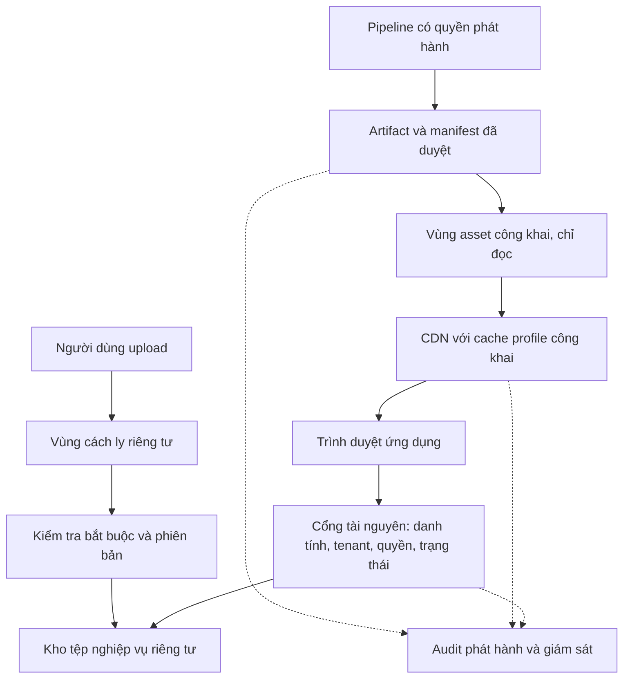

# Static resource policy

## 1. Mục tiêu của chính sách tài nguyên tĩnh

**Static resource policy** là tập yêu cầu xác định tài nguyên dạng tệp nào được phục vụ, ai được đọc hoặc thay đổi, qua đường nào, với kiểu nội dung và chính sách cache nào, cùng cách phát hành và thu hồi.

Tài nguyên tĩnh có thể gồm JavaScript, CSS, font, ảnh, biểu tượng, tài liệu và các tệp cấu hình công khai của ứng dụng. “Tĩnh” mô tả cách phân phối nội dung; nó không tự quyết định tài nguyên được công khai.

Ví dụ, một tệp CSS của giao diện có thể dành cho mọi người. Một PDF hợp đồng có nội dung không đổi vẫn phải kiểm tra quyền. Một tệp HTML do người dùng upload có thể chứa nội dung chủ động, dù được lưu như một object thông thường.

Trong chương **File và resource security**, chính sách cần bảo vệ ba nhóm mục tiêu:

- Không làm lộ tệp riêng tư, secret hoặc hiện vật không được phép phát hành.
- Không cho nội dung không tin cậy trở thành mã chạy dưới quyền của ứng dụng.
- Phân phối đúng phiên bản, đúng kiểu nội dung và đúng phạm vi cache, kể cả khi có CDN hoặc lỗi vận hành.

Sau bài học, người học có thể chuyển các mục tiêu đó thành yêu cầu đo được, gắn với mô hình đe dọa, thiết kế kiến trúc và bằng chứng kiểm thử.

**Các đường dẫn, domain và ngưỡng số trong bài là ví dụ đặc tả, không phải cấu hình dùng chung cho mọi hệ thống.**

## 2. Tình huống và mô hình đe dọa

Giả sử một nền tảng quản lý hồ sơ đa tenant có:

- Ứng dụng tại app.example.test.
- Asset giao diện do pipeline phát hành tại static.example.test.
- Tệp hồ sơ được truy cập qua cổng tài nguyên có xác thực.
- Vùng upload cách ly chưa được phép phục vụ cho người dùng.
- CDN phục vụ asset công khai.

Tenant là ranh giới tổ chức; quyền đọc tệp hồ sơ phụ thuộc vào tenant, người dùng, tài nguyên và trạng thái tệp.

| Tình huống | Rủi ro cần ngăn |
| --- | --- |
| Đưa toàn thư mục build hoặc workspace vào web root | Lộ cấu hình, source map hoặc hiện vật ngoài ý định |
| Xem mọi URL có đuôi .css hoặc .png là công khai | Phản hồi riêng tư bị cache hoặc bỏ kiểm tra quyền |
| Người dùng ghi được vào nơi phân phối JavaScript | Nội dung upload có thể trở thành mã của ứng dụng |
| Tệp nhạy cảm được đưa vào cache dùng chung | Người khác nhận lại phản hồi của người dùng trước |
| Chỉ chặn qua CDN nhưng origin mở công khai | Truy cập vòng ngoài chính sách |
| Đường dẫn được chuẩn hóa khác nhau giữa các tầng | Đọc ngoài thư mục hoặc đi nhầm route |
| Tệp được trả với MIME không phù hợp | Trình duyệt xử lý khác với ý định |
| CDN hoặc phụ thuộc bên ngoài thay nội dung asset | Mã không đúng bản được chấp nhận được tải vào ứng dụng |
| Rollback HTML nhưng xóa asset cũ quá sớm | Trang tham chiếu tài nguyên không còn tồn tại |
| Thu hồi tệp riêng tư nhưng cache hoặc URL cũ vẫn dùng được | Quyền truy cập thực tế kéo dài hơn cam kết |

### Chuỗi truy vết mẫu

| Thành phần | Ví dụ |
| --- | --- |
| Rủi ro | PDF riêng tư bị CDN lưu như một static asset công khai |
| Mục tiêu | Không chia sẻ phản hồi riêng tư giữa người dùng hoặc tenant |
| Yêu cầu | Tệp riêng tư đi qua cổng kiểm tra quyền; không được shared cache lưu |
| Thiết kế | Route và storage tách lớp, cache bypass, header phù hợp, origin riêng tư |
| Bằng chứng | Cùng URL được gọi lần lượt bởi người có quyền, người khác và người vô danh |

Một cấu hình “bật static middleware” chưa thể thay thế những quyết định này.

## 3. Phân loại trước khi chọn cách phục vụ

### 3.1. Bảng chính sách theo lớp tài nguyên

| Lớp | Ví dụ | Quyền đọc | Quyền ghi hoặc phát hành | Cách cache tham chiếu |
| --- | --- | --- | --- | --- |
| Asset ứng dụng công khai | JS, CSS, font, logo đã duyệt | Có thể vô danh | Pipeline hoặc vai trò phát hành | Cache dài nếu URL gắn phiên bản bất biến |
| Entry HTML công khai | Khung ứng dụng giống nhau cho mọi người | Có thể vô danh | Pipeline phát hành | Xác minh lại hoặc TTL ngắn theo yêu cầu cập nhật |
| Tệp cấu hình công khai | Endpoint công khai, feature flag không nhạy cảm | Theo công bố của sản phẩm | Vai trò cấu hình | TTL được xác định rõ |
| Tệp nghiệp vụ riêng tư | Hồ sơ, tài liệu tenant | Theo quyền hiện tại | Luồng nghiệp vụ có kiểm soát | Trong ví dụ: không lưu HTTP cache |
| Nội dung người dùng chưa tin cậy | Upload, preview chưa đạt | Chỉ thành phần kiểm tra có quyền | Luồng upload | Không phục vụ công khai |
| Hiện vật nội bộ | Secret, backup, log, source map chưa được duyệt | Không qua đường public asset | Quy trình nội bộ | Không thuộc danh mục phát hành |

Không suy ra lớp từ đuôi tệp. Phân loại phải dựa trên route, manifest phát hành hoặc metadata tài nguyên có thẩm quyền.

Một ảnh riêng tư không trở thành công khai vì có MIME image/png. Một tệp JSON công khai cũng không được chứa secret chỉ vì gọi là runtime config.

### 3.2. Công khai nghĩa là có thể bị sao chép

Mọi nội dung JavaScript, CSS hoặc cấu hình gửi tới trình duyệt phải được xem là người dùng có thể đọc. Minify, đổi tên biến hoặc che đường dẫn không bảo vệ secret.

Không đưa mật khẩu, private key, credential dịch vụ hoặc giá trị chỉ server được biết vào bundle, source map hoặc cấu hình public.

Một số định danh hoặc khóa được thiết kế để công khai theo sản phẩm vẫn cần phạm vi và hạn chế sử dụng phù hợp. Chính sách phải phân biệt chúng với secret, thay vì dựa vào tên trường có chữ “key”.

### 3.3. Source map và hiện vật phụ

Source map có thể phục vụ debug hợp lệ, nhưng cần quyết định phát hành rõ ràng. Trong ví dụ, source map không nằm trong public artifact; bản dùng cho công cụ quan sát được chuyển qua đường có phân quyền.

Cũng cần phân loại file backup, bản sao có hậu tố, cấu hình môi trường, thư mục quản lý mã nguồn, test fixture và báo cáo build. Chặn một tên tệp riêng lẻ không thay thế một danh mục được phép phát hành.

## 4. Ranh giới lưu trữ, đường dẫn và quyền ghi

### 4.1. Chỉ phục vụ artifact được chọn

Public web root phải được tạo từ artifact phát hành đã được chấp nhận, thay vì trỏ vào toàn workspace hoặc thư mục chứa dữ liệu runtime.

Một manifest có thể liệt kê:

```text
logical_name
public_path
content_digest
content_type
content_length
release_id
cache_profile
```

Chỉ pipeline có quyền ghi vào vùng public asset. Tài khoản ứng dụng, người dùng upload và worker xử lý hồ sơ không được sửa JS hoặc CSS đã phát hành.

Static handler không thực thi script phía server trong vùng này. Một tệp được đặt nhầm vào web root không được kích hoạt PHP, JSP hoặc cơ chế thực thi khác ngoài thiết kế.

### 4.2. Giữ đường dẫn trong phạm vi được phép

Nếu ánh xạ URL sang filesystem, cần:

- Phân tích và chuẩn hóa theo quy tắc thống nhất giữa proxy và origin.
- Từ chối biểu diễn mơ hồ hoặc không hợp lệ theo hợp đồng.
- Xác minh đường dẫn cuối cùng nằm trong thư mục gốc được phép.
- Có chính sách với symlink và các dạng phân cách đường dẫn của hệ điều hành.
- Không dựa vào phép so sánh tiền tố chuỗi đơn giản.

Ví dụ, chuỗi bắt đầu bằng /srv/public không chứng minh thuộc thư mục đó nếu đường dẫn thực tế là /srv/public-backup. Kiểm tra phải theo ranh giới thành phần đường dẫn và đối tượng thật sẽ mở.

Với object storage, cần ràng buộc bucket, prefix, object key và vai trò có quyền. Không cho client truyền một đường dẫn tùy ý để tài khoản máy chủ đọc bằng quyền rộng hơn.

Đường truy cập bất biến theo manifest hoặc ID tài nguyên thường giúp thu hẹp phạm vi, nhưng vẫn cần kiểm tra quyền và cấu hình lưu trữ.

### 4.3. Không để fallback mở rộng quyền

Directory listing phải bị tắt, trừ một chức năng liệt kê đã được thiết kế và phân quyền riêng.

Ứng dụng SPA có thể trả entry HTML cho route giao diện được phép. Không áp cùng fallback cho API, tệp riêng tư, đường dẫn cấu hình nội bộ hoặc asset không tồn tại.

Một request tới /assets/missing.js phải có phản hồi thiếu tài nguyên đúng hợp đồng, không âm thầm nhận trang đăng nhập HTML với trạng thái thành công.

Việc route có một hậu tố trông giống static không được làm CDN hoặc proxy xem phản hồi động là công khai. Đây là điểm cần kiểm thử khi phòng tránh rò dữ liệu qua phân loại cache sai.

### 4.4. Origin không phải đường vòng

Nếu chính sách yêu cầu đi qua CDN hoặc cổng tài nguyên, đường origin trực tiếp phải có kiểm soát tương ứng.

Có thể dùng danh tính dịch vụ, chính sách mạng và quyền storage phù hợp với kiến trúc. Không chỉ dựa vào một header bí mật mà client có thể tự gửi khi origin vẫn mở cho mọi nguồn.

Phải kiểm tra cả hostname phụ, endpoint bucket, alias cũ và các bản triển khai còn tồn tại trong phạm vi quản lý.

## 5. Kiểu nội dung và cách trình duyệt sử dụng

### 5.1. MIME phải do server quyết định

Content-Type cần được xác định từ danh mục artifact hoặc kết quả kiểm tra có thẩm quyền. Không dùng MIME do người upload khai báo làm quyết định cuối.

Ví dụ chính sách:

| Tài nguyên | Content-Type ví dụ | Điều cần kiểm chứng |
| --- | --- | --- |
| JavaScript ứng dụng | text/javascript | Không trả HTML lỗi dưới cùng URL thành công |
| CSS | text/css | Nội dung và route đúng artifact |
| PNG | image/png | Phù hợp đối tượng đã được kiểm tra |
| JSON công khai | application/json | Không chứa dữ liệu theo người dùng hoặc secret |
| Download riêng tư | Theo loại đã được chấp nhận | Quyền, trạng thái và Content-Disposition phù hợp |

X-Content-Type-Options: nosniff hỗ trợ ngăn diễn giải sai MIME trong những ngữ cảnh được tiêu chuẩn quy định, đặc biệt đối với script và stylesheet. Nó cần đi cùng Content-Type đúng. [Nguồn: WHATWG Fetch — X-Content-Type-Options](https://fetch.spec.whatwg.org/#x-content-type-options-header).

Header này không làm một tệp HTML được khai báo text/html trở thành nội dung thụ động. Không dùng nosniff như thay thế cho phân loại hoặc cô lập nội dung chủ động.

### 5.2. Nội dung không tin cậy không thuộc origin thực thi ứng dụng

HTML, SVG hoặc nội dung có thể chủ động cần chính sách theo ngữ cảnh sử dụng. Trong ví dụ, nội dung người dùng không được dùng như script hoặc document tin cậy trên origin ứng dụng.

Nếu cần preview, dùng luồng tạo preview hoặc origin được cô lập với quyền và header phù hợp. Content-Disposition: attachment có thể hỗ trợ cách tải xuống, nhưng không thay thế phân quyền hoặc kiểm tra nội dung.

Tách subdomain chưa chắc tách cookie. Nếu cookie phiên được đặt quá rộng cho cả miền cha, nó có thể đi tới một subdomain không nên nhận. Chính sách phải kiểm tra phạm vi cookie và luồng request thực tế.

### 5.3. Header của phản hồi lỗi cũng cần đúng

Không chỉ kiểm tra phản hồi 200. Redirect, 304, lỗi quyền, lỗi origin và lỗi từ CDN phải có hành vi phù hợp với lớp tài nguyên.

Phản hồi lỗi không được chứa stack trace, đường dẫn nội bộ, secret hoặc nội dung riêng tư rồi bị cache theo chính sách public asset.

Nếu có bản nén sẵn, server phải trả Content-Encoding và Content-Type phù hợp với biểu diễn. Một file .br hoặc .gz phụ trợ không tự được công khai ngoài manifest chỉ vì nằm cùng thư mục.

## 6. Cache là một phần của ranh giới dữ liệu

### 6.1. Phân biệt các chỉ thị

| Chỉ thị | Ý nghĩa cần hiểu đúng |
| --- | --- |
| public | Cho phép cache dùng chung theo các điều kiện còn lại |
| private | Không cho shared cache lưu phản hồi theo phạm vi chỉ thị |
| no-store | Chỉ thị không lưu phản hồi trong HTTP cache |
| no-cache | Có thể lưu, nhưng phải xác minh lại trước khi tái sử dụng theo quy tắc |
| max-age | Khoảng độ mới của phản hồi |

Không hiểu no-cache là không lưu. Các quy tắc cache và phản hồi của request có Authorization được mô tả trong RFC 9111; không được suy ra cứ có xác thực là mọi tầng tự cấu hình an toàn. [Nguồn: RFC 9111, mục 3.5 và 5.2](https://www.rfc-editor.org/rfc/rfc9111.html#section-5.2).

Trong ví dụ, tệp riêng tư dùng Cache-Control: private, no-store và route cache bypass. Việc không lưu tại HTTP cache vẫn không xóa được bản người dùng đã tải hoặc dữ liệu ứng dụng tự ghi vào storage.

### 6.2. Cache key phải khớp nội dung

Nếu phản hồi thay đổi theo tenant, quyền, ngôn ngữ, encoding hoặc nguồn request, mọi chiều có ý nghĩa phải được xử lý đúng ở cache hoặc đường đó phải không dùng cache chia sẻ.

Không chọn cache key chỉ bằng đuôi tệp. Không dựa vào một query string bất kỳ làm “bằng chứng khác người dùng” khi CDN có thể bỏ query khỏi key.

Vary hỗ trợ mô tả một số chiều phản hồi nhưng không thay thế kiểm tra quyền. Không coi Vary: Cookie hoặc việc đưa user ID vào key là đủ nếu CDN vẫn có đường lấy nội dung trước xác thực.

### 6.3. Ví dụ phản hồi theo lớp

Asset công khai có URL gắn nội dung bất biến:

```http
Content-Type: text/javascript
Cache-Control: public, max-age=31536000
X-Content-Type-Options: nosniff
```

Entry HTML công khai giống nhau cho mọi người trong chính sách yêu cầu xác minh lại:

```http
Content-Type: text/html; charset=utf-8
Cache-Control: no-cache
X-Content-Type-Options: nosniff
```

Tệp riêng tư trong hồ sơ:

```http
Content-Type: application/pdf
Cache-Control: private, no-store
Content-Disposition: attachment
X-Content-Type-Options: nosniff
```

Các ví dụ chỉ thể hiện một phần header. Entry HTML chứa dữ liệu cá nhân không được áp chính sách public chỉ vì có cùng tên index.html.

### 6.4. HEAD, Range và conditional request

Kiểm tra quyền và trạng thái tệp phải xảy ra trước khi trả thông tin riêng tư, kể cả request chỉ xin header, một dải byte hoặc dùng ETag để xác minh bản đã có.

Không trả 304 cho người đã mất quyền chỉ vì ETag khớp. Không dùng HEAD hoặc Range làm đường nhận metadata hay nội dung mà GET đầy đủ sẽ từ chối.

Nếu hỗ trợ range, cần ngân sách cho số range, byte và kết nối. Nhiều request nhỏ không được tạo tiêu thụ không giới hạn đối với tài nguyên lớn.

### 6.5. Service worker và cache của ứng dụng

HTTP cache không phải nơi lưu duy nhất trong trình duyệt. Nếu có service worker hoặc mã ứng dụng tự quản lý cache, chính sách phải quy định loại tài nguyên nào được lưu.

Trong ví dụ, cache ứng dụng chỉ lưu asset công khai theo manifest; không lưu tệp hồ sơ, phản hồi có dữ liệu cá nhân hoặc URL mang quyền truy cập.

Service worker phải có chủ sở hữu, phiên bản, phạm vi và cơ chế cập nhật phù hợp. Kiểm thử đăng xuất hoặc thu hồi quyền cần quan sát cả đường cache này, không chỉ header từ origin.

## 7. CORS, CSP và toàn vẹn asset

### 7.1. CORS không phải phân quyền

CORS điều chỉnh một số khả năng trình duyệt đọc phản hồi giữa origin. Nó không thay thế kiểm tra quyền trên server và không ngăn một client ngoài trình duyệt tải tài nguyên công khai.

Đối với JS module, font hoặc tài nguyên cross-origin, cần chính sách phù hợp với cách nạp. Nếu tài nguyên thật sự công khai, việc cho đọc từ nhiều origin có thể là chủ đích hợp lệ; không mặc định mọi wildcard đều là lỗi.

Với phản hồi riêng tư hoặc có credential, phải xác định origin được phép, cách xử lý credential và cache theo nguồn. Không phản chiếu tùy ý Origin do client gửi rồi coi đó là allowlist.

Nếu phản hồi thay đổi theo Origin, cần xử lý Vary và cache key tương ứng hoặc không cache chia sẻ.

### 7.2. CSP giới hạn nơi và cách nạp mã

Content Security Policy của document ứng dụng cần chỉ ra nguồn script, style, font, image và các nội dung liên quan được cho phép. Chính sách phải phù hợp mô hình thực thi, có thể dùng nonce hoặc hash khi cần.

Cho phép một origin trong script-src là một quyết định tin cậy đối với mã có thể được nạp từ đó. Không đưa origin chứa upload không tin cậy vào cùng danh sách chỉ vì nó thuộc tổ chức.

Chế độ Report-Only giúp quan sát vi phạm nhưng không phải chế độ chặn. Nghiệm thu phải kiểm tra chính sách đang được cưỡng chế và hành vi thật của trình duyệt. [Nguồn: OWASP Content Security Policy Cheat Sheet](https://cheatsheetseries.owasp.org/cheatsheets/Content_Security_Policy_Cheat_Sheet.html).

CSP là một lớp giảm rủi ro, không sửa được asset đã bị thay độc hại trong nguồn đang được tin cậy nếu mô hình cho phép mã đó thực thi.

### 7.3. Subresource Integrity

**Subresource Integrity (SRI)** cho phép trình duyệt kiểm tra tài nguyên được tải với digest kỳ vọng trong những ngữ cảnh được hỗ trợ. Nó hữu ích với script hoặc stylesheet được chấp nhận ở một phiên bản xác định. [Nguồn: W3C Subresource Integrity](https://www.w3.org/TR/2016/REC-SRI-20160623/).

Digest cần được tạo từ artifact đã duyệt và gắn vào document qua quy trình phát hành đáng tin cậy. Với tài nguyên cross-origin, cấu hình CORS và cách nạp phải đáp ứng điều kiện SRI của trình duyệt.

Không lấy digest từ cùng một nguồn có thể tự đổi cả mã lẫn giá trị kiểm tra tại lúc chạy rồi xem đó là pin độc lập. Nếu document ứng dụng và digest cùng bị thay, SRI không bảo vệ khỏi thay đổi đó.

URL có tên chứa hash cũng không tự làm trình duyệt xác minh byte. Tính bất biến vẫn phải được cưỡng chế ở pipeline và storage; SRI là cơ chế kiểm tra riêng khi được áp dụng.

## 8. Phát hành, rollback và thu hồi

### 8.1. Không ghi đè nội dung tại URL bất biến

Nếu /assets/app.a1b2c3.js đã đại diện một nội dung, không thay byte ở cùng URL rồi trông chờ mọi cache đồng loạt cập nhật.

Pipeline phải sinh URL mới khi nội dung thay đổi và bảo vệ quyền ghi vào artifact đã phát hành. Manifest hoặc entry document trỏ tới tập phiên bản tương thích.

Thứ tự phát hành cần tránh HTML mới trỏ tới asset chưa tồn tại. Một quy trình có thể đưa asset mới lên trước, xác minh rồi cập nhật entry document theo cơ chế chuyển phiên bản.

### 8.2. Giữ khả năng rollback

Rollback entry document cần giữ được asset của phiên bản tương ứng trong khoảng hỗ trợ. Xóa ngay mọi asset cũ sau một lần deploy có thể làm tab đang mở hoặc client đang chuyển phiên bản hỏng.

Không nhầm rollback phiên bản với việc chấp nhận tiếp tục dùng một phiên bản đã bị xác định nguy hiểm. Kế hoạch phải chỉ ra bản tốt đã biết và cách chặn artifact có vấn đề tại hạ tầng có thể kiểm soát.

### 8.3. Cache dài hạn có giới hạn thu hồi

Asset công khai cache một năm có thể còn trên client dù origin đã xóa. Purge CDN chỉ tác động phần CDN quản lý; không bảo đảm xóa bản đã được lưu trong trình duyệt hoặc tải về.

Vì vậy, không áp cùng mô hình cache dài hạn cho tài liệu riêng tư cần thu hồi quyền nhanh.

Ví dụ mục tiêu rollback: trong năm phút từ quyết định, các request entry document mới thực sự đi tới hạ tầng phải nhận phiên bản đã được chấp nhận. Mục tiêu này không cam kết đổi ngay mã đang chạy trong tab cũ hoặc xóa cache offline.

Nếu yêu cầu sản phẩm đòi hỏi giới hạn thời gian tồn tại client chặt hơn, cần thiết kế vòng đời client, tương thích API và chính sách cache tương ứng, rồi kiểm thử đúng phạm vi.

### 8.4. Thu hồi tệp riêng tư

Trong ví dụ, download riêng tư luôn qua cổng kiểm tra quyền; shared cache bị bypass và không phát URL trực tiếp dài hạn.

Mục tiêu là trong 60 giây từ khi quyết định thu hồi có hiệu lực, mọi request đọc mới phải bị từ chối theo chính sách. Nếu có cache quyền, phải tính độ trễ lan truyền và TTL vào cận này.

Dữ liệu đã gửi cho client trước thu hồi không thể được lấy lại chỉ bằng một header hoặc đổi trạng thái server. Kết nối đang truyền cần có quy tắc riêng nếu nghiệp vụ yêu cầu ngắt giữa chừng.

## 9. Bộ yêu cầu mẫu có thể nghiệm thu

### SR-001 — Danh mục tài nguyên và quyền công khai

Mọi route phục vụ tệp phải có lớp dữ liệu, chủ sở hữu, nguồn phát hành, quyền đọc, quyền ghi, MIME, cache profile và quy tắc vòng đời.

Chỉ artifact trong manifest đã chấp nhận được đưa vào public asset root. Mặc định không phát hành secret, log, backup, cấu hình nội bộ hoặc source map chưa được duyệt.

Không dùng đuôi URL hoặc vị trí thư mục đơn thuần để quyết định dữ liệu nghiệp vụ là công khai.

### SR-002 — Cô lập nơi ghi và nơi phục vụ

Public asset root chỉ cho pipeline phát hành được ủy quyền ghi. Tài khoản upload, worker nghiệp vụ và người dùng không có quyền sửa artifact ứng dụng.

Vùng upload cách ly, kho riêng tư và vùng public có ranh giới quyền rõ. Mã phía server không được thực thi từ static root; directory listing bị tắt.

Static delivery chỉ cho GET và HEAD trong ví dụ. OPTIONS nếu cần thuộc chính sách giao thức riêng; các thao tác ghi không được đi qua đường public asset.

### SR-003 — Đường dẫn, route và origin

Mọi đường dẫn được giải quyết trong root, bucket hoặc prefix được cho phép. Chuẩn hóa phải nhất quán và từ chối trường hợp mơ hồ; không thoát phạm vi qua traversal, alias hoặc symlink ngoài chính sách.

Không áp SPA fallback lên API, tệp riêng tư, hiện vật nội bộ hoặc asset thiếu. Các đường origin và hostname thay thế phải có kiểm soát tương đương đường được công bố.

Nếu có reverse proxy nội bộ phục vụ file sau kiểm tra quyền, đường nội bộ không được gọi trực tiếp từ client để bỏ qua bước đó.

### SR-004 — Quyền đọc riêng tư

Mỗi GET, HEAD, Range hoặc conditional request tới tài nguyên riêng tư phải kiểm tra danh tính, tenant, quyền hiện tại và trạng thái phiên bản trước phản hồi nội dung hoặc metadata cần bảo vệ.

Tệp chưa đạt điều kiện sử dụng hoặc đã bị thu hồi không được phục vụ bằng cách đổi đuôi URL, gọi origin trực tiếp hoặc dùng ETag cũ.

Người không có quyền nhận phản hồi theo chính sách lỗi đã công bố, không nhận object key nội bộ, URL có quyền truy cập hay metadata của tenant khác.

### SR-005 — MIME và nội dung chủ động

Content-Type lấy từ metadata có thẩm quyền hoặc manifest. Mọi phản hồi tài nguyên trong phạm vi áp dụng gửi X-Content-Type-Options: nosniff theo hồ sơ header.

Nội dung người dùng không được phục vụ như mã hoặc document tin cậy trên origin ứng dụng. Chức năng preview nếu có cần ranh giới và chính sách riêng.

Tên tệp download và header phải được tạo an toàn, không đưa ký tự điều khiển hoặc giá trị chưa kiểm tra vào response header.

### SR-006 — Cache theo lớp dữ liệu

Asset công khai có URL bất biến có thể dùng max-age 31.536.000 giây trong ví dụ. Entry HTML công khai phải xác minh lại theo no-cache; entry chứa dữ liệu cá nhân áp chính sách riêng tư.

Tệp riêng tư dùng private, no-store, cache bypass tại CDN và không được service worker lưu vào cache ứng dụng trong mô hình ví dụ.

Không cache công khai phản hồi riêng tư chỉ vì request có hậu tố static. Header và cấu hình CDN phải nhất quán cho phản hồi thành công, lỗi, redirect và xác minh lại.

### SR-007 — Nguồn nạp và toàn vẹn

Danh mục script, stylesheet và font bên ngoài phải có chủ sở hữu và phiên bản được chấp nhận. Không nạp mã từ URL tùy ý theo input người dùng.

Document ứng dụng có CSP phù hợp và được cưỡng chế. Script hoặc stylesheet bên ngoài thuộc danh mục yêu cầu pin phải có SRI cùng cấu hình cross-origin đã kiểm thử.

Digest, manifest và artifact được tạo qua đường phát hành có quyền phù hợp. Ghi đè byte tại URL bất biến phải bị từ chối hoặc bị quy trình phát hành phát hiện trước công bố.

### SR-008 — Phát hành và phục hồi

Trước chuyển entry document, pipeline xác minh mọi asset được tham chiếu tồn tại, đúng digest và đúng header theo manifest.

Có bản phát hành tốt đã biết và quy trình rollback. Trong năm phút từ quyết định rollback, request entry document mới đi tới hạ tầng phải nhận phiên bản đã chấp nhận theo phạm vi đo đã nêu.

Hồ sơ rollback phải ghi giới hạn với client đã cache hoặc tab đang chạy. Không tuyên bố purge CDN là xóa được mọi bản client.

### SR-009 — Thu hồi và cache quyền

Với tệp riêng tư qua cổng tài nguyên, request đọc mới phải bị chặn trong 60 giây từ quyết định thu hồi có hiệu lực. Cache quyền và mọi điểm thực thi phải nằm trong ngân sách này.

Nếu bổ sung URL ký, CDN riêng tư hoặc chế độ offline, phải đánh giá lại thời hạn token, cache key, nơi kiểm tra quyền và khả năng thu hồi trước khi giữ cùng cam kết.

Không dùng trạng thái lỗi của nguồn quyền để tự chuyển sang cho phép hoặc phục vụ bản stale chưa được chính sách chấp nhận.

### SR-010 — Quan sát và quản lý thay đổi

Ghi release ID, artifact digest, phiên bản cache profile, người hoặc dịch vụ phát hành, thời điểm và kết quả thay đổi. Truy cập riêng tư có audit theo yêu cầu dữ liệu và nghiệp vụ.

Không ghi session token, URL mang quyền truy cập hoặc query nhạy cảm vào log public/CDN ngoài chính sách. Metric không dùng đường dẫn tùy ý hoặc file ID làm nhãn không giới hạn.

Thay route, hostname, CDN rule, bucket policy, MIME mapping hoặc service worker phải được xem là thay đổi ranh giới bảo mật và có kiểm tra liên quan.

## 10. Kiến trúc tham chiếu



Hai đường public và private có thể dùng chung nhà cung cấp nhưng không được ngầm dùng chung quyền, route hoặc cache rule.

Cổng tài nguyên cần quyết định trước khi kho dữ liệu hoặc reverse proxy phục vụ nội dung. Asset công khai không cần kiểm tra phiên người dùng chỉ để đọc, nhưng quá trình tạo và thay đổi asset vẫn phải được kiểm soát.

Đầu cuối origin, cache và trình duyệt đều là một phần của phép nghiệm thu; kiểm tra riêng cấu hình trên một server không đủ.

## 11. Ma trận kiểm thử và bằng chứng

| Mã | Yêu cầu | Kịch bản | Kết quả cần chứng minh |
| --- | --- | --- | --- |
| T-01 | SR-001 | So sánh manifest với file thực tế có thể lấy từ public root | Không có hiện vật ngoài danh mục |
| T-02 | SR-002 | Tài khoản upload hoặc worker thử sửa asset | Bị từ chối; quyền pipeline không bị chia sẻ |
| T-03 | SR-003 | Đường traversal, encode không hợp lệ, alias và symlink trong môi trường thử | Không thoát root hoặc đi nhầm route |
| T-04 | SR-003 | Asset thiếu, route API và đường hiện vật nội bộ | Không nhận fallback làm thay đổi lớp dữ liệu |
| T-05 | SR-003 | Truy cập origin, bucket endpoint và hostname phụ | Không có đường bỏ qua chính sách |
| T-06 | SR-004 | Cùng file ID được gọi bởi đúng người, người khác, tenant khác và vô danh | Quyền được giữ trên mọi đường và trạng thái |
| T-07 | SR-004 | HEAD, Range, ETag sau thu hồi hoặc với sai quyền | Không lộ nội dung hoặc metadata cần bảo vệ |
| T-08 | SR-005 | MIME sai, response lỗi HTML dưới URL script, nội dung chủ động upload | Không thực thi ngoài chính sách; header thực đúng |
| T-09 | SR-006 | Làm nóng cache bằng người A rồi gọi bằng người B và vô danh | Không dùng lại phản hồi riêng tư |
| T-10 | SR-006 | URL riêng tư có hậu tố .css hoặc .png; query và encoding khác nhau | Không phân loại public chỉ từ hình thức URL |
| T-11 | SR-006 | Browser cache, CDN cache và service worker sau đăng xuất | Không có cache ứng dụng phục vụ tệp riêng tư ngoài quyền |
| T-12 | SR-007 | Asset bên ngoài bị thay byte; origin ngoài danh mục; CSP chỉ report | Phát hiện hoặc chặn đúng lớp, không nhầm report với cưỡng chế |
| T-13 | SR-008 | Deploy thiếu asset hoặc rollback phiên bản | Không tham chiếu tập chưa tồn tại; đạt mục tiêu cập nhật entry |
| T-14 | SR-009 | Thu hồi trong lúc cache quyền còn tồn | Chặn request mới trong cận 60 giây đã công bố |
| T-15 | SR-010 | CDN tạo lỗi, log query hoặc lượng đường dẫn lạ tăng | Không cache nhầm dữ liệu, không lộ credential, log có ngân sách |

Kiểm thử cache phải quan sát cả phản hồi và việc origin hoặc cổng quyền có được gọi. Một response có header đúng nhưng CDN vẫn phục vụ bản đã lưu trái chính sách là chưa đạt.

Hồ sơ nghiệm thu cần gồm release ID, cấu hình route, quyền storage, cache profile, header từ từng tầng, kết quả theo nhiều danh tính và trạng thái cache. Với kiểm thử trình duyệt, ghi môi trường và phiên bản hỗ trợ; không suy từ một lần tải mới sang mọi đường cache.

Dùng dữ liệu giả hoặc đã được phép và môi trường có kiểm soát để thử rò chéo người dùng. Không cần đưa secret thật vào public root để kiểm tra cơ chế chặn.

## 12. Những sai lầm thường gặp và duy trì chính sách

| Cách làm thiếu | Hệ quả | Điều cần bổ sung |
| --- | --- | --- |
| “Tệp tĩnh thì public” | Lộ tài liệu riêng tư | Phân loại theo dữ liệu và quyền |
| Đưa cả workspace vào web root | Lộ hiện vật ngoài ý định | Artifact và manifest được chọn |
| Chỉ chặn ở giao diện hoặc CDN | Origin có thể vẫn mở | Kiểm soát mọi đường vào |
| Dựa vào đuôi URL để chọn cache | Phản hồi động riêng tư bị dùng lại | Metadata route và lớp dữ liệu có thẩm quyền |
| Dùng no-cache để diễn đạt không lưu | Cache vẫn có thể giữ dữ liệu | Hiểu đúng chỉ thị và kiểm thử nhiều tầng |
| Vary hoặc CORS thay phân quyền | Client khác vẫn có thể truy cập | Cổng kiểm tra quyền tại server |
| nosniff thay kiểm tra nội dung chủ động | Nội dung vẫn có thể được xử lý theo MIME được khai báo | Loại tệp, origin và ngữ cảnh sử dụng |
| URL có hash nhưng cho phép ghi đè | Cache giữ các byte khác nhau dưới cùng URL | Bất biến artifact và quyền phát hành |
| CSP ở Report-Only được báo là đã chặn | Vi phạm chỉ được ghi nhận | Cưỡng chế và kiểm thử trình duyệt |
| Purge CDN được xem là thu hồi mọi bản | Client có thể còn cache hoặc dữ liệu đã tải | Cam kết theo phạm vi thực có thể kiểm soát |

Ở bước phân tích, lập danh mục tài nguyên và ranh giới dữ liệu: cái gì công khai, cái gì phụ thuộc quyền, cái gì chưa tin cậy và cái gì không được phát hành.

Ở bước thiết kế, chốt storage, origin, route, quyền ghi, MIME, cache và vòng đời. Xác định các nguồn script hoặc style được tin cậy cùng yêu cầu toàn vẹn và cô lập.

Ở bước triển khai, quản lý artifact, manifest và cấu hình hạ tầng có phiên bản. Tách quyền phát hành khỏi quyền runtime; bảo đảm một thay đổi CDN rule không âm thầm mở quyền cho dữ liệu riêng tư.

Ở bước kiểm thử, đối chiếu chính sách trên request thật qua origin, CDN và trình duyệt. Dùng nhiều danh tính, trạng thái cache, phương thức và phiên bản tài nguyên.

Ở bước vận hành, theo dõi hiện vật ngoài manifest, thay đổi quyền storage, cache profile, nguồn nạp và lỗi phát hành. Khi có sự cố, rollback hoặc thu hồi theo đúng phạm vi đã cam kết và lưu bằng chứng.

Một static resource policy có thể nghiệm thu phải nối được **rủi ro → phân loại tài nguyên → quyền đọc và ghi → đường phục vụ → MIME và cache → toàn vẹn phiên bản → phát hành, thu hồi và bằng chứng kiểm thử**. Nhờ đó, phân phối tệp tĩnh trở thành một phần rõ ràng của thiết kế bảo mật.
