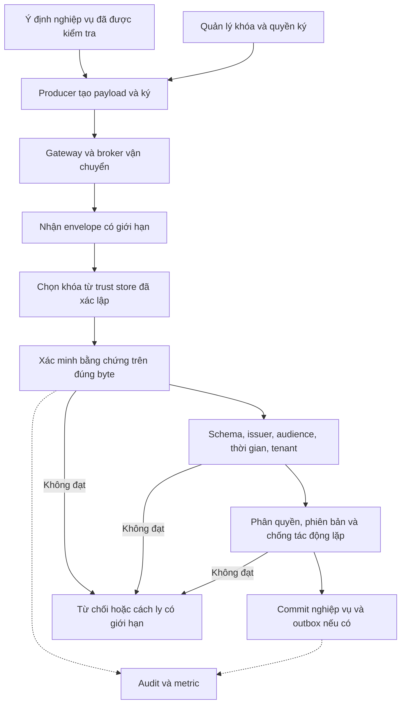

# Message integrity

## 1. Mục tiêu toàn vẹn thông điệp

**Message integrity** là thuộc tính cho phép bên nhận phát hiện thay đổi trái phép đối với dữ liệu thuộc phạm vi được bảo vệ, dựa trên cơ chế kiểm chứng và quan hệ tin cậy đã xác định.

Trong chương **Communication security**, yêu cầu toàn vẹn cần trả lời nhiều hơn câu “message phải có hash”:

- Những byte, trường và metadata nào phải được bảo vệ?
- Ai có quyền tạo bằng chứng và ai được xác minh?
- Bằng chứng có còn hiệu lực khi qua proxy, queue hoặc lưu trữ trung gian không?
- Bên nhận có sử dụng đúng dữ liệu đã được xác minh không?
- Khi thiếu bằng chứng, khóa bị thu hồi hoặc xác minh lỗi, hệ thống làm gì?
- Kiểm thử nào chứng minh sửa đổi không tạo tác động nghiệp vụ?

Toàn vẹn cần được phân biệt với bí mật dữ liệu, xác thực danh tính, phân quyền và chống phát lại. Các mục tiêu liên quan nhưng không tự thay thế nhau.

Sau bài học, người học có thể chuyển rủi ro sửa thông điệp thành yêu cầu đo được, chọn ranh giới bảo vệ, đặc tả dữ liệu được xác minh và liên kết với kiến trúc, logging, kiểm thử cùng phục hồi.

**Các schema, thuật toán và ngưỡng trong ví dụ là hồ sơ minh họa cần được đánh giá trước khi áp dụng.**

## 2. Tình huống xuyên suốt và mô hình đe dọa

Một nền tảng quản lý hồ sơ có dịch vụ tiếp nhận yêu cầu cấp quyền và dịch vụ thực thi quyền. Thông điệp đi qua gateway, broker và worker trước khi một quyền đọc được tạo.

Thông điệp mô tả tenant, người được cấp quyền, tài nguyên, vai trò và thời hạn. Tenant là ranh giới tổ chức; thay đổi tenant hoặc tài nguyên có thể dẫn tới truy cập dữ liệu ngoài phạm vi.

Ví dụ một nội dung hợp lệ:

```json
{
  "schemaVersion": 1,
  "messageId": "msg-6d2f",
  "issuer": "access-request-service",
  "audience": "access-enforcement-service",
  "environment": "prod",
  "tenantId": "tenant-12",
  "operation": "GRANT_ACCESS",
  "issuedAt": "2026-11-27T08:00:00Z",
  "expiresAt": "2026-11-27T08:05:00Z",
  "requestId": "req-81",
  "approvalCycleId": "cycle-3",
  "expectedVersion": 7,
  "beneficiaryId": "user-31",
  "resourceId": "dataset-27",
  "role": "READER",
  "durationSeconds": 86400
}
```

Đây là nội dung minh họa trước khi được đóng gói và ký, không phải một thông điệp đã có bằng chứng mật mã.

| Tình huống | Hậu quả cần ngăn |
| --- | --- |
| Đổi READER thành một vai trò mạnh hơn | Cấp quyền vượt ý định được phê duyệt |
| Đổi người nhận, tài nguyên hoặc tenant | Tác động lên đối tượng không được phép |
| Sửa thời hạn hoặc phiên bản | Gia hạn quyền hoặc dùng quyết định cũ |
| Thay audience hoặc đưa message thử nghiệm sang sản xuất | Dùng bằng chứng ngoài ngữ cảnh |
| Sửa header định tuyến nhưng giữ body | Bên nhận áp dụng ngữ cảnh khác dữ liệu được bảo vệ |
| Middleware parse rồi serialize lại | Mất bằng chứng hoặc xác minh trên dữ liệu khác dữ liệu thực thi |
| Broker lưu thông điệp nhưng người có quyền quản trị sửa nội dung | Bảo vệ từng kết nối không còn đủ |
| Dùng khóa của một issuer khác | Chữ ký đúng về toán học nhưng sai nguồn có thẩm quyền |
| Gửi lại nguyên message đã có chữ ký | Toàn vẹn còn đúng nhưng tác động có thể bị lặp |

### Chuỗi truy vết mẫu

| Thành phần | Ví dụ |
| --- | --- |
| Rủi ro | Vai trò bị thay trên đường từ dịch vụ phê duyệt tới worker |
| Mục tiêu | Worker chỉ thực thi đúng nội dung do issuer được phép phát hành |
| Yêu cầu | Các trường quyết định quyền nằm trong payload được xác minh; thiếu hoặc sai bằng chứng phải bị chặn |
| Thiết kế | Hồ sơ thông điệp có chữ ký, trust store theo issuer và cổng xác minh trước tác động |
| Bằng chứng | Sửa từng trường quan trọng và kiểm tra không tạo quyền, outbox hoặc tác động bên ngoài |

## 3. Những cơ chế khác nhau bảo vệ điều gì?

| Cơ chế | Điều hỗ trợ | Giới hạn cần hiểu |
| --- | --- | --- |
| Checksum như CRC | Phát hiện một số lỗi truyền hoặc lưu trữ vô ý | Không tạo bằng chứng chống người có thể sửa dữ liệu và tính lại checksum |
| Hash mật mã không khóa | Đối chiếu nội dung với một digest đáng tin cậy | Digest gửi cùng dữ liệu qua cùng nguồn không được xác thực có thể bị thay cùng dữ liệu |
| MAC hoặc HMAC | Toàn vẹn và xác thực trong nhóm giữ secret chung | Bên có secret xác minh thường cũng có khả năng tạo MAC |
| Chữ ký số | Xác minh bằng public key tương ứng với private key tạo chữ ký | Phải xác lập khóa, nguồn và quyền sử dụng đúng; không tự chứng minh quyền nghiệp vụ |
| Mã hóa có xác thực, như AEAD | Bí mật và toàn vẹn trong phạm vi giao thức đã chọn | Phải xử lý khóa, nonce và dữ liệu liên kết đúng theo giao thức |
| TLS | Bảo vệ dữ liệu trên một kết nối giữa các đầu cuối TLS | Không tự giữ bằng chứng ứng dụng sau khi kết thúc kết nối hoặc qua thành phần trung gian |

### 3.1. Hash chỉ hữu ích khi digest có nguồn tin cậy

Nếu người sửa message có thể thay cả body và trường sha256, việc tính lại hash vẫn cho kết quả khớp. Muốn dùng digest làm bằng chứng chống sửa đổi, digest cần được bảo vệ bằng chữ ký, MAC hoặc một nguồn đối chiếu có thẩm quyền.

Content-Digest của HTTP mô tả digest nội dung; riêng digest không cung cấp toàn bộ bảo vệ nguồn gốc hoặc mọi thành phần của message. RFC 9530 phân biệt digest nội dung với bảo vệ đầu cuối và việc dùng digest trong chữ ký. [Nguồn: RFC 9530 — Digest Fields](https://www.rfc-editor.org/rfc/rfc9530.html).

### 3.2. Chữ ký không làm nội dung trở nên bí mật

Một thông điệp được ký vẫn có thể đọc được bởi người nhìn thấy payload. Mã hóa Base64 hoặc Base64url cũng không tạo tính bí mật.

Nếu dữ liệu nhạy cảm, phải có yêu cầu bảo mật kênh, lưu trữ và quyền truy cập. Khi cần mã hóa ở cấp ứng dụng, dùng giao thức đã được chọn thay vì tự ghép mã hóa và hash.

### 3.3. Khóa đúng khác với quyền đúng

Chữ ký có thể chứng minh một khóa đã tạo bằng chứng trên dữ liệu, theo giả định khóa chưa bị chiếm. Nó không tự chứng minh:

- Issuer được phép cấp mọi vai trò.
- Issuer được phép đại diện cho mọi tenant.
- Người dùng trong payload vẫn còn quyền.
- Quyết định nghiệp vụ còn hợp lệ ở trạng thái hiện tại.
- Một cá nhân cụ thể đã trực tiếp phê duyệt.

Cần quan hệ tin cậy và kiểm tra nghiệp vụ riêng. Không dùng câu “có chữ ký nên tin mọi trường” thay cho việc kiểm tra ngữ nghĩa.

## 4. Chọn ranh giới bảo vệ

### 4.1. Bảo vệ từng chặng

Ví dụ đường truyền:

```text
Producer --TLS--> Gateway --TLS--> Broker --TLS--> Consumer
```

Mỗi kết nối có thể được bảo vệ nhưng nội dung vẫn được giải mã tại từng đầu cuối. Gateway hoặc broker có quyền sửa thông điệp nếu kiến trúc không có bằng chứng được consumer kiểm tra.

mTLS có thể xác thực dịch vụ đang kết nối với broker, nhưng không tự chứng minh ai đã tạo payload nhiều giờ trước hoặc liệu payload đã bị đổi sau khi tiếp nhận.

Nếu rủi ro chỉ nằm trong phạm vi kết nối và mọi trung gian thuộc ranh giới tin cậy đã chấp nhận, có thể chọn bảo vệ theo chặng. Quyết định cần được ghi rõ; không mặc định mọi hệ thống đều phải ký ở cấp ứng dụng.

### 4.2. Bảo vệ từ producer đến consumer

Khi cần phát hiện thay đổi qua lưu trữ hoặc nhiều trung gian, producer tạo bằng chứng trên nội dung và consumer xác minh trước sử dụng. Broker vận chuyển thông điệp nhưng không được tự tạo lại bằng chứng dưới danh tính producer.

TLS vẫn cần cho bí mật dữ liệu và bảo vệ kết nối. Chữ ký cấp thông điệp không phải lý do bỏ xác thực endpoint hoặc bỏ kiểm tra chứng thư trên đường truyền.

### 4.3. Trung gian có quyền biến đổi

Một số hệ thống thật sự cần chuyển schema hoặc tổng hợp message. Có hai lựa chọn cần đặc tả:

- Giữ nguyên thông điệp gốc và bằng chứng, thêm envelope trung gian riêng.
- Xác minh đầu vào, thực hiện biến đổi được phép và phát hành thông điệp mới bằng danh tính của thành phần biến đổi.

Trong lựa chọn thứ hai, consumer phải biết đang tin thành phần biến đổi, không còn nhận cùng một bằng chứng đầu cuối từ producer gốc cho nội dung mới.

Không cho phép một bridge tự ký lại mọi dữ liệu chưa xác minh rồi khiến nội dung đó có vẻ đáng tin. Chuỗi chuyển đổi cần lưu quan hệ nguồn và phiên bản phù hợp.

## 5. Phạm vi dữ liệu phải được bảo vệ

### 5.1. Payload và ngữ cảnh đều quan trọng

Chỉ bảo vệ role nhưng không bảo vệ tenant hoặc beneficiary vẫn cho phép thay đối tượng nhận quyền.

Đối với ví dụ, phạm vi bắt buộc gồm:

- Loại message và phiên bản schema.
- Issuer, audience và môi trường.
- Tenant và hành động.
- ID message, thời điểm phát hành và hết hạn.
- Phiếu, vòng phê duyệt, phiên bản mong đợi.
- Người nhận, tài nguyên, vai trò và thời hạn quyền.

Nếu một trường ảnh hưởng đến phân quyền, tính phí, giới hạn, thứ tự hoặc lựa chọn đối tượng, cần xem nó có thuộc bằng chứng và được kiểm tra hay không.

Metadata chỉ dùng cho quan sát có thể nằm ngoài phạm vi, nhưng không được âm thầm dùng lại làm nguồn quyết định bảo mật.

### 5.2. Kiểm tra sự nhất quán với envelope

Queue name, routing key hoặc HTTP header có thể lặp lại tenant hay loại thao tác. Consumer phải dùng nguồn đã được xác minh và đối chiếu phần lặp theo chính sách.

Ví dụ, body đã ký ghi tenant-12 nhưng header không được bảo vệ ghi tenant-87 thì không được chọn tenant-87 để thực thi. Có thể từ chối xung đột hoặc bỏ metadata ngoài phạm vi theo hợp đồng, nhưng không để hai tầng diễn giải khác nhau.

### 5.3. HTTP message cần chọn đúng thành phần

Nếu dùng HTTP Message Signatures, hồ sơ phải quy định method, đích nhận, thành phần header và digest nội dung nào bắt buộc được bảo vệ.

Ký một Content-Digest rồi không đối chiếu nó với body thực tế là chưa đủ. Tương tự, bảo vệ body mà không ràng buộc phương thức hoặc đích có thể cho phép dùng nội dung trong ngữ cảnh khác.

RFC 9421 mô tả cơ chế bảo vệ các thành phần HTTP và yêu cầu ứng dụng chọn phạm vi thích hợp; tiêu chuẩn không tự chọn thay chính sách của hệ thống. [Nguồn: RFC 9421 — HTTP Message Signatures](https://www.rfc-editor.org/rfc/rfc9421.html).

### 5.4. Tham chiếu dữ liệu lớn

Nếu message chỉ chứa tham chiếu tệp, chữ ký của message không tự bảo vệ byte tệp tại nơi khác.

Có thể bảo vệ manifest gồm ID, version bất biến, độ dài và digest của đối tượng. Consumer phải lấy đúng phiên bản được phép và kiểm chứng dữ liệu theo manifest trước sử dụng.

Không thay một URL được bảo vệ thành quyền tải tùy ý bằng tài khoản máy chủ. Quyền truy cập và nguồn dữ liệu vẫn cần được xác định.

## 6. Byte được ký, chuẩn hóa và ngữ nghĩa

### 6.1. Ký đúng byte và giữ nguyên

Một cách tiếp cận là serialize payload một lần, ký đúng byte đó rồi vận chuyển như một phần không được thay đổi.

Ví dụ:

```json
{"role":"READER","durationSeconds":86400}
```

và:

```json
{
  "durationSeconds": 86400,
  "role": "READER"
}
```

có thể có cùng ý nghĩa ứng dụng nhưng khác byte. Với hồ sơ ký byte gốc, đổi cách serialize có thể làm xác minh thất bại và đó là hành vi dự kiến.

Không xác minh bản A rồi dùng bản B đã được middleware biến đổi cho nghiệp vụ mà không có kiểm soát tương ứng.

### 6.2. Chuẩn hóa phải là một giao thức rõ ràng

Nếu cần hai bên tạo cùng biểu diễn từ một object, phải chọn quy tắc chuẩn hóa có phiên bản, cùng miền dữ liệu và thư viện tương thích.

JSON Canonicalization Scheme mô tả một cách tạo biểu diễn JSON có tính xác định trong miền dữ liệu của nó. Đây là một lựa chọn cần đánh giá, không phải bước tự động bắt buộc cho mọi message. [Nguồn: RFC 8785 — JSON Canonicalization Scheme](https://www.rfc-editor.org/rfc/rfc8785.html).

Không tự “xóa khoảng trắng và sắp xếp key” rồi xem đã có chuẩn hóa đầy đủ. Cần xét số, Unicode, escape, khóa trùng và miền dữ liệu.

Chuẩn hóa mật mã cũng không thay thế quy tắc ngữ nghĩa. Một ID có phân biệt hoa thường không được tự đổi hoa thường chỉ để tiện ký.

### 6.3. Tránh hai parser hiểu khác nhau

Payload chứa hai trường cùng tên hoặc số ngoài miền có thể được các thư viện diễn giải khác nhau. Yêu cầu cần từ chối dữ liệu mơ hồ theo schema.

Bản object nghiệp vụ phải được tạo từ chính payload đã xác minh, bằng parser và quy tắc đã định nghĩa. Không để adapter xác minh một trường nhưng tầng nghiệp vụ lại chọn trường khác từ query, header hoặc body chưa được bảo vệ.

Với dữ liệu có độ chính xác quan trọng, chọn kiểu và miền biểu diễn phù hợp. Không chuyển một giá trị lớn qua số thực rồi âm thầm thay đổi giá trị đã được cho phép.

## 7. Hồ sơ JWS minh họa

### 7.1. Đóng gói bằng giao thức có sẵn

JSON Web Signature (JWS) mô tả cách biểu diễn nội dung được bảo vệ bằng chữ ký số hoặc MAC. JWS không đồng nghĩa với việc mọi payload đều là JWT hoặc đều mang cùng ngữ nghĩa xác thực. [Nguồn: RFC 7515 — JSON Web Signature](https://www.rfc-editor.org/rfc/rfc7515.html).

Trong ví dụ, chọn JWS Compact Serialization với payload được mang trực tiếp và giữ đúng byte. Hồ sơ không dùng detached payload, không hỗ trợ biến thể mở rộng ngoài danh mục.

Protected header minh họa:

```json
{
  "alg": "ES256",
  "kid": "access-request-service/key-2026-11",
  "typ": "access-command+jws"
}
```

Hệ thống yêu cầu các trường này nằm trong protected header theo hồ sơ ứng dụng. Giá trị trong header chưa đáng tin trước xác minh; chúng chỉ là dữ liệu có giới hạn để chọn cách kiểm tra đã được cấu hình.

ES256 trong JOSE là ECDSA với P-256 và SHA-256. Đây là thuật toán được chọn cho ví dụ, không phải tuyên bố mọi hệ thống phải chọn nó. [Nguồn: RFC 7518, mục 3.4](https://www.rfc-editor.org/rfc/rfc7518.html#section-3.4).

Không tự cài đặt thuật toán hoặc tự chuyển đổi định dạng chữ ký ngoài thư viện đã được chọn và kiểm thử.

### 7.2. Allowlist thay cho quyết định từ input

Verifier phải có hồ sơ thuật toán và loại khóa được phép theo issuer, mục đích và phiên bản giao thức.

- Từ chối none trong hồ sơ cần chữ ký này.
- Từ chối thuật toán không nằm trong danh mục.
- Không dùng public key làm secret cho một thuật toán MAC.
- Không thử mọi thuật toán cho tới khi có một cách xác minh thành công.
- Từ chối extension quan trọng không được hỗ trợ.
- Không chấp nhận một loại message khác chỉ vì dùng cùng thư viện.

Tên kid không phải quyền truy cập khóa tùy ý. Nó phải được ánh xạ trong trust store đã được xác lập, không nối trực tiếp vào đường dẫn hoặc URL do người gửi quyết định.

### 7.3. Nguồn khóa và quan hệ issuer

Một public key do người gửi tự đính kèm chưa chứng minh đó là khóa của issuer được phép. Cần cấu hình tin cậy hoặc quá trình thiết lập quan hệ phù hợp.

Nếu đọc issuer hoặc kid trước xác minh để tìm ứng viên, chỉ được dùng như gợi ý trong danh mục có giới hạn. Sau xác minh phải đối chiếu issuer đã được bảo vệ với danh tính khóa thực sự.

Không tải khóa tùy ý từ URL xuất hiện trong message. Nếu có cơ chế đồng bộ trust store, endpoint và quyền cập nhật phải được xác định ngoài dữ liệu chưa tin cậy; giới hạn việc refresh để tránh làm cạn tài nguyên.

## 8. Quản lý khóa và giới hạn của bằng chứng

### 8.1. Bảo vệ quyền tạo bằng chứng

Private key hoặc secret cần được lưu trong cơ chế quản lý khóa được tổ chức chấp nhận. Chỉ workload có thẩm quyền được gọi thao tác ký cho đúng mục đích.

Không chia một secret cho mọi dịch vụ nếu điều đó khiến mọi bên nhận có thể giả mạo mọi bên gửi. Với MAC, cần ghi rõ nhóm giữ secret và khả năng tạo MAC của từng bên.

Không ghi khóa, token truy cập hệ thống khóa hoặc toàn bộ thông tin nhạy cảm vào log. Quyền ký và quyền quản trị khóa cần được phân tách theo rủi ro.

### 8.2. Rotation có phối hợp

Một quy trình có thể gồm:

1. Phân phối public key mới và chính sách chấp nhận tới verifier.
2. Xác minh các verifier có thể kiểm tra khóa mới.
3. Chuyển issuer sang ký bằng khóa mới.
4. Duy trì khóa cũ trong khoảng cần thiết cho message hợp lệ theo hồ sơ.
5. Ngừng chấp nhận khóa cũ theo chính sách và lưu bằng chứng thay đổi.

Khoảng chuyển tiếp phải xét tuổi tối đa của message, clock skew và đường giao nhận. Không giữ khóa cũ vô thời hạn chỉ vì còn message nằm trong queue.

### 8.3. Thu hồi khi khóa bị nghi ngờ

Thu hồi khẩn cấp khác rotation thông thường. Một message ký bằng khóa đã bị thu hồi có thể không còn được chấp nhận dù chữ ký vẫn đúng và thời hạn trong payload chưa hết.

Cần mục tiêu lan truyền trạng thái khóa, chính sách cache và hành vi khi không xác minh được độ mới của trust store.

Trong ví dụ, mục tiêu chặn xác minh mới bằng khóa bị thu hồi là 60 giây từ khi quyết định được công bố tại nguồn có thẩm quyền. Độ trễ phân phối và cache phải nằm trong ngân sách này; các node không giữ được điều kiện tin cậy phải ngừng tạo tác động nhạy cảm mới.

Tác động đã xảy ra trước thu hồi cần quy trình đánh giá riêng. Thu hồi khóa không tự đảo ngược dữ liệu nghiệp vụ hoặc kết quả đã phát hành.

### 8.4. Bằng chứng tốt không sửa dữ liệu do issuer tạo sai

Nếu issuer có lỗi nghiệp vụ hoặc bị chiếm quyền ký, nó có thể phát hành message không mong muốn nhưng có chữ ký hợp lệ. Consumer vẫn cần giới hạn quyền issuer, xác minh tenant, schema, trạng thái và quy tắc nghiệp vụ.

Chữ ký bảo vệ một quan hệ tin cậy đã xác lập; nó không làm mọi nội dung từ nguồn đó trở nên đúng.

## 9. Thời hạn, phát lại và thứ tự

Toàn vẹn không ngăn gửi lại nguyên thông điệp. Cần bảo vệ message ID, thời gian và dữ liệu trạng thái rồi thực thi các kiểm tra tương ứng.

Trong hồ sơ ví dụ:

- issuedAt và expiresAt là thời gian UTC đúng định dạng schema.
- Khoảng từ issuedAt đến expiresAt lớn hơn 0 và không quá 300 giây.
- issuedAt không được ở tương lai quá 30 giây theo đồng hồ nhận có thẩm quyền.
- Tại điểm quyết định, thời gian nhận phải nhỏ hơn expiresAt.
- Thời điểm bằng expiresAt bị từ chối.
- Kiểm tra thời gian áp dụng cả sau khi chờ queue, không chỉ tại gateway.

Message ID hỗ trợ phát hiện giao lại, nhưng chống tác động lặp còn cần khóa nghiệp vụ và quyết định nguyên tử. Cùng ý định không được tạo thêm quyền chỉ bằng cách ký lại với message ID mới.

expectedVersion giúp ràng buộc quyết định với trạng thái mong đợi. Chữ ký của một phiên bản cũ vẫn đúng về mật mã; consumer phải kiểm tra phiên bản hiện tại trước commit.

Nếu nghiệp vụ yêu cầu thứ tự, phải có sequence hoặc quy tắc phiên bản phù hợp. Có trường sequence được ký chưa có nghĩa consumer đã thực thi đúng quy tắc thứ tự.

## 10. Bộ yêu cầu mẫu có thể nghiệm thu

### MI-001 — Phạm vi và ranh giới tin cậy

Mọi lệnh cấp quyền trong ví dụ phải có bằng chứng cấp thông điệp do issuer đã đăng ký tạo, được consumer xác minh trước tác động. Các kết nối giữa thành phần vẫn dùng kênh bảo vệ theo hồ sơ truyền thông.

Danh mục producer, gateway, broker, bridge và consumer phải chỉ rõ thành phần nào được thay đổi nội dung. Thành phần chuyển đổi tạo message mới dưới danh tính riêng, không giả danh producer gốc.

### MI-002 — Dữ liệu được bảo vệ

Payload phải bảo vệ toàn bộ trường ở schema minh họa, gồm tenant, audience, môi trường, thời gian, người nhận, tài nguyên, vai trò và thời hạn.

Mọi bản sao của trường quyết định trong header hoặc routing metadata phải được đối chiếu hoặc không được dùng làm nguồn quyết định theo hợp đồng. Xung đột không được dẫn tới thực thi theo phần không được bảo vệ.

Nếu message tham chiếu tệp, manifest hoặc dữ liệu ngoài, hồ sơ phải quy định nội dung nào cần ràng buộc thêm bằng version, độ dài và digest.

### MI-003 — Hồ sơ mật mã và trust store

Lệnh dùng hồ sơ JWS Compact với ES256 và protected header alg, kid, typ như đã mô tả. Verifier chỉ chấp nhận khóa, thuật toán, issuer và mục đích trong cấu hình được quản lý.

Từ chối thiếu chữ ký, chữ ký sai, none, kiểu khóa không phù hợp, message type không đúng hoặc extension bắt buộc không được hỗ trợ. Không có chế độ bỏ qua xác minh trên đường sản xuất của lệnh này.

kid không được chỉ định nguồn khóa ngoài trust store. Mọi thay đổi quan hệ khóa với issuer có audit và được kiểm tra trước kích hoạt.

### MI-004 — Byte, parser và giới hạn

Payload được ký theo byte và vận chuyển nguyên vẹn. Consumer chỉ tạo object nghiệp vụ từ payload đã xác minh.

Từ chối khóa JSON trùng, schema lạ, giá trị ngoài miền hoặc trường quyết định mơ hồ. Không tự bỏ trường không hiểu nếu trường đó có thể thay đổi ý nghĩa lệnh.

Trong ví dụ, envelope nhận tối đa 96 KiB, protected header sau giải mã tối đa 2 KiB, payload sau giải mã tối đa 64 KiB và độ sâu JSON tối đa 32 theo quy tắc đếm đã công bố.

Parsing tối thiểu để xác định cấu trúc và chọn khóa phải có giới hạn trước xác minh. Không xử lý URL, chạy logic nghiệp vụ hoặc deserialize vào kiểu có hành vi nguy hiểm từ dữ liệu chưa được chấp nhận.

### MI-005 — Cổng xác minh trước tác động

Trước khi tạo quyền, ghi trạng thái nghiệp vụ có hiệu lực hoặc phát lệnh bên ngoài, consumer phải hoàn tất:

- Xác minh bằng chứng với khóa phù hợp.
- Đối chiếu issuer, audience, môi trường và loại message.
- Kiểm tra thời hạn và schema.
- Kiểm tra tenant, phạm vi quyền của issuer và điều kiện nghiệp vụ.
- Kiểm tra phiên bản, giao lại và bất biến thao tác.

Không phát hành thành công rồi xác minh bất đồng bộ sau đó. Bản ghi tiếp nhận hoặc log an toàn có thể có trước, nhưng không được biểu diễn thành tác động đã được ủy quyền.

### MI-006 — Lỗi và trạng thái chưa xác minh

Nếu thiếu bằng chứng, không tìm được khóa tin cậy, chữ ký sai hoặc nguồn chính sách không còn đáp ứng độ mới, không tạo tác động nhạy cảm.

Lỗi định dạng và chữ ký sai không được retry vô hạn. Lỗi tạm thời của nguồn khóa hoặc mạng được retry có giới hạn theo deadline; vẫn không coi message là hợp lệ trong lúc chờ.

Dữ liệu chờ hoặc bị cách ly có quota, thời hạn và quyền truy cập. Không trả toàn payload, chi tiết khóa nội bộ hoặc thông tin tenant khác trong lỗi.

### MI-007 — Thời gian, phát lại và nguyên tử

Áp dụng thời hạn 300 giây và độ lệch tương lai 30 giây như mục 9. Thời gian server có thẩm quyền được kiểm tra tại cổng quyết định cuối.

Bản ghi chống trùng, chuyển trạng thái và tác động cục bộ phải phối hợp nguyên tử hoặc bằng giao thức có bất biến tương đương. Message giao lại sau commit không tạo thêm quyền hoặc gia hạn thời điểm hết hạn.

Nếu phát lệnh sang hệ thống khác, dùng operation ID ổn định cùng cơ chế chống trùng hoặc đối soát tại bên nhận. Chữ ký không thay thế giao thức này.

### MI-008 — Rotation, thu hồi và phục hồi

Mục tiêu chặn xác minh mới bằng khóa đã thu hồi là 60 giây theo phạm vi đã định nghĩa. Cache và độ trễ phân phối phải được kiểm thử cùng nguồn cập nhật.

Sau restart hoặc restore, không khôi phục chính sách khóa cũ hơn theo cách làm sống lại khóa đã thu hồi. Quy trình phải xác lập lại trạng thái tin cậy trước tạo tác động mới.

Rotation thông thường phải tương thích với cửa sổ message hợp lệ. Thu hồi khẩn cấp được ưu tiên theo chính sách sự cố, không kéo dài chấp nhận chỉ để rút backlog.

### MI-009 — Dữ liệu và quan sát

Thông điệp có chữ ký vẫn được bảo vệ theo phân loại dữ liệu khi truyền, lưu trong queue, cách ly và lưu log.

Audit gồm message ID, issuer đã xác minh, key ID, phiên bản profile, kết quả kiểm tra, lý do từ chối, thời điểm và operation ID theo quyền phù hợp. Dữ liệu chưa xác minh phải được đánh dấu là chưa tin cậy nếu được ghi để điều tra.

Không log secret, private key, credential hoặc toàn bộ payload nhạy cảm. Giới hạn độ dài dữ liệu log và số lượng giá trị nhãn metric để lưu lượng lỗi không làm cạn hệ thống quan sát.

### MI-010 — Thay đổi hợp đồng và khả năng tương tác

Thay schema, serializer, proxy, bridge, thư viện JOSE hoặc cơ chế nén phải được đánh giá tác động tới byte và phạm vi xác minh.

Các bên phải có vector kiểm thử hợp lệ, sai bằng chứng và sai ngữ cảnh. Không tự hạ yêu cầu xác minh khi một thay đổi khiến nhiều message bị từ chối; cần tìm và sửa bất đồng giao thức qua quy trình.

## 11. Kiến trúc tham chiếu và đường xác minh



Logic khái niệm:

```text
enforce_envelope_and_decode_limits()
parse_minimal_protected_header()
resolve_candidate_key_from_configured_trust()
verify_signature_with_expected_profile()

payload = parse_verified_payload_strictly()
verify_issuer_audience_environment_type_and_time(payload)
verify_routing_consistency(payload)
authorize_issuer_and_business_action(payload)

begin_consistent_business_decision()
    verify_current_version_and_business_invariants()
    resolve_duplicate_or_record_new_operation()
    apply_effect_and_persist_result()
commit()

return_result()
```

Đây là mô tả yêu cầu, không phải mã mật mã có thể dùng trực tiếp. Thư viện phải được cấu hình đúng và việc chọn khóa không được trở thành một đường thực thi input tùy ý.

Không cho middleware sau cổng xác minh thay dữ liệu rồi tiếp tục giữ trạng thái “đã xác minh”. Nếu cần chuyển đổi, kết quả biến đổi phải đi qua quy tắc đã thiết kế và được phân biệt với bản gốc.

## 12. Kiểm thử sửa đổi và bằng chứng nghiệm thu

### 12.1. Những gì phải kiểm tra

| Mã | Yêu cầu | Kịch bản | Kết quả cần chứng minh |
| --- | --- | --- | --- |
| T-01 | MI-002, MI-005 | Sửa từng trường tenant, người nhận, tài nguyên, vai trò, thời hạn | Không có tác động mới; phát hiện sai bằng chứng hoặc sai ngữ cảnh |
| T-02 | MI-002 | Đổi header định tuyến nhưng giữ payload | Không thực thi theo ngữ cảnh chưa được bảo vệ |
| T-03 | MI-003 | Thiếu chữ ký, none, thuật toán lạ hoặc sai loại khóa | Từ chối theo profile, không fallback |
| T-04 | MI-003 | Chữ ký đúng bằng khóa của issuer không được phép | Không nhầm đúng mật mã với đúng thẩm quyền |
| T-05 | MI-003 | kid lạ, URL khóa do input chỉ định hoặc refresh liên tục | Không tải nguồn tùy ý; kiểm soát tài nguyên tìm khóa |
| T-06 | MI-004 | Serialize lại, đổi whitespace hoặc thứ tự key trong hồ sơ ký byte | Bằng chứng không còn khớp; không dùng bản khác đã được xác minh |
| T-07 | MI-004 | JSON khóa trùng, số ngoài miền, sâu hoặc lớn vượt trần | Từ chối có giới hạn, không tạo tác động |
| T-08 | MI-005, MI-007 | Message đúng chữ ký nhưng sai audience, môi trường, thời hạn hoặc phiên bản | Từ chối đúng lớp ngữ nghĩa |
| T-09 | MI-007 | Giao lại sau commit trước phản hồi; nhiều message cho cùng ý định | Không tạo tác động lặp |
| T-10 | MI-008 | Rotation, thu hồi, cache cũ và node mất kết nối | Giữ cận thu hồi; không cho qua khi trạng thái tin cậy không đủ |
| T-11 | MI-002 | Message ký manifest nhưng object tham chiếu bị đổi | Không sử dụng dữ liệu khác version hoặc digest được bảo vệ |
| T-12 | MI-001, MI-010 | Bridge biến đổi schema hoặc middleware sửa sau xác minh | Không duy trì tuyên bố bảo vệ đầu cuối sai |
| T-13 | MI-006, MI-009 | Flood thông điệp lỗi hoặc kho khóa tạm ngừng | Retry, cách ly, log và metric có giới hạn |
| T-14 | MI-008 | Restore cấu hình hoặc dữ liệu cũ | Không hồi sinh khóa đã thu hồi và không bỏ dấu tác động đã có |

Nếu dùng canonicalization, cần thêm bộ vector cho đúng quy tắc chuẩn hóa đã chọn. Không lấy hành vi của hồ sơ ký byte nguyên gốc áp sang một hồ sơ canonicalization rồi kết luận sai.

Với HTTP signature và digest, cần kiểm tra body bị đổi nhưng trường digest còn nguyên, method hoặc đích bị đổi, cùng các biến đổi hợp lệ của proxy theo hợp đồng.

### 12.2. Quan sát tác động thực tế

Phản hồi từ chối chưa đủ chứng minh yêu cầu. Cần kiểm tra số quyền tạo ra, trạng thái phiếu, thời hạn quyền, outbox và tác động của hệ thống bên ngoài.

Hồ sơ bằng chứng nên ghi phiên bản profile, thư viện, schema, topology, khóa thử và trạng thái tin cậy, input đã loại dữ liệu nhạy cảm, kết quả từng cổng và trạng thái trước sau.

Dùng vector và môi trường kiểm thử được phép; không dùng private key sản xuất để minh họa hoặc ghi vào tài liệu.

## 13. Sai lầm thường gặp và duy trì yêu cầu

| Sai lầm | Hệ quả | Điều cần bổ sung |
| --- | --- | --- |
| Gửi hash cùng body rồi coi là chống sửa đổi | Người sửa có thể đổi cả hai | Digest có nguồn tin cậy hoặc được MAC, ký |
| Chỉ có TLS tới gateway | Trung gian sau điểm kết thúc TLS có thể sửa dữ liệu | Ranh giới từng chặng hoặc đầu cuối được quyết định rõ |
| Ký body nhưng tin tenant từ header khác | Dữ liệu quyết định nằm ngoài bằng chứng | Phạm vi đầy đủ và đối chiếu envelope |
| Chữ ký đúng thì bỏ kiểm tra quyền | Issuer có thể vượt phạm vi nghiệp vụ | Thẩm quyền issuer và trạng thái hiện tại |
| Để message chọn thuật toán hoặc nguồn khóa tùy ý | Bypass hoặc mở rộng quan hệ tin cậy | Allowlist và trust store có kiểm soát |
| Xác minh rồi parse lại một bản khác | Tác động không còn gắn đúng dữ liệu đã kiểm tra | Một nguồn payload đã xác minh |
| Tắt xác minh khi lỗi khóa | Sự cố vận hành trở thành bypass | Giữ chặn, retry hữu hạn và phục hồi |
| Giữ public key cũ mãi để tránh lỗi queue | Khóa bị ngừng chấp nhận vẫn có hiệu lực | Rotation và thu hồi theo thời hạn |
| Chữ ký thay cho chống replay | Message cũ vẫn có thể nguyên vẹn | Thời hạn, trạng thái và idempotency |
| Log mọi payload để điều tra | Lộ dữ liệu và tăng chi phí | Audit có phạm vi và ngân sách |

Ở bước phân tích, xác định trường nào quyết định tác động và ai có thể thay đổi chúng trên đường đi. Chọn mục tiêu phát hiện lỗi vô ý, sửa đổi chủ đích hoặc cả hai.

Ở bước thiết kế, chốt ranh giới, hồ sơ byte hoặc chuẩn hóa, thuật toán được phép, nguồn khóa và cổng kiểm tra trước tác động. Ghi rõ ai được chuyển đổi hoặc phát hành lại message.

Ở bước triển khai, dùng thư viện đã được chọn, parser có giới hạn và cấu hình xác minh tường minh. Bảo vệ quyền ký, cập nhật trust store và đường phân phối chính sách.

Ở bước kiểm thử, gắn mã yêu cầu với sửa đổi dữ liệu, nhầm ngữ cảnh, lỗi khóa, replay và phục hồi. Kiểm chứng trên tác động nghiệp vụ thay vì chỉ thông báo thư viện.

Ở bước vận hành, theo dõi tỷ lệ sai bằng chứng, khóa lạ, schema không hỗ trợ, tuổi message và trạng thái thu hồi. Thay đổi giao thức hoặc khóa phải có lộ trình tương thích và bằng chứng.

Một yêu cầu message integrity có thể nghiệm thu phải nối được **rủi ro → ranh giới và dữ liệu được bảo vệ → bằng chứng với khóa có thẩm quyền → xác minh đúng byte → kiểm tra ngữ nghĩa và quyền → tác động nguyên tử → bằng chứng sửa đổi bị chặn và phục hồi**. Liên kết này giúp toàn vẹn thông điệp trở thành một yêu cầu bảo mật cụ thể trong vòng đời phát triển.
