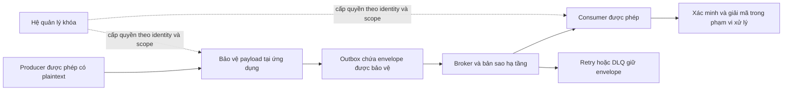

# Message confidentiality

## 1. Xác định ai được biết nội dung message

Message confidentiality là yêu cầu chỉ những chủ thể được phép mới đọc được nội dung message trong phạm vi và thời gian đã xác định. Message có thể là request/response API, sự kiện bất đồng bộ, lệnh gửi qua broker, thông báo hoặc webhook. Đặc tả cần chỉ rõ nội dung nào được bảo vệ, đối tượng nào không được đọc và bảo vệ bắt đầu/kết thúc ở đâu.

Trong module yêu cầu bảo mật, câu “message phải được mã hóa” chưa đủ. TLS có thể bảo vệ một kết nối nhưng nội dung vẫn được giải mã ở proxy hoặc broker; mã hóa storage không ngăn một consumer có quyền đọc queue nhìn thấy plaintext; mã hóa payload không tự giấu topic name, kích thước và thời điểm gửi.

Ví dụ nền tảng học tập phát sự kiện cập nhật kết quả học tập qua một hạ tầng messaging dùng chung. Dịch vụ học vụ cần đọc chi tiết, còn đội vận hành broker chỉ cần định tuyến và xử lý hạ tầng. Nếu mô hình đe dọa không cho phép broker operator đọc điểm hoặc dữ liệu học viên, thiết kế phải giữ payload được bảo vệ khi đi qua broker, không chỉ trong lúc truyền đến broker.

Một yêu cầu hữu ích trả lời được: ai tạo message, ai được giải mã, ai có thể thấy metadata, khóa do ai quản lý, bản sao nào được tạo, điều gì xảy ra khi mã hóa/giải mã thất bại và bằng chứng nào chứng minh không có đường fallback lộ nội dung.

Bài dùng một profile giả định cho sự kiện học vụ nhạy cảm. Các giới hạn thời gian, kích thước và quyền trong ví dụ cần được hiệu chỉnh theo nghiệp vụ và kiến trúc thực tế; không phải cấu hình mặc định cho mọi hệ thống.

## 2. Vẽ luồng dữ liệu và đánh dấu mọi nơi có thể có plaintext

Phải xét cả đường chính và bản sao phát sinh khi lỗi. Một message có thể đi từ business service qua outbox, gateway, broker, retry topic, dead-letter queue, công cụ replay rồi tới consumer. Payload cũng có thể xuất hiện trong trace, exception hoặc bản chụp debug mà không nằm trên sơ đồ ban đầu.



Sơ đồ đặt điểm bảo vệ trước integration outbox và điểm giải mã ở consumer được phép. Business database nguồn có chính sách bảo vệ riêng; điều đó không có nghĩa dữ liệu nguồn không còn plaintext ở mọi nơi. Phạm vi của profile là bản message và các bản sao tích hợp của nó.

| Điểm | Có được có plaintext payload nhạy cảm trong profile? | Kiểm soát cần đặc tả |
|---|---|---|
| Producer tạo sự kiện | Có, trong phạm vi nghiệp vụ được phép | Quyền đọc nguồn, tối thiểu dữ liệu và vòng đời bộ nhớ |
| Outbox tích hợp | Không; lưu envelope đã được bảo vệ | Transaction/độ bền và chống fallback plaintext |
| Proxy, broker, replica, công cụ xem queue | Không | TLS, message encryption, ACL và không có quyền lấy khóa giải mã |
| Retry/DLQ/quarantine tích hợp | Không | Giữ nguyên bảo vệ, quyền replay và retention riêng |
| Consumer học vụ được phép | Có, sau các bước xác minh bắt buộc | Quyền theo message type/tenant/mục đích và giới hạn plaintext |
| Log/trace/metric mặc định | Không | Allowlist metadata và chặn payload/key/token |
| Dịch vụ thông báo ngoài hệ thống | Chỉ tập dữ liệu được duyệt cho đích đó | Tạo message riêng đã giảm dữ liệu, không forward toàn bộ sự kiện |

Mô hình đe dọa cần nêu giới hạn. Nếu producer hoặc consumer được phép đọc đã bị chiếm quyền thực thi, message encryption không tự ngăn tiến trình đó lấy plaintext. Nếu cùng một quản trị viên có thể tự cấp quyền broker lẫn KMS và sửa ứng dụng, việc phân tách danh nghĩa có thể không đạt mục tiêu. Cần xét quyền thực tế trong chuỗi quản trị.

## 3. Phân biệt bảo vệ đường truyền, storage và nội dung message

| Lớp bảo vệ | Điều nó hỗ trợ | Những bên vẫn có thể thấy nội dung |
|---|---|---|
| TLS trên một kết nối | Giảm nguy cơ nghe lén/sửa trên chặng kết nối đó khi xác minh đúng endpoint | Các endpoint kết thúc TLS và thành phần xử lý plaintext sau đó |
| Mã hóa broker/storage phía server | Bảo vệ dữ liệu lưu theo phạm vi backend | Dịch vụ broker và các consumer được cấp quyền phù hợp theo thiết kế |
| Mã hóa payload tại ứng dụng | Giữ nội dung được bảo vệ qua các trung gian không có quyền giải mã | Producer, recipient và các bên thực sự giữ/quản lý khả năng giải mã |
| Ký/MAC | Bảo vệ một số thuộc tính toàn vẹn/xác thực theo mô hình khóa | Payload vẫn có thể đọc được nếu không được mã hóa |
| Base64/encoding | Biểu diễn bytes qua giao thức | Bất kỳ ai nhận được dữ liệu đều có thể decode |

Tài liệu [Amazon SQS — Encryption at rest](https://docs.aws.amazon.com/AWSSimpleQueueService/latest/SQSDeveloperGuide/sqs-server-side-encryption.html) minh họa rõ phạm vi của một tính năng: SSE mã hóa message body khi lưu và SQS giải mã để gửi cho consumer được phép; metadata có phạm vi khác. Vì vậy, không suy mục tiêu “broker không đọc được” chỉ từ việc bật encryption-at-rest.

Cụm từ “end-to-end” phải đặt tên hai đầu. Nếu service A mã hóa và service B giải mã, đó là phạm vi ứng dụng A–B theo hợp đồng; gateway có khóa giải mã thì nó cũng là một đầu được tin cậy. Nếu mục tiêu chỉ người dùng cuối có khóa, kiến trúc và khả năng xử lý phía server sẽ khác đáng kể.

Profile của bài chọn cả TLS cho các chặng được hỗ trợ và bảo vệ payload từ producer tới consumer học vụ. Broker vẫn xử lý một tập metadata tối thiểu. Đây là quyết định theo threat model; không phải mọi message công khai đều cần cùng mức bảo vệ.

Không loại bỏ ACL hoặc xác thực vì payload đã được mã hóa. Bên có quyền nhận ciphertext vẫn có thể sao chép, xóa, replay hoặc gây tải; bên có quyền mã hóa không mặc nhiên có quyền yêu cầu mọi tác vụ nghiệp vụ. Confidentiality phải kết hợp với quyền, toàn vẹn và giới hạn tài nguyên.

## 4. Đặc tả bảo mật cho từng chặng truyền

[RFC 8446](https://www.rfc-editor.org/rfc/rfc8446.html) đặc tả TLS 1.3 để bảo vệ giao tiếp trước nghe lén, sửa đổi và giả mạo message trên kết nối. Muốn biến khả năng đó thành yêu cầu hệ thống, cần chỉ ra chặng nào dùng TLS, ai xác minh identity nào và điểm nào kết thúc bảo vệ.

Profile nội bộ giả định các thành phần được kiểm soát cùng hỗ trợ TLS 1.3 và chỉ cho phép profile đó trên producer–broker, broker–consumer, API quản lý và đường gọi dịch vụ khóa. Kết nối không đạt profile hoặc không xác minh được danh tính đích phải thất bại; không retry qua HTTP/plaintext để giữ throughput.

Các trường hợp cần kiểm chứng gồm chứng chỉ không nằm trong trust policy, hết hạn, danh tính đích không khớp và endpoint bị đổi ngoài cấu hình được phép. Không dùng trust-all hoặc tắt hostname/endpoint verification. Private CA có thể là nguồn tin cậy hợp lệ nếu được cấu hình và quản lý đúng; không đánh đồng chứng chỉ từ hệ CA nội bộ với việc bỏ xác minh.

Nếu dùng mTLS, cần ánh xạ identity chứng chỉ sang workload và scope được phép. mTLS xác thực một bên của kết nối, chưa tự cho phép đọc mọi topic hoặc giải mã mọi tenant. Khi TLS kết thúc ở sidecar/proxy, chặng từ proxy tới ứng dụng và quyền truy cập plaintext trong node vẫn phải nằm trong sơ đồ và chính sách.

Cấu hình phải bao phủ client SDK, broker replication, connector và công cụ vận hành thực sự truyền nội dung hoặc credential. Một packet capture trên chặng public chỉ chứng minh điều đã quan sát ở chặng đó. Tách endpoint quản lý có thể xem/replay message khỏi quyền vận hành hạ tầng thông thường.

Profile không gửi command nhạy cảm bằng TLS early data/0-RTT. Nếu có nhu cầu dùng tính năng đó, phải đánh giá thuộc tính và replay riêng trước khi cho phép. TLS ở một kết nối không thay chống replay message ở tầng ứng dụng khi dữ liệu được lưu rồi gửi lại qua kết nối khác.

## 5. Bảo vệ payload bằng cơ chế có xác thực và ngữ cảnh ràng buộc

Khi chọn message encryption, dùng protocol/library được duy trì và crypto profile được duyệt thay vì tự thiết kế thuật toán. Profile minh họa chọn AEAD với AES-256-GCM, nonce 96 bit và tag 128 bit; lựa chọn cần được ánh xạ vào implementation đã kiểm chứng cùng giới hạn sử dụng, không chỉ một chuỗi tên algorithm trong config.

[RFC 5116](https://www.rfc-editor.org/info/rfc5116/) mô tả interface AEAD gồm khóa, nonce, plaintext và associated data. Associated data được xác thực nhưng không được mã hóa. Trong thiết kế này, cần dùng nó để ràng buộc payload với ngữ cảnh xử lý mà không đưa bí mật vào phần còn nhìn thấy.

Ví dụ các trường cần có quan hệ được bảo vệ có thể gồm envelope version, message ID, routing domain, recipient và schema/profile. Nếu một trường quyết định tenant hoặc quyền xử lý, consumer không được chỉ đọc giá trị đó rồi tin trước khi xác minh và đối chiếu với ngữ cảnh có thẩm quyền.

```text
Plaintext:
  Nội dung học vụ tối thiểu cho tác vụ của recipient.

Ngữ cảnh được xác thực, có thể nhìn thấy:
  Envelope/profile version, message ID và các giá trị scope/routing tối thiểu.

Ciphertext + tag:
  Được library tạo và kiểm tra theo crypto profile.

Không đặt vào associated data:
  Điểm, email, access token, nội dung bài tập hoặc dữ liệu phải giữ bí mật.
```

Associated data cần có encoding/canonicalization xác định theo protocol/library. Không để producer ký/xác thực một chuỗi JSON nhưng consumer diễn giải một object khác do field trùng, kiểu số hoặc thứ tự biến đổi. Kiểm tra schema và giới hạn cấu trúc trước xử lý đắt tiền; dữ liệu chỉ trở thành đáng tin theo thuộc tính tương ứng sau các bước xác minh bắt buộc.

AEAD hợp lệ không tự chứng minh một producer cụ thể trong mọi mô hình khóa. Bất kỳ bên nào giữ cùng khóa đối xứng đều có thể có khả năng tạo message hợp lệ; public-key encryption thông thường cũng không mặc định xác thực người gửi. Nếu cần bằng chứng nguồn gốc qua broker không tin cậy, chọn cơ chế xác thực nguồn riêng trong protocol/profile được duyệt, chẳng hạn chữ ký trên envelope thích hợp, và kiểm tra identity/scope của nguồn.

[RFC 9771](https://www.rfc-editor.org/rfc/rfc9771.html) phân biệt các thuộc tính của AEAD và những tính chất bổ sung có thể cần trong ứng dụng. Với profile này, consumer không được dùng plaintext chưa xác minh tag để log, parse nghiệp vụ hoặc tạo tác dụng phụ. Mã hóa và kiểm tra tag không thay authorization của hành động bên trong.

## 6. Phân tách quyền nhận message và quyền giải mã

Quyền consume queue và quyền lấy khả năng giải mã là hai lớp khác nhau. Broker operator có thể cần quản lý backlog nhưng không cần đọc điểm; consumer học vụ có thể được giải mã một miền message nhưng không được giải mã mọi sự kiện của nền tảng.

Một mô hình envelope encryption dùng data encryption key (DEK) cho payload và key encryption key (KEK) để bảo vệ DEK. Wrapped DEK có thể đi cùng ciphertext; plaintext DEK chỉ tồn tại ở endpoint cần thiết theo hợp đồng. KEK được quản lý trong hệ quản lý khóa/HSM/KMS phù hợp, với quyền quản trị khác quyền sử dụng.

[OWASP Cryptographic Storage Cheat Sheet](https://cheatsheetseries.owasp.org/cheatsheets/Cryptographic_Storage_Cheat_Sheet.html#key-management) nêu vai trò của quản lý vòng đời khóa và phân tách khóa với dữ liệu. Áp dụng vào messaging, yêu cầu cần nói rõ workload nào được tạo/wrap/unwrap key, trong scope nào và khi quyền đó bị thu hồi thì hệ thống phản ứng ra sao.

| Chủ thể | Quyền minh họa | Giới hạn |
|---|---|---|
| Producer học vụ | Tạo payload và sử dụng encryption profile cho luồng đã duyệt | Không tự chọn recipient/key domain tùy ý từ request người dùng |
| Broker/connector định tuyến | Nhận, lưu, chuyển envelope | Không có quyền unwrap DEK của payload học vụ |
| Consumer học vụ | Giải mã message thuộc recipient/domain được giao | Kiểm scope từng message, không dùng key role rộng cho mọi tenant |
| Nhân viên hỗ trợ queue | Xem metadata được phép, đề nghị replay | Không có mặc định quyền xuất plaintext hoặc lấy khóa |
| Quản trị khóa | Quản lý key policy theo phân quyền | Thay policy có audit, đánh giá khả năng tự cấp quyền ngoài mục tiêu |

Key ID trong envelope là dữ liệu đầu vào chưa tin cậy. Resolver phải ánh xạ qua danh mục/scope được phép, không nhận arbitrary URL, key ARN hoặc đường dẫn do message chỉ định rồi gọi decrypt bằng quyền rộng. Nếu không, consumer có thể bị biến thành công cụ giải mã hộ dữ liệu ngoài phạm vi.

Nếu service có quyền giải mã nhiều tenant, phải kiểm chứng ràng buộc tenant ở policy và consumer; một key ID có tên tenant không tự tạo phân tách. Nếu mục tiêu là broker và nhóm quản trị của nó không đọc được, họ cũng không được có đường tự cấp identity consumer, truy cập process memory hoặc thay key policy mà không có kiểm soát tương ứng.

Không lưu plaintext DEK trong envelope, source code, log hoặc ticket hỗ trợ. Giới hạn thời gian giữ key cache, số lượng entry, scope và cách xử lý thu hồi. Trong runtime quản lý bộ nhớ như Java, giảm lifetime/copy và dùng khả năng thư viện phù hợp; không tuyên bố mọi bản sao key trong heap được xóa chắc chắn chỉ vì đã gán biến về null.

## 7. Quản lý nonce, envelope và giới hạn sử dụng

Profile dùng AES-GCM phải bảo đảm không tái sử dụng nonce cho các lần mã hóa khác nhau dưới cùng khóa, cùng giới hạn độ dài/số lần sử dụng của profile. Nhiều instance dùng chung key cần thiết kế phù hợp; chỉ ghép timestamp hoặc counter local có thể tạo trùng khi restart/scale.

Một lựa chọn minh họa là cấp DEK mới bằng cơ chế mật mã được quản lý cho mỗi lần mã hóa message ban đầu, và để library xử lý nonce theo profile. Cách này vẫn cần CSPRNG, kiểm soát vòng đời key và giới hạn của implementation. Không suy “random” thành bảo đảm toán học không thể trùng trong mọi điều kiện.

Khi retry publish cùng một message, có thể gửi lại nguyên envelope đã được tạo mà không mã hóa lại payload. Đó không phải một lần gọi encryption mới với nonce cũ. Nếu payload/context thay đổi hoặc cần tạo ciphertext mới, dùng quy trình cấp key/nonce mới theo profile; không sửa body rồi giữ nguyên key/nonce của bản trước.

Envelope logic có thể chứa các trường sau. Đây là mô hình để viết yêu cầu, không phải đề xuất tự tạo wire protocol thay một định dạng/library đã được duyệt:

```json
{
  "envelopeVersion": "academic-message-v2",
  "messageId": "msg-a472",
  "routingDomain": "opaque-domain-17",
  "recipient": "academic-consumer",
  "cryptoProfile": "academic-aead-profile-3",
  "keyReference": "approved-key-handle-9",
  "wrappedDataKey": "<encoded protected key material>",
  "nonce": "<encoded nonce>",
  "ciphertextAndTag": "<encoded authenticated ciphertext>",
  "originProof": "<proof required by the approved source-authentication profile>"
}
```

Encoding của bytes, trường nào nằm trong protected header/AAD, phạm vi origin proof và cách chọn key đều phải do protocol/profile xác định. Không chỉ đặt tên trường `protected` rồi cho client thay mà không kiểm chứng. Nếu dùng chữ ký, profile phải ràng buộc đúng các thành phần quan trọng, không chỉ một message ID tách rời khỏi ciphertext.

Đặt allowlist version/algorithm/profile ở consumer. Header do message gửi không được tự bật thuật toán yếu, tag ngắn hơn, unsigned mode hoặc đường legacy chưa được chấp thuận. Migration cần giai đoạn hỗ trợ version rõ và thời điểm ngừng nhận; không dùng `unknown version` làm lý do chuyển sang parse plaintext.

Ví dụ profile giới hạn plaintext nghiệp vụ tối đa 64 KiB, envelope tối đa 128 KiB và số field/độ sâu cấu trúc theo schema. Đây là trần ứng dụng để hạn chế tài nguyên, không phải giới hạn thuật toán. Message lớn dùng luồng tài nguyên riêng đã đặc tả; chuyển thành object reference không được làm đối tượng tham chiếu trở thành plaintext công khai.

## 8. Chỉ giải mã và sử dụng trong ngữ cảnh được phép

Consumer không nên là một API giải mã tùy ý. Trước khi gọi cơ chế unwrap/open, kiểm tra định dạng và giới hạn đầu vào, profile/version được phép, recipient dự kiến, nguồn message theo cơ chế xác thực đã chọn và key domain được phép cho identity hiện tại. Giá trị trong envelope chỉ là claim cần đối chiếu, không tự là quyền.

Một consumer đọc queue dùng chung cần biết routing domain được cấp từ cấu hình/authorization đáng tin cậy. Không lấy `tenantId` do người gửi bất kỳ khai rồi cấp quyền decrypt cho chính tenant đó. Key policy/context và consumer gate phải cùng giữ quan hệ giữa identity, domain, recipient và mục đích xử lý.

Sau khi AEAD xác minh thành công mới sử dụng plaintext để kiểm tra schema nghiệp vụ và quan hệ với protected context. Nếu body khai tenant/recipient khác phần ngữ cảnh được xác thực, không tự chọn một trong hai để tiếp tục. Dữ liệu được mã hóa hợp lệ vẫn có thể chứa một tác vụ không được phép hoặc giá trị nghiệp vụ sai.

Phải xác định ai có quyền tạo loại sự kiện này. mTLS từ consumer tới broker chỉ xác thực broker trên chặng đó, không tự chứng minh producer ban đầu là dịch vụ học vụ. Cơ chế origin proof của profile và quyền publish theo loại message phải ràng buộc nguồn gốc mà hệ thống thực sự cần kiểm chứng.

Confidentiality không tự chống replay. Một ciphertext hợp lệ được gửi lại vẫn có thể giải mã thành công. Profile chọn message ID gắn với nội dung/ngữ cảnh được bảo vệ, thời hạn sử dụng được xác thực và cơ chế chống lặp tại nơi tạo tác dụng phụ. Deduplication key không được chỉ dựa vào header message ID chưa được kiểm chứng.

Profile sự kiện minh họa cho phép xử lý nghiệp vụ trong 24 giờ từ thời điểm phát hành được bảo vệ. Message quá hạn không được tự thực hiện chỉ vì còn giải mã được. Nếu cần xử lý lại vì sự cố, có quy trình được cấp quyền để đối soát hoặc phát message mới với căn cứ và version phù hợp; không sửa timestamp của envelope cũ.

Plaintext sau giải mã chỉ đi tới thành phần nghiệp vụ được phép. Không tự gửi toàn bộ sự kiện sang analytics, email hoặc công cụ hỗ trợ. Nếu một recipient khác cần tập dữ liệu ít hơn, tạo message được giảm dữ liệu và bảo vệ riêng cho recipient đó. Quyền giải mã không mặc nhiên cho quyền phát tán tiếp.

Hạn chế bản sao trong bộ nhớ, debug dump và serialization. Không giữ payload trong cache toàn cục không có scope/TTL. Với dữ liệu cần dùng lâu dài, chuyển sang kho nghiệp vụ có policy rõ thay vì giữ plaintext message vô thời hạn trong một cache xử lý.

## 9. Giữ bí mật trên retry, dead-letter queue và công cụ vận hành

Một thiết kế thường kiểm tốt happy path nhưng để dữ liệu lộ khi xử lý lỗi. Payload đã được consumer giải mã có thể bị đưa vào exception rồi một error handler serialize nó thành message mới ở DLQ. Khi đó queue chính chứa ciphertext nhưng DLQ lại chứa plaintext.

| Thành phần | Quy tắc trong profile |
|---|---|
| Outbox trước publish | Chỉ lưu envelope đã bảo vệ, không kèm bản JSON nghiệp vụ ở field debug |
| Retry cùng recipient | Giữ envelope hoặc tạo bản mới theo protocol; không bỏ mã hóa để dễ retry |
| Dead-letter/quarantine | Giữ nguyên nội dung được bảo vệ; error metadata chỉ thuộc allowlist |
| Replay console | Quyền điều phối không tự cho quyền decrypt/export plaintext |
| Connector tới hệ khác | Đích và tập dữ liệu được duyệt; không forward payload đã mở tùy ý |
| Trace/log/alert | ID và error category cần thiết; không body, DEK, credential hay plaintext dump |
| Backup của hạ tầng message | Bảo vệ envelope và quyền khôi phục; không có bản giải mã phụ phục vụ debug |

Mỗi copy cần retention, quyền đọc, đường export và cơ chế xóa riêng. Không suy quyền của DLQ bằng quyền queue chính nếu chúng nằm ở tài khoản/vùng khác. Kiểm kê cả công cụ quản lý, tracing agent, service mesh capture, replay script và bản ghi hỗ trợ do con người tạo.

Chuyển transport metadata không nhất thiết phải thay envelope được bảo vệ. Nếu routing/context nằm trong AAD hoặc origin proof, không sửa trực tiếp để replay sang recipient khác. Chuyển mục đích/recipient cần một hành động được cấp quyền và bảo vệ dữ liệu lại theo protocol, với audit liên kết tới nguồn.

Không xử lý lại message quá hạn chỉ vì operator bấm replay. Quyền replay cần giới hạn scope, số lượng, môi trường và tác dụng phụ được phép. Dữ liệu production không được mang sang môi trường development với key rộng quyền hơn để “thử xem lỗi gì”. Một cơ chế điều tra plaintext nếu thực sự cần phải có quyền và quy trình riêng, không phải chế độ mặc định của console.

Quan sát lỗi nên phân loại schema, version/profile không hỗ trợ, identity/scope không hợp lệ, unwrap không sẵn sàng, xác minh mật mã thất bại và lỗi nghiệp vụ. Phản hồi cho caller không cần tiết lộ chi tiết nội bộ có thể biến consumer thành oracle dò key hoặc nội dung; người vận hành được phép có thể xem mã lỗi/correlation cần thiết trong kênh được kiểm soát.

## 10. Vòng đời khóa, thu hồi quyền và phục hồi

Xác định riêng khóa được dùng để bảo vệ message mới và khả năng giải mã message đã có. Khi quay vòng KEK hoặc đổi profile, backlog/DLQ/backup có thể vẫn tham chiếu key version cũ. Xóa key cũ quá sớm có thể làm dữ liệu không thể xử lý; giữ mọi quyền và key cũ vô hạn lại tăng phạm vi rủi ro.

Một kế hoạch cần nêu: cryptoperiod/giới hạn sử dụng, key version mới, thời điểm producer chuyển sang key mới, tập key được phép decrypt, retention/replay tối đa và cách ngừng key cũ. Đổi KEK/wrapping có thể khác với mã hóa lại payload; cơ chế rewrap hoặc re-encrypt phải do implementation/profile hỗ trợ và được kiểm chứng.

Profile minh họa giữ message ở queue/DLQ tối đa bảy ngày theo lớp dữ liệu được duyệt, còn quyền thực hiện nghiệp vụ thông thường hết sau 24 giờ. Hai mốc có mục đích khác nhau. Nếu backup hoặc hồ sơ điều tra có thời hạn khác, thời gian giữ khả năng giải mã và quyền sử dụng phải được quyết định riêng, không suy chỉ từ retention queue chính.

Thu hồi quyền consumer cần xét credential, policy cache, DEK cache và plaintext đã được mở. Profile có thể đặt mục tiêu thay đổi quyền có hiệu lực tại gate đọc/giải mã mới trong tối đa 60 giây sau khi commit tại nguồn quyền, trong fixture đã công bố. Điều đó đòi hỏi cơ chế đồng bộ/cache/identity tương ứng; không phải bảo đảm tự có của KMS.

Sau mốc thu hồi có hiệu lực, không cấp plaintext mới cho identity/scope đã bị thu hồi. Byte đã được recipient nhận trước đó không thể bị “thu lại” bằng một lần đổi ACL. KMS deny không tự xóa plaintext DEK đang được cache; cơ chế ứng dụng phải đáp ứng đúng giới hạn đã cam kết hoặc mô tả cửa sổ phơi lộ được chấp nhận.

Khi nghi ngờ lộ khóa hoặc một recipient bị chiếm quyền, cô lập identity/quyền bị ảnh hưởng, ngừng dùng key/profile liên quan cho message mới theo kế hoạch và đánh giá dữ liệu có thể đã bị lộ. Rotation không tự khôi phục bí mật của ciphertext mà kẻ tấn công đã sao chép cùng khả năng giải mã tương ứng.

Phục hồi backup cần kiểm chứng cả key, policy và identity. Không cấp quyền rộng cho môi trường restore chỉ để đọc được mọi message. Áp lại hạn xử lý, quyền hiện tại và chống replay trước khi tạo tác dụng phụ; thành công giải mã một backlog không đồng nghĩa được thực thi toàn bộ backlog đó.

Nếu dịch vụ khóa tạm lỗi, producer không publish plaintext và consumer không bypass crypto. Có thể chờ/retry có giới hạn với envelope còn được bảo vệ, giữ trạng thái pending/quarantine theo contract. Quota, timeout và cảnh báo cần ngăn outage KMS biến thành vòng retry hoặc backlog không giới hạn.

## 11. Minh họa luồng xử lý không fallback sang plaintext

Giả mã dưới đây biểu diễn hợp đồng, không phải wire format hoặc bản cài crypto. Các hàm `seal/open` phải đến từ protocol/library đã được duyệt; kiểm tra nguồn, scope, sử dụng key và version phải có implementation cụ thể, không chỉ tồn tại trong tên hàm.

```text
prepareMessage(actor, sourceSnapshot, intendedRecipient):
    requirePermissionToReadAndPublishThisData(actor, sourceSnapshot)
    recipient = resolveApprovedRecipientAndPurpose(intendedRecipient)
    payload = buildMinimalAllowedPayload(sourceSnapshot, recipient)
    enforcePlaintextSchemaAndSizeLimits(payload)

    context = buildProtectedContextFromTrustedScopeAndNewMessageIdentity()
    profile = resolveApprovedCryptoAndOriginProfile(context, recipient)
    envelope = managedProtocol.seal(payload, context, profile)
    enforceEnvelopeSchemaAndSizeLimits(envelope)

    persistOnlyProtectedEnvelopeInIntegrationOutbox(envelope)
    publishOverRequiredAuthenticatedTransport(envelope)
    # Nếu seal hoặc lưu/publish lỗi, giữ đúng trạng thái đã cam kết.
    # Không publish payload plaintext như một đường thay thế.

consumeMessage(workloadIdentity, transportContext, envelope):
    enforceUntrustedInputBoundsAndEnvelopeAllowlist(envelope)
    expectedScope = resolveAllowedScopeFromTrustedWorkloadAndSubscription()
    rejectUnapprovedKeyReferencesAndProfiles(envelope, expectedScope)
    verifyOriginAccordingToApprovedProfile(envelope, expectedScope)
    requireCurrentDecryptAuthority(workloadIdentity, expectedScope)

    plaintext = managedProtocol.openAndVerifyBeforeRelease(
        envelope, expectedScope)
    try:
        requirePayloadSchemaAndProtectedContextConsistency(plaintext, envelope)
        requireMessageWithinAuthenticatedProcessingWindow(envelope, plaintext)
        requireBusinessAuthorityForThisProducerAndAction(plaintext, expectedScope)
        applyBusinessEffectWithVerifiedIdentityAndDeduplication()
        acknowledgeAccordingToDeliveryContract()
    finally:
        releasePlaintextAndKeyMaterialUnderTheLibraryRuntimeContract()
```

Độ bền business event và integration outbox cần hợp đồng transaction riêng. Nếu một thay đổi nghiệp vụ đã xảy ra nhưng publish chưa rõ kết quả, dùng định danh/snapshot bền vững để đối soát và retry. Không tái dựng message từ một bản ghi nguồn đã thay đổi mà vẫn dùng message ID/version cũ; confidentiality không thay yêu cầu toàn vẹn sự kiện.

Consumer phải bảo đảm `open` không phát plaintext chưa được xác minh cho parser nghiệp vụ, logger hoặc downstream. Với profile message nhỏ, có thể giữ bộ đệm có giới hạn cho tới khi xác minh hoàn tất. Nếu cần streaming, phải dùng protocol hỗ trợ xác thực từng đơn vị với ngữ nghĩa rõ, không tự cho rằng những byte trả về trước khi kiểm tag cuối đã an toàn để sử dụng.

Decryption thành công không tạo quyền thực hiện một lệnh từ producer sai scope. Sau các bước mật mã, vẫn kiểm tra loại hành động, target, tenant và trạng thái nghiệp vụ. Message mã hóa từ một workload bị cấp quá nhiều quyền vẫn có thể là lệnh trái phép.

Giải phóng plaintext/key trong giả mã có nghĩa tuân theo khả năng thực tế của library/runtime: giảm copy, kết thúc scope và dùng cơ chế xử lý memory được hỗ trợ. Không coi một lệnh xóa reference là chứng minh đã zeroize mọi bản sao. Debug dump và crash report vẫn thuộc danh mục dữ liệu cần kiểm soát.

## 12. Tối thiểu metadata và nêu rõ phần không được che giấu

Mã hóa payload thường vẫn để lộ ai nói chuyện với ai ở một mức nào đó, kích thước, thời điểm, số lượng, topic/queue name hoặc một phần routing header. Với message nhạy cảm, metadata cũng có thể tiết lộ tình trạng học tập hoặc nhóm người dùng dù không có điểm trong body.

| Dữ liệu muốn đưa vào message | Quyết định minh họa |
|---|---|
| Điểm, email, lý do sửa hồ sơ | Chỉ trong payload được bảo vệ và chỉ khi recipient cần |
| Tên người học trong topic/partition key | Không dùng; chọn key routing không chứa nội dung cá nhân và kiểm soát khả năng liên kết |
| Access token hoặc signed URL tải tài liệu | Không đặt ở header/AAD/log; ưu tiên reference và kiểm quyền tại nơi truy cập |
| Message ID ngẫu nhiên/opaque | Có thể dùng theo nhu cầu, vẫn kiểm soát correlation và retention |
| Tên event thể hiện nội dung riêng tư | Xét liệu có cần public routing hay chuyển vào payload/nhóm loại ít chi tiết hơn |
| `keyReference` và recipient | Tối thiểu thông tin cần cho protocol, không nhúng tên cá nhân hoặc secret |

Hash một email có miền giá trị dễ đoán không tự biến nó thành metadata vô hại. Base64 cũng không ẩn được thông tin. Khi cần pseudonym hoặc routing handle, xác định cơ chế, scope liên kết và quyền ánh xạ; không gọi mọi identifier opaque là dữ liệu hoàn toàn vô danh.

Profile không cam kết giấu toàn bộ traffic pattern trước người quan sát mạng hoặc broker. Nếu mô hình đe dọa cần giảm lộ độ dài/tần suất, xem xét một policy padding/batching hoặc protocol phù hợp với giới hạn và chi phí được đo. Padding không tự che danh tính recipient, lịch gửi hoặc mọi đặc trưng lưu lượng.

Ciphertext gửi lại nguyên vẹn trên retry có thể được liên kết là cùng một message. Việc dùng DEK/nonce mới theo profile cho lần mã hóa mới không tự giấu được correlation ID hoặc lịch tác vụ. Đặc tả cần nêu dữ liệu nào được phép lộ thay vì chỉ nêu thuật toán.

Minimize trước khi encrypt: một consumer chỉ cần biết có cập nhật để gọi API có quyền không nhất thiết cần cả hồ sơ học viên trong event. Tuy nhiên, reference cũng phải có quyền, thời hạn và tính nhất quán phù hợp. Không thay payload bí mật bằng một URL công khai dẫn tới cùng plaintext.

## 13. Gắn rủi ro với yêu cầu đo được

| Mã | Rủi ro |
|---|---|
| R-MSG-01 | Người quan sát đọc nội dung/credential trên một chặng truyền không được bảo vệ |
| R-MSG-02 | Broker/operator/trung gian đọc payload ngoài tập được phép |
| R-MSG-03 | Consumer hoặc key resolver giải mã sai tenant/recipient/scope |
| R-MSG-04 | Retry/DLQ/log/backup tạo bản plaintext ngoài thiết kế |
| R-MSG-05 | Nonce, profile, AAD hoặc xác minh tag sai làm mất thuộc tính mật mã |
| R-MSG-06 | Quyền/key cũ hoặc đường legacy tiếp tục cấp plaintext sau thu hồi/migration |
| R-MSG-07 | Lỗi KMS/crypto làm fallback plaintext, oracle hoặc cạn tài nguyên |
| R-MSG-08 | Metadata và forwarding làm lộ dữ liệu dù payload đã mã hóa |

| ID | Yêu cầu minh họa | Rủi ro | Bằng chứng nghiệm thu |
|---|---|---|---|
| MC-01 | Có danh mục chặng truyền, điểm giải mã, recipient và bản sao; mỗi plaintext point có căn cứ quyền | R-MSG-01, R-MSG-02 | Sơ đồ luồng và ma trận quyền nhìn thấy dữ liệu |
| MC-02 | Profile nhạy cảm bảo vệ payload trước integration outbox; broker/connector không có quyền unwrap payload học vụ | R-MSG-02, R-MSG-04 | Quan sát outbox/queue bằng identity vận hành và kiểm key grants |
| MC-03 | Các chặng của profile dùng TLS 1.3, xác minh endpoint, không trust-all/plaintext fallback | R-MSG-01 | Test certificate/identity và quan sát từng chặng |
| MC-04 | Payload dùng AEAD/library/profile đã duyệt; nonce/key usage và tag length đáp ứng profile qua scale/restart | R-MSG-05 | Cấu hình, giới hạn sử dụng, test vector và kiểm thử vòng đời key/nonce |
| MC-05 | Trường quyết định context được bảo vệ và so với scope có thẩm quyền; AAD không chứa bí mật | R-MSG-03, R-MSG-05, R-MSG-08 | Tamper tenant/recipient/schema/context và kiểm metadata |
| MC-06 | Consumer chỉ nhận key reference/profile trong danh mục; không gọi key URL/domain tùy ý từ message | R-MSG-03, R-MSG-07 | Test key ID sai scope và outbound tới resolver |
| MC-07 | Origin được xác minh theo profile; plaintext chỉ được phát hành sau kiểm chứng bắt buộc | R-MSG-02, R-MSG-05 | Message giả nguồn/tag sai và quan sát không có plaintext/tác dụng phụ |
| MC-08 | Retry/DLQ/replay giữ payload được bảo vệ; quyền replay không tự gồm quyền xuất plaintext | R-MSG-04 | Fault injection trong consumer, DLQ và công cụ vận hành |
| MC-09 | Producer/consumer không bypass crypto khi KMS/library lỗi; retry có timeout, quota và trạng thái rõ | R-MSG-07 | Tiêm lỗi wrap/unwrap/seal/open và đo backlog/tài nguyên |
| MC-10 | Giới hạn plaintext 64 KiB, envelope 128 KiB và cấu trúc theo schema; không dùng quá tải để bật plaintext mode | R-MSG-07 | Test biên kích thước và input độc hại |
| MC-11 | Profile xử lý trong 24 giờ, retention queue/DLQ bảy ngày; replay/restore áp lại quyền và thời hạn | R-MSG-04, R-MSG-06 | Clock-controlled test và diễn tập restore |
| MC-12 | Thay đổi quyền có hiệu lực tại gate đọc/giải mã mới trong tối đa 60 giây theo fixture và nguồn commit đã xác định | R-MSG-03, R-MSG-06 | Test cache, credential và key authority trước/sau mốc |
| MC-13 | Rotation/migration có tập key/version được phép và thời điểm ngừng; không bỏ backlog không đọc được mà không báo | R-MSG-06 | Diễn tập chuyển version với queue/DLQ/backup |
| MC-14 | Log/trace/error/metric chỉ có metadata được duyệt, không payload/DEK/token; routing tối thiểu dữ liệu | R-MSG-04, R-MSG-08 | Canary và inspection tại các điểm quan sát đã kiểm kê |
| MC-15 | Business authorization, chống replay và forwarding được kiểm tra riêng sau xác minh mật mã | R-MSG-03, R-MSG-08 | Ciphertext hợp lệ nhưng sai action/scope hoặc được gửi lại |

Đặc tả một yêu cầu trọng tâm có thể viết như sau. Đây là tài liệu yêu cầu, không phải cấu hình crypto production:

```yaml
id: MC-02
scope: sensitive_academic_event_pipeline
risk_refs: [R-MSG-02, R-MSG-04]
allowed_plaintext_parties:
  - authorized_academic_producer_within_its_source_scope
  - authorized_academic_consumer_within_its_recipient_scope
required_behavior:
  - protect_payload_before_persistence_in_integration_outbox
  - preserve_payload_protection_across_broker_retry_dlq_and_replay
  - deny_broker_and_routing_operator_identities_payload_unwrap_authority
  - release_plaintext_only_after_required_origin_context_and_aead_checks
  - emit_only_approved_nonsecret_diagnostic_metadata
on_crypto_or_key_failure:
  - do_not_publish_or_forward_plaintext
  - do_not_execute_unverified_message_content
  - retain_protected_pending_or_quarantined_state_under_the_delivery_contract
acceptance:
  - queue_outbox_and_dlq_inspection_by_operator_role_exposes_no_plaintext_payload
  - operator_role_cannot_gain_plaintext_through_the_documented_key_apis
  - malformed_or_tampered_envelopes_produce_no_business_side_effect
verification:
  - inspect_all_declared_message_copies_and_observability_paths
  - exercise_real_workload_and_operator_identity_policies_in_test_environment
  - document_endpoint_compromise_and_metadata_visibility_as_model_boundaries
owner: academic_integration_team
```

Fixture cần nêu library/profile version, identity/key policy, topology, các copy được quan sát, dữ liệu canary, giới hạn tải và thời điểm thay quyền. “Không thấy chuỗi canary” giúp tìm leak tại điểm kiểm tra, chưa chứng minh độ an toàn thuật toán hoặc sự vắng mặt của mọi bản sao chưa kiểm kê. Kết hợp inspection với cấu hình, test vector và đánh giá ranh giới thiết kế.

## 14. Ma trận kiểm thử từ transport tới vận hành sự cố

Kiểm thử sử dụng dữ liệu giả lập và identity riêng trong môi trường được phép. Cần quan sát plaintext exposure, key access và tác dụng phụ, không chỉ việc message tới consumer thành công. Các ca dưới đây là kế hoạch xác minh yêu cầu, không phải khẳng định đã thực hiện trên một hệ thống thật.

| Ca | Kích thích | Kết quả cần chứng minh |
|---|---|---|
| T01 — Đường hợp lệ | Producer/recipient đúng scope và profile | Consumer nhận đúng dữ liệu sau xác minh; bản sao trung gian giữ bảo vệ |
| T02 — TLS sai identity | Endpoint/certificate không thuộc trust policy, hết hạn hoặc không khớp | Kết nối thất bại, không trust-all hoặc fallback plaintext |
| T03 — Chặng bị bỏ sót | Connector/proxy/replication và API quản lý trong sơ đồ | Mọi chặng đạt profile, nêu rõ điểm kết thúc TLS |
| T04 — Broker operator | Xem outbox/queue và thử unwrap bằng role vận hành | Không đọc payload và không có khả năng giải mã ngoài quyền |
| T05 — Consumer sai scope | Identity tenant/domain/recipient khác | Không nhận plaintext mới ngoài scope; không tự cấp quyền từ header |
| T06 — Key reference | Key handle không thuộc danh mục hoặc URL tùy ý | Reject, không biến consumer thành resolver/decrypt oracle rộng quyền |
| T07 — Sửa ciphertext/tag | Đổi byte, cắt tag hoặc trộn thành phần từ envelope khác | Xác minh thất bại, không log plaintext hoặc tạo tác dụng phụ |
| T08 — Sửa context | Đổi domain, recipient, schema hoặc message ID được bảo vệ | Không xử lý như message hợp lệ của context mới |
| T09 — Nonce/key lifecycle | Scale/restart, retry và fault trong nguồn key/nonce | Đáp ứng chiến lược uniqueness/usage của profile; không mã hóa payload mới bằng cặp bị tái sử dụng |
| T10 — Retry envelope | Publish lại cùng envelope sau mất ack | Không gọi encryption mới sai nonce; tác dụng phụ chống lặp theo hợp đồng |
| T11 — Nội dung thay đổi | Retry builder đọc snapshot mới nhưng giữ message identity cũ | Không gắn nội dung mới với bằng chứng/ID cũ trái profile |
| T12 — Nguồn giả | Message có route hợp lệ nhưng origin proof sai/thiếu | Không coi kết nối broker là bằng chứng producer ban đầu |
| T13 — Crypto hợp lệ, lệnh sai | Producer/scope không được yêu cầu action hoặc target đó | Business authorization vẫn chặn |
| T14 — Version/downgrade | Unknown profile, tag rút ngắn, plaintext legacy mode | Không tự bật nhánh yếu hơn hoặc parse plaintext |
| T15 — Giới hạn | Plaintext/envelope vượt trần, field trùng hoặc cấu trúc quá sâu | Reject có giới hạn, không tạo vòng xử lý đắt tiền vô hạn |
| T16 — KMS lỗi phía gửi | Wrap/generate key/seal thất bại | Không ghi/publish bản plaintext thay thế |
| T17 — KMS lỗi phía nhận | Unwrap/open timeout hoặc lỗi authority | Không bypass; pending/quarantine và retry đúng ngân sách |
| T18 — Plaintext chưa xác minh | Library có output trung gian trước bước xác minh cuối | Parser nghiệp vụ/log/downstream không nhận output chưa được xác minh |
| T19 — Consumer exception | Lỗi sau giải mã và đường error handler đưa vào DLQ | DLQ không chứa payload plaintext từ exception/context |
| T20 — Replay console | Operator đổi recipient, xuất body hoặc replay message cũ | Scope, quyền và protected context không bị bỏ qua |
| T21 — Hết hạn xử lý | Trước, bằng, sau mốc processing expiry đã được xác thực | Không thực hiện quá hạn chỉ vì vẫn decrypt được |
| T22 — Thu hồi | Revoke ở nguồn, còn credential/policy/DEK cache | Gate mới chặn trong giới hạn 60 giây đã cam kết |
| T23 — Rotation | Key mới cho producer, backlog/DLQ còn key cũ | Xử lý đúng tập được phép, không làm mất khả năng đọc âm thầm |
| T24 — Restore | Khôi phục queue/backup với quyền hoặc deadline đã thay đổi | Áp lại policy, không tự thực hiện toàn bộ message khôi phục |
| T25 — Quan sát | Log/trace/dump/alert ở success và failure | Không lộ payload, raw key, token hoặc dữ liệu ngoài allowlist |
| T26 — Metadata | Topic, routing key, AAD, metric labels | Không chứa bí mật/PII trái policy; nêu phần traffic metadata còn lộ |
| T27 — Forwarding/reference | Consumer gửi thông báo hoặc object reference sang đích khác | Chỉ dữ liệu/recipient được phép, không thay bằng URL plaintext công khai |
| T28 — Sự cố và tải | Mất KMS trong tải cao rồi phục hồi cùng backlog | Quota/retry có giới hạn, không plaintext fallback và không mở quyền toàn cục để xử lý nhanh |

Kiểm thử nonce không chỉ là chạy một số lượng nhỏ và thấy không trùng. Cần đánh giá cơ chế của implementation, scope key, giới hạn sử dụng và các trường hợp khởi động lại/nhiều producer. Test vector kiểm tra tương thích mật mã; fault test và cấu hình kiểm tra cách ứng dụng dùng cơ chế đó. Một round-trip encrypt/decrypt thành công chưa chứng minh chống thay đổi hoặc đúng authorization.

Kiểm thử quyền cần dùng các identity thực của producer, broker operator, support, consumer và key administrator trong phạm vi test. Không chỉ mock một hàm `isAllowed()` trả false rồi kết luận IAM/KMS production đã phân tách. Tương tự, inspection phải lấy ở broker/outbox/DLQ thực của fixture, qua các pipeline logging đang được cấu hình.

Một diễn tập toàn luồng có thể phát message có canary giả lập, làm consumer lỗi sau khi mở payload, chuyển sang DLQ, rotate key, thu hồi một consumer rồi khôi phục và replay có kiểm soát. Đối chiếu mọi bản sao và log, quyền unwrap, thời điểm gate có hiệu lực và số tác dụng phụ. Các trường hợp chưa quan sát đủ phải được ghi là giới hạn bằng chứng, không tự đánh dấu đạt.

Bằng chứng gồm phiên bản ứng dụng/profile/library, topology, policy/identity, thời điểm, message ID đã kiểm chứng, vị trí inspection và kết quả trước/sau tiêm lỗi. Không đưa plaintext thật, raw DEK hoặc credential vào hồ sơ test để chứng minh confidentiality.

## 15. Duy trì yêu cầu trong vòng đời phát triển

Ở giai đoạn yêu cầu, xác định tài sản, recipient và những trung gian không được phép đọc nội dung. Ghi rõ các plaintext point, metadata còn nhìn thấy và giới hạn của mô hình đe dọa. Đội nghiệp vụ quyết định dữ liệu thực sự cần gửi; đội bảo mật và nền tảng xác định profile, quyền key và bằng chứng.

Trong thiết kế, chọn điểm mã hóa/giải mã, protocol/library và quyền trên từng bản sao. Trong triển khai, kiểm tra serializer, outbox, error handler, tracing, SDK, key cache và migration. Một tiện ích debug hoặc connector mới có thể tạo plaintext point ngoài sơ đồ dù phần mã hóa cốt lõi không đổi.

Khi thêm recipient, đổi tenant scope, broker/provider, library/profile, KMS, retention, replay hoặc môi trường restore, đánh giá lại ranh giới và ca kiểm chứng liên quan. Giữ khả năng rotate/revoke và diễn tập trước khi có sự cố; không để việc bảo vệ backlog chỉ dựa vào một khóa/identity không có kế hoạch vòng đời.

Những dấu hiệu đặc tả còn thiếu gồm “dùng TLS” không chỉ rõ điểm kết thúc; “queue đã mã hóa” nhưng operator vẫn đọc body; “dùng AEAD” không có context/key/nonce policy; “DLQ nội bộ” không có quyền và retention; hoặc “đổi key là thu hồi dữ liệu” không xét cache và bản sao đã nhận. Mỗi câu cần bổ sung scope, điều kiện, hành vi khi lỗi và nguồn bằng chứng.

Message confidentiality đạt mục tiêu khi nội dung chỉ được mở tại các đầu được phép, các bản sao trung gian giữ đúng mức bảo vệ và đường lỗi/phục hồi không tạo ngoại lệ plaintext ngoài hợp đồng. Bảo đảm đó cần được kiểm chứng cùng quyền, toàn vẹn và vòng đời dữ liệu trong toàn bộ chuỗi truyền thông.