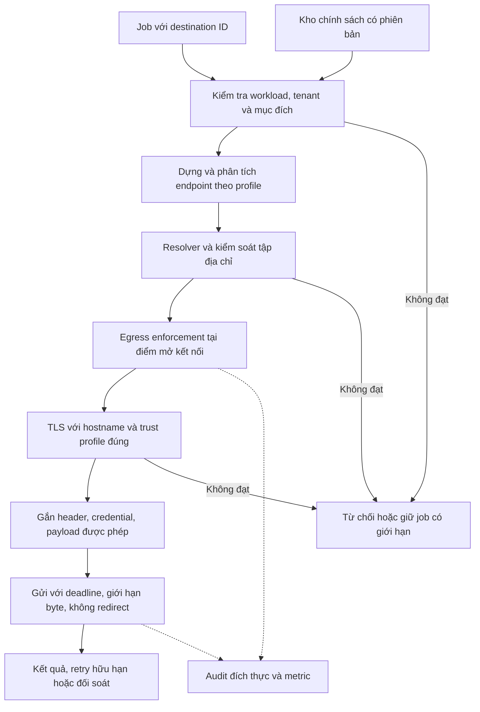

# Outbound request allowlist

## 1. Mục tiêu của danh sách đích được phép

**Outbound request allowlist** là chính sách chỉ cho phép một workload gửi request ra ngoài tới những đích, thao tác và ngữ cảnh đã được chấp nhận. Quyết định cần gắn với bên gửi, mục đích nghiệp vụ, nơi nhận, dữ liệu và điểm cưỡng chế thực tế.

Trong chương **Communication security**, allowlist giúp giảm nguy cơ:

- Server bị lợi dụng gửi request tới dịch vụ nội bộ hoặc tài nguyên quản trị.
- Dữ liệu và credential bị chuyển tới nơi không được phép.
- Một kết nối hợp lệ ban đầu bị chuyển hướng tới đích khác.
- Worker hoặc thư viện đi vòng qua cổng kiểm soát mạng.
- Đích đã bị thu hồi vẫn nhận request từ job hoặc kết nối cũ.

Allowlist không chỉ là danh sách chuỗi domain. Một yêu cầu có thể nghiệm thu phải trả lời: **workload nào được gọi đích nào, bằng giao thức và thao tác gì, với dữ liệu gì, kết nối tới địa chỉ thực nào và trong điều kiện nào phải bị chặn**.

OWASP phân biệt tình huống hệ thống chỉ gọi các ứng dụng đã xác định với tình huống phải gọi nhiều đích do người dùng lựa chọn. Với tập đích xác định, kiểm soát allowlist ở ứng dụng và mạng là các lớp quan trọng để phòng SSRF. [Nguồn: OWASP SSRF Prevention Cheat Sheet](https://cheatsheetseries.owasp.org/cheatsheets/Server_Side_Request_Forgery_Prevention_Cheat_Sheet.html).

Sau bài học, người học có thể viết yêu cầu về đăng ký đích, URL, DNS, địa chỉ kết nối, redirect, credential, logging và kiểm thử để nối rủi ro với kiến trúc thực thi.

**Các domain, đường dẫn và ngưỡng số dưới đây là ví dụ đặc tả, không phải cấu hình mặc định.**

## 2. Tình huống xuyên suốt: webhook kết quả hồ sơ

Một nền tảng quản lý hồ sơ đa tenant gửi thông báo xử lý tới đối tác. Tenant là ranh giới tổ chức; tenant A không được dùng cấu hình hoặc credential của tenant B.

Thay vì nhận một URL tùy ý trong mỗi job, worker nhận destination ID. Dịch vụ cấu hình ánh xạ ID đó tới endpoint đã được chấp nhận.

Ví dụ:

```text
Destination ID: partner-a-status
Workload:       document-notification-worker
Tenant:         tenant-12
Mục đích:       Gửi trạng thái xử lý hồ sơ
Scheme:         https
Host:           hooks.partner-a.example.test
Port:           443
Method:         POST
Path:           /v1/document-status
Credential:     Tham chiếu riêng của đích này
Redirect:       Không tự theo
```

Các trường trên cần có nguồn quản lý có thẩm quyền. Chúng không trở nên đáng tin chỉ vì được chuyển vào một file cấu hình hoặc nằm trong message nội bộ.

### 2.1. Mô hình đe dọa

| Tình huống | Rủi ro |
| --- | --- |
| Job chứa URL tới dịch vụ quản trị | Workload dùng quyền mạng của server để truy cập tài nguyên ngoài mục đích |
| Một URL chỉ chứa tên đối tác trong query hoặc userinfo | So sánh chuỗi nhận nhầm host |
| DNS của host được phép trỏ tới địa chỉ bị cấm | Kiểm tra domain không đủ bảo vệ địa chỉ kết nối |
| DNS đổi sau kiểm tra nhưng trước lúc kết nối | Request thực đi tới đích chưa được chấp nhận |
| Endpoint trả redirect tới nơi khác | HTTP client tự vượt giới hạn đích ban đầu |
| Request chuyển tiếp Authorization hoặc Cookie từ người dùng | Lộ credential ngoài phạm vi |
| Proxy hoặc SDK dùng resolver khác | Kết nối thực không đi qua kiểm tra đã thiết kế |
| Đích bị thu hồi khi job đang chờ | Worker tiếp tục gửi dữ liệu theo cấu hình cũ |
| Phản hồi quá lớn, chậm hoặc nén mạnh | Cạn kết nối, bộ nhớ hoặc worker |
| Đối tác hợp lệ nhưng dữ liệu gửi quá rộng | Allowlist đúng đích vẫn không ngăn rò dữ liệu nghiệp vụ |

### 2.2. Chuỗi truy vết mẫu

| Thành phần | Ví dụ |
| --- | --- |
| Rủi ro | Worker gửi dữ liệu hồ sơ tới endpoint ngoài phạm vi tenant |
| Mục tiêu | Chỉ gửi trường được phép tới đích đã chấp nhận cho đúng tenant và mục đích |
| Yêu cầu | Destination ID được đối chiếu workload, tenant, endpoint và payload profile tại lúc gửi |
| Thiết kế | Kho chính sách có phiên bản, connector dùng chung, egress enforcement |
| Bằng chứng | Đổi destination, tenant, redirect và DNS trong môi trường thử; quan sát đích thực và byte được gửi |

## 3. Đặc tả một mục allowlist

### 3.1. Danh sách cần nhiều chiều

| Trường | Nội dung cần xác định |
| --- | --- |
| Chủ sở hữu | Nhóm nghiệp vụ và kỹ thuật chịu trách nhiệm |
| Workload | Danh tính dịch vụ nào được dùng mục này |
| Tenant hoặc phạm vi | Đích dùng riêng, dùng chung hay chỉ cho một nhóm tổ chức |
| Mục đích | Loại dữ liệu hoặc hành động được gửi |
| Origin | Scheme, host chuẩn hóa và effective port |
| Thao tác | Method, path hoặc template được giới hạn, query được phép |
| Chính sách IP | Địa chỉ hoặc nhóm địa chỉ có thể kết nối |
| TLS | Danh tính endpoint cần xác minh và trust profile |
| Credential | Loại, nơi lấy và phạm vi được gắn |
| Redirect | Cấm hoặc số bước, quy tắc đánh giá lại |
| Tài nguyên | Timeout, byte, concurrency và retry |
| Vòng đời | Trạng thái, ngày đánh giá, hết hạn và thu hồi |
| Bằng chứng | Người hoặc dịch vụ phê duyệt, phiên bản và kết quả kiểm chứng |

Một host được phép không có nghĩa mọi path, method và payload trên host đó đều được phép. Ví dụ quyền gửi trạng thái không mặc nhiên bao gồm gọi API quản trị của cùng đối tác.

### 3.2. Ưu tiên định danh logic khi có tập đích xác định

Trong ví dụ, request nghiệp vụ chỉ chọn destination ID thuộc quyền sử dụng. Server tự dựng URL từ cấu hình và tham số đã kiểm tra.

Điều này giảm việc phải chấp nhận cú pháp URL tùy ý ở mỗi request. Tuy nhiên, destination ID vẫn cần phân quyền; không cho client đoán ID của tenant khác rồi sử dụng credential tương ứng.

Nếu sản phẩm hỗ trợ webhook tự đăng ký, cần quy trình đánh giá endpoint và quyền đăng ký. Xác minh quyền kiểm soát domain có thể hỗ trợ xác nhận bên nhận, nhưng không chứng minh địa chỉ mạng luôn an toàn hoặc mọi dữ liệu đều được phép chuyển tới đó.

Danh sách mà người dùng có thể thêm mọi URL rồi kích hoạt ngay chỉ có ý nghĩa bảo vệ theo những điều kiện đăng ký thực sự được cưỡng chế. Không tuyên bố đó là danh sách đối tác đã tin cậy nếu chưa có cơ sở tương ứng.

### 3.3. Đích nội bộ phải là trường hợp riêng

Một số workload cần gọi dịch vụ nội bộ hợp lệ. Không áp dụng quy tắc “mọi địa chỉ private đều bị cấm” cho mọi nghiệp vụ mà không xét kiến trúc.

Cần tách hồ sơ connector nội bộ với hồ sơ webhook công khai. Chỉ workload có quyền, danh tính dịch vụ và đích nội bộ cụ thể mới được sử dụng. Không để quyền gọi nội bộ trở thành lựa chọn của chức năng nhận URL từ người dùng.

## 4. Phân tích URL và chuẩn hóa

### 4.1. Không dùng contains hoặc startsWith trên URL thô

URL có các thành phần riêng như scheme, authority, host, port, path và query. RFC 3986 mô tả cú pháp và quy tắc xử lý URI; so sánh bảo mật phải làm trên thành phần đã được phân tích theo hồ sơ, không trên một chuỗi có vẻ giống domain. [Nguồn: RFC 3986, mục 3](https://www.rfc-editor.org/rfc/rfc3986.html#section-3).

Nếu host thật là nơi khác nhưng tên đối tác xuất hiện trong userinfo, path hoặc query, điều đó không đáp ứng allowlist host.

Trong hồ sơ webhook ví dụ:

- Chỉ chấp nhận URL tuyệt đối dùng https.
- Host phải khớp chính xác mục đăng ký sau chuẩn hóa đã quy định.
- Effective port phải là 443.
- Không chấp nhận userinfo hoặc fragment.
- Không chấp nhận IP literal do request nghiệp vụ cung cấp.
- Không chấp nhận ký tự điều khiển hoặc biểu diễn mơ hồ ngoài hợp đồng.
- Không có cơ chế fallback sang scheme khác khi phân tích lỗi.

Các hạn chế này là lựa chọn của hồ sơ; một hệ thống có nhu cầu khác phải đặc tả và kiểm thử riêng.

### 4.2. Hostname và phạm vi domain

Phải quy định cách xử lý hoa thường, dấu chấm cuối hostname và tên quốc tế. Trong ví dụ, cấu hình lưu hostname ASCII chuẩn hóa; tên quốc tế nếu được hỗ trợ phải qua quy trình chuyển đổi và đánh giá lúc đăng ký.

Không dùng kiểm tra hậu tố không có ranh giới label. Một tên chứa chuỗi domain được phép không tự là một subdomain hợp lệ của domain đó.

Wildcard cần phạm vi và chủ sở hữu rõ. Cho phép toàn bộ subdomain chỉ phù hợp khi tổ chức thực sự kiểm soát và chấp nhận các đích con, kể cả dịch vụ nhiều tenant hoặc tên đã bị bỏ quên.

### 4.3. Path và query cũng có thể thay đổi ý nghĩa

Nếu hồ sơ chỉ cho POST /v1/document-status, không cho client thay path thành endpoint khác.

Tham số path được kiểm tra theo schema và mã hóa theo thành phần, không nối chuỗi tùy ý. Khi ghép với base URL, không để một tham số biến thành URL tuyệt đối hoặc thay authority.

Query phải có danh mục và miền giá trị phù hợp. Không cho tham số điều khiển một đích chuyển tiếp phía sau nếu điều đó mở rộng phạm vi dữ liệu ra ngoài chính sách.

Chính sách ứng dụng chỉ kiểm soát nơi nó gửi trực tiếp; một đối tác được phép vẫn cần cam kết và cơ chế phù hợp với cách họ xử lý dữ liệu sau tiếp nhận.

## 5. DNS, địa chỉ thực và thời điểm kết nối

### 5.1. Tên được phép chưa đủ

Một hostname được phép có thể trả về nhiều địa chỉ hoặc thay đổi kết quả theo thời gian. Vì vậy, cần kiểm soát cả tên đích và địa chỉ mà kết nối thực sẽ sử dụng.

Hồ sơ webhook công khai trong ví dụ từ chối các nhóm đích không được phép như:

- Loopback, link-local và địa chỉ không dùng để kết nối đích công khai theo chính sách.
- Mạng private hoặc mạng nội bộ của tổ chức.
- Multicast, địa chỉ chưa chỉ định và các phạm vi đặc biệt không phù hợp.
- Endpoint metadata, quản trị hoặc control plane nằm trong danh mục bảo vệ.

Danh mục phân loại phải được duy trì cho IPv4, IPv6 và cách định tuyến của hạ tầng. Không chỉ chặn một địa chỉ hoặc một dải IPv4 quen thuộc rồi xem đã bao phủ.

Một địa chỉ công khai cũng không tự trở thành đích hợp lệ: nó vẫn phải thuộc request tới host và mục đích đã được allowlist cho phép.

### 5.2. Kiểm tra kết quả phân giải đầy đủ

Cần xét các địa chỉ ứng viên mà HTTP client có thể chọn, gồm A, AAAA và kết quả cuối qua chuỗi alias theo resolver được sử dụng.

Trong ví dụ, nếu tập kết quả chứa địa chỉ bị cấm theo hồ sơ, request bị từ chối thay vì để client tự thử một địa chỉ khác ngoài kiểm soát. Hệ thống có thể chọn chiến lược khác nhưng phải chứng minh mọi địa chỉ thực được thử đều hợp lệ.

Host được so với allowlist là tên endpoint đã đăng ký. Một alias phục vụ phân giải không tự được coi là URL đích mới mà ứng dụng được phép gọi.

Các dạng biểu diễn như IPv4-mapped IPv6 phải được diễn giải đúng trước phân loại. Nếu hạ tầng có dịch hoặc chuyển đổi địa chỉ, chính sách cần bảo vệ cả đích cuối có thể tới được, không chỉ chuỗi địa chỉ trước chuyển đổi.

### 5.3. Gắn kiểm tra với kết nối thực

Một lỗi thường gặp:

```text
Phân giải để kiểm tra -> kết quả hợp lệ
HTTP client tự phân giải lại -> kết quả khác
Kết nối tới địa chỉ chưa được kiểm tra
```

Đây là khoảng trống giữa kiểm tra và sử dụng, có thể liên quan đến DNS rebinding hoặc thay đổi DNS thông thường.

Thiết kế cần một trong các cơ chế có thể chứng minh:

- Connector dùng chính tập địa chỉ đã kiểm tra và không tự mở đường phân giải khác.
- Egress proxy hoặc lớp mạng thực hiện phân giải, phân loại và cưỡng chế tại nơi tạo kết nối.
- Một cơ chế tương đương ràng buộc quyết định với đích cuối thực sự.

Chỉ giảm DNS TTL hoặc kiểm tra lúc đăng ký không đủ cho mọi kết nối sau này.

### 5.4. Giữ đúng danh tính TLS

Nếu kết nối tới địa chỉ đã được kiểm tra, TLS vẫn phải xác minh danh tính hostname đã đăng ký. SNI và authority không được bị đổi tùy ý theo input.

Không tắt kiểm tra hostname chỉ vì client dùng IP đã được duyệt để mở socket. IP hợp lệ về mạng không chứng minh bên kia là đối tác mong muốn.

Khi chứng thư không hợp lệ hoặc không xác minh được danh tính, không gửi HTTP credential hoặc payload nghiệp vụ. Hồ sơ ví dụ không dùng TLS early data cho request chứa dữ liệu nhạy cảm.

### 5.5. Retry, pool và kết nối thay thế

Mọi lần kết nối mới hoặc thử địa chỉ tiếp theo đều phải nằm trong kiểm soát. Không để cơ chế dự phòng của thư viện chọn một đích chưa được đánh giá.

Request mới trên connection pool vẫn cần kiểm tra chính sách đích hiện hành. Việc connection đã được tạo trước thu hồi không cho phép gửi thêm request ngoài quyền.

Nếu dùng cơ chế gộp kết nối hoặc route thay thế, phải chứng minh authority và địa chỉ đích của từng request vẫn tuân thủ hồ sơ. Không mặc định một kết nối TLS có thể phục vụ nhiều hostname là lý do bỏ kiểm tra theo request.

## 6. Redirect và request thứ cấp

### 6.1. Redirect là một quyết định đích mới

Endpoint hợp lệ có thể trả Location tới nơi khác. Nếu HTTP client tự theo redirect, allowlist ban đầu chưa kiểm soát request tiếp theo.

Trong hồ sơ webhook ví dụ, tự theo redirect bị tắt. Phản hồi 3xx được ghi là chưa giao thành công; worker không gửi lại payload hoặc credential tới Location.

Nếu sản phẩm thật sự cần redirect, mỗi bước phải được đánh giá lại về URL, DNS, IP, TLS, method, dữ liệu và credential; có số bước tối đa và không hạ xuống HTTP.

Các loại redirect có thể khác nhau về việc giữ hoặc đổi method và nội dung. Không dựa vào mặc định thư viện cho một thao tác nhạy cảm. [Nguồn: RFC 9110, mục 15.4](https://www.rfc-editor.org/rfc/rfc9110.html#section-15.4).

### 6.2. Không chuyển tiếp credential theo quán tính

Dù redirect được cho phép, credential chỉ được gắn nếu đích mới thuộc đúng phạm vi đã chấp nhận. Không tự chuyển Authorization, Cookie hoặc secret của đích đầu sang origin khác.

Đổi URL không phải chỉ là thay nơi đọc phản hồi; nó có thể làm lộ dữ liệu ngay khi gửi request tiếp theo.

### 6.3. Phụ thuộc tạo thêm request

Một parser HTML, renderer PDF, trình xử lý tài liệu hoặc SDK có thể tự tải thêm tài nguyên. Những request thứ cấp đó cũng phải thuộc phạm vi chính sách.

Nếu chức năng chỉ cần gửi webhook, không cần bật các khả năng tự tải URL từ nội dung phản hồi. Nếu có nhu cầu khác, phải đưa các thành phần phát request vào danh mục và điểm cưỡng chế tương ứng.

## 7. Credential, header và dữ liệu gửi đi

### 7.1. Credential gắn với đích và mục đích

Credential phải được lấy từ nguồn được quản lý theo destination, tenant và phạm vi API. Không dùng chung một token rộng cho mọi endpoint vì thuận tiện.

Worker chỉ lấy và gắn credential sau khi đích được kiểm tra theo hồ sơ. Không dùng thông tin xác thực của workload để đáp ứng challenge từ một đích tùy ý.

Credential của tenant A không được dùng khi job khai báo tenant B. Destination đã đăng ký nhưng thuộc mục đích khác cũng không tự được nhận cùng payload.

### 7.2. Header không do client tùy ý quyết định

Danh mục header được phép cần xác định rõ. Trong ví dụ:

- Host hoặc authority được tạo từ endpoint đã chấp nhận.
- Authorization lấy từ credential profile của đích.
- Content-Type do connector chọn theo schema.
- Delivery ID được tạo theo thao tác ổn định.
- Không chuyển nguyên header từ request người dùng.

Cookie phiên, Proxy-Authorization, header điều khiển proxy hoặc header đổi đích không được lấy tùy ý từ input nghiệp vụ.

Ký payload hoặc dùng mTLS có thể bổ sung xác thực thông điệp và bên gọi, nhưng không thay thế kiểm soát nơi nhận.

### 7.3. Giới hạn trường dữ liệu

Payload webhook chỉ gồm trường đã được chấp nhận cho mục đích thông báo. Không gửi toàn bộ hồ sơ chỉ vì đối tác nằm trong allowlist.

Cần xác định dữ liệu nào được gửi, tenant nào, thời điểm nào và có cần kiểm tra quyền hoặc trạng thái hiện tại trước gửi không.

Nếu URL chứa token hoặc dữ liệu nhạy cảm, nguy cơ xuất hiện trong log tăng lên. Nên dùng cơ chế xác thực đã được thiết kế và quy định cách ẩn dữ liệu trong log, thay vì nối secret tùy ý vào query.

## 8. Egress ở ứng dụng và hạ tầng

### 8.1. Các lớp có trách nhiệm khác nhau

| Lớp | Điều có thể cưỡng chế |
| --- | --- |
| Ứng dụng hoặc connector | Tenant, mục đích, method, path, payload và credential |
| Resolver hoặc connector tạo kết nối | Tập địa chỉ, đích thực và ràng buộc phân giải |
| Egress proxy | Danh tính workload và đích theo khả năng giao thức thực tế |
| Chính sách mạng | Đường ra, địa chỉ, port và việc ngăn kết nối trực tiếp |
| TLS | Danh tính endpoint và bảo vệ kênh theo trust profile |

Một proxy chỉ chuyển tiếp CONNECT mà không thấy HTTP bên trong TLS không tự kiểm tra được mọi path, method hoặc trường dữ liệu. Không giao cho nó một trách nhiệm mà nó không có thông tin để thực hiện.

Nếu proxy kết thúc TLS để kiểm tra nội dung, nó trở thành một đầu cuối có thể thấy dữ liệu nhạy cảm. Cần đánh giá quan hệ tin cậy và bảo vệ đường từ proxy tới đối tác.

### 8.2. Ngăn đường đi vòng

Workload trong ví dụ chỉ được ra ngoài qua connector hoặc egress service đã thiết kế; kết nối trực tiếp ngoài phạm vi mạng được phép phải bị chặn.

Cấu hình proxy, resolver và ngoại lệ không được bị input người dùng điều khiển. Thư viện phụ, tác vụ nền, công cụ quản trị và worker mới đều phải đi qua kiểm soát phù hợp.

Nếu ứng dụng chỉ thấy địa chỉ của proxy, việc kiểm tra socket peer tại ứng dụng không chứng minh địa chỉ đối tác cuối. Lớp proxy phải chịu trách nhiệm phần phân giải và cưỡng chế đích thật, có bằng chứng để đối chiếu.

### 8.3. Metadata và dịch vụ quản trị

Endpoint metadata hoặc control plane phải được bảo vệ theo môi trường triển khai. Với cloud, cần kiểm tra cả dạng IPv4, IPv6 và cấu hình dịch vụ.

Ví dụ tài liệu AWS mô tả IMDS cùng cơ chế phiên của IMDSv2 và địa chỉ truy cập trong các môi trường hỗ trợ. Các kiểm soát nền tảng này bổ sung cho chính sách egress; chúng không thay thế allowlist của ứng dụng. [Nguồn: Amazon EC2 — Instance Metadata Service](https://docs.aws.amazon.com/AWSEC2/latest/UserGuide/configuring-instance-metadata-service.html).

Không chỉ chặn một URL metadata quen thuộc rồi cho phép mọi đích khác. Trọng tâm của allowlist vẫn là chỉ mở những luồng thực sự cần.

## 9. Tài nguyên, lỗi và vòng đời chính sách

### 9.1. Giới hạn request hợp lệ

Một đích được phép vẫn có thể chậm hoặc trả dữ liệu quá lớn. Hồ sơ ví dụ quy định:

| Thành phần | Ngưỡng minh họa |
| --- | --- |
| Payload gửi | Tối đa 64 KiB sau serialize |
| Response body trước giải nén HTTP | Tối đa 256 KiB |
| Response body sau giải nén nếu hỗ trợ | Tối đa 1 MiB |
| Thời gian mỗi attempt | Tối đa mười giây, gồm DNS, kết nối, TLS, gửi và nhận |
| Retry | Tối đa ba attempt tổng cộng |
| Deadline giao nhận | Tối đa 60 giây từ tiếp nhận job theo hồ sơ |
| Redirect tự động | Không cho phép |

Timeout con phải không vượt thời gian còn lại của attempt và deadline tổng. Không cộng một timeout đầy đủ mới cho mỗi giai đoạn rồi làm tổng vượt giới hạn.

Retry chỉ áp dụng lỗi được phép, có backoff và không đổi đích để tìm nơi “gửi được”. Trước mỗi attempt, đánh giá lại destination và chính sách hiện hành.

Với POST có thể tạo tác động bên đối tác, timeout không chứng minh họ chưa nhận. Cần delivery ID ổn định, idempotency hoặc khả năng đối soát theo hợp đồng, không chỉ tăng số lần thử.

### 9.2. Đánh giá khi thực thi, không chỉ lúc tạo job

Job nên chứa destination ID và thông tin cần đối chiếu, thay vì lưu một URL có thẩm quyền vĩnh viễn.

Nếu destination bị đổi, tạm dừng hoặc thu hồi trong lúc job chờ, worker phải áp dụng quy tắc hiện hành. Không tự gửi dữ liệu cũ tới một endpoint mới có chủ sở hữu khác chỉ vì giữ nguyên ID.

Việc chuyển đối tác hoặc thay mục đích phải qua quy trình cấu hình được phép, có quyết định với job đang chờ.

### 9.3. Lỗi chính sách không được mở đường gửi

Nếu không xác minh được đích, địa chỉ hoặc phiên bản chính sách đủ mới, không phát request chứa dữ liệu nghiệp vụ theo giả định cho phép.

Có thể giữ job trong hàng đợi hữu hạn hoặc trả lỗi rõ ràng, tùy hợp đồng. Không chuyển sang direct egress hoặc tắt TLS verification khi proxy gặp sự cố.

Nếu cần ngoại lệ khẩn cấp, ngoại lệ có chủ sở hữu, mục đích, workload, đích, thời hạn và audit. Không tạo wildcard không hết hạn để xử lý một lỗi tích hợp.

## 10. Bộ yêu cầu mẫu có thể nghiệm thu

### OA-001 — Danh mục đích và quyền sử dụng

Mọi luồng outbound trong phạm vi phải có destination profile với workload, tenant, mục đích, origin, method, path, payload profile, credential, giới hạn và chủ sở hữu.

Worker gửi trạng thái chỉ nhận destination ID thuộc quyền tenant; không nhận URL tùy ý thay endpoint trong từng job. Default là từ chối nếu không có mục phù hợp.

API nội bộ, SDK, worker và request thứ cấp phải nằm trong danh mục; không miễn kiểm tra chỉ vì chạy trong mạng nội bộ.

### OA-002 — Phân tích và chuẩn hóa

Hồ sơ webhook chỉ cho https, hostname chính xác đã đăng ký và effective port 443. Không chấp nhận userinfo, fragment, IP literal từ request nghiệp vụ, scheme khác hoặc biểu diễn mơ hồ ngoài hợp đồng.

Path và query được dựng từ template, danh mục tham số và dữ liệu đã kiểm tra. Không dùng contains, startsWith hoặc regex URL tổng quát làm kiểm soát duy nhất.

Quy tắc canonical hostname, tên quốc tế và dấu chấm cuối được quản lý thống nhất giữa đăng ký, connector và proxy.

### OA-003 — DNS và địa chỉ kết nối

Mọi địa chỉ ứng viên mà hệ thống có thể thử phải đáp ứng chính sách IP của destination profile. Trong hồ sơ public, không cho loopback, link-local, private, mạng quản trị và phạm vi đặc biệt bị cấm, kể cả các dạng IPv6 tương ứng.

Nếu tập phân giải có địa chỉ bị cấm, từ chối trước khi tạo kết nối tới đích trong hồ sơ ví dụ.

Cơ chế tạo kết nối phải dùng địa chỉ đã được cưỡng chế, hoặc ủy quyền phần đó cho egress layer có khả năng thực thi thực tế. Không chỉ kiểm tra bằng một lần phân giải rồi để client phân giải lại không kiểm soát.

### OA-004 — TLS, authority và credential

Trước khi gửi HTTP payload hoặc credential, xác minh chứng thư và danh tính hostname đã đăng ký theo trust profile. Không tắt kiểm tra hostname khi kết nối bằng IP đã chọn.

Authority, SNI, credential và header có thẩm quyền không được người dùng ghi đè. Credential gắn với đúng destination, tenant và mục đích.

Không dùng early data cho request nhạy cảm trong hồ sơ này. Không chuyển tiếp Authorization, Cookie hoặc header proxy của request người dùng ra đối tác ngoài danh mục.

### OA-005 — Redirect và đích phát sinh

Tự theo redirect bị tắt. Mọi phản hồi 3xx không được làm worker phát request kế tiếp hoặc chuyển credential sang Location.

Nếu có hồ sơ khác cho phép redirect, phải có giới hạn số bước và thực hiện lại toàn bộ đánh giá đích, IP, TLS, method, dữ liệu và credential ở mỗi bước.

Thư viện xử lý nội dung không được tự tạo request thứ cấp ngoài chính sách đã cấp cho workload.

### OA-006 — Egress không thể đi vòng

Workload chỉ có đường ra được thiết kế. Kết nối trực tiếp hoặc đường proxy thay thế ngoài danh mục bị chặn ở hạ tầng, không chỉ bằng quy ước lập trình.

Proxy phải kiểm soát nơi nhận thực tế nếu nó là thành phần phân giải hoặc mở socket. Ứng dụng vẫn chịu trách nhiệm tenant, method, path và dữ liệu mà proxy không quan sát được.

Cấu hình resolver, proxy và ngoại lệ do nguồn quản lý có thẩm quyền cung cấp, không lấy từ request hoặc message không tin cậy.

### OA-007 — Thời gian, byte và retry

Áp dụng các ngưỡng ở mục 9, đo trên đường thực tế gồm proxy và giải nén nếu có. Dừng đọc khi response vượt ngân sách; không nạp toàn bộ rồi mới kiểm tra.

Mỗi retry phải kiểm tra lại profile hiện hành và deadline còn lại. Dùng cùng delivery ID cho cùng ý định; không tự tạo một thao tác mới để né kết quả chưa rõ.

Job hết deadline hoặc vi phạm chính sách kết thúc theo trạng thái riêng, không được đổi endpoint ngoài phê duyệt.

### OA-008 — Thay đổi và thu hồi

Mục tiêu ngừng phát request nghiệp vụ mới tới destination bị thu hồi là trong 60 giây từ khi quyết định được công bố tại nguồn chính sách có thẩm quyền.

Kho chính sách, cache, worker, proxy và connection pool phải phối hợp để đạt cận này. Request mới trên kết nối cũ vẫn thuộc phạm vi; dữ liệu đã gửi trước quyết định không thể được thu hồi bằng thay cấu hình.

Nếu không giữ được độ mới chính sách cần thiết, dừng gửi mới theo hồ sơ. Restore hoặc rollback không được làm sống lại destination đã thu hồi mà không có quyết định mới hợp lệ.

### OA-009 — Dữ liệu và quan sát

Chỉ gửi các trường được phép theo payload profile. Không chuyển toàn bộ hồ sơ, secret nội bộ hoặc dữ liệu tenant khác do endpoint có mặt trong allowlist.

Audit ghi workload, tenant theo quyền, destination ID, phiên bản chính sách, method, route template, quyết định, địa chỉ đích thực tại lớp có thẩm quyền và mã lỗi phù hợp.

Không log token, payload nhạy cảm hoặc URL có secret đầy đủ. Dữ liệu đầu vào chưa tin cậy phải được giới hạn độ dài và xử lý an toàn trước log; nhãn metric có số chiều hữu hạn.

### OA-010 — Bằng chứng trước khi áp dụng

Trước khi kích hoạt destination hoặc thay connector, phải có kiểm thử hợp lệ, ngoài chính sách, DNS thay đổi, redirect, TLS sai và đường egress vòng ngoài trong môi trường được phép.

Không kết luận đạt chỉ vì thư viện trả “URL hợp lệ” hoặc một request tới đối tác thành công. Bằng chứng phải chỉ ra request bị cấm không tới đích và không gửi credential.

## 11. Kiến trúc và logic thực thi tham chiếu



Logic khái niệm:

```text
profile = load_current_authorized_destination(workload, tenant, purpose)
verify_profile_active_and_fresh()
endpoint = build_endpoint_from_profile_and_validated_parameters()
verify_scheme_host_port_path_and_query(endpoint)

connection_plan = resolve_and_enforce_destination(profile, endpoint)
open_only_through_approved_egress(connection_plan)
verify_tls_identity_for_registered_host()

recheck_policy_before_starting_new_http_request()
attach_destination_scoped_credentials_and_allowed_headers()
send_bounded_payload_with_deadline()
read_bounded_response_without_automatic_redirect()

record_result_or_schedule_allowed_retry()
```

Đây là mô tả bất biến, không phải mã có thể dùng trực tiếp. Nếu egress proxy là bên phân giải và tạo kết nối, các bước liên quan phải nằm ở proxy; không giả định ứng dụng đã kiểm chứng peer cuối chỉ từ địa chỉ proxy.

Thứ tự và giao thức phối hợp phải bảo đảm không gửi dữ liệu trước khi hoàn tất điều kiện tương ứng. Với lỗi TLS, có thể đã có kết nối mạng để bắt tay, nhưng không được gửi payload nghiệp vụ hay credential.

## 12. Kiểm thử và bằng chứng nghiệm thu

Kiểm thử dùng DNS, proxy, endpoint và dữ liệu do nhóm kiểm thử quản lý hoặc được phép. Không cần truy cập metadata thật hoặc dịch vụ nội bộ thật để chứng minh quy tắc chặn.

| Mã | Yêu cầu | Kịch bản | Kết quả cần chứng minh |
| --- | --- | --- | --- |
| T-01 | OA-001 | Destination hợp lệ, sai workload, sai tenant và sai mục đích | Chỉ luồng đúng được gửi; không lấy credential ngoài phạm vi |
| T-02 | OA-002 | Host không khớp nhưng tên đối tác xuất hiện ở phần khác của URL | Không nhận nhầm bằng so sánh chuỗi |
| T-03 | OA-002 | Scheme, port, userinfo, fragment, tên quốc tế và biểu diễn không hợp đồng | Phân tích và quyết định nhất quán |
| T-04 | OA-002 | Tham số path hoặc base URL có thể thay authority | Không đổi origin hoặc thao tác ngoài profile |
| T-05 | OA-003 | DNS trả loopback, private, link-local hoặc các dạng IPv6 bị cấm | Không mở kết nối tới địa chỉ bị cấm |
| T-06 | OA-003 | Nhiều A/AAAA gồm địa chỉ bị cấm; chuỗi alias | Mọi ứng viên thực được xử lý theo cùng chính sách |
| T-07 | OA-003 | Kết quả DNS thay giữa kiểm tra và kết nối | Socket thực không đi tới đích chưa được cưỡng chế |
| T-08 | OA-004 | IP được phép nhưng chứng thư sai hostname hoặc không đáng tin | Không gửi HTTP payload hoặc credential |
| T-09 | OA-005 | Endpoint trả redirect cùng origin, khác origin hoặc hạ scheme | Hồ sơ cấm redirect không phát request tiếp |
| T-10 | OA-004, OA-005 | Input có Authorization, Cookie, Host hoặc header proxy tùy ý | Không chuyển tiếp hoặc ghi đè ngoài danh mục |
| T-11 | OA-006 | Bỏ connector, đổi proxy hoặc gọi trực tiếp từ worker | Hạ tầng ngăn đường vòng; có bằng chứng đích thực |
| T-12 | OA-007 | Phản hồi chậm, quá lớn, nén mạnh hoặc lỗi sau đối tác đã nhận | Deadline và byte có hiệu lực; retry không tạo tác động trùng ngoài hợp đồng |
| T-13 | OA-008 | Thu hồi khi job đang chờ hoặc connection pool còn mở | Chặn request mới trong cận 60 giây |
| T-14 | OA-008 | Nguồn chính sách lỗi, cache cũ, restore cấu hình trước thu hồi | Không tự mở đường gửi hoặc hồi sinh đích |
| T-15 | OA-009 | Payload có dữ liệu ngoài profile và log chứa secret | Dữ liệu không bị gửi hoặc ghi ngoài chính sách |

### Bằng chứng cần giữ

Một bài nghiệm thu cần ghi:

- Destination profile và phiên bản chính sách.
- Danh tính workload, tenant và mục đích thử.
- Cấu hình connector, resolver, proxy và chính sách mạng.
- Tập địa chỉ phân giải, địa chỉ thực được kết nối hoặc lý do chặn.
- Kết quả TLS, method, route và số byte gửi nhận đã được bảo vệ dữ liệu.
- Số attempt, deadline, redirect và quyết định retry.
- Dấu thời gian thu hồi cùng request cuối được phép và request mới bị chặn.

Nếu endpoint bị cấm vẫn thấy kết nối hoặc nhận body dù ứng dụng cuối cùng trả lỗi, phải phân tích đúng điểm vi phạm. Phản hồi “blocked” tại client không đủ chứng minh không có dữ liệu đã đi ra.

Ngược lại, một kết nối tới proxy được phép không tự là vi phạm địa chỉ đích; cần quan sát đúng lớp đang mở kết nối cuối.

## 13. Sai lầm thường gặp và duy trì chính sách

| Cách làm thiếu | Hệ quả | Điều cần bổ sung |
| --- | --- | --- |
| Chỉ kiểm URL chứa tên đối tác | Nhận nhầm host từ thành phần khác | Phân tích thành phần và so origin |
| Chỉ chặn một IP metadata | Bỏ sót nội bộ, IPv6 và đích khác | Allowlist cùng chính sách địa chỉ đầy đủ |
| Kiểm DNS một lần lúc đăng ký | Địa chỉ về sau có thể khác | Cưỡng chế tại kết nối thực |
| Client tự theo redirect | Request mới vượt đích đã duyệt | Cấm hoặc đánh giá lại từng bước |
| Tắt hostname verification khi dùng IP | Không chứng minh đúng đối tác | Giữ danh tính hostname TLS |
| Cho người dùng tự đặt mọi header | Lộ credential hoặc đổi authority | Danh mục header và credential theo đích |
| Proxy chỉ cho CONNECT được xem là kiểm đủ path | Proxy có thể không thấy HTTP trong TLS | Phân trách nhiệm theo dữ liệu quan sát được |
| Job giữ URL cũ có quyền vĩnh viễn | Không thu hồi được cấu hình đang chờ | Kiểm tra profile hiện hành lúc gửi |
| Cho direct egress khi proxy lỗi | Sự cố trở thành bypass | Giữ chặn và phục hồi có kiểm soát |
| Đích hợp lệ nên gửi mọi dữ liệu | Rò dữ liệu nghiệp vụ vẫn xảy ra | Payload profile và phạm vi tenant |

Ở bước phân tích, xác định workload thực sự cần gọi ra ngoài, dữ liệu được chuyển và quyền của bên nhận. Phân biệt đích cố định, webhook tự đăng ký và connector nội bộ.

Ở bước thiết kế, chốt schema destination, quy tắc URL, resolver, đích kết nối, TLS, proxy và nơi cưỡng chế. Lập danh sách mọi thư viện hoặc worker có thể tạo request, kể cả request thứ cấp.

Ở bước triển khai, dùng connector và cấu hình có phiên bản; không cho input quyết định proxy, resolver, credential hoặc authority ngoài hợp đồng. Chính sách mạng cần giữ ranh giới ngay cả khi có lỗi ứng dụng.

Ở bước kiểm thử, nối từng yêu cầu với thay đổi URL, DNS, redirect, đích thực, lỗi TLS và thu hồi. Quan sát lưu lượng và byte tại đúng tầng, không chỉ response của thư viện.

Ở bước vận hành, theo dõi destination không còn sử dụng, thay đổi domain, lỗi phân giải, từ chối IP, redirect và credential. Ngoại lệ cần thời hạn và đánh giá lại; thay đổi đối tác hoặc hạ tầng phải có bằng chứng mới phù hợp.

Một outbound request allowlist có thể nghiệm thu phải nối được **rủi ro → workload và dữ liệu → đích cùng thao tác được phép → URL và địa chỉ thực → TLS và credential → egress không thể đi vòng → vòng đời, quan sát và bằng chứng kiểm thử**. Nhờ đó, kiểm soát request đi ra trở thành một yêu cầu bảo mật cụ thể trong thiết kế hệ thống.
