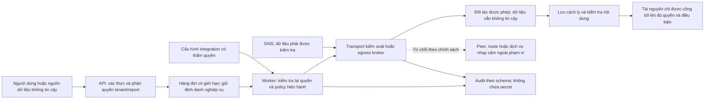

# SSRF defense

## 1. SSRF là gì và cần bảo vệ điều gì?

**SSRF — Server-Side Request Forgery** xảy ra khi đầu vào từ một bên không tin cậy khiến thành phần phía máy chủ gửi yêu cầu tới đích hoặc thực hiện thao tác mạng ngoài phạm vi được phép. Máy chủ có thể có vị trí mạng, danh tính dịch vụ và credential mà người gửi đầu vào không có.

Ví dụ, một tính năng nhập báo cáo cho phép người dùng đưa URL, sau đó backend tải nội dung. Nếu backend có thể truy cập các dịch vụ quản trị nội bộ và không ràng buộc đích, tính năng đó có thể trở thành một đường sử dụng quyền mạng của backend để thực hiện hành động không được phép.

Trong chương **Communication security** của module yêu cầu bảo mật, phòng vệ SSRF cần được chuyển thành yêu cầu cụ thể về mục đích gọi ra ngoài, đích, giao thức, danh tính, dữ liệu truyền đi, giới hạn tài nguyên và bằng chứng kiểm thử. Câu “validate URL trước khi gọi” chưa xác định đủ các điều kiện này.

SSRF không đòi hỏi ứng dụng trả toàn bộ response cho người dùng. Một request không đọc kết quả vẫn có thể tạo tác động ở đích, sử dụng credential của dịch vụ hoặc làm lộ thông tin qua các kênh khác. Vì vậy, tiêu chí nghiệm thu phải kiểm tra kết nối và tác động thực tế, không chỉ dữ liệu trong phản hồi API.

### Mục tiêu học tập

Sau bài này, người học có thể:

1. Xác định điểm vào và quyền mạng mà một tính năng đang sử dụng.
2. Viết hợp đồng đích và thao tác theo mục đích nghiệp vụ.
3. Đặc tả việc phân tích URL, phân giải DNS và kiểm tra peer thực tế.
4. Kiểm soát redirect, proxy, credential và các lời gọi phụ phát sinh.
5. Xây dựng yêu cầu egress, ngân sách tài nguyên, audit và tiêu chí nghiệm thu.

## 2. Mô hình đe dọa và ranh giới tin cậy

### 2.1. Điểm vào có thể gọi mạng

Không giới hạn phân tích ở một API có tên “fetch URL”. Những tính năng sau cũng có thể tạo request phía server:

| Tính năng | Đầu vào ảnh hưởng | Thành phần cần kiểm soát |
|---|---|---|
| Nhập tài liệu hoặc ảnh | URL, mã tài nguyên đối tác | Dịch vụ tải dữ liệu và nơi lưu kết quả |
| Preview liên kết | URL và redirect từ đích | Bộ lấy metadata và client HTTP |
| Webhook | Endpoint đích, cấu hình gửi | Bộ phát sự kiện, retry và credential |
| Tạo PDF hoặc render HTML | Trang chính, ảnh, font, tài nguyên nhúng | Renderer và mọi lời gọi phụ |
| Xử lý tài liệu | Tham chiếu bên ngoài trong nội dung | Parser, bộ chuyển đổi và scanner |
| Kiểm tra tích hợp | Địa chỉ dịch vụ do người cấu hình nhập | Công cụ kiểm tra, proxy hoặc connector |
| Tác vụ nền | URL hoặc tham chiếu đã lưu từ request trước | Worker và quyền mạng của worker |

Giá trị đã vào cơ sở dữ liệu hoặc hàng đợi vẫn có thể bắt nguồn từ bên không tin cậy. Worker không được bỏ chính sách chỉ vì payload không đến trực tiếp từ HTTP request hiện tại.

### 2.2. Tài sản và kết quả cần ngăn chặn

| Tài sản | Kịch bản rủi ro | Yêu cầu cần xem xét |
|---|---|---|
| Dịch vụ quản trị và điều khiển | Backend bị dùng làm cầu nối tới endpoint không dành cho người gọi | Chặn đích ngoài mục đích và cách ly egress |
| Danh tính workload | Request tiếp cận nguồn credential hoặc metadata hạ tầng | Giới hạn khả năng tiếp cận và quyền được cấp |
| Dữ liệu nội bộ | Dịch vụ tải hoặc chuyển tiếp nội dung không được phép | Phân quyền đối tượng và chính sách response |
| Credential tích hợp | Token hoặc cookie bị gửi sai host hoặc qua redirect | Ràng buộc credential với đúng đích và hành động |
| Năng lực phục vụ | Kết nối treo, response lớn, nhiều fetch đồng thời | Deadline, giới hạn byte và concurrency |
| Phạm vi tenant | Dùng tích hợp của tenant khác để lấy dữ liệu | Ánh xạ tenant, integration và tài nguyên có thẩm quyền |

Mô hình cần ghi rõ backend có thể tới những mạng, proxy và dịch vụ nào. Không giả định “nội bộ” chỉ là một dải địa chỉ riêng. Dịch vụ nhạy cảm có thể nằm ở địa chỉ công khai của tổ chức hoặc được định tuyến qua một tên miền được phép truy cập.

### 2.3. Bất biến bảo mật

Một bất biến khái quát:

> Mọi request do tính năng tạo ra phải thuộc mục đích được cấp quyền, tới đúng đích và peer được phép, dùng đúng giao thức, phương thức và credential; các bước phân giải, redirect, retry và xử lý phụ không được mở rộng phạm vi đó.

Bất biến phải được cưỡng chế ở nơi tạo kết nối và nơi cấp quyền. Việc chặn response sau khi request đã tới dịch vụ ngoài phạm vi không đáp ứng yêu cầu ngăn request đó xảy ra.

### 2.4. Khả năng của đối phương và giả định triển khai

Trong ví dụ này, đối phương có thể tạo request hợp lệ ở mức giao thức, có thể là người dùng đã đăng nhập, và có thể điều khiển nội dung URL, job hoặc response từ một máy chủ bên ngoài. Ở nhánh đe dọa DNS, đối phương có khả năng thay đổi kết quả phân giải của một tên mà bộ fetch có thể gặp. Việc đăng nhập không làm đầu vào trở nên đáng tin cậy.

Ta không giả định đối phương đã sửa được mã backend hoặc cấu hình tích hợp có thẩm quyền. Tuy vậy, thay đổi cấu hình sai, tên miền đối tác bị chiếm quyền và một thư viện gọi mạng ngoài wrapper vẫn là các trường hợp cần lớp phòng vệ độc lập. Cấu hình đích do quản trị viên nhập cũng phải qua kiểm tra; quyền sửa cấu hình không mặc nhiên là quyền mở mọi mạng cho workload.

Có hai dạng quan sát thường gặp:

- **SSRF có phản hồi:** dữ liệu hoặc thông tin lỗi từ đích quay lại người gọi, có thể làm lộ nội dung vốn chỉ backend truy cập được.
- **Blind SSRF:** người gọi không nhận nội dung đích nhưng request vẫn xảy ra; tác động phụ, thời gian chờ hoặc log của máy chủ do đối phương kiểm soát có thể tiết lộ kết quả.

SSRF mô tả việc lạm dụng phía máy chủ làm bên gửi request. Trong CSRF, trọng tâm là request sử dụng ngữ cảnh của trình duyệt nạn nhân. Một open redirect chỉ tạo chỉ dẫn chuyển hướng; nó trở thành một mắt xích SSRF khi bộ fetch phía server tự đi theo chỉ dẫn đó ngoài policy. Phân biệt các khái niệm giúp chọn đúng nơi cưỡng chế.

### 2.5. Sơ đồ luồng dữ liệu và một đường khai thác



Ranh giới cần kiểm chứng gồm người gọi–API, dữ liệu job–worker, cấu hình–quyết định đích, tên DNS–peer kết nối và response–nội dung được sử dụng. Nếu không có broker, transport của worker phải chịu trách nhiệm tương ứng; sơ đồ không yêu cầu thêm một dịch vụ chỉ để có đủ ô.

Một đường khai thác trong phòng thử có thể diễn ra như sau:

1. Tính năng nhận URL từ người dùng và xác nhận tên xuất hiện trong allowlist.
2. Máy chủ ngoài trả redirect, hoặc DNS thay đổi giữa lần kiểm tra và lần client tự phân giải.
3. Backend dùng vị trí mạng của mình để tạo request tới fixture mô phỏng dịch vụ nội bộ.
4. Người dùng lấy được nội dung, nhận biết dịch vụ tồn tại, hoặc khiến dịch vụ thực hiện tác động phụ dù response đã bị che.

Mỗi mắt xích cần một yêu cầu riêng: giới hạn target, không tự redirect, ràng buộc DNS–kết nối, egress tối thiểu và kiểm soát quyền. Che lỗi ở bước cuối không thay thế các yêu cầu ngăn request ở bước trước.

## 3. Ưu tiên định danh nghiệp vụ thay cho URL tự do

### 3.1. Hợp đồng theo mục đích

Nếu tính năng chỉ nhập báo cáo từ một số đối tác đã đăng ký, client nên gửi `partner_id` và `report_id`. Máy chủ xác minh quyền rồi lấy host, route và credential từ cấu hình có thẩm quyền.

```text
Danh tính + tenant + partner_id + report_id
                    ↓
Kiểm tra quyền tích hợp và tài nguyên
                    ↓
Cấu hình đích, route và credential phía máy chủ
                    ↓
Fetch theo chính sách mạng và giới hạn tài nguyên
                    ↓
Kiểm tra nội dung trước khi đưa vào sử dụng
```

Trong ví dụ, `report_id` gồm đúng 32 ký tự hex chữ thường. Máy chủ đặt nó vào một thành phần route đã định, không nhận path, query, header hoặc URL thay thế tùy ý.

Một đối tác có quyền cung cấp dữ liệu không đồng nghĩa người dùng được lấy mọi tài nguyên mà credential đối tác truy cập được. Cần xác minh report thuộc phạm vi người gọi và tenant, tránh biến backend thành bên đại diện có quyền quá rộng.

### 3.2. Hồ sơ tham chiếu

Xét tính năng `partner_report_import` với các tham số minh họa:

| Thuộc tính | Chính sách ví dụ |
|---|---|
| Đầu vào | `partner_id` đã đăng ký và `report_id` đúng grammar |
| Đích | Host chính xác lấy từ cấu hình của integration thuộc tenant |
| Giao thức và cổng | HTTPS trên cổng 443 |
| Phương thức | GET; không cho client chọn phương thức hoặc body |
| Route | Mẫu route phía máy chủ dành riêng cho tải báo cáo |
| Redirect | Không tự đi theo redirect trong hồ sơ này |
| Credential | Được chọn phía máy chủ cho integration, không lấy từ request người dùng |
| Ngân sách thiết lập kết nối | Tối đa 3 giây từ bắt đầu phân giải đến hoàn tất kết nối và TLS |
| Thời hạn fetch toàn bộ | Tối đa 15 giây từ bắt đầu xử lý mạng, gồm các bước thiết lập và đọc |
| Dữ liệu nhận | Tối đa 10 MiB trên luồng truyền và 10 MiB sau giải nén nội dung |
| Đồng thời | Tối đa 2 fetch mỗi tenant và 8 fetch toàn cụm |
| Retry tự động | Không có trong hồ sơ tham chiếu |
| Nội dung | Được giữ riêng và kiểm tra trước khi gắn vào hồ sơ để sử dụng |

Các số này dùng để minh họa đặc tả đo được, không phải giới hạn chuẩn. Trong bài, `1 MiB = 1.048.576 byte`.

Tên host mẫu trong tài liệu hoặc fixture kiểm thử không thay thế cấu hình đối tác thật. Đích được phép phải có chủ sở hữu, mục đích, môi trường, chính sách địa chỉ và quy trình cập nhật.

### 3.3. Khi bắt buộc nhận URL

Một tính năng tổng quát có thể cần URL người dùng cung cấp. Khi đó phải có hợp đồng riêng: giao thức, host, cổng, đường dẫn, query, redirect, nhóm địa chỉ, quyền và giới hạn.

Không mở rộng âm thầm từ “tải báo cáo của đối tác” sang “tải mọi URL công khai”. Hai tính năng có bề mặt tin cậy và nhu cầu cách ly khác nhau. Các ngoại lệ cần có phạm vi, người phê duyệt, thời hạn và bằng chứng kiểm thử.

### 3.4. Ví dụ request và policy được lưu phía máy chủ

Request của người dùng chỉ mang ý định nghiệp vụ:

```json
{
  "partner_id": "partner-alpha",
  "report_id": "0123456789abcdef0123456789abcdef"
}
```

Máy chủ lấy tenant từ danh tính đã xác thực, không tin một trường tenant do caller tự khai. `partner_id` được tra cứu trong phạm vi tenant; `report_id` phải thuộc tài nguyên caller được phép nhập. Không lấy URL hoặc credential đã được caller đóng sẵn trong payload job làm nguồn có thẩm quyền.

Dưới đây là **schema minh họa**, không phải cấu hình dùng trực tiếp cho một thư viện HTTP hay một nền tảng mạng cụ thể:

```yaml
policy_id: partner-report-import
version: 3
purpose: partner_report_import
request:
  scheme: https
  exact_host: reports.partner.example
  port: 443
  method: GET
  path_template: /v1/reports/{report_id}
  report_id_pattern: '[0-9a-f]{32}'
  query_allowed: false
  userinfo_allowed: false
  fragment_allowed: false
  follow_redirects: false
  automatic_retries: 0
identity:
  credential_binding: current_tenant_and_integration
  credential_source: server_managed_secret_reference
network:
  resolve_at: component_that_connects_to_origin
  mixed_allowed_and_denied_answers: reject
  connect_only_to_validated_candidates: true
  forbid_direct_fallback_when_broker_required: true
limits:
  setup_deadline_ms: 3000
  fetch_deadline_ms: 15000
  encoded_body_max_bytes: 10485760
  decoded_body_max_bytes: 10485760
  response_headers_max_bytes: 16384
  active_per_tenant: 2
  active_cluster: 8
```

Các tên `.example` trong bài chỉ là ký hiệu minh họa; bộ kiểm thử phải ánh xạ chúng vào fixture do nhóm kiểm soát. Không coi các tên này là đối tác đang tồn tại hoặc đích công khai được phép mặc định.

Policy còn cần tham chiếu tới tập địa chỉ được phép và các đích nhạy cảm của môi trường. Không thể suy một tập IP an toàn chỉ từ `exact_host`. `credential_source` là tham chiếu đến nơi cấp secret phía máy chủ, không phải giá trị secret. Giới hạn 16 KiB cho response header là phần bổ sung minh họa nhằm chặn việc tiêu thụ tài nguyên ngay trước khi đọc body.

Người sở hữu integration chịu trách nhiệm xác nhận đích, route và quyền dữ liệu; nhóm nền tảng chịu trách nhiệm khả năng cưỡng chế của transport/egress; nhóm tính năng chịu trách nhiệm quyền tenant, vòng đời job và nội dung. Một thay đổi host, port hoặc route phải tạo phiên bản policy có thể truy vết và chạy lại các ca bị ảnh hưởng.

## 4. Phân tích URL và chuẩn hóa nhất quán

### 4.1. Dùng một ngữ nghĩa phân tích rõ ràng

URL phải được phân tích bằng cơ chế phù hợp với giao thức và client kết nối thực tế. Không xác định host bằng cách tìm chuỗi con, tách theo vài ký tự hoặc kiểm tra tên miền xuất hiện ở bất kỳ vị trí nào.

Hợp đồng cần xác định từng thành phần:

| Thành phần | Yêu cầu cần làm rõ |
|---|---|
| Scheme | Chỉ những giao thức được cấp quyền; không tự dùng mọi scheme thư viện hỗ trợ |
| Host | Giá trị sau phân tích và chuẩn hóa theo chính sách, so khớp đúng danh tính đích |
| Port | Cổng được phép; không suy rằng đúng host thì mọi cổng đều được dùng |
| Userinfo | Từ chối trong hồ sơ tham chiếu; không dùng làm credential |
| Path | Route được tạo hoặc cho phép theo mục đích, không chỉ kiểm tra host |
| Query | Chỉ trường và giá trị thuộc hợp đồng; quản lý bí mật nếu có |
| Fragment | Không được dùng để thay đổi quyết định đích; hồ sơ URL cần quy định rõ việc từ chối hoặc loại bỏ |

Một tên miền được phép xuất hiện trong phần userinfo, path hoặc query không làm host thực sự trở thành đích được phép.

### 4.2. Biến thể tên và mã hóa

Phải chốt cách xử lý hoa thường, dấu chấm cuối, tên quốc tế, dạng mã hóa và địa chỉ IP viết trực tiếp. Không kiểm tra một dạng rồi cho tầng sau chuẩn hóa hoặc giải mã tiếp thành đích khác.

Trong hồ sơ tham chiếu, host đến từ cấu hình chính xác; người dùng không được tự chọn tên hoặc IP. Với API nhận URL, có thể từ chối các dạng không cần thiết cho nghiệp vụ thay vì cố sửa chúng rồi tiếp tục.

Nếu có allowlist tên miền con, phải so khớp theo ranh giới tên và chính sách sở hữu. Một phép kiểm tra `contains` hoặc prefix ký tự không chứng minh đích thuộc tên miền được phê duyệt. Allowlist rộng cũng cần xem xét ai có quyền tạo hoặc điều khiển tên con.

### 4.3. Host đúng chưa đủ

Một host có thể phục vụ nhiều ứng dụng và route, gồm cả chức năng quản trị hoặc endpoint tạo tác động phụ. Cần ràng buộc phương thức, route, query và credential với mục đích fetch.

Không cho người dùng cung cấp header `Host`, thông tin proxy, header xác thực hoặc các tùy chọn client làm thay đổi đích và quyền thực tế sau khi URL đã được kiểm tra.

### 4.4. Ví dụ quyết định đối với URL

Bảng sau kiểm tra hợp đồng URL tương đương policy mẫu. Đây là các dữ liệu kiểm thử parser hoặc cấu hình, không phải lý do để mở thêm trường URL cho API chỉ nhận ID. Ký hiệu `{id}` thay cho report ID 32 ký tự đã được xác minh.

| URL hoặc thuộc tính | Quyết định trước bước kết nối | Lý do |
|---|---|---|
| `https://reports.partner.example/v1/reports/{id}` | Có thể tiếp tục sang DNS, quyền và TLS | Khớp hình dạng target; chưa chứng minh peer và quyền hợp lệ |
| `https://reports.partner.example@blocked.fixture.example/v1/reports/{id}` | Từ chối | Có userinfo; host thực là `blocked.fixture.example` |
| `https://reports.partner.example.evil.example/v1/reports/{id}` | Từ chối | Host không khớp chính xác |
| `https://blocked.fixture.example/?next=reports.partner.example` | Từ chối | Tên được phép xuất hiện trong query không xác định host |
| `http://reports.partner.example/v1/reports/{id}` | Từ chối | Scheme không được phép |
| `https://reports.partner.example:8443/v1/reports/{id}` | Từ chối | Cổng không được phép |
| `https://reports.partner.example/admin` | Từ chối | Route không thuộc thao tác nhập báo cáo |
| `https://127.0.0.1/v1/reports/{id}` hoặc `https://[::1]/v1/reports/{id}` | Từ chối | IP literal không phải host hợp đồng; đây còn là địa chỉ loopback |
| Target có query, fragment hoặc report ID chứa dấu phân cách path | Từ chối | Hồ sơ mẫu không cấp các khả năng đó |
| URL thuộc scheme khác HTTPS | Từ chối trước khi giao cho handler | Không tự mở rộng sang các giao thức hoặc khả năng đọc tài nguyên khác |

Cổng mặc định, hoa thường và biểu diễn host phải được xử lý nhất quán với parser đã chọn. Hồ sơ mẫu lưu host ASCII chuẩn hóa và dựng URL phía máy chủ, nên không cần chấp nhận mọi dạng biểu diễn từ caller. Không dùng bảng ví dụ làm danh sách chặn chuỗi hoàn chỉnh: quyết định vẫn dựa trên thành phần URL đã phân tích và ngữ nghĩa kết nối thực.

## 5. DNS, địa chỉ đích và kết nối thực tế

### 5.1. Tên được phép phải dẫn tới peer được phép

Allowlist hostname không tự bảo vệ khi kết quả DNS dẫn tới địa chỉ ngoài phạm vi hoặc thay đổi giữa kiểm tra và kết nối. Cần xác định resolver được dùng, kết quả được đánh giá và cách client chọn địa chỉ.

Chính sách địa chỉ phải bao phủ các lớp liên quan trong môi trường: loopback, địa chỉ riêng, link-local, địa chỉ không phù hợp cho kết nối đích, mạng quản trị, control plane và các dịch vụ metadata hoặc credential hạ tầng. Cần quản lý cả các đích công khai nhưng không thuộc mục đích được phép.

Không coi một danh sách chặn IP sao chép một lần là bản mô tả đầy đủ của hạ tầng. Danh mục đích nhạy cảm và quy tắc egress phải có chủ sở hữu và được cập nhật khi topology thay đổi.

### 5.2. IPv4, IPv6 và mọi candidate

Client có thể nhận nhiều địa chỉ và chọn lại khi kết nối lỗi. Mọi candidate có thể được dùng, bao gồm IPv4 và IPv6, đều phải chịu cùng chính sách.

Địa chỉ nên được đánh giá theo biểu diễn nhị phân và ngữ nghĩa của stack, không chỉ theo chuỗi ký tự. Cần xử lý các dạng tương đương hoặc địa chỉ được biểu diễn thông qua dạng khác mà client hỗ trợ.

Hồ sơ tham chiếu từ chối một snapshot DNS có cả candidate được phép và candidate bị cấm, tránh fallback sang địa chỉ chưa được chấp nhận. Một thiết kế khác có thể chỉ cho dùng tập candidate đã duyệt, nhưng phải chứng minh client và mọi lần thử chỉ dùng tập đó.

### 5.3. Ràng buộc kiểm tra với thao tác kết nối

Mẫu dễ có khoảng hở:

```text
resolve(host) → kiểm tra kết quả
http_client.fetch(url) → client tự resolve lại và chọn địa chỉ khác
```

Yêu cầu cần gắn quyết định với peer thực được kết nối: dùng kết quả đã được xác minh trong phạm vi hiệu lực, hoặc cưỡng chế tương đương tại thành phần có quyền phân giải và tạo kết nối.

Khi kết nối tới địa chỉ đã chọn cho một URL HTTPS, vẫn phải xác minh chứng chỉ theo danh tính host hợp đồng và gửi SNI phù hợp khi cần. Không đổi sang gọi IP rồi bỏ kiểm tra hostname để làm cơ chế ràng buộc hoạt động.

Snapshot DNS cần có phạm vi và thời gian hiệu lực. Nếu phải phân giải lại khi retry, hết hiệu lực hoặc đổi đích, phải đánh giá chính sách lại. Connection pool cũng phải giữ đúng đích, peer và thế hệ chính sách; không tái sử dụng kết nối làm vượt một thay đổi quyền hoặc egress đã có hiệu lực.

### 5.4. Thuật toán kiểm tra địa chỉ và ràng buộc peer

Việc kiểm tra có thể được mô tả bằng hợp đồng sau:

```text
resolve_and_validate(target, policy, setup_deadline):
    require target.logical_host matches policy.exact_host
    answers = controlled_resolver.resolve_addresses(
        target.logical_host, until=setup_deadline
    )
    require answers is not empty

    approved = empty_set
    for answer in answers:
        ip = parse_to_binary_address(answer)
        require address_family_is_supported(ip)
        require policy.permits_origin_address(ip)
        require not policy.is_sensitive_destination(ip)
        approved.add(ip)

    return connection_lease(
        logical_authority=target.host_and_port,
        allowed_peers=approved,
        policy_version=policy.version,
        expires_at=bounded_expiry(policy, answers),
        tenant_and_integration=target.authorization_scope
    )
```

Đây là trách nhiệm cần triển khai, không phải tên API có sẵn. Transport chỉ được mở kết nối nếu lease còn hiệu lực, chọn một peer trong tập đã duyệt và giữ nguyên logical authority để xác minh TLS/SNI/HTTP. Khi candidate kết nối lỗi, chỉ được thử candidate khác của cùng tập còn hiệu lực; không tự resolve lại mà bỏ bước kiểm tra. Nếu tất cả candidate lỗi, hồ sơ không tự khởi tạo một fetch mới.

Với CNAME, cần theo dõi quá trình phân giải theo resolver và kiểm tra mọi địa chỉ cuối có thể được dùng. Một alias hợp lệ của đối tác không nhất thiết trùng tên hostname hợp đồng, nhưng tên alias hoặc TTL thấp cũng không phải bằng chứng peer an toàn. Mục tiêu là giữ đúng danh tính logic và đánh giá địa chỉ thực, kể cả IPv4-mapped IPv6 hoặc cơ chế chuyển đổi địa chỉ mà stack triển khai thực sự hỗ trợ.

**DNS rebinding** là trường hợp tên có thể lần lượt dẫn tới các địa chỉ thuộc những phạm vi khác nhau. Ràng buộc tập địa chỉ đã kiểm tra với kết nối ngăn khoảng hở “kiểm tra một IP, gửi tới IP khác”. Chỉ kiểm tra peer sau khi TLS/HTTP đã gửi dữ liệu có thể quá muộn; việc giới hạn peer phải có hiệu lực trước kết nối ngoài phạm vi.

Nếu ứng dụng không kiểm soát được resolver hoặc hàm dial của client, lựa chọn triển khai là client/transport có khả năng cần thiết hoặc broker cưỡng chế tại origin. Không tuyên bố đã pin IP chỉ vì trước đó đã gọi một hàm DNS. Cũng không thay URL bằng IP rồi chèn `Host` thủ công và tắt xác minh chứng chỉ.

Pool cần kiểm tra lease và quyền trước khi cấp lại kết nối. Một lựa chọn bảo thủ là tách pool theo tenant/integration, logical authority, peer và phiên bản policy. Nếu có chia sẻ pool, HTTP/2 coalescing, chuyển transport hoặc đích thay thế, thiết kế phải chứng minh các tối ưu đó không dùng kết nối hoặc địa chỉ ngoài phạm vi; nếu chưa chứng minh được thì tắt khả năng tương ứng.

## 6. Redirect, proxy và đường đi thực tế

### 6.1. Redirect là một quyết định đích mới

Một URL ban đầu được phép có thể trả redirect tới đích không được phép. Hồ sơ tham chiếu không tự đi theo redirect; response chuyển hướng được xử lý như một kết quả chưa tải được báo cáo theo hợp đồng.

Nếu sản phẩm cần redirect, phải đặc tả riêng:

- Số hop tối đa và deadline tổng, không đặt lại toàn bộ ngân sách ở mỗi hop.
- Tái đánh giá scheme, host, cổng, route, DNS và peer cho mọi đích mới.
- Không tự hạ từ kênh được bảo vệ sang giao thức ngoài chính sách.
- Không chuyển tiếp credential, cookie hoặc header nhạy cảm sang một đích mới chỉ vì nó xuất hiện trong `Location`.
- Phương thức và body sau chuyển hướng phải vẫn thuộc thao tác được cấp quyền.

Redirect về cùng host cũng cần được xét theo route và mục đích. Một route tải báo cáo không nên trở thành quyền gọi mọi endpoint trên host đó.

Các lời gọi HEAD, kiểm tra URL hoặc “thử kết nối” trước fetch cũng là request phía server. Chúng phải đi qua chính sách trước khi được gửi, không được truy cập đích tùy ý rồi mới quyết định URL có an toàn không.

### 6.2. Nơi phân giải có thể là proxy

Nếu ứng dụng kết nối qua proxy, địa chỉ peer của socket ứng dụng có thể chỉ là proxy. Kiểm tra địa chỉ đó không chứng minh origin mà proxy sẽ truy cập là đích hợp lệ.

Yêu cầu cần chỉ rõ thành phần nào phân giải hostname và tạo kết nối origin. Nếu proxy hoặc egress broker thực hiện việc đó, chính nó phải cưỡng chế chính sách đích và candidate, hoặc có một hợp đồng ràng buộc tương đương có thể kiểm chứng.

Không cho request người dùng chọn proxy, tunnel, chế độ kết nối hoặc cấu hình môi trường làm thay đổi tuyến ngoài chính sách. Khi proxy bắt buộc từ chối hoặc lỗi, ứng dụng không được tự chuyển sang gọi trực tiếp để bỏ qua kiểm soát.

### 6.3. Các tuyến khác nhau phải có cùng bảo đảm

Service mesh, NAT, gateway và đường failover có thể làm thay đổi nơi thực thi chính sách. Cần xác định rule được áp dụng trước hay sau các bước định tuyến liên quan và đối chiếu đích thật tại điểm thích hợp.

Không coi một rule có tên “egress allowlist” là bằng chứng nó bao phủ mọi namespace mạng, IPv6, loopback hoặc đường proxy. Phạm vi phải được kiểm thử trên topology thực mà sản phẩm hỗ trợ.

## 7. Credential, header và danh tính gọi ra ngoài

### 7.1. Ngăn sử dụng quyền đại diện quá rộng

Backend thường có credential tích hợp hoặc quyền mạng lớn hơn người dùng. Cần kiểm tra người dùng được phép dùng integration nào, cho mục đích nào và với tài nguyên nào trước khi backend sử dụng quyền đó.

Credential cần gắn với tenant, đích, môi trường và thao tác phù hợp. Không lấy một token có quyền rộng rồi cho người dùng chọn tùy ý resource path. Đó là rủi ro sử dụng backend như một bên đại diện bị điều khiển sai mục đích.

Với tác vụ nền, phải xác định quyền nào được chốt lúc nhận việc, quyền nào phải đánh giá lại trước thực thi và cách xử lý khi integration bị thu hồi hoặc đổi cấu hình trong lúc job chờ.

### 7.2. Tạo header từ allowlist phía máy chủ

Không sao chép nguyên bộ header từ request của người dùng sang request bên ngoài. Các trường xác thực, cookie, `Host`, thông tin proxy và header có thể được dịch vụ khác dùng làm tín hiệu tin cậy phải có nguồn và chính sách riêng.

Máy chủ chỉ tạo các header cần cho thao tác, lấy credential từ nơi có thẩm quyền và không để client ghi đè. Credential của proxy và credential của origin cần đúng hop, không bị chuyển tiếp lẫn nhau.

Nếu có mã liên kết để theo dõi, phải giới hạn và xác minh định dạng trước khi đưa vào header hoặc log. Không dùng dữ liệu tùy ý để thay đổi cấu trúc HTTP request.

### 7.3. Giữ xác minh TLS

HTTPS cần xác minh đúng danh tính peer, chuỗi tin cậy, hiệu lực và profile của hệ thống. Allowlist IP hoặc hostname không thay thế xác minh TLS, và TLS hợp lệ cũng không thay thế quyền gọi route.

Nếu đích dùng mTLS, credential client phải được cấp cho đúng integration và mục đích. Người dùng không được chọn khóa, chứng chỉ hoặc trust store tùy ý trong một request fetch.

Lỗi trust hoặc danh tính phải tạo kết quả lỗi theo hợp đồng, không tự tắt xác minh, chuyển sang HTTP hoặc thêm một CA do response của đích đề nghị.

### 7.4. Bí mật trong URL

Một số tích hợp có URL chứa token hoặc chữ ký. Khi thật sự hỗ trợ, phải quản lý nó như dữ liệu nhạy cảm: phạm vi sử dụng, thời hạn, quyền đọc và cách che trong log, lỗi, trace.

Không chuyển tiếp query nhạy cảm sang host hoặc route khác qua redirect. Cũng không tự sửa URL đã ký theo một phép chuẩn hóa làm thay đổi ý nghĩa rồi cho rằng chữ ký vẫn bảo đảm cùng thao tác. Hợp đồng tích hợp phải xác định cách sử dụng và kiểm tra cụ thể.

## 8. Egress control và cô lập thành phần fetch

### 8.1. Giới hạn mạng là một lớp cưỡng chế độc lập

Dịch vụ fetch nên chỉ có khả năng tới các đích, cổng và dịch vụ cần thiết. Các đường không thuộc nghiệp vụ bị từ chối theo chính sách, bao gồm đường tới dịch vụ điều khiển hoặc credential hạ tầng mà thành phần không cần.

Danh tính workload cũng nên có quyền tối thiểu. Nếu bộ fetch không cần đọc secret quản trị hoặc điều khiển hạ tầng, không cấp những quyền đó chỉ vì nó chạy cùng một môi trường với dịch vụ khác.

Lớp mạng giúp hạn chế hậu quả khi có một đường gọi bỏ qua wrapper ứng dụng, nhưng không hiểu đầy đủ quyền tenant hoặc mọi route nghiệp vụ. Chỉ cho phép cổng 443 không chứng minh mọi HTTPS request đều có mục đích hợp lệ.

Một tích hợp nội bộ hợp lệ có thể cần địa chỉ riêng. Khi đó phải có chính sách riêng theo dịch vụ, chủ thể và thao tác, thay vì mở mọi mạng nội bộ cho một bộ tải URL tổng quát.

### 8.2. Egress broker không được trở thành open proxy

Nếu dùng broker tập trung, broker phải xác thực workload gọi nó, kiểm tra mục đích và áp dụng cấu hình đích có thẩm quyền. Việc mọi caller có thể gửi URL tùy ý tới broker rồi dùng quyền mạng của broker chỉ chuyển vị trí rủi ro.

Cần giới hạn phương thức, route, credential, response và loại tunnel được hỗ trợ. Các yêu cầu kết nối hoặc proxy không được cấp quyền mở tùy ý chỉ vì caller là một dịch vụ nội bộ.

Audit phải liên kết được caller gốc, tenant hoặc integration liên quan, policy và kết nối origin. Không tin một header tự khai là bằng chứng về danh tính caller.

### 8.3. Các request phụ cũng phải được kiểm soát

Renderer có thể tải ảnh hoặc font sau khi nhận một trang; parser hoặc bộ chuyển đổi có thể đọc tham chiếu ngoài. Chỉ bảo vệ request đầu tiên chưa kiểm soát toàn bộ đồ thị gọi mạng.

Nếu không thể bảo đảm từng lời gọi phụ đi qua policy phù hợp, cần tắt khả năng mạng đó hoặc cô lập thành phần bằng ranh giới egress đủ mạnh. Dữ liệu chính đến từ đối tác hợp lệ vẫn phải được coi là đầu vào không tin cậy ở bước xử lý tiếp theo.

### 8.4. Đưa kiểm soát vào triển khai thực tế

Một phương án triển khai cho tính năng nhập báo cáo là tách bộ fetch khỏi tiến trình API và đặt egress mặc định từ chối ở workload đó. Workload chỉ được dùng resolver được quản lý, kênh kiểm soát cần thiết và đích đối tác hoặc broker theo thiết kế. API và hàng đợi không được mở một đường fetch khác để “hỗ trợ tạm”.

Nếu bắt buộc qua broker, chính sách mạng phải ngăn workload gọi trực tiếp origin; broker xác thực workload và mục đích trước khi cấp khả năng gọi ra ngoài. Bộ lọc của broker phải đánh giá origin thực, không chỉ domain trong yêu cầu CONNECT. Nếu transport chạy trực tiếp, lớp egress vẫn phải chặn đích nhạy cảm và có cơ chế quản lý địa chỉ động phù hợp; một rule L3/L4 đơn thuần không tự hiểu route HTTP hoặc quyền tenant.

Ở cấu hình client, cần quyết định rõ các khả năng có thể tạo request hoặc đổi đích: redirect, retry ngầm, proxy từ biến môi trường, cookie jar, xác thực tự động, fallback địa chỉ, tái sử dụng pool và xử lý response. Cơ chế tự tìm địa chỉ thay thế chỉ được dùng khi đi qua cùng kiểm tra; nếu không bảo đảm được thì vô hiệu hóa trong bộ fetch này. Không dựa vào mặc định chưa được xác minh của thư viện.

Luồng lấy credential và audit có thể cần kết nối tới dịch vụ nội bộ có thẩm quyền. Các kênh đó phải có policy riêng, không nằm trong khả năng target do người dùng điều khiển. “Chặn toàn bộ IP riêng” tại mọi socket mà không phân biệt trách nhiệm có thể làm hỏng hệ thống; “cho mọi IP riêng vì cần secret store” lại mở quá rộng quyền fetch.

Khi một bộ xử lý nội dung không hỗ trợ policy từng request, chạy nó với quyền mạng bị giới hạn hoặc tắt tải tài nguyên ngoài. Một test cần thử chính renderer/parser sau khi fetch chính đã thành công, vì nó có thể hoạt động ở process hoặc namespace khác với bộ tải ban đầu.

## 9. Ngân sách tài nguyên và xử lý response

### 9.1. Deadline bao phủ toàn bộ công việc mạng

Trong hồ sơ tham chiếu, 3 giây thiết lập gồm phân giải, kết nối và TLS; 15 giây tổng tính từ khi bắt đầu xử lý mạng đến khi kết thúc đọc. Cần cưỡng chế deadline qua các thành phần có thể chờ, không chỉ ở một bước đọc socket.

Nếu sản phẩm có retry hoặc redirect, chúng vẫn nằm trong ngân sách tổng và phải được cấp quyền lại khi có điều kiện thay đổi. Mỗi lần thử tạo kết nối thực phải được hạch toán.

Hết thời gian chờ của API không chứng minh worker, resolver hoặc lời gọi từ xa đã dừng. Slot chỉ được giải phóng theo vòng đời công việc thật hoặc cơ chế cưỡng chế đã được kiểm chứng.

### 9.2. Giới hạn byte thực và dữ liệu giải nén

Không chỉ tin `Content-Length` hoặc MIME do đích trả. Cần đếm byte thực trong quá trình nhận, giới hạn cả dữ liệu trên luồng truyền và dữ liệu sau giải nén nếu client có xử lý mã hóa nội dung.

Hồ sơ tham chiếu giới hạn cả hai ở 10 MiB. Response nhỏ trên mạng có thể giải nén thành dữ liệu lớn hơn, nên chỉ chặn kích thước truyền chưa đủ. Buffer, dung lượng tạm và bộ xử lý nội dung cũng cần ngân sách riêng.

Khi vượt giới hạn, dừng hoặc cô lập công việc theo giao thức và đánh dấu thất bại. Không đọc hết vào RAM rồi mới kiểm tra. Phần dữ liệu đã lưu phải có trạng thái và quy trình dọn tương ứng.

### 9.3. Đồng thời, hàng đợi và phản hồi lỗi

Trần 2 fetch mỗi tenant và 8 toàn cụm phải áp dụng qua mọi instance và đường worker thuộc tính năng. Nếu xếp hàng, một cấu hình minh họa có thể cho tối đa 32 job toàn cụm, 4 mỗi tenant và chờ tối đa 30 giây trước khi bắt đầu mạng.

Hết ngân sách không được dẫn đến bỏ kiểm tra đích hoặc dùng client khác ít ràng buộc hơn. Cần phản hồi quá tải, từ chối hoặc chờ theo hợp đồng đã định.

Mã HTTP upstream, lỗi TLS và timeout cần được ánh xạ sang kết quả của tính năng. Không trả nguyên response, header hay trang lỗi của dịch vụ nội bộ cho người gọi. Lỗi xác thực upstream cũng không được kích hoạt việc tự tìm credential rộng hơn ngoài chính sách.

### 9.4. Response không trở thành nội dung được tin ngay

Tệp tải được phải đi qua chính sách lưu trữ, cách ly, định dạng và xử lý nội dung phù hợp trước khi sử dụng. Không render trực tiếp HTML của đích trong origin ứng dụng hoặc công bố tệp chỉ vì request mạng đã thành công.

Phương thức GET cũng không tự chứng minh đích không có tác động phụ. Quyền thao tác và route vẫn phải được kiểm soát theo hợp đồng dịch vụ được gọi.

## 10. Mô tả luồng cưỡng chế và ví dụ triển khai

### 10.1. Pseudocode bao phủ quyền, kết nối và vòng đời tài nguyên

```text
import_report(request):
    identity = authenticate(request)
    validate_business_ids(request)
    authorize_current(identity, request.partner_id, request.report_id)
    ticket = acquire_cluster_capacity(
        tenant=identity.tenant,
        active_limits=(2_per_tenant, 8_cluster),
        optional_queue_limits=(4_per_tenant, 32_cluster, wait_30s)
    )
    transfer = NONE
    quarantine = NONE

    try:
        # Job có thể đã chờ: kiểm tra quyền và cấu hình lại trước khi gọi mạng.
        target = authorize_and_build_current_partner_target(identity, request)
        policy = load_current_valid_policy(target)
        audit_start_durably(target.ids, policy.version)

        started_at = monotonic_now()
        setup_end = started_at + 3s
        fetch_end = started_at + 15s
        lease = resolve_and_validate(target, policy, setup_end)
        transfer = controlled_transport.open(
            target=target,
            lease=lease,
            method=GET,
            headers=server_owned_headers(target),
            redirects=DISABLED,
            automatic_retries=0,
            verify_tls_for=target.logical_host,
            setup_until=setup_end,
            entire_fetch_until=fetch_end,
            response_header_limit=16KiB
        )
        require transfer.status == 200
        require response_type_allowed(transfer.headers)
        quarantine = receive_bounded_stream(
            transfer,
            encoded_limit=10MiB,
            decoded_limit=10MiB,
            until=fetch_end
        )
        mark_content_awaiting_inspection(quarantine)
        return pending_inspection_result()
    catch failure:
        mark_job_failed_with_safe_reason(failure)
        retain_or_cleanup_partial_content_by_policy(quarantine)
        raise safe_business_error(failure)
    finally:
        ensure_transfer_stopped_or_egress_authority_revoked(transfer)
        release_capacity_after_network_stop(ticket)
        record_final_audit_without_secrets()
```

Các hàm là **hợp đồng trách nhiệm**, không phải API chuẩn đã tự cung cấp bảo đảm. `controlled_transport` phải thực sự giữ peer, TLS, proxy và deadline theo policy. Nếu broker kết nối origin, phần phân giải và lease phải được cưỡng chế tại broker hoặc qua một giao thức ràng buộc tương đương; kiểm tra một lần ở caller rồi để broker tự resolve là chưa đủ.

`setup_end` và `fetch_end` là mốc thời gian tuyệt đối trên đồng hồ đơn điệu của bên cưỡng chế. Bộ đọc không được đặt lại deadline sau mỗi chunk; thời gian thiết lập 3 giây đã nằm trong 15 giây tổng. Ở thiết kế nhiều tiến trình, phải truyền ngân sách còn lại bằng cơ chế phù hợp, không giả định đồng hồ đơn điệu của hai máy có cùng giá trị.

Nhánh `finally` phải bao phủ lỗi DNS, TLS, response và giải nén. Việc hết thời gian chờ ở tầng API hoặc hủy một future không tự chứng minh socket hay resolver nền đã dừng. Transport cần cơ chế hủy có thể kiểm chứng và ranh giới egress có thể thu hồi; nếu không bảo đảm được thì không được báo đã đáp ứng deadline hoặc giải phóng slot sớm để công việc tiếp tục chạy vô hạn.

Phần đọc body phải giới hạn cả byte trước và sau giải mã nội dung, bộ đệm tạm và loại content encoding được hỗ trợ. Chính sách phải xác định hành vi với encoding không hỗ trợ, response không có độ dài và header quá lớn. Trong hồ sơ này, chỉ status 200 đúng hợp đồng mới đi vào luồng nhập; redirect, lỗi upstream và response khác không được chuyển nguyên vẹn về caller.

Kiểm tra nội dung diễn ra sau fetch có ngân sách xử lý và trạng thái job riêng; không được gọi tổng thời gian 15 giây là SLA hoàn tất mọi bước nhập báo cáo. Không công bố tệp khi nó còn chờ kiểm tra. Audit cuối cần cơ chế lưu bền vững hoặc hàng đợi bền vững có giới hạn theo chính sách; không để lỗi ghi log che mất việc dừng mạng và dọn tài nguyên.

### 10.2. Ví dụ Java: dựng URI từ dữ liệu nghiệp vụ

Đoạn Java sau minh họa riêng việc ngăn caller biến report ID thành URL hoặc path khác. `approvedAsciiHost` chỉ được lấy từ cấu hình integration hiện hành đã được phê duyệt; nó không phải tham số nhận trực tiếp từ request người dùng.

```java
import java.net.URI;
import java.net.URISyntaxException;
import java.util.regex.Pattern;

final class ReportTarget {
    private static final Pattern REPORT_ID = Pattern.compile("[0-9a-f]{32}");

    static URI build(String approvedAsciiHost, String reportId)
            throws URISyntaxException {
        if (approvedAsciiHost == null || approvedAsciiHost.isBlank()) {
            throw new IllegalArgumentException("Missing approved host");
        }
        if (reportId == null || !REPORT_ID.matcher(reportId).matches()) {
            throw new IllegalArgumentException("Invalid report identifier");
        }

        URI target = new URI(
            "https", null, approvedAsciiHost, 443,
            "/v1/reports/" + reportId, null, null
        );
        if (!approvedAsciiHost.equals(target.getHost())
                || target.getRawUserInfo() != null) {
            throw new IllegalArgumentException("Invalid configured host");
        }
        return target;
    }
}
```

Đoạn này không xác minh quyền tenant, không phân giải DNS, không chặn địa chỉ và không tạo kết nối; nó là một phần của SSRF-02. Việc lấy `URI` đã dựng rồi truyền cho một client HTTP thông thường không tự đáp ứng SSRF-03 đến SSRF-11. Tên lớp, nơi cung cấp cấu hình và transport thực phải được ghép vào kiến trúc có các bảo đảm tương ứng.

Ví dụ an toàn ở cấp luồng là: nhận `partner_id`/`report_id` → kiểm tra quyền → dựng URI → cấp lease peer → gọi transport kiểm soát → lưu cách ly. Ví dụ còn khoảng hở là: nhận URL → kiểm tra chuỗi chứa tên đối tác → gọi client tự redirect/resolve → trả body trực tiếp. Sự khác biệt nằm ở quyền và kết nối thực, không ở số lượng điều kiện `if` trước lệnh gửi.

## 11. Audit, cảnh báo và phục hồi an toàn

### 11.1. Ghi lại quyết định thay vì thu thập bí mật

Một yêu cầu audit cần chỉ rõ sự kiện, trường dữ liệu, quyền đọc và thời gian lưu. Với `partner_report_import`, mỗi lần thử phải liên kết được với job gốc và có một kết quả cuối cùng, kể cả khi bị từ chối trước khi tạo socket.

Các trường cần thiết gồm:

- Mã sự kiện và thời điểm; mã liên kết do hệ thống tạo hoặc xác minh.
- Workload thực thi, tenant và mã integration theo chính sách bảo vệ dữ liệu của hệ thống.
- Mục đích `partner_report_import`, mã đích trong cấu hình và phiên bản policy.
- Quyết định cho phép hoặc từ chối, giai đoạn thất bại và mã lý do có cấu trúc.
- Đích và peer thực tế tại điểm có thể quan sát origin; nếu dùng broker, liên kết bằng chứng của caller với bằng chứng tại broker.
- Thời lượng, lượng byte đã nhận và sau giải nén, số lần thử, kết quả kết thúc và trạng thái nội dung cách ly.

Không ghi nguyên URL chứa chữ ký, query nhạy cảm, header xác thực, cookie, response body hoặc credential. Khi từ chối đầu vào, chỉ lưu mô tả đã giới hạn độ dài và che dữ liệu theo schema; không chép chuỗi tùy ý vào log. IP hoặc định danh tenant trong audit cũng cần quyền truy cập và thời hạn lưu phù hợp.

Thông báo trả cho người dùng chỉ nêu kết quả nghiệp vụ và mã liên kết cần thiết. Chi tiết topology, địa chỉ bị chặn và lỗi handshake thuộc kênh chẩn đoán được phân quyền. Hành vi và thời gian phản hồi vẫn có thể tạo kênh quan sát trong blind SSRF, nên việc che thông báo không thay thế kiểm soát kết nối.

### 11.2. Cảnh báo phải có ngưỡng và người xử lý

Một cấu hình minh họa là phát cảnh báo khi cùng integration có ít nhất 5 quyết định từ chối đích trong một cửa sổ trượt 60 giây; cảnh báo phải xuất hiện trong kênh giám sát trong 60 giây kể từ khi đủ ngưỡng. Nhóm vận hành an toàn của tính năng sở hữu việc tiếp nhận và điều tra. Các ngưỡng này là ví dụ cần hiệu chỉnh theo lưu lượng và rủi ro.

Cần tách số liệu từ chối theo policy khỏi timeout hoặc lỗi của đối tác. Một đợt lỗi DNS không tự chứng minh có tấn công; một request bị chặn tới đích nhạy cảm cũng không chứng minh đã bị lộ credential. Người điều tra phải đối chiếu bằng chứng kết nối, request được gửi và quyền của workload.

Không dùng URL tùy ý hoặc `report_id` làm nhãn metric có số lượng giá trị không giới hạn. Hệ thống audit cũng cần giới hạn dung lượng và xử lý quá tải. Đặc tả phải chốt hành vi khi kênh audit không khả dụng; trong hồ sơ tham chiếu, nếu không thể tiếp nhận bền vững sự kiện bắt đầu hoặc từ chối theo chính sách audit, không khởi tạo fetch mới. Tính bền vững này phải được kiểm thử, không suy ra chỉ từ việc hàm ghi log trả về.

### 11.3. Lỗi kiểm soát và khôi phục sau sự cố

Không phân giải được tên, không xác minh được quyền hoặc không có policy hợp lệ đều phải dẫn tới từ chối khởi tạo kết nối. Nếu có cache policy, cần đặc tả hiệu lực, phiên bản và thời hạn thu hồi; không âm thầm dùng bản cũ vô thời hạn khi hệ thống quản lý lỗi.

Khi thu hồi integration, quy trình phải phân biệt job chờ và fetch đang chạy. Với hồ sơ minh họa:

1. Chặn cấp quyền mới ngay tại nguồn cấu hình có thẩm quyền; job chờ phải đánh giá lại quyền ngay trước khi bắt đầu mạng.
2. Phát lệnh ngừng fetch đang chạy; yêu cầu cưỡng chế không còn lưu lượng ứng dụng của integration đó tại điểm egress trong tối đa 5 giây từ khi lệnh thu hồi được chấp nhận. Nếu ứng dụng không đủ khả năng cưỡng chế, broker hoặc lớp mạng phải đáp ứng thời hạn này.
3. Loại bỏ khả năng tái sử dụng kết nối và credential đã bị thu hồi; không cho pool hoặc worker cũ tiếp tục bằng trạng thái cache.
4. Cách ly dữ liệu nhận dở, giữ bằng chứng theo chính sách và chỉ đưa dữ liệu vào sử dụng sau khi có kết quả kiểm tra hợp lệ.
5. Chỉ mở lại sau khi policy, egress và cấu hình credential cần thiết đã được xác minh; job được chạy lại phải đi qua toàn bộ kiểm tra hiện hành.

Thời hạn 5 giây là mục tiêu thiết kế của ví dụ, cần được chứng minh trên kiến trúc triển khai. Dừng truyền không đảo ngược request đã tới đích hoặc tác động đã xảy ra. Nếu có bằng chứng credential đã được gửi sai nơi, quy trình sự cố phải đánh giá việc thu hồi hoặc thay credential và phạm vi ảnh hưởng trước khi khôi phục.

## 12. Chuyển mô hình đe dọa thành yêu cầu có thể nghiệm thu

### 12.1. Định danh rủi ro và bằng chứng

Để truy vết, mô hình tham chiếu sử dụng các mã cục bộ:

| Mã rủi ro | Điều kiện cần ngăn chặn |
|---|---|
| R1 | Người gọi sử dụng quyền integration hoặc tài nguyên ngoài tenant của mình |
| R2 | Request tới đích, route hoặc peer ngoài hợp đồng nghiệp vụ |
| R3 | Credential bị gửi sai nơi hoặc danh tính TLS không được xác minh |
| R4 | Fetch hoặc xử lý response làm cạn tài nguyên và công bố dữ liệu chưa được kiểm tra |
| R5 | Không thể điều tra, thu hồi quyền hoặc khôi phục tính năng theo chính sách |

Một yêu cầu hoàn chỉnh cần có chủ thể thực thi, điều kiện kích hoạt, hành vi bắt buộc, kết quả lỗi và cách chứng minh. Từ “phải” trong ma trận dưới đây mô tả nghĩa vụ của hồ sơ minh họa, không tuyên bố đây là bộ giá trị chuẩn cho mọi sản phẩm.

### 12.2. Ma trận yêu cầu, kiến trúc và tiêu chí kiểm thử

| ID / rủi ro | Yêu cầu bảo mật | Điểm cưỡng chế | Kiểm thử và bằng chứng chấp nhận |
|---|---|---|---|
| SSRF-01 / R1 | Trước mỗi fetch, phải xác minh người gọi và tenant được dùng integration và report; kiểm tra lại quyền của job chờ trước khi bắt đầu mạng. | API cấp quyền và worker | T01: report hoặc integration ngoài quyền bị từ chối; không có request origin; job chờ sau thu hồi cũng bị từ chối. |
| SSRF-02 / R2 | Đích phải được tạo từ cấu hình có thẩm quyền, chỉ dùng HTTPS:443, GET, route báo cáo và `report_id` gồm 32 ký tự hex chữ thường. | Bộ tạo target | T02: đầu vào thay URL, phương thức, path hoặc header đích không thể mở rộng target; yêu cầu hợp lệ vẫn tới đúng fixture. |
| SSRF-03 / R2 | Mọi candidate IPv4/IPv6 phải được đánh giá; hồ sơ này từ chối snapshot có candidate bị cấm; kết nối origin chỉ được dùng peer đã duyệt trong phạm vi hiệu lực. | Resolver và transport, hoặc broker | T03: DNS đổi giữa bước kiểm tra và kết nối, tập địa chỉ hỗn hợp, fallback và pool không tạo kết nối tới peer bị cấm. |
| SSRF-04 / R2, R3 | Không tự đi theo redirect và không tạo request thăm dò ngoài policy; không cho caller đổi proxy hoặc tự chuyển sang đường trực tiếp khi proxy bắt buộc lỗi. | Client HTTP và broker | T04: fixture trả redirect hoặc proxy lỗi; không có request tiếp theo tới đích chuyển hướng hay qua tuyến bị cấm. |
| SSRF-05 / R3 | Phải xác minh TLS theo host hợp đồng; credential và header nhạy cảm chỉ được tạo phía máy chủ cho đúng integration và đích. | Transport TLS và bộ cấp credential | T05: chứng chỉ sai danh tính bị từ chối trước HTTP request; fixture được phép chỉ nhận credential kiểm thử đúng phạm vi. |
| SSRF-06 / R2 | Lớp egress phải từ chối đường ngoài chính sách; renderer, parser và broker không được mở đường gọi mạng phụ vượt quyền. | Mạng, broker và sandbox xử lý nội dung | T06: thử từ đúng workload và các thành phần phụ trên topology hỗ trợ; bằng chứng tại origin và egress xác nhận không tới đích bị cấm. |
| SSRF-07 / R4 | Thiết lập kết nối phải nằm trong 3 giây và toàn bộ fetch trong 15 giây; mỗi luồng dữ liệu truyền và sau giải nén không vượt 10 MiB được tiếp nhận theo ngân sách. | Transport, bộ đếm streaming và bộ giải nén | T07: DNS chậm, TLS treo, đọc nhỏ giọt và response nén vượt ngưỡng phải bị dừng theo giới hạn; không chờ tải hết để kiểm tra. |
| SSRF-08 / R4 | Phải giữ trần 2 fetch mỗi tenant và 8 toàn cụm; nếu bật hàng đợi mẫu, giới hạn 4 job mỗi tenant, 32 toàn cụm và 30 giây chờ. | Bộ điều phối chung cho API và worker | T08: tải đồng thời qua nhiều instance không vượt trần; timeout ở API không giải phóng slot khi công việc mạng còn chạy. |
| SSRF-09 / R4 | Dữ liệu tải về phải nằm trong vùng cách ly; fetch lỗi hoặc kiểm tra nội dung chưa đạt không được tạo tài nguyên có thể sử dụng. | Lưu trữ và pipeline kiểm tra nội dung | T09: ngắt kết nối, response vượt ngưỡng hoặc nội dung không hợp lệ không tạo bản báo cáo dùng được; dữ liệu dở có trạng thái dọn rõ ràng. |
| SSRF-10 / R5 | Phải có audit theo schema và cảnh báo đạt ngưỡng ví dụ trong thời hạn 60 giây; không lưu credential hoặc nội dung nhạy cảm ngoài schema. | API, worker, broker và hệ thống giám sát | T10: đối chiếu job với quyết định và kết quả cuối, kiểm tra che bí mật, gây lỗi kênh audit và xác minh hành vi đã đặc tả. |
| SSRF-11 / R2, R5 | Phải thu hồi quyền theo quy trình, ngừng lưu lượng ứng dụng đang chạy trong 5 giây và không tái dùng quyền hoặc kết nối đã thu hồi. | Nguồn policy, worker, pool và egress | T11: thu hồi khi có cả job chờ và fetch đang chạy; đo tại điểm cưỡng chế và thử lại bằng pool cũ trước khi cho phép phục hồi. |

Các yêu cầu liên quan nhau nhưng không thay thế nhau. Chẳng hạn, SSRF-05 chứng minh danh tính TLS; SSRF-01 và SSRF-02 mới xác định người gọi có quyền yêu cầu thao tác đó. Một kết nối TLS thành công không đủ để đánh dấu toàn bộ tính năng đạt yêu cầu SSRF.

Với giới hạn byte, phải nêu rõ ranh giới đo: payload HTTP được đọc trước giải mã nội dung và payload sau giải mã, không phải tổng byte của TCP/TLS. Hệ thống có thể phải đọc một phần dữ liệu để phát hiện vượt ngưỡng; bằng chứng cần cho thấy nó dừng có giới hạn và không tiếp nhận, lưu hoặc giải nén vô hạn. Với giới hạn thời gian, phép đo phải nêu đồng hồ, điểm bắt đầu, điểm kết thúc và sai số công cụ được chấp thuận trước nghiệm thu.

## 13. Thiết kế kiểm thử và duy trì yêu cầu trong vòng đời

### 13.1. Môi trường kiểm thử có kiểm soát

Kiểm thử cần DNS, HTTP/TLS server, proxy và endpoint mô phỏng do nhóm kiểm thử kiểm soát. Endpoint mô phỏng dịch vụ nhạy cảm chỉ trả dấu hiệu nhận biết và ghi nhận kết nối; không sử dụng credential thật hoặc gọi thử tới metadata và dịch vụ quản trị của môi trường sản xuất.

Tập thử nên có cả đường hợp lệ và đường bị từ chối. Nếu mọi request đều bị chặn vì môi trường hỏng, việc không thấy SSRF chưa chứng minh cơ chế phân biệt đúng. Đường hợp lệ phải nhận đúng báo cáo và lưu vào vùng cách ly trước khi chuyển sang trạng thái được sử dụng.

Các biến thể cần được chọn theo ngữ nghĩa của stack triển khai: tên được phép nằm ở userinfo hoặc query, tên gần giống, dạng mã hóa hoặc IP mà client hỗ trợ, nhiều bản ghi DNS, DNS thay đổi, IPv6, redirect tương đối và tuyệt đối, pool có sẵn, proxy thực hiện DNS, tài nguyên nhúng và giải nén response. Với API chỉ nhận ID, phải xác minh caller không thể đi vòng sang API, job payload hoặc cấu hình khác để tự chọn target.

### 13.2. Quan sát request thực tế

Không lấy một mã HTTP 400 hoặc thông báo “blocked” làm bằng chứng duy nhất. Có thể ứng dụng đã gửi request rồi mới chặn response. Mỗi ca T01–T11 phải đối chiếu ít nhất các nguồn quan sát phù hợp:

- Quyết định policy và audit của thành phần thực thi.
- Kết nối và request origin ghi nhận tại fixture hoặc broker có khả năng quan sát origin.
- Bằng chứng egress, DNS hoặc transport cần thiết để phân biệt đã phân giải, đã tạo kết nối và đã gửi HTTP request.
- Trạng thái job, slot tài nguyên và nội dung đã lưu khi ca thử kết thúc.

Một truy vấn DNS trong ca bị từ chối sau phân giải không đồng nghĩa đã gửi request tới origin. Ngược lại, socket chỉ tới proxy không chứng minh proxy chưa gọi origin. Mỗi yêu cầu phải chốt sự kiện nào bị cấm và điểm nào quan sát được nó.

Bộ ca phải có tình huống không nhận response, vì blind SSRF vẫn có thể tạo kết nối và tác động. Khi yêu cầu cấm tạo kết nối, tiêu chí đạt là không có kết nối tới fixture bị cấm; khi yêu cầu giới hạn hành động, phải kiểm tra cả phương thức, route, header và credential mà fixture thực nhận.

### 13.3. Hồ sơ nghiệm thu và thay đổi kiến trúc

Hồ sơ nghiệm thu của tính năng cần liên kết từng ID yêu cầu với rủi ro, người sở hữu, cấu hình policy, điểm cưỡng chế, ca kiểm thử và bằng chứng trên phiên bản triển khai cụ thể. Những ô chưa có bằng chứng phải được ghi nhận là chưa đạt hoặc có ngoại lệ được quản lý, không đánh dấu đạt chỉ vì đã có wrapper kiểm tra URL.

Khi đổi thư viện HTTP, resolver, proxy, chế độ IPv6, pool kết nối, cơ chế giải nén hoặc hạ tầng egress, phải xác định lại các bảo đảm bị ảnh hưởng và chạy các ca tương ứng. Thêm đối tác, mở route mới hoặc cho phép redirect cũng là thay đổi phạm vi tin cậy cần cập nhật yêu cầu và mô hình đe dọa.

### 13.4. Các ca nghiệm thu chi tiết cho hồ sơ tham chiếu

Các ca dưới đây cụ thể hóa T01–T11. Chúng là đặc tả kiểm thử cần chạy trên hệ thống triển khai, không phải tuyên bố đã chạy hay đã đạt. Mọi endpoint bị cấm trong ca thử đều là fixture cô lập; không thăm dò dịch vụ nhạy cảm thật.

**AC-01 — Đường hợp lệ và phân quyền tài nguyên, truy vết T01/T02/T05/T09.**

- Given: tenant A được cấp integration `partner-alpha`; report mẫu thuộc A; DNS chỉ trả peer fixture được phê duyệt; TLS hợp lệ cho host hợp đồng.
- When: caller gửi request JSON ở mục 3.4.
- Then: fixture nhận đúng một GET tới route báo cáo, không có query; credential kiểm thử thuộc A; dữ liệu vào vùng cách ly và chưa được công bố trước kiểm tra nội dung.
- When: caller A thay bằng report hoặc integration chỉ thuộc B, hoặc một job chờ bị thu hồi quyền trước khi bắt đầu fetch.
- Then: không có kết nối origin cho ca bị từ chối; job có lý do phù hợp, không dùng credential của B và không tạo báo cáo dùng được.

**AC-02 — Parser, host và route, truy vết T02.**

Chạy từng hàng trong bảng 4.4 qua đúng parser/bộ dựng target của sản phẩm. Các hàng bị từ chối không được tạo kết nối origin. Với API chỉ nhận ID, thử giá trị chứa dấu phân cách, ID sai độ dài, chữ hoa và trường URL/header bổ sung; payload phải bị từ chối hoặc trường ngoài hợp đồng phải được bỏ qua theo schema, nhưng không được làm thay đổi target. Bằng chứng gồm target đã phân tích được che phù hợp, mã quyết định và bộ đếm fixture bằng 0 cho các đích ngoài phạm vi.

**AC-03 — Snapshot DNS hỗn hợp và thay đổi giữa hai thời điểm, truy vết T03.**

- Given: resolver kiểm soát trả một candidate được phép và một candidate bị cấm, thử cả A và AAAA.
- Then: snapshot bị từ chối trước kết nối; không có fallback tới một trong các peer của snapshot đó trong hồ sơ này.
- Given: lần phân giải được kiểm tra trả `PEER_ALLOWED`; nếu bị gọi lại không qua kiểm tra, resolver sẽ trả `PEER_DENIED`.
- When: chạy fetch và cố làm candidate đầu tiên kết nối lỗi hoặc làm lease hết hiệu lực.
- Then: transport chỉ dùng lease còn hiệu lực hoặc thực hiện một vòng phân giải–kiểm tra mới được cấp quyền; không gửi tới `PEER_DENIED`. Audit và log resolver chỉ rõ đường đã dùng.

Các ký hiệu peer là fixture trong mạng thử, không phải dải IP công khai được mặc nhiên cho phép. Nếu đích được gọi qua proxy, quan sát phải đặt tại proxy–origin; bộ đếm socket caller–proxy không đủ cho ca này.

**AC-04 — Redirect và credential, truy vết T04/T05.**

Fixture được phép trả lần lượt redirect tới cùng host nhưng route khác, tới host khác và tới fixture nhạy cảm. Với mọi response chuyển hướng, không có request thứ hai; header credential chỉ xuất hiện ở request ban đầu đúng phạm vi. Sau đó thử chứng chỉ không khớp host hoặc không được trust: có thể quan sát kết nối/TLS thất bại, nhưng không có HTTP request mang credential. Ca proxy bắt buộc lỗi phải kết thúc mà không phát sinh đường trực tiếp.

**AC-05 — Ngưỡng byte và thời gian, truy vết T07.**

| Fixture / đầu vào | Kết quả cần quan sát |
|---|---|
| Body hợp lệ dài `10 MiB - 1` và đúng `10 MiB`, đúng định dạng | Có thể hoàn tất bước fetch nếu mọi điều kiện khác đạt; không bị từ chối chỉ vì chạm ngưỡng |
| Body dài `10 MiB + 1`, không dựa vào `Content-Length` | Bị dừng khi phát hiện vượt ngưỡng; không có nội dung vượt ngưỡng được chấp nhận để sử dụng |
| Body nén nhỏ nhưng dữ liệu giải nén vượt 10 MiB | Bị dừng ở bộ đếm dữ liệu sau giải nén, không giải nén hết rồi mới kiểm tra |
| Response header vượt 16 KiB theo cách đo của transport | Bị từ chối trước khi tiếp nhận body không giới hạn |
| DNS, kết nối hoặc TLS chưa xong sau 3 giây | Thiết lập thất bại theo deadline; không tiếp tục gửi HTTP request sau hạn |
| Đọc nhỏ giọt liên tục nhưng tổng fetch vượt 15 giây | Fetch bị dừng theo mốc tổng, không được gia hạn bởi các chunk mới |

Trước khi chạy phải chốt phần header nào được tính, cách đo payload, kích thước block đọc/giải nén tối đa và sai số đo thời gian. Phép phát hiện vượt ngưỡng có thể đọc thêm một lượng hữu hạn; lượng này phải nằm trong ngân sách bộ đệm đã chấp thuận, không được tính là nội dung hợp lệ hoặc tích lũy không giới hạn. Giới hạn header cũng cần được cưỡng chế ngay khi parse, không sau khi đã giữ toàn bộ header trong RAM.

**AC-06 — Tải đồng thời và dọn công việc, truy vết T08/T09.**

Tạo hơn 2 fetch cho cùng tenant và hơn 8 fetch qua nhiều instance, cho fixture giữ kết nối mở. Tại mọi thời điểm, số fetch thực đang hoạt động không vượt từng trần; việc API hết chờ không cho phép worker nhả slot trong khi socket còn chạy. Nếu bật hàng đợi mẫu, kiểm tra riêng ngưỡng 4/32 job và chờ quá 30 giây. Ngắt kết nối giữa chừng phải để lại trạng thái job xác định, không công bố báo cáo dở và không rò slot sau khi công việc đã thật sự dừng.

**AC-07 — Egress và lời gọi phụ, truy vết T06.**

Từ đúng workload, thử một đường gọi không qua wrapper ứng dụng tới fixture bị cấm; egress phải từ chối. Cho tài liệu hợp lệ ở đích chính tham chiếu tới ảnh/font hoặc tài nguyên ngoài ở fixture đó; renderer/parser không được tạo request vượt policy. Chạy trên các tuyến và họ địa chỉ được sản phẩm hỗ trợ, bao gồm tuyến proxy hoặc namespace xử lý nội dung riêng nếu có.

**AC-08 — Audit, thu hồi và khôi phục, truy vết T10/T11.**

Gây đủ 5 quyết định từ chối trong cửa sổ 60 giây cho cùng integration và đo cảnh báo trong 60 giây từ lúc đủ ngưỡng. Dùng credential kiểm thử có dấu hiệu nhận biết để xác minh nó không có trong log, trace, lỗi trả người dùng hoặc metric. Làm kênh audit không thể tiếp nhận bền vững: không được khởi tạo fetch mới trái chính sách audit đã chọn.

Khi có cả job chờ, kết nối đang đọc và pool có kết nối nhàn rỗi, chấp nhận lệnh thu hồi integration tại thời điểm `t0`. Không cấp phép fetch mới sau quyết định thu hồi có thẩm quyền; trong tối đa 5 giây từ `t0`, điểm cưỡng chế egress phải ngăn lưu lượng ứng dụng của integration đang chạy. Thử dùng lại job/pool cũ phải bị từ chối. Chỉ khi cấu hình đã được xác minh và cấp quyền lại, một job qua đầy đủ kiểm tra hiện hành mới được chạy. Không coi việc khóa nút trên giao diện là bằng chứng đã thu hồi ở worker hoặc origin.

### 13.5. Điều kiện chấp nhận và giới hạn của kết luận

Một bản triển khai chỉ được đánh dấu đáp ứng hồ sơ này khi có đủ các điều kiện sau:

1. Có chủ sở hữu cho từng SSRF-01–SSRF-11 và bản policy có phiên bản cho đúng môi trường; các giá trị minh họa đã được chấp nhận hoặc thay bằng giá trị có lý do và ca đo tương ứng.
2. Các ca T01–T11, được cụ thể hóa bởi AC-01–AC-08, có kết quả và bằng chứng từ đúng transport/broker, mạng và worker thực tế. Đường hợp lệ phải chạy được cùng với các đường bị từ chối.
3. Bằng chứng phân biệt rõ phân giải DNS, tạo kết nối, TLS, gửi HTTP và công bố nội dung; không suy “không SSRF” chỉ từ mã lỗi ở API.
4. Các đường phụ, proxy, IPv6, pool, hủy việc và thu hồi policy nằm trong phạm vi kiểm tra. Khả năng chưa được hỗ trợ phải bị vô hiệu hóa có kiểm chứng hoặc được ghi nhận là khoảng trống cần xử lý.
5. Log không chứa secret; quota, deadline, bộ nhớ/đĩa tạm và dọn công việc đáp ứng ngân sách đã đặc tả; quy trình thu hồi và mở lại có người chịu trách nhiệm.
6. Khi thay đổi cấu hình, thư viện hoặc topology ảnh hưởng một bảo đảm, bộ ca liên quan phải được thực hiện lại trước khi kết luận bảo đảm đó vẫn còn hiệu lực.

Kết quả kiểm thử chứng minh các điều kiện và phiên bản nằm trong hồ sơ, không chứng minh không thể có mọi SSRF trong mọi môi trường. Chẳng hạn, địa chỉ công khai vẫn có thể là đích nhạy cảm của tổ chức, nội dung từ đối tác hợp lệ vẫn có thể độc hại, và một quyền integration quá rộng vẫn có thể bị lạm dụng dù peer hoàn toàn đúng. Các rủi ro đó phải được liên kết với yêu cầu phân quyền, quản lý dữ liệu và xử lý nội dung tương ứng.

Phòng vệ SSRF đạt yêu cầu khi quyền nghiệp vụ, danh tính đích, peer thực, đường egress, credential và ngân sách tài nguyên được ràng buộc xuyên suốt một thao tác. Khả năng truy vết từ rủi ro đến bằng chứng kiểm thử giúp nhóm chứng minh các ràng buộc đó còn hiệu lực sau mỗi lần thay đổi hệ thống.
