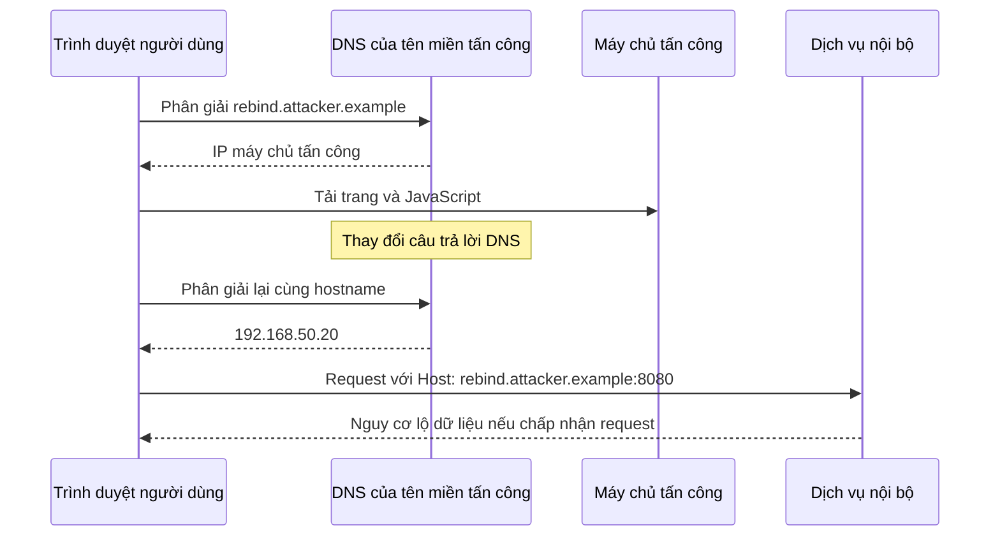

# DNS rebinding defense

## 1. Mục tiêu và phạm vi bài học

Trong chương **Communication security**, phòng vệ DNS rebinding là bài toán giữ đúng ranh giới tin cậy khi một tên miền có thể trỏ tới những địa chỉ khác nhau theo thời gian. Yêu cầu “chỉ cho phép tên miền hợp lệ” chưa mô tả được hệ thống sẽ kết nối tới đâu, dịch vụ nào sẽ chấp nhận request và dữ liệu nào có thể bị lộ.

Trong phạm vi module **SECURITY_SECURITY_DESIGN_SECURITY_REQUIREMENTS**, bài học chuyển mối đe dọa này thành yêu cầu bảo mật cụ thể, đo được và có bằng chứng kiểm thử. Hai bề mặt được xem xét là:

- **Dịch vụ nhận request:** giao diện quản trị, API nội bộ hoặc agent chạy trên máy người dùng, có thể bị trình duyệt truy cập qua tên miền của kẻ tấn công.
- **Thành phần gửi request:** chức năng tải URL, tạo preview hoặc gửi webhook, có thể bị lợi dụng để truy cập một đích khác sau bước kiểm tra DNS.

Sau bài học, người học cần mô tả được đường tấn công, xác định tài sản và ranh giới tin cậy, đặc tả kiểm soát tại đúng vị trí, rồi liên kết từng yêu cầu với tiêu chí nghiệm thu. Các mã yêu cầu, ngưỡng và cấu hình dưới đây là ví dụ thiết kế cho bài học; khi áp dụng phải điều chỉnh theo kiến trúc và mức rủi ro của hệ thống.

## 2. DNS rebinding hoạt động như thế nào?

### 2.1. Tên miền giữ nguyên nhưng địa chỉ thay đổi

Với origin HTTP(S) thông thường, trình duyệt xác định origin bằng bộ ba **scheme, hostname, port**. Địa chỉ IP sau phân giải DNS không phải thành phần của bộ ba này. Hai lần truy cập cùng `http://rebind.attacker.example:8080` có thể giữ nguyên origin dù kết nối mạng đi tới hai địa chỉ khác nhau. Khái niệm origin được mô tả trong [RFC 6454](https://www.rfc-editor.org/rfc/rfc6454.html).

Một kịch bản khái niệm:

1. Người dùng mở trang tại `http://rebind.attacker.example:8080`; tên miền ban đầu trỏ tới máy chủ do bên tấn công kiểm soát.
2. Trang tải mã JavaScript. Sau đó, câu trả lời DNS cho cùng hostname thay đổi thành địa chỉ của một dịch vụ nội bộ, chẳng hạn `192.168.50.20`.
3. Khi trình duyệt thực hiện kết nối mới sau một lần phân giải lại, request có thể đi tới dịch vụ nội bộ nhưng vẫn mang authority `rebind.attacker.example:8080`.
4. Nếu dịch vụ chấp nhận authority tùy ý và thiếu kiểm soát truy cập phù hợp, mã từ trang độc hại có thể đọc dữ liệu hoặc thực hiện thao tác trên dịch vụ đó.



Đây là đường tấn công có điều kiện. Cần có khả năng tiếp cận dịch vụ, cổng và giao thức phù hợp, một lần kết nối hoặc phân giải lại, cùng các điểm yếu ở đích. TTL thấp không bảo đảm trình duyệt đổi IP ngay: cache, kết nối đang mở, chính sách trình duyệt và kiểm soát mạng đều có thể ngăn hoặc làm thay đổi kết quả.

### 2.2. Không đồng nhất với DNS spoofing

Trong DNS rebinding, bên tấn công có thể sở hữu hợp lệ tên miền và thay đổi bản ghi của chính mình. Không nhất thiết phải giả mạo câu trả lời từ resolver hay chiếm DNS của nạn nhân.

DNSSEC cung cấp xác thực nguồn và tính toàn vẹn dữ liệu DNS theo [RFC 4033](https://www.rfc-editor.org/rfc/rfc4033.html). Từ đó suy ra: một bản ghi được ký hợp lệ vẫn có thể trỏ tới địa chỉ mà ứng dụng không được phép truy cập. Xác thực bản ghi không thay thế chính sách cho địa chỉ đích.

### 2.3. Biến thể phía máy chủ: khoảng trống giữa kiểm tra và sử dụng

Một chức năng tải ảnh có thể thực hiện chuỗi sau:

```text
Kiểm tra URL
    -> phân giải hostname thành IP được phép
    -> thông qua kiểm tra
    -> gọi HTTP client bằng hostname ban đầu
    -> HTTP client phân giải lại thành IP nội bộ
    -> kết nối tới IP chưa được kiểm tra
```

Đây là lỗi **time-of-check to time-of-use (TOCTOU)**: địa chỉ được kiểm tra và địa chỉ được sử dụng không còn là cùng một đối tượng. DNS rebinding có thể hỗ trợ SSRF, nhưng không phải mọi SSRF đều cần rebinding; một URL trỏ thẳng tới loopback cũng có thể đủ nếu hệ thống không có chính sách đích.

Điểm kiểm soát phải gắn với kết nối thực tế. [OWASP SSRF Prevention Cheat Sheet](https://cheatsheetseries.owasp.org/cheatsheets/Server_Side_Request_Forgery_Prevention_Cheat_Sheet.html) nhấn mạnh việc kết nối tới địa chỉ đã được xác thực, kể cả khi có retry hoặc fallback.

## 3. Mô hình đe dọa trước khi viết yêu cầu

### 3.1. Tài sản, chủ thể và giả định

| Thành phần | Tài sản hoặc quyền cần bảo vệ | Giả định cần xác minh |
| --- | --- | --- |
| Agent trên máy người dùng | Tệp cục bộ, lệnh điều khiển, token phiên | Website bên ngoài có thể khiến trình duyệt thử kết nối tới agent |
| Console nội bộ | Cấu hình hệ thống, tài khoản quản trị | “Nằm trong LAN” không có nghĩa mọi request đều đáng tin |
| URL fetcher | Danh tính workload và khả năng truy cập mạng | Người dùng có thể ảnh hưởng URL hoặc tên miền đích |
| DNS, proxy và HTTP client | Quyết định tên miền đi tới địa chỉ nào | Các thành phần có thể phân giải tên ở những thời điểm khác nhau |
| Nền tảng vận hành | Chính sách mạng và cấu hình allowlist | Cấu hình có thể bị thiếu hoặc sai sau triển khai, khôi phục |

Kẻ tấn công trong mô hình có thể kiểm soát tên miền, câu trả lời DNS, trang web và phản hồi redirect của mình. Không giả định họ đã có quyền quản trị, đọc được token bí mật hay sửa cấu hình firewall; nếu các khả năng đó tồn tại, cần bổ sung đường tấn công tương ứng.

### 3.2. Các rủi ro cần truy vết

| Mã rủi ro | Đường tấn công | Hậu quả |
| --- | --- | --- |
| R-01 | Trình duyệt gọi dịch vụ nội bộ bằng hostname bên tấn công | Đọc cấu hình, điều khiển agent, thay đổi dữ liệu |
| R-02 | URL được kiểm tra bằng một IP, kết nối bằng IP khác | SSRF tới dịch vụ nội bộ hoặc metadata của môi trường cloud |
| R-03 | Redirect, retry hoặc IPv6 fallback vượt qua kiểm tra ban đầu | Vượt chính sách dù luồng chính đã có kiểm tra |
| R-04 | Proxy tin header do client gửi hoặc route mặc định nhận mọi Host | Bỏ qua chốt kiểm soát ở biên |
| R-05 | Triển khai hoặc khôi phục làm mất allowlist và egress policy | Lỗ hổng xuất hiện lại sau sự cố vận hành |

Ranh giới cần làm rõ gồm website bên ngoài với dịch vụ cục bộ, proxy với ứng dụng, bộ phân giải với lớp tạo socket, và URL fetcher với các mạng chứa dữ liệu nhạy cảm. Mỗi ranh giới cần một chủ thể chịu trách nhiệm thực thi; ghi chung “hạ tầng sẽ xử lý” không đủ để nghiệm thu.

## 4. Chuyển mục tiêu thành đặc tả có thể kiểm chứng

Một yêu cầu hữu ích phải trả lời được: **thành phần nào**, **trong điều kiện nào**, **phải làm gì**, **từ chối ra sao** và **chứng minh bằng cách nào**.

Ví dụ còn mơ hồ:

> Hệ thống phải chống DNS rebinding và sử dụng DNS an toàn.

Ví dụ có thể nghiệm thu:

> Mọi request HTTP tới console phải được kiểm tra authority bằng danh sách hostname và cổng cấu hình trước. Request không khớp phải bị từ chối trước khi chạy handler nghiệp vụ, không trả dữ liệu cấu hình và không tạo thay đổi trạng thái. Kiểm thử bao gồm cả truy cập qua proxy và truy cập trực tiếp backend nếu đường đó tồn tại.

Đối với fetcher, một bất biến khác cần được nêu rõ:

> Mỗi kết nối mới chỉ được gửi dữ liệu tới địa chỉ đích đã được đánh giá theo phiên bản chính sách hiện hành. Nếu phân giải lại, đổi đích hoặc thử địa chỉ dự phòng, quyết định cho phép phải được thực hiện lại trước khi gửi request.

Một hồ sơ yêu cầu nên có mã định danh, rủi ro liên quan, phạm vi endpoint, owner triển khai, tiêu chí pass/fail và bằng chứng. Không dùng một cờ cấu hình làm bằng chứng duy nhất cho hành vi của toàn bộ đường truyền.

## 5. Yêu cầu cho dịch vụ nhận request

### DR-IN-01 — Chỉ chấp nhận authority được cấu hình

**Yêu cầu:** Gateway và ứng dụng phải có danh sách authority hợp lệ cho từng listener. Với HTTP/1.1, kiểm tra `Host`; với HTTP/2 hoặc HTTP/3, kiểm tra authority theo cách framework tiếp nhận và chuẩn hóa request. Không mặc định nhận mọi hostname chỉ vì địa chỉ socket là nội bộ.

Ví dụ danh sách của console trong môi trường thử nghiệm là `console.corp.example:8443`. Danh sách này phải đến từ cấu hình tin cậy, không được tự xây từ `Host`, `Origin`, reverse DNS hoặc một header do client gửi.

**Quy tắc chấp nhận:** Chuẩn hóa hostname, cổng mặc định và cách biểu diễn IPv6 theo parser đã chọn. Từ chối authority thiếu, không hợp lệ hoặc mâu thuẫn; không so sánh bằng tìm chuỗi con. Nếu cho phép wildcard, phải đặc tả ranh giới nhãn DNS và lý do cần wildcard; ưu tiên tên chính xác.

**Tiêu chí nghiệm thu:** Gửi request với `rebind.attacker.example:8443`, tên gần giống tên hợp lệ và authority mâu thuẫn. Tất cả phải bị từ chối trước handler nghiệp vụ. Mã lỗi có thể là `400`, `403` hoặc `421` theo giao thức và thiết kế; bài kiểm tra phải xác nhận không có dữ liệu nhạy cảm hoặc tác dụng phụ.

### DR-IN-02 — Xác thực và phân quyền độc lập với vị trí mạng

**Yêu cầu:** API nhạy cảm phải yêu cầu danh tính hợp lệ và kiểm tra quyền cho từng hành động, kể cả khi request đến từ loopback, LAN hoặc proxy nội bộ. Không coi địa chỉ nguồn nội bộ là bằng chứng người dùng đã được phép quản trị.

Đối với local agent, có thể thiết kế luồng ghép đôi với ứng dụng tin cậy, token ngẫu nhiên được giữ ngoài trang web không tin cậy và phạm vi quyền theo thao tác. Cơ chế cụ thể phải phù hợp sản phẩm; một token cố định công khai trong bundle JavaScript không tạo ranh giới bảo mật.

**Tiêu chí nghiệm thu:** Request có authority hợp lệ nhưng thiếu danh tính phải thất bại; danh tính chỉ có quyền đọc không được đổi cấu hình. Kiểm tra cả endpoint đọc dữ liệu nhạy cảm và endpoint ghi. Việc trình duyệt không gửi được cookie của tên miền console qua tên miền tấn công không cho phép bỏ qua kiểm tra quyền ở API.

### DR-IN-03 — Kiểm soát nguồn khởi tạo và thao tác có trạng thái

**Yêu cầu:** Endpoint dành cho trình duyệt phải có chính sách `Origin` rõ ràng và biện pháp chống CSRF phù hợp khi sử dụng cookie phiên. Origin cho phép phải được cấu hình độc lập; phép so sánh `Origin.host == Host` không đủ vì trong kịch bản rebinding cả hai có thể cùng là tên miền bên tấn công.

Không phải mọi request đều có header `Origin`. Với trường hợp thiếu hoặc giá trị `null`, phải xác định hành vi theo hợp đồng endpoint. Ví dụ, API quản trị chỉ cho UI trình duyệt sử dụng có thể từ chối trường hợp đó; một API máy với máy được thiết kế riêng có thể dùng xác thực dịch vụ thay thế. Không tạo ngoại lệ chung “thiếu Origin thì cho qua”.

Thao tác thay đổi trạng thái không được thực hiện bằng GET. WebSocket phục vụ trình duyệt phải kiểm tra authority, origin và xác thực tại handshake, sau đó kiểm tra quyền đối với thông điệp. Cấu hình CORS cho HTTP không tự trở thành chính sách bảo vệ WebSocket.

**Tiêu chí nghiệm thu:** Thử origin lạ, thiếu origin, `Origin: null`, phiên thiếu CSRF token và WebSocket handshake trái chính sách. Với từng endpoint, kết quả phải phù hợp hợp đồng đã ghi và không thực hiện hành động trái phép.

### DR-IN-04 — Giữ chuỗi tin cậy qua TLS và reverse proxy

**Yêu cầu:** Console và API quản trị qua mạng phải dùng TLS với danh tính dịch vụ được quản lý phù hợp. Client phải xác minh chứng thư theo hostname dự kiến; không tắt kiểm tra chứng thư để giải quyết lỗi cấu hình. Trong kịch bản HTTPS, đích mới thường không có chứng thư hợp lệ cho hostname của bên tấn công, nên kiểm tra TLS đúng có thể chặn kết nối đó.

Nếu TLS kết thúc ở reverse proxy, proxy phải thực thi chính sách authority và bảo vệ đường tới backend. Backend chỉ tin các header forwarded từ proxy được xác định; proxy phải loại bỏ hoặc ghi đè giá trị do client tự gửi. Listener hoặc virtual host mặc định phải từ chối authority ngoài danh sách thay vì route vào console.

**Tiêu chí nghiệm thu:** Kiểm tra tên chứng thư không khớp, truy cập backend trực tiếp, request với `X-Forwarded-Host` giả và trường hợp proxy đã ghi đè Host. Nếu proxy làm mất authority ban đầu, nó phải đã kiểm tra giá trị đó trước khi ghi đè; cấu hình backend đơn độc không chứng minh được bước này.

## 6. Yêu cầu cho thành phần gửi request

### DR-OUT-01 — Định nghĩa đích được phép trước khi phân giải

**Yêu cầu:** Mỗi tính năng phải có chính sách scheme, hostname, cổng và loại mạng đích. Nếu nghiệp vụ chỉ gọi một tập đối tác, dùng allowlist cụ thể. Nếu nghiệp vụ buộc phải tải URL công khai bất kỳ, ghi nhận rủi ro cao hơn và thiết kế một fetcher cô lập với quyền mạng tối thiểu.

Ví dụ profile `PUBLIC_PREVIEW` chỉ cho HTTPS trên cổng 443, không cho user-info trong URL, không dùng credential nội bộ và không cho truy cập mạng quản trị. Đây là lựa chọn của ví dụ, không phải quy tắc bắt buộc cho mọi ứng dụng.

**Tiêu chí nghiệm thu:** URL sai scheme, sai cổng hoặc chứa dạng địa chỉ mà parser và HTTP client hiểu khác nhau phải bị từ chối. Cùng một cách chuẩn hóa phải được dùng cho kiểm tra chính sách và tạo request.

### DR-OUT-02 — Đánh giá địa chỉ theo chính sách mạng đầy đủ

**Yêu cầu:** Phải phân loại địa chỉ sau phân giải, bao gồm IPv4 và IPv6. Profile chỉ truy cập Internet không được hiểu “không thuộc RFC 1918” là “được phép”. Chính sách phải xét loopback, link-local, unspecified, multicast, các dải đặc biệt, mạng riêng của tổ chức và endpoint metadata trong môi trường triển khai.

Đầu vào dạng IPv4-mapped IPv6, ví dụ `::ffff:127.0.0.1`, phải được phân loại theo địa chỉ nhúng phù hợp. Các cách ghi địa chỉ không chuẩn phải bị từ chối hoặc chuẩn hóa nhất quán trước so sánh; không dùng regex tự viết làm bộ phân loại IP.

Các registry [IPv4 special-purpose](https://www.iana.org/assignments/iana-ipv4-special-registry) và [IPv6 special-purpose](https://www.iana.org/assignments/iana-ipv6-special-registry) của IANA là đầu vào tham khảo cho dữ liệu phân loại. Chúng không mô tả mạng riêng, route, NAT hay quyền truy cập của tổ chức; owner hạ tầng phải bổ sung những phần đó.

Đối với profile minh họa, nếu tập địa chỉ cuối cùng sau phân giải alias/CNAME có cả địa chỉ cho phép và bị cấm thì từ chối toàn bộ kết quả. Đây là lựa chọn bảo thủ để giảm phụ thuộc vào thuật toán chọn IP. Thiết kế khác có thể chỉ dùng tập IP được phép, nhưng phải chứng minh client không bao giờ fallback sang phần đã loại.

**Tiêu chí nghiệm thu:** Bộ dữ liệu kiểm tra có A/AAAA trộn, alias dẫn tới mạng cấm, loopback, địa chỉ nhúng và dải mạng tổ chức. Kết quả không phụ thuộc thứ tự câu trả lời DNS.

### DR-OUT-03 — Gắn địa chỉ được kiểm tra với kết nối thực tế

**Yêu cầu:** Lớp tạo kết nối phải sử dụng đúng địa chỉ đã được xác thực. Không gọi `resolve(host)` để kiểm tra rồi giao lại `host` cho một client có thể phân giải độc lập.

Khi kết nối tới IP đã chọn, vẫn phải giữ hostname ban đầu cho HTTP authority, TLS SNI và xác minh chứng thư. Thay URL HTTPS bằng URL chứa IP rồi tắt kiểm tra hostname làm mất một kiểm soát bảo mật khác. [libcurl `CURLOPT_RESOLVE`](https://curl.se/libcurl/c/CURLOPT_RESOLVE.html) là một ví dụ cơ chế cung cấp ánh xạ hostname–port–IP cho client; nó không tự tạo chính sách địa chỉ cho ứng dụng.

Quyết định phải bao phủ mọi địa chỉ thực sự được thử. Nếu client dùng proxy phân giải từ xa, proxy đó phải thực thi cùng ranh giới đích hoặc nhận một giao thức kết nối có ràng buộc tương đương. Ứng dụng phân giải trước rồi để proxy tự phân giải lại không đáp ứng yêu cầu này.

**Tiêu chí nghiệm thu:** Dùng resolver kiểm thử trả IP được phép ở lần đầu và IP cấm ở lần sau. Quan sát kết nối mạng phải chứng minh không có dữ liệu ứng dụng gửi tới đích cấm. Client hoặc dùng đúng IP đã kiểm tra, hoặc kiểm tra lại và từ chối trước khi gửi.

### DR-OUT-04 — Bao phủ redirect, retry và vòng đời kết nối

**Yêu cầu:** Tắt tự động theo redirect nếu tính năng không cần. Nếu cần, mỗi hop phải quay lại quy trình kiểm tra URL, phân giải, phân loại và ràng buộc kết nối. Đặt giới hạn hữu hạn cho số hop; không chuyển credential, cookie nội bộ hoặc token tới authority mới ngoài hợp đồng cho phép.

Retry, fallback giữa IPv4/IPv6, kết nối mới sau lỗi và thay đổi do discovery đều phải tuân thủ cùng chính sách. Connection pool phải gắn kết nối với đúng authority và ngữ cảnh chính sách; nếu chính sách thay đổi để thu hồi một đích, cần cơ chế đóng hoặc loại bỏ kết nối không còn hợp lệ trước khi tiếp tục sử dụng.

**Tiêu chí nghiệm thu:** Kiểm tra redirect tới mạng cấm, redirect sang scheme cấm, IPv4 lỗi rồi fallback sang IPv6 cấm, cùng retry sau khi DNS đổi. Không có nhánh nào được gửi request tới đích ngoài chính sách.

### DR-OUT-05 — Giới hạn thiệt hại ở mạng và dữ liệu

**Yêu cầu:** Workload thực hiện fetch phải có egress tối thiểu, không có đường truy cập không cần thiết tới control plane, database và metadata. Khi nghiệp vụ cần gọi dịch vụ nội bộ, dùng một profile hoặc connector riêng với đích và danh tính cụ thể; không mở quyền mạng nội bộ cho toàn bộ URL do người dùng cung cấp.

Đặt giới hạn thời gian, kích thước phản hồi và đồng thời theo nhu cầu tính năng. Không chuyển nguyên phản hồi nhạy cảm từ mạng nội bộ về người nhập URL. Chính sách mạng phải bao phủ cả IPv4 lẫn IPv6 và thực tế định tuyến của môi trường.

**Tiêu chí nghiệm thu:** Khi mô phỏng lỗi kiểm tra ở ứng dụng trong môi trường cô lập, lớp egress vẫn ngăn truy cập tài sản đã xác định. Bằng chứng bao gồm kết quả quan sát ở đích và chính sách mạng được triển khai, không chỉ một lỗi timeout ở client.

## 7. Mã giả thể hiện ranh giới thực thi

### 7.1. Luồng nhận request của console

```text
handleAdministrativeRequest(request, trustedConnectionContext):
    authority = parseEffectiveAuthorityStrictly(
        request,
        trustedConnectionContext
    )
    require authority in configuredAuthoritiesForThisListener

    if endpointIsBrowserOnly(request.endpoint):
        origin = parseOriginUsingEndpointContract(request)
        require origin in configuredBrowserOrigins

    identity = authenticate(request)
    require authorize(identity, request.action, request.resource)

    if usesCookieSession(request) and changesState(request):
        require validCsrfProtection(request)

    executeBusinessHandler(request)
```

Đây là mã giả để thảo luận yêu cầu, không phải middleware có thể sao chép trực tiếp. `trustedConnectionContext` phải phân biệt kết nối từ proxy được tin và kết nối trực tiếp; không đơn thuần đọc `X-Forwarded-Host`. Với endpoint đọc thông tin nhạy cảm, các bước authority, xác thực và phân quyền vẫn bắt buộc dù không có thay đổi trạng thái.

### 7.2. Luồng fetch URL công khai

```text
fetchPublicResource(inputUrl, policy):
    url = parseAndNormalizeStrictly(inputUrl)

    for hop from 0 to policy.maxRedirects:
        require policy.permitsUrl(url)

        addresses = resolveFinalAddressesOrParseIpLiteral(url.host)
        require addresses is not empty
        require every address is permitted by policy

        response = transport.requestUsingOnlyValidatedAddresses(
            url = url,
            addresses = addresses,
            tlsPeerName = url.host,
            authority = url.authority,
            automaticRedirects = false,
            uncheckedResolutionOrFallback = false,
            credentials = credentialsAllowedForThisExactTarget(url)
        )

        if response is not redirect:
            return consumeWithinLimits(response, policy)

        require hop < policy.maxRedirects
        url = resolveRedirectAgainstCurrentUrl(response.location, url)

    reject("redirect_limit")
```

Hợp đồng của `requestUsingOnlyValidatedAddresses` là phần quyết định: nó phải kiểm soát cả lần thử đầu, retry và fallback. Nếu thư viện đang dùng không cung cấp khả năng đó, thiết kế cần một lớp transport khác hoặc egress proxy thực thi chính sách. Đặt tên hàm an toàn không chứng minh được hành vi an toàn.

Nếu dùng pool, proxy, NAT hoặc cơ chế chuyển đổi địa chỉ, cần ghi rõ lớp nào nhìn thấy địa chỉ đích có ý nghĩa đối với chính sách. Kiểm tra peer sau khi đã gửi request chỉ có ích cho phát hiện; bí mật hoặc lệnh có thể đã tới đích, nên đó không phải điểm ngăn chặn đạt yêu cầu.

## 8. Những biện pháp dễ bị hiểu quá mức

| Biện pháp | Vai trò phù hợp | Khoảng trống phải ghi nhận |
| --- | --- | --- |
| CORS | Kiểm soát việc trang khác origin đọc phản hồi theo cơ chế trình duyệt | Rebinding có thể giữ nguyên origin; một số request vẫn có thể được gửi dù trang không đọc được phản hồi |
| Kiểm tra `Origin` | Giới hạn nguồn khởi tạo cho endpoint trình duyệt | Không thay thế authority, xác thực và phân quyền; phải có hợp đồng cho request thiếu header |
| DNSSEC | Xác thực dữ liệu DNS và tính toàn vẹn | Chủ sở hữu tên miền vẫn có thể công bố IP không được phép |
| DNS filtering | Chặn một số câu trả lời DNS ngoài chính sách của mạng | Không bảo đảm mọi client đều dùng resolver đó và không thay kiểm soát ở kết nối |
| TTL hoặc DNS cache | Ảnh hưởng thời điểm phân giải và hiệu năng | Không phải hợp đồng bảo mật gắn kiểm tra với kết nối |
| Chỉ bind loopback | Thu hẹp phạm vi tiếp cận trực tiếp qua mạng | Trình duyệt chạy trên cùng máy vẫn cần được xét trong mô hình đe dọa |
| HTTPS xác minh đúng | Bảo vệ kênh và xác thực hostname đích | Không tự quyết định URL hay mạng đích nào được nghiệp vụ cho phép |
| Kiểm tra IP private IPv4 | Chặn một phần đích nội bộ | Bỏ sót IPv6, loopback, link-local, metadata và mạng tổ chức dùng dải khác |
| Chỉ kiểm tra ở gateway | Chặn request trên đường đi qua gateway | Không bao phủ backend hoặc listener còn truy cập được qua đường khác |

Một số trình duyệt còn có cơ chế kiểm soát truy cập mạng cục bộ. [Tài liệu Local Network Access của Chrome](https://developer.chrome.com/docs/modern-web-guidance/guides/security/local-network-access) mô tả cơ chế quyền liên quan. Khi đặc tả môi trường hỗ trợ, phải ghi phiên bản, cấu hình và trạng thái quyền thực tế, rồi kiểm thử trên tổ hợp đó. Không lấy một lần trình duyệt chặn request làm bằng chứng rằng dịch vụ đã thực thi authority hoặc fetcher đã chặn SSRF.

## 9. Ma trận truy vết từ rủi ro tới bằng chứng

| Yêu cầu | Rủi ro chính | Nơi thực thi | Bằng chứng nghiệm thu |
| --- | --- | --- | --- |
| DR-IN-01 | R-01, R-04 | Gateway, listener và ứng dụng | Request authority lạ bị chặn trước handler trên mọi đường vào |
| DR-IN-02 | R-01 | Middleware và tầng nghiệp vụ | Kiểm thử thiếu danh tính, sai quyền và sai phạm vi tài nguyên |
| DR-IN-03 | R-01 | API trình duyệt, WebSocket handshake | Kết quả theo hợp đồng Origin/CSRF, không có tác dụng phụ |
| DR-IN-04 | R-01, R-04 | TLS termination, reverse proxy, backend | Kiểm thử TLS và giả mạo forwarded header; xác nhận đường trực tiếp |
| DR-OUT-01 | R-02 | Parser và policy engine | Bộ URL bị từ chối hoặc chấp nhận đúng profile |
| DR-OUT-02 | R-02, R-03 | Resolver và bộ phân loại địa chỉ | Bộ A/AAAA, alias, địa chỉ nhúng và dải tổ chức |
| DR-OUT-03 | R-02 | Transport hoặc egress proxy | Log kết nối và quan sát đích khi DNS thay đổi giữa các lần gọi |
| DR-OUT-04 | R-03 | Redirect handler, retry, connection pool | Redirect/fallback/retry không gửi request tới đích cấm |
| DR-OUT-05 | R-02, R-03 | Mạng workload và xử lý phản hồi | Đích nội bộ không nhận request khi lớp ứng dụng bị mô phỏng lỗi |
| DR-OPS-01, DR-OPS-02 | R-05 | Logging, triển khai và khôi phục | Log đã lọc dữ liệu, kiểm thử cấu hình thiếu và diễn tập phục hồi |

Mỗi dòng cần owner cụ thể trong dự án thực tế. Nếu nhóm ứng dụng chịu trách nhiệm Host nhưng nhóm nền tảng ghi đè Host ở proxy, hai nhóm phải thống nhất bằng chứng cho cả chuỗi; không thể chỉ ghép hai cấu hình riêng lẻ rồi coi như đã đạt.

## 10. Thiết kế bộ kiểm thử có khả năng phân biệt đúng và sai

### 10.1. Môi trường và cách quan sát

Thực hiện trong mạng thử nghiệm được kiểm soát. Chuẩn bị một DNS có thể lập trình câu trả lời, một đích được phép và một dịch vụ mồi thuộc mạng bị cấm. Dịch vụ mồi chỉ ghi nhận kết nối/request thử nghiệm; không sử dụng metadata thật hoặc tài sản sản xuất.

Đối với trình duyệt, ghi nhận cả cache, kết nối đang mở, chính sách mạng và trạng thái quyền của phiên bản đang kiểm tra. Một phép thử không khiến trình duyệt phân giải lại chưa kiểm tra được khả năng xử lý rebinding của dịch vụ. Bổ sung kiểm thử authority trực tiếp để chứng minh chốt ở server độc lập với hành vi trình duyệt.

Đối với fetcher, dùng resolver/transport kiểm thử có thể điều khiển thứ tự sự kiện thay vì chỉ chờ TTL. Quan sát ở cả client, đích được phép và dịch vụ mồi. Không xem thông báo “fetch failed” là bằng chứng không có request nào đã rời máy.

### 10.2. Các ca kiểm thử cốt lõi

| Mã | Thiết lập | Điều kiện pass |
| --- | --- | --- |
| T-01 | Request hợp lệ: authority, danh tính và quyền đều đúng | Tác vụ được phép thành công, chứng minh hệ thống vẫn phục vụ nghiệp vụ |
| T-02 | Request tới console bằng hostname bên tấn công | Bị chặn trước handler; không trả dữ liệu hoặc thay đổi trạng thái |
| T-03 | Origin và Host đều là tên miền bên tấn công | Không vượt kiểm tra nhờ việc hai header giống nhau |
| T-04 | Host hợp lệ nhưng thiếu danh tính hoặc thiếu quyền | Bị từ chối theo chính sách truy cập |
| T-05 | Giả mạo forwarded header và thử đường backend trực tiếp | Không bỏ qua kiểm soát authority hoặc xác thực |
| T-06 | DNS lần đầu trả IP cho phép, lần sau trả IP cấm | Transport không gửi dữ liệu tới IP cấm |
| T-07 | Tập A/AAAA gồm cả địa chỉ cho phép và bị cấm | Theo profile minh họa, từ chối trước khi gửi request |
| T-08 | Alias/CNAME kết thúc ở loopback, link-local hoặc mạng tổ chức | Phân loại theo địa chỉ cuối và từ chối đúng chính sách |
| T-09 | Redirect từ đích cho phép sang mạng hoặc scheme bị cấm | Dừng trước request ở hop bị cấm; không rò credential |
| T-10 | Kết nối IPv4 lỗi, IPv6 dự phòng thuộc mạng cấm | Không có fallback chưa được xác thực |
| T-11 | URL chứa IPv4-mapped IPv6 hoặc cách ghi không được hỗ trợ | Chuẩn hóa rồi áp dụng đúng chính sách, hoặc từ chối nhất quán |
| T-12 | HTTP proxy có resolver riêng và câu trả lời DNS thay đổi | Proxy không tạo đường đi tới đích cấm sau kiểm tra ở ứng dụng |
| T-13 | Endpoint trình duyệt thiếu/null Origin, thiếu CSRF hoặc WebSocket origin lạ | Hành vi khớp hợp đồng endpoint, không có thao tác trái phép |
| T-14 | Thu hồi một đích khi pool đang có kết nối hoặc cấu hình bị thiếu | Không tiếp tục gửi tới đích đã thu hồi; cấu hình thiếu không mở quyền |
| T-15 | Dịch vụ được khôi phục từ bản cấu hình chuẩn | Authority, egress, TLS và các ca từ chối quan trọng vẫn đạt |

Một báo cáo nghiệm thu cần ghi phiên bản build, profile chính sách, môi trường, kết quả từng ca, quan sát ở đích và giới hạn còn lại. Với T-06, kết nối tới IP công khai đã được kiểm tra vẫn có thể hợp lệ dù DNS sau đó đổi; điều kiện cần chứng minh là không sử dụng địa chỉ mới chưa được cho phép.

## 11. Logging, phát hiện và phục hồi

### DR-OPS-01 — Ghi nhận quyết định mà không tạo rò rỉ mới

**Yêu cầu:** Sự kiện từ chối phải có mã yêu cầu, tính năng, mã lý do, phiên bản chính sách và trường đích đã được chuẩn hóa theo nhu cầu điều tra. Với fetcher, có thể ghi loại mạng, IP đích hoặc dấu định danh phù hợp chính sách dữ liệu; dữ liệu vận hành này cần quyền truy cập và thời hạn lưu xác định.

Không ghi nguyên URL có query chứa token, header `Authorization`, cookie hoặc nội dung phản hồi nhạy cảm. Giới hạn độ dài và xử lý ký tự điều khiển trong dữ liệu do client cung cấp để tránh giả mạo log. Khi có sampling/rate limit, giữ bộ đếm tổng và tín hiệu cho hành vi từ chối bất thường.

Ví dụ sự kiện tối giản:

```json
{
  "event": "outbound_destination_denied",
  "requirementId": "DR-OUT-03",
  "feature": "public-preview",
  "requestId": "req-lab-042",
  "reason": "resolved_destination_not_permitted",
  "destinationClass": "loopback",
  "policyVersion": "preview-policy-7"
}
```

**Tiêu chí nghiệm thu:** Ca thử bị chặn tạo được sự kiện có thể truy vết nhưng không chứa token mồi đặt trong URL hoặc header. Nhóm vận hành xác định được thành phần ra quyết định và phiên bản cấu hình đang có hiệu lực.

### DR-OPS-02 — Không mở quyền khi triển khai hoặc khôi phục lỗi

**Yêu cầu:** Allowlist, chính sách egress và cấu hình proxy phải được quản lý phiên bản. Nếu cấu hình bảo mật bắt buộc bị thiếu hoặc không hợp lệ, listener quản trị hoặc tính năng fetch tương ứng phải dừng phục vụ theo thiết kế fail-closed; không tự chuyển sang wildcard hoặc cho phép mọi mạng.

Khi có dấu hiệu khai thác, runbook cần xác định cách cô lập tính năng, bảo toàn bằng chứng, kiểm tra endpoint đã bị tiếp cận và xử lý credential có khả năng lộ. Sau sửa lỗi, loại bỏ kết nối pool không còn phù hợp, triển khai chính sách đã xác minh và chạy lại các ca từ chối quan trọng trước khi mở lại tính năng.

**Tiêu chí nghiệm thu:** Diễn tập xóa cấu hình trong môi trường thử nghiệm khiến đúng tính năng ngừng theo hợp đồng. Khôi phục từ cấu hình chuẩn phải vượt T-01, T-02, T-06, T-09 và kiểm tra egress. Thời gian khôi phục và mức gián đoạn cần theo mục tiêu của dịch vụ, không tự coi việc nới chính sách là giải pháp phục hồi.

## 12. Tình huống áp dụng: local agent và chức năng preview

Một sản phẩm có local agent để đọc dữ liệu trên máy người dùng, đồng thời có backend tải URL để tạo preview. Yêu cầu ban đầu là “chỉ dùng trong nội bộ và bật CORS”. Hai tính năng cần hai chuỗi kiểm soát riêng:

**Local agent:** xác định listener và authority hợp lệ; yêu cầu ghép đôi/xác thực; kiểm tra quyền đọc hoặc thực thi; đặc tả origin của UI tin cậy và xử lý CSRF nếu dùng cookie; bảo vệ WebSocket nếu có. Bằng chứng chính là request mang hostname của bên tấn công bị chặn dù trình duyệt có thể tiếp cận agent. Ràng buộc chỉ lắng nghe loopback giúp giảm bề mặt nhưng vẫn cần kiểm thử từ trình duyệt trên cùng máy.

**Preview backend:** chạy trong workload không có quyền mạng quản trị; chỉ chấp nhận profile URL đã định; phân giải và phân loại cả IPv4/IPv6; buộc transport dùng địa chỉ đã kiểm tra; kiểm tra từng hop, retry và fallback. Bằng chứng chính là dịch vụ mồi ở mạng cấm không nhận request khi DNS đổi sau bước kiểm tra.

Nếu một trong hai tính năng cần ngoại lệ, hồ sơ phải ghi phạm vi endpoint, đích được phép, owner, thời hạn xem xét và kiểm soát bù. Ngoại lệ “tin mọi tên miền nội bộ” không xác định được đích và không có tiêu chí kiểm thử hữu ích.

## 13. Bài tập tự kiểm tra

1. Một console kiểm tra `Origin.host == Host` và không yêu cầu đăng nhập vì chỉ chạy trong LAN. Viết hai yêu cầu độc lập để chặn đường rebinding, kèm phép thử chứng minh từng yêu cầu.
2. Một fetcher kiểm tra toàn bộ kết quả DNS nhưng HTTP client tự phân giải lại. Mô tả đúng chỗ phát sinh TOCTOU và bằng chứng mạng cần có để xác nhận bản sửa.
3. Client dùng proxy doanh nghiệp. Nêu thành phần chịu trách nhiệm phân giải và cách chứng minh chính sách địa chỉ vẫn được thực thi ở nơi tạo kết nối.
4. Bản cập nhật đóng lỗi IPv4 nhưng để IPv6 fallback ngoài kiểm soát. Thêm yêu cầu, ca nghiệm thu và owner phù hợp vào ma trận truy vết.
5. Sau phục hồi, console nhận mọi Host vì virtual host mặc định đã thay đổi. Viết tiêu chí triển khai và kiểm thử phục hồi để phát hiện lỗi này trước khi mở dịch vụ.

Kết quả cần đạt của mỗi bài tập là một chuỗi có thể kiểm chứng: **tài sản và rủi ro → yêu cầu cụ thể → điểm thực thi → hành vi từ chối → bằng chứng kiểm thử → owner vận hành**. Chuỗi này giúp yêu cầu phòng vệ DNS rebinding đi cùng thiết kế, triển khai và phục hồi thay vì chỉ tồn tại như một ghi chú trong tài liệu an ninh.
