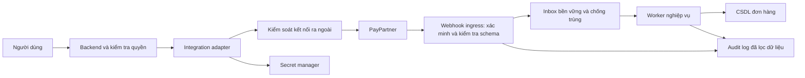

# Third-party integration security — Yêu cầu bảo mật khi tích hợp bên thứ ba

## 1. Mục tiêu và phạm vi

Một tích hợp bên thứ ba mở thêm đường đi cho dữ liệu, quyền truy cập và quyết định nghiệp vụ. Ứng dụng có thể gửi thông tin khách hàng tới dịch vụ chăm sóc khách hàng, gọi nhà cung cấp thanh toán, nhận webhook hoặc cho một đối tác đọc dữ liệu qua API. Mỗi đường đi tạo ra một quan hệ tin cậy cần được giới hạn và kiểm chứng.

Trong chương **Communication security**, bài học này tập trung vào cách biến mục tiêu an toàn thông tin và mô hình đe dọa thành yêu cầu bảo mật cụ thể cho các đường tích hợp. Kết quả cần có là đặc tả mà nhóm kiến trúc, phát triển, kiểm thử và vận hành có thể cùng sử dụng: ai được giao tiếp, được gửi dữ liệu gì, được phép thực hiện hành động nào, kiểm tra bằng cách nào và xử lý ra sao khi niềm tin không còn hợp lệ.

Sau bài học, người học có thể:

- Xác định tài sản, hướng giao tiếp và ranh giới tin cậy của một tích hợp.
- Viết yêu cầu về xác thực, phân quyền, bảo vệ dữ liệu, logging và phục hồi.
- Liên kết mỗi yêu cầu với rủi ro, thành phần thực thi và tiêu chí kiểm thử.
- Xác định bằng chứng cần thu thập trước khi đưa tích hợp vào vận hành và khi thay đổi nhà cung cấp.

Các con số trong ví dụ là **giả định của một hệ thống minh họa**, cần điều chỉnh theo mức độ rủi ro, hợp đồng và hành vi thực tế của nhà cung cấp. Chúng không phải ngưỡng bắt buộc cho mọi hệ thống.

## 2. Nhìn tích hợp như một chuỗi quyết định tin cậy

### 2.1. Phân biệt các hướng giao tiếp

| Hướng tích hợp | Ví dụ | Câu hỏi bảo mật chính |
| --- | --- | --- |
| Hệ thống gọi ra ngoài | Backend gọi API thanh toán | Đang kết nối đúng nhà cung cấp chưa? Có gửi vượt dữ liệu hoặc quyền cần thiết không? |
| Bên ngoài gọi vào | Nhà cung cấp gửi webhook | Ai tạo thông điệp? Thông điệp có bị sửa, phát lại hoặc xử lý lặp không? |
| Đối tác sử dụng API của hệ thống | Đơn vị vận chuyển lấy danh sách đơn | Đối tác được đọc đối tượng nào và cho tenant nào? |
| Người dùng ủy quyền qua nhà cung cấp | Liên kết tài khoản dịch vụ bên ngoài | Quyền cấp có đúng mục đích, thời hạn và người sở hữu tài khoản không? |
| Thư viện hoặc SDK trong tiến trình | SDK gửi telemetry | Mã đó có thể truy cập dữ liệu, secret và mạng nào trong ứng dụng? |

Một API key hợp lệ chỉ chứng minh bên gọi có credential tương ứng. Nó không tự chứng minh rằng bên gọi được sửa một đơn hàng cụ thể. TLS bảo vệ kết nối, nhưng một phản hồi đi qua TLS vẫn có thể chứa dữ liệu sai, trường thừa hoặc giá trị gây nguy hiểm khi ứng dụng sử dụng.

SDK chạy trong tiến trình còn có thể dùng quyền của chính ứng dụng. Vì vậy, yêu cầu giao tiếp an toàn cần đi cùng việc đánh giá dependency, giới hạn dữ liệu và kiểm soát egress; không thể chỉ kiểm tra URL của nhà cung cấp.

### 2.2. Ví dụ xuyên suốt: tích hợp thanh toán

Giả sử nền tảng bán hàng gọi nhà cung cấp PayPartner để tạo phiên thanh toán. PayPartner gửi webhook khi thanh toán thành công. Hệ thống lưu trạng thái đơn hàng và có thể gửi một số thông tin sang dịch vụ chăm sóc khách hàng.

Các tài sản quan trọng gồm:

- Credential tạo thanh toán và hoàn tiền.
- Mã đơn hàng, số tiền, loại tiền, tenant và trạng thái thanh toán.
- Dữ liệu khách hàng được chia sẻ.
- Khả năng xác định một thông báo là hợp lệ và xử lý mỗi tác động nghiệp vụ đúng số lần cho phép.
- Nhật ký đủ để điều tra mà không làm lộ secret hoặc dữ liệu cá nhân.

Ranh giới tin cậy nằm giữa người dùng và backend, backend và PayPartner, PayPartner và điểm nhận webhook, điểm nhận và hàng đợi nội bộ, cũng như giữa các tenant.



Sơ đồ thể hiện nơi đặt biện pháp kiểm soát. Mỗi mũi tên vẫn cần được mô tả bằng danh tính, giao thức, dữ liệu, quyền hạn và hành vi khi lỗi.

### 2.3. Từ đe dọa đến yêu cầu

| Đe dọa | Tác động | Yêu cầu cần hình thành |
| --- | --- | --- |
| Kẻ tấn công giả webhook “đã thanh toán” | Giao hàng khi chưa thu tiền | Xác thực thông điệp, kiểm tra liên kết giao dịch và chỉ chuyển trạng thái hợp lệ |
| Credential bị lấy từ log | Đọc dữ liệu hoặc gọi nghiệp vụ trái phép | Không ghi secret, giới hạn scope, xoay vòng và thu hồi có kiểm chứng |
| Một tenant dùng mã giao dịch của tenant khác | Rò rỉ hoặc sửa dữ liệu chéo tenant | Ánh xạ chủ thể và đối tượng từ dữ liệu tin cậy phía máy chủ |
| Cùng sự kiện được gửi nhiều lần | Hoàn tiền hoặc giao hàng lặp | Khử trùng sự kiện và bảo đảm tác động nghiệp vụ có tính idempotent |
| Nhà cung cấp trả URL do đối tượng khác kiểm soát | SSRF, truy cập tài nguyên nội bộ | Ràng buộc đích kết nối và kiểm tra từng kết nối thực tế |
| Nhà cung cấp ngừng đáp ứng | Cạn tài nguyên và lan truyền lỗi | Timeout, giới hạn đồng thời, retry có ngân sách và đối soát |
| Tài khoản nhà cung cấp bị chiếm quyền | Nhận dữ liệu sai dù chữ ký hợp lệ | Kiểm tra bất biến nghiệp vụ, giới hạn thiệt hại và có khả năng ngắt tích hợp |

Điểm cuối đặc biệt quan trọng: xác thực thành công không có nghĩa mọi nội dung được xác thực đều an toàn hoặc đúng về nghiệp vụ.

## 3. Cấu trúc của một yêu cầu có thể kiểm chứng

Câu “tích hợp phải an toàn” không cho biết phải triển khai hay kiểm thử gì. Một yêu cầu tốt nên nêu:

1. **ID và rủi ro:** yêu cầu xử lý mối đe dọa nào.
2. **Chủ thể, đối tượng và điều kiện:** ai thực hiện, với dữ liệu nào, ở đường giao tiếp nào.
3. **Hành vi bắt buộc:** điều phải làm và trường hợp phải từ chối.
4. **Giới hạn đo được:** thời gian, kích thước, quyền hoặc số lần xử lý.
5. **Điểm thực thi:** adapter, gateway, worker, CSDL hay cấu hình nhà cung cấp.
6. **Tiêu chí chấp nhận và bằng chứng:** kịch bản kiểm thử, cấu hình, log hoặc kết quả diễn tập.
7. **Chủ sở hữu:** nhóm chịu trách nhiệm thực thi, phê duyệt thay đổi và xử lý sự cố.

Ví dụ:

> **TP-WH-01:** Với mọi webhook thay đổi trạng thái thanh toán, ingress phải xác minh chữ ký theo hợp đồng PayPartner trên đúng chuỗi byte được quy định, trước khi ghi nhận sự kiện để xử lý nghiệp vụ. Thông điệp thiếu chữ ký, sai chữ ký hoặc dùng khóa không được chấp nhận phải bị từ chối và không tạo thay đổi trạng thái đơn hàng.

Tiêu chí chấp nhận bao gồm sửa một byte của body, thay timestamp đã ký, thiếu header bắt buộc và dùng khóa đã thu hồi. Với từng trường hợp, cần kiểm tra cả phản hồi ở ingress lẫn việc không phát sinh tác động nghiệp vụ. Chỉ thấy HTTP 4xx chưa chứng minh rằng worker phía sau không xử lý dữ liệu.

Một trường hợp khác:

> **TP-AUTHZ-01:** Credential dành cho tạo phiên thanh toán chỉ được cấp các quyền cần cho chức năng đó. Backend không được dùng credential có quyền hoàn tiền cho đường tạo phiên. Bằng chứng gồm cấu hình quyền tại nhà cung cấp và phép thử gọi nghiệp vụ ngoài phạm vi bằng credential đó.

Nếu nhà cung cấp không hỗ trợ tách quyền, cần ghi rõ hạn chế, đánh giá rủi ro còn lại và xác định biện pháp thay thế. Không ghi “đã áp dụng least privilege” khi chưa có cơ chế thực thi tương ứng.

## 4. Đặc tả yêu cầu theo từng lớp

### 4.1. Đích giao tiếp và bảo vệ đường truyền

Đối với tích hợp server-to-server của ví dụ, đặc tả cần yêu cầu:

- Dùng HTTPS với chính sách TLS được tổ chức phê duyệt; xác minh chuỗi chứng thư và hostname bằng cơ chế của nền tảng.
- Không có cờ bỏ qua xác minh chứng thư trong cấu hình triển khai. Kết nối có chứng thư không hợp lệ phải thất bại.
- Mỗi tích hợp có danh sách đích được cấu hình và kiểm soát thay đổi: scheme, hostname, cổng, và khi cần, đường dẫn hoặc nhóm API.
- Không tự động chuyển credential hoặc header nhạy cảm tới đích redirect mới. Chỉ chấp nhận redirect khi có nhu cầu được đặc tả và đích mới được kiểm tra đầy đủ.
- URL do người dùng, webhook hoặc phản hồi đối tác cung cấp không được mặc nhiên dùng làm đích kết nối.
- Với chức năng bắt buộc tải tài nguyên từ URL, phải kiểm soát địa chỉ mạng thực tế được kết nối, bao gồm IPv4, IPv6 và các lần redirect; ngăn truy cập tài nguyên nội bộ, loopback, link-local hoặc dịch vụ metadata ngoài phạm vi cho phép.
- Kiểm soát egress tại lớp mạng hoặc proxy hỗ trợ ràng buộc đích, để việc kiểm tra ở ứng dụng không trở thành lớp bảo vệ duy nhất.

Kiểm tra chuỗi URL trước khi phân giải DNS là chưa đủ để ngăn việc đích thực tế thay đổi. Thiết kế cần tránh khoảng trống giữa kiểm tra địa chỉ và mở kết nối, đồng thời xét hành vi DNS, proxy và redirect của HTTP client.

Tiêu chí kiểm thử nên bao gồm hostname không được phép, chứng thư sai hostname, chứng thư hết hạn, redirect sang đích khác và các biến thể địa chỉ nội bộ. Phép thử phải chạy qua đúng HTTP client và cấu hình egress dùng khi triển khai.

### 4.2. Danh tính, credential và quyền hạn

Chọn cơ chế theo khả năng của đối tác và mô hình tin cậy:

| Cơ chế | Điều cần đặc tả | Điều không tự giải quyết |
| --- | --- | --- |
| API key | Phạm vi, lưu trữ, truyền tải, xoay vòng và thu hồi | Quyền trên từng đối tượng hoặc chống phát lại một thao tác nghiệp vụ |
| OAuth 2.0 access token | Luồng cấp quyền phù hợp, scope, thời hạn và cách resource server xác minh token | Sự đúng đắn của dữ liệu và quyền nghiệp vụ ngoài scope được định nghĩa |
| mTLS | Danh tính gắn với chứng thư, trust store, thay khóa và thu hồi | Quyền thao tác trên từng tenant hay đối tượng |
| Chữ ký thông điệp | Thuật toán, khóa, dữ liệu được ký, timestamp và xử lý phát lại | Tính bí mật của nội dung hoặc việc bên ký đã bị xâm nhập |

Trong ví dụ thanh toán:

- Secret được lưu trong secret manager và chỉ cấp cho workload cần dùng; không đưa vào mã nguồn, frontend, image build hoặc log.
- Tách credential theo môi trường và chức năng khi nhà cung cấp hỗ trợ. Credential kiểm thử không được truy cập dữ liệu thật.
- Không đặt secret trong query string vì URL có thể được ghi tại nhiều lớp trung gian.
- Quyền đọc secret của workload phải được kiểm tra độc lập với quyền gọi API của credential.
- Có quy trình xoay vòng chủ động và thu hồi khẩn cấp; kiểm thử cả khóa mới hoạt động lẫn khóa cũ bị từ chối sau thời điểm kết thúc chuyển đổi.
- Không cho phép lỗi tải hoặc xác minh credential chuyển hệ thống sang chế độ bỏ qua xác thực.

Nếu resource server nhận JWT access token, đặc tả cần nêu thuật toán được chấp nhận, nguồn khóa đáng tin cậy, issuer, audience, thời hạn và scope. Nếu dùng opaque token, cần quy định cơ chế xác minh hoặc introspection phù hợp. Không mặc định mọi access token đều là JWT, và không dùng thao tác “decode payload” thay cho xác minh.

Với luồng người dùng liên kết tài khoản, yêu cầu cần thêm việc ràng buộc phiên ủy quyền với người dùng khởi tạo, kiểm tra callback, phòng chống tráo tài khoản và xử lý hủy quyền. Tham số do trình duyệt gửi lên không được tự quyết định tenant hoặc tài khoản nội bộ sẽ nhận liên kết.

### 4.3. Phân quyền và ràng buộc nghiệp vụ

Yêu cầu phân quyền phải tồn tại ở từng thao tác, dù API đã đi qua gateway hoặc webhook đã có chữ ký hợp lệ.

Đối với sự kiện “thanh toán thành công”, backend phải kiểm tra:

- Mã giao dịch bên ngoài đã được ánh xạ với một yêu cầu thanh toán do hệ thống tạo.
- Merchant hoặc tài khoản nhà cung cấp tương ứng với cấu hình tích hợp đang dùng.
- Đơn hàng thuộc tenant được suy ra từ ánh xạ phía máy chủ.
- Số tiền, loại tiền và các thuộc tính quyết định nghiệp vụ khớp với dữ liệu đã lưu.
- Loại sự kiện và chuyển trạng thái nằm trong tập được phép.
- Sự kiện đến trễ hoặc sai thứ tự không làm trạng thái lùi về bước không hợp lệ.

Không sử dụng trực tiếp `tenantId`, `role` hoặc quyền trong payload để thiết lập ngữ cảnh nội bộ. Các trường đó chỉ có thể được sử dụng sau khi đối chiếu với nguồn tin cậy và hợp đồng tích hợp.

Ví dụ, webhook có chữ ký hợp lệ nhưng số tiền khác đơn hàng phải đi vào luồng ngoại lệ để đối soát, không được tự sửa số tiền đơn hàng nhằm làm cho dữ liệu khớp. Trạng thái “đã thanh toán” trên trang redirect của trình duyệt cũng không đủ làm bằng chứng thanh toán.

### 4.4. Hợp đồng dữ liệu và giảm thiểu chia sẻ

Mỗi tích hợp cần có hợp đồng dữ liệu mô tả tối thiểu:

| Nội dung | Ví dụ đặc tả |
| --- | --- |
| Mục đích | Tạo phiên thanh toán và nhận kết quả |
| Trường được gửi | Mã tham chiếu, số tiền, loại tiền; chỉ thêm trường khách hàng nếu nghiệp vụ cần |
| Phân loại | Trường công khai, nội bộ, dữ liệu cá nhân, secret |
| Trường cấm gửi | Mật khẩu, access token nội bộ, dữ liệu ngoài phạm vi giao dịch |
| Lưu trữ | Nơi lưu, bên có quyền truy cập, thời hạn và cách xác minh xóa |
| Chuyển tiếp | Nhà cung cấp phụ nào được tiếp nhận dữ liệu và theo điều kiện nào |
| Phiên bản | Schema, thay đổi tương thích và thời hạn chuyển đổi |
| Khi chấm dứt | Thu hồi truy cập, xử lý dữ liệu còn lưu và bằng chứng hoàn tất |

Đầu vào từ đối tác phải được kiểm tra kiểu, độ dài, kích thước, tập giá trị và cấu trúc theo schema. Chính sách trường lạ cần rõ: bỏ qua an toàn với trường không ảnh hưởng nghiệp vụ, hoặc từ chối khi schema yêu cầu chặt chẽ. Tránh tự động gán toàn bộ payload vào đối tượng miền có trường quyền hạn hoặc trạng thái nhạy cảm.

Bảo vệ đường truyền phải đi cùng giới hạn nơi lưu dữ liệu sau khi nhận: CSDL, hàng đợi, dead-letter queue, công cụ tracing, backup và hệ thống hỗ trợ khách hàng. Nếu body webhook cần được lưu để điều tra, phải xác định quyền đọc, mã hóa khi lưu, thời hạn và cách xóa.

Cam kết của nhà cung cấp về lưu trữ hoặc xóa dữ liệu cần bằng chứng phù hợp và chủ sở hữu đánh giá. Một unit test của adapter không chứng minh nhà cung cấp đã xóa dữ liệu trong hệ thống của họ.

## 5. Webhook: xác thực thông điệp và kiểm soát tác động

### 5.1. Đặc tả xác minh trước khi viết code

Không thể dùng chung một công thức ký cho mọi nhà cung cấp. Hợp đồng cần xác định chính xác:

- Thuật toán, định dạng chữ ký và cách chọn khóa.
- Phần thông điệp được ký: raw body, timestamp, request target hoặc các trường khác.
- Quy tắc ghép dữ liệu, encoding và canonicalization nếu có.
- Những trường cần được bảo vệ toàn vẹn, đặc biệt mã sự kiện, tenant hoặc merchant, số tiền và thời gian.
- Cách kiểm tra độ mới của thông điệp và xử lý retry.
- Cách thay khóa, giới hạn thời gian chấp nhận đồng thời và thu hồi khi lộ khóa.

Nếu hợp đồng ký trên raw body, ingress phải giữ được đúng các byte đó. Parse JSON rồi serialize lại có thể làm đổi khoảng trắng, thứ tự trường hoặc cách biểu diễn ký tự, khiến kết quả xác minh sai. Middleware giải nén hoặc biến đổi body cũng phải được xét trong hợp đồng.

Với HMAC, dùng thư viện mật mã đáng tin cậy và phép so sánh constant-time phù hợp. Secret ký webhook phải được quản lý độc lập theo phạm vi cần thiết. IP allowlist có thể bổ sung nếu phù hợp, nhưng không thay thế chữ ký thông điệp.

### 5.2. Phát lại và gửi trùng là hai vấn đề liên quan

**Phát lại** là gửi lại thông điệp đã thu được nhằm tạo tác động trái phép. **Gửi trùng** cũng xuất hiện trong vận hành bình thường khi nhà cung cấp không nhận được phản hồi hoặc tự retry.

Vì vậy, cần kết hợp:

1. Xác minh nguồn và tính toàn vẹn.
2. Kiểm tra độ mới theo thông tin thời gian đã được ký, nếu giao thức hỗ trợ.
3. Khử trùng bằng mã sự kiện ổn định, có ràng buộc với nguồn và tài khoản tích hợp.
4. Bảo đảm xử lý nghiệp vụ an toàn khi chạy lại sau lỗi.

Ví dụ, một hợp đồng có thể cho phép sai lệch thời gian tối đa 5 phút nếu nhà cung cấp tạo timestamp và chữ ký mới cho mỗi lần gửi. Nếu nhà cung cấp giữ nguyên timestamp cho các lần retry kéo dài nhiều giờ, ngưỡng 5 phút sẽ loại cả thông báo hợp lệ. Phải làm rõ hành vi đó trước khi chốt yêu cầu; không tự bỏ kiểm tra độ mới khi thấy retry thất bại.

Thời hạn lưu dấu khử trùng phải bao phủ cửa sổ gửi lại đã thỏa thuận và khoảng phục hồi cần thiết. Với thao tác nhạy cảm, dấu vết nghiệp vụ như “giao dịch này đã hoàn tiền” có thể cần tồn tại lâu hơn bản ghi chống trùng sự kiện.

Khóa khử trùng của ví dụ là `(provider, integrationAccountId, eventId)`. Tài khoản tích hợp phải được xác định từ cấu hình và cơ chế xác thực đáng tin cậy, không chỉ dựa vào một trường tùy ý trong body.

### 5.3. Luồng tiếp nhận bền vững

Mã giả sau minh họa trách nhiệm; chi tiết giao thức ký phải lấy từ hợp đồng tích hợp đã được xác minh:

```text
receiveWebhook(request):
    enforceBodySizeAndAdmissionLimits(request)
    rawBody = readBoundedRawBody(request)

    integration = resolveConfiguredIntegration(request.endpoint)
    verifyRequiredSignature(integration, request.headers, rawBody)
    verifyFreshnessAccordingToProviderContract(request.headers, rawBody)

    event = parseAndValidateSchema(rawBody)
    verifyProviderAccountBinding(integration, event)

    key = (integration.provider, integration.accountId, event.id)

    transaction:
        insertInboxIfAbsent(key, event, processingState = RECEIVED)
        # Unique constraint ngăn hai request đồng thời tạo hai bản ghi.

    return providerCompatibleAcknowledgement()
    # Chỉ xác nhận thành công sau khi inbox đã commit bền vững.

processInboxRecord(record):
    transaction:
        lockOrClaimForProcessing(record)
        if record.state == COMPLETED:
            return
        resolveInternalOrderFromTrustedMapping(record)
        verifyAmountCurrencyTenantAndAllowedTransition(record)
        applyBusinessChangesIdempotently(record)
        markRecordCompleted(record)
        appendOutboxIfExternalSideEffectNeeded(record)
```

Không đánh dấu sự kiện “đã xử lý” trước khi thay đổi nghiệp vụ được lưu thành công. Nếu worker chết giữa chừng, bản ghi đã nhận cần được thử lại theo trạng thái bền vững.

Nếu tác động là lời gọi ra ngoài, một transaction CSDL không thể tự làm lời gọi HTTP và cập nhật nội bộ trở thành một thao tác nguyên tử. Có thể dùng outbox, idempotency key phía dịch vụ nhận và đối soát. Không hứa “exactly once” chỉ vì đã có unique constraint ở inbox.

Với request trùng đã được lưu bền vững, ingress có thể trả acknowledgement phù hợp mà không tạo thêm tác động. Nếu chưa lưu được vào inbox, phản hồi phải tuân theo hợp đồng để nhà cung cấp retry; không trả thành công rồi âm thầm mất sự kiện.

## 6. Khả năng chịu lỗi, logging và ứng phó

### 6.1. Giới hạn lỗi và đối soát

Yêu cầu phục hồi phải phân biệt lỗi giao tiếp với kết quả nghiệp vụ chưa biết.

Ví dụ, timeout khi tạo thanh toán không chứng minh nhà cung cấp chưa tạo giao dịch. Retry với một idempotency key mới có thể tạo lần thanh toán thứ hai. Yêu cầu phù hợp là duy trì một khóa ổn định cho cùng thao tác logic trong phạm vi hợp đồng của nhà cung cấp, lưu ánh xạ nội bộ và truy vấn hoặc đối soát khi kết quả chưa rõ.

Các giới hạn minh họa:

| Thành phần | Yêu cầu ví dụ | Bằng chứng |
| --- | --- | --- |
| Lời gọi tạo phiên | Deadline tổng 5 giây, gồm kết nối và đọc phản hồi | Mô phỏng kết nối chậm, phản hồi chậm và đo thời gian kết thúc |
| Retry tự động | Tối đa 2 lần thử lại khi loại lỗi và tính idempotent cho phép; dùng backoff và jitter trong ngân sách thời gian | Kiểm tra số lần gọi, khóa idempotency và tổng thời gian |
| Tiếp nhận webhook | Body tối đa 256 KiB, không cấp phát bộ nhớ vô hạn trước xác minh | Thử body vượt giới hạn và đo tài nguyên |
| Xử lý bất đồng bộ | Giới hạn đồng thời và hàng đợi theo sức chứa đã phê duyệt | Thử tải lớn, kiểm tra backpressure và không mất sự kiện đã xác nhận |
| Kết quả chưa rõ | Không chuyển đơn sang “đã thanh toán”; đưa vào trạng thái chờ đối soát | Mô phỏng timeout sau khi nhà cung cấp đã nhận yêu cầu |

Khi đã hết ngân sách retry, không retry vô hạn. Cần có trạng thái quan sát được, đường xử lý ngoại lệ và cách đối soát với dữ liệu nhà cung cấp.

Nếu dùng circuit breaker, phải xác định điều kiện mở, thử lại và đóng; đồng thời bảo đảm việc chặn tạo giao dịch mới không làm mất khả năng đối soát giao dịch cũ. Rate limit webhook cần tránh để nguồn gửi giả mạo làm cạn toàn bộ khả năng tiếp nhận thông báo hợp lệ. Tách hạn mức và chính sách admission theo kiến trúc cụ thể.

### 6.2. Nhật ký và cảnh báo

Mỗi loại sự kiện quan trọng cần có schema log được phê duyệt. Ví dụ:

- Tên tích hợp, môi trường, loại thao tác và mã tương quan nội bộ.
- Kết quả xác thực, kiểm tra quyền, kiểm tra schema và xử lý nghiệp vụ.
- Mã sự kiện hoặc tham chiếu được kiểm soát phù hợp với phân loại dữ liệu.
- Mã lỗi đã chuẩn hóa, số lần thử và độ trễ.
- Thay đổi cấu hình đích, quyền, credential hoặc trạng thái bật/tắt tích hợp.

Không ghi access token, API key, chữ ký dùng để xác thực hoặc nguyên payload chứa dữ liệu nhạy cảm. Quy tắc lọc phải áp dụng cả log lỗi của HTTP client, gateway, APM và tracing. Dữ liệu từ đối tác đưa vào log cần được xử lý để không phá cấu trúc log hoặc tạo log injection.

Ví dụ yêu cầu đo được:

> **TP-OBS-01:** Nếu tỷ lệ webhook sai chữ ký vượt ngưỡng đã phê duyệt trong cửa sổ quan sát, hệ thống phải gửi cảnh báo tới kênh vận hành được chỉ định trong thời hạn quy định. Cảnh báo chỉ chứa metadata đã lọc và đủ mã tương quan để điều tra.

Ngưỡng, cửa sổ và thời hạn phải được điền bằng giá trị cụ thể trong đặc tả của dự án. Bài kiểm thử phải tạo đủ tín hiệu để xác nhận cảnh báo thực sự đến nơi nhận, thay vì chỉ kiểm tra có một dòng log.

### 6.3. Ngắt tích hợp và phục hồi an toàn

Khi nghi ngờ nhà cung cấp hoặc credential bị xâm nhập, cần có khả năng:

1. Dừng các thao tác mới hoặc phạm vi bị ảnh hưởng theo quyền của người vận hành.
2. Thu hồi credential ở phía nhà cung cấp và cập nhật bí mật nội bộ.
3. Chặn tác động nghiệp vụ từ nguồn bị nghi ngờ theo chính sách ứng phó; dữ liệu cần giữ để điều tra phải được cách ly và kiểm soát truy cập.
4. Khoanh vùng khoảng thời gian, tài khoản, tenant và giao dịch bị ảnh hưởng.
5. Đối soát trạng thái trước khi bật lại.
6. Chạy lại bản ghi hợp lệ theo cơ chế idempotent và audit đầy đủ.

Một nút tắt trong UI không đủ nếu worker vẫn dùng credential cũ hoặc hàng đợi tiếp tục tạo tác động. Yêu cầu phải nói rõ nơi thực thi, quyền kích hoạt và thời gian có hiệu lực.

Ví dụ, mục tiêu thu hồi khẩn cấp trong 15 phút phải được chứng minh bằng diễn tập từ lúc có quyết định đến lúc credential cũ không còn thực hiện được thao tác. Nếu nhà cung cấp chỉ hỗ trợ thời gian thu hồi dài hơn, cần ghi nhận giới hạn và biện pháp giảm thiểu thực tế.

## 7. Ma trận truy vết yêu cầu — rủi ro — kiểm thử

Một tập yêu cầu ban đầu cho ví dụ có thể được biểu diễn như sau. Trong đặc tả triển khai, mỗi dòng cần bổ sung chủ sở hữu và bằng chứng được lưu ở đâu.

| ID | Yêu cầu chính | Rủi ro được xử lý | Điểm thực thi | Tiêu chí kiểm chứng tiêu biểu |
| --- | --- | --- | --- | --- |
| TP-NET-01 | Chỉ kết nối đích được phê duyệt qua TLS có xác minh | Giả đích, nghe lén, SSRF | Adapter và egress | Đích lạ, chứng thư sai và redirect trái phép đều bị chặn |
| TP-ID-01 | Credential tách phạm vi và được quản lý tập trung | Lộ secret, quyền quá rộng | Secret manager và cấu hình đối tác | Đường không có quyền không đọc được secret; lời gọi ngoài scope thất bại |
| TP-WH-01 | Xác minh chữ ký trước nhận xử lý | Webhook giả hoặc bị sửa | Webhook ingress | Sửa body hoặc trường đã ký không tạo bản ghi xử lý |
| TP-WH-02 | Kiểm tra độ mới theo hợp đồng | Phát lại thông điệp cũ | Webhook ingress | Thông điệp ngoài cửa sổ bị xử lý đúng chính sách; retry hợp lệ vẫn hoạt động |
| TP-IDEM-01 | Chống trùng và xử lý nghiệp vụ idempotent | Tác động lặp khi retry hoặc crash | Inbox, worker và CSDL | Hai request đồng thời và lần chạy lại sau crash chỉ tạo tác động được phép |
| TP-AUTHZ-02 | Kiểm tra tenant, giao dịch, số tiền và trạng thái | Tráo đối tượng, sửa nghiệp vụ | Domain service | Webhook hợp lệ về chữ ký nhưng sai liên kết không cập nhật đơn |
| TP-DATA-01 | Chỉ gửi và lưu trường được phê duyệt | Chia sẻ quá mức, tồn lưu dữ liệu | Adapter và nơi lưu | Kiểm tra request thực tế, log, queue và cấu hình thời hạn lưu |
| TP-RES-01 | Timeout, retry có giới hạn và đối soát | Lan truyền lỗi, giao dịch không rõ kết quả | Adapter và reconciliation worker | Timeout sau chấp nhận được phục hồi mà không tạo giao dịch lặp |
| TP-OBS-01 | Log được lọc và cảnh báo có người nhận | Không phát hiện tấn công, lộ dữ liệu trong log | Observability pipeline | Cảnh báo đến nơi; quét dữ liệu kiểm thử không thấy secret |
| TP-IR-01 | Thu hồi và ngắt tích hợp có diễn tập | Tiếp tục bị khai thác sau phát hiện | Control plane và đối tác | Credential cũ thất bại trong thời hạn mục tiêu; khôi phục có đối soát |

Ma trận giúp phát hiện yêu cầu chưa có nơi thực thi, nơi thực thi chưa có bằng chứng hoặc rủi ro chưa được xử lý. Việc đánh dấu “có middleware bảo mật” không thay thế các phép kiểm chứng này.

## 8. Đưa yêu cầu vào vòng đời phát triển

### 8.1. Trước khi tích hợp

Lập hồ sơ nhà cung cấp theo mức độ quan trọng: dữ liệu tiếp nhận, quyền được cấp, cơ chế xác thực, phụ thuộc vận hành, khả năng xuất/xóa dữ liệu và khả năng thay thế. Bằng chứng cần tương ứng với từng tuyên bố; báo cáo đánh giá độc lập không thay thế kiểm thử API hoặc xem xét hợp đồng dữ liệu của chính tích hợp.

Từ mô hình đe dọa, chọn yêu cầu bắt buộc và rủi ro còn lại. Nếu một yêu cầu chưa đáp ứng, ghi rõ phạm vi ngoại lệ, người chấp nhận rủi ro, thời hạn và điều kiện xem xét lại.

### 8.2. Khi thiết kế và phát triển

Gắn ID yêu cầu với thành phần kiến trúc và hạng mục triển khai. Chốt hợp đồng chữ ký, schema, retry và idempotency trước khi xây dựng worker.

Phân biệt ba loại bằng chứng:

- **Tự động:** kiểm thử phân quyền, webhook sửa nội dung, xử lý lặp và không lộ secret.
- **Cấu hình hoặc tích hợp thực tế:** scope tại nhà cung cấp, chứng thư, egress và quy trình thu hồi.
- **Vận hành hoặc hợp đồng:** thời gian thông báo sự cố, lưu trữ, xóa dữ liệu và diễn tập phục hồi.

Mock hữu ích cho lỗi và nhánh xử lý, nhưng không chứng minh sandbox hoặc production của nhà cung cấp thực hiện đúng giả định. Cần kiểm chứng hành vi quan trọng ở môi trường phù hợp với dữ liệu thử nghiệm được cho phép.

### 8.3. Trước phát hành và khi có thay đổi

Bộ bằng chứng phát hành nên cho thấy yêu cầu nào đã đạt, phép thử nào đã chạy, cấu hình nào đang áp dụng và ai sở hữu rủi ro còn lại.

Đánh giá lại khi đổi endpoint, phiên bản API, thuật toán ký, scope, SDK, nơi lưu dữ liệu, nhà cung cấp phụ hoặc hành vi retry. Một thay đổi có vẻ nhỏ như middleware parse body cũng có thể làm hỏng xác minh chữ ký.

Khi ngừng tích hợp, phải thu hồi credential và quyền truy cập, dừng job hoặc subscription liên quan, xử lý dữ liệu tồn lưu theo thỏa thuận và xác nhận không còn lời gọi ngoài ý muốn. Giữ bằng chứng audit cần thiết theo chính sách đã phê duyệt.

## 9. Bài tập áp dụng

Giả sử hệ thống sẽ bổ sung dịch vụ gửi thông báo bên ngoài. Backend gửi địa chỉ nhận và nội dung; nhà cung cấp gửi webhook về trạng thái giao nhận.

Hãy tạo một đặc tả ngắn gồm:

1. Sơ đồ luồng dữ liệu với ít nhất ba ranh giới tin cậy và danh sách trường được chia sẻ.
2. Năm đe dọa, bao gồm webhook giả, lộ credential, gửi trùng, truy cập chéo tenant và gián đoạn nhà cung cấp.
3. Tám yêu cầu có ID, điều kiện thực thi và tiêu chí chấp nhận đo được.
4. Ma trận truy vết tới thành phần kiến trúc và bằng chứng.
5. Kịch bản thu hồi credential, đối soát kết quả chưa rõ và ngừng sử dụng dịch vụ.

Dùng các tình huống sau để tự kiểm tra đặc tả:

- Chữ ký đúng nhưng event thuộc tài khoản tích hợp khác.
- Hai webhook giống nhau đến đồng thời.
- Worker dừng sau khi lưu thay đổi nghiệp vụ nhưng trước khi xác nhận hoàn tất xử lý.
- Nhà cung cấp trả timeout dù đã chấp nhận gửi thông báo.
- HTTP client vô tình ghi toàn bộ request khi gặp lỗi.
- URL trong phản hồi trỏ tới địa chỉ nội bộ.
- Khóa cũ vẫn hoạt động sau thời điểm kết thúc xoay vòng.

Đặc tả đạt mục tiêu khi mỗi tình huống đều dẫn tới hành vi rõ ràng, có nơi thực thi, có người chịu trách nhiệm và có bằng chứng kiểm chứng. Đây là cơ sở để tiếp tục xây dựng kiểm thử, đánh giá kiến trúc và quản lý rủi ro trong suốt vòng đời tích hợp.

