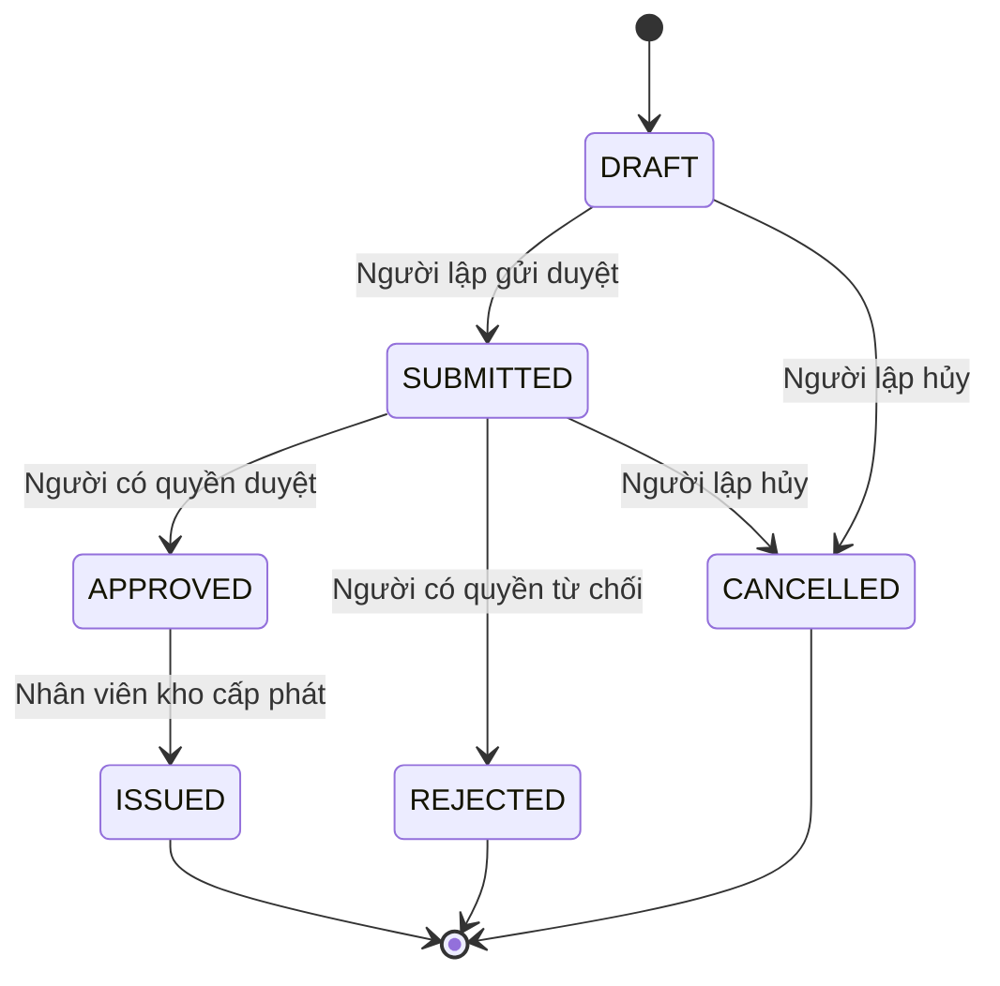

# Integrity — Tính toàn vẹn

## 1. Tính toàn vẹn bảo vệ điều gì?

Một hệ thống có thể giữ kín dữ liệu nhưng vẫn gây thiệt hại nếu dữ liệu bị thay đổi trái phép, bị ghi thiếu hoặc chuyển sang trạng thái sai. Số lượng tồn kho bị sửa, một yêu cầu chưa duyệt bị đánh dấu hoàn tất hoặc bản sao lưu thiếu giao dịch đều là những vấn đề về tính toàn vẹn.

**Integrity**, hay **tính toàn vẹn**, là mục tiêu bảo vệ dữ liệu và trạng thái hệ thống khỏi việc sửa đổi hoặc phá hủy không được phép, đồng thời duy trì các thuộc tính đúng đắn, đầy đủ và nhất quán mà hệ thống đã xác định.

Phạm vi này bao gồm hành vi cố ý và sai sót: người dùng vượt quyền, lỗi lập trình, xử lý đồng thời, tác vụ chạy lại, cấu hình sai hoặc phục hồi dữ liệu không đầy đủ.

Trong đặc tả yêu cầu bảo mật, câu “dữ liệu phải toàn vẹn” cần được chuyển thành những điều có thể kiểm chứng:

- Ai được tạo, sửa, duyệt, xóa hoặc phục hồi dữ liệu?
- Trường nào được thay đổi ở từng trạng thái?
- Quy tắc nghiệp vụ nào luôn phải đúng?
- Một nhóm thay đổi có phải hoàn tất cùng nhau không?
- Khi có yêu cầu lặp hoặc cập nhật đồng thời, kết quả phải như thế nào?
- Làm sao phát hiện sai lệch và xác định trạng thái có thể phục hồi?

Sau bài học này, người học có thể phân tích mục tiêu toàn vẹn theo tài sản, viết quy tắc bất biến, liên kết rủi ro với yêu cầu và lựa chọn bằng chứng kiểm chứng phù hợp.

## 2. Đặt integrity trong bối cảnh mục tiêu bảo mật

### 2.1. Quan hệ với bí mật và sẵn sàng

| Mục tiêu | Câu hỏi chính | Ví dụ với yêu cầu cấp phát thiết bị |
|---|---|---|
| Confidentiality — tính bí mật | Ai được biết hoặc đọc thông tin? | Người ngoài tổ chức không đọc được nội dung yêu cầu |
| Integrity — tính toàn vẹn | Ai được thay đổi và thay đổi nào hợp lệ? | Chỉ người có quyền mới duyệt; số lượng và trạng thái không bị sửa trái quy trình |
| Availability — tính sẵn sàng | Chức năng và dữ liệu có sử dụng được khi cần không? | Nhân viên kho có thể xử lý yêu cầu trong thời gian phục vụ đã thống nhất |

Một sự cố có thể ảnh hưởng nhiều mục tiêu. Xóa trái phép chứng từ làm mất tính toàn vẹn và có thể làm dữ liệu không còn sẵn sàng. Sửa quyền truy cập có thể làm thay đổi trái phép chính sách, sau đó dẫn đến lộ dữ liệu.

Việc phân loại giúp đặt câu hỏi; khi viết yêu cầu vẫn cần theo dõi toàn bộ tác động thực tế.

### 2.2. Toàn vẹn không tự chứng minh sự thật ngoài hệ thống

Một bản ghi có thể không bị sửa từ lúc nhập nhưng vẫn sai ngay từ đầu. Ví dụ, nhân viên nhập “còn 20 thiết bị” trong khi kho thực tế chỉ còn 15.

Bảo vệ toàn vẹn cần kết hợp với quy trình xác nhận nguồn, đối soát và kiểm tra nghiệp vụ nếu mục tiêu là phản ánh đúng thế giới thực. Chữ ký hoặc mã kiểm tra có thể giúp xác nhận nội dung được giữ nguyên hoặc được tạo bởi khóa nào; chúng không tự xác nhận số lượng hàng thực tế.

### 2.3. Thay đổi được phép vẫn cần tuân theo quy tắc

Quản trị viên có quyền sửa dữ liệu không có nghĩa mọi thay đổi của họ đều hợp lệ. Nếu hệ thống yêu cầu người lập không tự duyệt, quyền quản trị thông thường không nên vô tình bỏ qua quy tắc đó.

Những trường hợp đặc biệt cần có phạm vi, thẩm quyền, quy trình và dấu vết riêng. Mục tiêu là mô tả rõ những thay đổi nào được phép, bởi ai và trong điều kiện nào.

## 3. Các lớp cần xem xét khi đặc tả tính toàn vẹn

### 3.1. Nội dung dữ liệu

Dữ liệu phải có kiểu, cấu trúc, miền giá trị và quan hệ hợp lệ. Ví dụ, số lượng cấp phát là số nguyên dương; thiết bị phải tồn tại và thuộc phạm vi tổ chức đang xử lý.

Kiểm tra cấu trúc là một phần của toàn vẹn. Một giá trị đúng kiểu vẫn có thể vượt quyền hoặc vi phạm nghiệp vụ.

### 3.2. Trạng thái và quy trình nghiệp vụ

Một yêu cầu chỉ được đi qua các chuyển trạng thái đã cho phép. Không thể gọi trực tiếp thao tác cấp phát để bỏ qua phê duyệt.

Nội dung đã được phê duyệt phải gắn với phiên bản cụ thể. Nếu thay đổi thiết bị hoặc số lượng sau khi duyệt mà vẫn giữ phê duyệt cũ, quyết định duyệt đã mất ý nghĩa.

### 3.3. Giao dịch và cập nhật đồng thời

Những thay đổi liên quan có thể cần hoàn tất cùng nhau. Khi cấp phát thiết bị, giảm tồn kho, tạo chứng từ và đổi trạng thái phải tuân theo tính nhất quán đã đặc tả.

Hai yêu cầu chạy đồng thời không được làm mất cập nhật của nhau hoặc cùng sử dụng số lượng tồn kho chỉ đủ cho một lần cấp phát.

### 3.4. Nguồn gốc, thứ tự và độ mới

Hệ thống cần biết ai tạo thay đổi, nguồn nào cung cấp dữ liệu và thông tin có còn hiệu lực không.

Một thông điệp hợp lệ có thể bị gửi lại. Một phiên bản dữ liệu cũ có thể được gửi lên để ghi đè thay đổi mới. Các tình huống này đòi hỏi kiểm soát trạng thái, phiên bản và xử lý lặp phù hợp.

### 3.5. Mã, cấu hình và bằng chứng

Quy tắc bảo vệ dữ liệu có thể bị vô hiệu nếu mã hoặc cấu hình bị sửa trái phép. Log và bản sao lưu cũng là tài sản cần bảo vệ toàn vẹn vì chúng hỗ trợ phát hiện, điều tra và khôi phục.

Vì vậy, phạm vi yêu cầu có thể bao gồm mã phát hành, cấu hình quyền, thông tin tham chiếu, lịch sử kiểm toán và dữ liệu phục hồi.

## 4. Bắt đầu bằng tài sản và các quy tắc bất biến

### 4.1. Quy tắc bất biến là gì?

**Invariant**, hay **quy tắc bất biến**, là điều kiện phải luôn đúng tại những điểm quan sát đã xác định của hệ thống.

Ví dụ:

- Mỗi yêu cầu thuộc đúng một tổ chức.
- Người lập không đồng thời là người duyệt yêu cầu đó.
- Tồn kho không âm sau một giao dịch cấp phát đã hoàn tất.
- Một yêu cầu chỉ có một chứng từ cấp phát thành công trong phạm vi nghiệp vụ của ví dụ.
- Nội dung được cấp phát phải trùng với phiên bản đã được duyệt.

Cần nói rõ thời điểm và phạm vi. Với một giao dịch gồm nhiều bước bên trong cơ sở dữ liệu, trạng thái trung gian chưa commit có thể chưa đáp ứng mọi quan hệ; các giao dịch khác không được quan sát hoặc sử dụng trạng thái đó theo cách làm sai chính sách nhất quán.

### 4.2. Tách mục tiêu, yêu cầu, thiết kế và kiểm chứng

| Thành phần | Ví dụ |
|---|---|
| Mục tiêu | Bảo đảm yêu cầu cấp phát chỉ được thực hiện theo nội dung và thẩm quyền hợp lệ |
| Rủi ro | Người lập sửa số lượng sau khi được duyệt |
| Yêu cầu | Sau khi gửi duyệt, các trường thiết bị và số lượng phải được bảo vệ theo chính sách phiên bản |
| Thiết kế | Đóng băng phiên bản đã gửi; phê duyệt tham chiếu phiên bản đó |
| Tiêu chí chấp nhận | Yêu cầu sửa số lượng sau phê duyệt bị từ chối và không làm thay đổi dữ liệu |
| Bằng chứng | Kết quả kiểm thử API, kiểm tra đường cập nhật và cấu hình quyền liên quan |

Việc chọn một công nghệ giao dịch hoặc một thuật toán kiểm tra không thay thế cho phát biểu yêu cầu. Nhóm cần biết hành vi mong muốn trước khi chọn cách thực hiện.

## 5. Ví dụ xuyên suốt: yêu cầu cấp phát thiết bị

### 5.1. Bối cảnh và giả định

Một hệ thống cho phép nhiều tổ chức quản lý yêu cầu cấp phát thiết bị từ kho. Các vai trò gồm người lập, người duyệt và nhân viên kho.

Ví dụ lựa chọn những quy tắc sau:

1. Mỗi yêu cầu thuộc một tổ chức và tham chiếu thiết bị trong phạm vi tổ chức đó.
2. Số lượng yêu cầu là số nguyên dương.
3. Người lập được sửa nội dung khi yêu cầu ở trạng thái nháp.
4. Khi gửi duyệt, nội dung được đóng băng; muốn thay đổi phải kết thúc yêu cầu theo quy trình và tạo yêu cầu mới.
5. Người duyệt phải có quyền và khác người lập.
6. Chỉ yêu cầu đã duyệt mới được cấp phát.
7. Không cho phép cấp phát một phần hoặc xuất âm trong mô hình này.
8. Một lần cấp phát thành công tạo một chứng từ và giảm tồn kho đúng một lần.

Các quy tắc này phục vụ ví dụ. Sản phẩm hỗ trợ đặt trước, cấp phát nhiều lần hoặc điều chỉnh sau duyệt sẽ cần một mô hình trạng thái và các bất biến khác.

### 5.2. Mô hình trạng thái



Tên trạng thái:

- DRAFT: nháp.
- SUBMITTED: đã gửi duyệt.
- APPROVED: đã duyệt.
- ISSUED: đã cấp phát.
- REJECTED: bị từ chối.
- CANCELLED: đã hủy.

Mọi thao tác còn cần kiểm tra quyền và tổ chức sở hữu. Có một cạnh trên sơ đồ không có nghĩa bất kỳ người dùng nào cũng được thực hiện chuyển trạng thái đó.

### 5.3. Những điều luôn phải được giữ đúng

```text
Tổ chức của yêu cầu = tổ chức được phép xử lý tài nguyên.

Số lượng yêu cầu là số nguyên và lớn hơn 0.

Nếu đã duyệt:
    người duyệt khác người lập;
    quyết định duyệt gắn với phiên bản nội dung đã gửi.

Nếu đã cấp phát:
    trước đó yêu cầu phải được duyệt;
    nội dung cấp phát khớp nội dung đã duyệt;
    có đúng một chứng từ cấp phát thành công;
    tồn kho đã giảm đúng số lượng tương ứng;
    tồn kho sau giao dịch không âm.
```

Nếu kho không đủ hàng, thao tác cấp phát phải thất bại theo hợp đồng lỗi đã thống nhất. Không được để yêu cầu mang trạng thái đã cấp phát trong khi tồn kho hoặc chứng từ chưa được cập nhật tương ứng.

## 6. Chuyển mô hình đe dọa thành yêu cầu toàn vẹn

| Tình huống | Hậu quả | Nhóm yêu cầu cần có |
|---|---|---|
| Sửa tổ chức hoặc mã yêu cầu trên API | Thay đổi dữ liệu của tổ chức khác | Xác thực, phân quyền tài nguyên và ngữ cảnh tổ chức |
| Gửi thêm trường trạng thái hoặc người duyệt | Bỏ qua quy trình nghiệp vụ | Giới hạn trường cập nhật và máy trạng thái |
| Sửa số lượng sau duyệt | Cấp phát khác nội dung đã được chấp thuận | Đóng băng nội dung, liên kết phiên bản và quyết định duyệt |
| Hai nhân viên cùng thao tác trên một yêu cầu | Ghi đè hoặc cấp phát lặp | Kiểm soát đồng thời và bất biến nghiệp vụ |
| Gửi lại sau khi mất phản hồi | Tồn kho bị trừ nhiều lần | Xử lý lặp và ràng buộc duy nhất |
| Lỗi giữa cập nhật tồn kho và trạng thái | Dữ liệu liên quan bị lệch | Giao dịch nguyên tử hoặc cơ chế nhất quán được đặc tả |
| Sửa lịch sử kiểm toán | Che giấu người và nội dung đã thay đổi | Bảo vệ quyền ghi, sửa, xóa và khả năng phát hiện sai lệch |
| Khôi phục bản sao không nhất quán | Trạng thái, chứng từ và tồn kho không khớp | Phục hồi có kiểm chứng và đối soát |

Mỗi rủi ro cần được đánh giá theo tác động và điều kiện xảy ra. Những yêu cầu quan trọng phải có chủ sở hữu, ưu tiên và bằng chứng tương ứng trước quyết định phát hành.

## 7. Viết yêu cầu cụ thể, đo được và có thể kiểm chứng

### 7.1. Danh tính và quyền thay đổi

**INT-AUTHZ-01:** Máy chủ chỉ cho phép thay đổi yêu cầu khi danh tính đã được xác thực có quyền thực hiện hành động đối với tài nguyên thuộc đúng tổ chức. Danh tính người lập được xác lập từ ngữ cảnh đáng tin cậy, không lấy trực tiếp từ trường tự khai của máy khách.

**Tiêu chí chấp nhận:**

- Người chưa xác thực không thay đổi được dữ liệu được bảo vệ.
- Người có quyền tại A không sửa, duyệt hoặc cấp phát yêu cầu của B.
- Người lập không tự duyệt yêu cầu của mình.
- Việc gửi trường người duyệt, người lập hoặc tổ chức ngoài phạm vi cho phép không làm thay đổi các thuộc tính đó.

**Bằng chứng:** ma trận vai trò, hành động, tổ chức và trạng thái; kiểm thử cả trường hợp được phép và bị từ chối.

**Chủ sở hữu:** nhóm dịch vụ cấp phát và nhóm chính sách quyền.

### 7.2. Nội dung và chuyển trạng thái

**INT-WF-01:** Hệ thống chỉ cho phép các chuyển trạng thái được đặc tả. Nội dung thiết bị và số lượng chỉ được sửa ở DRAFT. Quyết định duyệt phải tham chiếu phiên bản nội dung được gửi duyệt.

**Tiêu chí chấp nhận:**

- Gọi cấp phát trực tiếp trên DRAFT hoặc SUBMITTED bị từ chối.
- Sửa số lượng sau SUBMITTED không làm thay đổi nội dung.
- Phê duyệt không thể gắn vào một phiên bản khác phiên bản đang được xét.
- Các đường cập nhật thông thường, quản trị và tác vụ nền thuộc phạm vi đều giữ các bất biến tương ứng.

**Bằng chứng:** kiểm thử chuyển trạng thái và kiểm tra mọi đường ghi có liên quan.

**Chủ sở hữu:** nhóm nghiệp vụ và nhóm phát triển dịch vụ.

### 7.3. Kiểm tra giá trị và quan hệ dữ liệu

**INT-DATA-01:** Máy chủ phải kiểm tra kiểu, miền giá trị và quan hệ tham chiếu của dữ liệu ghi. Chỉ các trường được phép của hành động hiện tại được cập nhật.

**Tiêu chí chấp nhận:**

- Số lượng bằng 0, âm, không nguyên hoặc vượt giới hạn đã công bố bị từ chối.
- Thiết bị không tồn tại hoặc ngoài phạm vi tổ chức không được chấp nhận.
- Các trường do máy chủ quản lý như trạng thái, phiên bản và thời điểm duyệt không bị cập nhật qua thao tác sửa nội dung.
- Yêu cầu không hợp lệ không để lại thay đổi nghiệp vụ một phần.

**Bằng chứng:** kiểm thử giá trị biên, quan hệ dữ liệu và các trường gửi thêm ngoài hợp đồng.

**Chủ sở hữu:** nhóm API và nhóm quản lý mô hình dữ liệu.

Giới hạn số lượng cụ thể cần được thống nhất trong đặc tả sản phẩm. Cụm từ “không quá lớn” không đủ để nhóm xây dựng cùng một hành vi.

### 7.4. Cập nhật đồng thời và tính nguyên tử

**INT-TX-01:** Với mô hình lưu trữ giao dịch của ví dụ, cập nhật trạng thái, giảm tồn kho, tạo chứng từ và ghi bản ghi kiểm toán bền vững phải commit cùng nhau hoặc không có thay đổi nghiệp vụ nào được commit.

Yêu cầu cập nhật phải chỉ rõ phiên bản dự kiến. Một thao tác dùng phiên bản cũ không được âm thầm ghi đè thay đổi đã hoàn tất.

**Tiêu chí chấp nhận:**

- Hai yêu cầu cập nhật cùng phiên bản không cùng ghi đè thành công ngoài chính sách.
- Hai thao tác cấp phát không làm tồn kho âm.
- Lỗi trước commit không để lại trạng thái đã cấp phát, chứng từ hoặc tồn kho thay đổi riêng lẻ.
- Thành công chỉ được thông báo khi giao dịch đã commit theo hợp đồng.

**Bằng chứng:** kiểm thử đồng thời, chèn lỗi có kiểm soát và kiểm tra dữ liệu sau giao dịch.

**Chủ sở hữu:** nhóm phát triển dịch vụ và nhóm phụ trách lưu trữ.

Các hệ thống lưu dữ liệu ở nhiều dịch vụ độc lập cần đặc tả cách phối hợp, trạng thái trung gian, thử lại và bù trừ. Không thể mặc nhiên mở rộng một giao dịch cục bộ thành bảo đảm nguyên tử cho toàn bộ hệ thống phân tán.

### 7.5. Xử lý yêu cầu lặp

**INT-RETRY-01:** Một yêu cầu lặp thuộc cùng phạm vi khóa xử lý lặp và cùng nội dung phải trả về kết quả đã xác định hoặc trạng thái đang xử lý theo hợp đồng, đồng thời không tạo thêm chứng từ hoặc giảm tồn kho lần nữa.

Trong ví dụ, nhóm chọn giữ kết quả xử lý lặp tối thiểu 24 giờ. Khóa phải có phạm vi rõ ràng, gắn với tổ chức, hành động và tài nguyên phù hợp.

**Tiêu chí chấp nhận:**

- Gửi lại sau khi giao dịch đã commit nhưng phản hồi bị mất không tạo cấp phát mới.
- Dùng lại khóa với nội dung khác bị báo xung đột theo hợp đồng.
- Gửi cùng khóa đồng thời không tạo hai kết quả nghiệp vụ.
- Dùng một khóa mới hoặc chờ khóa cũ hết hạn vẫn không vượt qua quy tắc “mỗi yêu cầu chỉ cấp phát một lần”.

**Bằng chứng:** kiểm thử gửi lại, mất phản hồi, khóa trùng và xử lý đồng thời.

**Chủ sở hữu:** nhóm API và nhóm xử lý giao dịch.

Thời hạn 24 giờ chỉ là ví dụ. Chống lặp ở giao diện và bất biến nghiệp vụ bổ sung cho nhau; việc hết hạn khóa không được làm mất bảo vệ của trạng thái cuối.

### 7.6. Logging và bằng chứng thay đổi

**INT-LOG-01:** Mỗi thay đổi nghiệp vụ thành công phải có bản ghi kiểm toán bền vững liên kết với giao dịch, gồm mã sự kiện, chủ thể, tổ chức, hành động, tài nguyên, phiên bản liên quan, thời gian và kết quả trong phạm vi được phép ghi.

Quyền sửa và xóa lịch sử phải được hạn chế. Các thao tác bị từ chối cần được ghi nhận theo chính sách giám sát riêng. Không ghi mật khẩu, token hoặc bí mật truy cập.

**Tiêu chí chấp nhận:**

- Có thể xác định ai đã gửi duyệt, duyệt và cấp phát một yêu cầu.
- Không tồn tại giao dịch thành công mà thiếu bản ghi kiểm toán bền vững trong phạm vi đặc tả.
- Tài khoản ghi sự kiện không tự có quyền tùy ý sửa lịch sử nếu chính sách cấm.
- Khi kênh gửi log tập trung lỗi, bản ghi cục bộ đã commit không bị mất và được xử lý theo chính sách chuyển tiếp.
- Sự kiện chuyển tiếp lặp được nhận diện theo mã sự kiện để tránh diễn giải sai số lần thao tác.

**Bằng chứng:** kiểm tra giao dịch, quyền truy cập, sự kiện mẫu và thử gián đoạn kênh log.

**Chủ sở hữu:** nhóm dịch vụ và nhóm vận hành kiểm toán.

### 7.7. Phục hồi giữ được quan hệ dữ liệu

**INT-REC-01:** Quy trình phục hồi phải kiểm tra quan hệ giữa yêu cầu, chứng từ, tồn kho và lịch sử sự kiện trước khi đưa hệ thống trở lại phục vụ. Phạm vi sao lưu và phục hồi phải bao gồm các dữ liệu, khóa và cấu hình cần thiết.

**Tiêu chí chấp nhận:**

- Sau phục hồi, các yêu cầu đã cấp phát và chứng từ tương ứng đáp ứng quy tắc đã chọn.
- Việc xử lý lại sự kiện hoặc công việc tồn đọng không giảm tồn kho lần nữa.
- Có kiểm tra tính toàn vẹn của bản sao và xác định điểm phục hồi phù hợp.
- Những chênh lệch với hoạt động kho thực tế được nhận diện và đối soát theo quy trình.
- Kết quả diễn tập ghi rõ phạm vi đã phục hồi, sai lệch và mục tiêu vận hành đạt được.

**Bằng chứng:** báo cáo diễn tập, truy vấn đối chiếu, kết quả kiểm tra bản sao và hồ sơ xử lý chênh lệch.

**Chủ sở hữu:** nhóm vận hành cùng chủ sở hữu nghiệp vụ kho.

## 8. Lựa chọn cơ chế theo loại rủi ro

### 8.1. Xác thực và phân quyền bảo vệ quyền sửa đổi

Xác thực xác định chủ thể theo cơ chế đã chọn. Phân quyền quyết định chủ thể được thay đổi dữ liệu nào và theo hành động nào.

Các kiểm tra cần được thực thi ở phía có quyền ghi dữ liệu. Việc ẩn nút duyệt trên giao diện không ngăn được một yêu cầu API trực tiếp. Tài khoản dịch vụ và công cụ vận hành cũng cần phạm vi quyền rõ ràng.

### 8.2. Kiểm tra đầu vào và ràng buộc dữ liệu

Kiểm tra đầu vào giúp phát hiện dữ liệu sai trước khi xử lý. Ràng buộc ở nơi lưu trữ có thể bảo vệ thêm các bất biến mà nó biểu diễn được, như quan hệ tham chiếu, tính duy nhất hoặc điều kiện giá trị.

Cần kiểm soát việc gán trường theo dữ liệu đầu vào. Nếu API chép toàn bộ trường người dùng gửi vào đối tượng lưu trữ, người dùng có thể tác động đến trạng thái hoặc danh tính do máy chủ quản lý.

### 8.3. Giao dịch, khóa và kiểm soát phiên bản

Giao dịch hỗ trợ tính nguyên tử trong phạm vi mà cơ chế lưu trữ bảo đảm. Khóa hoặc cập nhật có điều kiện giúp phối hợp thao tác đồng thời.

Ví dụ, kiểm soát phiên bản cần được gắn vào thao tác ghi có tính nguyên tử phù hợp. Việc đọc phiên bản, so sánh ở ứng dụng rồi ghi không điều kiện có thể để lọt một cập nhật khác trong khoảng giữa.

Ràng buộc tồn kho cũng phải chịu được hai yêu cầu cấp phát đồng thời; kiểm tra số dư một lần trước giao dịch chưa đủ.

### 8.4. Hash, MAC và chữ ký số

| Cơ chế | Có thể hỗ trợ điều gì? | Giới hạn cần hiểu |
|---|---|---|
| Hàm băm — hash | So sánh nội dung với giá trị tham chiếu đáng tin cậy | Nếu người sửa dữ liệu thay được cả giá trị tham chiếu, phép so sánh không còn bảo đảm độc lập |
| Mã xác thực thông điệp — MAC | Kiểm tra toàn vẹn và nguồn theo mô hình chia sẻ khóa bí mật | Bên có khóa đều có thể tạo mã hợp lệ; cần bảo vệ và phân phối khóa |
| Chữ ký số | Kiểm tra nội dung gắn với khóa ký bằng khóa kiểm chứng thích hợp | Cần xác lập độ tin cậy của khóa, phạm vi ký và chính sách hiệu lực |

Các cơ chế này bảo vệ những khẳng định khác nhau. Một thông điệp được xác thực vẫn có thể mang hành động vượt quyền hoặc dữ liệu nghiệp vụ sai.

Khi dùng MAC hoặc chữ ký, thiết kế cần xác định đầy đủ nội dung được bảo vệ, cách biểu diễn dữ liệu, bên nhận dự kiến, hiệu lực và cách chống sử dụng lại nếu cần. Những phần không được bao phủ có thể bị thay đổi mà phép kiểm chứng vẫn thành công.

Chữ ký xác nhận mối liên hệ với khóa ký trong các giả định đã thiết lập. Việc quy trách nhiệm cho một cá nhân hoặc kết luận về sự thật nghiệp vụ cần thêm cơ chế quản lý khóa, định danh và quy trình liên quan.

### 8.5. Mã hóa đường truyền và lưu trữ

Mã hóa kênh truyền có thể hỗ trợ bảo vệ dữ liệu giữa các đầu cuối theo cơ chế đã chọn. Nó không ngăn một người dùng đã xác thực gửi số lượng sai hoặc một máy chủ có quyền ghi tạo dữ liệu sai.

Cơ chế bảo vệ khi lưu cần được xem xét theo khả năng xác thực nội dung, quyền truy cập và quản lý khóa. Chỉ nói “đã mã hóa” chưa trả lời ai có thể sửa dữ liệu và hệ thống sẽ phát hiện sửa đổi ra sao.

## 9. Minh họa một thao tác cấp phát

Giả sử dữ liệu nghiệp vụ, chứng từ, bản ghi xử lý lặp và bản ghi sự kiện bền vững đều nằm trong cùng phạm vi giao dịch. Mã giả thể hiện ý định thiết kế:

```text
principal = xác_minh_danh_tính(request)
command = kiểm_tra_hợp_đồng_và_các_trường_được_phép(request)

BẮT ĐẦU GIAO DỊCH

    xác_lập_quyền_xử_lý_tài_nguyên(principal, command)

    kiểm_tra_hoặc_giữ_khóa_xử_lý_lặp(
        tổ_chức, hành_động, tài_nguyên, khóa, dấu_vân_tay_nội_dung
    )
    nếu đã có kết quả khớp:
        kết_thúc_theo_hợp_đồng_và_trả_kết_quả_cũ
    nếu cùng khóa nhưng khác nội dung:
        hủy_giao_dịch_và_báo_xung_đột

    yêu_cầu = đọc_và_khóa_yêu_cầu_trong_đúng_tổ_chức()
    kiểm_tra_phiên_bản_dự_kiến(yêu_cầu, command)
    yêu_cầu_phải_ở_trạng_thái_APPROVED()
    nội_dung_phải_khớp_phiên_bản_đã_duyệt()

    tồn_kho = đọc_và_khóa_bản_ghi_tồn_kho_liên_quan()
    kiểm_tra_tồn_kho_đủ_số_lượng()

    giảm_tồn_kho()
    tạo_chứng_từ_với_ràng_buộc_một_lần_cấp_phát()
    đổi_trạng_thái_sang_ISSUED_và_tăng_phiên_bản()
    ghi_sự_kiện_kiểm_toán_bền_vững()
    lưu_kết_quả_xử_lý_lặp()

COMMIT
trả_kết_quả_đã_commit()

Nếu lỗi trước COMMIT:
    ROLLBACK và xử lý theo hợp đồng lỗi
```

Thiết kế thực tế phải chọn cách giữ khóa xử lý lặp, thứ tự khóa dữ liệu và xử lý xung đột phù hợp với cơ chế lưu trữ. Mọi đường cập nhật cùng dữ liệu cần tuân theo các bảo đảm đã chọn.

Không nên giữ một giao dịch dữ liệu mở chỉ để chờ một hệ thống log bên ngoài hoàn tất. Một lựa chọn là ghi sự kiện hoặc bản ghi chờ chuyển tiếp trong cùng giao dịch, rồi gửi ra ngoài sau commit. Khi đó phải đặc tả thử lại, nhận diện trùng và phát hiện tồn đọng.

Nếu mất phản hồi sau commit, người dùng có thể không biết thao tác đã thành công. Hệ thống phải tra cứu kết quả theo hợp đồng thay vì thực hiện lại tác động nghiệp vụ một cách mù quáng.

## 10. Kiểm chứng tính toàn vẹn bằng các tình huống cụ thể

| Tình huống kiểm chứng | Điều cần quan sát |
|---|---|
| Người A sửa yêu cầu thuộc B | Không có thay đổi dữ liệu của B |
| Người lập tự duyệt | Bị từ chối và trạng thái giữ nguyên |
| Gửi thêm trường trạng thái hoặc người duyệt | Các trường do máy chủ quản lý không bị thay đổi trái phép |
| Sửa số lượng sau khi gửi duyệt | Nội dung đóng băng giữ nguyên |
| Cấp phát trên trạng thái chưa duyệt | Không có chứng từ hoặc thay đổi tồn kho |
| Hai cập nhật dùng cùng phiên bản | Không âm thầm ghi đè dữ liệu mới hơn |
| Hai cấp phát tranh cùng lượng tồn kho | Chỉ các giao dịch đủ điều kiện thành công; tồn kho không âm |
| Gửi lại sau khi mất phản hồi thành công | Trả kết quả phù hợp, không tạo tác động lần hai |
| Cùng khóa xử lý lặp nhưng khác nội dung | Xung đột theo hợp đồng, không sửa kết quả trước |
| Lỗi sau khi giảm tồn kho nhưng trước commit | Không để lại thay đổi nghiệp vụ một phần |
| Kênh log tập trung bị gián đoạn | Bản ghi sự kiện bền vững còn tồn tại và được chuyển tiếp theo chính sách |
| Phục hồi rồi chạy lại công việc tồn đọng | Không phát sinh cấp phát lặp; quan hệ dữ liệu được kiểm tra |

Cần có cả kiểm thử luồng hợp lệ. Một hệ thống từ chối mọi thay đổi có thể tránh nhiều sai lệch nhưng không đáp ứng chức năng cần thiết.

Với kiểm thử đồng thời, cần thực sự tạo các thao tác chồng lấn theo kịch bản. Chạy hai yêu cầu lần lượt không chứng minh cơ chế kiểm soát tranh chấp hoạt động.

Với kiểm thử giao dịch, quan sát cả phản hồi và dữ liệu sau lỗi. Thông báo lỗi đúng không đủ nếu tồn kho đã bị thay đổi.

## 11. Logging, đối soát và phát hiện sai lệch

### 11.1. Lịch sử cần đủ để giải thích thay đổi

Một sự kiện kiểm toán có thể ghi:

```text
event_id
event_type
actor_id
organization_id
request_id
previous_version
new_version
previous_state
new_state
result
occurred_at
correlation_id
```

Danh sách trường phải được điều chỉnh theo mục đích điều tra và yêu cầu bảo vệ dữ liệu. Không cần sao chép mọi nội dung nhạy cảm vào log để có khả năng truy vết.

Dữ liệu sự kiện phải được ghi theo cấu trúc phù hợp, tránh để đầu vào tạo ra sự kiện giả trong cách lưu hoặc hiển thị. Đồng thời phải kiểm soát quyền đọc, ghi, sửa và xóa.

### 11.2. Phát hiện sửa đổi cần căn cứ độc lập phù hợp

Một chuỗi giá trị băm có thể hỗ trợ phát hiện thay đổi nếu điểm tham chiếu và quyền quản lý được bảo vệ đúng cách. Nếu cùng một chủ thể có thể sửa toàn bộ log và mọi giá trị kiểm chứng liên quan, khả năng phát hiện sẽ bị hạn chế.

Vì vậy, thiết kế có thể cần tách quyền, bảo vệ điểm kiểm chứng hoặc dùng khả năng lưu giữ phù hợp. Mỗi lựa chọn phải đi cùng mô hình đe dọa và cách kiểm chứng cụ thể.

### 11.3. Đối soát bổ sung cho kiểm soát phòng ngừa

Đối soát định kỳ có thể tìm:

- Yêu cầu đã cấp phát nhưng thiếu chứng từ.
- Chứng từ trùng với cùng yêu cầu.
- Tồn kho hoặc tổng biến động không đáp ứng quan hệ đã xác định.
- Sự kiện đã commit nhưng chưa được chuyển tiếp quá giới hạn.
- Hoạt động vật lý chưa phản ánh trong dữ liệu hoặc ngược lại.

Sai lệch cần có người tiếp nhận và quy trình xử lý. Không tự động sửa mọi dữ liệu chỉ để làm cho báo cáo đối soát hết lỗi; trước tiên cần xác định nguồn đúng và bảo toàn bằng chứng.

## 12. Phục hồi khi tính toàn vẹn đã bị ảnh hưởng

Một sự cố toàn vẹn có thể được phát hiện muộn, sau khi nhiều bản sao lưu đã chứa dữ liệu sai. Bản sao mới nhất chưa chắc là điểm phục hồi phù hợp.

Quy trình cần làm rõ:

1. Phạm vi tài sản, giao dịch và khoảng thời gian bị ảnh hưởng.
2. Cách ngăn thay đổi tiếp tục làm sai dữ liệu.
3. Nguồn bằng chứng được bảo toàn để điều tra.
4. Căn cứ chọn điểm phục hồi hoặc phương án sửa dữ liệu.
5. Cách đối chiếu giao dịch sau điểm phục hồi.
6. Cách xử lý công việc và sự kiện có thể được phát lại.
7. Cách xác nhận tính đúng đắn trước khi phục vụ trở lại.

Hai mục tiêu vận hành thường liên quan:

- **RPO:** giới hạn mất dữ liệu được chấp nhận, thường diễn đạt bằng khoảng thời gian.
- **RTO:** thời gian mục tiêu để khôi phục dịch vụ tới mức hoạt động đã thống nhất, có mốc đo rõ ràng.

Mục tiêu toàn vẹn bổ sung câu hỏi: dữ liệu khôi phục có đúng và đủ theo các quy tắc đã xác định không? Đạt thời gian phục hồi mà đưa dữ liệu sai vào phục vụ vẫn không đạt mục tiêu này.

Với cấp phát thiết bị, thao tác ngoài đời không tự đảo ngược khi cơ sở dữ liệu quay về quá khứ. Nhóm phải đối soát chứng từ, hoạt động kho và các thay đổi sau điểm phục hồi trước khi tiếp tục cấp phát.

## 13. Liên kết yêu cầu với kiến trúc và vòng đời phát triển

### 13.1. Bảng truy vết minh họa

| Rủi ro | Yêu cầu | Nơi thực thi | Bằng chứng |
|---|---|---|---|
| Thay đổi dữ liệu chéo tổ chức | INT-AUTHZ-01 | API, lớp chính sách và đường ghi dữ liệu | Ma trận quyền và kiểm thử tài nguyên |
| Cấp phát khác nội dung đã duyệt | INT-WF-01 | Mô hình trạng thái và phiên bản nội dung | Kiểm thử đóng băng và chuyển trạng thái |
| Ghi dở dang hoặc tranh chấp tồn kho | INT-TX-01 | Phạm vi giao dịch và cơ chế đồng thời | Kiểm thử chèn lỗi và thao tác chồng lấn |
| Cấp phát lặp sau thử lại | INT-RETRY-01 | Hợp đồng API, bản ghi xử lý lặp và ràng buộc nghiệp vụ | Kiểm thử mất phản hồi, khóa trùng và trạng thái cuối |
| Che giấu thay đổi | INT-LOG-01 | Bản ghi sự kiện, quyền và đường chuyển tiếp | Kiểm tra sự kiện, cấu hình và gián đoạn |
| Phục hồi dữ liệu không nhất quán | INT-REC-01 | Quy trình phục hồi và đối soát | Diễn tập và báo cáo quan hệ dữ liệu |

### 13.2. Bảo vệ những thứ thực thi quy tắc

Nếu người không được phép sửa mã, cấu hình quyền hoặc dữ liệu tham chiếu, các bất biến có thể bị vô hiệu. Yêu cầu toàn vẹn cần xem xét:

- Quyền thay đổi mã và phát hành.
- Nguồn bản build và khả năng truy về phiên bản mã.
- Quy trình thay đổi cấu hình có tác động đến quyền hoặc giao dịch.
- Quyền của tài khoản dịch vụ và công cụ bảo trì.
- Cách kiểm tra dữ liệu nhập hàng loạt và kịch bản chuyển đổi dữ liệu.

Một tác vụ bảo trì bỏ qua quy tắc có thể gây sai lệch giống đường API. Các đường đặc quyền phải được quản lý theo phạm vi và quy trình rõ ràng.

### 13.3. Khi nào phải xem xét lại yêu cầu?

Cần đánh giá ảnh hưởng khi thêm cấp phát một phần, đổi mô hình phê duyệt, mở API tích hợp, tách cơ sở dữ liệu, thêm hàng đợi hoặc thay đổi cách phục hồi.

Mỗi thay đổi có thể làm thay đổi bất biến, phạm vi giao dịch, điều kiện xử lý lặp và bằng chứng cần có. Kết quả kiểm thử phải gắn với phiên bản mã, cấu hình, mô hình dữ liệu và chính sách áp dụng.

## 14. Những sai lệch thường gặp

| Sai lệch | Hậu quả | Cách điều chỉnh |
|---|---|---|
| Chỉ viết “dữ liệu phải toàn vẹn” | Không xác định được điều kiện đạt | Nêu chủ thể, hành động, trạng thái, bất biến và bằng chứng |
| Chỉ kiểm tra đầu vào ở giao diện | Yêu cầu trực tiếp hoặc tác vụ nền vượt kiểm soát | Thực thi tại đường ghi đáng tin cậy và nơi lưu phù hợp |
| Đồng nhất đăng nhập với quyền sửa | Người dùng hợp lệ sửa tài nguyên ngoài phạm vi | Kiểm tra hành động trên tài nguyên và tổ chức |
| Cho rằng hash luôn chứng minh nguồn gốc | Người sửa thay được cả dữ liệu và giá trị tham chiếu | Xác định mô hình tin cậy và bảo vệ căn cứ kiểm chứng |
| Dùng mã hóa thay cho quy tắc nghiệp vụ | Dữ liệu sai vẫn được gửi qua kênh được bảo vệ | Kết hợp bảo vệ kênh, quyền và bất biến |
| Kiểm tra phiên bản rồi ghi không điều kiện | Mất cập nhật khi có tranh chấp | Gắn điều kiện phiên bản với cơ chế ghi có bảo đảm phù hợp |
| Chống lặp chỉ bằng khóa có thời hạn | Dùng khóa mới hoặc khóa hết hạn gây tác động lần hai | Giữ bất biến nghiệp vụ và trạng thái cuối |
| Chỉ kiểm tra việc tạo bản sao lưu | Chưa biết dữ liệu có khôi phục đúng không | Diễn tập, đối chiếu quan hệ và xử lý phát lại |
| Sửa dữ liệu sự cố mà không giữ bằng chứng | Khó xác định nguyên nhân và phạm vi ảnh hưởng | Bảo toàn bằng chứng, xác định nguồn đúng và ghi nhận sửa chữa |

## 15. Bài tập áp dụng

Một hệ thống cho phép nhân viên gửi yêu cầu thay đổi cấu hình dịch vụ. Người có quyền phê duyệt xét nội dung, sau đó tác vụ nền áp dụng cấu hình. Yêu cầu có thể được gửi lại khi người dùng mất kết nối.

Hãy thực hiện:

1. Liệt kê các tài sản cần bảo vệ toàn vẹn, gồm nội dung, trạng thái, phiên bản cấu hình và lịch sử.
2. Viết ít nhất năm quy tắc bất biến, nêu rõ thời điểm và phạm vi áp dụng.
3. Mô tả các rủi ro: sửa sau duyệt, tự duyệt, áp dụng phiên bản cũ, thực hiện lặp và lỗi giữa các bước.
4. Viết yêu cầu về quyền thay đổi, phiên bản, đồng thời, logging và phục hồi.
5. Chọn tiêu chí chấp nhận cho từng yêu cầu, gồm trường hợp hợp lệ và bị từ chối.
6. Nêu bằng chứng cần có trước phát hành và một thay đổi khiến bằng chứng cũ cần được tạo lại.
7. Giải thích hash hoặc chữ ký có thể bảo vệ khẳng định nào và phần nào vẫn cần kiểm tra nghiệp vụ.

Đặc tả đạt mức có thể sử dụng khi người phát triển biết phải giữ quy tắc nào, người kiểm thử biết cần quan sát điều gì và người vận hành biết cách phát hiện, truy vết và phục hồi khi xuất hiện sai lệch.
