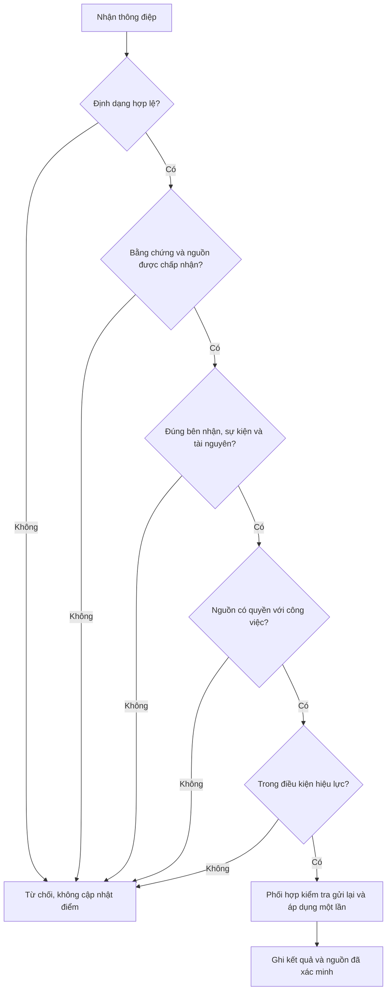

# Authenticity

## 1. Authenticity là mục tiêu bảo vệ điều gì?

**Authenticity — tính xác thực — là thuộc tính cho phép có cơ sở tin rằng một thực thể, thông điệp hoặc hiện vật đúng là đối tượng hay nguồn mà nó tuyên bố đại diện.** Trong phần mềm, câu hỏi cốt lõi thường là: “Yêu cầu này thực sự gắn với danh tính nào?”, “Kết quả này có đến từ nguồn được chấp nhận không?” hoặc “Đây có phải đúng bản phát hành mà hệ thống dự định sử dụng không?”.

Ví dụ, một nền tảng học tập nhận kết quả từ dịch vụ chấm bài tự động. Thông điệp chứa mã học viên, mã bài và điểm. Chỉ vì JSON có trường `source: grading-service` hoặc yêu cầu có tiêu đề `X-Service-Name` không có nghĩa nguồn gửi đã được xác minh. Nếu hệ thống tin ngay các giá trị tự khai này, một bên khác có thể giả danh dịch vụ để gửi điểm.

Mục tiêu authenticity là thiết lập căn cứ tin cậy cho nguồn và đối tượng đang được sử dụng. Để trở thành yêu cầu bảo mật, mục tiêu phải được cụ thể hóa: xác thực nguồn nào, đối với dữ liệu nào, trong ngữ cảnh nào, bằng chứng nào được chấp nhận và hệ thống làm gì khi bằng chứng không hợp lệ.

Trong bài này, ví dụ xuyên suốt là một nền tảng học tập có người dùng đăng nhập, giảng viên sửa điểm và dịch vụ chấm tự động gửi kết quả. Các giả định và con số minh họa được nêu trong bài chỉ phục vụ giải thích cách đặc tả, không phải một cấu hình chung cho mọi hệ thống.

## 2. Phân biệt các khái niệm dễ nhầm

| Khái niệm | Câu hỏi chính | Ví dụ |
| --- | --- | --- |
| Authenticity — tính xác thực | Đối tượng hoặc nguồn có đúng như tuyên bố không? | Kết quả chấm có gắn với đúng dịch vụ chấm đã được cấu hình không? |
| Authentication — xác thực danh tính | Quy trình nào kiểm tra bằng chứng về danh tính? | Máy chủ kiểm tra thông tin xác thực để thiết lập principal của người gọi. |
| Integrity — tính toàn vẹn | Dữ liệu có bị thay đổi trái với điều kiện được bảo vệ không? | Điểm và mã bài không bị sửa trên phần dữ liệu đã được kiểm chứng. |
| Authorization — phân quyền | Chủ thể này có được thực hiện hành động với tài nguyên này không? | Dịch vụ chấm chỉ được gửi kết quả cho công việc được giao trong đúng trường. |
| Confidentiality — tính bí mật | Ai có thể biết dữ liệu? | Bên nghe lén không đọc được điểm đang truyền. |
| Freshness — tính mới theo ngữ cảnh | Bằng chứng hoặc thông điệp còn phù hợp ở thời điểm sử dụng không? | Một kết quả cũ không bị phát lại để gây tác động lần nữa. |
| Khả năng quy trách nhiệm | Có thể liên kết hành động với chủ thể và bằng chứng nào? | Audit lưu danh tính đã được xác minh và mã công việc tương ứng. |

Authentication là một quá trình tạo căn cứ cho authenticity của danh tính trong phạm vi nhất định. Authenticity còn có thể liên quan đến dữ liệu, điểm kết nối, gói phần mềm và bản sao lưu, không chỉ màn hình đăng nhập.

Authenticity và integrity thường được bảo vệ cùng nhau. Tuy nhiên, cần chú ý **cái gì thực sự được kiểm chứng**. Nếu bằng chứng chỉ bao phủ nội dung điểm mà không bao phủ mã học viên hoặc loại sự kiện, những phần ngoài phạm vi đó có thể bị dùng sai mà phép kiểm tra vẫn thành công.

Một thông điệp đến từ nguồn đúng cũng chưa chắc được phép gây ra mọi thay đổi. Dịch vụ chấm hợp lệ không tự có quyền sửa điểm của mọi trường. Tương tự, dữ liệu đã được xác minh nguồn vẫn có thể sai nghiệp vụ do lỗi của nguồn; authenticity không bảo đảm điểm chấm chính xác hay người dùng thực sự có chủ ý thực hiện hành động.

## 3. Một tuyên bố xác thực cần những thành phần nào?

Có thể phân tích một quyết định sử dụng dữ liệu bằng bốn thành phần:

1. **Tuyên bố:** chủ thể hoặc thông điệp đang tự nhận là ai, đến từ đâu hoặc đại diện cho đối tượng nào.
2. **Bằng chứng:** thông tin cho phép kiểm tra tuyên bố đó, chẳng hạn thông tin xác thực, bằng chứng mật mã hoặc danh tính của đầu kết nối đã được kiểm tra.
3. **Gốc tin cậy và ánh xạ:** căn cứ để biết bằng chứng thuộc về nguồn nào; ví dụ cấu hình nhà cung cấp danh tính hoặc ánh xạ khóa với dịch vụ tích hợp.
4. **Ngữ cảnh chấp nhận:** hệ thống nhận nào, loại hành động nào, tenant nào, tài nguyên nào và thời điểm nào được phép sử dụng bằng chứng.

**Principal — chủ thể bảo mật —** là thực thể được hệ thống nhận diện để đánh giá quyền, như tài khoản người dùng hoặc danh tính dịch vụ. Khi kiểm tra bằng chứng thành công, hệ thống thiết lập principal tương ứng; tên người dùng hay tên nguồn trong nội dung yêu cầu không được tự động thay thế kết quả đó.

Ví dụ:

```text
Tuyên bố:
Thông điệp là kết quả của dịch vụ chấm S cho công việc J.

Bằng chứng:
Bằng chứng xác thực thông điệp theo cơ chế tích hợp đã thống nhất.

Căn cứ tin cậy:
Khóa hoặc thông tin xác thực được cấu hình phía nhận,
liên kết với dịch vụ S và phạm vi tích hợp cụ thể.

Ngữ cảnh:
Dành cho nền tảng này, loại sự kiện chấm hoàn tất,
đúng công việc J, học viên và tenant được giao,
trong điều kiện hiệu lực đã quy định.
```

Nếu hệ thống nhận luôn một khóa công khai bất kỳ do bên gửi tự đính kèm rồi dùng khóa đó để tin nguồn, phép kiểm tra có thể chỉ chứng minh thông điệp phù hợp với chính khóa bên gửi lựa chọn. Nó chưa chứng minh khóa thuộc dịch vụ được chấp nhận. Vì vậy, yêu cầu phải làm rõ cách thiết lập và duy trì quan hệ giữa bằng chứng với danh tính.

## 4. Các đối tượng cần authenticity trong hệ thống

| Đối tượng | Tuyên bố cần kiểm tra | Hậu quả nếu tin nhầm |
| --- | --- | --- |
| Người dùng và phiên | Yêu cầu gắn với principal nào, ngữ cảnh xác thực còn hiệu lực không | Kẻ giả danh thao tác bằng quyền của người khác. |
| Dịch vụ gọi API | Danh tính kỹ thuật nào đang gọi | Một ứng dụng không được chấp nhận gửi dữ liệu hoặc lệnh. |
| Máy chủ hoặc điểm kết nối | Phía nhận kết nối có đúng dịch vụ dự định không | Dữ liệu hoặc thông tin xác thực bị gửi đến điểm giả mạo. |
| Thông điệp và sự kiện | Nội dung có gắn với đúng nguồn và ngữ cảnh không | Kết quả giả hoặc sự kiện bị tráo được đưa vào nghiệp vụ. |
| Gói triển khai và cấu hình | Hiện vật có đúng nguồn phát hành và phiên bản được chấp thuận không | Triển khai mã hoặc cấu hình do nguồn không được phép tạo. |
| Bản sao lưu | Bản sao có đúng nguồn và tập dữ liệu cần phục hồi không | Khôi phục từ dữ liệu giả, sai môi trường hoặc sai thời điểm. |
| Dấu vết kiểm toán | Bản ghi đến từ thành phần nào và liên kết với hành động nào | Khó phân biệt bằng chứng thật với dữ liệu tự khai hoặc bị chèn. |

Không phải mọi đối tượng dùng cùng một cơ chế kiểm chứng. Việc người dùng đăng nhập không chứng minh tệp triển khai đúng nguồn; việc kiểm tra một gói phần mềm không chứng minh người gọi API có quyền sử dụng dữ liệu. Mỗi yêu cầu phải chỉ rõ đối tượng và phạm vi bằng chứng.

## 5. Các cơ chế hỗ trợ và giới hạn của chúng

### 5.1. Xác thực danh tính người dùng hoặc dịch vụ

Cơ chế đăng nhập và thông tin xác thực dịch vụ giúp hệ thống thiết lập danh tính theo bằng chứng được chấp nhận. Yêu cầu cần nêu nguồn danh tính, điều kiện hiệu lực, cách ánh xạ vào principal và hành vi khi kiểm tra không thành công.

Sau đó vẫn cần kiểm tra quyền đối với hành động và tài nguyên cụ thể. Một người dùng đăng nhập hợp lệ có thể không được xem điểm của người khác; một dịch vụ tích hợp hợp lệ có thể chỉ được hoạt động trong một tenant.

### 5.2. Kênh truyền có xác thực đầu kết nối

Một kênh được thiết lập và kiểm tra đúng có thể bảo vệ dữ liệu trên chặng truyền và cung cấp căn cứ về đầu kết nối tương ứng. Tuy nhiên, xác thực máy chủ không tự xác thực người dùng đang gửi yêu cầu. Nếu TLS kết thúc ở thành phần trung gian, phải làm rõ danh tính và ngữ cảnh nào được chuyển tiếp qua các chặng sau.

Không nên viết “có HTTPS nên mọi yêu cầu là thật”. Yêu cầu phải xác định đầu nào được xác thực, bằng căn cứ nào, và ứng dụng còn phải kiểm tra gì trước khi chấp nhận dữ liệu.

### 5.3. MAC và chữ ký số

**MAC — Message Authentication Code —** là mã xác thực thông điệp dựa trên bí mật dùng chung. Trong mô hình chỉ các bên hợp lệ giữ bí mật và cơ chế được sử dụng đúng, nó giúp kiểm tra thông điệp không bị thay đổi ngoài điều kiện được bảo vệ và được tạo bởi một bên có khả năng dùng bí mật đó.

Giới hạn quan trọng là những bên cùng biết bí mật thường đều có khả năng tạo MAC. Vì vậy, một MAC không tự phân biệt được bên nào trong nhóm giữ bí mật đã tạo thông điệp. Việc nhiều dịch vụ dùng chung một bí mật có thể làm giảm khả năng xác định nguồn cụ thể.

**Chữ ký số** sử dụng khóa ký và khóa kiểm tra tương ứng. Khi cơ chế và phép kiểm tra đúng, nó cung cấp bằng chứng về dữ liệu đã được ký và khả năng sử dụng khóa ký. Kết luận về danh tính nguồn còn phụ thuộc việc khóa kiểm tra được liên kết với nguồn nào, khóa có còn được chấp nhận không và khóa ký có bị lộ hay bị dùng ngoài ý muốn không.

Một chữ ký hợp lệ không tự chứng minh người cụ thể đã trực tiếp phê duyệt hành động. Khả năng xác lập trách nhiệm cần thêm quản lý khóa, quy trình và bằng chứng liên quan; không thể suy ra chỉ từ một trường `signature` trong thông điệp.

### 5.4. Hash không có căn cứ nguồn là chưa đủ

Giá trị hash giúp so sánh dữ liệu với một giá trị tham chiếu. Nếu bên tấn công có thể thay cả tệp lẫn hash tham chiếu, việc hai giá trị khớp nhau chưa chứng minh nguồn của tệp.

Tương tự, tên tệp, địa chỉ email, địa chỉ IP, logo hoặc trường `source` có thể là dấu hiệu hỗ trợ bối cảnh nhưng không tự thay thế một cơ chế xác minh nguồn phù hợp. Cần phân biệt dữ liệu nhận diện do bên gửi tự khai với danh tính mà phía nhận đã có căn cứ chấp nhận.

## 6. Từ mục tiêu authenticity đến kịch bản đe dọa

Với nền tảng nhận kết quả chấm tự động, tài sản cần bảo vệ là điểm, quan hệ giữa điểm với học viên và bài, cùng bằng chứng về lần cập nhật. Mục tiêu ở mức cao có thể viết:

> Chỉ sử dụng kết quả chấm khi có căn cứ xác minh rằng nó đến từ nguồn chấm được chấp nhận và được tạo cho đúng ngữ cảnh mà nền tảng đang xử lý.

Để phân rã mục tiêu này, cần xét các giả định có thể sai:

| Giả định sai | Kịch bản đe dọa | Nghĩa vụ cần đặc tả |
| --- | --- | --- |
| Tên nguồn trong JSON đủ để xác định người gửi | Một bên tự khai tên dịch vụ chấm rồi gửi điểm giả | Xác minh bằng chứng và ánh xạ vào nguồn đã được cấu hình. |
| Chỉ cần bảo vệ giá trị điểm | Mã học viên hoặc mã công việc bị thay trong khi điểm giữ nguyên | Bao phủ các trường ảnh hưởng ý nghĩa và tác động của thông điệp. |
| Thông điệp đúng nguồn luôn được chấp nhận | Một kết quả đúng nguồn nhưng thuộc hệ thống nhận, tenant hoặc công việc khác được dùng lại | Kiểm tra ngữ cảnh và quyền theo tài nguyên đích. |
| Bằng chứng hợp lệ đồng nghĩa yêu cầu mới | Kết quả cũ được phát lại hoặc gửi đồng thời nhiều lần | Xác định hiệu lực thời gian và tác động tối đa của một sự kiện. |
| Khóa từng hợp lệ sẽ luôn hợp lệ | Thông điệp được kiểm tra bằng khóa đã bị thu hồi | Quản lý trạng thái, hiệu lực và thay đổi của căn cứ tin cậy. |
| Xử lý nội bộ có thể bỏ thông tin nguồn | Tiến trình nền không biết kết quả đã được kiểm tra ở đâu | Bảo toàn ngữ cảnh xác minh hoặc thực hiện lại phép kiểm tra theo thiết kế. |

Không phải tất cả nghĩa vụ đều là authenticity theo nghĩa hẹp. Mô hình đe dọa chỉ ra các thuộc tính phải phối hợp: nguồn đúng, dữ liệu đúng phạm vi bảo vệ, quyền hợp lệ và thời điểm phù hợp. Nếu chỉ đặc tả một trong số đó, hệ thống có thể chấp nhận một thông điệp có bằng chứng hợp lệ nhưng gây tác động sai.

## 7. Ví dụ xuyên suốt: kết quả chấm tự động

### 7.1. Xác định thông điệp và ý nghĩa từng trường

Giả sử bên tích hợp gửi sự kiện có cấu trúc minh họa:

```json
{
  "eventId": "event-demo-001",
  "eventType": "grading.completed",
  "sourceId": "grader-demo-a",
  "recipient": "learning-platform-demo",
  "schoolId": "school-demo-a",
  "jobId": "job-demo-101",
  "studentId": "student-demo-09",
  "assignmentId": "assignment-demo-04",
  "score": 8.5,
  "issuedAt": "2030-01-01T10:00:00Z"
}
```

Các giá trị chỉ để minh họa, không phải thông tin xác thực thật. Bằng chứng xác thực được truyền theo giao thức tích hợp đã thống nhất; việc không đưa nó vào JSON trên không có nghĩa thông điệp được chấp nhận mà không kiểm tra.

Các trường có ý nghĩa khác nhau:

- `sourceId` nêu nguồn tự khai, cần đối chiếu với nguồn xác định từ bằng chứng.
- `recipient` và `eventType` giúp giới hạn hệ thống nhận và ý nghĩa nghiệp vụ.
- `schoolId`, `jobId`, `studentId`, `assignmentId` xác định phạm vi tài nguyên bị tác động.
- `score` là giá trị nghiệp vụ cần cập nhật.
- `eventId` và `issuedAt` hỗ trợ quy tắc phát hiện gửi lại và hiệu lực theo thời gian.

Đối với lựa chọn thiết kế dùng bằng chứng xác thực thông điệp trong ví dụ này, toàn bộ các trường trên phải nằm trong phạm vi được bảo vệ. Phía nhận cũng phải kiểm tra quan hệ giữa chúng, chẳng hạn công việc có thực sự được giao cho nguồn chấm đó và thuộc đúng học viên, bài, trường hay không.

Nếu một trường được bảo vệ nhưng chứa giá trị không được phép, kết quả xác minh nguồn có thể thành công trong khi quyết định nghiệp vụ vẫn phải từ chối. Điều này không mâu thuẫn: nguồn đúng vẫn có thể gửi nội dung sai hoặc vượt phạm vi được cấp.

### 7.2. Bảo vệ đúng biểu diễn mà hai bên cùng hiểu

Một giao thức có thể bảo vệ chuỗi byte nhận được hoặc một biểu diễn chuẩn hóa được định nghĩa rõ. Điều quan trọng là bên tạo và bên kiểm tra phải thống nhất **chính xác dữ liệu được đưa vào phép kiểm chứng**.

Nếu phía kiểm tra hiểu một trường theo cách khác với phía xử lý nghiệp vụ, có thể xuất hiện khoảng trống giữa “đã kiểm tra” và “đã sử dụng”. Vì vậy, đặc tả cần làm rõ tập trường, định dạng, quy tắc phân tích, xử lý trường lặp hoặc cấu trúc không hợp lệ và cách phiên bản giao thức được xác định.

Không nên tự viết câu “ký JSON” rồi để mỗi thành phần tùy ý chọn cách tuần tự hóa hoặc loại bỏ trường. Yêu cầu cần mô tả phạm vi bảo vệ; thiết kế giao thức phải hiện thực hóa phạm vi đó nhất quán.

### 7.3. Nguồn đúng không thay thế tính mới và chống tác động lặp

Một thông điệp cũ có thể vẫn có bằng chứng xác thực hợp lệ. Nếu chấp nhận nó nhiều lần, hệ thống có thể ghi đè kết quả hoặc tạo các tác động phụ lặp lại. Cần hai quyết định riêng:

1. **Cửa sổ thời gian:** thông điệp được chấp nhận trong khoảng nào so với thời điểm phát hành.
2. **Quy tắc gửi lại:** cùng một sự kiện có được gây thay đổi nghiệp vụ lần nữa không.

Giả sử nghiệp vụ của ví dụ chọn điều kiện thời gian:

```text
-60 giây <= thời điểm nhận - issuedAt <= 300 giây
```

Điều này cho phép tối đa 60 giây lệch về tương lai và tối đa 300 giây tuổi thông điệp, tính theo các mốc thời gian đã thống nhất. Đây chỉ là giả định minh họa; giá trị thực tế phải phù hợp độ lệch đồng hồ, độ trễ và cơ chế gửi lại của hệ thống.

Cửa sổ này chưa ngăn một thông điệp bị phát lại nhiều lần ngay trong khoảng hợp lệ. Có thể đặc tả thêm:

> Với mỗi cặp nguồn đã xác minh và mã sự kiện, hệ thống chỉ được áp dụng tác động cập nhật điểm tối đa một lần. Nhận lại cùng sự kiện với cùng nội dung không được tạo tác động lặp; cùng định danh nhưng nội dung khác phải bị từ chối và được ghi nhận để xử lý.

Kiểm tra tính duy nhất và cập nhật phải được thiết kế để không tạo tác động lặp khi các bản gửi đến đồng thời. Nếu kiểm tra một nơi rồi cập nhật không có sự bảo đảm phối hợp, hai lần xử lý có thể cùng nghĩ rằng sự kiện chưa được dùng.

Thời gian giữ thông tin chống gửi lại cũng cần khớp với thời gian thông điệp có thể được chấp nhận, gồm các trường hợp chuyển đổi khóa hoặc phục hồi trạng thái. Nếu trạng thái chống gửi lại bị mất nhưng thông điệp cũ vẫn còn hợp lệ, kiểm soát có thể không còn tác dụng như dự định.

### 7.4. Luồng quyết định chấp nhận

Có thể biểu diễn các nghĩa vụ ở mức khái niệm:



Sơ đồ thể hiện các điều kiện cần thỏa mãn, không phải một thiết kế giao dịch hoàn chỉnh. Trình tự kỹ thuật và cách lưu trạng thái còn phụ thuộc kiến trúc, nhưng không được bỏ điều kiện hoặc cho cập nhật điểm trước khi có đủ căn cứ chấp nhận.

## 8. Viết yêu cầu authenticity đủ rõ

Một mẫu hữu ích là:

> Trước khi **[sử dụng dữ liệu hoặc thực hiện hành động]**, hệ thống phải xác minh **[tuyên bố về nguồn hoặc đối tượng]** bằng **[loại bằng chứng được chấp nhận]**, dựa trên **[căn cứ tin cậy]**, trong **[ngữ cảnh và điều kiện hiệu lực]**. Nếu không xác minh được, hệ thống phải **[hành vi từ chối cụ thể]**.

Với người dùng, yêu cầu có thể là:

> API sửa điểm phải lấy principal từ ngữ cảnh xác thực đã được máy chủ kiểm tra. Tham số người sửa do bên gọi gửi lên không được dùng thay thế danh tính đó. Khi không có ngữ cảnh còn hiệu lực, API phải từ chối trước khi thay đổi điểm.

Yêu cầu phân quyền được nối tiếp nhưng nên tách rõ:

> Principal đã xác thực chỉ được sửa điểm khi có quyền còn hiệu lực đối với lớp và trường chứa bản ghi đích.

Tách hai nghĩa vụ giúp xác minh độc lập: một yêu cầu kiểm tra nguồn danh tính, yêu cầu còn lại kiểm tra quyền đối với tài nguyên. Không nên dùng một câu “đã đăng nhập nên được sửa” để bao trùm cả hai.

## 9. Liên kết mục tiêu với yêu cầu, kiến trúc và bằng chứng

Bảng sau minh họa một phần danh mục yêu cầu cho nền tảng. Các yêu cầu về phạm vi dữ liệu và xử lý lặp phối hợp với mục tiêu authenticity, đồng thời phục vụ các thuộc tính bảo mật liên quan.

| Mã | Yêu cầu minh họa | Trách nhiệm trong thiết kế | Bằng chứng xác minh |
| --- | --- | --- | --- |
| SR-AUTHENTICITY-01 | Điểm tiếp nhận kết quả chấm phải xác minh bằng chứng nguồn theo giao thức tích hợp và ánh xạ vào nguồn được cấu hình trước khi chấp nhận cập nhật. Nguồn không xác minh được phải bị từ chối, không thay đổi điểm. | Thành phần tiếp nhận, cấu hình quan hệ tin cậy và ánh xạ principal dịch vụ. | Yêu cầu hợp lệ từ nguồn được chấp nhận; yêu cầu chỉ tự khai tên nguồn; bằng chứng không hợp lệ hoặc nguồn chưa được cấu hình. |
| SR-AUTHENTICITY-02 | Bằng chứng của thông điệp kết quả phải bao phủ mã sự kiện, loại sự kiện, nguồn, bên nhận, tenant, công việc, học viên, bài, điểm và thời điểm phát hành theo biểu diễn giao thức đã quy định. | Cách tạo, kiểm tra và phân tích thông điệp phải thống nhất tập dữ liệu được bảo vệ. | Thay lần lượt từng trường mà không tạo lại bằng chứng; mỗi thông điệp bị thay đổi phải bị từ chối trước khi cập nhật. |
| SR-CONTEXT-01 | Nguồn đã xác minh chỉ được gửi kết quả cho công việc được giao, đúng học viên, bài và tenant; sự kiện dành cho hệ thống nhận khác không được chấp nhận. | Kiểm tra quan hệ công việc và quyền phía máy chủ. | Bằng chứng hợp lệ nhưng sai bên nhận, sai công việc hoặc ngoài phạm vi nguồn được giao. |
| SR-REPLAY-01 | Theo chính sách ví dụ, thông điệp phải nằm trong cửa sổ thời gian đã nêu và mỗi cặp nguồn, mã sự kiện chỉ được tạo tác động cập nhật tối đa một lần. | Quy tắc thời gian, lưu trạng thái nhận và cơ chế áp dụng tác động có phối hợp. | Các mốc thời gian biên, gửi lại cùng sự kiện và gửi đồng thời nhiều bản. |
| SR-TRUST-01 | Không được dùng khóa đã bị thu hồi để chấp nhận kết quả chấm mới sau thời điểm chính sách thu hồi có hiệu lực; nếu không xác định đủ căn cứ xác minh thì không được cập nhật điểm. | Vòng đời cấu hình tin cậy, hiệu lực cache và hành vi lỗi. | Thông điệp tạo bằng khóa bị thu hồi; thử trạng thái thiếu căn cứ kiểm tra theo mô hình lỗi của thiết kế. |
| SR-AUDIT-01 | Kết quả xử lý phải có dấu vết liên kết nguồn đã xác minh nếu có, mã sự kiện, công việc, thời điểm và lý do chấp nhận hoặc từ chối; không ghi khóa, bí mật hay token truy cập nguyên giá trị. | Thành phần phát sinh sự kiện và nơi lưu audit được kiểm soát quyền. | Đối chiếu các nhánh xử lý; phân biệt nguồn tự khai với nguồn đã xác minh; kiểm tra dữ liệu bí mật không xuất hiện. |
| SR-RESTORE-01 | Trước khi dùng bản sao để khôi phục, quy trình phải kiểm tra nguồn, định danh môi trường, điểm phục hồi và bằng chứng toàn vẹn theo cơ chế đã đặc tả. Bản sao không xác minh được không được mở cho sử dụng nghiệp vụ. | Quy trình sao lưu, quản lý bằng chứng và bước kiểm tra trước khi đưa dữ liệu phục hồi vào sử dụng. | Bản sao hợp lệ, bản bị sửa, bản sai môi trường và bản có nguồn không được chấp nhận. |

Yêu cầu `SR-TRUST-01` còn cần một quyết định vận hành cụ thể về thời điểm chính sách thu hồi có hiệu lực và độ trễ cho phép trong kiến trúc phân tán. Không nên viết “thu hồi ngay” rồi dùng một cache chưa có giới hạn hiệu lực. Giá trị được chọn phải được ghi rõ và kiểm chứng trước khi nghiệm thu yêu cầu này.

Một yêu cầu có thể được thực hiện bởi nhiều thành phần. Chẳng hạn, nguồn được xác minh ở điểm tiếp nhận nhưng dữ liệu được cập nhật trong tiến trình nền. Khi đó, thiết kế phải bảo đảm tiến trình nền chỉ sử dụng kết quả đã được kiểm tra, giữ đúng ngữ cảnh và không mở thêm đường ghi điểm bỏ qua các nghĩa vụ trên.

## 10. Xác minh authenticity bằng tình huống quan sát được

### 10.1. Cần kiểm tra cả chấp nhận đúng và từ chối đúng

Chỉ kiểm tra rằng một thông điệp giả bị từ chối là chưa đủ. Một hệ thống từ chối mọi thứ có thể đạt phép kiểm tra đó nhưng không đáp ứng chức năng nghiệp vụ. Cần kiểm tra cả nguồn hợp lệ trong ngữ cảnh hợp lệ và những trường hợp không được chấp nhận.

| Tình huống | Điều cần quan sát |
| --- | --- |
| Nguồn được cấu hình, bằng chứng và công việc hợp lệ | Kết quả được áp dụng theo quyền, có dấu vết liên kết đúng nguồn. |
| Chỉ sửa trường tên nguồn, không có bằng chứng tương ứng | Không cập nhật điểm; tên tự khai không trở thành principal đã xác minh. |
| Thay điểm, học viên hoặc tenant sau khi tạo bằng chứng | Không chấp nhận thông điệp bị thay; dữ liệu đích không bị tác động. |
| Bằng chứng hợp lệ nhưng công việc thuộc nguồn khác | Không cập nhật ngoài phạm vi được giao. |
| Bằng chứng hợp lệ nhưng sai loại sự kiện hoặc bên nhận | Không sử dụng thông điệp ngoài ngữ cảnh đã định. |
| Thông điệp ngoài cửa sổ thời gian | Từ chối theo chính sách thời gian; không tạo tác động nghiệp vụ. |
| Gửi lại sự kiện đã xử lý | Không tạo tác động lần nữa; kết quả xử lý phù hợp quy tắc gửi lại đã đặc tả. |
| Nhiều bản cùng sự kiện đến đồng thời | Không có nhiều lần áp dụng chỉ vì kiểm tra trùng chạy song song. |
| Khóa đã bị thu hồi theo chính sách hiệu lực | Không chấp nhận kết quả mới bằng khóa đó. |
| Không thể xác minh đủ nguồn | Không cập nhật điểm; phát sinh thông tin vận hành phù hợp mà không lộ bí mật. |

Có thể mô tả một tiêu chí chấp nhận như sau:

```gherkin
Feature: Kiểm tra nguồn và nội dung kết quả chấm

  Scenario: Điểm bị thay sau khi tạo bằng chứng xác thực
    Given một thông điệp cho công việc J có bằng chứng hợp lệ của nguồn S
    And thông điệp gốc có điểm 8.5
    When bên gửi thay điểm thành 10.0 nhưng giữ nguyên bằng chứng
    Then hệ thống từ chối thông điệp do kiểm chứng không thành công
    And điểm của công việc J không bị thay đổi bởi thông điệp đó
    And dấu vết không ghi S là nguồn đã được xác minh cho lần gửi này
```

Ở bước cuối, hệ thống vẫn có thể lưu tên nguồn tự khai trong một trường được đánh dấu rõ là chưa xác minh, nếu thiết kế audit cho phép. Điều cần tránh là biến một tuyên bố không được chứng minh thành thông tin có vẻ đáng tin trong log.

Mô tả trên chưa phải bộ kiểm thử chạy được. Khi triển khai, nhóm cần dữ liệu thử, cách tạo bằng chứng hợp lệ, điểm quan sát trạng thái và cơ chế kiểm tra không có tác động ngoài ý muốn.

### 10.2. Chọn bằng chứng đúng với yêu cầu

Kiểm thử hộp đen cho biết hành vi quan sát được, nhưng có những điều cần xem xét thiết kế hoặc cấu hình: khóa kiểm tra đến từ đâu, trường nào được bao phủ, đường xử lý nào có thể bỏ qua phép kiểm tra và cache tin cậy có hiệu lực bao lâu.

Các bằng chứng có thể bổ sung nhau:

- Kiểm thử tích hợp cho các nhánh chấp nhận, từ chối, thời gian và gửi lại.
- Kiểm tra cấu hình nguồn, ánh xạ danh tính, trạng thái khóa và phạm vi quyền.
- Xem xét thiết kế luồng đồng bộ, bất đồng bộ và đường quản trị.
- Diễn tập thu hồi khóa, lỗi nguồn xác minh và phục hồi trạng thái liên quan.

Việc có một dòng “verify thành công” trong log chưa chứng minh đầy đủ. Cần biết kiểm tra gì, dựa trên căn cứ nào và kết quả được ràng buộc với dữ liệu thực sự sử dụng ra sao. Một bộ kiểm thử có giới hạn cũng không chứng minh tuyệt đối rằng mọi thông điệp giả đều bị loại bỏ trong mọi điều kiện.

## 11. Duy trì tính xác thực trong vòng đời phát triển

### 11.1. Quản lý căn cứ tin cậy và thay đổi khóa

Authenticity phụ thuộc vào vòng đời của bằng chứng và cấu hình tin cậy. Những câu hỏi cần được trả lời gồm:

- Ai được thêm một nguồn danh tính hoặc tích hợp mới?
- Ai xác nhận khóa hay thông tin xác thực thuộc đúng nguồn?
- Một nguồn được phép hoạt động trong tenant và loại công việc nào?
- Thay khóa có khoảng chuyển tiếp hay không; mỗi khóa được chấp nhận đến khi nào?
- Khi nghi lộ khóa, cơ chế thu hồi và đánh giá dữ liệu đã nhận hoạt động ra sao?
- Các thành phần có trạng thái hoặc cache cũ được cập nhật theo giới hạn nào?

Không nên gắn cố định một danh tính với một khóa mà bỏ qua khả năng thay đổi. Cũng không nên nhận thêm nguồn từ dữ liệu tự khai mà không có quy trình thiết lập quan hệ tin cậy.

### 11.2. Không đồng nhất authenticity với chống chối bỏ

**Non-repudiation — tính chống chối bỏ —** hướng tới việc có bằng chứng để hỗ trợ xử lý trường hợp một bên phủ nhận nguồn gốc hoặc hành động đã thực hiện. Nó liên quan nhưng không đồng nhất với authenticity của một lần xử lý.

Một thông điệp kiểm tra MAC thành công có thể đủ cho quan hệ tích hợp giữa các bên chia sẻ bí mật, nhưng không giúp phân biệt chắc chắn bên nào trong số đó đã tạo nó. Chữ ký số có thể hỗ trợ bằng chứng nguồn mạnh hơn trong mô hình phù hợp, song kết luận vẫn phụ thuộc liên kết danh tính với khóa, quyền sử dụng khóa, thời điểm và việc bảo vệ bằng chứng.

Do đó, yêu cầu “biết nguồn để xử lý API” và yêu cầu “giữ bằng chứng để xử lý việc phủ nhận sau này” cần được mô tả riêng. Không nên xem đăng nhập hoặc ký một thông điệp là tự động đáp ứng toàn bộ nhu cầu chứng minh hành động của con người.

### 11.3. Xem xét lại khi kiến trúc thay đổi

Chuyển phép xác minh từ API sang cổng trung gian, thêm hàng đợi, đổi nhà cung cấp danh tính hoặc phục hồi từ bản sao đều có thể thay đổi giả định về nguồn. Nhóm cần xác định ngữ cảnh nào được chuyển tiếp, thành phần nào được phép khẳng định đã xác minh và những đường nào còn có thể đi trực tiếp vào xử lý.

Khi xảy ra sự cố, cũng cần phân biệt: thông điệp giả không có bằng chứng hợp lệ; thông điệp dùng khóa đã lộ; thông điệp đúng nguồn nhưng sai nghiệp vụ; và thông điệp đúng nguồn bị dùng ngoài ngữ cảnh. Mỗi trường hợp dẫn đến yêu cầu và hành động khắc phục khác nhau.

## 12. Các nhầm lẫn thường gặp

| Nhầm lẫn | Vấn đề | Cách đặc tả tốt hơn |
| --- | --- | --- |
| “Có tên nguồn là đủ.” | Tên có thể do bên gửi tự khai. | Nêu bằng chứng, căn cứ tin cậy và cách ánh xạ principal. |
| “Đăng nhập rồi thì được phép.” | Danh tính và quyền trên tài nguyên là hai nghĩa vụ khác nhau. | Kiểm tra phân quyền sau khi thiết lập danh tính. |
| “Hash khớp nên tệp đúng nguồn.” | Hash tham chiếu có thể cùng bị thay với tệp. | Xác định nguồn tin cậy của giá trị tham chiếu hoặc cơ chế xác thực hiện vật. |
| “Chữ ký hợp lệ nên mọi nội dung đều đúng.” | Chữ ký không chứng minh sự thật nghiệp vụ hoặc quyền gây tác động. | Kiểm tra trường được bảo vệ, quan hệ tài nguyên và quyền của nguồn. |
| “Thông điệp xác thực không thể phát lại.” | Bằng chứng cũ có thể vẫn hợp lệ. | Đặc tả cửa sổ thời gian, định danh sự kiện và tác động tối đa khi gửi lại. |
| “Nội bộ hệ thống nên có thể bỏ kiểm tra.” | Đường nội bộ có thể nhận dữ liệu thiếu nguồn hoặc bị vượt qua. | Làm rõ điểm xác minh, cách truyền ngữ cảnh và đường ghi dữ liệu được phép. |
| “Xác minh thất bại thì vẫn xử lý để không gián đoạn.” | Có thể biến lỗi kiểm soát thành cơ hội cập nhật dữ liệu giả. | Đặc tả hành vi khi không đủ bằng chứng cho từng chức năng nhạy cảm. |

## 13. Các ý chính cần nhớ

Authenticity tạo căn cứ để hệ thống tin một thực thể, nguồn hoặc hiện vật đúng như tuyên bố trong phạm vi đã xác định. Muốn cụ thể hóa mục tiêu này, cần nêu rõ **tuyên bố, bằng chứng, căn cứ tin cậy, dữ liệu được bảo vệ và ngữ cảnh chấp nhận**.

Nguồn đúng chưa chứng minh đủ quyền, dữ liệu đúng nghiệp vụ hoặc thông điệp còn mới. Vì vậy, yêu cầu authenticity cần nối với phân quyền, toàn vẹn, hiệu lực thời gian, chống tác động lặp, audit và phục hồi phù hợp.

Câu hỏi để bắt đầu đặc tả là: **“Trước khi sử dụng đối tượng này, hệ thống dựa vào đâu để biết đúng nguồn, bằng chứng bao phủ phần nào, và điều gì phải xảy ra khi không xác minh được?”** Câu trả lời cần được nối đến thành phần thiết kế và bằng chứng kiểm chứng trong vòng đời phát triển.
