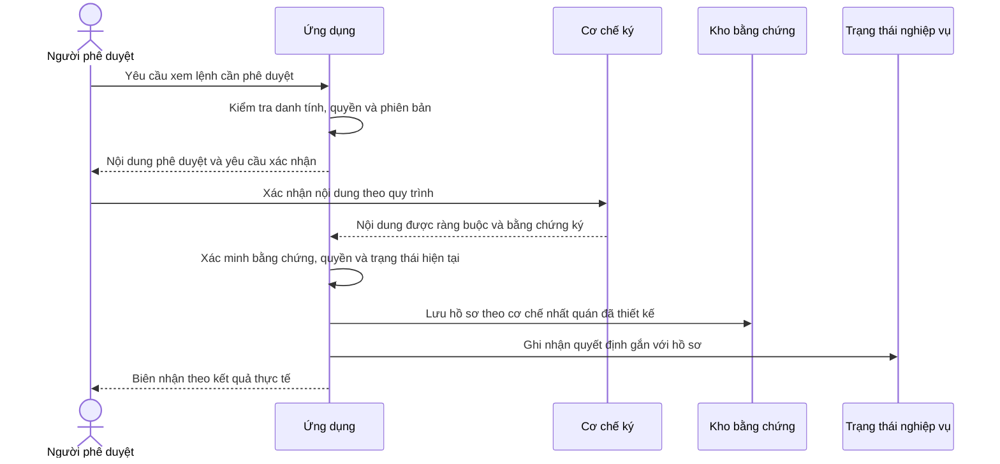

# Non-repudiation

## 1. Chống chối bỏ là mục tiêu gì?

Giả sử một người dùng phê duyệt lệnh thanh toán. Sau đó phát sinh tranh chấp: “Tôi chưa phê duyệt”, “Tôi phê duyệt số tiền khác” hoặc “Hệ thống đã sửa người nhận sau khi tôi xác nhận”.

Một bản ghi “thanh toán được duyệt” chưa đủ để giải quyết các câu hỏi này. Cần biết:

- Chủ thể nào được gắn với hành động?
- Hành động áp dụng cho nội dung chính xác nào?
- Bằng chứng được tạo và bảo vệ như thế nào?
- Có thể kiểm tra lại bằng chứng sau khi phiên đăng nhập đã hết hạn không?
- Những giả định nào giới hạn kết luận?

**Non-repudiation**, thường dịch là **tính chống chối bỏ** hoặc **khả năng chống chối bỏ**, là mục tiêu tạo và duy trì bằng chứng để một bên không thể phủ nhận một hành động hay thông điệp mà không bị đối chiếu với bằng chứng có thể kiểm chứng.

Trong thiết kế bảo mật, cần chuyển mục tiêu này thành yêu cầu về **quy kết chủ thể, ràng buộc nội dung, bảo vệ bằng chứng và khả năng kiểm chứng**. Không nên viết một yêu cầu tuyệt đối như “người dùng không bao giờ chối bỏ được”.

Bằng chứng kỹ thuật có thể hỗ trợ đánh giá một tranh chấp, nhưng không tự chứng minh mọi yếu tố về ý chí của con người hoặc quyết định cách một cơ quan có thẩm quyền sẽ đánh giá nó. Tài khoản bị chiếm, khóa bị lộ, thiết bị bị kiểm soát hoặc quy trình gắn danh tính không đáng tin đều có thể làm suy yếu kết luận.

Bài học thuộc chương **Mục tiêu bảo mật** và sử dụng tình huống giả định về phê duyệt thanh toán trong hệ thống nhiều tenant. Các yêu cầu và ngưỡng minh họa cần được điều chỉnh theo tài sản, mô hình đe dọa và nghĩa vụ thực tế.

## 2. Phân biệt với các mục tiêu bảo mật liên quan

| Khái niệm | Câu hỏi chính | Giới hạn khi dùng làm bằng chứng chống chối bỏ |
| --- | --- | --- |
| Xác thực | Chủ thể đang tương tác được xác định như thế nào? | Đăng nhập không tự chứng minh đã đồng ý với một nội dung giao dịch cụ thể |
| Phân quyền | Chủ thể có được thực hiện hành động này trên đối tượng này không? | Có quyền phê duyệt không chứng minh đã thực sự phê duyệt |
| Tính toàn vẹn | Nội dung có bị thay đổi ngoài điều kiện cho phép không? | Phát hiện thay đổi không tự xác định ai tạo nội dung |
| Truy vết và trách nhiệm giải trình | Có thể lần theo hoạt động tới chủ thể và bối cảnh không? | Bản ghi có thể do một bên tự tạo, tự sửa hoặc thiếu nội dung quyết định |
| Non-repudiation | Có bằng chứng nào để đối chiếu sự phủ nhận về chủ thể, nội dung hoặc hành động? | Giá trị phụ thuộc nguồn bằng chứng, quản lý khóa, danh tính và quy trình |
| Tính bí mật | Người không có quyền có đọc được dữ liệu không? | Mã hóa dữ liệu không tự chứng minh ai đã đồng ý với dữ liệu đó |

Các mục tiêu bổ trợ nhau. Chữ ký có thể hỗ trợ toàn vẹn và quy kết nguồn, nhưng không thay thế phân quyền. Logging hỗ trợ điều tra, nhưng không tự đạt mọi mức bảo đảm chống chối bỏ.

### 2.1. Không phải mọi hệ thống đều cần cùng mức bảo đảm

Một thao tác thay đổi màu giao diện có thể chỉ cần log vận hành. Một quyết định giải ngân, thay đổi người thụ hưởng hoặc phê duyệt tài liệu quan trọng có thể cần bằng chứng mạnh hơn.

Cần quyết định:

- Tranh chấp nào phải giải quyết?
- Bên nào có thể phủ nhận hoặc thao túng bằng chứng?
- Ai sẽ kiểm tra bằng chứng?
- Trong bao lâu và trong điều kiện nào phải kiểm tra được?
- Tổn thất nếu không chứng minh được là gì?

Mức bảo đảm cần thiết phải đến từ rủi ro và nghĩa vụ, không chỉ từ việc có sẵn một thư viện chữ ký.

### 2.2. Các dạng bằng chứng khác nhau

Có thể cần bằng chứng về:

- **Nguồn gốc:** bên nào tạo hoặc gửi một thông điệp.
- **Phê duyệt:** chủ thể nào xác nhận một nội dung và một hành động.
- **Tiếp nhận:** bên nhận hoặc hệ thống nhận đã tiếp nhận nội dung nào.
- **Giao nhận:** nội dung đã được chuyển tới một điểm hoặc một bên theo điều kiện giao nhận đã xác định.

Không nên dùng một chữ ký của bên gửi để kết luận bên nhận đã đọc nội dung. Một biên nhận của máy chủ có thể chứng minh máy chủ xác nhận tiếp nhận, nhưng chưa chứng minh một cá nhân đã xem hoặc hiểu thông điệp.

Mỗi loại bằng chứng cần mô tả đúng điều nó xác nhận.

## 3. Đặt mục tiêu theo mô hình đe dọa

### 3.1. Bối cảnh minh họa

Một tenant là một tổ chức khách hàng với dữ liệu và quyền riêng. Trong mỗi tenant:

- Người lập tạo lệnh thanh toán.
- Người phê duyệt có quyền duyệt theo chính sách.
- Ứng dụng ghi nhận quyết định và có thể chuyển lệnh sang bước thực hiện.
- Bộ phận kiểm tra cần xác minh quyết định sau này.

Những tài sản quan trọng gồm nội dung lệnh, quyền phê duyệt, danh tính, khóa ký, trạng thái quyết định và hồ sơ bằng chứng.

### 3.2. Các tình huống cần xét

| Mã | Tình huống | Khoảng cần được bảo vệ |
| --- | --- | --- |
| R-NR-01 | Người dùng phủ nhận đã phê duyệt | Liên kết giữa chủ thể và hành động |
| R-NR-02 | Người dùng nói số tiền hoặc người nhận đã bị đổi | Liên kết giữa bằng chứng và nội dung chính xác |
| R-NR-03 | Quản trị viên sửa log để quy trách nhiệm cho người khác | Tính toàn vẹn và khả năng kiểm tra độc lập của bằng chứng |
| R-NR-04 | Kẻ tấn công gửi lại một phê duyệt cũ | Tính duy nhất, phiên bản và điều kiện sử dụng |
| R-NR-05 | Khóa hoặc tài khoản bị chiếm | Giới hạn của việc quy kết và quy trình xử lý sự cố |
| R-NR-06 | Sau phục hồi, chỉ còn trạng thái đã duyệt mà mất bằng chứng | Tính đầy đủ và nhất quán của hồ sơ |
| R-NR-07 | Hết hạn chứng thư hoặc thay khóa làm không kiểm tra được hồ sơ cũ | Khả năng kiểm chứng trong thời gian lưu giữ |

Nếu mô hình đe dọa có quản trị viên độc hại, một bảng log mà cùng quản trị viên có thể sửa cả nội dung lẫn giá trị băm sẽ có giới hạn khác với bằng chứng được bảo vệ bởi một miền quản lý độc lập.

Không thể chọn biện pháp phù hợp khi chưa nói rõ ai được tin và ai có khả năng thao túng từng phần.

### 3.3. Các giả định cần ghi rõ

Ví dụ:

- Danh tính gắn với khóa hoặc tài khoản được thiết lập theo quy trình nào?
- Khóa riêng do người dùng, thiết bị, tổ chức hay máy chủ quản lý?
- Ai có quyền yêu cầu hệ thống ký?
- Bên xác minh tin cậy nguồn khóa công khai nào?
- Đồng hồ hoặc dịch vụ thời gian có vai trò gì?
- Người dùng nhìn thấy nội dung nào trước khi xác nhận?
- Bằng chứng có còn dùng được nếu tài khoản hoặc dịch vụ ban đầu không tồn tại nữa không?

Các giả định chưa xác minh phải được ghi nhận. Không biến một giả định về người giữ khóa thành một sự thật đã được chứng minh.

## 4. Một hồ sơ bằng chứng cần ràng buộc những gì?

Mục tiêu là ngăn bằng chứng của hành động A bị dùng để giải thích cho hành động B hoặc cho phiên bản nội dung khác.

### 4.1. Nội dung phê duyệt cần đủ cụ thể

Một thông điệp minh họa:

```json
{
  "schemaVersion": "1",
  "purpose": "payment-approval",
  "tenantId": "tenant-example",
  "paymentId": "payment-example",
  "paymentVersion": 7,
  "action": "APPROVE",
  "amountMinor": 1250000,
  "currency": "VND",
  "beneficiaryRef": "beneficiary-example",
  "approvalRequestId": "approval-request-example",
  "challengeId": "challenge-example",
  "policyVersion": "approval-policy-example"
}
```

Đây chỉ là mẫu nội dung, không phải định dạng chuẩn sẵn dùng.

Các trường có vai trò:

- `purpose` và `action` giới hạn ý nghĩa của thông điệp.
- `tenantId`, `paymentId` và `paymentVersion` gắn đúng phạm vi, đối tượng và phiên bản.
- Số tiền, đơn vị tiền tệ và người thụ hưởng ràng buộc nội dung nghiệp vụ.
- Định danh yêu cầu và challenge hỗ trợ phân biệt lần xác nhận, chống dùng lại theo quy trình.
- Phiên bản chính sách hỗ trợ giải thích điều kiện được áp dụng tại thời điểm đó.

Nếu `beneficiaryRef` trỏ tới một đối tượng có thể sửa, chỉ ký mã tham chiếu có thể chưa đủ. Cần ràng buộc tới phiên bản hoặc nội dung người thụ hưởng đã được hiển thị và phê duyệt.

### 4.2. Phải xác định chính xác dữ liệu được ký

Hai biểu diễn nhìn giống nhau có thể khác byte. Một giá trị tiền cũng có thể bị hiểu khác nếu thiếu đơn vị hoặc quy tắc biểu diễn.

Cần đặc tả:

- Dùng dữ liệu gốc nào và cách đóng gói xác định.
- Quy tắc mã hóa ký tự, kiểu số và trường bắt buộc.
- Cách xử lý trường thừa, thiếu, trùng hoặc không nhận diện.
- Cách liên kết tới tệp đính kèm hay nội dung dài.
- Thuật toán và tham số được phép theo cấu hình tin cậy.

Nếu dùng JSON hoặc định dạng có nhiều biểu diễn tương đương, cần chọn cơ chế tuần tự hóa hoặc chuẩn hóa phù hợp. Không giả định mọi thư viện sẽ tự sinh ra cùng một chuỗi byte.

Không tự thiết kế thuật toán mật mã. Dùng cơ chế và thư viện phù hợp, rồi đặc tả rõ nội dung và chính sách xác minh mà hệ thống chịu trách nhiệm.

### 4.3. Bằng chứng không chỉ có chữ ký

Tùy mức bảo đảm, hồ sơ có thể gồm:

| Thành phần | Mục đích |
| --- | --- |
| Nội dung chính xác được phê duyệt | Biết hành động áp dụng cho dữ liệu nào |
| Chữ ký và thông tin định dạng | Kiểm tra ràng buộc mật mã |
| Liên kết khóa với chủ thể | Giải thích khóa thuộc hoặc được sử dụng thay mặt cho ai |
| Bối cảnh quyền và chính sách | Biết hành động có được cấp quyền trong điều kiện nào |
| Định danh yêu cầu và đối tượng | Liên kết hồ sơ với trạng thái nghiệp vụ |
| Biên nhận của hệ thống | Biết hệ thống xác nhận tiếp nhận hoặc hoàn tất bước nào |
| Bằng chứng thời gian phù hợp | Hỗ trợ xác định dữ liệu đã tồn tại hoặc sự kiện được ghi nhận vào lúc nào |
| Dữ liệu phục vụ kiểm tra lâu dài | Có thể kiểm tra theo chính sách sau khi đổi khóa hoặc kết thúc phiên |

Không cần thu thập mọi dữ liệu có thể có. Cần giữ đủ để kiểm chứng mục tiêu, đồng thời hạn chế dữ liệu cá nhân và bí mật không cần thiết.

## 5. Chọn cơ chế bằng chứng và hiểu giới hạn

### 5.1. Giá trị băm không tự chứng minh người tạo

Giá trị băm giúp đối chiếu nội dung khi có một giá trị kỳ vọng đáng tin cậy. Nếu một người có thể sửa nội dung và sửa luôn giá trị băm lưu cùng nơi, phép băm riêng lẻ không phát hiện được sự thay đổi đó.

Một giá trị băm cũng không tự gắn dữ liệu với người dùng. “Có hash” chưa phải bằng chứng chống chối bỏ về chủ thể.

### 5.2. HMAC có giới hạn khi nhiều bên cùng giữ bí mật

HMAC có thể hỗ trợ xác thực thông điệp và toàn vẹn trong mô hình dùng khóa bí mật chung. Tuy nhiên, các bên có khả năng tạo cùng một HMAC không dễ chứng minh cho một bên độc lập rằng chỉ một bên cụ thể đã tạo thông điệp.

Vì vậy, không nên mặc định một HMAC giữa ứng dụng và đối tác tạo ra cùng khả năng quy kết như chữ ký dùng khóa riêng được quản lý tách biệt.

HMAC vẫn có thể phù hợp cho mục tiêu bảo vệ giao tiếp đã xác định. Điều cần tránh là kết luận vượt quá mô hình giữ khóa.

### 5.3. Chữ ký số hỗ trợ bằng chứng, không tự chứng minh mọi yếu tố

Chữ ký số cho phép kiểm tra mối liên hệ giữa dữ liệu, chữ ký và khóa công khai theo thuật toán. Khả năng quy kết tới một chủ thể còn phụ thuộc:

- Cách thiết lập danh tính và gắn với khóa.
- Khả năng bảo vệ và giới hạn sử dụng khóa riêng.
- Quy trình xác nhận nội dung.
- Bằng chứng về thời điểm, trạng thái khóa và sự cố.
- Cấu hình tin cậy của bên xác minh.

Bất kỳ ai dùng được khóa riêng theo cách vượt kiểm soát đều có thể làm suy yếu lập luận về người thực hiện. Vì vậy, phát biểu “chữ ký hợp lệ chứng minh chắc chắn cá nhân đó đã tự nguyện thao tác” là quá mạnh.

### 5.4. Chữ ký máy chủ xác nhận điều gì?

Nếu ứng dụng ký một biên nhận bằng khóa máy chủ, biên nhận có thể chứng minh ứng dụng hoặc tổ chức vận hành đã đưa ra xác nhận tương ứng, trong các giả định về khóa và quy trình.

Nó không tự biến thành chữ ký riêng của người dùng. Nếu máy chủ có thể tự tạo cả dữ liệu yêu cầu lẫn chữ ký, mô hình vẫn dựa vào độ tin cậy của máy chủ về việc ai đã yêu cầu.

Cần phân biệt:

- Người dùng ký nội dung bằng cơ chế gắn với khóa của họ.
- Tổ chức ký thay mặt theo một quy trình được định nghĩa.
- Máy chủ ký xác nhận rằng nó quan sát được một yêu cầu từ một phiên.

Ba mô hình có thể phục vụ các mức bảo đảm khác nhau và phải được mô tả đúng.

### 5.5. TLS và MFA không thay thế bằng chứng giao dịch

TLS bảo vệ một kênh truyền theo mô hình của nó. Nó không tự cung cấp hồ sơ bền vững, có thể đưa ra sau này để chứng minh người dùng đã phê duyệt chính xác nội dung nào.

MFA tăng mức bảo vệ xác thực. Nếu người dùng hoàn tất MFA để đăng nhập rồi ứng dụng tự tạo một giao dịch khác, việc đăng nhập không tự chứng minh đồng ý với giao dịch đó.

Với hành động nhạy cảm, cần ràng buộc bước xác nhận với nội dung cụ thể và mô tả rõ cơ chế nào cung cấp bằng chứng.

## 6. Thiết kế một luồng phê duyệt có bằng chứng

Luồng dưới đây minh họa mô hình có bằng chứng ký cho nội dung phê duyệt. Cơ chế giữ khóa và ký phải được lựa chọn theo mức bảo đảm cần đạt.



Sơ đồ là luồng logic. Nó chưa giả định hai kho có thể tham gia cùng một giao dịch kỹ thuật. Thiết kế thực tế phải giải quyết tính nhất quán và các điểm lỗi giữa các bước.

### 6.1. Hiển thị và xác nhận đúng nội dung

Người phê duyệt cần được hiển thị các yếu tố quyết định như hành động, số tiền, đơn vị tiền tệ, người nhận và đối tượng liên quan.

Nội dung hiển thị phải ràng buộc với nội dung được ký hoặc xác nhận. Nếu giao diện hiển thị một lệnh nhưng thành phần ký xử lý một lệnh khác, chữ ký hợp lệ về mật mã vẫn không giải quyết được tranh chấp về nội dung được trình bày.

Độ tin cậy của thiết bị, giao diện và đường truyền tới thành phần ký là một phần của mô hình đe dọa. Một thông báo “xác nhận” chung chung không tự tạo ra bằng chứng về sự đồng ý với chi tiết giao dịch.

### 6.2. Xác minh lại trước khi tạo tác động

Giữa lúc xem và lúc gửi bằng chứng, nội dung hoặc quyền có thể đã thay đổi.

Máy chủ cần kiểm tra:

- Bằng chứng áp dụng cho đúng tenant, hành động, đối tượng và phiên bản.
- Chủ thể gắn với bằng chứng đáp ứng yêu cầu danh tính.
- Quyền phê duyệt hiện tại và trạng thái nghiệp vụ cho phép hành động.
- Challenge hoặc yêu cầu xác nhận còn hợp lệ theo chính sách.
- Bằng chứng chưa bị dùng để tạo một tác động không được phép lặp.
- Không có thay đổi nội dung sau bước được ràng buộc.

Chữ ký không tự ngăn replay. Định danh duy nhất trong nội dung chỉ có ích khi hệ thống kiểm tra và lưu trạng thái sử dụng phù hợp, kể cả khi có yêu cầu đồng thời hoặc thử lại.

### 6.3. Ràng buộc trạng thái nghiệp vụ với bằng chứng

Một trạng thái “đã duyệt” phải dẫn được tới hồ sơ tương ứng. Một hồ sơ phê duyệt cũng phải cho biết hệ thống đã tiếp nhận, đã áp dụng hay đã từ chối hành động.

Cần tránh:

- Nghiệp vụ đã được xác nhận thành công nhưng bằng chứng chưa được lưu bền vững.
- Có chữ ký hợp lệ nhưng hệ thống chưa hề áp dụng quyết định, sau đó lại diễn giải chữ ký như bằng chứng giao dịch đã hoàn tất.
- Gửi lại yêu cầu tạo thêm một lần phê duyệt hoặc thanh toán.
- Phục hồi dữ liệu chỉ giữ một bên của liên kết.

Có thể cần trạng thái trung gian như “đã nhận, đang xác minh” hoặc một cơ chế ghi nhất quán giữa thay đổi và hồ sơ. Biên nhận phải nói đúng trạng thái, không gọi bước tiếp nhận là giao dịch thanh toán đã hoàn tất.

## 7. Chuyển mục tiêu thành yêu cầu cụ thể

Các yêu cầu dưới đây là mẫu cấu trúc để áp dụng cho ví dụ. Chúng cần được bổ sung nguồn nghĩa vụ, chủ sở hữu, môi trường và chính sách cụ thể trong dự án.

### 7.1. SR-NR-01 — Ràng buộc nội dung quyết định

Đối với phê duyệt thanh toán, bằng chứng phải ràng buộc tối thiểu hành động, tenant, mã và phiên bản lệnh, số tiền, đơn vị tiền tệ, người thụ hưởng theo phiên bản được xác định và định danh yêu cầu phê duyệt.

Nếu nội dung quyết định thay đổi, ứng dụng không được dùng bằng chứng của phiên bản cũ để phê duyệt phiên bản mới.

**Tiêu chí chấp nhận:**

- Bằng chứng đúng nội dung được xử lý theo quyền và trạng thái hợp lệ.
- Thay đổi từng trường quyết định làm bằng chứng không còn được chấp nhận cho nội dung mới.
- Một bằng chứng không được sử dụng cho tenant, lệnh hoặc hành động khác.
- Thiếu trường hoặc biểu diễn dữ liệu không đúng hợp đồng bị xử lý theo quy tắc đã xác định.

### 7.2. SR-NR-02 — Quy kết theo mô hình danh tính và khóa

Ứng dụng chỉ được chấp nhận bằng chứng khi xác định được chủ thể hoặc vai trò ký theo mô hình đã chọn, xác minh bằng cơ chế và nguồn tin cậy được chấp thuận, đồng thời kiểm tra quyền nghiệp vụ độc lập.

Khóa công khai hoặc chứng thư kèm thông điệp không được tự trở thành đáng tin chỉ vì chữ ký khớp với chính khóa đó.

**Tiêu chí chấp nhận:**

- Nguồn khóa không được tin cậy không được chấp nhận.
- Không thể tự khai mã người ký khác để đổi người bị quy kết.
- Khóa hợp lệ của chủ thể không có quyền không tạo được phê duyệt.
- Mô hình ký thay mặt, nếu có, thể hiện đúng bên ủy quyền và phạm vi.
- Hồ sơ cho phép giải thích vì sao khóa được gắn với chủ thể trong bối cảnh đó.

### 7.3. SR-NR-03 — Ngăn sử dụng lại sai mục đích

Ứng dụng không được tạo thêm tác động nghiệp vụ từ việc gửi lại cùng yêu cầu hoặc bằng chứng phê duyệt. Bằng chứng cũ không được áp dụng cho phiên bản nội dung mới.

**Tiêu chí chấp nhận:**

- Gửi lại cùng yêu cầu trả kết quả nhất quán hoặc bị từ chối theo hợp đồng.
- Các yêu cầu đồng thời không tạo tác động trùng.
- Bằng chứng của hành động xem không được dùng làm bằng chứng phê duyệt.
- Challenge hết hiệu lực không được tạo quyết định mới theo chính sách áp dụng.

Đây là phần bổ trợ để bằng chứng không bị đặt vào bối cảnh sai. Nó không thay thế việc kiểm tra chữ ký hoặc quyền.

### 7.4. SR-NR-04 — Lưu bền vững và liên kết nhất quán

Ứng dụng không được xác nhận phê duyệt hoàn tất nếu chưa đáp ứng điều kiện lưu bền vững hồ sơ và liên kết với trạng thái nghiệp vụ theo thiết kế đã phê duyệt.

Thiết kế phải nêu cách phục hồi khi lỗi xảy ra giữa lưu bằng chứng và ghi nhận quyết định.

**Tiêu chí chấp nhận:**

- Giả lập lỗi tại các điểm quan trọng để kiểm tra không có trạng thái thành công thiếu hồ sơ theo nghĩa vụ.
- Hồ sơ tiếp nhận nhưng chưa áp dụng không bị diễn giải là quyết định hoàn tất.
- Thử lại không tạo tác động trùng.
- Có thể đối soát hồ sơ với dữ liệu nghiệp vụ và phát hiện bất nhất.

### 7.5. SR-NR-05 — Bảo vệ và kiểm chứng trong thời gian lưu giữ

Trong thời gian lưu theo chính sách, hồ sơ phải đủ để bên được cấp quyền kiểm tra nội dung, chủ thể theo mô hình tin cậy và kết quả xử lý. Thay đổi hoặc thiếu thành phần ảnh hưởng tới kết luận phải được phát hiện hoặc được báo là không đủ bằng chứng.

Nội dung đã ký không được âm thầm ghi đè. Nếu cần đính chính, phải tạo một hồ sơ liên kết mới và giữ lịch sử theo chính sách.

**Tiêu chí chấp nhận:**

- Sửa nội dung, thay chữ ký, tráo hồ sơ hoặc bỏ thành phần bắt buộc không cho kết luận hợp lệ.
- Sau thay khóa hoặc đóng tài khoản, hồ sơ cũ vẫn được kiểm tra theo chính sách đã nêu.
- Kết quả phân biệt hợp lệ, không hợp lệ và chưa đủ bằng chứng.
- Bằng chứng được phục hồi cùng dữ liệu liên quan theo yêu cầu phục hồi.

Nếu cần thời hạn cụ thể, phải nêu nguồn và lý do chọn. Không mặc định mọi loại bằng chứng phải lưu vĩnh viễn.

### 7.6. Yêu cầu định lượng phải nói rõ điều đo được

Có thể cần đặt giới hạn cho:

- Thời gian một yêu cầu xác nhận còn được sử dụng.
- Thời gian phát hiện và ngừng chấp nhận khóa đã bị thu hồi.
- Độ trễ lưu bền vững hoặc truy xuất hồ sơ.
- Thời gian giữ bằng chứng.
- RPO/RTO của kho hồ sơ và dữ liệu nghiệp vụ.

Mỗi đại lượng cần mốc đo, phạm vi, điều kiện lỗi và cách kiểm chứng.

Ví dụ, “truy xuất hồ sơ trong 30 giây” còn thiếu kích thước hồ sơ, tải, điểm bắt đầu/kết thúc và quy tắc xử lý lỗi. Các yêu cầu hiệu năng không được cho phép bỏ xác minh hoặc kết luận hợp lệ khi thiếu dữ liệu để đạt thời gian.

## 8. Quản lý khóa và danh tính quyết định mức quy kết

### 8.1. Ai thực sự kiểm soát khóa?

Nếu khóa riêng của người dùng được máy chủ lưu dưới dạng mà quản trị viên ứng dụng có thể dùng tùy ý, cần đánh giá lại phát biểu “chỉ người dùng có thể ký”.

Một thiết bị bảo vệ khóa hoặc dịch vụ quản lý khóa có thể giảm rủi ro xuất khóa, nhưng vẫn cần kiểm soát ai được yêu cầu ký và ký nội dung nào. Bảo vệ khóa khỏi sao chép không tự ngăn việc sử dụng khóa trái phép qua giao diện được cấp quyền.

Cần đặc tả:

- Cách tạo, cấp và liên kết khóa với danh tính.
- Quyền kích hoạt thao tác ký.
- Điều kiện xác nhận với nội dung cụ thể.
- Tách nhiệm vụ quản trị và phê duyệt khi cần.
- Thu hồi, thay khóa và phản ứng khi nghi lộ khóa.
- Bằng chứng về ủy quyền khi một dịch vụ ký thay mặt.

Không đưa khóa riêng, mật khẩu hoặc mã xác thực vào hồ sơ bằng chứng hay log.

### 8.2. Tài khoản dùng chung làm yếu khả năng quy trách nhiệm

Nếu nhiều người cùng dùng một tài khoản và một khóa, hệ thống có thể chỉ gắn hành động với tài khoản hoặc tổ chức đó, không đủ căn cứ phân biệt cá nhân.

Nếu mục tiêu là quy trách nhiệm tới từng người, yêu cầu phải bao gồm định danh phù hợp và quy trình sử dụng tương ứng. Không thể bù hoàn toàn khoảng trống này bằng cách thêm trường “tên người thao tác” do máy khách tự gửi.

### 8.3. Khóa bị lộ không làm mọi hồ sơ có cùng kết luận

Khi phát hiện khóa bị xâm phạm, cần xác định phạm vi nghi ngờ và thu thập bằng chứng liên quan. Không tự kết luận tất cả chữ ký lịch sử đều giả, cũng không mặc định tất cả chữ ký trước lúc phát hiện đều đáng tin.

Thời điểm phát hiện có thể muộn hơn thời điểm lộ khóa. Nếu không xác định được mốc xâm phạm, phải thể hiện độ không chắc chắn trong kết luận.

Lưu trạng thái và dữ liệu cần thiết để đánh giá theo thời điểm là quan trọng, nhưng kết luận vẫn phụ thuộc mô hình tin cậy và chất lượng bằng chứng.

## 9. Thời gian, chứng thư và khả năng kiểm chứng lâu dài

### 9.1. Thời gian người ký tự khai có giới hạn

Một trường `signedAt` nằm trong nội dung được ký chứng minh rằng khóa đã ký cả giá trị đó. Nó không tự chứng minh đồng hồ đúng hoặc chữ ký thực sự được tạo tại thời điểm được khai báo.

Tương tự, thời gian trong log ứng dụng phụ thuộc nguồn đồng hồ và khả năng bảo vệ log.

Cần nói rõ đang dùng:

- Thời gian do chủ thể khai.
- Thời gian máy chủ tiếp nhận.
- Thời gian do nguồn được tin cậy xác nhận.
- Thứ tự hoặc điểm tiến triển của một sổ sự kiện.

Các loại thời gian không tự thay thế nhau.

### 9.2. Dấu thời gian hỗ trợ điều gì?

Một dịch vụ dấu thời gian đáng tin cậy có thể cung cấp bằng chứng rằng dữ liệu hoặc dấu vết nội dung đã tồn tại không muộn hơn mốc do dịch vụ xác nhận, theo cơ chế và giả định áp dụng.

Nó không tự chứng minh nội dung đúng về nghiệp vụ, người dùng đã đọc nội dung hay khóa chưa từng bị lộ trước mốc đó.

Bằng chứng thời gian cũng cần được xác minh bằng nguồn tin cậy và lưu các thành phần cần thiết cho thời gian đánh giá.

### 9.3. Hết hạn hiện tại không tự quyết định giá trị hồ sơ cũ

Một chứng thư hết hạn ở hiện tại không tự đồng nghĩa chữ ký lịch sử không còn kiểm tra được hoặc chắc chắn không hợp lệ.

Đánh giá lịch sử có thể cần:

- Khóa công khai và chuỗi tin cậy phù hợp.
- Chính sách xác minh áp dụng.
- Bằng chứng thời gian đủ tin cậy.
- Thông tin trạng thái hoặc thu hồi có liên quan.
- Nội dung chính xác đã được ký.
- Dữ liệu về sự cố và các giới hạn đã biết.

Không được giả định một yêu cầu gọi trực tuyến tới nguồn trạng thái trong hiện tại luôn trả lời đủ câu hỏi về quá khứ.

### 9.4. Lưu giữ dài hạn là một bài toán riêng

Nếu thời gian lưu dài, thuật toán, định dạng, thư viện, nguồn khóa hoặc dịch vụ có thể thay đổi. Cần có kế hoạch duy trì khả năng đọc và kiểm chứng, lưu căn cứ tin cậy và đánh giá lại khi cơ chế bảo vệ suy yếu.

Không sửa nội dung gốc đã ký chỉ để chuyển định dạng. Có thể cần bảo quản bản gốc và tạo hồ sơ bổ sung hoặc cơ chế bảo vệ tiếp theo theo quy trình đã định.

Một kế hoạch “giữ tệp chữ ký” nhưng không giữ nội dung và thông tin xác minh có thể không đủ cho mục tiêu lâu dài.

## 10. Logging, lưu trữ và phục hồi hỗ trợ chống chối bỏ

### 10.1. Log vận hành và hồ sơ bằng chứng có vai trò khác nhau

Log vận hành giúp chẩn đoán và tương quan sự kiện. Hồ sơ bằng chứng cần giữ được các thành phần đáp ứng mục tiêu kiểm chứng đã xác định.

Có thể dùng mã hồ sơ để liên kết từ log tới nơi lưu bằng chứng, thay vì chép toàn bộ nội dung nhạy cảm vào mọi hệ thống quan sát.

| Dữ liệu | Nơi lưu phù hợp theo thiết kế | Lưu ý |
| --- | --- | --- |
| Mã yêu cầu và mã hồ sơ | Log và kho bằng chứng | Phải tương quan được nhưng không tự chứa quyền truy cập |
| Nội dung được phê duyệt | Kho bằng chứng có quyền truy xuất phù hợp | Giữ đúng dữ liệu đã được ràng buộc |
| Chữ ký và dữ liệu xác minh | Kho bằng chứng | Bảo đảm đủ ngữ cảnh kiểm tra |
| Kết quả xử lý nghiệp vụ | Dữ liệu nghiệp vụ và hồ sơ liên kết | Phân biệt tiếp nhận, chấp nhận và hoàn tất |
| Khóa riêng và bí mật xác thực | Hệ thống quản lý bí mật hoặc khóa phù hợp | Không đưa vào log hay bộ hồ sơ xuất cho kiểm tra |

Nếu chỉ giữ hash mà không thể cung cấp nội dung gốc hoặc một biểu diễn tương ứng đáng tin cậy, bên kiểm tra có thể không biết chính xác điều gì đã được phê duyệt. Ngược lại, giữ nội dung gốc ở mọi nơi làm tăng nguy cơ lộ dữ liệu. Cần thiết kế nơi lưu và quyền truy xuất có chủ đích.

### 10.2. Bảo vệ khỏi sửa và xóa theo mô hình đe dọa

Biện pháp có thể gồm quyền ghi hạn chế, tách nhiệm vụ, lưu chỉ bổ sung, bảo vệ tính toàn vẹn bằng mật mã, đối soát và bản sao thuộc miền quản lý khác.

Mỗi biện pháp có giới hạn:

- Chế độ chỉ bổ sung phải được đánh giá cùng quyền quản trị có thể thay cấu hình hoặc xóa nơi lưu.
- Chuỗi hash cần một điểm neo đáng tin cậy; nếu có thể thay toàn bộ chuỗi và điểm đối chiếu, khả năng phát hiện bị giảm.
- Mã hóa hỗ trợ bí mật nhưng không tự bảo đảm không bị xóa.
- Một chữ ký trên hồ sơ không tự bảo đảm hồ sơ luôn sẵn có.

Không cần mặc định dùng blockchain hoặc một công nghệ lưu trữ cụ thể. Chọn biện pháp theo bên có thể thao túng bằng chứng và mức kiểm chứng cần đạt.

### 10.3. Phục hồi phải giữ được quan hệ bằng chứng–nghiệp vụ

Bản sao lưu cần bao phủ các thành phần cần thiết, không chỉ trạng thái “đã duyệt”.

Diễn tập phục hồi nên kiểm tra:

1. Có đọc được hồ sơ và nội dung chính xác không?
2. Có đủ dữ liệu xác minh và căn cứ tin cậy không?
3. Có giải mã được dữ liệu theo quyền phù hợp không?
4. Có phát hiện trạng thái nghiệp vụ thiếu hồ sơ hoặc hồ sơ chưa áp dụng không?
5. Có khôi phục trạng thái ngăn sử dụng lại và thông tin thu hồi cần thiết không?
6. Có tránh tạo tác động trùng khi tiếp tục xử lý không?

Nếu kho nghiệp vụ và kho bằng chứng có điểm phục hồi khác nhau, cần quy tắc đối soát trước khi mở lại phần chức năng liên quan.

Thời gian phục hồi nhanh không bù được việc mất bằng chứng mà mục tiêu yêu cầu phải giữ.

### 10.4. Lưu giữ phải cân bằng bằng chứng và dữ liệu

Nội dung phê duyệt có thể chứa dữ liệu cá nhân hoặc thông tin tài chính. Yêu cầu lưu giữ cần nêu mục đích, thời hạn theo nguồn áp dụng, người được truy xuất và cách xử lý khi hết hạn.

Không thể vừa xóa các thành phần bắt buộc cho phép kiểm chứng vừa tuyên bố mọi hồ sơ vẫn xác minh đầy đủ, trừ khi có thiết kế thay thế đã được đánh giá cho mục tiêu đó.

Nếu có yêu cầu lưu giữ và xóa xung đột, cần làm rõ theo chủ sở hữu nghĩa vụ; không giải quyết bằng cách tự giữ vĩnh viễn hoặc tự xóa bằng chứng.

## 11. Kiểm chứng mục tiêu bằng nhiều loại bằng chứng

### 11.1. Ma trận kiểm thử minh họa

| Tình huống | Kết quả cần quan sát |
| --- | --- |
| Nội dung, chủ thể, quyền và trạng thái đều hợp lệ | Quyết định được xử lý và liên kết đúng hồ sơ |
| Đổi số tiền, đơn vị tiền tệ hoặc người nhận | Không chấp nhận bằng chứng cũ cho nội dung mới |
| Đổi tenant, mã lệnh hoặc phiên bản | Không tạo tác động trên đối tượng khác |
| Thay khóa công khai bằng khóa do bên gửi tự chọn | Không vượt được chính sách nguồn tin cậy |
| Chữ ký khớp nhưng chủ thể không có quyền | Không phê duyệt nghiệp vụ |
| Gửi lại hoặc gửi đồng thời cùng bằng chứng | Không tạo tác động lặp |
| Kho bằng chứng lỗi tại điểm nhạy cảm | Không báo hoàn tất trái điều kiện lưu bền vững |
| Thiếu nội dung gốc hoặc dữ liệu xác minh bắt buộc | Không kết luận hợp lệ đầy đủ; nêu thành phần thiếu |
| Đổi khóa rồi kiểm tra hồ sơ cũ | Xử lý theo chính sách lịch sử, không mất liên kết danh tính |
| Phục hồi từ bản sao lưu | Kiểm tra được hồ sơ và đối soát được trạng thái |
| Dữ liệu hoặc chỉ mục bằng chứng bị sửa | Phát hiện bất nhất trong phạm vi kiểm soát đã thiết kế |
| Dịch vụ thời gian hoặc trạng thái khóa không sẵn sàng | Phân loại theo yêu cầu, không tự bỏ bước bắt buộc |

Đây là các hướng kiểm chứng, không phải bằng chứng đã có cho một hệ thống thực tế.

### 11.2. Tách ba câu hỏi kiểm tra

Một quy trình xác minh nên phân biệt:

1. **Kiểm tra mật mã:** nội dung có khớp chữ ký với khóa được dùng không?
2. **Kiểm tra tin cậy và quy kết:** khóa được chấp nhận theo căn cứ nào, gắn với chủ thể nào và trong bối cảnh thời gian nào?
3. **Kiểm tra nghiệp vụ:** bằng chứng có được áp dụng đúng quyền, đúng phiên bản và đúng trạng thái không?

Một chữ ký khớp về toán học vẫn có thể không được chấp nhận theo chính sách tin cậy. Một bằng chứng hợp lệ về nguồn vẫn có thể không đủ để thực hiện nghiệp vụ.

Kết quả kiểm tra nên nêu lý do và phân biệt ít nhất:

- Đáp ứng các điều kiện xác minh trong phạm vi.
- Không đáp ứng điều kiện xác minh.
- Chưa đủ thông tin để kết luận.

Không gộp lỗi truy cập nguồn trạng thái với kết luận chữ ký giả. Cũng không coi việc chưa truy cập được dữ liệu cần thiết là lý do để tự cho qua.

### 11.3. Không chỉ kiểm tra chữ ký

Rà soát thiết kế cần xem quản lý khóa, ánh xạ danh tính, quyền kích hoạt ký, nội dung hiển thị và các đường quản trị.

Kiểm thử tích hợp cần xem hành vi khi lỗi, dùng lại và thay đổi nội dung. Diễn tập phục hồi cần xem tính đầy đủ và nhất quán của bằng chứng.

Một phép thử “ký rồi verify thành công” chỉ kiểm tra một phần rất nhỏ. Nó không chứng minh người dùng đã thấy đúng nội dung, khóa được quản lý tốt hoặc quản trị viên không thể tạo hồ sơ giả theo mô hình đe dọa.

### 11.4. Kiểm tra bởi bên khác có nghĩa gì?

Nếu mục tiêu đòi hỏi một bên độc lập kiểm chứng, cần xác định bên đó nhận được gì và tin cậy những nguồn nào.

Một bộ xuất hồ sơ có thể cần nội dung, chữ ký, thông tin xác minh, biên nhận, liên kết đối tượng và chính sách áp dụng. Công cụ xác minh không nên chỉ hỏi cùng máy chủ “hồ sơ này có hợp lệ không?” rồi lặp lại câu trả lời nếu mô hình đe dọa có chính máy chủ thao túng.

Mức độc lập phải được mô tả cụ thể. Không phải mọi hệ thống đều cần cùng cách kiểm chứng, nhưng hệ thống phải đáp ứng đúng mức đã tuyên bố.

## 12. Những nhầm lẫn thường gặp

| Phát biểu | Điểm thiếu hoặc sai | Cách làm rõ |
| --- | --- | --- |
| “Có log là chống chối bỏ” | Chưa biết ai tạo/sửa được log và log ràng buộc nội dung nào | Đặc tả nguồn, toàn vẹn, nội dung và khả năng kiểm chứng |
| “Có hash nên biết ai phê duyệt” | Hash không tự gắn chủ thể | Bổ sung mô hình quy kết và bằng chứng phù hợp |
| “HMAC chứng minh bên gửi với mọi bên thứ ba” | Bên cùng giữ bí mật có thể tạo thông điệp | Nêu giới hạn mô hình khóa chung |
| “Chữ ký hợp lệ thì chắc chắn đúng người tự nguyện ký” | Bỏ qua lộ khóa, thiết bị và quy trình xác nhận | Nêu giả định và giới hạn của kết luận |
| “Máy chủ ký thay nên người dùng không thể phủ nhận” | Có thể chỉ chứng minh máy chủ đưa ra lời xác nhận | Mô tả đúng bên ký và điều được xác nhận |
| “Đăng nhập MFA là đồng ý mọi giao dịch sau đó” | Không ràng buộc nội dung cụ thể | Thiết kế bước xác nhận gắn nội dung |
| “Có timestamp trong JSON nên thời gian chắc đúng” | Thời gian tự khai có thể không đáng tin | Nêu nguồn thời gian và loại bằng chứng |
| “Chứng thư hết hạn hôm nay thì mọi hồ sơ cũ vô hiệu” | Nhầm kiểm tra hiện tại với đánh giá lịch sử | Dùng chính sách và dữ liệu xác minh theo thời điểm |
| “Chữ ký tự ngăn gửi lại” | Bằng chứng hợp lệ có thể bị dùng lại | Kiểm tra định danh, phiên bản và trạng thái sử dụng |
| “Lưu bất biến là đủ” | Chưa giải quyết danh tính, nội dung và tính sẵn có | Liên kết toàn bộ chuỗi bằng chứng |

## 13. Chọn mức bảo đảm và quản lý rủi ro còn lại

Non-repudiation có thể đòi hỏi thêm bước xác nhận, quản lý khóa, lưu giữ dữ liệu và công cụ kiểm chứng. Mức đầu tư phải phù hợp với tác động của tranh chấp.

Có thể xem xét theo trình tự:

1. Xác định hành động và tranh chấp cần giải quyết.
2. Xác định bên có khả năng giả mạo hoặc sửa bằng chứng.
3. Chọn mức quy kết: phiên, tài khoản, tổ chức hay cá nhân theo mô hình cụ thể.
4. Chọn cơ chế ràng buộc nội dung và bảo vệ khóa.
5. Xác định thời gian lưu và mức kiểm chứng độc lập.
6. Kiểm tra tính khả thi, trải nghiệm xác nhận và hành vi khi lỗi.
7. Ghi rõ rủi ro còn lại và người có thẩm quyền quyết định.

Ví dụ, nếu hệ thống chỉ giữ log do ứng dụng ký, nó có thể cung cấp bằng chứng tổ chức ghi nhận thao tác từ một tài khoản. Không được trình bày cùng bằng chứng đó như sự bảo đảm rằng chỉ cá nhân dùng khóa riêng độc lập mới tạo được phê duyệt.

Một biện pháp được thiết kế tốt vẫn có giới hạn: thiết bị người dùng bị chiếm, quy trình cấp danh tính sai hoặc sự thông đồng giữa các vai trò có thể nằm ngoài phần bảo vệ đã đạt. Cần nêu giới hạn và quyết định xử lý, không biến chúng thành cam kết tuyệt đối.

Nếu yêu cầu bắt buộc chưa đáp ứng, ghi trạng thái chưa đạt hoặc chưa đủ bằng chứng. Một quyết định ngoại lệ không làm thay đổi kết quả kỹ thuật.

## 14. Bài tập vận dụng

### Bài 1: Log nói được điều gì?

Ứng dụng ghi: “Tài khoản U đã duyệt lệnh P lúc T”. Quản trị viên có quyền sửa bảng log và trạng thái thanh toán.

Có thể kết luận đã đạt chống chối bỏ trước quản trị viên độc hại không?

**Gợi ý:** chưa đủ. Cần mô hình bằng chứng có khả năng phát hiện hoặc hạn chế thao túng tương ứng, ràng buộc nội dung và căn cứ quy kết. Chỉ có một dòng log do cùng bên kiểm soát chưa đáp ứng mức tuyên bố đó.

### Bài 2: Chữ ký đúng nhưng nội dung bị thay

Người dùng ký số tiền 1.000.000 VND cho người nhận A. Sau đó hệ thống sửa người nhận trong đối tượng được tham chiếu nhưng vẫn dùng cùng mã giao dịch.

Chữ ký còn đủ để chứng minh phê duyệt cho người nhận mới không?

**Gợi ý:** không. Phải ràng buộc nội dung hoặc phiên bản người nhận được phê duyệt. Một tham chiếu thay đổi được có thể làm thiếu liên kết tới nội dung chính xác.

### Bài 3: Bằng chứng ký và kết quả nghiệp vụ

Máy chủ nhận một chữ ký hợp lệ nhưng bị lỗi trước khi ghi nhận quyết định. Một bộ phận khác dùng chữ ký đó để kết luận thanh toán đã hoàn tất.

**Gợi ý:** kết luận vượt quá bằng chứng. Chữ ký phê duyệt, biên nhận tiếp nhận và bằng chứng hoàn tất thanh toán là các sự kiện khác nhau. Hồ sơ phải phân biệt và liên kết chúng.

### Bài 4: Chọn kết luận khi khóa bị lộ

Khóa bị phát hiện lộ hôm nay. Một hồ sơ có thời gian tự khai từ tuần trước nhưng không có thêm căn cứ thời gian đáng tin cậy.

Có thể mặc định hồ sơ được tạo trước lúc lộ khóa không?

**Gợi ý:** không. Thời điểm phát hiện không chắc là thời điểm xâm phạm, còn thời gian tự khai không chứng minh thời điểm thực. Cần dữ liệu bổ sung và kết luận có thể là chưa đủ bằng chứng.

## 15. Câu hỏi trước khi chốt yêu cầu chống chối bỏ

- Cần chứng minh nguồn gốc, phê duyệt, tiếp nhận hay hoàn tất?
- Bằng chứng gắn với chủ thể ở mức nào và ai quản lý khóa?
- Nội dung chính xác, phiên bản, hành động và tenant đã được ràng buộc chưa?
- Người xác nhận có được trình bày đúng nội dung cần phê duyệt không?
- Xác minh bằng chứng có tách khỏi kiểm tra quyền nghiệp vụ không?
- Hệ thống có chống sử dụng lại sai mục đích và tác động trùng không?
- Trạng thái nghiệp vụ có luôn liên kết với hồ sơ đúng nghĩa không?
- Bằng chứng thời gian xác nhận điều gì và không xác nhận điều gì?
- Sau đổi khóa, hết hạn, sự cố và phục hồi còn kiểm tra được gì?
- Kết luận có phản ánh đúng dữ liệu thiếu và giới hạn mô hình tin cậy không?

Mục tiêu chống chối bỏ trở nên có thể triển khai khi hệ thống xác định rõ điều cần chứng minh, tạo bằng chứng ràng buộc đúng chủ thể và nội dung, bảo vệ bằng chứng trong vòng đời lưu giữ, đồng thời cung cấp cách kiểm chứng cùng giới hạn của kết luận.
