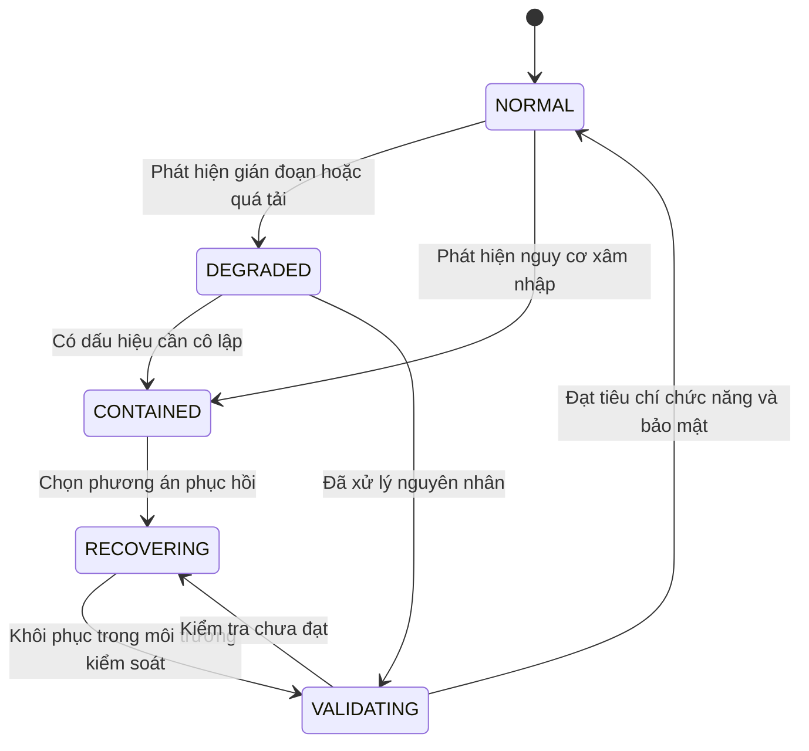
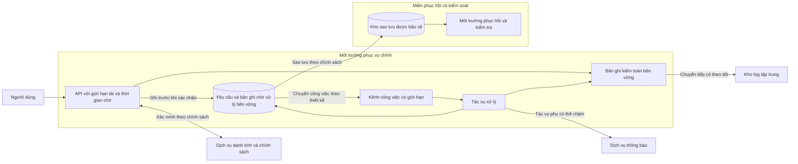

# Resilience — Khả năng chống chịu và phục hồi

## 1. Resilience bảo vệ khả năng tiếp tục phục vụ

Một hệ thống có thể hoạt động ổn định trong điều kiện bình thường nhưng mất khả năng phục vụ khi một phụ thuộc ngừng phản hồi, hàng đợi tăng nhanh, tài khoản bị chiếm quyền hoặc dữ liệu bị phá hoại. Việc khởi động lại một tiến trình không giải quyết được mọi tình huống này.

**Resilience**, hay **khả năng chống chịu và phục hồi**, là khả năng chuẩn bị, chịu tác động, duy trì chức năng thiết yếu ở mức chấp nhận được, phục hồi có kiểm soát và điều chỉnh sau sự cố.

Trong bối cảnh bảo mật, hệ thống còn phải giữ những thuộc tính bảo vệ quan trọng khi chịu áp lực. Tiếp tục trả dữ liệu bằng cách bỏ kiểm tra quyền không đáp ứng mục tiêu chống chịu an toàn. Phục hồi nhanh nhưng dùng dữ liệu đã bị sửa hoặc cấp lại quyền đã bị thu hồi cũng chưa đạt mục tiêu.

Yêu cầu resilience cần trả lời:

- Những chức năng nào phải được ưu tiên khi nguồn lực suy giảm?
- Hệ thống cần chịu được những loại sự cố hoặc hành vi tấn công nào?
- Có thể giảm chất lượng hoặc tạm dừng chức năng nào?
- Những giới hạn bảo mật nào vẫn phải giữ?
- Khi nào được xác nhận đã tiếp nhận một yêu cầu?
- Mất dữ liệu và gián đoạn tới mức nào được chấp nhận?
- Bằng chứng nào xác nhận việc phục hồi đủ an toàn để tiếp tục phục vụ?

Sau bài học này, người học có thể chuyển mục tiêu chống chịu thành yêu cầu về xác thực, phân quyền, dữ liệu, logging và phục hồi; liên kết chúng với rủi ro, kiến trúc và tiêu chí kiểm chứng.

## 2. Phân biệt resilience với các khái niệm liên quan

| Khái niệm | Trọng tâm | Ví dụ | Giới hạn cần hiểu |
|---|---|---|---|
| Availability — tính sẵn sàng | Chức năng có sử dụng được khi cần không? | Người dùng mở được yêu cầu hỗ trợ | Một tỷ lệ sẵn sàng chung không mô tả đầy đủ cách ứng xử khi bị tấn công |
| Reliability — độ tin cậy vận hành | Hệ thống thực hiện đúng chức năng trong điều kiện và khoảng thời gian xác định | Tác vụ xử lý yêu cầu hoàn tất ổn định | Cần bổ sung kịch bản bất thường và hành vi có chủ đích |
| Redundancy — dự phòng | Có thành phần thay thế | Hai máy chủ API | Cả hai vẫn có thể cùng hỏng do cấu hình, tài khoản hoặc phụ thuộc chung |
| Backup — sao lưu | Có bản sao dữ liệu theo chính sách | Bản sao lưu cơ sở dữ liệu | Chưa chứng minh khôi phục được hoặc bản sao không chứa dữ liệu bị phá hoại |
| Disaster recovery — phục hồi sau thảm họa | Khôi phục chức năng và dữ liệu sau gián đoạn lớn | Đưa dịch vụ sang môi trường phục hồi | Cần phối hợp với phát hiện, cô lập, quyền truy cập và kiểm tra dữ liệu |
| Resilience — chống chịu và phục hồi | Chuẩn bị, chịu tác động, phục vụ có giới hạn, phục hồi và thích nghi | Dừng thông báo phụ, tiếp nhận yêu cầu bền vững, khôi phục dịch vụ có kiểm chứng | Phải xác định rõ kịch bản, mức phục vụ và giới hạn bảo mật |

Các biện pháp dự phòng và sao lưu góp phần tạo resilience. Chúng cần được lựa chọn theo mô hình sự cố và mô hình đe dọa, thay vì chỉ dựa vào số lượng máy chủ.

Ví dụ, bản sao dữ liệu đồng bộ có thể sao chép rất nhanh một thao tác xóa trái phép. Dự phòng giúp chịu lỗi phần cứng nhưng không tự bảo vệ khỏi cùng một hành động phá hoại lan sang mọi bản sao.

## 3. Bắt đầu từ chức năng thiết yếu và tác động nghiệp vụ

### 3.1. Xác định hành trình cần bảo vệ

Đơn vị phân tích nên là chức năng hoặc hành trình nghiệp vụ cụ thể. Câu “hệ thống phải luôn hoạt động” không cho biết điều gì cần phục hồi trước.

Xét một cổng hỗ trợ cho nhiều tổ chức, gồm:

- Đăng nhập và xác định quyền truy cập.
- Xem yêu cầu hỗ trợ trong tổ chức.
- Tiếp nhận yêu cầu mới và cấp mã biên nhận.
- Xử lý tác vụ nền, phân công và cập nhật trạng thái.
- Lưu tệp đính kèm.
- Gửi thông báo.
- Ghi nhận kiểm toán và phục hồi dữ liệu.

Gửi thông báo có thể chậm hơn trong một số tình huống. Tiếp nhận yêu cầu mới có thể tiếp tục khi tác vụ phân công tạm dừng, nếu yêu cầu được lưu bền vững và việc tồn đọng còn trong giới hạn. Xem dữ liệu của tổ chức khác thì vẫn phải bị từ chối.

### 3.2. Xác định mức phục vụ tối thiểu

Mức phục vụ tối thiểu là tập chức năng cùng chất lượng và bảo vệ cần có trong chế độ suy giảm. Ví dụ:

> Người dùng đã được xác thực và có quyền vẫn có thể xem yêu cầu của tổ chức mình và gửi yêu cầu mới trong giới hạn tải đã xác định. Yêu cầu mới phải được lưu bền vững trước khi xác nhận tiếp nhận. Thông báo và phân công tự động có thể được xử lý muộn. Phân quyền và kiểm toán cho thao tác thuộc phạm vi vẫn được duy trì.

Mô tả phải chỉ rõ đối tượng, chức năng, điều kiện tải, giới hạn thời gian và phần được phép chậm. Nếu một chức năng không thể thực hiện an toàn, cần có hành vi từ chối hoặc tạm dừng rõ ràng.

### 3.3. Phân loại tác động và ưu tiên

| Chức năng | Tác động nếu gián đoạn | Khả năng giảm chức năng minh họa |
|---|---|---|
| Xem yêu cầu hỗ trợ | Người dùng thiếu thông tin xử lý | Có thể phục vụ dữ liệu ở điểm nhất quán được chấp thuận, với quyền truy cập còn phù hợp |
| Tiếp nhận yêu cầu mới | Nhu cầu không được ghi nhận | Tiếp nhận vào kho bền vững khi còn đủ khả năng xử lý tồn đọng |
| Thay đổi quyền quản trị | Quyết định quyền có thể sai khi phụ thuộc lỗi | Tạm dừng nếu không xác minh được điều kiện an toàn |
| Phân công tự động | Tăng thời gian chờ | Xếp hàng hoặc chuyển sang quy trình thủ công được kiểm soát |
| Gửi thông báo | Người dùng nhận tin muộn | Thử lại có giới hạn và hiển thị trạng thái trong ứng dụng |
| Ghi kiểm toán bắt buộc | Thiếu khả năng truy vết | Dùng bản ghi bền vững theo thiết kế; dừng thao tác liên quan nếu không còn đáp ứng chính sách |

Các lựa chọn trên cần được chủ sở hữu nghiệp vụ, dữ liệu và vận hành thống nhất. Một chế độ suy giảm phải được thiết kế trước để nhóm không phải tự tạo chính sách trong lúc sự cố.

## 4. Chọn kịch bản sự cố và mô hình đe dọa

### 4.1. Kịch bản cần cụ thể

Một yêu cầu như “chịu được mọi cuộc tấn công” không xác định được phạm vi kiểm chứng. Cần chọn các kịch bản có tác động và điều kiện rõ ràng:

- Một tiến trình hoặc nút ứng dụng ngừng hoạt động.
- Tác vụ nền ngừng xử lý trong một khoảng thời gian.
- Nhà cung cấp danh tính hoặc dịch vụ thông báo không phản hồi.
- Một tổ chức gửi lượng yêu cầu vượt mức sử dụng đã thống nhất.
- Kênh logging gián đoạn hoặc kho lưu đệm gần đầy.
- Tài khoản ứng dụng bị chiếm quyền.
- Dữ liệu bị xóa, mã hóa trái phép hoặc sửa âm thầm.
- Mất môi trường chính, cần phục hồi ở môi trường khác.

Với mỗi kịch bản, ghi điểm bắt đầu, thành phần bị ảnh hưởng, đặc quyền của tác nhân, thời gian kéo dài và những phụ thuộc vẫn hoạt động.

### 4.2. Miền lỗi và miền quyền phải được xem xét cùng nhau

**Miền lỗi** là nhóm thành phần có thể cùng bị ảnh hưởng bởi một nguyên nhân, như nguồn điện, vùng triển khai, dịch vụ danh tính hoặc cấu hình dùng chung.

**Miền quyền** thể hiện phạm vi mà một danh tính có thể tác động. Hai kho sao lưu ở hai vị trí khác nhau vẫn có thể cùng bị xóa nếu một tài khoản có quyền quản trị cả hai.

Nhóm cần hỏi:

- Bản sao dự phòng có phụ thuộc cùng tài khoản quản trị không?
- Môi trường phục hồi có dùng lại bí mật có thể đã bị lộ không?
- Cấu hình sai có được triển khai đồng thời tới mọi bản sao không?
- Việc cô lập một thành phần có làm mất luôn kênh quản trị cần phục hồi không?
- Kênh giám sát có cùng phụ thuộc với hệ thống nó đang theo dõi không?

Nhãn “khác môi trường” hoặc “đã dự phòng” cần được xác nhận bằng thiết kế, quyền và diễn tập.

## 5. Chuyển mục tiêu thành thước đo có nghĩa

### 5.1. Đặt thời gian phục hồi theo phạm vi chức năng

**RTO — Recovery Time Objective** là thời gian mục tiêu để khôi phục dịch vụ tới mức hoạt động đã thống nhất. Phải xác định mốc bắt đầu, mốc kết thúc và cách kiểm tra chức năng đã phục hồi.

Ví dụ:

> Với kịch bản mất môi trường chính, trong vòng 30 phút kể từ mốc gián đoạn được ghi nhận, cổng hỗ trợ phải cung cấp lại mức phục vụ tối thiểu gồm xem và tiếp nhận yêu cầu, với xác thực, phân quyền và kiểm toán theo chính sách. Khôi phục đầy đủ các tác vụ phụ có mục tiêu riêng là 2 giờ.

Thời điểm ứng dụng khởi động xong chưa chắc là mốc kết thúc. Cần kiểm tra các hành trình, dữ liệu và điều kiện bảo mật thuộc phạm vi.

### 5.2. Đặt giới hạn mất dữ liệu theo từng kịch bản

**RPO — Recovery Point Objective** là giới hạn mất dữ liệu được chấp nhận, thường diễn đạt bằng khoảng thời gian giữa điểm dữ liệu khôi phục được và thời điểm gián đoạn.

Ví dụ đặt RPO không quá 5 phút cho kịch bản mất môi trường chính trong khi dữ liệu sao lưu không bị ảnh hưởng về toàn vẹn.

Kịch bản phá hoại dữ liệu cần phân tích riêng. Nếu bản sao gần nhất đã chứa dữ liệu sai, điểm sạch có thể cũ hơn nhiều. Nhóm phải báo cáo khoảng dữ liệu chưa xác nhận và cách đối soát, thay vì dùng một bản sao mới nhưng sai để tuyên bố đạt RPO.

Nếu nghiệp vụ yêu cầu không mất bất kỳ yêu cầu đã xác nhận nào trong một kịch bản, cần ghi thành yêu cầu riêng và thiết kế độ bền dữ liệu phù hợp với miền lỗi đó. Một RPO cho phép mất 5 phút không đồng nghĩa với bảo đảm không mất dữ liệu đã tiếp nhận.

### 5.3. Đo phát hiện, tồn đọng và phục hồi an toàn

| Thước đo | Điều cần định nghĩa |
|---|---|
| Thời gian phát hiện | Từ tín hiệu hoặc hành vi nào đến lúc cảnh báo nào được tạo |
| Thời gian tiếp nhận xử lý | Từ cảnh báo đến khi người hoặc quy trình có trách nhiệm bắt đầu xử lý |
| Thời gian phục hồi | Chức năng nào, mốc đo nào, tiêu chí an toàn nào |
| Tuổi công việc tồn đọng | Từ lúc tiếp nhận đến lúc xử lý hoặc chuyển trạng thái xác định |
| Tỷ lệ tiếp nhận thành công | Loại yêu cầu hợp lệ, tải đầu vào và điều kiện phụ thuộc |
| Giới hạn mất dữ liệu | Kịch bản, điểm dữ liệu kiểm chứng và cách đối soát |
| Mức bao phủ diễn tập | Những kịch bản, quyền và hành trình thực sự đã kiểm chứng |

Khi dùng một chỉ số trung bình, cần ghi rõ cách tính và vẫn theo dõi từng sự cố. Một thời gian trung bình thấp có thể che khuất kịch bản nghiêm trọng chưa khôi phục được.

### 5.4. Các con số phải đi cùng điều kiện thử

Ví dụ yêu cầu về tiếp nhận:

> Trong kịch bản tác vụ nền dừng 5 phút, với tối đa 20 yêu cầu mới mỗi giây, kích thước nội dung không quá 256 KiB và các phụ thuộc được nêu vẫn hoạt động, API phải tiếp nhận bền vững trong giới hạn dung lượng đã cấp. Độ trễ p95 của những yêu cầu hợp lệ được tiếp nhận không quá 3 giây.

Cần ghi thêm dung lượng ban đầu, ngưỡng từ chối tải, cách đo lỗi và hành vi khi hết khả năng tiếp nhận. Tệp đính kèm lớn cần có bài kiểm chứng riêng nếu không nằm trong phạm vi này.

Tỷ lệ lỗi và số yêu cầu bị từ chối phải được báo cáo cùng độ trễ. Chỉ đo những yêu cầu nhanh thành công có thể tạo ra kết quả không phản ánh mức phục vụ thực tế.

Tất cả con số trong các ví dụ của bài là lựa chọn minh họa, cần được thay bằng mục tiêu phù hợp với nghiệp vụ.

## 6. Thiết kế các trạng thái vận hành rõ ràng



- **NORMAL:** phục vụ theo mục tiêu thông thường.
- **DEGRADED:** giảm chức năng hoặc chất lượng theo chính sách.
- **CONTAINED:** cô lập phạm vi bị ảnh hưởng để hạn chế thiệt hại.
- **RECOVERING:** phục hồi dữ liệu, thành phần và cấu hình.
- **VALIDATING:** kiểm tra trước khi đưa về phục vụ đầy đủ.

Không phải mọi sự cố đều cần đi qua tất cả trạng thái. Điểm quan trọng là có tiêu chí vào, ra, người có quyền chuyển và hành vi của từng chức năng.

Ví dụ, khi dịch vụ thông báo lỗi, cổng hỗ trợ có thể ở DEGRADED. Khi phát hiện tài khoản ứng dụng bị lạm dụng để sửa dữ liệu, việc tự động chuyển toàn bộ lưu lượng sang một bản sao có cùng quyền có thể không đủ; cần xem xét cô lập và xử lý danh tính liên quan.

## 7. Đặc tả yêu cầu bảo mật khi giảm chức năng

### 7.1. Xác thực và phân quyền vẫn có hiệu lực

**RES-AUTH-01:** Khi phụ thuộc danh tính hoặc chính sách quyền gián đoạn, mỗi hành động phải áp dụng chính sách hiệu lực quyền đã được phê duyệt. Không tự cấp quyền chỉ vì không kiểm tra được phụ thuộc.

Có thể đặc tả rằng:

- Hành động thay đổi quyền hoặc truy cập đặc quyền cần xác minh mới theo chính sách, nếu không thì tạm dừng.
- Một số hành động đọc được dùng phiên hoặc dữ liệu quyền đã xác minh trong thời hạn hữu hạn, nếu rủi ro đó được chấp nhận.
- Khi dữ liệu quyền hết hạn hoặc không xác định được tổ chức, yêu cầu bị từ chối.
- Truy cập khẩn cấp sử dụng cơ chế đã chuẩn bị, có phạm vi, thời hạn, thẩm quyền và kiểm toán riêng.

**Tiêu chí chấp nhận:** thử phụ thuộc không phản hồi, quyền hết hạn, quyền đã thu hồi và hành động đặc quyền; không có trường hợp vượt chính sách hiệu lực.

**Bằng chứng:** ma trận hành động theo chế độ vận hành, cấu hình phiên hoặc bộ nhớ đệm và kết quả kiểm thử lỗi phụ thuộc.

### 7.2. Cách ly tổ chức khi quá tải

**RES-LIMIT-01:** Tải vượt chính sách của một tổ chức không được tiêu thụ toàn bộ nguồn lực đã dành cho các tổ chức khác trong kịch bản đã xác định. Cơ chế giới hạn phải bao phủ các tài nguyên liên quan như kết nối, công việc nền và dung lượng lưu.

**Tiêu chí chấp nhận:** tạo tải vượt mức từ A, đồng thời đo hành trình hợp lệ của B theo mục tiêu đã chọn; xác nhận dữ liệu và quyền vẫn được cách ly.

**Bằng chứng:** cấu hình giới hạn, tải thử, độ trễ, lỗi, độ dài hàng đợi và mức sử dụng tài nguyên theo tổ chức.

Việc giới hạn chỉ ở giao diện tiếp nhận có thể chưa đủ nếu công việc đắt tiền đã đi vào hàng đợi hoặc kho dữ liệu.

### 7.3. Tiếp nhận bền vững và trạng thái minh bạch

**RES-DATA-01:** Hệ thống chỉ xác nhận đã tiếp nhận yêu cầu sau khi dữ liệu cần thiết được ghi bền vững theo bảo đảm của kịch bản đã nêu. Phản hồi phải phân biệt tiếp nhận với xử lý hoàn tất.

**Tiêu chí chấp nhận:**

- Sau lỗi tiến trình thuộc phạm vi chịu lỗi, yêu cầu đã xác nhận vẫn có trạng thái tra cứu được.
- Nếu chưa lưu được theo bảo đảm đã chọn, hệ thống không trả xác nhận tiếp nhận thành công.
- Khi mất phản hồi sau khi đã ghi dữ liệu, khách có thể gửi lại hoặc tra cứu bằng định danh theo hợp đồng.
- Yêu cầu lặp không tạo tác động nghiệp vụ trùng.
- Không có trạng thái “đã hoàn tất” khi công việc mới chỉ được xếp hàng.

**Bằng chứng:** kiểm thử mất phản hồi, dừng tiến trình, khởi động lại và đối chiếu định danh yêu cầu.

Bảo đảm bền vững phải ghi rõ miền lỗi. Việc chịu được lỗi một tiến trình không tự chứng minh chịu được mất toàn bộ nơi lưu dữ liệu.

### 7.4. Hàng đợi và thử lại có giới hạn

**RES-QUEUE-01:** Công việc tồn đọng và số lần thử lại phải có giới hạn được cấu hình, với chính sách hết hạn, xử lý thất bại và cảnh báo. Khi không còn khả năng tiếp nhận an toàn, hệ thống áp dụng hành vi từ chối hoặc giảm chức năng đã công bố.

**Tiêu chí chấp nhận:**

- Phụ thuộc không phản hồi không làm số công việc hoặc kết nối tăng vô hạn.
- Thử lại không tạo tác động trùng và không vượt ngân sách thời gian đã định.
- Công việc không thể xử lý được đưa tới trạng thái có thể theo dõi.
- Khi phụ thuộc trở lại, tốc độ xử lý tồn đọng không làm sập thành phần vừa phục hồi.

**Bằng chứng:** kiểm thử gián đoạn kéo dài và khôi phục phụ thuộc, số lần thử, tuổi công việc và mức sử dụng tài nguyên.

### 7.5. Logging tiếp tục phục vụ điều tra

**RES-LOG-01:** Các sự kiện kiểm toán bắt buộc phải được lưu bền vững theo thiết kế ngay cả khi kênh log tập trung gián đoạn. Dung lượng lưu đệm, thời gian giữ, cảnh báo và hành vi khi hết khả năng lưu phải được xác định.

**Tiêu chí chấp nhận:**

- Có thể truy vết thay đổi đặc quyền và thao tác quan trọng trong kịch bản mất kênh.
- Dữ liệu lưu đệm được bảo vệ khỏi truy cập, sửa hoặc xóa trái phép.
- Chuyển tiếp sau phục hồi có thể nhận diện sự kiện lặp.
- Không ghi token, mật khẩu hoặc toàn bộ nội dung nhạy cảm chỉ để chẩn đoán.
- Khi không lưu được sự kiện bắt buộc, thao tác chịu ràng buộc đó được xử lý đúng chính sách đã chọn.

**Bằng chứng:** sự kiện trước, trong và sau gián đoạn; quyền truy cập; kiểm tra dung lượng và chuyển tiếp.

Không nên áp dụng cùng một hành vi cho mọi log. Cần phân biệt sự kiện kiểm toán bắt buộc với dữ liệu chẩn đoán có thể lấy mẫu hoặc giảm mức thu thập theo chính sách.

## 8. Kiến trúc minh họa để thực hiện yêu cầu



Sơ đồ chỉ minh họa quan hệ trách nhiệm. Cần mô tả thêm dữ liệu tệp, khóa, cấu hình và những phụ thuộc khác nếu chúng cần để phục hồi chức năng.

Một cách triển khai là ghi yêu cầu và bản ghi công việc chờ chuyển tiếp trong cùng giao dịch cục bộ, rồi gửi công việc tới kênh xử lý sau commit. Nếu chọn cách này, phải quản lý tồn đọng, chuyển tiếp lặp và tính nhất quán của trạng thái.

Đặt kho sao lưu trong một ô riêng không tự tạo ra cách ly. Cần kiểm tra quyền truy cập, khả năng xóa, phụ thuộc danh tính, khóa và tác động của một tài khoản bị chiếm quyền.

### 8.1. Giới hạn thời gian chờ và ngân sách thử lại

Mỗi lời gọi phụ thuộc cần thời gian chờ hữu hạn. Tổng thời gian xử lý phải xét cả thời gian chờ và thử lại ở nhiều lớp.

Thử lại có thể hữu ích với lỗi tạm thời, nhưng cần giới hạn số lần, khoảng chờ phù hợp và độ lệch giữa các khách để tránh đồng loạt gọi lại. Hành động được thử lại phải có cơ chế tránh tác động nghiệp vụ trùng.

Nếu API, thư viện và tác vụ đều tự thử lại mà không phối hợp, số lời gọi có thể tăng mạnh khi phụ thuộc đang yếu.

### 8.2. Tạm ngừng gọi phụ thuộc đang lỗi

Một cơ chế có thể tạm dừng gọi phụ thuộc sau ngưỡng lỗi, chờ một khoảng rồi thử phục hồi có kiểm soát. Cách này giúp bảo vệ nguồn lực của bên gọi và tránh tiếp tục gây tải không có ích.

Phải quy định dữ liệu hoặc chức năng thay thế nào được phép cung cấp trong thời gian đó. Không dùng một cơ chế giảm lỗi mạng để vô tình bỏ xác thực, bỏ phân quyền hoặc trả dữ liệu cũ ngoài chính sách.

### 8.3. Cô lập nguồn lực và bảo vệ năng lực dự phòng

Có thể tách hàng đợi, nhóm xử lý hoặc hạn mức theo loại công việc và tổ chức để hạn chế sự lan truyền của quá tải.

Năng lực dành cho quản trị, giám sát và phục hồi cũng cần được xem xét. Nếu mọi nguồn lực đều bị công việc người dùng chiếm hết, nhóm có thể không còn kênh quan sát hoặc thao tác khắc phục.

## 9. Phục hồi sau sự cố bảo mật

### 9.1. Cô lập trước khi đưa dữ liệu trở lại

Với lỗi vận hành thuần túy, chuyển sang bản sao có thể phù hợp. Với dấu hiệu xâm nhập, nhóm còn cần đánh giá phạm vi tài khoản, mã, cấu hình và dữ liệu bị ảnh hưởng.

Quy trình phục hồi cần chỉ rõ:

1. Cách nhận diện và giới hạn phạm vi sự cố.
2. Người được quyền cô lập, phục hồi và cho phép mở lại dịch vụ.
3. Bằng chứng phải giữ để điều tra.
4. Cách chọn dữ liệu và thành phần có căn cứ tin cậy.
5. Cách xử lý thông tin xác thực có thể đã bị lộ.
6. Cách kiểm tra trước khi kết nối lại môi trường phục vụ.

Việc thay đổi bí mật cần theo phạm vi ảnh hưởng và thứ tự phụ thuộc đã được đánh giá. Sao chép nguyên cấu hình cũ từ bản sao lưu có thể mang trở lại quyền hoặc thông tin xác thực không còn được chấp nhận.

### 9.2. Xác minh dữ liệu và các kiểm soát

**RES-REC-01:** Trước khi phục vụ trở lại, hệ thống phải xác minh dữ liệu, quan hệ nghiệp vụ và những kiểm soát bảo mật thuộc mức phục vụ cần khôi phục.

Tiêu chí có thể gồm:

- Dữ liệu của các tổ chức vẫn được cách ly.
- Quan hệ giữa yêu cầu, trạng thái và công việc không bị sai lệch.
- Quyền đã thu hồi không tự có hiệu lực trở lại do phục hồi bản cũ.
- Tài khoản dịch vụ và khóa truy cập phù hợp với chính sách hiện hành.
- Kênh logging và cảnh báo cần thiết hoạt động.
- Công việc tồn đọng được nhận diện, thử lại hoặc đối soát theo quy trình.
- Các hành trình thiết yếu đạt mức tải và chất lượng đã thống nhất.

**Bằng chứng:** báo cáo phục hồi, kiểm tra dữ liệu, kiểm thử quyền và kết quả hành trình nghiệp vụ.

### 9.3. Không đồng nhất dữ liệu khôi phục với dữ liệu đầy đủ

Nếu phục hồi tới điểm cũ, một số yêu cầu người dùng từng nhìn thấy có thể chưa hiện diện. Cần xác định khoảng chưa xác nhận, công bố trạng thái phù hợp và có quy trình đối soát bằng mã biên nhận hoặc nguồn bằng chứng được phép.

Nếu một thông báo đã gửi ra ngoài trước sự cố, việc quay lui cơ sở dữ liệu không thu hồi được thông báo đó. Những tác động bên ngoài cần được đối soát riêng trước khi phát lại công việc.

## 10. Kiểm chứng resilience bằng kịch bản có giới hạn

### 10.1. Ma trận kiểm chứng minh họa

| Kịch bản | Điều cần quan sát | Thuộc tính bảo mật phải giữ |
|---|---|---|
| Dừng một tiến trình API | Yêu cầu đang xử lý, thử lại và khả năng tiếp tục phục vụ | Không mất ngữ cảnh quyền hoặc tạo dữ liệu trùng trái chính sách |
| Dừng tác vụ nền | Tiếp nhận bền vững, độ dài hàng đợi và tuổi công việc | Không báo hoàn tất trước khi xử lý |
| Dịch vụ thông báo lỗi | Giới hạn thử lại và mức ảnh hưởng tới chức năng chính | Không lộ dữ liệu qua thông báo lỗi |
| Hệ thống danh tính không phản hồi | Chính sách phiên, quyền còn hiệu lực và hành động bị tạm dừng | Không tự mở quyền khi không xác minh được |
| Một tổ chức tạo tải vượt hạn mức | Tài nguyên của tổ chức khác và phản hồi từ chối | Cách ly dữ liệu và công bằng theo chính sách |
| Mất kênh log tập trung | Lưu đệm, cảnh báo, chuyển tiếp và nhận diện trùng | Bảo vệ sự kiện và bí mật |
| Mất môi trường chính | Mốc RTO, điểm RPO và mức phục vụ phục hồi | Quyền truy cập, dữ liệu và kiểm toán được xác nhận |
| Bản sao chứa dữ liệu bị sửa | Khả năng nhận diện và chọn điểm phù hợp | Không đưa dữ liệu chưa xác minh vào phục vụ |
| Tài khoản ứng dụng bị lạm dụng | Phạm vi ảnh hưởng và khả năng bảo vệ sao lưu | Quyền ứng dụng không mặc nhiên cho xóa mọi bằng chứng |
| Phục hồi xong và xử lý tồn đọng | Tốc độ xử lý, trạng thái và tác động lặp | Không thực hiện lại hành động ngoài chính sách |

Thử nghiệm cần có phạm vi, điều kiện dừng, quan sát và phương án khôi phục phù hợp. Đối với diễn tập có thể ảnh hưởng dịch vụ thật, tổ chức phải áp dụng quy trình vận hành và thẩm quyền tương ứng.

Kiểm chứng dữ liệu bị phá hoại có thể sử dụng dữ liệu thử và môi trường cô lập. Mục tiêu là kiểm tra khả năng phát hiện và phục hồi trong kịch bản đã thiết kế.

### 10.2. Cách ghi một kịch bản đo RTO

```text
Mã: TEST-RES-REC-01
Kịch bản: Mất môi trường chính; kho phục hồi không bị ảnh hưởng.

Điều kiện:
- Có tập dữ liệu thử gồm nhiều tổ chức và trạng thái công việc.
- Có dữ liệu đánh dấu thời gian để xác định điểm phục hồi.
- Có người và quy trình phụ trách phục hồi.
- Định nghĩa sẵn mức phục vụ tối thiểu và mốc bắt đầu đo.

Thực hiện:
1. Ghi nhận mốc gián đoạn theo quy tắc của kịch bản.
2. Thực hiện quy trình phục hồi ở môi trường đã chọn.
3. Kiểm tra dữ liệu và các phụ thuộc cần thiết.
4. Kiểm tra xác thực, phân quyền và logging.
5. Chạy hành trình xem và tiếp nhận yêu cầu.
6. Ghi nhận mốc đạt toàn bộ tiêu chí tối thiểu.
7. Đo mục tiêu phục hồi đầy đủ và xử lý tồn đọng riêng.

Bằng chứng:
- Dòng thời gian và quyết định.
- Điểm dữ liệu khôi phục.
- Kết quả kiểm tra dữ liệu và quyền.
- Kết quả hành trình và tải.
- Sai lệch, công việc tồn đọng và người xử lý.
```

Một diễn tập chỉ đo thời gian khởi động máy chủ chưa đủ để kết luận đạt RTO của dịch vụ. Cũng không nên suy từ kết quả một kịch bản rằng mọi kiểu mất dữ liệu hoặc xâm nhập đều đã được kiểm chứng.

## 11. Truy vết rủi ro, yêu cầu và quyết định kiến trúc

| Rủi ro | Yêu cầu | Quyết định kiến trúc cần làm rõ | Bằng chứng |
|---|---|---|---|
| Phụ thuộc quyền lỗi làm mở truy cập | RES-AUTH-01 | Chính sách phiên, dữ liệu quyền và hành vi từng hành động | Kiểm thử phụ thuộc lỗi và thu hồi quyền |
| Một tổ chức chiếm hết tài nguyên | RES-LIMIT-01 | Giới hạn, cách ly và ưu tiên công việc | Kiểm thử tải theo tổ chức |
| Mất yêu cầu đã xác nhận trong phạm vi chịu lỗi | RES-DATA-01 | Điểm ghi bền vững và cách trả biên nhận | Kiểm thử dừng tiến trình và mất phản hồi |
| Thử lại tạo quá tải hoặc tác động trùng | RES-QUEUE-01 | Ngân sách thử lại, trạng thái và cơ chế xử lý lặp | Kiểm thử gián đoạn và phục hồi phụ thuộc |
| Mất bằng chứng trong lúc sự cố | RES-LOG-01 | Bản ghi bền vững, quyền và giới hạn lưu đệm | Kiểm tra logging trước, trong và sau lỗi |
| Khôi phục dịch vụ với dữ liệu hoặc quyền sai | RES-REC-01 | Miền phục hồi, kiểm tra và điều kiện mở lại | Diễn tập có kiểm chứng chức năng và bảo mật |

Mỗi yêu cầu cần người chịu trách nhiệm thực hiện và người xác nhận mục tiêu nghiệp vụ. Một số yêu cầu phụ thuộc nhiều nhóm; trách nhiệm phối hợp phải rõ, không chỉ ghi chung “đội vận hành”.

Bằng chứng cần gắn với phiên bản mã, cấu hình, dữ liệu thử, môi trường và mô hình kịch bản. Thay đổi nhà cung cấp danh tính, cơ chế lưu trữ hoặc quyền phục hồi có thể khiến kết quả cũ cần được xem xét lại.

## 12. Duy trì resilience trong vòng đời phát triển

### 12.1. Khi phân tích và thiết kế

Xác định hành trình thiết yếu, tác động, kịch bản và mức phục vụ trước khi chọn biện pháp dự phòng. Mô hình đe dọa cần bao gồm quyền quản trị, dữ liệu sao lưu và các phụ thuộc dùng chung.

Những mục tiêu chưa có con số hoặc chưa xác định được bằng chứng cần được ghi thành vấn đề mở có người giải quyết.

### 12.2. Khi triển khai và kiểm thử

Đưa yêu cầu về lỗi phụ thuộc, thử lại, xử lý lặp, lưu bền vững và kiểm toán vào công việc phát triển. Rà soát cả mã và cấu hình thực tế.

Các kiểm thử lặp lại có thể được tự động hóa. Những diễn tập cần phối hợp con người, phục hồi hoặc đánh giá dữ liệu vẫn phải có kịch bản và bằng chứng phù hợp.

### 12.3. Khi phát hành và vận hành

Trước phát hành, xác nhận cấu hình giới hạn, quyền, kênh cảnh báo, bản sao lưu và người tiếp nhận sự cố. Runbook, tức hướng dẫn thao tác vận hành, phải đủ để người được phân công thực hiện trong điều kiện áp lực.

Theo dõi các dấu hiệu như tuổi công việc, dung lượng lưu đệm, lỗi phụ thuộc và tình trạng diễn tập. Một cảnh báo chỉ hữu ích khi có người tiếp nhận và hành động dự kiến.

### 12.4. Sau sự cố và khi có thay đổi

Rút ra thay đổi cụ thể từ sự cố:

- Giả định nào sai hoặc chưa được kiểm tra?
- Mục tiêu nào không đạt và ảnh hưởng là gì?
- Kiểm soát nào bị bỏ qua trong chế độ suy giảm?
- Quy trình nào thiếu quyền, dữ liệu hoặc thông tin liên hệ?
- Yêu cầu, thiết kế và kịch bản kiểm chứng nào phải cập nhật?

Việc thêm vùng triển khai, thay nhà cung cấp, thay chính sách giữ dữ liệu hoặc mở rộng đặc quyền đều cần đánh giá lại phạm vi chống chịu. Mức resilience phải được duy trì cùng sự thay đổi của hệ thống.

## 13. Những sai lệch thường gặp

| Sai lệch | Hậu quả | Cách điều chỉnh |
|---|---|---|
| Viết “không được gián đoạn” | Không xác định được mức đạt hoặc chi phí | Chọn kịch bản, chức năng, thời gian và giới hạn dữ liệu |
| Chỉ tăng số bản sao ứng dụng | Vẫn cùng hỏng do quyền hoặc phụ thuộc chung | Phân tích miền lỗi và miền quyền |
| Bỏ kiểm tra quyền khi phụ thuộc lỗi | Duy trì truy cập nhưng vi phạm bảo vệ dữ liệu | Đặc tả chế độ suy giảm theo từng hành động |
| Thử lại vô hạn | Tăng tồn đọng và làm phụ thuộc khó phục hồi | Giới hạn thời gian, số lần, tải và tác động lặp |
| Xác nhận trước khi dữ liệu đủ bền vững | Người dùng tin rằng yêu cầu đã được nhận nhưng dữ liệu mất | Gắn biên nhận với điểm lưu bền vững đã xác định |
| Dùng bản sao mới nhất dù dữ liệu sai | Phục hồi nhanh nhưng đưa sai lệch trở lại | Xác minh toàn vẹn và chọn điểm phù hợp |
| Chỉ đo thời gian khởi động | Tuyên bố phục hồi khi quyền, dữ liệu hoặc logging chưa sẵn sàng | Đo hành trình cùng điều kiện bảo mật |
| Dùng một RPO cho mọi kịch bản | Che khuất nguy cơ phá hoại và phát hiện muộn | Tách kịch bản mất nơi phục vụ và mất toàn vẹn |
| Có kế hoạch nhưng chưa diễn tập | Không biết thiếu khóa, quyền hay phụ thuộc nào | Diễn tập có giới hạn và giữ bằng chứng |
| Xử lý tồn đọng ngay ở tốc độ tối đa | Làm sập hệ thống vừa phục hồi | Điều tiết tốc độ và giám sát giai đoạn mở lại |

## 14. Bài tập áp dụng

Một dịch vụ cho phép khách hàng gửi yêu cầu xuất báo cáo. API ghi yêu cầu, tác vụ nền tạo tệp, dịch vụ ngoài gửi thông báo và người dùng tải tệp qua kiểm tra quyền. Hệ thống có kho log và môi trường phục hồi riêng.

Hãy thực hiện:

1. Xác định mức phục vụ thông thường và mức phục vụ tối thiểu khi suy giảm.
2. Chọn ba kịch bản: tác vụ nền dừng, phụ thuộc danh tính lỗi và dữ liệu bị phá hoại.
3. Đặt mục tiêu thời gian, dữ liệu và tải cho từng kịch bản; giải thích phạm vi áp dụng.
4. Viết yêu cầu về xác thực, phân quyền, tiếp nhận bền vững, logging và phục hồi.
5. Nêu cách xử lý khi công việc tồn đọng vượt giới hạn và khi không thể xác minh quyền.
6. Viết tiêu chí chấp nhận cho gửi lại sau mất phản hồi và phục hồi công việc chưa hoàn tất.
7. Chỉ ra một phụ thuộc hoặc đặc quyền dùng chung có thể làm mất tác dụng của dự phòng.
8. Mô tả bằng chứng cần có để cho phép phục vụ trở lại và cách cập nhật yêu cầu sau diễn tập.

Đặc tả cần đủ rõ để người phát triển biết hành vi khi lỗi, người kiểm thử đo được mức đạt và người vận hành biết điều kiện chuyển chế độ, phục hồi và mở lại dịch vụ.
