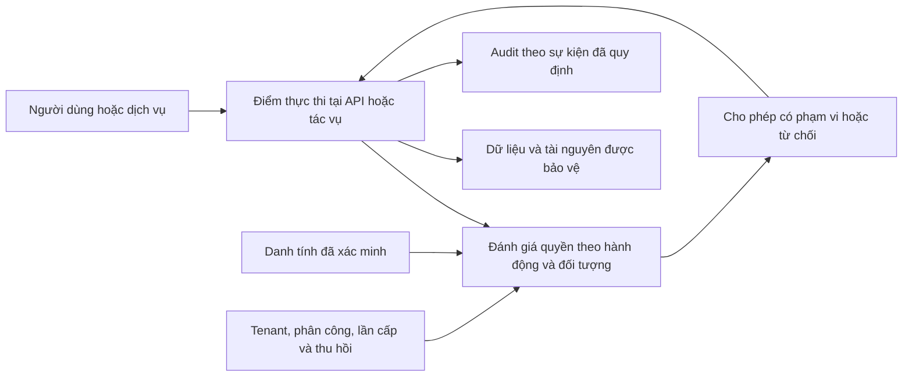

# Least privilege

## Mục tiêu bài học

**Least privilege — nguyên tắc đặc quyền tối thiểu** yêu cầu mỗi chủ thể chỉ có những quyền cần thiết để thực hiện nhiệm vụ được cho phép, trên đúng tài nguyên, trong đúng phạm vi và khoảng thời gian cần thiết. Chủ thể có thể là con người, ứng dụng, worker, pipeline triển khai hoặc tác vụ phục hồi.

Trong chương Mục tiêu bảo mật, least privilege là một kết quả cần đạt chứ không chỉ là việc tạo nhiều vai trò. Một hệ thống có vai trò `USER` và `ADMIN` vẫn có thể cấp quyền quá rộng nếu mọi quản trị viên đều đọc được mọi dữ liệu, hoặc một worker dùng tài khoản có thể xóa cả database.

Sau bài học, bạn có thể:

- Phân tích quyền cần thiết từ nhiệm vụ nghiệp vụ và hậu quả khi quyền bị lạm dụng.
- Mô tả quyền theo chủ thể, hành động, tài nguyên, điều kiện và thời hạn.
- Phân biệt quyền tối thiểu với xác thực, mặc định từ chối, nhu cầu biết và phân tách nhiệm vụ.
- Viết yêu cầu về phân quyền, ủy quyền, danh tính máy, quyền tạm thời, thu hồi và audit.
- Liên kết yêu cầu với rủi ro, điểm thực thi kiến trúc và bằng chứng kiểm chứng.

Ví dụ xuyên suốt là một cổng hỗ trợ khách hàng nhiều doanh nghiệp. Các vai trò, chính sách và ngưỡng thời gian trong bài là giả định minh họa; dự án thực tế cần được chủ quy trình, chủ dữ liệu và chủ dịch vụ xác nhận.

## 1. Mục tiêu của quyền tối thiểu

### 1.1. Đủ quyền làm việc và giới hạn hậu quả

Least privilege không có nghĩa làm cho mọi tài khoản gần như không thể sử dụng hệ thống. Mục tiêu là cấp **đủ quyền cho nhiệm vụ hợp lệ**, đồng thời hạn chế phạm vi tác động khi có sai sót, tài khoản bị chiếm hoặc người dùng cố tình lạm dụng.

Giả sử worker tạo báo cáo cần đọc một tập trường dữ liệu và ghi tệp kết quả. Nếu nó được cấp thêm quyền đổi vai trò người dùng, xóa dữ liệu gốc và đọc toàn bộ kho bí mật, những quyền này làm tăng hậu quả mà không phục vụ nhiệm vụ tạo báo cáo.

Một mô tả mục tiêu hữu ích là:

> Worker báo cáo chỉ được đọc dữ liệu thuộc phạm vi tác vụ đã được cho phép và ghi kết quả vào vùng được chỉ định; không được thay đổi dữ liệu nghiệp vụ, quản lý quyền hoặc truy cập bí mật ngoài nhiệm vụ.

Từ mục tiêu này, nhóm có thể quyết định cách tách danh tính, giới hạn quyền dữ liệu và kiểm tra từng tác vụ. Chỉ ghi “worker phải dùng least privilege” chưa đủ để triển khai hay kiểm thử.

### 1.2. Phân biệt các khái niệm liên quan

| Khái niệm | Câu hỏi chính | Quan hệ với least privilege |
|---|---|---|
| Xác thực | Chủ thể đang thao tác là ai? | Tạo căn cứ danh tính; chưa chứng minh chủ thể được làm hành động cụ thể |
| Phân quyền | Chủ thể này được làm gì trong điều kiện hiện tại? | Là cơ chế thực thi nhiều yêu cầu về quyền tối thiểu |
| Mặc định từ chối | Nếu chưa có căn cứ cho phép thì xử lý thế nào? | Ngăn việc vô tình mở quyền khi thiếu quy tắc, nhưng các quy tắc cho phép vẫn có thể quá rộng |
| Nhu cầu biết | Chủ thể cần biết thông tin nào để làm việc? | Giúp giới hạn quyền đọc và trường dữ liệu được trả về |
| Phân tách nhiệm vụ | Những bước nào không nên do cùng một chủ thể thực hiện? | Bổ sung ràng buộc giữa các nhiệm vụ, như người yêu cầu không tự phê duyệt quyền của mình |
| Phòng thủ nhiều lớp | Khi một kiểm soát thất bại còn lớp nào hạn chế hậu quả? | Có thể giới hạn quyền ở API, dữ liệu, hạ tầng và hệ điều hành theo các nhiệm vụ tương ứng |

Xác thực đa yếu tố có thể tăng độ tin cậy về danh tính nhưng không làm một quyền cấp thừa trở thành cần thiết. Tương tự, nằm trong mạng nội bộ không phải bằng chứng rằng một tài khoản nên đọc mọi dữ liệu.

## 2. Nhìn quyền theo nhiều chiều

### 2.1. Vai trò chỉ là một phần của quyết định

Một quyền cụ thể cần mô tả ít nhất:

| Chiều | Câu hỏi | Ví dụ |
|---|---|---|
| Chủ thể | Ai hoặc dịch vụ nào sử dụng quyền? | Nhân viên U2, worker báo cáo |
| Hành động | Thao tác nào được phép? | Đọc phiếu, sửa trạng thái, tạo bản xuất |
| Tài nguyên | Đối tượng nào chịu tác động? | Phiếu T-100, tệp gắn với phiếu đó |
| Phạm vi | Giới hạn khách hàng hoặc nhóm công việc là gì? | Tenant A, các phiếu được phân công |
| Trường dữ liệu | Được đọc hoặc sửa những thuộc tính nào? | Được sửa trạng thái, không được sửa người tạo hay tenant |
| Điều kiện | Quyền có hiệu lực khi nào? | Tài khoản còn hoạt động, phiếu còn ở trạng thái cho phép |
| Thời hạn | Bắt đầu và kết thúc quyền lúc nào? | Quyền hỗ trợ đặc biệt trong 30 phút |
| Nguồn cấp | Ai có quyền cấp hoặc phê duyệt? | Chủ tenant phê duyệt đúng phạm vi được ủy quyền |

Quy tắc chỉ kiểm tra `role == AGENT` có thể bỏ sót tenant, đối tượng được phân công, trường dữ liệu và thời điểm thu hồi. Một quyền quá rộng ở bất kỳ chiều nào đều có thể tạo đường lạm dụng.

### 2.2. Xem quyền hiệu lực, gồm cả đường gián tiếp

**Quyền hiệu lực** là khả năng thực tế mà chủ thể có sau khi xét các vai trò, nhóm, chính sách, quyền kế thừa và cách hệ thống thực thi. Không nên đánh giá chỉ bằng tên vai trò hoặc một màn hình cấu hình.

Ví dụ:

- Tài khoản không có quyền đọc database nhưng có quyền lấy bí mật chứa thông tin xác thực database.
- Pipeline không trực tiếp đọc dữ liệu nhưng có thể triển khai mã chạy bằng một danh tính có quyền đọc dữ liệu đó.
- Quản trị viên không có quyền xem phiếu nhưng có thể tự gán vai trò đọc mọi phiếu cho chính mình.
- Người dùng không được đọc một phiếu qua API nhưng vẫn lấy được tệp xuất hoặc tệp đính kèm của phiếu ấy.

Những đường này làm phạm vi quyền thực tế rộng hơn mô tả ban đầu. Phân tích least privilege cần theo cả khả năng cấp quyền, giả danh, thay mã, đọc bí mật và truy cập bản sao dữ liệu.

Nếu nhiều vai trò cùng có hiệu lực, quyền thường được tổng hợp theo cơ chế của hệ thống. Không được giả định mọi cơ chế đều ưu tiên từ chối theo cùng cách. Những ràng buộc bắt buộc, như không truy cập chéo tenant hoặc không tự duyệt quyền, cần có quy tắc kết hợp và tiêu chí kiểm chứng rõ ràng khi chủ thể mang nhiều vai trò.

## 3. Ví dụ: cổng hỗ trợ nhiều tenant

### 3.1. Nhiệm vụ và dữ liệu

Mỗi doanh nghiệp khách hàng là một **tenant**, tức một phạm vi dữ liệu và quyền riêng. Người dùng tạo phiếu hỗ trợ; nhân viên xử lý phiếu được phân công; quản trị tenant quản lý một số thông tin thành viên. Một worker tạo tệp báo cáo theo tác vụ được yêu cầu.

Chủ nghiệp vụ trong ví dụ chấp thuận các chính sách:

1. Người yêu cầu đọc phiếu do mình tạo trong tenant mà mình còn là thành viên hợp lệ.
2. Nhân viên xử lý chỉ đọc và cập nhật phiếu đang được phân công cho mình trong đúng tenant.
3. Việc sửa người tạo, tenant hoặc người được phân công không nằm trong thao tác sửa nội dung thông thường.
4. Quản trị tenant được quản lý tài khoản cơ bản theo phạm vi ủy quyền, nhưng không mặc nhiên được đọc nội dung mọi phiếu hoặc tự cấp quyền đọc đó.
5. Nhân sự hỗ trợ kỹ thuật của nhà cung cấp không có quyền đọc nội dung khách hàng thường trực.
6. Quyền đặc biệt phải có nhiệm vụ, phạm vi, người phê duyệt và thời hạn.

Đây là lựa chọn nghiệp vụ của ví dụ, không phải mô hình vai trò áp dụng cho mọi cổng hỗ trợ. Một tổ chức có thể cần phạm vi khác, nhưng phải nêu rõ lý do và hậu quả của phạm vi đó.

### 3.2. Ma trận quyền cần thiết

| Chủ thể/vai trò | Quyền cần cho nhiệm vụ | Giới hạn bắt buộc | Quyền không mặc nhiên có |
|---|---|---|---|
| Người yêu cầu | Tạo phiếu, đọc phiếu của mình, bổ sung thông tin theo trạng thái | Đúng tenant, đúng chủ thể, trường được phép | Đọc phiếu người khác, đổi tenant hoặc người tạo |
| Nhân viên xử lý | Đọc và cập nhật phiếu được phân công | Đúng tenant, đúng phân công hiện tại, đúng hành động/trạng thái | Tự nhận mọi phiếu, quản lý thành viên, xuất toàn bộ dữ liệu |
| Quản trị tenant | Quản lý tài khoản cơ bản trong tenant theo quyền ủy quyền | Không tự nâng quyền, không cấp vượt danh sách vai trò được phép | Đọc mọi nội dung nghiệp vụ hoặc đổi quyền của tenant khác |
| Hỗ trợ kỹ thuật đặc biệt | Xem metadata cần cho chẩn đoán của tenant được duyệt | Đúng nhiệm vụ, tập trường được duyệt, có thời hạn | Đọc nội dung và tệp đính kèm nếu chưa có quyền riêng |
| Worker báo cáo | Đọc tập dữ liệu được cho phép, ghi kết quả tác vụ | Đúng tenant/tác vụ, cột dữ liệu, vùng ghi kết quả | Sửa/xóa phiếu, quản lý quyền, đọc mọi bí mật |

Metadata vẫn có thể nhạy cảm, chẳng hạn mã khách hàng, thời điểm hoạt động hoặc thông tin định tuyến. Từ “metadata” không tự làm dữ liệu thành công khai; cần liệt kê tập trường cụ thể mà hỗ trợ kỹ thuật được xem.

### 3.3. Gắn quyền với kịch bản rủi ro

| Mã rủi ro | Kịch bản | Hậu quả cần hạn chế |
|---|---|---|
| LP-RISK-01 | Người dùng thay mã phiếu để đọc dữ liệu ngoài phạm vi | Lộ dữ liệu trong tenant hoặc giữa các tenant |
| LP-RISK-02 | Người quản trị tự gán quyền cao hơn phạm vi ủy quyền | Leo thang quyền và truy cập ngoài nhiệm vụ |
| LP-RISK-03 | Worker bị chiếm và dùng quyền dữ liệu/hạ tầng quá rộng | Lộ, sửa hoặc xóa hàng loạt tài sản |
| LP-RISK-04 | Quyền đã hết nhu cầu nhưng vẫn còn trong token, cache hoặc tác vụ | Người dùng tiếp tục truy cập sau khi chuyển nhiệm vụ hoặc bị thu hồi |
| LP-RISK-05 | Không biết ai cấp, dùng hoặc thu hồi quyền đặc biệt | Khó phát hiện lạm dụng và điều tra sự cố |

Mục tiêu của least privilege là giảm khả năng và phạm vi tác động của các kịch bản này. Nó không chứng minh mọi lỗ hổng hay thông đồng đều đã được loại bỏ.

## 4. Quy trình chuyển nhiệm vụ thành quyền tối thiểu

### Bước 1: Chốt nhiệm vụ và người chịu trách nhiệm

Ghi nhiệm vụ bằng kết quả nghiệp vụ, như “xử lý phiếu được phân công”, thay vì bắt đầu bằng một vai trò có tên `SUPER_ADMIN`. Chủ quy trình và chủ dữ liệu xác nhận những thao tác thật sự cần thiết.

Đối với nhiệm vụ hiếm khi xảy ra như phục hồi sự cố, quyền có thể ít được sử dụng nhưng vẫn cần thiết. Không kết luận quyền là thừa chỉ vì chưa thấy dùng trong một khoảng log ngắn.

### Bước 2: Liệt kê hành động và đối tượng

Tách đọc, tạo, sửa, xóa, xuất, chia sẻ, cấp quyền và giả danh khi chúng có cách kiểm soát khác nhau. Tách thao tác sửa trạng thái khỏi thay người tạo hoặc tenant; quyền “sửa phiếu” không nên tự bao gồm mọi trường.

Kiểm tra cả API, giao diện, tìm kiếm, xuất dữ liệu, tệp đính kèm, tác vụ nền và đường quản trị. Giấu một nút trên giao diện không thay thế kiểm tra phía máy chủ.

### Bước 3: Thêm điều kiện phạm vi và thời gian

Xác định tenant, quan hệ sở hữu/phân công, trạng thái đối tượng, danh tính còn hiệu lực và thời hạn được cấp. Dữ liệu làm căn cứ phải đến từ nguồn có thẩm quyền, không chỉ từ các trường do client gửi.

Nếu chính sách yêu cầu kiểm tra phân công hiện tại, một bản cache phân công cũ chỉ có thể được dùng khi thỏa điều kiện độ mới đã thống nhất. Việc một token còn hạn hoặc có chữ ký hợp lệ không chứng minh mọi quyền bên trong vẫn phù hợp.

### Bước 4: Phân tích quyền cấp cho người khác và đường gián tiếp

**Quyền ủy quyền** là quyền cấp một số quyền cho chủ thể khác trong giới hạn được chấp thuận. Có quyền đọc không tự động có quyền cấp quyền đọc. Một quản trị viên được ủy quyền quản lý tài khoản cơ bản cũng không tự động có quyền gán vai trò đặc biệt.

Cần xác định danh sách vai trò/hành động được cấp, phạm vi tenant, bên nhận, thời hạn và điều kiện phê duyệt. Xét cả việc thay nhóm, sửa chính sách, tạo token hoặc triển khai mã có thể dẫn đến quyền cao hơn.

### Bước 5: Chọn điểm thực thi và hành vi khi thiếu căn cứ

Nêu rõ kiểm tra tại API, dịch vụ nghiệp vụ, tầng dữ liệu hoặc hạ tầng theo quyền tương ứng. Không cần mọi lớp sao chép cùng một chính sách, nhưng mỗi quyền quan trọng phải có điểm thực thi thực sự và có thể kiểm chứng.

Nếu không xác minh được điều kiện bắt buộc cho một thao tác, phải từ chối thao tác đó. Hệ thống có thể giữ những luồng độc lập vẫn xác minh được an toàn; không tự mở rộng quyền để duy trì số phản hồi thành công.

### Bước 6: Quy định cấp, sử dụng, thu hồi và xem xét lại

Một đặc tả quyền chỉ nói cách cấp là chưa đầy đủ. Cần có điều kiện hết hạn, thu hồi, chuyển nhiệm vụ, thay vai trò, vô hiệu hóa tài khoản, xử lý tác vụ đang chờ và kiểm tra quyền sau phục hồi dữ liệu.

Mỗi quyền đặc biệt phải có chủ sở hữu chính sách, bên thực hiện và bằng chứng. Việc chấp nhận quyền rộng còn lại là quyết định rủi ro của bên có thẩm quyền, không nên ngầm để lập trình viên hoặc tài khoản dịch vụ tự quyết định.

## 5. Mẫu đặc tả một quyền

```text
Permission ID: LP-PERM-ASSIGNED-TICKET-READ
Nhiệm vụ: Đọc phiếu để xử lý công việc được phân công
Chủ thể: Nhân viên xử lý có danh tính đã xác thực và còn hoạt động
Hành động: Đọc nội dung phiếu và tệp được phép gắn với phiếu
Tài nguyên: Một phiếu cụ thể trong tenant đang xét
Điều kiện:
  - Chủ thể còn là thành viên hợp lệ của tenant.
  - Phiếu đang được phân công cho chủ thể tại thời điểm quyết định truy cập.
  - Tập trường/tệp trả về thuộc chính sách đọc của nhiệm vụ.
Không bao gồm:
  - Phiếu khác, tenant khác, xuất hàng loạt hoặc quản lý quyền.
  - Sửa người tạo, tenant hoặc thông tin phân công.
Nguồn dữ liệu quyền: Thành viên tenant và phân công từ máy chủ
Khi thiếu căn cứ: Từ chối, không trả nội dung hoặc tạo tác dụng phụ
Chủ chính sách: Chủ quy trình hỗ trợ phối hợp chủ dữ liệu
Liên kết rủi ro: LP-RISK-01, LP-RISK-04
Bằng chứng: Kiểm thử đúng/sai phân công, tenant, thời điểm thu hồi và đường tải tệp
```

Mẫu này mô tả kết quả cần giữ đúng. Cách dùng vai trò, thuộc tính hoặc quan hệ để thực thi là quyết định thiết kế. Chọn một mô hình phân quyền không tự chứng minh tất cả điều kiện trong mẫu đã được thực hiện.

## 6. Bộ yêu cầu bảo mật có thể kiểm chứng

### LP-REQ-01 — Quyết định quyền phía máy chủ theo hành động và đối tượng

Trước mỗi hành động đọc hoặc thay đổi dữ liệu, máy chủ phải kiểm tra danh tính, hành động, tenant, đối tượng và các điều kiện bắt buộc của nhiệm vụ. Không dùng vai trò hoặc tenant do client tự khai báo làm căn cứ duy nhất. Khi không có quy tắc cho phép hoặc không xác minh được điều kiện bắt buộc, từ chối thao tác.

Đối với cập nhật phiếu, máy chủ chỉ chấp nhận tập trường được phép cho hành động hiện tại. Trong ví dụ, request sửa nội dung có thêm trường thay tenant, người tạo hoặc phân công phải bị từ chối và không làm thay đổi dữ liệu. Những thao tác quản lý phân công nếu được cung cấp phải có quyền riêng.

Phạm vi thực thi phải bao gồm API trực tiếp, tìm kiếm, xuất dữ liệu, tệp đính kèm và các đường quản trị có cùng khả năng tác động. Không trả dữ liệu ngoài quyền qua cache hoặc kết quả đã tạo từ trước.

**Nguồn:** LP-RISK-01.

**Chấp nhận:** kiểm tra người đúng/sai phân công, cùng/khác tenant, tài khoản còn/mất hiệu lực, trường được phép/bị cấm và đối tượng không tồn tại. Kiểm tra dữ liệu trả về cùng mọi tác dụng phụ; phản hồi lỗi phải theo hợp đồng API và không tiết lộ nội dung ngoài phạm vi.

### LP-REQ-02 — Giới hạn quyền cấp và thay đổi quyền

Người cấp quyền chỉ được gán các vai trò, hành động, phạm vi và thời hạn nằm trong quyền ủy quyền đã được xác định cho mình. Không được tự nâng quyền hoặc dùng thay đổi nhóm/chính sách để đạt cùng kết quả bị cấm. Quyền đọc dữ liệu không tự tạo quyền cấp quyền đọc cho người khác.

Trong ví dụ, quản trị tenant chỉ được quản lý các vai trò tài khoản cơ bản trong tenant của mình. Việc cấp quyền đọc nội dung rộng hơn hoặc quyền quản trị đặc biệt phải theo quy trình riêng, có người phê duyệt đủ thẩm quyền và khác người nhận khi chính sách yêu cầu kiểm soát độc lập.

Các đường gán trực tiếp, gán qua nhóm, nhập hàng loạt và API quản trị đều phải giữ cùng giới hạn. Khi chủ thể có nhiều vai trò, quy tắc cấm tự nâng quyền và ranh giới tenant vẫn phải được duy trì theo chính sách kết hợp đã đặc tả.

**Nguồn:** LP-RISK-02.

**Chấp nhận:** thử cấp vượt danh sách được ủy quyền, cấp sang tenant khác, cấp cho chính mình và thay đổi nhóm để đạt quyền bị cấm. Xác nhận không phát sinh quyền hiệu lực mới, không chỉ kiểm tra API trả lỗi. Kiểm tra thêm việc cấp hợp lệ vẫn hoạt động.

### LP-REQ-03 — Quyền đặc biệt có phạm vi và tự hết hạn

Một lần cấp quyền hỗ trợ đặc biệt phải có mã nhiệm vụ, tenant, danh tính nhận quyền, danh sách hành động/tập trường được phép, người phê duyệt, thời điểm bắt đầu và hết hạn. Trong ví dụ, thời hạn mỗi lần cấp không vượt quá **30 phút**; gia hạn phải được quyết định như một lần cấp mới theo quy trình đã định nghĩa.

Máy chủ phải từ chối yêu cầu mới sử dụng quyền đặc biệt tại hoặc sau thời điểm hết hạn, kể cả phiên đăng nhập còn tồn tại. Không được biến một phiên hỗ trợ tạm thời thành vai trò thường trực hoặc mở rộng sang tenant khác mà không có lần cấp phù hợp.

Mốc 30 phút là giả định về nhu cầu hỗ trợ trong bài. Dự án khác có thể chọn thời hạn khác, nhưng phải xác định căn cứ và trách nhiệm phê duyệt.

**Nguồn:** LP-RISK-02, LP-RISK-04, LP-RISK-05.

**Chấp nhận:** thử trước thời điểm bắt đầu, trong thời hạn, đúng lúc hết hạn và sau hết hạn. Kiểm tra cả API, tải kết quả và đường giả danh nếu hệ thống có hỗ trợ. Cache quyền không được làm thời hạn hiệu lực kéo dài hơn lần cấp.

### LP-REQ-04 — Danh tính máy chỉ có quyền phục vụ nhiệm vụ

API, worker báo cáo, pipeline và tác vụ sao lưu/phục hồi phải sử dụng danh tính với quyền theo nhiệm vụ và môi trường. Danh tính worker báo cáo không được sửa/xóa phiếu, cấp quyền người dùng hoặc đọc bí mật không phục vụ báo cáo.

Worker phải nhận ngữ cảnh tenant, người yêu cầu và phạm vi dữ liệu từ bản ghi tác vụ có thẩm quyền do máy chủ tạo. Không chấp nhận một cờ tự khai như `isAdmin=true` trong thông điệp làm bằng chứng cho phép. Trước khi thực thi tác vụ và trước khi phát hành kết quả, kiểm tra các điều kiện quyền tương ứng theo chính sách độ mới đã thống nhất.

Quyền ghi kết quả phải giới hạn vào vùng của nhiệm vụ và môi trường được chỉ định. Các quyền đọc dữ liệu ở tầng hạ tầng cũng phải được đánh giá: nếu danh tính worker vẫn đọc được mọi tenant ở database, đây là phạm vi quyền rộng cần có lý do, biện pháp hạn chế phù hợp và người chịu trách nhiệm rủi ro còn lại.

**Nguồn:** LP-RISK-03, LP-RISK-04.

**Chấp nhận:** dùng chính danh tính worker thử các hành động cho phép và bị cấm; thử sửa tenant/phạm vi trong đầu vào tác vụ; đối chiếu quyền thực tế ở API, kho dữ liệu, kho kết quả và kho bí mật. Một kiểm thử ứng dụng từ chối không chứng minh mọi quyền hạ tầng đã tối thiểu.

### LP-REQ-05 — Thu hồi quyền có thời hạn tác động rõ ràng

Trong ví dụ, sau khi thay đổi thu hồi quyền được cam kết tại nguồn có thẩm quyền, các yêu cầu truy cập mới dựa trên quyền cũ phải bị từ chối trên mọi đường liên quan trong tối đa **60 giây**. Thời gian đo từ mốc cam kết thu hồi, không phải từ lúc một cache cuối cùng nhận được thông báo.

Phạm vi gồm API, cache quyết định quyền, phiên/token, tác vụ chờ và tải tệp kết quả. Với quyền tạm thời ở LP-REQ-03, thời điểm hết hạn vẫn là giới hạn cứng của lần cấp; không cộng thêm 60 giây như một khoảng gia hạn.

Nếu người dùng bị thu hồi quyền trước khi tác vụ chạy hoặc trước khi phát hành kết quả, hệ thống không được tiếp tục cung cấp dữ liệu theo phạm vi cũ vượt quá chính sách hiệu lực này. Quy tắc xử lý tác vụ đang chạy phải được nêu riêng, chẳng hạn hủy hoặc không phát hành kết quả khi không còn điều kiện cho phép.

Yêu cầu trên áp dụng cho các yêu cầu truy cập mới. Nó không khẳng định hệ thống có thể thu hồi những byte đã tải xong về thiết bị người dùng; giới hạn đó cần được ghi rõ khi đánh giá rủi ro xuất dữ liệu.

**Nguồn:** LP-RISK-04.

**Chấp nhận:** phát token/phiên và tạo tác vụ trước khi thu hồi, sau đó thử truy cập qua các đường trong phạm vi. Đo trường hợp cache đã có quyền cũ và thông điệp đồng bộ bị chậm. Chữ ký token hợp lệ hoặc liên kết chưa hết hạn không được tự vượt qua mục tiêu thu hồi.

Một token chỉ được kiểm tra ngoại tuyến và còn hạn dài hơn 60 giây có thể không đáp ứng chính sách này nếu không có cơ chế vô hiệu hóa bổ sung. Rút thời hạn token hoặc cache cũng cần tính toàn bộ độ trễ và sai lệch thời gian được cho phép; không thể chỉ nhìn một tham số rồi kết luận đã đạt.

### LP-REQ-06 — Cấp quyền và sử dụng quyền đặc biệt có audit

Hệ thống phải ghi dấu vết cấp, sửa, gia hạn, thu hồi và sử dụng quyền đặc biệt. Sự kiện phải xác định người yêu cầu, người phê duyệt nếu có, chủ thể thực thi, người nhận quyền, tenant/tài nguyên, hành động, phạm vi, thời hạn, kết quả, thời điểm và mã liên kết nhiệm vụ. Khi thay chính sách, lưu định danh phiên bản cần cho điều tra.

Đối với tác vụ do dịch vụ thực hiện thay người dùng, phải phân biệt danh tính máy thực thi với danh tính người khởi tạo và căn cứ quyền. Một dòng log chỉ ghi `system` không đủ để giải thích vì sao một bản xuất được tạo.

Người dùng nghiệp vụ không được sửa/xóa audit. Quyền đọc và quản trị audit cũng cần giới hạn, vì bản thân dấu vết có thể chứa thông tin nhạy cảm. Không ghi token, mật khẩu, khóa hoặc toàn bộ nội dung khách hàng không cần thiết.

Trong ví dụ, không được hoàn tất cấp quyền đặc biệt nếu chưa có bản ghi cấp quyền bền vững gắn với thay đổi quyền. Nếu không đáp ứng điều kiện đó, thao tác cấp phải thất bại theo hành vi đã đặc tả; không bỏ dấu vết để giữ luồng cấp quyền hoạt động.

**Nguồn:** LP-RISK-02, LP-RISK-05.

**Chấp nhận:** đối chiếu quyền đã cấp với sự kiện, thử đường cấp qua nhóm/API, kiểm tra phân quyền trên kho audit và thử lỗi tại điểm lưu dấu vết. Cần phân biệt bản ghi một lần thử với quyền thực sự đã được cam kết.

### LP-REQ-07 — Xem xét lại quyền và không tái mở quyền khi phục hồi

Trong chính sách minh họa, quyền quản trị đặc biệt ở môi trường sản xuất phải được rà soát ít nhất mỗi **90 ngày** và khi người dùng thay đổi nhiệm vụ. Mỗi quyền giữ lại cần có chủ sở hữu và căn cứ nhiệm vụ; quyền không còn cần phải có quyết định thu hồi và bằng chứng hoàn tất.

Khi phục hồi từ bản sao cũ, trước khi mở lại truy cập phải đối soát trạng thái tài khoản, thành viên tenant, lần cấp hết hạn và các quyết định thu hồi với nguồn thay đổi có thẩm quyền còn giữ được. Không tự coi quyền trong bản sao cũ là trạng thái được phép hiện tại.

Nếu không có nguồn để xác nhận trạng thái cần thiết, phải nêu giới hạn phục hồi và giữ đóng những truy cập chưa xác minh được theo quy trình đã thống nhất. Nguồn đối soát, khóa và danh tính phục hồi là các phụ thuộc phải được đưa vào thiết kế phục hồi.

**Nguồn:** LP-RISK-04, LP-RISK-05.

**Chấp nhận:** kiểm tra hồ sơ rà soát có quyết định và người chịu trách nhiệm; phục hồi bản sao được tạo trước một lần thu hồi, rồi thử danh tính/quyền cũ sau bước đối soát. Mốc 90 ngày là ví dụ quản trị, không thay thế việc thu hồi kịp thời khi nhiệm vụ kết thúc.

## 7. Liên kết mục tiêu với kiến trúc

Một quyết định quyền thường cần ba nhóm thành phần:

- Nguồn thông tin có thẩm quyền về danh tính, nhiệm vụ, thành viên tenant, phân công và các lần cấp.
- Nơi đánh giá điều kiện theo chính sách và thời gian hiện tại.
- Điểm thực thi không cho phép đường truy cập bỏ qua kết quả quyết định.



Sơ đồ mô tả trách nhiệm logic, không bắt buộc dùng một dịch vụ tập trung. Nếu quyết định nằm ở nhiều nơi, cần đảm bảo cùng hiểu phạm vi, quy tắc kết hợp và yêu cầu độ mới.

Với thao tác thay đổi dữ liệu, kiểm tra quyền rồi chờ quá lâu trước khi ghi có thể tạo khoảng trống: phân công hoặc trạng thái đối tượng đã đổi. Thiết kế phải ràng buộc các điều kiện quan trọng với thời điểm thực thi phù hợp, chẳng hạn bằng điều kiện cập nhật hoặc giao dịch có kiểm soát. Cơ chế cụ thể cần phù hợp với yêu cầu nhất quán và thời hạn thu hồi; không nên hứa tính tức thời nếu hệ thống chỉ cung cấp đồng bộ chậm.

Đối với hiệu năng, có thể cache quyết định hoặc thuộc tính khi chính sách cho phép, nhưng phải nêu khóa cache, phạm vi tenant/chủ thể, độ mới và cách vô hiệu hóa. Cache dùng chung mà thiếu tenant hoặc danh tính trong khóa có thể làm dữ liệu hoặc quyền của người này bị áp cho người khác.

## 8. Kiểm chứng quyền tối thiểu bằng hành vi hiệu lực

### 8.1. Kiểm thử cả cho phép và từ chối

Nếu mọi thao tác đều bị chặn, kiểm thử từ chối có thể đạt nhưng người dùng không làm được nhiệm vụ. Vì vậy, mỗi quyền cần trường hợp cho phép hợp lệ và những trường hợp chỉ thay đổi một điều kiện quan trọng để bị từ chối.

Ví dụ cho LP-REQ-01:

```gherkin
Feature: Đọc phiếu theo phân công và tenant

  Scenario: Nhân viên đủ vai trò nhưng không được phân công
    Given phiếu T-100 thuộc tenant A, do U1 tạo và đang giao cho U3
      And U2 còn hoạt động trong tenant A
      And U2 có vai trò nhân viên xử lý và quản trị tenant
      And U2 không có lần cấp đặc biệt cho nội dung T-100
    When U2 gọi trực tiếp API đọc T-100
    Then yêu cầu bị từ chối theo hợp đồng API
      And không trả nội dung hoặc tệp đính kèm của T-100
      And không thay đổi phân công của phiếu

  Scenario: Nhân viên được phân công hợp lệ
    Given U3 còn hoạt động trong tenant A và có quyền xử lý
      And T-100 hiện đang được phân công cho U3
    When U3 đọc T-100
    Then chỉ các trường và tệp thuộc chính sách đọc được trả về
      And quyền đọc không làm phát sinh quyền xuất toàn bộ tenant
```

Trong ví dụ này, vai trò quản trị tenant không tạo ngoại lệ đọc nội dung, nên việc kết hợp vai trò không được mở đường đọc T-100 cho U2. Nếu sản phẩm thật có quy tắc khác, cần phản ánh rõ trong chính sách và kết quả mong đợi.

### 8.2. Ma trận tình huống cần bao phủ

| Tình huống | Điều cần chứng minh | Yêu cầu liên quan |
|---|---|---|
| Cùng vai trò, khác tenant | Quyền không vượt ranh giới khách hàng | LP-REQ-01 |
| Cùng tenant, khác người tạo/phân công | Quyền gắn với đối tượng và nhiệm vụ | LP-REQ-01 |
| Sửa thêm trường bị cấm | Không có quyền ghi ngầm trên thuộc tính khác | LP-REQ-01 |
| Kết hợp nhiều vai trò | Quy tắc bắt buộc vẫn được giữ theo chính sách kết hợp | LP-REQ-01, 02 |
| Cấp vai trò qua nhóm hoặc nhập hàng loạt | Đường gián tiếp không vượt giới hạn ủy quyền | LP-REQ-02 |
| Quyền đặc biệt đúng lúc hết hạn | Không kéo dài quyền theo phiên hoặc cache | LP-REQ-03 |
| Worker dùng thông điệp sửa tenant | Ngữ cảnh tác vụ không tạo quyền tự khai | LP-REQ-04 |
| Worker gọi thao tác quản lý người dùng | Quyền máy không rộng hơn nhiệm vụ | LP-REQ-04 |
| Thu hồi khi token/cache còn quyền cũ | Đạt thời hạn thu hồi trên mọi đường liên quan | LP-REQ-05 |
| Tải tệp bằng liên kết đã phát trước thu hồi | Bản sao và khả năng truy cập trực tiếp không bỏ qua chính sách | LP-REQ-05 |
| Cấp quyền khi kho audit lỗi | Không tạo quyền thành công thiếu dấu vết bắt buộc | LP-REQ-06 |
| Phục hồi bản sao trước lần thu hồi | Không tái mở quyền cũ sau phục hồi | LP-REQ-07 |

Kiểm tra mã phản hồi là chưa đủ đối với thao tác có tác dụng phụ. Phải xác nhận quyền hiệu lực, dữ liệu, nhóm, token hoặc tác vụ không bị thay đổi trái phép. Với đường đọc, kiểm tra cả nội dung, số lượng kết quả và tệp liên quan theo phạm vi hợp đồng.

### 8.3. Bằng chứng và giới hạn kết luận

Một ma trận quyền dự kiến không thay thế kiểm tra quyền đang có. Cần đối chiếu cấu hình danh tính, chính sách hạ tầng, quyền dữ liệu và hành vi ứng dụng trong môi trường đại diện.

Kiểm thử một API không chứng minh đường xuất dữ liệu, cache hoặc công cụ quản trị cũng đúng. Tương tự, log không ghi nhận lạm dụng không chứng minh quyền đã tối thiểu. Bằng chứng cần được gắn với phạm vi và phiên bản đã kiểm tra.

## 9. Duy trì least privilege trong vòng đời phát triển

### Khi thêm chức năng

Một chức năng xuất dữ liệu, tìm kiếm tập trung hoặc hỗ trợ giả danh có thể tạo quyền mới dù không đổi vai trò cũ. Cần xác định nhiệm vụ, tập dữ liệu và đường truy cập mới, rồi bổ sung yêu cầu cùng kiểm chứng.

Không giải quyết lỗi thiếu quyền bằng cách cấp rộng ngay cho cả ứng dụng. Trước hết xác định thao tác nào bị thiếu, tại lớp nào và phạm vi nào thật sự cần; sau đó cấp phần cần thiết theo quy trình thay đổi.

### Khi thay đổi nhân sự và tổ chức

Chuyển bộ phận, kết thúc hợp đồng, đổi tenant hoặc hết nhiệm vụ phải kích hoạt xem xét quyền. Nguồn sự kiện và người chịu trách nhiệm cần rõ; không chỉ chờ đến đợt rà soát định kỳ.

Quyền tạm thời cần tự hết hạn theo cơ chế thực thi, không chỉ dựa vào một lời nhắc để quản trị viên thu hồi thủ công. Các trường hợp ngoại lệ phải có phạm vi, căn cứ, người chấp thuận và thời điểm xem xét lại.

### Khi thay đổi kiến trúc hoặc phục hồi

Tách một worker, đổi kho dữ liệu hoặc đưa thêm công cụ quan sát làm thay đổi danh tính và tài nguyên có thể truy cập. Cần cập nhật danh mục quyền, bí mật, môi trường và điểm thực thi liên quan.

Quyền rộng còn lại phải được ghi cùng lý do và giới hạn. Ví dụ, worker đọc được nhiều tenant vì kiến trúc hiện tại chưa tách được phạm vi tại tầng dữ liệu; lọc trong ứng dụng giúp xử lý nghiệp vụ nhưng không tự loại bỏ toàn bộ hậu quả khi worker bị chiếm. Chủ rủi ro cần hiểu điều đó để quyết định xử lý tiếp.

## 10. Lỗi thường gặp khi đặc tả least privilege

| Cách làm | Khoảng trống | Cách cải thiện |
|---|---|---|
| Chỉ ghi “áp dụng least privilege” | Không rõ quyền, đối tượng hoặc bằng chứng | Nêu nhiệm vụ, hành động, phạm vi, điều kiện và thời hạn |
| Chỉ kiểm tra vai trò | Bỏ sót tenant, đối tượng, trường và trạng thái | Đặc tả điều kiện trên tài nguyên và hành động cụ thể |
| Coi MFA là đủ an toàn | Tài khoản được xác thực vẫn có thể có quyền thừa | Xem quyền hiệu lực độc lập với cách xác thực |
| Ẩn nút trên giao diện | API trực tiếp vẫn có thể thực hiện | Kiểm tra tại điểm xử lý có thẩm quyền |
| Không xét quyền ủy quyền | Người dùng tự tạo đường nâng quyền | Giới hạn cấp quyền, nhóm, chính sách và khả năng giả danh |
| Dùng chung tài khoản dịch vụ quản trị | Một thành phần bị chiếm ảnh hưởng nhiều tài sản | Tách danh tính và quyền theo nhiệm vụ/môi trường |
| Thu hồi trên màn hình nhưng token còn dùng được | Trạng thái quyền và khả năng truy cập không khớp | Đặt thời hạn thu hồi và kiểm chứng toàn bộ đường truy cập |
| Chỉ rà soát quyền không dùng gần đây | Có thể bỏ nhầm quyền phục hồi hiếm dùng hoặc giữ quyền thừa mới cấp | Đối chiếu nhiệm vụ, căn cứ và chủ sở hữu |
| Khôi phục toàn bộ quyền từ bản sao cũ | Tái xuất hiện quyền đã thu hồi | Đối soát trạng thái hiện hành trước khi mở truy cập |

## 11. Bài tập vận dụng

Một nhóm muốn thêm worker tải hàng loạt tệp đính kèm để tạo gói dữ liệu hỗ trợ. Để làm nhanh, nhóm dự định dùng tài khoản quản trị đang có và nhận trực tiếp `tenantId`, danh sách mã phiếu cùng cờ `canReadAll` từ request người dùng.

Hãy thực hiện:

1. Nêu nhiệm vụ thật sự của worker và các quyền đọc/ghi tối thiểu cần có.
2. Chỉ ra các dữ liệu đầu vào không được xem là bằng chứng quyền.
3. Viết yêu cầu giới hạn tập phiếu, trường/tệp, vùng ghi kết quả và thời hạn truy cập.
4. Xác định cách xử lý khi quyền người yêu cầu bị thu hồi trước lúc gói dữ liệu sẵn sàng.
5. Đề xuất kiểm tra worker không sửa dữ liệu, cấp quyền hoặc đọc bí mật ngoài nhiệm vụ.
6. Nêu rủi ro còn lại nếu quyền hạ tầng của worker vẫn đọc được mọi tenant và ai cần quyết định cách xử lý.

**Gợi ý tự đối chiếu:** tài khoản quản trị có quyền vượt nhiệm vụ gom tệp. Ngữ cảnh quyền phải được xác lập từ nguồn máy chủ có thẩm quyền, kiểm tra với từng đối tượng và giữ giới hạn khi tạo/tải kết quả. Quyền đọc một số phiếu không tự tạo quyền xuất toàn bộ dữ liệu, và một cờ do client gửi không thể mở rộng phạm vi đó.

## 12. Checklist bàn giao yêu cầu least privilege

- [ ] Mỗi quyền có nhiệm vụ nghiệp vụ và chủ sở hữu chính sách rõ ràng.
- [ ] Đã xác định chủ thể, hành động, tài nguyên, tenant, trường và điều kiện cần thiết.
- [ ] Đã tách quyền sử dụng, quyền cấp cho người khác và quyền thay đổi chính sách.
- [ ] Quy tắc kết hợp vai trò không làm mất các ràng buộc bắt buộc.
- [ ] Danh tính máy và quyền hạ tầng được đánh giá cùng quyền ứng dụng.
- [ ] API, tác vụ nền, tìm kiếm, cache, xuất dữ liệu và tải tệp được đưa vào phạm vi liên quan.
- [ ] Quyền đặc biệt có phê duyệt, phạm vi, thời điểm bắt đầu và tự hết hạn.
- [ ] Thu hồi có mốc đo và thời hạn tác động rõ trên token, cache và các đường khác.
- [ ] Có audit đủ phân biệt người khởi tạo, người phê duyệt và dịch vụ thực thi.
- [ ] Có kiểm thử cho phép, từ chối, ranh giới thời gian, kết hợp quyền và tác dụng phụ.
- [ ] Rà soát định kỳ, thay đổi nhiệm vụ và phục hồi không làm tích lũy hoặc tái mở quyền thừa.
- [ ] Rủi ro còn lại có căn cứ, người chịu trách nhiệm và điều kiện xem xét lại.

Least privilege được thể hiện bằng khả năng thực tế của từng chủ thể trong từng nhiệm vụ. Khi quyền có phạm vi và vòng đời rõ ràng, nhóm có thể giải thích vì sao quyền được cấp, chứng minh giới hạn của nó và thu hồi đúng lúc mà vẫn giữ được chức năng nghiệp vụ cần thiết.
