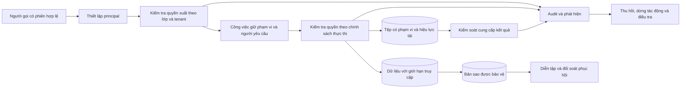

# Defense in depth

## 1. Defense in depth là gì?

**Defense in depth — phòng thủ theo chiều sâu — là cách tổ chức nhiều biện pháp bảo vệ bổ sung cho nhau để một sai sót, một kiểm soát bị vượt qua hoặc một thành phần bị chiếm quyền không lập tức dẫn đến toàn bộ hậu quả cần ngăn chặn.** Các biện pháp có thể ngăn chặn, giới hạn tác động, phát hiện, hỗ trợ ứng phó và phục hồi.

Ví dụ, một nền tảng học tập kiểm tra đăng nhập trước khi cho người dùng gọi API xuất bảng điểm. Nếu tài khoản giảng viên bị chiếm, lớp đăng nhập có thể vẫn hoạt động đúng: người gọi đang sử dụng thông tin xác thực hợp lệ. Hệ thống còn cần giới hạn lớp mà tài khoản được xuất, phạm vi dữ liệu của tác vụ nền, quyền tải tệp, khả năng phát hiện hoạt động bất thường và quy trình thu hồi truy cập.

Phòng thủ theo chiều sâu không được đánh giá bằng số sản phẩm bảo mật hoặc số bước người dùng phải đi qua. Câu hỏi có ích hơn là:

> Nếu kiểm soát này không ngăn được kịch bản đang xét, kiểm soát nào tiếp tục ngăn chặn, giới hạn hoặc giúp xử lý hậu quả, và nó có phụ thuộc vào cùng nguyên nhân thất bại hay không?

Đây là một định hướng thiết kế. Để áp dụng trong phát triển phần mềm, nhóm phải chuyển nó thành các yêu cầu riêng, có phạm vi, điều kiện, trách nhiệm và bằng chứng kiểm chứng. Câu “hệ thống áp dụng defense in depth” chưa đủ để triển khai hoặc nghiệm thu.

## 2. Bắt đầu từ tài sản và chuỗi rủi ro

### 2.1. Bảo vệ một kết quả nghiệp vụ cụ thể

Một tài sản có thể là dữ liệu, chức năng đặc quyền, bí mật kỹ thuật hoặc khả năng cung cấp dịch vụ. Các mục tiêu thường gặp gồm:

- **Bí mật:** dữ liệu chỉ được tiết lộ cho chủ thể được phép.
- **Toàn vẹn:** dữ liệu và hành vi chỉ được thay đổi theo quyền và quy tắc hợp lệ.
- **Sẵn sàng:** dịch vụ và dữ liệu sử dụng được theo nhu cầu đã thống nhất.
- **Tính xác thực và khả năng truy vết:** có căn cứ về danh tính, nguồn và các hành động liên quan.

Với bảng điểm, một mục tiêu là không để giảng viên truy cập dữ liệu ngoài lớp được phân công. Với thời hạn nộp bài, mục tiêu còn có thể là tiếp nhận bài hợp lệ trong điều kiện tải và sự cố đã xác định. Hai mục tiêu này cần các lớp bảo vệ khác nhau.

Không nên bắt đầu bằng danh sách “tường lửa, mã hóa, log, sao lưu” rồi giả định mọi rủi ro đã được bao phủ. Phải biết các kiểm soát đó bảo vệ điều gì và đóng góp ở bước nào của kịch bản.

### 2.2. Mô tả đường đi đến hậu quả

Một kịch bản minh họa:

```text
Thông tin xác thực của giảng viên bị chiếm
    -> người gọi tạo yêu cầu xuất dữ liệu
    -> thay mã trường hoặc lớp trong yêu cầu
    -> tác vụ nền đọc quá phạm vi
    -> báo cáo chứa dữ liệu của nhiều trường
    -> tệp được tải hoặc chia sẻ ngoài quyền
```

Chuỗi này giúp tìm nhiều điểm can thiệp. Giới hạn quyền theo lớp có thể chặn ở bước tạo yêu cầu; kiểm soát truy cập dữ liệu có thể giới hạn bước đọc; quyền kho tệp có thể ngăn một đường tải khác; audit và cảnh báo có thể giúp phát hiện; thu hồi truy cập và xử lý công việc đang chờ giúp ứng phó.

Một kiểm soát không cần giải quyết toàn bộ chuỗi. Tuy nhiên, nếu không kiểm soát nào xử lý bước đọc dữ liệu vượt quyền, việc có cảnh báo và sao lưu không bù được khoảng trống đó.

## 3. “Nhiều lớp” không đồng nghĩa “nhiều lần làm cùng một việc”

### 3.1. Lớp bảo vệ được phân biệt bằng nghĩa vụ và điểm thực thi

Có thể tổ chức kiểm soát ở nhiều vị trí: thiết bị và kênh truy cập, danh tính, API, logic nghiệp vụ, dữ liệu, tác vụ nền, kho tệp, giám sát và vận hành. Đây là các điểm tìm kiểm soát, không phải một kiến trúc bắt buộc cho mọi hệ thống.

Hai phép kiểm tra cùng gọi một hàm phân quyền có thể giúp tái sử dụng quy tắc hoặc tránh quên gọi ở một đường xử lý. Nhưng nếu hàm đó quyết định sai vì tin mã tenant do bên gọi tự khai, cả hai phép kiểm tra có thể thất bại cùng lúc. Không nên mặc định chúng tạo ra hai lớp độc lập.

Ngược lại, phân quyền theo đối tượng và giới hạn quyền của tài khoản dịch vụ bảo vệ những phạm vi khác nhau. Một bên quyết định người dùng có quyền làm gì; bên kia giới hạn tài nguyên mà thành phần thực thi có thể tác động khi có lỗi hoặc bị chiếm quyền.

### 3.2. Độc lập có nghĩa tương đối với một kịch bản

Không có yêu cầu rằng mọi lớp phải hoàn toàn độc lập trong mọi tình huống. Điều cần phân tích là **một nguyên nhân cụ thể có thể làm mất tác dụng bao nhiêu lớp**.

Ví dụ:

| Hai kiểm soát | Điều cần kiểm tra về phụ thuộc |
| --- | --- |
| API kiểm tra tenant và truy vấn thêm điều kiện tenant | Cả hai có lấy tenant từ cùng một giá trị không được xác minh không? |
| Tài khoản ứng dụng có quyền hạn chế và kho sao lưu được phân quyền riêng | Một danh tính quản trị hoặc bí mật dùng chung có thể mở cả hai không? |
| Ứng dụng phát sinh audit và kho audit hạn chế sửa | Tài khoản ứng dụng có thể xóa hoặc sửa toàn bộ dấu vết đã gửi không? |
| Chặn truy cập ở API và hạn chế tải tệp ở kho lưu trữ | Đường dẫn tải có bỏ qua API và còn hiệu lực sau thu hồi quyền không? |
| Nhiều bản sao dữ liệu | Các bản sao có cùng bị xóa bởi một quyền quản trị hoặc cùng mất do một sự cố không? |

Mục tiêu là hiểu những điểm còn phụ thuộc chung và quyết định mức rủi ro chấp nhận được. Phân tách quyền, nơi lưu, cách quản trị hoặc cơ chế kiểm tra có thể tăng khả năng chống một số lỗi chung, nhưng cũng phải được cân nhắc với chi phí và khả năng vận hành.

### 3.3. Kiến trúc nhiều tầng không tự tạo phòng thủ theo chiều sâu

Một ứng dụng có controller, service và repository chưa chắc có nhiều lớp bảo vệ. Nếu mọi đường xử lý đều dùng một tài khoản cơ sở dữ liệu toàn quyền và bỏ qua phân quyền theo đối tượng, việc tách mã thành ba tầng không tạo ra nghĩa vụ bảo mật mới.

Tương tự, chia thành nhiều dịch vụ không tự làm hệ thống an toàn hơn. Nó có thể tạo thêm ranh giới, thông tin xác thực và kênh truyền cần quản lý. Phòng thủ theo chiều sâu được đánh giá qua các kiểm soát có hiệu lực, không qua số thành phần trên sơ đồ.

## 4. Kết hợp ngăn chặn, giới hạn, phát hiện, ứng phó và phục hồi

Một hệ thống có thể không ngăn được mọi sự cố ngay từ đầu. Phòng thủ theo chiều sâu cần xem cả hành vi trước, trong và sau sự cố.

| Vai trò của kiểm soát | Mục đích | Ví dụ trên nền tảng học tập | Giới hạn cần nhớ |
| --- | --- | --- | --- |
| Ngăn chặn | Không cho hành vi không hợp lệ xảy ra | Kiểm tra quyền sửa điểm với lớp và trường cụ thể. | Có thể thiếu đường xử lý hoặc có lỗi trong quy tắc. |
| Giới hạn tác động | Hạn chế phạm vi khi một kiểm soát bị vượt qua | Tài khoản tiến trình xuất chỉ có quyền cần thiết, giới hạn tập dữ liệu của từng công việc. | Quyền kỹ thuật vẫn phải đủ chặt để tạo ra giới hạn thực tế. |
| Phát hiện | Nhận biết sự kiện hoặc dấu hiệu cần xử lý | Audit xuất báo cáo và cảnh báo theo quy tắc đã xác định. | Có log không đồng nghĩa có người hoặc hệ thống phát hiện kịp thời. |
| Ứng phó | Dừng hoặc giảm tác động đang tiếp diễn | Thu hồi phiên, dừng công việc chưa chạy, vô hiệu hóa khả năng tải do nền tảng cấp. | Cần biết kiểm soát nào có thể thu hồi và độ trễ tác dụng. |
| Phục hồi | Khôi phục dữ liệu và dịch vụ về trạng thái chấp nhận được | Khôi phục điểm từ bản sao đã kiểm chứng, đối soát trước khi mở lại dịch vụ. | Không thu hồi được dữ liệu đã bị người khác biết chỉ bằng việc khôi phục. |

Các vai trò có thể chồng lên nhau. Giới hạn tốc độ có thể giảm tác động của lạm dụng, đồng thời tạo tín hiệu phát hiện. Tuy nhiên, không nên tính nhiều vai trò của cùng một cơ chế thành nhiều lớp độc lập nếu chúng cùng mất tác dụng khi cơ chế đó hỏng.

Đặc biệt, sao lưu hỗ trợ khả năng phục hồi nhưng không ngăn việc đọc trộm bảng điểm. Mã hóa lưu trữ bảo vệ trong mô hình truy cập nhất định, nhưng không thay thế phân quyền khi ứng dụng đã được phép giải mã. Đánh giá đúng đóng góp giúp tránh dùng một kiểm soát để biện minh cho khoảng trống khác.

## 5. Ví dụ xuyên suốt: xuất bảng điểm của nhiều trường

### 5.1. Phạm vi và giả định

Giả sử nền tảng phục vụ nhiều trường. Mỗi trường là một **tenant**, tức một phạm vi dữ liệu và quản trị cần được phân tách. Giảng viên được xuất bảng điểm của lớp được phân công; việc quản trị thành viên không tự cấp quyền xuất mọi bảng điểm.

Backend gồm API, hàng đợi, tiến trình tạo báo cáo, cơ sở dữ liệu và kho tệp. Tệp được tạo bất đồng bộ rồi cung cấp qua một luồng tải có kiểm soát. Các giả định này dùng để phân tích ví dụ, không phải một danh sách kiểm soát đầy đủ cho mọi nền tảng học tập.

Tình huống cần xem xét là người gọi có phiên hợp lệ nhưng thử xuất dữ liệu ngoài quyền. Phiên có thể thuộc người dùng đang lạm dụng quyền hoặc đã bị chiếm; yêu cầu bảo vệ dữ liệu cần hoạt động với cả hai trường hợp.

### 5.2. Lớp danh tính: thiết lập đúng principal

**Principal — chủ thể bảo mật —** là thực thể được hệ thống nhận diện để đánh giá quyền, như tài khoản giảng viên hoặc danh tính dịch vụ. API phải lấy principal từ ngữ cảnh xác thực đã được kiểm tra, không từ tham số `userId` do người gọi tự nhận.

Lớp này giảm nguy cơ giả mạo danh tính bằng dữ liệu tự khai. Nó không giải quyết được mọi trường hợp dùng thông tin xác thực bị chiếm. Vì thế, vẫn cần các giới hạn đối với tài nguyên và hành động sau khi danh tính đã được thiết lập.

### 5.3. Lớp nghiệp vụ: kiểm tra hành động và đối tượng

Trước khi tạo công việc xuất, hệ thống phải kiểm tra quyền xuất của principal đối với lớp và tenant chứa dữ liệu. Mã lớp hoặc mã trường trong yêu cầu chỉ là đối tượng được đề nghị, không phải bằng chứng về quyền.

Khi không xác định được quyền, chức năng xuất nhạy cảm phải xử lý theo quy tắc đã đặc tả, chẳng hạn từ chối tạo công việc và không cấp quyền tải. Không nên để lỗi của nguồn phân quyền làm hành vi chuyển thành cho phép toàn bộ.

Kiểm tra này phải bao phủ các đường tạo báo cáo đã xác định: giao diện, API tích hợp và giao diện quản trị nếu có. Chỉ ẩn nút xuất trên màn hình không đáp ứng nghĩa vụ phía máy chủ.

### 5.4. Lớp xử lý nền và dữ liệu: giới hạn những gì thực sự được đọc

Công việc cần giữ người yêu cầu, tenant, lớp và bộ lọc đã được kiểm tra. Trong chính sách ví dụ, tiến trình nền kiểm tra lại quyền xuất hiện tại trước khi đọc dữ liệu. Nếu quyền bị thu hồi lúc công việc còn chờ, công việc không được tiếp tục xuất theo quyền cũ.

Một hệ thống khác có thể dùng ủy quyền có phạm vi và thời hạn riêng cho công việc. Khi đó, hiệu lực và thu hồi của ủy quyền phải được đặc tả rõ, thay vì mặc định rằng yêu cầu từng hợp lệ sẽ có quyền mãi mãi.

Tại lớp truy cập dữ liệu, cần có giới hạn thực sự đối với tập dữ liệu và loại thao tác mà thành phần được phép thực hiện. Có thể dùng chính sách truy cập dữ liệu, danh tính có phạm vi hoặc cơ chế tương ứng với kiến trúc. Nếu thiết kế chỉ thêm điều kiện tenant vào truy vấn nhưng vẫn lấy tenant từ cùng đầu vào sai, đó chưa phải lớp bù đắp cho lỗi nguồn tenant.

Danh tính của tiến trình xuất cũng không nên có quyền quản trị mọi tài sản chỉ để thuận tiện. Phạm vi quyền cần gắn với nhiệm vụ, ví dụ đọc dữ liệu phục vụ báo cáo và ghi vào nơi lưu kết quả đã được cho phép; quyền xóa bản sao lưu hoặc sửa dấu vết không phải hệ quả tự nhiên của nhiệm vụ đó.

### 5.5. Lớp đầu ra và kho tệp: bảo vệ dữ liệu sau khi tạo

Báo cáo chỉ nên chứa các trường phục vụ mẫu được chấp thuận. Nếu không cần email hoặc nội dung bài nộp, không đưa chúng vào tệp chỉ vì có thể truy vấn được.

Tệp và metadata cần gắn với người yêu cầu, tenant, lớp và chính sách tải. Kho tệp không được tạo một đường truy cập công khai ngoài ý muốn. Nếu cấp đường dẫn tải mang quyền truy cập tạm thời, phải xác định ai được cấp, hiệu lực đến khi nào và khả năng thu hồi của thiết kế.

Điểm kiểm tra lúc tạo công việc không tự kiểm soát được mọi lần tải sau đó. Cần theo dõi tài sản từ dữ liệu gốc đến tệp xuất và các cách truy cập tệp. Đồng thời, hệ thống phải nhìn nhận đúng giới hạn: không thể mặc định thu hồi được mọi bản đã tải xuống và lưu ngoài phạm vi kiểm soát.

### 5.6. Lớp phát hiện và ứng phó: tạo hành động từ bằng chứng

Audit có thể ghi principal, tenant, lớp, mã công việc, thời điểm và kết quả xử lý. Không cần sao chép toàn bộ bảng điểm, mật khẩu hoặc token vào log để chứng minh một lần xuất đã xảy ra.

Phát hiện cần có quy tắc và người hoặc hệ thống chịu trách nhiệm tiếp nhận. Một cảnh báo không có nơi nhận, không có thời gian xử lý và không có hành động được phép thực hiện chỉ là một đầu ra kỹ thuật.

Quy trình ứng phó phải làm rõ các tài sản liên quan: thu hồi phiên có dừng công việc đang chờ không, công việc đang chạy có bị hủy không và khả năng tải đã cấp còn hiệu lực bao lâu. Không nên đánh dấu “đã thu hồi quyền” khi chỉ cập nhật một bảng nhưng các đường truy cập khác tiếp tục hoạt động ngoài chính sách.

### 5.7. Lớp phục hồi: chuẩn bị cho sự cố toàn vẹn và sẵn sàng

Nếu dữ liệu điểm bị sửa hoặc mất, nền tảng cần bản sao có thể khôi phục và cách đối soát trước khi mở lại nghiệp vụ. Bản sao cần được bảo vệ khỏi cùng quyền hoặc sự cố có thể phá hủy dữ liệu chính theo mô hình rủi ro đã chọn.

Hai mục tiêu thường dùng là **RPO — Recovery Point Objective**, giới hạn mất dữ liệu xét theo thời gian, và **RTO — Recovery Time Objective**, giới hạn thời gian phục hồi theo các mốc đã thống nhất. Các giá trị phải được nghiệp vụ và vận hành xác nhận, không suy ra chỉ từ việc có lịch sao lưu.

Trong sự cố lộ dữ liệu, phục hồi vẫn có thể cần để đưa hệ thống về trạng thái sử dụng được, nhưng không làm người đã nhận dữ liệu quên nội dung đó. Yêu cầu bảo vệ bí mật và kế hoạch ứng phó phải phản ánh giới hạn này.

## 6. Vẽ các nghĩa vụ thay vì chỉ vẽ thiết bị

Một sơ đồ khái niệm cho ví dụ:



Các ô trong sơ đồ là nghĩa vụ cần được thực hiện; chúng không tự chứng minh tính độc lập. Phân tích vẫn phải trả lời căn cứ quyền đến từ đâu, thành phần nào giữ bí mật, ai có quyền quản trị và những đường nào có thể bỏ qua từng ô.

## 7. Phân tích lỗi chung giữa các lớp

**Common-cause failure — thất bại do nguyên nhân chung —** xảy ra khi một nguyên nhân làm mất tác dụng của nhiều kiểm soát cùng lúc. Đây là điểm quan trọng khi đánh giá phòng thủ theo chiều sâu.

| Nguyên nhân chung | Các lớp có thể cùng mất tác dụng | Hướng làm rõ yêu cầu |
| --- | --- | --- |
| Tin mã tenant do bên gọi tự khai | Phân quyền API, truy vấn, cache và công việc nền | Chỉ rõ nguồn ngữ cảnh tin cậy và kiểm tra quan hệ tài nguyên ở các điểm liên quan. |
| Một danh tính quản trị dùng cho mọi tác vụ | Dữ liệu chính, tệp xuất, log và bản sao | Phân tách quyền theo nhiệm vụ và đánh giá những quyền vẫn có thể vượt qua nhiều lớp. |
| Bí mật dùng chung cho nhiều thành phần | Xác thực dịch vụ và khả năng xác định nguồn | Xác định phạm vi thông tin xác thực và hậu quả khi một thành phần bị chiếm. |
| Cấu hình chung chuyển sang cho phép khi lỗi | Nhiều điểm phân quyền | Đặc tả hành vi khi không đủ thông tin cho từng chức năng nhạy cảm. |
| Ứng dụng có quyền xóa dấu vết đã gửi | Thực thi nghiệp vụ và bằng chứng phát hiện | Hạn chế sửa, xóa dấu vết theo mô hình quản trị đã thống nhất. |
| Bản sao nằm cùng phạm vi phá hủy | Dữ liệu chính và phục hồi | Xác định sự cố cần chịu được và kiểm tra mức phân tách bản sao phù hợp. |
| Quy trình khẩn cấp bỏ qua mọi giới hạn | Kiểm soát truy cập, phê duyệt và audit | Đặc tả quyền khẩn cấp, điều kiện dùng, thời hạn và bằng chứng bắt buộc. |

Không thể loại bỏ mọi phụ thuộc. Điều cần có là mô hình rõ ràng để biết một lớp bù đắp cho loại lỗi nào, loại lỗi nào còn có thể vượt qua toàn bộ chuỗi và ai chấp nhận phần rủi ro còn lại.

## 8. Chuyển defense in depth thành yêu cầu có thể kiểm chứng

Một cách đặc tả hữu ích gồm ba phần:

> Để giảm **[rủi ro với tài sản]**, hệ thống phải thực hiện **[kiểm soát tại điểm xác định]**. Khi **[lớp trước không ngăn được kịch bản hoặc gặp lỗi]**, **[giới hạn hoặc phản ứng còn phải được bảo đảm]**. Kết quả được xác minh bằng **[bằng chứng]**.

Không nhất thiết đưa cả ba phần vào một câu dài. Có thể tách thành yêu cầu riêng rồi liên kết bằng mã rủi ro và mục tiêu chung.

### 8.1. Ma trận yêu cầu cho ví dụ xuất bảng điểm

| Mã | Yêu cầu minh họa | Vai trò trong phòng thủ | Bằng chứng xác minh |
| --- | --- | --- | --- |
| SR-IDENTITY-01 | API phải xác định principal từ ngữ cảnh xác thực đã kiểm tra; tham số tự khai không được dùng thay danh tính đó. | Ngăn giả mạo danh tính bằng đầu vào. | Đăng nhập bằng A nhưng gửi mã người dùng B; quyết định quyền vẫn dựa trên A hoặc yêu cầu bị từ chối theo đặc tả. |
| SR-EXPORT-AUTHZ-01 | Mỗi yêu cầu tạo báo cáo phải kiểm tra quyền xuất đối với đúng lớp và tenant; thiếu quyền hoặc không xác định được quyền thì không tạo công việc và không cấp kết quả. | Chặn truy cập trái phép ngay tại luồng nghiệp vụ. | Các trường hợp có quyền, ngoài lớp, ngoài tenant và nguồn quyền không cung cấp đủ căn cứ. |
| SR-WORKER-01 | Trước khi đọc dữ liệu tạo tệp, tiến trình nền phải kiểm tra lại quyền xuất hiện tại của người yêu cầu và giới hạn dữ liệu theo phạm vi công việc. | Bảo vệ khi quyền thay đổi hoặc đường tiếp nhận bỏ sót kiểm tra thuộc phạm vi thiết kế. | Thu hồi quyền khi công việc còn chờ; đưa công việc tham chiếu tài nguyên ngoài quyền và kiểm tra không sinh tệp trái phép. |
| SR-PRIVILEGE-01 | Danh tính tiến trình xuất không được có quyền sửa điểm, sửa audit đã lưu hoặc xóa bản sao lưu. | Giới hạn hậu quả nếu tiến trình xuất bị chiếm. | Kiểm tra quyền và thử các thao tác bị cấm bằng danh tính thử tương ứng. |
| SR-FILE-01 | Mọi đường tải do nền tảng cung cấp phải kiểm tra điều kiện cấp quyền tải đã đặc tả; khi không có quyền, không được trả nội dung hoặc khả năng tải dùng được. | Bảo vệ tài sản sau khi đã tạo tệp. | Thử truy cập chéo tài khoản, chéo tenant và các đường tải trực tiếp trong phạm vi. |
| SR-OUTPUT-01 | Mẫu báo cáo trong ví dụ chỉ được xuất mã học viên, tên hiển thị và điểm thuộc tập dữ liệu được phép; không xuất email hoặc thông tin xác thực. | Giảm lượng dữ liệu có thể bị tiết lộ qua đầu ra. | Đối chiếu cấu trúc, tập dòng và nội dung tệp với dữ liệu thử đã biết. |
| SR-AUDIT-01 | Các bước tạo, thực thi và tải báo cáo phải có dấu vết liên kết principal, tenant, tài nguyên, mã công việc, thời điểm và kết quả; loại bỏ token nguyên giá trị và nội dung bảng điểm khỏi log ứng dụng. | Phát hiện và điều tra mà không tạo bản sao nhạy cảm không cần thiết. | Đối chiếu một công việc qua các bước và kiểm tra các nhánh thành công, từ chối, lỗi. |
| SR-RESPONSE-01 | Sau khi thao tác thu hồi quyền hoàn tất, yêu cầu tạo báo cáo và yêu cầu tải mới phải áp dụng quyền đã thu hồi; công việc chưa bắt đầu phải kiểm tra lại trước khi đọc dữ liệu. | Giảm tác động tiếp diễn sau phát hiện. | Thu hồi khi phiên còn tồn tại, công việc đang chờ và tệp đã được tạo; kiểm tra các yêu cầu mới. |

Yêu cầu thu hồi trong bảng phân biệt yêu cầu mới và công việc chưa bắt đầu. Cách xử lý công việc đang chạy, luồng tải đang diễn ra và đường dẫn tải đã cấp cần được quyết định thêm nếu chúng nằm trong phạm vi rủi ro. Không thể suy ra những hành vi đó chỉ từ một thao tác cập nhật quyền.

### 8.2. Ví dụ định lượng cho phát hiện và phục hồi

Một số nghĩa vụ cần ngưỡng để nghiệm thu. Giả sử riêng ví dụ này chọn:

- Khi một principal gửi từ 20 yêu cầu tạo báo cáo trở lên trong một cửa sổ trượt 10 phút, hệ thống tạo một cảnh báo tới kênh vận hành được chỉ định không muộn hơn 60 giây sau lúc đạt ngưỡng.
- Với kịch bản mất cơ sở dữ liệu chính đã xác định, dữ liệu điểm cần có RPO tối đa 15 phút và dịch vụ cần đạt RTO tối đa 2 giờ, theo mốc bắt đầu và kết thúc diễn tập đã thống nhất.

Các số trên chỉ là giả định học tập. Ngưỡng thực tế phải dựa trên hành vi hợp lệ, tác động, năng lực vận hành và rủi ro được chấp thuận. Một giảng viên có thể xuất nhiều báo cáo vì công việc chính đáng; cảnh báo không tự chứng minh có tấn công và cũng không tự ngăn rò rỉ.

Tương tự, tần suất sao lưu chưa chứng minh đạt RPO và RTO. Bằng chứng cần đến từ diễn tập với dữ liệu sử dụng được, quyền và khóa cần thiết, cùng các mốc đo rõ ràng.

## 9. Xác minh khi một lớp không bảo vệ được như dự kiến

### 9.1. Kiểm tra từng nghĩa vụ và sự phối hợp

Một bộ kiểm tra chỉ gọi luồng thành công không đủ đánh giá phòng thủ theo chiều sâu. Cần kiểm tra từng yêu cầu, các điểm chuyển giao và một số tình huống lớp trước không chặn được kịch bản.

Có thể thực hiện với danh tính, tài nguyên và dữ liệu thử trong môi trường kiểm thử đã được thiết kế cho tình huống đó. Mục đích là quan sát thuộc tính còn được bảo đảm, thay vì chỉ kiểm tra rằng có nhiều thành phần đang chạy.

| Tình huống giả lập | Thuộc tính cần quan sát | Điều không được kết luận quá mức |
| --- | --- | --- |
| Người gọi có phiên hợp lệ nhưng không có quyền lớp đích | API từ chối; không tạo công việc hoặc khả năng tải trái phép. | Không chứng minh đã ngăn mọi cách chiếm tài khoản. |
| Công việc ngoài quyền lọt tới tiến trình nền | Tiến trình từ chối theo quyền hiện tại và phạm vi được đặc tả; không tạo tệp trái phép. | Không chứng minh hai lớp độc lập nếu chúng cùng có một lỗi quy tắc. |
| Một tệp thử đã tồn tại nhưng người gọi không có quyền tải | Đường tải trong phạm vi không cung cấp nội dung hoặc khả năng tải dùng được. | Không chứng minh người từng có quyền chưa lưu một bản sao bên ngoài. |
| Danh tính tiến trình xuất được sử dụng để thử sửa điểm, xóa audit hoặc xóa bản sao | Các thao tác bị từ chối bởi giới hạn quyền thực tế. | Không chứng minh mọi tài khoản quản trị cũng bị giới hạn như vậy. |
| Kênh cảnh báo không nhận được sự kiện theo thiết kế | Hệ thống bộc lộ lỗi giám sát và có hành vi vận hành đã quy định. | Không thể coi việc có bản ghi log là đã cảnh báo thành công. |
| Dữ liệu chính bị mất trong kịch bản diễn tập | Phục hồi đúng tập dữ liệu, đúng quan hệ tenant, đáp ứng mốc đo đã chọn. | Không chứng minh có thể khắc phục hậu quả bí mật của dữ liệu đã lộ. |

### 9.2. Ví dụ tiêu chí chấp nhận giữa API và tác vụ nền

```gherkin
Feature: Giới hạn quyền ở thời điểm tạo báo cáo

  Scenario: Quyền bị thu hồi khi công việc còn chờ
    Given giảng viên A có quyền xuất bảng điểm lớp X
    And hệ thống đã nhận công việc J nhưng chưa bắt đầu đọc dữ liệu
    When quyền xuất của A đối với lớp X bị thu hồi hoàn tất
    And tiến trình nền bắt đầu xử lý J
    Then tiến trình không tạo báo cáo lớp X theo quyền cũ của A
    And không cấp khả năng tải dữ liệu của công việc đó
    And audit liên kết J với kết quả từ chối theo quyền hiện tại
```

Đây là đặc tả hành vi kiểm thử, chưa phải bộ kiểm thử chạy được. Khi triển khai cần xác định thời điểm thu hồi hoàn tất, cách giữ công việc ở trạng thái chờ, nơi quan sát tệp và bằng chứng không có dữ liệu bị cung cấp.

### 9.3. Kết hợp kiểm thử, kiểm tra cấu hình và diễn tập

Một số thuộc tính không quan sát đủ qua API. Nhóm cần kiểm tra quyền kỹ thuật, nguồn cấu hình, quan hệ quản trị, đường truy cập kho tệp và nơi lưu bản sao. Phân tích phụ thuộc giúp chỉ ra các lớp có thể cùng mất tác dụng mà kiểm thử thông thường chưa chạm tới.

Không nên tạo hai bản triển khai quy tắc khác nhau chỉ để có vẻ độc lập nếu sự khác biệt làm chính sách mâu thuẫn. Có thể dùng chung định nghĩa quyền để thống nhất nghiệp vụ, đồng thời tăng khả năng chống lỗi qua giới hạn đặc quyền, phân tách quản trị, kiểm soát dữ liệu và bằng chứng từ những điểm khác nhau. Tính độc lập phải được phân tích theo loại lỗi, không phải qua việc mã có bị lặp hay không.

## 10. Cân bằng độ phức tạp, vận hành và rủi ro còn lại

### 10.1. Thêm lớp phải có lý do

Mỗi lớp có chi phí: cấu hình, bí mật, độ trễ, xử lý lỗi, cảnh báo và trách nhiệm vận hành. Một lớp không rõ người phụ trách hoặc không được duy trì có thể tạo cảm giác an toàn mà không tạo bảo vệ tương ứng.

Trước khi thêm kiểm soát, cần hỏi:

1. Nó xử lý bước nào của kịch bản và tài sản nào?
2. Nếu lớp trước thất bại vì nguyên nhân đang xét, nó còn hiệu lực không?
3. Nó giới hạn hậu quả hay chỉ tạo bằng chứng sau khi hậu quả đã xảy ra?
4. Nó phụ thuộc vào danh tính, cấu hình, khóa hoặc quyền quản trị nào?
5. Khi nó lỗi, hệ thống xử lý ra sao và người vận hành biết bằng cách nào?
6. Có bằng chứng nào cho thấy nó hoạt động đúng trong điều kiện cần bảo vệ?

Việc thu hẹp chức năng hoặc không tạo một bản xuất dữ liệu không cần thiết cũng có thể giảm rủi ro. Không phải mọi vấn đề đều cần thêm một công cụ.

### 10.2. Làm rõ hành vi khi lỗi

Với đọc dữ liệu riêng, hệ thống có thể cần từ chối khi không xác định được quyền. Với lỗi kho audit, nhóm phải quyết định trước giao dịch nhạy cảm có được tiếp tục hay không, bằng chứng được giữ ở đâu và cách xử lý tiếp theo. Với giám sát, lỗi đường cảnh báo cần có khả năng được phát hiện.

Không có một hành vi duy nhất phù hợp cho mọi chức năng. Quyết định phải dựa trên hậu quả nghiệp vụ và mục tiêu bảo vệ, rồi được ghi thành yêu cầu. Tuy nhiên, không nên âm thầm biến lỗi kiểm soát thành quyền truy cập rộng hơn chỉ để tránh thông báo lỗi cho người dùng.

### 10.3. Ghi nhận phần rủi ro còn lại

Phòng thủ theo chiều sâu không bảo đảm mọi chuỗi tấn công đều bị chặn. Một danh tính đặc quyền bị chiếm, một lỗi chung trong chính sách hoặc một quy trình khẩn cấp vẫn có thể vượt qua nhiều lớp.

Cần ghi rõ điều kiện giả định, kịch bản được bao phủ, giới hạn đã biết và người chịu trách nhiệm quyết định rủi ro còn lại. Một lớp phát hiện bổ sung không tự làm yêu cầu ngăn truy cập trái phép được xem là đã đạt nếu yêu cầu đó vẫn thất bại. Nếu dùng biện pháp bù đắp hoặc chấp nhận ngoại lệ, phải có quyết định rõ về phạm vi, điều kiện và thời hạn xem xét.

## 11. Duy trì trong vòng đời phát triển

Các yêu cầu cần được liên kết từ rủi ro đến thiết kế, triển khai và bằng chứng. Khi thêm API, đổi kho tệp, tách tiến trình nền hoặc thay quyền quản trị, phải xác định các lớp nào bị ảnh hưởng và có đường mới nào bỏ qua kiểm soát không.

Bằng chứng vận hành nên phản ánh hiệu lực thực tế: các đường truy cập đã xác định có được kiểm tra, quyền kỹ thuật có còn đúng, cảnh báo có đến nơi nhận và phục hồi có đạt mục tiêu hay không. Số lượng kiểm soát hoặc số dòng log không đủ làm thước đo bảo mật.

Khi có sự cố, hãy tìm cả lớp bị vượt qua lẫn lý do các lớp sau không giới hạn được hậu quả. Nếu chỉ vá điểm đầu tiên mà bỏ qua lỗi chung, một đường khác có thể dẫn đến cùng hậu quả.

## 12. Những nhầm lẫn thường gặp

| Nhầm lẫn | Vì sao không đủ | Hướng làm rõ |
| --- | --- | --- |
| “Có nhiều công cụ là có nhiều lớp.” | Công cụ có thể bảo vệ cùng điểm và cùng thất bại. | Gắn từng kiểm soát với kịch bản, nghĩa vụ và phụ thuộc. |
| “Đăng nhập đã bảo vệ mọi dữ liệu.” | Tài khoản hợp lệ vẫn có thể vượt quyền hoặc bị chiếm. | Giới hạn hành động, đối tượng và phạm vi dữ liệu. |
| “Controller, service, repository là ba lớp bảo mật.” | Tách mã không tự tạo giới hạn quyền hay điểm kiểm soát. | Xác định các nghĩa vụ được thực thi thực sự tại từng nơi. |
| “Có WAF thì không cần sửa phân quyền.” | Một lớp lọc lưu lượng không tự quyết định đúng quyền nghiệp vụ trên mọi tài nguyên. | Đặc tả phân quyền tại nơi biết chủ thể, hành động và đối tượng. |
| “Có mã hóa thì không lo ứng dụng đọc sai dữ liệu.” | Ứng dụng được phép giải mã vẫn có thể trả dữ liệu ngoài quyền. | Kết hợp bảo vệ dữ liệu với kiểm soát truy cập. |
| “Có log thì sẽ phát hiện.” | Có thể không có quy tắc, nơi nhận hoặc hành động tiếp theo. | Xác định sự kiện, thời gian, người phụ trách và phản ứng. |
| “Có backup thì thiệt hại nào cũng phục hồi được.” | Dữ liệu đã bị tiết lộ không thể được giữ bí mật trở lại bằng khôi phục. | Nêu rõ loại hậu quả và mục tiêu mà phục hồi giải quyết. |

## 13. Các ý chính cần nhớ

Defense in depth tổ chức các kiểm soát bổ sung để một thất bại không lập tức dẫn đến toàn bộ hậu quả. Giá trị nằm ở cách chúng chặn đường đi, giới hạn quyền, phát hiện, hỗ trợ ứng phó và phục hồi, cùng mức chống chịu trước nguyên nhân thất bại chung.

Để biến định hướng này thành yêu cầu bảo mật, cần chỉ rõ **tài sản, rủi ro, vai trò của từng lớp, nơi thực hiện, phụ thuộc, hành vi khi lỗi và bằng chứng xác minh**. Kiểm thử phải bao gồm cả sự phối hợp và tình huống một lớp không bảo vệ được như dự kiến.

Câu hỏi dẫn đường là: **“Nếu lớp này không chặn được kịch bản đang xét, điều gì còn bảo vệ tài sản, giới hạn hậu quả hoặc giúp hệ thống xử lý sự cố?”** Trả lời bằng nghĩa vụ cụ thể và bằng chứng là cách đưa phòng thủ theo chiều sâu vào vòng đời phát triển.
