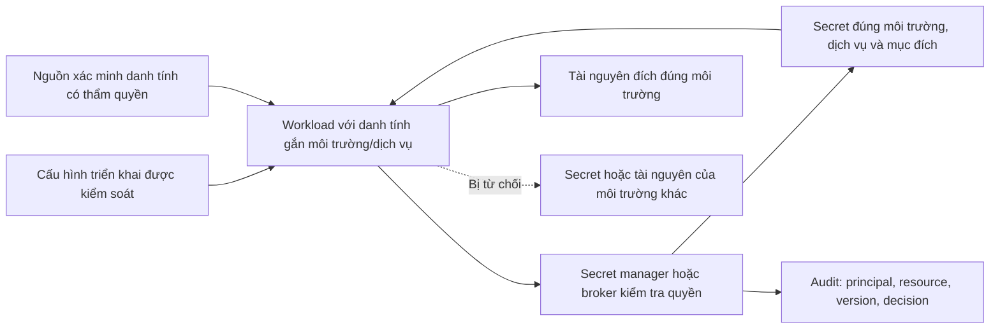

# Environment-specific secret

## 1. Secret theo môi trường là một ranh giới quyền

**Environment-specific secret** là secret được cấp, lưu trữ, sử dụng và quản lý vòng đời trong phạm vi một môi trường hoặc miền an toàn đã được xác định. Mật khẩu database của production, khóa ký webhook của staging và credential chạy kiểm thử phải có phạm vi sử dụng riêng. Tách tên biến hoặc tạo hai bản sao của cùng một credential không tạo ra sự cô lập này.

Một secret có thể là mật khẩu, private key, khóa ký đối xứng, client secret, API token hoặc vật liệu dùng để giải mã dữ liệu. Giá trị đó trao một khả năng cụ thể: kết nối database, gọi dịch vụ, ký một thông điệp được bên khác tin hoặc giải mã dữ liệu. Bài toán cần giải quyết là ai được dùng khả năng nào, trong môi trường nào và trong bao lâu.

Trong chương **Configuration security** của module yêu cầu bảo mật, mục tiêu không dừng ở quy tắc “mỗi môi trường có file cấu hình riêng”. Cần chuyển rủi ro thành các yêu cầu có thể kiểm chứng về danh tính workload, quyền truy cập secret, đích sử dụng, cấp phát, rotation, audit và phục hồi.

Ví dụ: worker xử lý báo cáo ở staging bị khai thác. Nếu nó có thể đọc hoặc sử dụng credential database production, một sự cố kiểm thử có thể trở thành sự cố dữ liệu thật. Nếu secret khác nhau nhưng tài khoản staging vẫn được cấp quyền tới dữ liệu production, ranh giới vẫn chưa đạt yêu cầu.

### Mục tiêu học tập

Sau bài này, người học có thể:

1. Xác định môi trường và miền an toàn mà từng secret thuộc về.
2. Phân biệt tách giá trị, tách danh tính, tách quyền và tách tài nguyên đích.
3. Đặc tả việc cấp secret lúc chạy mà không tin trường môi trường do caller tự khai.
4. Xử lý rotation, thu hồi, mất kết nối secret store và khôi phục mà không dùng nhầm môi trường.
5. Liên kết rủi ro với yêu cầu, điểm cưỡng chế và bằng chứng nghiệm thu.

## 2. Xác định phạm vi môi trường và loại secret

### 2.1. Môi trường không chỉ là một chuỗi `ENV`

Development, test, staging, production và môi trường preview thường có mức tin cậy, người vận hành và dữ liệu khác nhau. Tuy nhiên, tên gọi không tự tạo ranh giới. Cần ghi rõ một môi trường gồm workload nào, ai triển khai được, danh tính nào được cấp, secret store nào phục vụ và những tài nguyên nào được phép sử dụng.

Biến `ENV=production`, tên namespace hoặc nhãn trên một secret có thể hỗ trợ tổ chức cấu hình. Nếu workload staging tự sửa các giá trị đó rồi được cấp quyền production, cơ chế đang tin dữ liệu cấu hình thay cho danh tính có thẩm quyền.

Một mô tả phạm vi tối thiểu gồm:

| Thành phần | Câu hỏi cần chốt |
|---|---|
| Miền an toàn | Production và staging có được coi là hai ranh giới độc lập không? |
| Danh tính workload | Ai phát hành, xác minh và ràng buộc danh tính với môi trường? |
| Chủ thể quản trị | Ai tạo, đọc, cập nhật, thu hồi và cấp quyền secret? |
| Tài nguyên đích | Database, API, kho dữ liệu, issuer hoặc bên xác minh nào chấp nhận secret? |
| Đường cấp phát | Runtime lấy secret trực tiếp, qua agent hay qua broker? |
| Ngoại lệ | DR, công cụ vận hành hoặc tích hợp nào cần một miền quyền riêng? |

Một site DR có thể thuộc cùng miền production và được cấp quyền production theo thiết kế khôi phục. Điều đó khác với cấp credential production cho staging để tiện thử nghiệm. Quyết định phải dựa trên ranh giới và quyền thực tế đã được phê duyệt, không suy từ tên site.

### 2.2. Phân loại secret theo khả năng được trao

| Nhóm secret | Ví dụ | Điều cần cô lập theo môi trường |
|---|---|---|
| Credential truy cập dữ liệu | Mật khẩu database, token object storage | Tài khoản, quyền dữ liệu, endpoint và đường mạng |
| Credential gọi API | API token, OAuth client secret | Client, phạm vi quyền, tài nguyên và tài khoản đối tác |
| Khóa ký | Khóa ký token, webhook hoặc thông điệp | Bên được phép ký và tập bên xác minh chấp nhận |
| Khóa bảo vệ phiên | Khóa MAC hoặc mã hóa cookie phiên | Phiên và host ứng dụng của từng miền môi trường |
| Private key TLS/mTLS | Khóa riêng gắn với chứng chỉ client | Danh tính được bên nhận tin cậy và quyền dịch vụ |
| Khóa mã hóa dữ liệu | DEK, KEK hoặc quyền gọi dịch vụ giải mã | Dữ liệu, ngữ cảnh mã hóa, lịch sử key và quy trình phục hồi |
| Credential triển khai | Token CI/CD, quyền giả lập danh tính workload | Môi trường được triển khai và quyền cấp secret cho runtime |

Public certificate, tên secret, client ID hoặc endpoint thường không phải bản thân secret. Tuy vậy, tính toàn vẹn của chúng rất quan trọng: thay endpoint hoặc secret reference có thể khiến ứng dụng gửi credential tới sai nơi. Một secret reference cũng có thể tiết lộ cấu trúc hệ thống, nên việc công bố nó vẫn theo chính sách thông tin của tổ chức.

### 2.3. Môi trường thấp hơn vẫn cần bảo vệ thực chất

Không dùng credential yếu hoặc dùng chung vì dữ liệu được gọi là “test”. Staging có thể chứa dữ liệu nhạy cảm, tích hợp có tính phí hoặc quyền gửi thông báo ra ngoài. Credential dùng ở đó vẫn phải có chất lượng, quyền tối thiểu và vòng đời phù hợp.

Preview cho từng nhánh cần có danh tính và tài nguyên được giới hạn; không được kế thừa secret production hoặc toàn bộ secret staging chỉ vì cùng chạy một image. Với máy phát triển cá nhân, ưu tiên danh tính cá nhân có thời hạn và tài nguyên development; không phân phối credential runtime production làm cấu hình mẫu.

## 3. Mô hình đe dọa: secret có thể đi sai môi trường bằng cách nào?

### 3.1. Tài sản, đối phương và giả định

Tài sản cần bảo vệ gồm giá trị secret, khả năng sử dụng secret, dữ liệu đích, danh tính được tin cậy và tính sẵn sàng khi đổi secret. Quyền gọi một dịch vụ ký hoặc giải mã cũng là khả năng nhạy cảm, dù caller không bao giờ đọc được private key.

Đối phương có thể là người dùng điều khiển đầu vào ứng dụng, người có quyền chạy mã ở môi trường thử, contributor điều khiển pipeline không đáng tin hoặc một workload đã bị chiếm quyền. Mô hình cũng xem xét lỗi vận hành: sao chép cấu hình, cấp role quá rộng và phục hồi nhầm bản sao lưu.

Ta không giả định quản trị viên có toàn quyền hệ thống đã bị kiểm soát mà vẫn có thể bảo vệ mọi secret chỉ bằng đổi tên. Quyền quản trị vượt môi trường phải được nhận diện riêng, giảm tối đa và được audit; không trộn nó với danh tính runtime thông thường.

### 3.2. Các kịch bản chính

| Mã rủi ro | Kịch bản | Hậu quả |
|---|---|---|
| R1 | Workload staging đọc hoặc dùng secret production | Sự cố ở môi trường thấp mở rộng sang dữ liệu thật |
| R2 | Cấu hình trỏ sai secret hoặc endpoint; có fallback sang môi trường khác | Ứng dụng hoạt động với quyền sai mà vẫn báo khỏe |
| R3 | CI, image, log, bản dump hoặc backup mang theo secret qua môi trường | Secret thoát khỏi đường cấp phát và quyền được quản lý |
| R4 | Khóa ký hoặc credential được dùng chung giữa môi trường | Thông điệp, token hoặc phiên của môi trường thử được chấp nhận ở production |
| R5 | Rotation/thu hồi chỉ đổi giá trị trong store, consumer hoặc phiên cũ vẫn dùng được | Credential đã lộ còn hiệu lực hoặc dịch vụ bị gián đoạn |
| R6 | Mất secret store, restore hoặc break-glass mở quyền ngoài phạm vi | Phục hồi làm mất ranh giới hoặc không còn bằng chứng điều tra |

Một chuỗi tấn công minh họa: contributor điều khiển job kiểm thử → job đổi tham số `environment` thành production → broker tin tham số này để chọn role → job lấy credential production → kết nối tới dữ liệu thật. Điểm cần sửa là cơ chế cấp quyền dựa trên danh tính và ngữ cảnh triển khai có thẩm quyền; kiểm tra chuỗi `environment` ở giao diện là chưa đủ.

### 3.3. Bất biến bảo mật

> Một workload chỉ được nhận hoặc sử dụng secret thuộc môi trường, dịch vụ và mục đích mà danh tính có thẩm quyền của nó được cấp; thay cấu hình, version, pipeline hoặc đường phục hồi không được âm thầm mở rộng phạm vi đó.

Bất biến có hai vế: quyền lấy secret và quyền dùng khả năng mà secret trao. Không đọc được secret production nhưng được gọi một signing service production không giới hạn vẫn có thể vượt ranh giới. Ngược lại, có hai password khác nhau nhưng cùng tài khoản được cấp quyền đọc mọi môi trường cũng chưa tạo sự cô lập.

## 4. Kiến trúc tách secret theo môi trường

### 4.1. Tách theo nhiều lớp có trách nhiệm rõ ràng

| Lớp | Yêu cầu thiết kế | Giới hạn nếu chỉ dựa vào lớp này |
|---|---|---|
| Giá trị và vật liệu khóa | Credential/khóa được cấp riêng theo miền môi trường | Giá trị khác vẫn có thể có quyền chéo |
| Danh tính | Runtime staging và production là các principal khác nhau | Role hoặc trust policy quá rộng có thể nối lại hai miền |
| Secret store | Resource, namespace hoặc store được phân quyền rõ | Tên path hoặc nhãn không tự cưỡng chế quyền |
| Hạ tầng quản trị | Có thể tách account/project/cluster tùy mô hình rủi ro | Tách hạ tầng vẫn cần kiểm soát quản trị và pipeline |
| Tài nguyên đích | Tài khoản và dữ liệu đích chấp nhận đúng quyền môi trường | Firewall không thay thế phân quyền database/API |
| Mạng | Chỉ cho phép các tuyến cần thiết tới store và tài nguyên | Cùng mạng không có nghĩa cùng mức tin cậy |
| Vòng đời và audit | Rotation, thu hồi, phục hồi, cảnh báo có chủ sở hữu | Lưu secret đúng chỗ chưa bảo đảm consumer dùng đúng |

Một secret manager dùng chung có thể phục vụ nhiều môi trường nếu có mô hình quyền, trust boundary và bằng chứng cô lập phù hợp. Tách store hoặc account là một lựa chọn để giảm hậu quả của lỗi quản trị, không phải điều kiện đủ để miễn kiểm tra quyền thực tế.

### 4.2. Cấp phát dựa trên danh tính workload



Nguồn danh tính có thể là cơ chế workload identity hoặc một cơ chế bootstrap được quản lý. Bên cấp quyền phải xác minh issuer, đối tượng nhận và thuộc tính cần thiết của danh tính theo hệ thống đã chọn; không tin header tự khai, tên pod hoặc một chuỗi `ENV` do ứng dụng gửi.

Danh tính runtime chỉ được đọc hoặc dùng đúng resource cần thiết. Các quyền tạo version, sửa policy, liệt kê rộng, xuất key hoặc giả lập principal khác phải được tách theo trách nhiệm. Nếu có broker, broker phải giữ ranh giới này thay vì biến thành cổng nhận `secret_path` tùy ý rồi đọc bằng quyền quản trị.

### 4.3. Bài toán bootstrap

Nếu ứng dụng cần một token dài hạn để lấy secret và token đó được nhúng trong image dùng chung, ranh giới có thể đã bị phá ngay trước lần truy cập secret store đầu tiên. Cần đặc tả nguồn của credential bootstrap, nơi lưu, phạm vi, thời hạn và cách thu hồi.

Ưu tiên cơ chế cấp danh tính có thời hạn gắn với workload và môi trường triển khai. Khi buộc dùng credential tĩnh, phải có kênh phân phối riêng theo môi trường, quyền tối thiểu, bảo vệ lưu trữ và rotation; không để một bootstrap credential mở toàn bộ kho rồi giao việc phân biệt môi trường cho mã ứng dụng.

## 5. Hợp đồng cấu hình: ràng buộc secret với đúng đích

### 5.1. Bản ghi binding có thẩm quyền

Mỗi binding cần trả lời: secret nào, consumer nào, mục đích nào, môi trường nào và dùng với tài nguyên nào. Một cấu trúc tham chiếu có thể gồm:

| Trường | Ý nghĩa |
|---|---|
| Environment/domain | Miền an toàn được đối chiếu với danh tính triển khai |
| Service và purpose | Dịch vụ và thao tác được cấp, chẳng hạn đọc báo cáo |
| Principal | Danh tính runtime được phép nhận hoặc sử dụng secret |
| Secret resource ID | Định danh có thẩm quyền ở provider; không chỉ tên tùy ý |
| Version policy | Cách chọn version đang được phép dùng và trạng thái thu hồi |
| Target identity | Database/API/issuer và quyền đích được phép |
| Owner | Bên quản lý secret, consumer và quy trình thay đổi |
| Lifetime | Hạn dùng, cache, rotation, thu hồi và phục hồi |

Nhãn `environment=prod` trong metadata hữu ích để đối chiếu nhưng không thay thế quyền provider. Nếu caller được sửa nhãn hoặc tự chọn resource ID rồi gắn nhãn production, kiểm tra đó không chứng minh nguồn secret. Cần kiểm soát cả quyền sửa binding và quyền truy cập resource thật.

### 5.2. Ví dụ cấu hình hai môi trường

Ví dụ dưới đây là **schema minh họa**, không phải cú pháp dành cho một secret manager cụ thể. Các URI `secret://` chỉ biểu diễn reference, không chứa giá trị secret.

```yaml
# Binding được quản lý cho staging
service: report-api
environment: staging
workload_principal: report-api-staging
purpose: database-report-read
secret_ref: secret://staging/report-api/database-reader
version_selector: active
target_ref: database://staging/reports
fallback_secret_refs: []
---
# Binding được quản lý cho production
service: report-api
environment: production
workload_principal: report-api-production
purpose: database-report-read
secret_ref: secret://production/report-api/database-reader
version_selector: active
target_ref: database://production/reports
fallback_secret_refs: []
```

Ở runtime staging, thay `secret_ref` bằng reference production phải bị từ chối tại secret manager/broker, ngay cả khi ứng dụng có lỗi kiểm tra binding. Nếu đổi `target_ref` thành database production, kiểm tra cấu hình, quyền tài khoản đích và lớp mạng phải ngăn thao tác ngoài phạm vi. Reference không tự cấp quyền truy cập.

Không cấu hình fallback theo thứ tự “production không có thì thử staging” hoặc ngược lại. Không dùng một credential mặc định dùng chung khi biến môi trường thiếu. Một cấu hình bắt buộc chưa xác định môi trường hoặc binding là lỗi phải phát hiện trước khi mở các kết nối nghiệp vụ phụ thuộc secret đó.

### 5.3. Xác minh đích và ý nghĩa của secret

Secret đúng resource nhưng endpoint bị sửa vẫn có thể bị gửi sai nơi. Binding phải gắn credential với danh tính đích; kết nối cần xác minh danh tính và kênh bảo vệ phù hợp, đồng thời dùng tài khoản có quyền dữ liệu đúng môi trường.

Với token ký, cần tách khóa và xác minh issuer, audience, mục đích cùng các điều kiện token của hệ thống. Chỉ khác `kid` không ngăn bên production chấp nhận token staging nếu trust configuration vẫn tin toàn bộ khóa staging. Với mTLS, cần kiểm soát danh tính client mà bên nhận chấp nhận; cùng một CA không tự chứng minh cùng môi trường hoặc quyền.

Với cookie phiên, vật liệu bảo vệ phiên, phạm vi host/domain và chính sách chấp nhận phiên phải ngăn nhầm lẫn giữa môi trường. Đổi tên cookie là một biện pháp tổ chức, không thay thế tách khóa hoặc kiểm tra quyền phía server.

## 6. Cấp phát và sử dụng khi chạy

### 6.1. Luồng runtime tham chiếu

```text
initialize_secret_binding(deployment_context):
    identity = obtain_and_verify_workload_identity()
    scope = authoritative_scope(identity, deployment_context)
    binding = load_approved_binding(scope.environment, scope.service, purpose)
    require binding.principal matches identity.authorized_principal
    require binding.target belongs to scope.allowed_resources

    resource = provider.describe_authorized(binding.secret_resource_id)
    require resource.id matches binding.secret_resource_id
    require resource is permitted for scope.environment and purpose

    # Provider/broker phải cưỡng chế quyền, không chỉ ứng dụng tự so nhãn.
    secret_version = provider.read_active_version_as(identity, resource.id)
    require secret_version is allowed, current_enough, and not expired
    require target_identity_matches(binding.target)

    install_for_authorized_consumer(secret_version, binding.target)
    emit_audit(resource.id, secret_version.id, decision=ALLOW)
    enable_only_operations_whose_binding_is_ready()
```

Các hàm mô tả trách nhiệm cần được triển khai; đây không phải SDK đã có sẵn các bảo đảm. `deployment_context` phải đến từ nguồn triển khai có thẩm quyền và được đối chiếu với danh tính, không phải trường trong HTTP request, tham số job hoặc file do caller sửa tùy ý.

Việc đọc secret là thao tác mạng tới hệ thống kiểm soát được cấp quyền; nó không cho phép ứng dụng dùng credential đó với mọi target. Nhận secret thành công cũng không đủ để đánh dấu ứng dụng sẵn sàng cho một cấu hình binding sai.

### 6.2. Cách đưa secret vào tiến trình

Có thể cấp qua API, agent, file được mount có kiểm soát hoặc cơ chế khác phù hợp nền tảng. Đặc tả cần chốt consumer nào đọc được, cách cập nhật version, quyền trên file/bộ nhớ và đường nào có thể sao chép giá trị ra ngoài.

Biến môi trường không phải bảo đảm bí mật tự thân: tùy nền tảng và quyền vận hành, giá trị có thể xuất hiện trong thông tin tiến trình, dump, công cụ chẩn đoán hoặc log cấu hình. File mount cũng cần quyền truy cập, đường dẫn và hành vi cập nhật rõ ràng. Không chọn một kênh chỉ vì nó được gọi là “secret injection”.

Ứng dụng không ghi giá trị vào log khi khởi động, không serialize nguyên cấu hình vào lỗi và không trả secret qua endpoint chẩn đoán. Giới hạn thời gian giữ và số bản sao trong bộ nhớ khi có thể; không cam kết xóa sạch tuyệt đối trong mọi runtime nếu nền tảng không có khả năng chứng minh đó.

### 6.3. Cache có thời hạn và xử lý lỗi

Với credential xác thực của hồ sơ ví dụ, cache runtime tối đa 60 giây từ lần lấy thành công. Đọc trúng cache không được gia hạn thời điểm này. Refresh thất bại không biến một giá trị hết hạn thành hợp lệ và không kích hoạt việc tìm secret ở môi trường khác.

- Khởi động mới mà thiếu secret bắt buộc: không bật thao tác phụ thuộc secret; trạng thái readiness và lỗi phải phản ánh điều kiện chưa đạt.
- Tiến trình đang chạy mà provider lỗi: chỉ dùng version cache còn trong hạn và chưa bị thu hồi theo cơ chế được thiết kế; hết hạn thì ngừng thao tác mới cần credential đó.
- Có thông báo thu hồi hoặc binding sai: không tiếp tục dùng cache chỉ vì TTL chưa hết; hủy quyền sử dụng, xử lý pool/phiên theo yêu cầu thu hồi.
- Provider phục hồi: tải lại binding và version đúng phạm vi, xác minh rồi mới bật lại thao tác; không dùng “last known value” vô thời hạn.

Không có kết nối tới nguồn thu hồi thì hệ thống không thể biết tức thời mọi quyết định mới. Vì vậy, đặc tả phải chốt thời gian cũ tối đa có thể được sử dụng và phối hợp khả năng từ chối tại tài nguyên đích. TTL cache một mình không bảo đảm các phiên đã mở bị vô hiệu hóa.

## 7. CI/CD, image và cấu hình được promote

### 7.1. Promote mã và artifact, cấp secret theo đích triển khai

Một cách thiết kế là xây một image không chứa secret môi trường, sau đó triển khai cùng artifact với binding và danh tính riêng ở staging hoặc production. Bước build không cần đọc credential runtime production chỉ để tạo artifact.

Secret reference được quản lý theo môi trường; giá trị được cấp lúc runtime hoặc ở một bước được kiểm soát rõ ràng. Không thay placeholder bằng secret production rồi đóng gói kết quả vào image, archive, manifest có thể tải công khai hoặc artifact dùng lại cho môi trường khác.

Cần xét cả lớp image cũ, cache build, tệp tạm, báo cáo test, log và dữ liệu diagnostic. Xóa giá trị khỏi file cấu hình cuối không chứng minh nó chưa nằm trong một đầu ra trung gian. Bài này tập trung ranh giới môi trường; yêu cầu về repository và artifact phải hỗ trợ cùng ranh giới đó.

### 7.2. Tách quyền job kiểm thử, triển khai và runtime

Job chạy mã từ nguồn chưa được tin cậy không được cấp secret production hoặc quyền giả lập principal production. Đường release phải xác minh các điều kiện tin cậy của danh tính CI theo nền tảng: nguồn phát hành, đối tượng nhận, repository/workflow và đích triển khai cần thiết.

Quyền triển khai cũng cần đánh giá quyền gián tiếp. Một job không đọc secret trực tiếp nhưng có thể sửa workload production để xuất secret ra log vẫn có quyền nhạy cảm. Cần tách bước và role, giới hạn phạm vi triển khai, bảo vệ cấu hình danh tính và ghi audit cho thay đổi đó.

Không chọn role production chỉ từ tên nhánh hoặc tham số `environment` mà caller tự nhập. Ngữ cảnh này phải được xác minh tại nơi cấp quyền. Các biện pháp như bảo vệ nhánh hoặc điều kiện duyệt hỗ trợ chuỗi tin cậy nhưng không thay thế kiểm tra quyền tại secret provider và tài nguyên đích.

### 7.3. Secret kiểm thử và dữ liệu mẫu

Test dùng fixture hoặc credential được cấp riêng cho tài nguyên thử. Không lấy secret production để “test cho giống thật”, kể cả khi test chỉ chạy một truy vấn đọc. Kiểm thử tích hợp production, nếu thực sự cần, phải là một hoạt động thuộc miền production có danh tính, phạm vi và giám sát riêng.

Khi dữ liệu được sao chép xuống môi trường thấp, cần loại bỏ credential, token phiên, khóa nhúng hoặc tham chiếu có thể mở quyền production. Việc che dữ liệu nghiệp vụ không tự xử lý mọi secret trong bản sao lưu hoặc cấu hình đi kèm.

## 8. Rotation, thu hồi và hủy secret

### 8.1. Phân biệt thay mới và thu hồi

**Rotation** tạo hoặc chuyển sang version/credential mới theo kế hoạch. **Thu hồi** ngăn một credential hoặc khả năng đã cấp tiếp tục được chấp nhận. Chuyển alias `active` trong secret store chỉ thay cách consumer lấy giá trị; nó không tự làm password cũ ngừng hoạt động tại database hay token cũ mất hiệu lực ở đối tác.

Với credential xác thực, một luồng rotation có thể gồm:

1. Tạo credential/version mới đúng môi trường và quyền; đăng ký tại tài nguyên đích qua kênh quản trị có thẩm quyền.
2. Xác minh credential mới bằng thao tác tối thiểu thuộc hợp đồng, không ghi giá trị ra bằng chứng.
3. Chuyển binding hoặc alias có kiểm soát; consumer nạp version mới và cập nhật kết nối/pool.
4. Quan sát consumer và lỗi, giới hạn giai đoạn cùng chấp nhận cũ–mới theo kế hoạch.
5. Thu hồi credential cũ tại nơi xác thực; vô hiệu phiên/pool cũ nếu mục tiêu thu hồi yêu cầu.
6. Giữ metadata audit, hoàn tất dọn vật liệu cũ theo chính sách và kiểm thử lại đường truy cập.

Một consumer phải chứng minh đang dùng version nào bằng ID do provider cấp và trạng thái runtime, không bằng cách in giá trị hoặc hash secret vào log. Hash của secret có độ ngẫu nhiên thấp có thể trở thành dữ liệu hỗ trợ đoán secret; version ID tránh nhu cầu công bố dấu vết như vậy.

### 8.2. Hồ sơ thời gian minh họa

Các giá trị sau là mục tiêu của ví dụ `report-api`, không phải chuẩn bắt buộc cho mọi hệ thống:

| Điều kiện | Mục tiêu đo được |
|---|---|
| Cache credential xác thực | Tối đa 60 giây từ lần đọc thành công, không gia hạn khi cache hit |
| Chuyển sang credential mới | Mọi consumer đang hoạt động chuyển trong 5 phút từ lúc version mới được kích hoạt |
| Cùng chấp nhận cũ–mới khi rotation có kế hoạch | Tối đa 10 phút theo cửa sổ đã duyệt |
| Thu hồi khẩn cấp | Trong 5 phút từ lúc nguồn điều khiển có thẩm quyền chấp nhận lệnh, credential/phiên thuộc phạm vi phải không còn dùng được |
| Truy cập production trái môi trường | Một lần bị từ chối tạo cảnh báo trong 60 giây |
| Quyền break-glass của ví dụ | Có hạn tối đa 30 phút, không tự gia hạn |

Thu hồi 5 phút là yêu cầu đầu cuối, gồm secret provider, cache, tài nguyên đích và các phiên liên quan, không chỉ thời gian gửi lệnh. Nếu một database giữ phiên xác thực cũ vô hạn, cần đóng phiên hoặc có cưỡng chế bổ sung. Nếu token tự chứa không có cơ chế thu hồi tức thời, phải xem xét thời hạn token, cache xác minh và cơ chế từ chối phù hợp; không tuyên bố đạt 5 phút chỉ vì đã xóa khóa khỏi một store.

Với rotation có kế hoạch, cửa sổ cùng chấp nhận cũ–mới phải kết thúc theo giới hạn đã chốt. Với sự cố lộ credential, không kéo dài cửa sổ chỉ để giảm lỗi. Nếu phụ thuộc bên ngoài không hỗ trợ mục tiêu, phải thay thiết kế, giới hạn phạm vi hoặc ghi nhận yêu cầu chưa đạt cùng ngoại lệ được quản lý.

### 8.3. Khóa mã hóa dữ liệu có vòng đời khác credential đăng nhập

Không áp dụng máy móc quy tắc “xóa version cũ sau 10 phút” cho khóa giải mã dữ liệu. Dữ liệu hoặc backup cũ có thể vẫn cần key cũ. Rotation khóa mã hóa phải xác định dữ liệu nào dùng key nào, cách rewrap/re-encrypt, quyền giải mã lịch sử và điều kiện được hủy key.

Production key không được cấp cho staging chỉ để đọc một bản sao dữ liệu production. Việc chuyển dữ liệu cần đi qua quy trình có thẩm quyền để giảm nhạy cảm và mã hóa bằng key của môi trường đích, với bằng chứng không mang quyền production xuống dưới.

Hủy key quá sớm có thể làm mất khả năng phục hồi. Giữ key cũ vô thời hạn với quyền giải mã rộng cũng tạo rủi ro. Cần gắn thời gian giữ với vòng đời dữ liệu, backup và kế hoạch phục hồi cụ thể; các SLO credential ở mục 8.2 chỉ áp dụng cho loại đã được đặc tả.

## 9. Audit, sự cố và phục hồi

### 9.1. Ghi bằng chứng mà không ghi secret

Sự kiện cấp, đọc, sử dụng qua broker, bị từ chối, đổi binding, rotation, thu hồi và break-glass cần ghi được chủ thể, môi trường, dịch vụ, mục đích, resource ID, version ID, quyết định, mã lý do và thời điểm. Độ chi tiết của log phải đủ đối chiếu consumer với thay đổi tại provider và tài nguyên đích.

Không ghi secret value, private key, connection string chứa password, token trong header hoặc payload đầy đủ. Không gắn giá trị tùy ý do caller cung cấp làm nhãn metric. Endpoint lỗi và diagnostic phải theo cùng quy tắc che dữ liệu, không chỉ log ứng dụng chính.

Quyền đọc log, sửa cấu hình audit và thời hạn lưu phải có chủ sở hữu. Trong hồ sơ ví dụ, giữ audit truy cập và thay đổi binding 90 ngày; đây là tham số vận hành minh họa cần điều chỉnh theo nhu cầu thực tế. Không coi mốc này là yêu cầu pháp lý chung.

### 9.2. Khi nghi ngờ secret đi sai môi trường

Quy trình nên gồm:

1. Chặn đường cấp phát hoặc role gây vượt ranh giới; xác định consumer và resource thật qua ID, không lan truyền giá trị secret vào kênh điều tra.
2. Thu hồi credential/khả năng bị lộ tại nơi chấp nhận; xử lý phiên, token hoặc pool liên quan theo phạm vi sự cố.
3. Xác định dữ liệu và thao tác có thể đã xảy ra, cùng các bản sao trong log, artifact, dump hoặc backup.
4. Cấp credential mới đúng phạm vi và sửa binding/quyền gốc; không chỉ đổi tên secret hoặc xóa một file cấu hình.
5. Kiểm thử quyền chéo, thu hồi và khôi phục trước khi bật lại consumer bị ảnh hưởng.

Nếu cùng một credential đã được dùng ở nhiều môi trường, phải điều tra tất cả nơi có khả năng chấp nhận nó. Rotate mỗi bản sao trong store mà bỏ nơi xác thực gốc không giải quyết được rủi ro.

### 9.3. Phục hồi không được thay đổi ranh giới

Khôi phục secret store, agent hoặc deployment phải giữ nguyên phạm vi principal và resource. Backup mã hóa vẫn là dữ liệu nhạy cảm, cần quyền khôi phục và giải mã riêng; không tự động đưa toàn bộ secret production vào một môi trường thử để xác nhận backup dùng được.

Mất secret store không phải lý do để bật credential dùng chung, bỏ kiểm tra môi trường hoặc xuất secret vào file tạm không được quản lý. Có thể phục hồi qua site cùng miền production hoặc cơ chế đã được thiết kế, nhưng phải kiểm tra lại danh tính, version hợp lệ và trạng thái thu hồi.

Rollback ứng dụng cũng phải đọc binding hiện hành. Không khôi phục credential đã thu hồi chỉ để một phiên bản mã cũ chạy được. Khả năng tương thích với version mới cần được xét trước rotation; nếu không còn consumer an toàn để chạy, xử lý theo kế hoạch khôi phục đã xác định thay vì phá ranh giới.

### 9.4. Break-glass và môi trường bị hủy

Quyền khẩn cấp cần principal riêng, phạm vi cụ thể, người chịu trách nhiệm, thời hạn và audit. Với hồ sơ ví dụ, quyền hết hạn trong tối đa 30 phút, có cảnh báo và cần một quyết định mới nếu phải cấp lại; không tự gia hạn trong script nền.

Khi môi trường preview/test bị hủy, phải thu hồi danh tính, credential và đường cấp phát của nó, dọn tài nguyên đích và kiểm tra không còn consumer hợp lệ. Hủy pod không tự thu hồi token đã được sao chép. Với key mã hóa, việc hủy vật liệu vẫn phải tuân theo điều kiện dữ liệu/backup ở mục 8.3.

## 10. Ma trận yêu cầu bảo mật có thể kiểm chứng

Từ “phải” trong bảng sau mô tả nghĩa vụ của hồ sơ tham chiếu. Khi áp dụng cho sản phẩm thật, nhóm cần chốt môi trường, chủ sở hữu và giá trị thời gian theo rủi ro. Các mã giúp liên kết yêu cầu với kiến trúc và ca nghiệm thu.

| ID / rủi ro | Yêu cầu | Điểm cưỡng chế và chủ sở hữu | Bằng chứng chấp nhận |
|---|---|---|---|
| ENVSEC-01 / R1, R2 | Môi trường và dịch vụ của consumer phải được xác định từ danh tính/ngữ cảnh có thẩm quyền; caller không được tự chọn quyền bằng biến `ENV` hay tham số job. | Nền tảng danh tính và secret broker | AC-01: thay tham số không mở được resource production; quyết định gắn đúng principal. |
| ENVSEC-02 / R1 | Principal runtime chỉ được đọc/dùng đúng resource và purpose trong môi trường được cấp; không có wildcard vượt miền. | Policy provider/broker; chủ secret | AC-02: đọc và dùng chéo staging–production bị từ chối tại nơi cấp quyền, không chỉ ở UI. |
| ENVSEC-03 / R1, R4 | Credential/khóa và quyền tài nguyên đích phải được tách; production không chấp nhận credential hoặc khả năng ký của staging ngoài chính sách đã xác định. | IAM/database/API và bên xác minh; chủ tài nguyên | AC-03: credential/token thử đúng môi trường được chấp nhận, dùng chéo bị từ chối và không có tác động nghiệp vụ. |
| ENVSEC-04 / R2 | Binding phải ràng buộc principal, secret resource, mục đích và đích; thiếu/sai binding phải chặn thao tác phụ thuộc secret, không fallback sang môi trường khác. | Loader cấu hình và runtime; nhóm tính năng | AC-04: sai reference/đích hoặc thiếu secret không tạo kết nối nghiệp vụ ngoài phạm vi; readiness phản ánh đúng. |
| ENVSEC-05 / R3 | Artifact dùng qua nhiều môi trường không được chứa secret runtime; job chưa đáng tin không được lấy hoặc gián tiếp sử dụng quyền production. | CI/CD, registry và cấu hình triển khai; nhóm release | AC-05: kiểm tra đầu ra và thử principal CI; không lấy secret production hoặc sửa workload production bằng đường không được cấp. |
| ENVSEC-06 / R5 | Credential xác thực cache tối đa 60 giây; lỗi refresh không gia hạn hoặc đổi môi trường; giá trị bị thu hồi không được dùng tiếp theo cơ chế thu hồi. | SDK/agent và pool; nhóm runtime | AC-06: đồng hồ kiểm soát chứng minh cache hit không kéo dài hạn, outage không kích hoạt fallback. |
| ENVSEC-07 / R5 | Consumer chuyển sang version mới trong 5 phút, cửa sổ cùng chấp nhận có kế hoạch tối đa 10 phút; thu hồi đầu cuối tối đa 5 phút. | Chủ secret, chủ tài nguyên và runtime | AC-07: đo version runtime và việc chấp nhận tại đích, gồm kết nối/phiên cũ. |
| ENVSEC-08 / R3, R6 | Audit phải có principal, resource/version, môi trường và quyết định, giữ 90 ngày theo hồ sơ; không có secret trong log/trace/lỗi. | Provider, runtime và hệ thống audit; nhóm vận hành | AC-08: đối chiếu sự kiện và kiểm tra che dữ liệu trên tất cả đầu ra trong phạm vi. |
| ENVSEC-09 / R1, R6 | Một lần truy cập production trái môi trường bị từ chối phải tạo cảnh báo trong 60 giây. | Giám sát và nơi cưỡng chế quyền; nhóm an toàn | AC-08: gây sự kiện fixture và đo từ thời điểm từ chối tới cảnh báo. |
| ENVSEC-10 / R5, R6 | Restore/rollback phải giữ quyền môi trường và trạng thái thu hồi; key giải mã lịch sử chỉ được hủy khi điều kiện dữ liệu/backup đã đạt. | Quy trình khôi phục và quản lý key; chủ dữ liệu | AC-09: phục hồi cô lập có dữ liệu mẫu, không đưa quyền production xuống staging và không làm mất khả năng giải mã được yêu cầu. |
| ENVSEC-11 / R6 | Break-glass phải giới hạn phạm vi, audit và hết hạn tối đa 30 phút, không tự gia hạn. | Nơi cấp quyền khẩn cấp; nhóm vận hành có thẩm quyền | AC-10: quyền hoạt động trong phạm vi rồi mất hiệu lực đúng hạn ở cả provider và đích liên quan. |
| ENVSEC-12 / R1, R6 | Hủy môi trường phải thu hồi principal/credential của nó; không tái dùng credential cho môi trường mới. | Quản lý vòng đời môi trường; chủ nền tảng | AC-11: danh tính hoặc credential được giữ từ môi trường đã hủy không còn đọc secret hoặc truy cập tài nguyên. |

Ví dụ yêu cầu yếu: “staging và production dùng file `.env` khác nhau”. Cách kiểm chứng tốt hơn là ENVSEC-02 kết hợp ENVSEC-03: principal staging bị từ chối lấy secret production, đồng thời tài nguyên production từ chối credential staging. Hai điều kiện này bảo vệ hai đường lạm dụng khác nhau.

## 11. Thiết kế test và acceptance criteria

### 11.1. Môi trường và phương pháp đo

Dùng secret provider/broker thử, tài nguyên đích cô lập, principal thử và credential ngắn hạn không có quyền dữ liệu thật. Với khóa ký, dùng issuer và bên xác minh fixture. Không thử đăng nhập chéo bằng credential production thật từ staging chỉ để chứng minh một yêu cầu.

Đo ít nhất ở ba nơi: quyết định cấp quyền tại provider, version/binding tại consumer và việc chấp nhận thao tác tại đích. HTTP 403 từ API hoặc một dòng “wrong environment” trong log ứng dụng không chứng minh provider và tài nguyên đích có ranh giới độc lập.

Các giới hạn thời gian cần mốc bắt đầu/kết thúc và sai số đo được chấp thuận trước. Dùng đồng hồ đơn điệu khi đo trong một tiến trình; khi đối chiếu nhiều hệ thống, phải xử lý sai lệch đồng hồ và độ trễ thu thập. Không log giá trị secret để tạo bằng chứng.

### 11.2. Các ca nghiệm thu

**AC-01 — Không tự khai môi trường để nâng quyền, truy vết ENVSEC-01.**

- Given: principal thử được cấp quyền cho `report-api-staging` và không có quyền production.
- When: đổi `ENV`, secret reference, tham số environment hoặc payload job thành production.
- Then: quyền hiệu lực không chuyển sang production; resource production không được trả về; audit ghi principal thật và quyết định từ chối ở nơi cấp quyền.
- Đối chứng: binding staging hợp lệ vẫn hoạt động, tránh kết luận sai do toàn bộ provider đang lỗi.

**AC-02 — Kiểm tra quyền đọc và quyền sử dụng, truy vết ENVSEC-02.**

Thử principal staging đọc resource production, liệt kê namespace production và gọi broker ký/giải mã cho mục đích production. Mọi khả năng ngoài quyền phải bị từ chối. Thử chiều ngược lại cho principal runtime production nếu thiết kế không cấp quyền staging; quyền rộng của con người quản trị phải là principal khác và được ghi riêng. Không chỉ kiểm tra rằng hai secret có tên khác nhau.

**AC-03 — Bên nhận từ chối khả năng sai môi trường, truy vết ENVSEC-03.**

Credential staging phải dùng được với tài nguyên staging trong phạm vi được cấp và bị production fixture từ chối. Token hoặc thông điệp do khóa staging tạo phải bị bên xác minh production từ chối, kể cả khi cấu trúc đúng và chữ ký hợp lệ với khóa staging. Kiểm tra issuer/audience/trust configuration theo hợp đồng. Bằng chứng cần cho thấy không có thay đổi dữ liệu hoặc hành động nghiệp vụ ở đích production fixture.

**AC-04 — Cấu hình thiếu, sai hoặc bị tráo, truy vết ENVSEC-04.**

Lần lượt cấu hình thiếu binding, trỏ production secret từ staging, đổi metadata không có thẩm quyền và trỏ credential staging tới target production fixture. Consumer không bật thao tác phụ thuộc secret đó, không gửi credential tới đích ngoài hợp đồng và không tìm credential mặc định. Quan sát cả provider call, readiness và kết nối nghiệp vụ; kết nối có thẩm quyền tới secret store không phải kết nối nghiệp vụ bị cấm của ca này.

**AC-05 — Artifact và pipeline, truy vết ENVSEC-05.**

Build bằng credential fixture có dấu hiệu nhận biết, kiểm tra đầu ra trong phạm vi gồm image/layer, cache được lưu, artifact, báo cáo và log. Artifact được promote không có secret runtime của môi trường. Job chạy nguồn chưa đáng tin bị từ chối lấy role/secret production và bị từ chối sửa workload hoặc binding production. Job release được cấp hợp lệ chỉ hoạt động trong phạm vi đã định. Một công cụ quét không tìm thấy marker chỉ là một phần bằng chứng, không chứng minh mọi đường quyền gián tiếp đã được kiểm soát.

**AC-06 — Hạn cache và mất provider, truy vết ENVSEC-06.**

Lấy version fixture tại `t0`, cho provider ngừng phục vụ và liên tục đọc trúng cache. Không lần cache hit nào được đẩy hạn quá `t0 + 60 giây`; sau hạn, thao tác mới phụ thuộc credential phải dừng theo hợp đồng. Khởi động tiến trình mới trong outage cũng không dùng credential mặc định. Khôi phục provider rồi xác minh consumer nạp đúng version, đúng môi trường trước khi bật lại. Thử thông báo thu hồi khi cache còn hạn để xác nhận TTL không ghi đè quyết định thu hồi.

**AC-07 — Rotation và thu hồi đầu cuối, truy vết ENVSEC-07.**

Tạo version mới riêng cho staging và kích hoạt tại thời điểm đã ghi nhận. Trong 5 phút, mọi consumer staging đang hoạt động chuyển sang version mới; version/binding production không đổi do thao tác này. Đóng cửa sổ cùng chấp nhận cũ–mới trong tối đa 10 phút theo kế hoạch và thử xác thực bằng credential cũ tại fixture.

Tiếp theo, thu hồi khẩn cấp credential mới tại nguồn có thẩm quyền khi có cả kết nối mới, pool sẵn có và phiên đã mở. Trong 5 phút từ lúc lệnh được chấp nhận, không đường nào thuộc phạm vi còn sử dụng được credential/phiên bị thu hồi. Nếu xóa version khỏi store mà phiên cũ vẫn thao tác được, ca chưa đạt. Không dùng nội dung secret làm nhãn nhận diện trong bằng chứng; dùng resource/version ID và mã phiên fixture.

**AC-08 — Audit, che dữ liệu và cảnh báo, truy vết ENVSEC-08/09.**

Phát sinh thao tác cho phép, từ chối, đổi binding và rotation. Đối chiếu principal, resource/version ID, môi trường, quyết định và thời điểm giữa provider, consumer và đích. Dùng marker secret thử để kiểm tra log, trace, lỗi API và diagnostic; giá trị không được xuất hiện. Một lần principal staging bị từ chối truy cập production fixture phải tạo cảnh báo trong 60 giây. Kiểm tra cấu hình quyền và thời hạn lưu 90 ngày; không cần chờ thật 90 ngày để xác minh policy giữ/xóa dữ liệu và quyền sửa policy.

**AC-09 — Restore, rollback và key lịch sử, truy vết ENVSEC-10.**

Phục hồi backup thử trong miền được cấp quyền bằng key fixture tương ứng. Credential đã thu hồi không được tái hoạt động, rollback consumer không lấy version đã bị cấm và staging không được cấp key production. Với dữ liệu mã hóa mẫu còn trong thời hạn lưu, key lịch sử cần thiết vẫn giải mã được theo quyền; chỉ hủy key khi bằng chứng migration/backup cho thấy điều kiện đã đạt. Ca phải xác nhận cả việc giữ ranh giới và khả năng phục hồi dữ liệu.

**AC-10 — Break-glass hết hạn, truy vết ENVSEC-11.**

Cấp principal khẩn cấp fixture đúng phạm vi với hạn 30 phút hoặc ngắn hơn. Kiểm tra audit và cảnh báo, thử hành động ngoài phạm vi rồi đẩy thời gian kiểm thử tới sau hạn. Quyền phải hết hiệu lực tại nơi cấp secret và tài nguyên liên quan; token/phiên còn tồn tại phải được xét theo mục tiêu thu hồi đã chốt. Không coi việc giao diện hiển thị “expired” là bằng chứng quyền đích đã mất.

**AC-11 — Hủy môi trường, truy vết ENVSEC-12.**

Tạo môi trường preview fixture, cấp principal/credential và giữ một bản thử cho kiểm tra. Hủy môi trường bằng quy trình vận hành; xác minh principal cũ không đọc secret và credential cũ không dùng được ở tài nguyên đích. Môi trường preview mới phải được cấp vòng đời quyền riêng, không nhận lại credential cũ chỉ vì dùng cùng tên nhánh.

### 11.3. Điều kiện hoàn tất nghiệm thu

Một tính năng đáp ứng hồ sơ khi có danh mục binding và chủ sở hữu, bằng chứng quyền tại provider và đích, các ca AC-01–AC-11 đạt trên kiến trúc triển khai, cùng quy trình rotation/khôi phục đo được. Các đường CI, cache, pool, signing/decryption broker và quyền gián tiếp phải nằm trong phạm vi đã đánh giá.

Từng kết luận cần gắn với phiên bản policy, consumer, cấu hình danh tính và tài nguyên đích. Thiếu bằng chứng hoặc phụ thuộc không đáp ứng SLO phải được ghi nhận là chưa đạt hoặc ngoại lệ có phạm vi, thời hạn và người chịu trách nhiệm; không tự đổi thành đạt vì ứng dụng vẫn chạy.

Các ca trên là đặc tả nghiệm thu cho người triển khai, không phải tuyên bố rằng một hệ thống cụ thể đã được kiểm thử. Khi đổi secret manager, trust policy, SDK cache, CI identity, topology hoặc cách tài nguyên xác thực phiên, cần thực hiện lại các ca bị ảnh hưởng trước khi giữ nguyên kết luận.

## 12. Các tình huống cần quyết định riêng

### 12.1. Đối tác chỉ cấp một credential cho nhiều môi trường

Không sao chép credential đó vào hai namespace rồi tuyên bố đã tách. Cần yêu cầu credential sandbox hoặc quyền giới hạn thật sự nếu đối tác hỗ trợ. Một phương án khác là giữ quyền nhạy cảm ở một integration gateway thuộc miền được cấp, chỉ cho môi trường thấp thực hiện một tập thao tác thử an toàn qua policy có thể kiểm chứng.

Gateway vẫn phải xác thực caller, giới hạn mục đích và không cho staging điều khiển tùy ý request dùng credential production. Nếu không có cách ngăn tác động production, tính năng tích hợp từ môi trường thấp chưa đáp ứng yêu cầu cô lập; cần thay thiết kế hoặc quản lý ngoại lệ, không che bằng tên secret.

### 12.2. Nhiều môi trường dùng chung hạ tầng

Có thể dùng chung cụm hoặc provider nhưng cần principal, policy, tài khoản và tài nguyên logic riêng với bằng chứng phù hợp. Đồng thời phải xem xét ai có quyền quản trị hạ tầng chung và hậu quả nếu ranh giới đó bị vượt. Tách secret không thay thế cách ly workload hoặc phân quyền dữ liệu.

### 12.3. Kiểm thử cần dữ liệu gần production

Dùng dữ liệu tổng hợp hoặc tập dữ liệu được xử lý theo quy trình có thẩm quyền, cùng credential và key của môi trường thử. Dữ liệu giống thật không đòi hỏi dùng cùng credential. Nếu phải kiểm tra trên dữ liệu production thật, hoạt động đó cần thuộc miền production và được cấp quyền theo đúng rủi ro của dữ liệu.

Một đặc tả tốt cho secret theo môi trường nối được bốn yếu tố: danh tính có thẩm quyền, secret/khả năng được cấp, tài nguyên chấp nhận và vòng đời quyền. Khi một yếu tố thay đổi, hệ thống phải kiểm tra lại binding và giữ bằng chứng; việc có nhiều file cấu hình hoặc nhiều secret name chỉ là cách tổ chức đầu vào.
