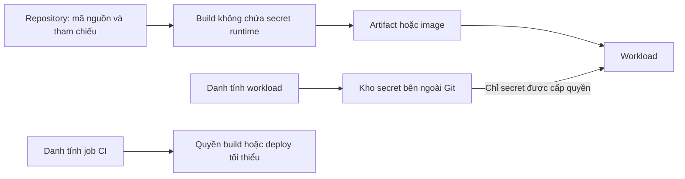

# Secret không nằm trong repository

## 1. Từ nguyên tắc đến yêu cầu bảo mật

Trong chương **Configuration security**, yêu cầu “secret không nằm trong repository” nhằm tách quyền đọc mã nguồn khỏi quyền sử dụng tài nguyên của hệ thống. Một người được xem code không mặc nhiên được phép đăng nhập database, ký token hoặc triển khai lên môi trường production.

Trong phạm vi module **SECURITY_SECURITY_DESIGN_SECURITY_REQUIREMENTS**, bài học chuyển mục tiêu này thành các yêu cầu cụ thể cho cấu hình, xác thực workload, phân quyền, CI/CD, logging và phục hồi. Mỗi yêu cầu cần có rủi ro liên quan, điểm thực thi và bằng chứng kiểm thử; chỉ thêm `.env` vào `.gitignore` chưa đủ để nghiệm thu.

Sau bài học, người học cần làm được ba việc:

- Phân biệt giá trị bí mật, cấu hình thông thường và tham chiếu tới bí mật.
- Thiết kế đường cấp phát secret bên ngoài Git và những kiểm soát ngăn rò rỉ trong quá trình phát triển, build, triển khai.
- Đặc tả cách phát hiện, thu hồi, thay thế và xử lý bản sao khi một secret đã lọt vào lịch sử repository.

Các mã yêu cầu, mô hình dịch vụ và mục tiêu thời gian trong bài là ví dụ đặc tả. Chúng phải được điều chỉnh theo tài sản, nhà cung cấp định danh và khả năng vận hành của dự án.

## 2. Cái gì là secret và “repository” bao gồm những gì?

### 2.1. Phân loại theo khả năng cấp quyền

Một giá trị là secret khi việc biết hoặc sở hữu nó có thể hỗ trợ xác thực, giải mã, ký, khôi phục tài khoản hay thực hiện một quyền mà người đọc repository không nên có.

| Loại dữ liệu | Ví dụ | Cách xử lý trong thiết kế |
| --- | --- | --- |
| Credential | Mật khẩu database, API token, refresh token | Không đưa giá trị thật vào Git; cấp phát theo danh tính và môi trường |
| Vật liệu mật mã bí mật | Private key, khóa mã hóa đối xứng, seed khôi phục | Lưu và sử dụng theo cơ chế quản lý khóa phù hợp; tránh xuất khóa khi không cần |
| Credential được nhúng | URL kết nối có mật khẩu, webhook URL chứa token | Tách phần cấp quyền khỏi cấu hình có thể chia sẻ |
| Dữ liệu phiên | Cookie đăng nhập, bearer token trong HTTP fixture | Không dùng dữ liệu phiên thật làm mẫu hay bản ghi kiểm thử |
| Cấu hình thông thường | Timeout, tên feature, địa chỉ dịch vụ công khai | Có thể version trong Git sau khi đánh giá độ nhạy |
| Định danh hoặc tham chiếu | Tên biến `PAYMENT_API_TOKEN`, secret reference, public client ID | Không tự cấp quyền nhưng vẫn có thể tiết lộ cấu trúc hệ thống |
| Vật liệu công khai | Public key, chứng thư công khai | Không đồng nhất với private key; kiểm soát tính toàn vẹn và mục đích sử dụng |

Đuôi file không quyết định toàn bộ phân loại. Một file `.pem` có thể chứa chứng thư công khai hoặc private key; một file YAML thông thường có thể chứa mật khẩu. Tên biến có chữ `PUBLIC` cũng không làm một credential trở thành dữ liệu công khai. Đối với khóa được nhà cung cấp thiết kế để phân phối công khai, phải kiểm tra đúng loại khóa và giới hạn quyền theo tài liệu của nhà cung cấp.

Base64, chia nhỏ chuỗi hoặc đổi tên biến không loại bỏ tính bí mật. Mã nguồn có chuỗi đã mã hóa kèm khóa giải mã cũng không tách được ranh giới quyền. Lưu cấu hình mã hóa trong Git là một mô hình kiến trúc riêng, cần chính sách và quản lý khóa độc lập; không tự coi đó là ngoại lệ hợp lệ cho yêu cầu đang đặc tả ở đây.

### 2.2. Không chỉ kiểm tra file ở commit mới nhất

Phạm vi Git cần xét gồm nội dung commit, các nhánh và tag có liên quan, lịch sử trước đó cùng những ref mà nền tảng lưu trữ cung cấp. Một secret đã bị xóa ở nhánh chính vẫn có thể còn trong commit cũ hoặc một nhánh khác.

Ngoài Git còn có các bản sao phát sinh: clone, fork, patch, PR diff, release asset, build cache, image, log và tệp đính kèm. Chúng cần kiểm soát liên quan dù không phải tất cả đều là đối tượng Git. Báo cáo kiểm tra phải phân biệt rõ đã quét phần nào, chưa tiếp cận được phần nào và ai chịu trách nhiệm xử lý.

Repository private thu hẹp nhóm người đọc nhưng không biến Git thành kho bí mật. Một credential dùng cho production vẫn có thể bị đọc bởi cộng tác viên, runner hoặc công cụ tích hợp chỉ cần quyền đọc mã nguồn.

## 3. Mô hình đe dọa và rủi ro cần truy vết

Giả sử một dịch vụ thanh toán có repository ứng dụng, pipeline build image và workload chạy riêng cho dev, staging, production. Developer cần phát triển tính năng; runner cần tải dependency; workload cần gọi database và cổng thanh toán. Ba chủ thể này không cần cùng một tập credential.



Sơ đồ thể hiện kiến trúc mục tiêu: artifact không cần chứa secret runtime; workload nhận secret qua một kênh cấp phát có xác thực. Nếu build cần token riêng để tải dependency, phải thiết kế kênh tạm thời cho token đó và chứng minh nó không lọt vào đầu ra build.

| Mã rủi ro | Tình huống | Hậu quả cần ngăn |
| --- | --- | --- |
| R-01 | Developer commit credential vào cấu hình hoặc tài liệu | Người đọc Git có quyền truy cập tài nguyên ngoài phạm vi của họ |
| R-02 | Xóa secret ở HEAD nhưng để lại trong lịch sử, tag hoặc bản sao | Credential tiếp tục bị thu thập và sử dụng |
| R-03 | Job CI nhận secret rồi chạy code không tin cậy | Secret bị gửi ra ngoài hoặc được dùng để thay đổi hệ thống |
| R-04 | Secret đi vào log, cache, image hoặc frontend bundle | Quyền đọc artifact trở thành quyền sử dụng credential |
| R-05 | Dùng chung secret giữa môi trường, dịch vụ hoặc người dùng | Một sự cố mở rộng sang các tài sản không liên quan |
| R-06 | Kho secret lỗi hoặc khôi phục cấu hình cũ | Hệ thống dùng mật khẩu mặc định, khôi phục credential đã bị lộ hoặc ngừng không kiểm soát |

Mô hình không giả định chỉ có kẻ tấn công bên ngoài. Sai sót của developer, một dependency build bị thay đổi và một runner bị chiếm quyền đều có thể đi qua các ranh giới trên. Owner yêu cầu phải xác định chủ thể nào được đọc từng secret và vào thời điểm nào.

## 4. Đặc tả yêu cầu thay vì chỉ đặt tên công cụ

Một yêu cầu chưa đủ rõ:

> Không commit secret, dùng secret manager và bật secret scanning.

Một yêu cầu có thể nghiệm thu:

> Giá trị credential thực của dịch vụ không được xuất hiện trong các commit/ref thuộc phạm vi kiểm soát. Mã nguồn chỉ chứa cấu hình không bí mật, tên biến hoặc tham chiếu. Workload production chỉ được lấy secret của chính dịch vụ và môi trường đó bằng danh tính được cấp quyền. Khi thiếu credential bắt buộc, chức năng phụ thuộc không được dùng mật khẩu mặc định hoặc credential của môi trường khác.

Hồ sơ yêu cầu cần ghi phạm vi repository và ref, loại secret, nguồn cấp phát, owner, cơ chế ngăn chặn, cách xử lý ngoại lệ và bằng chứng. Tên sản phẩm quét không thay cho tiêu chí hành vi; đổi công cụ không được làm mất bất biến bảo mật.

### SR-01 — Không version giá trị secret thực

**Yêu cầu:** Mã nguồn, file cấu hình, tài liệu, migration, test fixture và script trong Git không được chứa credential thực, private key thực hoặc giá trị tương đương có thể cấp quyền cho hệ thống đang quản lý. Phạm vi phải bao gồm các ref đã liệt kê trong hồ sơ yêu cầu, không chỉ nhánh chính.

**Tiêu chí nghiệm thu:** Quét nội dung và lịch sử trong phạm vi bằng ruleset đã xác định, kết hợp review các điểm sử dụng credential. Kết quả không còn phát hiện chưa được phân loại; credential thực được phát hiện phải được xử lý sự cố, không chỉ thêm vào allowlist. Báo cáo ghi rõ phạm vi và giới hạn vì scanner không chứng minh tuyệt đối mọi secret đều vắng mặt.

### SR-02 — Template an toàn và không có fallback bí mật

**Yêu cầu:** Repository chỉ chứa template với trường rỗng hoặc placeholder rõ ràng và tham chiếu không cấp quyền. Ứng dụng phải xác thực cấu hình khi khởi động hoặc trước khi bật chức năng liên quan. Không có nhánh fallback sang mật khẩu ghi cứng, token dùng chung hay tài khoản quản trị mặc định khi cấp phát thất bại.

**Tiêu chí nghiệm thu:** Clone mới không cung cấp đủ dữ liệu để truy cập dev dùng chung, staging hoặc production. Trường credential bị thiếu phải dẫn tới trạng thái đã đặc tả: dịch vụ không sẵn sàng hoặc tính năng phụ thuộc bị vô hiệu hóa. Log chỉ nêu tên cấu hình thiếu, không in giá trị đã nhận.

### SR-03 — Cấp phát ngoài Git bằng danh tính được phân quyền

**Yêu cầu:** Mỗi secret có owner, môi trường, mục đích và danh tính tiêu thụ cụ thể. Workload chỉ được đọc secret cần thiết; môi trường dev không đọc secret production. Ưu tiên credential ngắn hạn hoặc danh tính workload khi nhà cung cấp hỗ trợ; credential dài hạn còn lại phải có kế hoạch thay thế và thu hồi.

**Tiêu chí nghiệm thu:** Danh tính dịch vụ A không đọc secret của dịch vụ B, danh tính staging không đọc production, và người chỉ có quyền đọc repository không lấy được secret. Có audit event cho thao tác truy cập cần giám sát nhưng event không chứa giá trị bí mật.

Nguyên tắc về vòng đời, phân quyền và quản lý tập trung được trình bày trong [OWASP Secrets Management Cheat Sheet](https://cheatsheetseries.owasp.org/cheatsheets/Secrets_Management_Cheat_Sheet.html). Các yêu cầu và ca nghiệm thu trong bài là đặc tả minh họa, cần được ánh xạ vào hạ tầng cụ thể.

## 5. Ngăn secret đi vào commit từ máy phát triển

### SR-04 — Tách cấu hình cục bộ khỏi nội dung được theo dõi

**Yêu cầu:** Dự án phải hướng dẫn developer lấy credential dev qua kênh được cấp quyền, lưu ở vị trí phù hợp trên máy và tránh đưa vào tập file Git theo dõi. File local có secret cần quyền truy cập hệ điều hành thích hợp; máy dùng chung và công cụ đồng bộ phải nằm trong mô hình đe dọa.

Ví dụ template có thể version:

```dotenv
# .env.example: chỉ mô tả hợp đồng cấu hình
APP_ENV=local
DB_HOST=localhost
DB_USER=
DB_PASSWORD=
PAYMENT_API_TOKEN=
```

Các trường rỗng không phải credential mẫu có thể đăng nhập. Nếu cần dữ liệu kiểm thử, tạo credential mới cho sandbox cô lập hoặc dùng mock; không sao chép credential đang dùng vào fixture. `.env` cũng không phải chuẩn tự động được mọi runtime nạp: cơ chế nạp cấu hình phải được đặc tả riêng.

Ví dụ quy tắc `.gitignore` để giảm thao tác thêm file ngoài ý muốn:

```gitignore
.env
.env.*
!.env.example
/local-secrets/
/config/local-secrets.*
```

Đây là ví dụ cho cấu trúc dự án giả định. Cần kiểm tra các file template cần chia sẻ không bị chặn nhầm và đường dẫn bí mật thực tế đều được bao phủ. Theo [tài liệu Git về gitignore](https://git-scm.com/docs/gitignore), quy tắc ignore không tác động tới file đã được theo dõi; nó cũng không phải chốt kiểm soát đủ để ngăn một người cố ý thêm file.

**Tiêu chí nghiệm thu:** Trong repository thử nghiệm, file local chưa được theo dõi không xuất hiện trong tập file được thêm theo luồng thông thường; `.env.example` vẫn có thể version. Một ca thử riêng phải chứng minh hệ thống còn chốt phát hiện khi file bị thêm cưỡng bức hoặc secret nằm trong file không bị ignore.

### SR-05 — Quét nhiều lớp và quản lý ngoại lệ có phạm vi

**Yêu cầu:** Thiết kế phải có lớp phản hồi sớm ở máy phát triển và lớp kiểm soát do nền tảng quản lý tại push hoặc trước khi thay đổi được hợp nhất/phát hành. Không phụ thuộc duy nhất vào hook cục bộ vì developer có thể không cài hoặc bỏ qua hook.

Phải phân biệt hai năng lực: **push protection** cố ngăn dữ liệu vào remote; **CI scan** thường chỉ phát hiện sau khi nội dung đã tới remote. Nếu mục tiêu yêu cầu ngăn trước khi nhận dữ liệu, một check CI chạy sau push không đáp ứng được mục tiêu đó. Nếu scanner lỗi, trạng thái không được báo “không có secret”; luồng merge/release bảo vệ phải dừng hoặc đi theo ngoại lệ được quản lý.

Ruleset nên bao phủ định dạng credential của nhà cung cấp, khóa bí mật, cấu hình có khả năng cấp quyền và các dấu hiệu tổng quát phù hợp. Phát hiện bằng entropy hoặc regex có thể có false positive và false negative. Git history scan phải có đủ lịch sử/ref cần thiết; checkout nông không tự chứng minh đã kiểm tra toàn bộ lịch sử.

**Ngoại lệ:** Một fixture tổng hợp được xác minh không cấp quyền có thể cần suppression cụ thể theo rule và vị trí, kèm owner, lý do và thời hạn xem xét. Không cho phép bỏ qua cả thư mục cấu hình, mọi chuỗi `password` hoặc mọi phát hiện cũ để pipeline xanh. Baseline là hồ sơ nợ cần phân loại và xử lý, không phải tuyên bố rằng credential cũ an toàn.

[Tài liệu GitHub về push protection](https://docs.github.com/en/code-security/concepts/secret-security/push-protection) mô tả việc chặn push khi nhận ra secret và các cơ chế bypass. Trong dự án thực tế phải xác minh tính năng, loại secret và các đường ghi được bảo vệ theo cấu hình đang dùng; không mặc định mọi commit qua API, web hoặc bot đều có cùng mức bao phủ.

**Tiêu chí nghiệm thu:** Đặt marker tổng hợp không có khả năng xác thực vào rule kiểm thử riêng, thử qua các đường ghi được hỗ trợ và xác nhận chốt tương ứng chặn đúng. Thử bỏ hook, scanner lỗi và suppression quá rộng để chứng minh không có đường chuyển thành thành công im lặng.

## 6. CI/CD và artifact không trở thành kho secret thứ hai

### SR-06 — Job chỉ nhận secret khi thật sự cần và đủ tin cậy

**Yêu cầu:** Build, test, deploy và runtime phải có phạm vi quyền riêng. Job chạy mã từ nguồn chưa tin cậy không được nhận secret nhạy cảm hoặc danh tính có quyền tương đương. Điều kiện tin cậy phải dựa trên nguồn workflow, code được thực thi, môi trường và quyền thay đổi pipeline, không chỉ tên event.

Một job có secret rồi checkout và chạy mã từ pull request chưa tin cậy có thể tự gửi secret ra ngoài. Việc secret không hiển thị trong trang cấu hình CI không có nghĩa người sửa được workflow không thể khiến nó bị sử dụng sai. Cần kiểm soát thay đổi workflow, dependency/action được thực thi và quyền của token do CI tự cấp.

Đối với triển khai qua OIDC, có thể trao đổi danh tính job lấy quyền ngắn hạn thay vì lưu cloud key dài hạn trong cấu hình CI, như [tài liệu GitHub Actions về OIDC](https://docs.github.com/en/actions/concepts/security/openid-connect) mô tả. Chính sách bên nhận phải kiểm tra issuer, audience, subject và những điều kiện repository/ref/environment hoặc workflow phù hợp với nền tảng. Chỉ bật khả năng lấy OIDC token mà để trust policy quá rộng không đạt yêu cầu phân quyền.

**Tiêu chí nghiệm thu:** Job từ ngữ cảnh không được cấp phép không đọc được secret và không đổi được token lấy quyền production. Job triển khai hợp lệ chỉ thực hiện được hành động nằm trong phạm vi của nó. Tài liệu phải nêu ai được sửa workflow và ai được cấp quyền chạy deployment.

### SR-07 — Không đưa secret vào đầu ra build và runtime diagnostics

**Yêu cầu:** Secret không được ghi vào workflow, source sinh tự động, image layer, package, frontend bundle, source map, cache chia sẻ hoặc artifact. Khi build cần credential để tải dependency, sử dụng kênh tạm thời phù hợp và không sao chép giá trị vào đầu ra.

[Tài liệu Docker về build secrets](https://docs.docker.com/build/building/secrets/) mô tả secret mount cho quá trình build và khuyến cáo không dùng build argument hoặc Dockerfile environment variable để truyền secret. Xóa file ở một lệnh build sau không bảo đảm dữ liệu đã biến mất khỏi các layer trước. Secret mount cũng không ngăn script chủ động in hoặc sao chép nội dung, nên vẫn phải kiểm soát code build.

Tại runtime, biến môi trường hoặc file mount là kênh truyền, không tự là ranh giới bảo mật hoàn chỉnh. Phải xét quyền đọc process/file, debug endpoint, crash dump, lệnh xuất cấu hình và công cụ chẩn đoán. Đối với frontend chạy trên thiết bị người dùng, mọi credential nhúng trong bundle phải được coi là có thể bị người dùng đọc; thao tác cần secret của server phải chuyển về thành phần server được phân quyền.

**Tiêu chí nghiệm thu:** Dùng giá trị kiểm thử không cấp quyền để đi qua build và các nhánh lỗi, rồi kiểm tra artifact, image layer liên quan, cache và diagnostics theo phạm vi đã định. Chỉ kiểm tra filesystem của container cuối không chứng minh các layer trước không chứa secret.

### SR-08 — Không tiết lộ secret qua log và báo cáo quét

**Yêu cầu:** Ứng dụng, pipeline và scanner không được in toàn bộ secret. Báo cáo phát hiện dùng rule ID, vị trí và một dấu nhận diện phù hợp; hạn chế quyền đọc báo cáo. Không đưa chuỗi bí mật vào exception, command-line argument có thể bị ghi nhận, URL query hay báo cáo lỗi gửi tới bên thứ ba.

Masking là lớp hỗ trợ. Giá trị bị chia nhỏ, encode hoặc được công cụ biến đổi có thể không còn khớp bộ lọc. [Hướng dẫn bảo mật GitHub Actions](https://docs.github.com/en/actions/reference/security/secure-use) lưu ý rằng tự động che giá trị không được bảo đảm trong mọi cách biến đổi. Thiết kế phải giảm việc xuất dữ liệu ngay từ nguồn và kiểm tra các nhánh lỗi, không chỉ trông chờ chuỗi `***` trong log thành công.

**Tiêu chí nghiệm thu:** Đặt marker thử nghiệm vào trường credential, chạy đường thành công và thất bại, rồi xác nhận không có marker nguyên văn hoặc dạng biến đổi thuộc phạm vi đã đặc tả trong log và artifact chẩn đoán. Khi scanner phát hiện marker, báo cáo vẫn cung cấp đủ vị trí xử lý nhưng không sao chép toàn bộ giá trị.

## 7. Vòng đời secret và hành vi khi cấp phát thất bại

### SR-09 — Thay thế và thu hồi có thể kiểm chứng

**Yêu cầu:** Mỗi secret phải có owner, nơi sử dụng, phạm vi quyền, cách cấp mới và cách vô hiệu hóa giá trị cũ. Ưu tiên tách secret theo dịch vụ và môi trường để sự cố không buộc thay một credential dùng chung trên toàn hệ thống.

Đối với thay đổi định kỳ, có thể cần giai đoạn chuyển tiếp cho các consumer nhận giá trị mới nếu nhà cung cấp hỗ trợ. Phải giới hạn thời gian hai phiên bản cùng có hiệu lực và xác nhận giá trị cũ bị từ chối sau đó. Khi đã nghi lộ, ưu tiên vô hiệu hóa quyền bị lộ theo mức rủi ro; không mặc định giữ credential cũ hoạt động để tránh mọi gián đoạn.

**Tiêu chí nghiệm thu:** Sau thao tác thu hồi, giá trị cũ không còn thực hiện được hành động đã bảo vệ; consumer hợp lệ dùng giá trị mới thành công. Nếu credential có thể sinh session, token con hoặc tài nguyên khác, runbook phải xác định những gì còn hiệu lực và có cần thu hồi bổ sung hay không.

### SR-10 — Khôi phục không đưa secret cũ trở lại

**Yêu cầu:** Khi kho secret không truy cập được, hành vi của dịch vụ phải được đặc tả trước: không sẵn sàng, vô hiệu hóa tính năng liên quan, hoặc tiếp tục trong giới hạn với secret đã nhận còn hợp lệ nếu thiết kế cho phép. Không fallback sang giá trị ghi cứng và không mở rộng quyền để “chạy tạm”.

Nếu cache secret là cần thiết, phải quy định nơi lưu, quyền đọc, thời hạn, phản ứng khi thu hồi và cách xóa khi không còn sử dụng. Kế hoạch phục hồi phải khôi phục cấu hình tham chiếu, policy và quyền truy cập; không đóng gói credential đang dùng vào repository để làm bản dự phòng.

**Tiêu chí nghiệm thu:** Diễn tập kho secret lỗi, secret hết hạn, quyền đọc bị thu hồi và rollback ứng dụng. Hệ thống không dùng credential mặc định, không đọc chéo môi trường và không tái kích hoạt giá trị từng bị thu hồi. Kết quả quan sát được phải khớp mục tiêu gián đoạn và khôi phục của dịch vụ.

## 8. Khi secret đã được commit: xử lý quyền trước, bản sao sau

### 8.1. Xóa ở commit hiện tại không thu hồi credential

Một developer phát hiện mật khẩu trong file cấu hình, xóa dòng đó rồi commit. File hiện tại đã sạch nhưng commit trước vẫn chứa mật khẩu. Người đã clone, hệ thống cache hoặc người đọc được ref cũ vẫn có thể giữ một bản sao.

Với file local đã bị theo dõi, ví dụ vận hành sau thể hiện việc bỏ file khỏi index nhưng giữ bản trên máy:

```text
git rm --cached -- .env
```

Theo [tài liệu `git rm`](https://git-scm.com/docs/git-rm), `--cached` tác động tới index và giữ file trong working tree. Lệnh này không xóa lịch sử, không thu hồi credential và không làm bản sao trên máy khác biến mất. Đây là ví dụ cho tài liệu; việc vận hành thực tế cần kiểm tra trạng thái index và file đích trước khi áp dụng.

### 8.2. SR-11 — Quy trình ứng phó sự cố secret trong Git

**Yêu cầu:** Phát hiện credential thực trong Git hoặc đầu ra liên quan phải mở quy trình ứng phó với owner và mục tiêu thời gian đã định. Không coi trạng thái “đã xóa dòng”, “đã đóng alert” hoặc “scan hiện tại xanh” là bằng chứng sự cố đã được xử lý.

Quy trình cần các bước có thể xác nhận:

1. **Phân loại và hạn chế lan truyền:** ghi vị trí, thời điểm, loại quyền và bề mặt đã tiếp cận; không dán nguyên credential vào ticket hay chat. Giới hạn bản sao phục vụ điều tra theo quyền truy cập phù hợp.
2. **Vô hiệu hóa quyền bị lộ:** revoke hoặc rotate tại bên cấp credential; xác minh thao tác có hiệu lực. Tùy loại credential, xử lý session, token con hoặc quyền phát sinh còn tồn tại.
3. **Điều tra tác động:** kiểm tra audit log của tài nguyên đích trong khoảng thời gian credential có thể bị sử dụng; xác định có hành động ngoài dự kiến và tài sản liên quan hay không.
4. **Thay đường cấp phát:** đưa giá trị mới ra ngoài Git, cập nhật consumer và kiểm tra quyền tối thiểu. Không commit giá trị mới để thay giá trị cũ.
5. **Xử lý dữ liệu còn lưu:** đánh giá nhu cầu làm sạch lịch sử/ref và bản sao có thể kiểm soát, log, artifact, cache, release và fork. Phối hợp với chủ sở hữu nền tảng khi cần.
6. **Ngăn tái xuất hiện:** bổ sung rule hoặc review phù hợp, hướng dẫn người giữ clone cũ, kiểm tra lại phạm vi và đóng sự cố bằng bằng chứng thu hồi cùng các việc còn tồn đọng.

[Hướng dẫn GitHub về loại bỏ dữ liệu nhạy cảm](https://docs.github.com/en/authentication/keeping-your-account-and-data-secure/removing-sensitive-data-from-a-repository) đặt revoke/rotate ở bước đầu cho credential và mô tả tác động của việc viết lại lịch sử. Việc rewrite có thể đổi commit hash, ảnh hưởng nhánh, tag, chữ ký và công việc của cộng tác viên. Phải lập kế hoạch phối hợp; không force-push hàng loạt chỉ để làm một báo cáo quét hết cảnh báo.

Làm sạch lịch sử và vô hiệu hóa credential giải quyết hai mục tiêu khác nhau. Không thể bảo đảm mọi bản sao bên ngoài đã bị xóa. Với private key ký hoặc khóa giải mã, việc thay khóa cũng không tự khắc phục dữ liệu từng bị giải mã hay chữ ký đã bị lạm dụng; cần đánh giá hậu quả theo loại tài sản.

**Tiêu chí nghiệm thu:** Credential cũ bị bên cấp từ chối, consumer mới hoạt động đúng, các bề mặt có thể kiểm soát được xử lý theo quyết định sự cố và tồn đọng có owner. Báo cáo không tuyên bố “đã xóa toàn Internet”; nó ghi chính xác phạm vi đã xử lý và bằng chứng còn thiếu.

### 8.3. Ví dụ mục tiêu thời gian có thể đo

Một dự án có thể đặt mục tiêu cho credential production quyền cao: ghi nhận sự cố trong 15 phút và vô hiệu hóa quyền bị lộ trong 30 phút kể từ cảnh báo đã được xác nhận. Đây chỉ là số liệu minh họa để viết SLA nội bộ, không phải chuẩn chung.

Đặc tả phải xác định thời điểm bắt đầu, người trực, quyền thực hiện thu hồi và tình huống nhà cung cấp không hỗ trợ revoke tức thì. Bằng chứng thời gian đến từ hệ thống cảnh báo, thao tác tại bên cấp và kiểm tra credential cũ, không chỉ timestamp đóng ticket.

## 9. Ma trận truy vết yêu cầu và bằng chứng

| Yêu cầu | Rủi ro | Điểm thực thi chính | Bằng chứng cần thu |
| --- | --- | --- | --- |
| SR-01 | R-01, R-02 | Policy repository, scanner, review | Phạm vi ref/lịch sử, kết quả phân loại và giới hạn quét |
| SR-02 | R-01, R-06 | Template và kiểm tra cấu hình ứng dụng | Clone mới không có credential thật; thiếu secret không có fallback |
| SR-03 | R-05 | Secret store, IAM, danh tính workload | Kiểm thử quyền đúng dịch vụ và môi trường, audit event |
| SR-04 | R-01 | Máy phát triển, ignore rule, hướng dẫn dự án | File local không được thêm ngoài ý muốn; template vẫn version được |
| SR-05 | R-01, R-02 | Hook, push protection, CI, merge/release gate | Marker bị chặn; scanner lỗi và bypass không tạo thành công im lặng |
| SR-06 | R-03, R-05 | Workflow, trust policy, job permissions | Ngữ cảnh không tin cậy không nhận secret hoặc quyền deploy |
| SR-07 | R-04 | Build transport, packaging, artifact publishing | Kiểm tra đầu ra, layer và cache theo phạm vi |
| SR-08 | R-04 | Logging, scanner reporting, diagnostics | Báo cáo đủ định vị nhưng không chứa marker bí mật |
| SR-09 | R-02, R-05 | Nhà cung cấp credential và consumer | Giá trị cũ thất bại, giá trị mới hoạt động, phạm vi quyền đúng |
| SR-10 | R-06 | Cấp phát runtime, cache, quy trình khôi phục | Diễn tập lỗi và rollback không tái kích hoạt credential cũ |
| SR-11 | R-02, R-04 | Ứng phó sự cố và quản trị nền tảng Git | Thu hồi được xác minh, bản sao được xử lý theo phạm vi và owner |

Mỗi dự án cần thêm tên nhóm hoặc cá nhân chịu trách nhiệm vào ma trận. Ví dụ, nhóm ứng dụng không thể tự chứng minh SR-03 chỉ bằng mã đọc biến môi trường nếu quyền ở secret store do nhóm nền tảng quản lý. Bằng chứng cần đi qua đúng ranh giới trách nhiệm.

## 10. Bộ kiểm thử để nghiệm thu yêu cầu

Các ca dưới đây dành cho repository và môi trường thử nghiệm cô lập. Dùng marker tổng hợp hoặc credential sandbox do dự án kiểm soát; không tạo rò rỉ thật để kiểm tra chốt ngăn rò rỉ. Marker chỉ chứng minh đường thực thi và rule đã cấu hình, không chứng minh scanner nhận diện được mọi loại secret.

| Mã | Thiết lập | Điều kiện pass |
| --- | --- | --- |
| T-01 | Clone mới, chưa được cấp danh tính hay secret | Không truy cập được môi trường dùng chung hoặc production |
| T-02 | Bỏ cấu hình credential bắt buộc | Ứng dụng/tính năng ở trạng thái đã định; không dùng mật khẩu mặc định |
| T-03 | File local bị ignore và template không chứa credential | Luồng thêm file thông thường bỏ qua local file nhưng vẫn theo dõi template |
| T-04 | Bỏ qua hook rồi đưa marker vào file source | Chốt do nền tảng quản lý vẫn phát hiện; kết quả đúng mục tiêu push/merge/release |
| T-05 | Marker chỉ còn ở commit cũ hoặc nhánh/tag thuộc phạm vi | Quét lịch sử/ref phát hiện được; báo cáo không chỉ dựa vào HEAD |
| T-06 | Giả lập scanner lỗi, thiếu quyền hoặc thiếu lịch sử | Kết quả là lỗi/không đủ phạm vi; gate bắt buộc không coi là PASS |
| T-07 | Job không tin cậy yêu cầu secret hoặc quyền production | Không nhận được secret và không đổi danh tính lấy quyền trái phép |
| T-08 | Workload staging yêu cầu secret production hoặc secret dịch vụ khác | Bị từ chối và tạo audit event phù hợp |
| T-09 | Build có marker ở kênh cấp credential tạm thời | Marker không xuất hiện trong artifact, layer hoặc cache thuộc phạm vi |
| T-10 | Luồng thành công và lỗi có marker trong trường nhạy cảm | Log, exception và báo cáo quét không tiết lộ giá trị |
| T-11 | Rotate/revoke credential sandbox có kiểm soát | Credential cũ bị từ chối, consumer dùng giá trị mới thành công |
| T-12 | Kho secret không sẵn sàng hoặc credential bị thu hồi | Hành vi đúng hợp đồng, không fallback hay đọc chéo môi trường |
| T-13 | Rollback bản ứng dụng và phục hồi cấu hình | Không đưa credential từng bị lộ vào Git hoặc tái cấp quyền cho giá trị cũ |
| T-14 | Yêu cầu suppression cho fixture tổng hợp | Chỉ phạm vi được duyệt bỏ qua; marker ngoài phạm vi vẫn bị chặn |
| T-15 | Diễn tập một credential đã xuất hiện trong remote thử nghiệm | Có bằng chứng thu hồi, điều tra và xử lý bản sao; không chỉ xóa ở HEAD |

Báo cáo nghiệm thu ghi repository/ref đã kiểm tra, phiên bản ruleset, loại marker, đường ghi được thử, cấu hình workflow, quyền danh tính và vị trí bằng chứng đã được lọc secret. Kết quả “0 findings” phải đọc cùng phạm vi, lỗi scanner và các suppression đang có.

## 11. Tình huống thực tế: mật khẩu database trong file cấu hình

Một nhóm giữ mật khẩu database staging trong `application.yml` của repository private. File này đã tồn tại trong nhiều commit; pipeline đóng gói nguyên resource vào artifact. Nhóm dự định chuyển mật khẩu sang biến môi trường rồi xóa dòng cũ.

Phân tích yêu cầu cho thấy cần xử lý cả ba lớp:

1. **Quyền đang bị lộ:** xác định credential, phạm vi database và người/hệ thống có thể đã đọc. Thu hồi hoặc thay thế ở database; xác minh mật khẩu cũ không còn đăng nhập được.
2. **Đường cấp phát mới:** cấu hình trong Git chỉ còn hợp đồng hoặc tham chiếu; workload staging có quyền lấy credential staging qua kênh được quản lý. Developer và CI không cần nhận secret production để build.
3. **Dữ liệu còn tồn tại:** đánh giá lịch sử, artifact cũ, cache và bản sao liên quan. Xóa ở commit mới không thay cho các việc này. Bổ sung chốt quét và ca thiếu credential để không có fallback về mật khẩu cũ.

Một bản sửa chỉ được coi là đạt yêu cầu khi giá trị cũ đã mất quyền, workload dùng giá trị mới hoạt động đúng, nội dung version không chứa giá trị mới và bằng chứng cho các bề mặt còn lưu được ghi rõ. Nếu dự án chỉ thay một chuỗi ghi cứng bằng một chuỗi ghi cứng khác, rủi ro ban đầu vẫn tồn tại.

## 12. Câu hỏi tự kiểm tra

1. File `.env` đã được commit từ tháng trước. Thêm file vào `.gitignore` giải quyết được phần nào, và bằng chứng nào còn thiếu để xử lý sự cố?
2. Repository private không chứa secret nhưng workflow có thể đọc cloud key rồi chạy code từ PR chưa tin cậy. Viết yêu cầu xác thực/phân quyền và một ca kiểm thử cho ranh giới đó.
3. Scanner báo không có phát hiện sau checkout nông. Cần ghi giới hạn phạm vi ra sao và bổ sung điều kiện nào trước khi khẳng định đã quét lịch sử?
4. Một image xóa file credential ở layer cuối. Hãy nêu bằng chứng cần có để xác nhận secret không nằm trong artifact được phân phối.
5. Khi kho secret ngừng hoạt động, ứng dụng định dùng mật khẩu mặc định để tiếp tục chạy. Hãy viết lại yêu cầu phục hồi sao cho hành vi và tiêu chí pass/fail đều rõ ràng.
6. Sau khi rotate một credential, giá trị cũ vẫn truy cập được vì consumer còn chấp nhận cả hai phiên bản. Yêu cầu thu hồi cần bổ sung điều kiện nào để không chỉ dừng ở “đã cấp secret mới”?

Mỗi câu trả lời cần nối được **rủi ro → yêu cầu → điểm thực thi → phép thử → bằng chứng → owner**. Nhờ vậy, nguyên tắc “secret không nằm trong repository” trở thành một phần có thể nghiệm thu của thiết kế và vòng đời phát triển.
