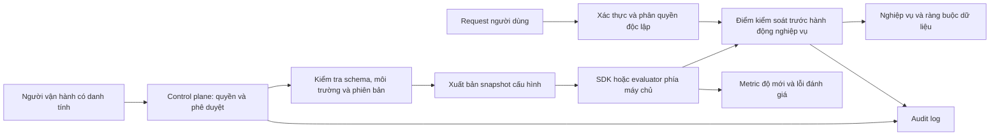

# Secure feature flag — Đặc tả yêu cầu bảo mật cho cờ tính năng

## 1. Mục tiêu và phạm vi

Feature flag là cơ chế quyết định hành vi của phần mềm bằng cấu hình, thường cho phép thay đổi mà không cần triển khai lại mã. Nhờ đó, nhóm phát triển có thể mở tính năng theo giai đoạn, thử nghiệm với một nhóm người dùng hoặc tạm dừng một nghiệp vụ khi có sự cố.

Cơ chế này cũng tạo ra một đường điều khiển mới: người có quyền sửa flag có thể làm thay đổi hành vi production gần như ngay lập tức. Một flag đặt sai giá trị, áp dụng nhầm môi trường hoặc được đánh giá từ dữ liệu không đáng tin cậy có thể mở tính năng cho sai đối tượng, làm mất biện pháp kiểm soát hoặc kéo dài sự cố.

Trong chương **Configuration security**, mục tiêu của bài học là chuyển các rủi ro đó thành yêu cầu bảo mật cụ thể, đo được và có thể kiểm chứng. Nội dung nối yêu cầu với mô hình đe dọa, thiết kế, phân quyền, dữ liệu, logging, phục hồi và các phép kiểm thử trong vòng đời phát triển.

Sau bài học, người học có thể:

- Phân biệt cờ phát hành, cờ thử nghiệm và cờ dừng nghiệp vụ.
- Xác định ai được sửa flag, dữ liệu nào được dùng để đánh giá và nơi quyết định phải được thực thi.
- Đặc tả giá trị an toàn khi thiếu cấu hình, cấu hình lỗi hoặc dịch vụ quản lý flag không truy cập được.
- Viết tiêu chí kiểm chứng cho thay đổi cấu hình, cache, kill switch và khôi phục.
- Quản lý vòng đời flag để giảm cấu hình thừa và tránh tái kích hoạt đường mã đã lỗi thời.

Các ngưỡng thời gian và giá trị trong ví dụ là giả định của một hệ thống minh họa. Khi áp dụng, cần chọn lại theo rủi ro, kiến trúc và năng lực thực tế của hệ thống.

## 2. Feature flag nằm ở đâu trong mô hình tin cậy?

### 2.1. Ba loại flag có mục đích khác nhau

| Loại | Ví dụ | Điều cần đặc tả |
| --- | --- | --- |
| Cờ phát hành | Bật giao diện checkout mới cho 10% khách hàng | Đối tượng, môi trường, nhánh mặc định và điều kiện tăng tỷ lệ |
| Cờ thử nghiệm | So sánh hai cách trình bày danh sách sản phẩm | Cách phân nhóm, dữ liệu thu thập và giới hạn ảnh hưởng |
| Cờ vận hành hoặc kill switch | Dừng tạo lệnh hoàn tiền mới | Quyền kích hoạt, độ trễ có hiệu lực, tác động với công việc đang chạy và cách mở lại |

Một cờ phát hành không tự trở thành cơ chế phân quyền. Nếu một người dùng không được hoàn tiền, việc họ thuộc nhóm được bật giao diện hoàn tiền không tạo thêm quyền đó.

Các kiểm soát nền tảng như xác thực, quyền trên tài nguyên, ràng buộc tenant, xác minh đầu vào và tính toàn vẹn giao dịch phải được thực thi độc lập. Không thiết kế một flag có thể bỏ qua những kiểm soát bắt buộc này.

Có thể dùng flag để triển khai một biện pháp tăng cường, chẳng hạn yêu cầu rà soát bổ sung cho giao dịch rủi ro cao. Khi tắt biện pháp tăng cường, các kiểm soát tối thiểu đã được phê duyệt vẫn phải tồn tại.

### 2.2. Control plane và đường thực thi

Hệ thống flag thường có hai phần:

- **Control plane:** nơi tạo flag, sửa targeting rule, phê duyệt và xuất bản cấu hình.
- **Đường đánh giá và thực thi:** nơi ứng dụng nhận cấu hình, đánh giá ngữ cảnh và quyết định cho phép một nhánh xử lý.

Ngoài ra còn có kho cấu hình, cache, SDK, pipeline đồng bộ và hệ thống audit. Mỗi thành phần đều có thể làm kết quả khác với ý định của người vận hành.



Sơ đồ cần được cụ thể hóa bằng thông tin: workload nào được đọc môi trường nào, snapshot nào đang có hiệu lực và khi nào ứng dụng phải ngừng dùng một cấu hình cũ.

### 2.3. Tài sản và đe dọa tiêu biểu

| Tài sản | Đe dọa | Hậu quả |
| --- | --- | --- |
| Quyền sửa cấu hình production | Tài khoản quản trị bị chiếm hoặc cấp quyền quá rộng | Bật tính năng nhạy cảm, đổi targeting hoặc vô hiệu hóa biện pháp tăng cường |
| Ngữ cảnh đánh giá | Client tự gửi tenant, role hoặc mã nhóm đặc quyền | Tính năng được mở cho sai đối tượng |
| Bản cấu hình phân phối | Sửa, thay môi trường hoặc phát lại phiên bản cũ | Ứng dụng dùng chính sách sai dù bản cấu hình có định dạng hợp lệ |
| Cache và fallback | Lỗi provider làm ứng dụng dùng giá trị cho phép | Tiếp tục thực hiện nghiệp vụ đã cần dừng |
| Credential SDK | Credential phía máy chủ bị đưa vào trình duyệt | Đọc cấu hình hoặc truy cập dịch vụ vượt phạm vi |
| Audit và telemetry | Ghi toàn bộ ngữ cảnh người dùng | Rò rỉ dữ liệu cá nhân hoặc secret |
| Vòng đời flag | Flag hết mục đích vẫn điều khiển mã production | Tái kích hoạt nhánh chưa còn được duy trì hoặc kiểm thử |

Mô hình đe dọa cần xét cả lỗi vô ý. Nhập nhầm môi trường hoặc hiểu ngược ý nghĩa boolean cũng có thể tạo tác động tương tự hành vi tấn công.

## 3. Mô tả một flag như một đối tượng bảo mật

Trước khi viết điều kiện `if`, cần có hồ sơ cho flag. Một tên và một giá trị boolean là chưa đủ.

| Thuộc tính | Nội dung cần xác định |
| --- | --- |
| Định danh và ý nghĩa | Flag điều khiển chính xác hành vi nào, giá trị nào mang nghĩa cho phép |
| Loại và mức ảnh hưởng | Phát hành, thử nghiệm hay vận hành; có ảnh hưởng dữ liệu hoặc tài chính không |
| Chủ sở hữu | Nhóm nghiệp vụ, nhóm kỹ thuật và người chịu trách nhiệm khi có sự cố |
| Phạm vi | Môi trường, dịch vụ, tenant, khu vực hoặc tập đối tượng |
| Nguồn dữ liệu đánh giá | Thuộc tính nào đáng tin cậy, lấy từ đâu |
| Vị trí thực thi | Backend, worker, gateway hay chỉ giao diện |
| Giá trị khi lỗi | Thiếu flag, sai kiểu, quá hạn, timeout và chưa tải được cấu hình |
| Độ mới | Thời gian được phép dùng snapshot và cách phát hiện hết hạn |
| Quyền thay đổi | Ai được tạo, sửa, xuất bản, bật lại hoặc dùng quyền khẩn cấp |
| Audit và cảnh báo | Sự kiện nào được lưu, ai nhận cảnh báo và trong bao lâu |
| Vòng đời | Ngày đánh giá lại, điều kiện loại bỏ và cách xử lý ứng dụng cũ |

Ví dụ hồ sơ rút gọn:

```yaml
key: refund_creation_allowed
purpose: Cho phép tiếp nhận lệnh hoàn tiền mới sau khi đã kiểm tra quyền
kind: operational
owner: payments-platform
environment: production
valueType: boolean
safeFallback: false
evaluationLocation: server
maxSnapshotAgeSeconds: 30
reviewDate: "2027-01-15"
```

Đây là schema minh họa cho hồ sơ yêu cầu, không phải cấu hình dùng trực tiếp cho mọi sản phẩm flag. Việc ghi `maxSnapshotAgeSeconds` không tự tạo ra cơ chế hết hạn; SDK hoặc lớp bao phải thực thi và được kiểm thử.

Một flag dạng “bắt buộc rà soát bổ sung” có thể có giá trị an toàn là `true`. Vì vậy, không áp dụng quy tắc “lỗi thì trả false” cho tất cả flag. Cần xác định **hành vi an toàn**, sau đó mới chọn giá trị biểu diễn.

## 4. Đặc tả quyền quản trị và kiểm soát thay đổi

### 4.1. Phân quyền theo hành động và phạm vi

Tối thiểu cần phân biệt quyền đọc, đề xuất, sửa quy tắc, xuất bản, kích hoạt khẩn cấp và quản lý credential. Phạm vi quyền cần xét môi trường và nhóm flag.

Ví dụ:

- Lập trình viên được đề xuất thay đổi flag production của dịch vụ mình sở hữu.
- Người có vai trò phát hành được xuất bản thay đổi trong phạm vi đã được cấp.
- Với flag có tác động tài chính, người đề xuất và người phê duyệt là hai danh tính khác nhau.
- Danh tính ứng dụng chỉ được đọc hoặc đánh giá cấu hình cần thiết, không được sửa.
- Credential môi trường thử nghiệm không được đọc hoặc sửa cấu hình production.
- Quyền khẩn cấp phải có phạm vi hẹp, thời hạn và dấu vết sử dụng.

Yêu cầu mẫu:

> **FF-ADM-01:** Với mọi thao tác xuất bản thay đổi cho flag tác động cao ở production, control plane phải xác minh quyền theo môi trường và nhóm flag, đồng thời kiểm tra phê duyệt gắn với đúng phiên bản thay đổi. Chỉnh sửa sau phê duyệt phải làm phê duyệt cũ mất hiệu lực.

Tiêu chí chấp nhận gồm: người chỉ có quyền đọc không sửa được qua API; người có quyền staging không xuất bản production; người đề xuất không tự phê duyệt; nội dung đã sửa không được dùng lại phê duyệt của nội dung trước.

Không chỉ kiểm tra nút trên giao diện. API quản trị, pipeline tự động và tài khoản dịch vụ cũng phải chịu cùng chính sách phù hợp.

### 4.2. Xuất bản có phiên bản và tránh ghi đè

Hai người cùng sửa flag có thể vô tình ghi đè thay đổi của nhau. Yêu cầu nên quy định optimistic concurrency hoặc cơ chế tương đương: thao tác cập nhật phải khai báo phiên bản gốc; nếu cấu hình đã thay đổi, hệ thống từ chối và yêu cầu đánh giá lại.

Phê duyệt cần gắn với nội dung có thể nhận diện chính xác, chẳng hạn revision hoặc digest của bản thay đổi. Bản xem trước phải thể hiện giá trị trước/sau, môi trường, targeting, dependency và nhóm đối tượng bị ảnh hưởng.

Đối với một tập flag phụ thuộc nhau, có thể cần xuất bản bằng snapshot nguyên tử. Không cho phép ứng dụng nhìn thấy nửa cấu hình mới và nửa cấu hình cũ nếu trạng thái hỗn hợp có thể vi phạm yêu cầu nghiệp vụ.

### 4.3. Đường khẩn cấp

Việc dừng nhanh một nghiệp vụ và việc bật lại không nhất thiết có cùng quy trình:

- Dừng nghiệp vụ nguy hiểm có thể được trao cho người trực vận hành trong phạm vi đã phê duyệt.
- Bật lại cần bằng chứng nguyên nhân đã được xử lý và điều kiện phục hồi đã đạt.
- Mọi thao tác khẩn cấp phải có danh tính, lý do, ticket hoặc mã sự cố và audit.
- Hết hạn quyền khẩn cấp không được tự đảo trạng thái flag để mở lại nghiệp vụ.
- Nếu control plane không truy cập được, phải có đường ứng phó thay thế phù hợp với kiến trúc, được giới hạn và diễn tập trước.

Quy trình khẩn cấp phải được xác định trước sự cố. Một tài khoản quản trị dùng chung không cung cấp được trách nhiệm cá nhân đáng tin cậy.

## 5. Bảo vệ cấu hình, targeting và dữ liệu

### 5.1. Tính toàn vẹn, nguồn gốc và độ mới

Ứng dụng phải nhận cấu hình từ nguồn được phê duyệt qua kênh có xác thực và bảo vệ đường truyền. Credential cần giới hạn theo chức năng, môi trường và workload; credential có quyền quản trị không được dùng cho SDK chỉ đọc.

Nếu kiến trúc phân phối snapshot qua cache, file hoặc kênh không được tin cậy hoàn toàn, có thể cần thêm chữ ký của snapshot. Khi đó phải đặc tả:

- Nội dung được ký, định dạng và thuật toán được chấp nhận.
- Nguồn khóa tin cậy và cách xoay vòng hoặc thu hồi.
- Ràng buộc ứng dụng, môi trường và định danh tập cấu hình.
- Phiên bản, thời điểm phát hành, thời điểm hết hiệu lực và chính sách chống phát lại.
- Hành vi khi sai chữ ký, sai môi trường, quá hạn hoặc không biết khóa.

Chữ ký hợp lệ chỉ chứng minh nội dung được chủ thể giữ khóa ký. Nó không tự chứng minh đây là cấu hình mới nhất. Một snapshot cũ vẫn có thể có chữ ký đúng.

Ví dụ yêu cầu:

> **FF-CFG-01:** Ứng dụng không được áp dụng snapshot sai nguồn, sai môi trường, sai kiểu dữ liệu hoặc vi phạm chính sách độ mới. Snapshot bị từ chối không được thay thế snapshot đang được chấp nhận; ứng dụng áp dụng chính sách fallback tương ứng khi cấu hình hiện tại không còn được phép sử dụng.

Nếu dùng revision tăng dần trong cùng một chuỗi cấu hình, rollback nên được xuất bản thành revision mới chứa giá trị đã được lựa chọn lại. Không đơn giản tải một revision cũ rồi tắt kiểm tra chống phát lại.

Với kiểm tra thời gian, cần xác định nguồn thời gian và giới hạn sai lệch đồng hồ. Tải lại cùng một snapshot hết hạn không được làm nó trở thành mới bằng cách đặt lại thời điểm nhận ở local cache. Nếu sản phẩm flag không cung cấp thuộc tính cần thiết, phải xây dựng cơ chế thay thế hoặc ghi nhận giới hạn thực tế, không tuyên bố bảo đảm chưa thể thực thi.

### 5.2. Targeting dùng ngữ cảnh đáng tin cậy

Backend phải tạo ngữ cảnh đánh giá từ danh tính và dữ liệu đã được xác minh. Không tin trực tiếp các trường client gửi lên như `tenantId`, `isAdmin`, `plan` hoặc `internalUser`.

Yêu cầu mẫu:

> **FF-CTX-01:** Khi đánh giá flag phía máy chủ theo tenant hoặc quyền sử dụng sản phẩm, tenant và gói dịch vụ phải được lấy từ ngữ cảnh xác thực và nguồn dữ liệu phía máy chủ. Giá trị tương ứng trong request không được ghi đè các thuộc tính này.

Một người dùng có thể thuộc nhiều tenant; hệ thống vẫn phải xác minh quyền đối với tenant đang thao tác. Việc flag đã bật cho tenant không chứng minh người dùng hiện tại là thành viên hợp lệ.

Phân nhóm theo tỷ lệ phần trăm thường chỉ tạo tính ổn định cho rollout. Nếu người dùng tự chọn khóa phân nhóm, họ có thể thử nhiều giá trị để vào nhóm mong muốn. Không dùng tỷ lệ rollout làm bằng chứng cấp quyền hoặc làm cách bảo vệ một tính năng bí mật.

### 5.3. Client-side flag và thông tin nhạy cảm

Flag phía trình duyệt hoặc ứng dụng di động có thể hỗ trợ giao diện, nhưng client nằm ngoài ranh giới tin cậy của backend. Người dùng có thể sửa local storage, request hoặc mã thực thi để bật nút.

Do đó:

- Backend phải tự xác thực, phân quyền và kiểm tra điều kiện nghiệp vụ cho mọi hành động nhạy cảm.
- Credential dùng ở client chỉ được có khả năng phù hợp với việc công khai; không nhúng server secret.
- Không đưa secret, mật khẩu, token nội bộ hoặc logic quyết định quyền nhạy cảm vào giá trị flag.
- Chỉ phân phối metadata cần thiết; danh sách targeting có thể làm lộ khách hàng, nhóm thử nghiệm hoặc kế hoạch sản phẩm.
- Với mobile offline, không cam kết dừng từ xa ngay lập tức nếu thiết bị không kết nối. Các tác động phía máy chủ vẫn phải chịu kiểm soát của máy chủ.

Đối với nhà cung cấp flag bên ngoài, cần đặc tả trường ngữ cảnh được gửi, mục đích, quyền truy cập, thời hạn lưu và cơ chế xóa. Dùng mã giả danh hoặc băm định danh không tự làm dữ liệu trở thành ẩn danh; vẫn cần đánh giá khả năng liên kết và tái nhận diện.

## 6. Fallback, cache và kill switch

### 6.1. Xác định hành vi cho từng trạng thái lỗi

Hành vi an toàn cần được quy định riêng cho từng flag và từng tình huống, thay vì để SDK tự chọn một default ngầm.

| Trạng thái | Ví dụ yêu cầu cho cờ cho phép tạo hoàn tiền |
| --- | --- |
| Ứng dụng vừa khởi động, chưa có cấu hình hợp lệ | Không tiếp nhận lệnh hoàn tiền mới |
| Flag không tồn tại hoặc sai kiểu | Không tiếp nhận; phát tín hiệu lỗi cấu hình |
| Provider tạm lỗi, snapshot còn trong thời hạn cho phép | Chỉ dùng snapshot nếu chính sách của flag cho phép |
| Snapshot vượt giới hạn độ mới | Không tiếp nhận; không kéo dài tuổi cache bằng một lần đọc local |
| Nhận snapshot sai chữ ký hoặc sai môi trường | Từ chối snapshot; chỉ tiếp tục dùng bản cũ nếu bản đó vẫn hợp lệ và còn hạn |
| Evaluator gặp exception | Không biến lỗi thành giá trị cho phép |
| Worker nhận lại công việc sau gián đoạn | Kiểm tra chính sách áp dụng cho công việc chờ trước khi tạo tác động mới |

Với một cờ chỉ thay đổi giao diện, tiếp tục dùng bản đã biết tốt có thể phù hợp. Với cờ dừng nghiệp vụ có tác động tài chính, tiếp tục cho phép vô thời hạn khi mất kết nối sẽ làm mất mục đích của kill switch.

Yêu cầu không nên ghi “luôn dùng cấu hình tốt gần nhất” mà thiếu thời hạn và giới hạn nghiệp vụ. Tương tự, fail closed cần được định nghĩa theo hành động: chặn tác động mới nhưng vẫn cho phép quan sát, điều tra và đối soát khi phù hợp.

### 6.2. Độ trễ có hiệu lực phải đo ở nơi thực thi

Giả sử yêu cầu ví dụ là:

> **FF-KILL-01:** Sau khi lệnh dừng được control plane xác nhận có hiệu lực, mọi instance đang phục vụ và còn kết nối phải ngừng chấp nhận lệnh hoàn tiền mới trong tối đa 30 giây. Instance không lấy được cấu hình mới phải ngừng chấp nhận khi cấu hình đang dùng hết giới hạn độ mới 30 giây.

Để yêu cầu này khả thi, phải ràng buộc cách xuất bản, độ trễ phân phối, chu kỳ polling hoặc push, cache ở các tầng và sai lệch thời gian. Không chỉ đặt polling 30 giây rồi kết luận mục tiêu 30 giây đã đạt.

Cần đo thời gian từ mốc xác nhận có hiệu lực tới quyết định tại API hoặc worker. Đối với instance mất kết nối, cần kiểm tra thời điểm hết hạn thực sự. Giới hạn độ mới cũng phải bao gồm sai lệch đồng hồ và quy tắc của nguồn cấp cấu hình.

Dashboard hiển thị “flag đã tắt” mới phản ánh control plane. Muốn xác nhận tác động, cần quan sát revision và hành vi của các instance đang phục vụ, bao gồm tiến trình vừa scale out, vừa restart hoặc bị phân vùng mạng.

### 6.3. Định nghĩa phạm vi của “dừng”

Một kill switch có thể chỉ chặn tiếp nhận request mới, hoặc còn cần chặn worker tạo tác động từ hàng đợi. Hai phạm vi này khác nhau.

Đặc tả cần phân loại:

- **Request mới:** kiểm tra ở cửa vào trước khi ghi nhận thao tác được phép.
- **Công việc đang chờ:** kiểm tra lại trước tác động nhạy cảm nếu chính sách yêu cầu dừng cả backlog.
- **Công việc đang chạy:** xác định điểm có thể hủy và trạng thái chuyển tiếp.
- **Tác động đã xảy ra ở hệ thống ngoài:** không giả định có thể đảo ngược bằng việc tắt flag; cần đối soát hoặc quy trình bù.
- **Các đường khác:** batch, lịch chạy tự động, công cụ hỗ trợ và API nội bộ cũng phải tuân theo cùng phạm vi.

Có khoảng thời gian giữa lúc đánh giá flag và lúc tác động xảy ra. Nếu yêu cầu yêu cầu ngăn mọi tác động sau một mốc cắt chính xác, một lần đọc flag ở đầu request là chưa đủ. Cần cơ chế điều phối hoặc kiểm tra quyền thực thi tại điểm tác động có tính nhất quán phù hợp, đồng thời xét cả hệ thống bên ngoài.

Ví dụ thực tế hơn có thể quy định: dừng tiếp nhận trong 30 giây, dừng worker bắt đầu tác động mới trong cùng thời hạn, còn các lời gọi đã gửi được hoàn tất và đối soát. Phạm vi đó phải được người sở hữu nghiệp vụ chấp nhận trước.

### 6.4. Đánh giá nhất quán trong một quyết định

Một thao tác không nên đọc các flag phụ thuộc từ các revision khác nhau rồi kết hợp thành trạng thái chưa từng được phê duyệt. Có thể chụp một snapshot hợp lệ tại đầu quyết định nghiệp vụ, sử dụng nhất quán và ghi revision vào audit phù hợp.

Tuy nhiên, snapshot đầu request không được dùng để bỏ qua yêu cầu kiểm tra kill switch tại điểm tác động. Thiết kế phải phân biệt tính nhất quán của quyết định và yêu cầu thu hồi khả năng thực thi.

## 7. Mẫu đặc tả và cách thực thi

### 7.1. Bộ yêu cầu mẫu

| ID | Yêu cầu | Rủi ro | Điểm thực thi | Tiêu chí chấp nhận |
| --- | --- | --- | --- | --- |
| FF-ADM-01 | Phân quyền và phê duyệt gắn với đúng phiên bản thay đổi | Thay đổi trái phép hoặc đổi sau phê duyệt | Control plane | API từ chối sai vai trò, sai môi trường và phê duyệt không còn khớp |
| FF-CFG-01 | Chỉ áp dụng cấu hình đúng nguồn, môi trường, schema và độ mới | Cấu hình giả, sai môi trường, phát lại | Bộ tải cấu hình | Snapshot sai hoặc quá hạn không được đưa vào evaluator |
| FF-CTX-01 | Dùng tenant và thuộc tính đáng tin cậy | Tráo ngữ cảnh, mở chéo tenant | Backend | Request tự khai tenant hoặc gói dịch vụ không đổi được kết quả hợp lệ |
| FF-BASE-01 | Flag không bỏ qua kiểm soát bảo mật bắt buộc | Truy cập trái phép khi bật tính năng | Domain service | Mọi nhánh flag đều từ chối người không có quyền |
| FF-FALL-01 | Fallback được quy định và thực thi theo từng flag | Lỗi provider làm mở nghiệp vụ | Lớp bao evaluator | Thiếu key, sai kiểu, timeout và exception đều cho hành vi đã đặc tả |
| FF-KILL-01 | Dừng trong thời hạn và phạm vi công việc đã định nghĩa | Tác động tiếp tục sau lệnh dừng | API, worker và cache | Đo được thời gian có hiệu lực ở instance kết nối và mất kết nối |
| FF-DATA-01 | Chỉ gửi ngữ cảnh được cho phép và không chứa secret | Lộ dữ liệu qua nhà cung cấp | SDK và pipeline telemetry | Kiểm tra payload thực tế và log không có trường cấm |
| FF-AUD-01 | Audit đầy đủ thay đổi nhạy cảm và phát cảnh báo | Không điều tra được hoặc không phát hiện lạm dụng | Control plane và observability | Truy được ai đổi gì, revision nào và cảnh báo tới đúng nơi |
| FF-LIFE-01 | Flag có chủ sở hữu và điều kiện loại bỏ | Nhánh cũ sống vô thời hạn | Quy trình phát triển | Danh mục flag xác định được flag quá hạn và công việc loại bỏ |

Các yêu cầu cần thêm mức ưu tiên, người chịu trách nhiệm và nơi lưu bằng chứng. Nếu có hạn chế của sản phẩm SDK hoặc nhà cung cấp, phải ghi rõ khoảng trống so với yêu cầu.

### 7.2. Mã giả cho một nghiệp vụ nhạy cảm

```text
createRefund(request, authenticatedContext):
    actor = requireAuthenticatedActor(authenticatedContext)
    order = loadOrderWithinAuthorizedTenant(actor, request.orderId)
    authorize(actor, action = CREATE_REFUND, resource = order)

    decision = flagPolicy.evaluateRequiredBoolean(
        key = "refund_creation_allowed",
        trustedContext = buildServerContext(actor, order),
        onUnavailable = DENY_NEW_REFUND,
        enforceConfiguredFreshness = true
    )

    if decision.doesNotPermitAction:
        recordSafeDecisionMetadata(
            action = "refund_create",
            reason = decision.reason,
            revision = decision.revision
        )
        return controlledUnavailableResponse()

    validateRefundBusinessRules(order, request)
    enqueueRefundIdempotently(order, request, decision.revision)

refundWorker(job):
    claimJobDurably(job)
    revalidateRequiredBusinessState(job)
    checkCurrentExecutionPermitIfStopPolicyRequiresIt(job)
    performExternalRefundWithStableIdempotencyKey(job)
    persistOutcomeAndAudit(job)
```

Mã giả mô tả trách nhiệm, không mặc định SDK có sẵn các hàm này. Lớp bao evaluator phải thể hiện giá trị, nguồn quyết định, revision, độ mới và lý do fallback theo hợp đồng.

Một lần kiểm tra ở worker vẫn có thể có khoảng hở trước lời gọi bên ngoài. Nếu yêu cầu cắt tác động chặt hơn phạm vi đã định nghĩa, cần thiết kế cơ chế cấp quyền thực thi tương ứng; không gọi một phép kiểm tra boolean thông thường là bảo đảm nguyên tử.

Không ghi toàn bộ request hoặc trusted context vào log. Cũng không dựa vào flag để thay thế idempotency, khóa hoặc các ràng buộc nghiệp vụ của thao tác hoàn tiền.

## 8. Logging, giám sát và phục hồi

### 8.1. Audit thay đổi cấu hình

Mỗi thay đổi tác động cao cần ghi tối thiểu:

- Danh tính người hoặc workload, hành động và kết quả.
- Flag, môi trường, revision gốc và revision mới.
- Nội dung thay đổi ở dạng phù hợp với phân loại dữ liệu.
- Người phê duyệt, lý do hoặc tham chiếu thay đổi.
- Thời điểm yêu cầu, thời điểm xuất bản có hiệu lực và việc dùng đường khẩn cấp.
- Mối liên kết tới hành động rollback hoặc bật lại.

Audit cần có quyền ghi và đọc phù hợp, bảo vệ khỏi sửa hoặc xóa trái phép, thời hạn lưu và cách truy xuất khi điều tra. Không lưu credential SDK hoặc toàn bộ danh sách người dùng nhạy cảm trong bản diff công khai cho mọi người đọc log.

Yêu cầu về “không sửa được audit” cần được triển khai bằng khả năng lưu trữ và quyền cụ thể. Một file log trong cùng máy mà quản trị viên ứng dụng có thể tùy ý sửa không tự đáp ứng yêu cầu đó.

### 8.2. Quan sát quyết định thực tế

Metric và log cần giúp trả lời:

- Instance đang dùng revision nào, cấu hình đã bao lâu và lấy từ đâu?
- Tỷ lệ đánh giá lỗi hoặc dùng fallback có tăng không?
- Có instance nào vẫn cho phép nghiệp vụ sau mốc dừng dự kiến?
- Có thay đổi targeting hoặc quyền quản trị bất thường không?
- Sau khi bật lại, lỗi nghiệp vụ có tái xuất hiện không?

Có thể theo dõi metric theo flag quan trọng, môi trường, dịch vụ và nhóm lý do hữu hạn. Không dùng user ID hoặc tenant ID không giới hạn làm nhãn metric; điều đó có thể làm tăng cardinality và lộ thông tin.

Không cần ghi từng lần đánh giá mọi flag. Với quyết định nhạy cảm, xác định chính sách audit và lấy mẫu nếu phù hợp sao cho vẫn đáp ứng yêu cầu điều tra. Audit thay đổi cấu hình và audit tác động nghiệp vụ có mục đích khác nhau, cần liên kết bằng revision hoặc mã tương quan.

Ví dụ yêu cầu đo được: cảnh báo khi một instance production báo cấu hình quá hạn hoặc khi kill switch đã dừng nhưng vẫn có tác động mới vượt phạm vi được phép. Mức ngưỡng, cửa sổ và thời hạn cảnh báo phải được điền cụ thể trong đặc tả dự án.

### 8.3. Khôi phục và rollback

Rollback giá trị flag không tự đảo ngược tác động đã xảy ra. Nhánh mới có thể đã ghi dữ liệu, đổi schema hoặc gửi thao tác sang đối tác.

Trước khi bật lại hoặc quay về nhánh cũ, cần kiểm tra:

1. Phiên bản ứng dụng hiện tại còn hỗ trợ cấu hình dự định dùng không.
2. Dữ liệu đã được ghi có tương thích với nhánh cũ không.
3. Công việc đang chờ cần giữ, hủy, chuyển đổi hay chạy lại.
4. Credential hoặc tài khoản quản trị có cần thu hồi và thay mới không.
5. Có đối soát được các tác động chưa rõ kết quả không.
6. Những bằng chứng nào cho thấy nguyên nhân sự cố đã được xử lý.

Diễn tập phục hồi phải bao gồm trường hợp control plane lỗi, cache chưa hết hạn, instance mới khởi động và người có quyền khẩn cấp không có mặt. Những bước phụ thuộc một cá nhân cần có phương án thay thế được kiểm soát.

## 9. Kiểm chứng trong vòng đời phát triển

### 9.1. Từ yêu cầu tới thiết kế

Trong giai đoạn yêu cầu, xác định tài sản và mức thiệt hại khi mỗi flag ở sai trạng thái. Từ đó chọn cơ chế phân quyền, phê duyệt, độ mới, fallback và khả năng quan sát.

Trong thiết kế, gắn từng yêu cầu với điểm thực thi. Ví dụ, kiểm soát sửa flag nằm ở control plane; kiểm soát chéo tenant ở backend; giới hạn cache ở SDK hoặc lớp bao; việc dừng backlog ở worker. Không gom mọi trách nhiệm vào một câu “nhà cung cấp flag đã hỗ trợ bảo mật”.

Các ngoại lệ cần có phạm vi, người chấp nhận rủi ro, thời hạn và điều kiện xem xét lại. Chẳng hạn, chưa thể bảo đảm cập nhật thiết bị offline phải được phản ánh trong cam kết vận hành.

### 9.2. Các tình huống kiểm thử có ý nghĩa

| Tình huống | Bằng chứng cần quan sát |
| --- | --- |
| Người dùng bật flag ở trình duyệt và gọi thẳng API | Backend vẫn kiểm tra quyền và không chấp nhận thao tác trái phép |
| Người có quyền staging gọi API sửa production | Thay đổi bị từ chối và có audit phù hợp |
| Sửa targeting sau khi đã phê duyệt | Không thể xuất bản bằng phê duyệt cũ |
| Nạp snapshot đúng chữ ký nhưng sai môi trường hoặc quá hạn | Snapshot bị từ chối; fallback đúng hợp đồng |
| Phát lại revision cũ sau khi đã nhận revision mới | Không áp dụng trái chính sách chống phát lại |
| Provider mất kết nối khi flag đang cho phép | Chỉ dùng cache trong giới hạn; sau đó dừng tác động đã quy định |
| Control plane tắt flag nhưng một instance không nhận push | Polling hoặc hết hạn đưa instance về hành vi an toàn trong giới hạn |
| Instance khởi động mới trong thời gian gián đoạn | Không dùng giá trị ngầm cho phép nghiệp vụ |
| Hai flag phụ thuộc được cập nhật cùng lúc | Không xuất hiện trạng thái hỗn hợp trái yêu cầu |
| Kill switch tắt khi có backlog và công việc đang chạy | Hành vi khớp phạm vi dừng, có audit và đối soát |
| Rollback sau khi nhánh mới đã ghi dữ liệu | Dữ liệu vẫn xử lý đúng hoặc thao tác bị chặn theo kế hoạch phục hồi |
| Telemetry gửi đến nhà cung cấp | Không có secret hoặc trường ngữ cảnh ngoài danh sách được phép |

Không nhất thiết kiểm thử mọi tổ hợp của hàng trăm flag. Cần xác định dependency, các trạng thái nguy hiểm và nhánh tác động cao; ưu tiên các tổ hợp có thể làm thay đổi bất biến bảo mật. Những kiểm soát nền tảng phải được chứng minh ở cả nhánh bật và tắt có liên quan.

Kiểm thử evaluator bằng mock chưa đủ để chứng minh độ trễ kill switch. Cần kiểm thử tích hợp hoặc diễn tập qua đường phân phối thật, cấu hình cache thật và tập instance đại diện. Ngược lại, một lần thao tác thủ công thành công không thay thế kiểm thử các nhánh lỗi trong mã.

### 9.3. Loại bỏ flag đúng thời điểm

Flag có thể tồn tại lâu hơn đợt phát hành ban đầu. Mỗi flag cần ngày đánh giá lại hoặc điều kiện kết thúc rõ ràng.

Khi loại bỏ:

- Xác nhận nhánh đích đã ổn định và được chấp nhận.
- Loại nhánh mã, dependency và kiểm thử không còn phù hợp.
- Xét các phiên bản ứng dụng cũ vẫn còn đọc key, đặc biệt mobile hoặc triển khai nhiều phiên bản.
- Cập nhật runbook, cảnh báo, quyền và tài liệu liên quan.
- Lưu bằng chứng thay đổi cần thiết theo chính sách audit.

Không xóa key trước rồi hy vọng mọi client có fallback đúng. Cũng không tái sử dụng key cũ cho một ý nghĩa khác vì client hoặc cache cũ có thể diễn giải theo hợp đồng trước đó.

## 10. Bài tập áp dụng

Một nền tảng muốn mở tính năng xuất dữ liệu khách hàng theo từng tenant, đồng thời có khả năng dừng nhanh khi phát hiện xuất nhầm dữ liệu.

Hãy xây dựng đặc tả gồm:

1. Hồ sơ cho cờ phát hành và cờ dừng vận hành, chỉ rõ mục đích khác nhau.
2. Sơ đồ control plane, đường đánh giá và worker xuất dữ liệu.
3. Ít nhất năm đe dọa, gồm sửa cấu hình trái phép, giả tenant, dùng cache cũ, lộ dữ liệu qua telemetry và bật lại không an toàn.
4. Tám yêu cầu có ID, chủ sở hữu, điểm thực thi và bằng chứng.
5. Chính sách cho request mới, tác vụ đang chờ, tác vụ đang chạy và file đã tạo.
6. Kịch bản kiểm chứng độ trễ dừng khi có instance mất kết nối.
7. Điều kiện phục hồi và điều kiện loại bỏ flag phát hành.

Đặc tả cần giải thích được vì sao một người không có quyền xuất dữ liệu vẫn bị từ chối khi flag đang bật, vì sao lỗi provider không mở nghiệp vụ ngoài ý muốn và bằng chứng nào xác nhận lệnh dừng đã có hiệu lực. Khi các câu trả lời gắn với hành vi đo được và thành phần thực thi cụ thể, feature flag mới trở thành một cơ chế cấu hình được quản lý bằng yêu cầu bảo mật.
