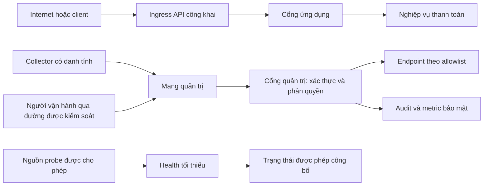

# Actuator endpoint exposure — Đặc tả yêu cầu kiểm soát bề mặt quản trị

## 1. Mục tiêu và phạm vi

Spring Boot Actuator cung cấp các khả năng quan sát và quản trị ứng dụng như kiểm tra sức khỏe, xem metric, đọc thông tin vận hành hoặc thay đổi một số trạng thái lúc chạy. Những khả năng này hữu ích cho vận hành nhưng cũng tạo thêm bề mặt tấn công nếu được cung cấp cho sai đối tượng hoặc qua sai đường truy cập.

Một endpoint không sửa dữ liệu vẫn có thể làm lộ cấu trúc ứng dụng, tên dịch vụ phụ thuộc, cấu hình hoặc dữ liệu trong bộ nhớ. Một endpoint thay đổi trạng thái có thể làm tăng lượng log, gây suy giảm tài nguyên hoặc ảnh hưởng khả năng phục vụ. Vì vậy, yêu cầu bảo mật không thể dừng ở câu “bật Actuator cho monitoring”.

Trong chương **Configuration security**, bài học này hướng dẫn chuyển mục tiêu an toàn thông tin và mô hình đe dọa thành yêu cầu cụ thể cho bề mặt Actuator: endpoint nào được tồn tại, được cung cấp qua kênh nào, ai được truy cập, được thực hiện thao tác gì và kiểm chứng bằng cách nào.

Sau bài học, người học có thể:

- Phân biệt việc endpoint tồn tại, được đưa ra một kênh quản trị và được chủ thể truy cập.
- Lập danh mục endpoint cùng dữ liệu, tác động và mức độ nhạy cảm.
- Đặc tả kiểm soát mạng, xác thực, phân quyền, logging và phục hồi.
- Thiết kế health probe đủ dùng mà không làm lộ chi tiết vận hành.
- Gắn yêu cầu với kiến trúc, tiêu chí kiểm thử và bằng chứng trước phát hành.

Tên endpoint và đường dẫn trong bài là ví dụ. Khả năng endpoint, phương thức HTTP, thuộc tính cấu hình và hành vi bảo mật phải được xác nhận theo phiên bản, dependency và bản triển khai thực tế. Bài học không giả định một bộ mặc định của framework luôn đúng cho mọi hệ thống.

## 2. Exposure là một chuỗi điều kiện

### 2.1. Bốn câu hỏi cần tách biệt

Khi đánh giá một endpoint, cần trả lời bốn câu hỏi:

1. **Có tồn tại không?** Dependency, cấu hình hoặc mã tùy chỉnh có tạo ra khả năng đó không?
2. **Được cung cấp qua kênh nào?** HTTP, JMX hoặc một cơ chế quản trị khác có làm nó khả dụng không?
3. **Đường truy cập có tới được không?** Ingress, reverse proxy, Service, cổng quản trị, địa chỉ bind và chính sách mạng có cho phép kết nối không?
4. **Ai được sử dụng?** Xác thực và phân quyền có kiểm soát đúng chủ thể, thao tác và môi trường không?

Chỉ cần một lớp được hiểu sai, endpoint có thể bị truy cập ngoài dự định. Ngược lại, nhận HTTP 401 tại một đường dẫn không chứng minh endpoint thật sự tồn tại, vì lớp xác thực có thể chặn trước khi định tuyến.

| Biện pháp | Điều đạt được | Điều cần kiểm chứng thêm |
| --- | --- | --- |
| Không tạo hoặc vô hiệu hóa khả năng không cần | Giảm chức năng có thể bị khai thác | Không còn đường thay thế hoặc kênh khác cung cấp khả năng tương đương |
| Allowlist endpoint trên HTTP | Giới hạn những endpoint được đưa ra HTTP | JMX, endpoint tùy chỉnh, alias và các cổng khác |
| Tách cổng hoặc mạng quản trị | Thu hẹp đường có thể kết nối | Cổng có bị publish nhầm hoặc truy cập từ workload không được phép không |
| Xác thực | Xác định danh tính chủ thể | Chủ thể đó có đúng quyền cho endpoint và thao tác không |
| Phân quyền | Giới hạn hành động được phép | Chính sách có được áp dụng ở tất cả đường và phiên bản triển khai không |

Đổi base path sang một chuỗi khó đoán không thay thế các lớp trên. Tương tự, một cổng có tên “internal” không tự trở thành ranh giới bảo mật.

### 2.2. Endpoint chỉ đọc vẫn có tác động bảo mật

| Nhóm khả năng minh họa | Dữ liệu hoặc tác động có thể có | Hướng yêu cầu |
| --- | --- | --- |
| Health | Trạng thái tổng thể, thành phần và lỗi phụ thuộc | Chỉ trả mức chi tiết phù hợp với người gọi |
| Info | Metadata ứng dụng, build hoặc nguồn mã tùy cấu hình | Chỉ công bố trường đã được phê duyệt |
| Metrics và định dạng cho hệ thống thu thập | Tên thành phần, mẫu lưu lượng, nhãn và tình trạng tài nguyên | Giới hạn danh tính thu thập và kiểm soát dữ liệu trong nhãn |
| Environment và configuration properties | Tên thuộc tính, cấu trúc và có thể có giá trị nhạy cảm | Không expose nếu không cần; che giá trị chỉ là một lớp bổ sung |
| Mappings, beans hoặc thông tin cấu trúc | Route, kiểu thành phần và quan hệ nội bộ | Hạn chế theo nhu cầu chẩn đoán |
| Thread dump hoặc heap dump | Ngữ cảnh chạy, stack, dữ liệu trong bộ nhớ | Đánh giá nhạy cảm cao và kiểm soát cả tài nguyên tiêu thụ |
| Loggers hoặc thao tác quản trị có ghi | Thay đổi hành vi lúc chạy | Quyền riêng theo thao tác, audit và quy trình khẩn cấp |
| Shutdown hoặc khả năng điều khiển vòng đời | Dừng hoặc gián đoạn dịch vụ | Không cung cấp nếu không có nhu cầu được phê duyệt |

Khả năng cụ thể phụ thuộc bản triển khai. Không suy luận rằng mọi endpoint trong bảng đều có sẵn hoặc được bật.

Việc che giá trị cấu hình không làm toàn bộ endpoint trở thành an toàn để công khai. Tên thuộc tính, cấu trúc và thông tin về thành phần vẫn có thể nhạy cảm; cơ chế che cũng không bảo đảm loại được mọi dữ liệu bí mật.

## 3. Ví dụ xuyên suốt và mô hình đe dọa

Giả sử một dịch vụ thanh toán có API phục vụ khách hàng, bộ thu thập metric và nhóm vận hành. Hệ thống cần kiểm tra sức khỏe để định tuyến lưu lượng nhưng không có nhu cầu cung cấp dump bộ nhớ qua HTTP.

Kiến trúc mục tiêu:



Sơ đồ mô tả ý định. Khi triển khai, phải xác định health nằm ở cổng nào, ai có thể kết nối và có route tương đương nào khác không.

Các đe dọa chính:

| ID rủi ro | Tình huống | Tác động |
| --- | --- | --- |
| R-ACT-01 | Internet truy cập endpoint cấu hình hoặc dump | Lộ secret, dữ liệu khách hàng hoặc cấu trúc nội bộ |
| R-ACT-02 | Workload khác đi thẳng tới cổng quản trị, bỏ qua ingress | Vượt kiểm soát chỉ đặt tại gateway |
| R-ACT-03 | Credential monitoring được dùng cho thao tác quản trị | Leo thang từ quan sát sang thay đổi trạng thái |
| R-ACT-04 | Health trả lỗi hoặc tên phụ thuộc cho người không có quyền | Lộ topology và hỗ trợ trinh sát |
| R-ACT-05 | Thao tác chẩn đoán tốn tài nguyên bị gọi lặp | Suy giảm khả dụng hoặc làm đầy lưu trữ |
| R-ACT-06 | Nâng cấp dependency hoặc profile làm mở thêm endpoint | Mở rộng bề mặt ngoài quy trình phê duyệt |
| R-ACT-07 | Dữ liệu lấy từ endpoint bị lưu vào log, cache hoặc công cụ hỗ trợ | Rò rỉ thứ cấp dù đường truy cập ban đầu đã có xác thực |

Mục tiêu là giới hạn cả khả năng truy cập và mức thiệt hại sau khi một credential hoặc workload bị xâm nhập.

## 4. Lập hợp đồng endpoint trước khi cấu hình

Mỗi môi trường cần một danh mục endpoint đã được phê duyệt. Danh mục không chỉ liệt kê tên mà phải mô tả giao diện thực tế và người sử dụng.

| Thuộc tính | Câu hỏi phải trả lời |
| --- | --- |
| Khả năng và đường truy cập | Endpoint nào, base path nào, cổng nào và có alias không? |
| Kênh | HTTP, JMX hay kênh quản trị khác? |
| Phương thức hoặc thao tác | Đọc, ghi, tạo artifact, thay đổi trạng thái hay điều khiển vòng đời? |
| Mục đích | Probe, metric, chẩn đoán hay ứng phó sự cố? |
| Dữ liệu | Có metadata nội bộ, dữ liệu cá nhân hoặc secret không? |
| Chủ thể | Collector, probe, người trực vận hành hay tài khoản dịch vụ nào? |
| Quyền | Quyền theo endpoint, thao tác và môi trường là gì? |
| Tài nguyên | Giới hạn tần suất, đồng thời, kích thước và thời gian xử lý nào phù hợp? |
| Lưu vết | Sự kiện nào được audit, lưu ở đâu và bao lâu? |
| Vòng đời | Ai sở hữu và khi nào phải xem xét lại? |

Một chính sách minh họa:

| Khả năng | Chính sách của dịch vụ thanh toán |
| --- | --- |
| Health tối thiểu | Chỉ cho nguồn probe được cho phép; không trả chi tiết thành phần |
| Metric phục vụ vận hành | Chỉ collector có danh tính; quyền đọc |
| Thông tin build đã duyệt | Chỉ vận hành nội bộ nếu thực sự cần |
| Environment, config properties, mappings | Không đưa ra HTTP trong triển khai thông thường |
| Heap dump và thread dump qua HTTP | Không cung cấp trong cấu hình vận hành thông thường của ví dụ |
| Thay đổi logger | Chỉ qua quy trình chẩn đoán khẩn cấp có phạm vi và audit |
| Điều khiển dừng dịch vụ qua Actuator | Không cung cấp; dùng cơ chế điều phối đã được kiểm soát |

Không sao chép bảng này thành chính sách chung cho mọi hệ thống. Một hệ thống khác có thể cần thread dump, nhưng phải đặc tả quyền, đường truy cập, giới hạn tài nguyên và xử lý artifact tương ứng.

### 4.1. Dùng allowlist và từ chối mặc định

Yêu cầu nên dựa trên tập khả năng được phê duyệt, thay vì expose toàn bộ rồi loại trừ vài tên đã biết.

> **ACT-EXP-01:** Bản triển khai production chỉ được đưa ra HTTP những endpoint và thao tác có trong danh mục được phê duyệt. Endpoint mới do dependency, cấu hình hoặc mã tùy chỉnh bổ sung không được tự trở nên truy cập được.

Tiêu chí kiểm chứng phải so sánh bề mặt thực tế với danh mục, không chỉ đọc một thuộc tính include. Cần xét endpoint tùy chỉnh, subpath, alias, cổng riêng và các route do proxy cung cấp.

Không chỉ kiểm tra đường gốc hoặc trang discovery. Tắt trang liệt kê endpoint không làm các endpoint bên dưới tự biến mất.

### 4.2. Kiểm soát kênh ngoài HTTP

> **ACT-CHN-01:** Mỗi kênh quản trị ngoài HTTP phải được xác định rõ trạng thái cho phép, khả năng kết nối và cơ chế xác thực, phân quyền. Kênh không có mục đích vận hành được phê duyệt phải không được cung cấp ra ngoài phạm vi cho phép.

Nếu sử dụng JMX, cần phân biệt việc một MBean tồn tại cục bộ với việc có remote connector truy cập được. Cấu hình HTTP không thay thế đánh giá JMX, và việc tắt một endpoint web không chứng minh khả năng tương ứng đã bị loại khỏi mọi kênh.

Không tự bật remote management chỉ để thuận tiện kiểm tra. Bằng chứng cần gồm cấu hình hiệu lực và khả năng kết nối của đúng bản triển khai.

## 5. Yêu cầu mạng, xác thực và phân quyền

### 5.1. Ranh giới mạng phải có bằng chứng

Tách cổng quản trị có thể hỗ trợ kiểm soát mạng nhưng không tự ngăn truy cập. Cần xét địa chỉ bind, Service, ingress, proxy, cổng host, firewall và chính sách giữa workload.

> **ACT-NET-01:** Cổng quản trị không được truy cập từ Internet hoặc từ workload ngoài tập nguồn được phê duyệt. Mọi đường đi trực tiếp hoặc qua proxy phải tuân theo cùng giới hạn.

Bộ tiêu chí chấp nhận cần có:

- Kiểm tra từ vị trí ngoài ranh giới hệ thống.
- Kiểm tra từ một workload nội bộ không được phép.
- Kiểm tra từ collector hoặc nguồn vận hành được phép.
- Kiểm tra đường trực tiếp tới cổng quản trị khi kiến trúc cho phép thực hiện phép thử đó.
- Kiểm tra các route của proxy, bao gồm rewrite và alias.
- Xác nhận chính sách vẫn đúng khi scale out hoặc thay instance.

Nếu chỉ cho truy cập qua loopback, cần chỉ rõ thành phần nào cùng namespace mạng hoặc cùng máy có thể kết nối. Loopback không cô lập các tiến trình cùng quyền truy cập tương ứng và có thể làm collector từ xa không hoạt động.

Với đường đi xuyên ranh giới mạng cần bảo vệ, phải yêu cầu TLS và xác minh peer phù hợp. Chỉ rõ nơi TLS kết thúc và đoạn nào còn lại; không mặc định đoạn từ proxy tới ứng dụng đã được bảo vệ.

### 5.2. Danh tính monitoring phải có quyền hẹp

> **ACT-ID-01:** Collector phải sử dụng danh tính riêng, có vòng đời credential và phạm vi truy cập phù hợp. Danh tính này chỉ được đọc những khả năng quan sát đã được phê duyệt, không được thực hiện thao tác quản trị có ghi.

Tách danh tính theo môi trường và chức năng khi khả thi. Không dùng một tài khoản quản trị chung cho collector, dashboard và người vận hành.

Nếu dùng token, đặc tả cách xác minh, thời hạn, phạm vi và thu hồi phù hợp với loại token. Nếu dùng mTLS, đặc tả trust store, ánh xạ danh tính chứng thư và quyền được cấp. Có chứng thư hợp lệ không tự đồng nghĩa được đọc mọi endpoint.

Credential không được đặt trong URL, source code hoặc log. Đường xoay vòng phải kiểm chứng credential mới hoạt động và credential cũ bị từ chối trong thời hạn mục tiêu đã chọn.

### 5.3. Phân quyền theo thao tác, không chỉ theo prefix

Một chính sách “đã đăng nhập thì được vào toàn bộ đường dẫn quản trị” thường rộng hơn nhu cầu. Danh tính đọc metric không nên tự có quyền đổi logger hoặc lấy dump.

> **ACT-AUTHZ-01:** Với mỗi endpoint được cung cấp, hệ thống phải kiểm tra quyền cho đúng thao tác và môi trường trước khi thực hiện hoặc trả dữ liệu. Các đường dẫn con phải chịu chính sách tương ứng.

Ví dụ chính sách logic, không phải cấu hình của một framework cụ thể:

```text
probe identity or approved probe source:
    allow only minimal health read

metrics collector:
    allow only approved metric read

diagnostic operator:
    allow only approved diagnostic actions
    require incident context for high-impact actions

all other endpoint/action combinations:
    deny
```

Nếu ứng dụng dùng nhiều security filter chain hoặc có management context riêng, phải kiểm tra chain thực sự xử lý từng request. Một chain rộng được chọn trước có thể làm chính sách dành cho endpoint quản trị không được áp dụng.

Tương tự, một tùy chỉnh bảo mật của ứng dụng có thể thay đổi hành vi mà nhóm vận hành tưởng framework đang tự cung cấp. Bằng chứng phải đến từ kiểm thử bản chạy với cấu hình hiệu lực.

### 5.4. Thao tác quản trị có ghi

Nếu cung cấp thao tác đổi trạng thái, cần đặc tả thêm:

- Phương thức và kiểu nội dung được chấp nhận.
- Xác thực và quyền riêng cho thao tác.
- Kiểm tra giá trị đầu vào, phạm vi thay đổi và giới hạn tài nguyên.
- Audit người thực hiện, thay đổi và kết quả.
- Điều kiện phê duyệt hoặc sử dụng quyền khẩn cấp.
- Cách phục hồi trạng thái sau chẩn đoán.

Nếu trình duyệt có thể gửi thao tác với credential tự động đính kèm, cần đánh giá CSRF và bảo vệ tương ứng. Không tắt CSRF trên phạm vi rộng chỉ để làm một thao tác quản trị hoạt động. Ngược lại, không mặc định mọi mô hình machine-to-machine có cùng cơ chế credential với phiên trình duyệt.

CORS cũng không thay thế xác thực hoặc kiểm soát mạng. Một client ngoài trình duyệt không bị ràng buộc bởi chính sách CORS của trình duyệt.

## 6. Health probe đủ dùng và không tiết lộ quá mức

### 6.1. Tách trạng thái tối thiểu và chi tiết chẩn đoán

Probe thường chỉ cần biết có nên tiếp tục chạy hoặc chuyển lưu lượng tới instance hay không. Nó không cần mật khẩu, stack trace hoặc tên cơ sở dữ liệu.

> **ACT-HEALTH-01:** Phản hồi health dành cho nguồn không có quyền chẩn đoán chỉ được chứa trạng thái và các trường tối thiểu đã phê duyệt. Không được trả danh sách thành phần, thông báo lỗi nội bộ, URL kết nối hoặc stack trace.

Ví dụ phản hồi tối thiểu theo hợp đồng của hệ thống:

```json
{
  "status": "UP"
}
```

Đây là ví dụ về dữ liệu được phép, không phải yêu cầu mọi framework phải trả chính xác cùng một body.

Nếu cần health chi tiết cho vận hành, phải có quyền hoặc đường truy cập riêng được kiểm chứng. Kiểm tra cả nhóm health, đường dẫn con và alias; việc đường gốc đã ẩn chi tiết không chứng minh mọi nhánh đều ẩn.

### 6.2. Liveness và readiness có mục đích khác nhau

- **Liveness** giúp quyết định tiến trình còn có khả năng hoạt động hay cần được khởi động lại.
- **Readiness** giúp quyết định instance đã sẵn sàng nhận lưu lượng hay chưa.

Không đưa mọi phụ thuộc bên ngoài vào liveness một cách máy móc. Khi một dịch vụ dùng chung gặp lỗi, restart hàng loạt instance có thể làm sự cố nặng hơn mà không phục hồi được phụ thuộc đó.

Readiness cần phản ánh khả năng phục vụ theo kiến trúc cụ thể. Không phải mọi lỗi phụ thuộc đều làm mất toàn bộ khả năng phục vụ, và một readiness trả “sẵn sàng” sai cũng có thể khiến lưu lượng tiếp tục tới instance không phục vụ được.

Yêu cầu mẫu cho hệ thống minh họa:

> **ACT-PROBE-01:** Khi mất một phụ thuộc không thể phục hồi bằng restart ứng dụng, liveness không được tự chuyển sang trạng thái gây restart chỉ vì lỗi phụ thuộc đó. Readiness và hành vi nghiệp vụ phải tuân theo chính sách suy giảm đã được thiết kế.

Tiêu chí kiểm chứng cần mô phỏng lỗi phụ thuộc, quan sát kết quả probe, hành vi điều phối và tác động thực tế. Chỉ kiểm tra JSON health là chưa đủ.

### 6.3. Không dùng “cho phép toàn bộ prefix” để mở probe

Nếu probe không dùng được cơ chế đăng nhập thông thường, cần cho phép đúng endpoint tối thiểu và đúng phạm vi nguồn. Không mở toàn bộ đường quản trị để làm một health check vượt qua.

Hợp đồng phải xác định phương thức, path sau rewrite, mã trạng thái và body được phép. Với endpoint quản trị được cung cấp và yêu cầu xác thực, có thể quy định 401 cho thiếu hoặc sai credential và 403 cho danh tính không đủ quyền. Với khả năng không được cung cấp, cần kiểm chứng nó không có route sử dụng được; không suy luận chỉ từ một mã lỗi.

## 7. Dữ liệu, tài nguyên và logging

### 7.1. Kiểm soát dữ liệu sau khi đọc

Một dump hoặc phản hồi chẩn đoán có thể tiếp tục tồn tại trong browser download, proxy cache, object storage, hệ thống ticket hoặc log. Vì vậy, yêu cầu cần bao phủ toàn bộ vòng đời dữ liệu.

> **ACT-DATA-01:** Artifact chẩn đoán có thể chứa dữ liệu nhạy cảm phải được phân loại, giới hạn người đọc, bảo vệ khi lưu và truyền, có thời hạn lưu cùng quy trình xóa. Không được tự đính kèm artifact vào kênh hỗ trợ không được phê duyệt.

Nếu không có nhu cầu thu thập dump, lựa chọn tốt hơn là không cung cấp khả năng đó trên đường truy cập thông thường. Khi có nhu cầu khẩn cấp, dùng quy trình được kiểm soát với dữ liệu và quyền hạn rõ ràng.

Với phản hồi nhạy cảm qua HTTP, cần đặc tả chính sách cache và cấu hình proxy tương ứng, ví dụ không lưu phản hồi chẩn đoán vào cache chia sẻ. Kiểm tra header thôi chưa đủ nếu một thành phần trung gian có quy tắc ghi đè.

Metric cũng là dữ liệu. Không dùng email, token, URL chứa thông tin nhạy cảm hoặc định danh người dùng không giới hạn làm nhãn metric. Nhãn có cardinality cao còn có thể gây áp lực lên hệ thống thu thập.

### 7.2. Giới hạn tài nguyên theo khả năng

Giới hạn tần suất và đồng thời phải phù hợp từng endpoint:

- Probe cần hoạt động ổn định dưới tải nhưng không được trở thành đường gây cạn tài nguyên.
- Metric cần giới hạn chi phí và kích thước phù hợp với chu kỳ scrape.
- Thao tác tạo artifact phải xét CPU, bộ nhớ, dung lượng đĩa và thời gian giữ tài nguyên.
- Timeout ở proxy không bảo đảm công việc tốn tài nguyên phía server đã dừng.

Ví dụ yêu cầu dự án có thể quy định chỉ một tác vụ chẩn đoán tốn tài nguyên chạy trên một instance tại một thời điểm, hoặc cấm hoàn toàn khả năng đó qua HTTP. Giá trị giới hạn phải có thử tải hoặc bằng chứng năng lực tương ứng.

Không đặt hạn mức chung quá thấp khiến nguồn truy cập trái phép có thể làm probe hợp lệ bị từ chối. Cần cân nhắc tách nguồn, danh tính và tài nguyên dành cho từng mục đích.

### 7.3. Audit đủ điều tra, không sao chép dữ liệu nhạy cảm

Audit cho thao tác nhạy cảm nên có:

- Danh tính hoặc thông tin nguồn phù hợp với mô hình xác thực.
- Môi trường, dịch vụ, instance và endpoint hoặc loại thao tác.
- Kết quả xác thực, phân quyền và thực hiện.
- Thời gian, mã tương quan và mã sự cố nếu có.
- Tham chiếu artifact được kiểm soát thay vì nội dung artifact.

Không ghi Authorization header, cookie phiên, credential, nguyên heap dump hoặc toàn bộ phản hồi cấu hình. Cần kiểm tra log ở gateway, ứng dụng, HTTP client, tracing và hệ thống audit.

Thông tin nguồn chỉ đáng tin khi được lấy từ lớp phù hợp. Nếu dùng header chuyển tiếp địa chỉ, phải xác định proxy nào được tin; không coi mọi giá trị client tự gửi là địa chỉ thật.

Ví dụ yêu cầu cảnh báo:

> **ACT-OBS-01:** Khi xuất hiện thao tác quản trị nhạy cảm ngoài cửa sổ được phê duyệt hoặc nhiều lần từ chối truy cập vượt ngưỡng, hệ thống phải gửi cảnh báo tới người trực trong thời hạn đã quy định, với metadata đã lọc.

Ngưỡng và thời hạn phải được điền bằng số cụ thể trong đặc tả dự án. Kiểm thử phải xác nhận cảnh báo tới nơi nhận, không chỉ xác nhận có log.

## 8. Ma trận truy vết yêu cầu, kiến trúc và bằng chứng

| ID yêu cầu | Rủi ro chính | Hành vi bắt buộc | Điểm thực thi | Bằng chứng tiêu biểu |
| --- | --- | --- | --- | --- |
| ACT-EXP-01 | R-ACT-01, R-ACT-06 | Chỉ cung cấp endpoint và thao tác đã duyệt | Cấu hình hiệu lực và endpoint tùy chỉnh | So sánh danh mục với bề mặt của bản chạy |
| ACT-CHN-01 | R-ACT-02 | Kiểm soát cả HTTP và kênh quản trị khác | Cấu hình kênh và connector | Kiểm tra cấu hình, cổng và khả năng kết nối |
| ACT-NET-01 | R-ACT-02 | Giới hạn nguồn và đường vào quản trị | Mạng, proxy, bind và Service | Phép thử từ nguồn được phép và không được phép |
| ACT-ID-01 | R-ACT-03 | Danh tính monitoring riêng, có vòng đời | Cấp credential và xác thực | Kiểm tra scope, xoay vòng và thu hồi |
| ACT-AUTHZ-01 | R-ACT-03 | Quyền theo endpoint, thao tác và môi trường | Security chain hoặc lớp phân quyền | Danh tính đọc metric không thực hiện được thao tác có ghi |
| ACT-HEALTH-01 | R-ACT-04 | Health tối thiểu không chứa chi tiết nhạy cảm | Health responder và proxy | Kiểm tra body trên đường gốc, nhóm và alias |
| ACT-PROBE-01 | R-ACT-05 | Probe không khuếch đại lỗi phụ thuộc | Health logic và điều phối | Mô phỏng lỗi, quan sát readiness, liveness và restart |
| ACT-DATA-01 | R-ACT-07 | Kiểm soát vòng đời dữ liệu chẩn đoán | Kho artifact, cache và quy trình hỗ trợ | Kiểm tra quyền đọc, thời hạn và xử lý xóa |
| ACT-OBS-01 | R-ACT-01, R-ACT-03 | Audit và cảnh báo có thể sử dụng | Observability pipeline | Sự kiện kiểm thử tạo cảnh báo đúng người nhận |

Mỗi yêu cầu cần có chủ sở hữu, mức ưu tiên, điều kiện áp dụng và nơi lưu bằng chứng. Các giới hạn chưa đáp ứng cần được ghi thành rủi ro còn lại có người chịu trách nhiệm và thời hạn xem xét.

Không đánh dấu một yêu cầu đạt chỉ vì “đã dùng Spring Security” hoặc “đã tách management port”. Cần chứng minh hành vi được yêu cầu trên đúng bản triển khai.

## 9. Kiểm chứng trước phát hành và khi có thay đổi

### 9.1. Bộ kiểm chứng theo góc nhìn chủ thể

Một bộ kiểm chứng có ý nghĩa phải thử nhiều danh tính và vị trí mạng:

| Kịch bản | Kết quả cần kiểm chứng |
| --- | --- |
| Client ngoài hệ thống gọi endpoint quản trị | Không truy cập được dữ liệu hoặc thao tác ngoài chính sách |
| Workload nội bộ không được phép gọi thẳng cổng quản trị | Không vượt qua được ranh giới đã quy định |
| Không có credential gọi endpoint được bảo vệ | Bị từ chối theo hợp đồng; không trả dữ liệu nhạy cảm |
| Danh tính hợp lệ nhưng không có quyền endpoint | Bị từ chối; không có tác động phụ |
| Collector gọi metric được phê duyệt | Đọc được dữ liệu cần thiết trong giới hạn tài nguyên |
| Collector thử thao tác thay đổi trạng thái | Bị từ chối cả qua proxy và đường trực tiếp có liên quan |
| Probe đọc health tối thiểu | Nhận đúng trạng thái và chỉ các trường được phép |
| Người không có quyền thử health chi tiết hoặc subpath | Không nhận thêm thành phần, lỗi nội bộ hoặc topology |
| Dependency hoặc endpoint tùy chỉnh mới được thêm | Không tự xuất hiện ngoài allowlist |
| Credential bị thu hồi | Không tiếp tục dùng được vượt quá thời hạn đã đặc tả |

Với thao tác có thể dừng dịch vụ hoặc tạo artifact nhạy cảm, cần dùng môi trường kiểm thử cô lập và dữ liệu thử nghiệm được phép. Không dùng secret hoặc dữ liệu khách hàng thật để chứng minh có thể bị lộ.

### 9.2. Kiểm tra định tuyến và cấu hình hiệu lực

Các biến thể sau dễ làm chính sách khác với dự định:

- Profile hoặc biến môi trường ghi đè cấu hình trong artifact.
- Base path bị đổi hoặc proxy rewrite sang đường khác.
- Management port xuất hiện trong một Service hoặc quy tắc publish không mong muốn.
- Health được cung cấp thêm qua alias trên cổng ứng dụng.
- Security filter chain khác nhau giữa main context và management context.
- Path có dấu gạch chéo cuối, đường dẫn con hoặc dạng mã hóa được các lớp xử lý khác nhau.
- Custom endpoint hoặc controller cung cấp dữ liệu quản trị ngoài nhóm Actuator dự kiến.

Cần kiểm tra sự nhất quán giữa proxy và ứng dụng về cách xử lý path, tránh trường hợp lớp chặn kiểm tra một đường nhưng backend nhận đường khác. Không dựa vào phép so khớp chuỗi prefix thiếu ràng buộc.

Một phản hồi 200 có thể là trang lỗi hoặc fallback HTML, không phải endpoint hoạt động. Một phản hồi 401 cũng có thể do lớp bảo vệ chung. Khi kết luận, phải kiểm tra đúng nội dung, tác động và điểm xử lý, không chỉ mã trạng thái.

### 9.3. Chọn bằng chứng theo yêu cầu

- Kiểm thử tự động phù hợp cho phân quyền, định dạng health và trường dữ liệu được phép.
- Kiểm thử tích hợp phù hợp cho security chain, endpoint thực tế và cấu hình hiệu lực.
- Kiểm tra triển khai phù hợp cho đường mạng, TLS, Service và proxy.
- Diễn tập phù hợp cho thu hồi credential, truy cập khẩn cấp và xử lý sự cố.
- Đánh giá cấu hình và dependency phù hợp cho nguy cơ mở thêm khả năng khi nâng cấp.

Mock endpoint không chứng minh bản production không expose một khả năng khác. Quét cổng cũng không chứng minh danh tính monitoring có đúng quyền. Mỗi loại bằng chứng chỉ trả lời được một phần của yêu cầu.

Đánh giá lại khi nâng cấp framework, thay dependency, thêm endpoint, đổi profile, đổi proxy, sửa security chain hoặc đổi mô hình mạng. Những thay đổi này có thể mở rộng bề mặt ngay cả khi mã nghiệp vụ không đổi.

## 10. Ứng phó sự cố và truy cập chẩn đoán khẩn cấp

Nếu phát hiện endpoint nhạy cảm có thể truy cập ngoài chính sách, cần có runbook xác định rõ:

1. Chặn đường truy cập bị ảnh hưởng mà vẫn giữ khả năng quan sát cần thiết.
2. Xác định endpoint, phương thức, môi trường và khoảng thời gian bị mở.
3. Thu hồi credential hoặc phiên bị nghi ngờ; đánh giá secret nào có thể đã lộ.
4. Kiểm tra audit và log ở các lớp, đồng thời bảo toàn bằng chứng.
5. Đánh giá dữ liệu đã có thể được đọc, tải hoặc thay đổi.
6. Khôi phục cấu hình đã kiểm chứng và thử lại các đường truy cập liên quan.
7. Theo dõi sau phục hồi và đóng khoảng trống yêu cầu hoặc kiểm thử.

Đóng endpoint không thu hồi được dữ liệu đã bị tải. Nếu dump bộ nhớ hoặc cấu hình có thể chứa credential đã bị đọc, cần đánh giá và xoay vòng credential liên quan theo phạm vi sự cố.

Với truy cập khẩn cấp, cần nêu endpoint được mở, người được dùng, thời hạn, nguồn mạng, giới hạn thao tác và cách đóng lại. Cấu hình tạm phải có dấu vết và được kiểm chứng đã kết thúc.

Ví dụ mục tiêu dự án có thể là thu hồi quyền chẩn đoán khẩn cấp trong vòng 15 phút kể từ khi kết thúc phiên hỗ trợ. Cần diễn tập thời gian thực tế, xét cả cache quyền, token còn hạn, proxy và phiên đã mở. Không chỉ xóa một người khỏi nhóm rồi mặc định quyền đã mất ở mọi lớp.

## 11. Bài tập áp dụng

Một dịch vụ xử lý đơn hàng cần health cho bộ cân bằng tải, metric cho collector và khả năng đổi log level khi điều tra lỗi. Nhóm phát triển đề xuất expose toàn bộ endpoint trên một cổng nội bộ để vận hành thuận tiện.

Hãy xây dựng đặc tả thay thế gồm:

1. Danh mục endpoint, thao tác, dữ liệu và mục đích được phê duyệt.
2. Sơ đồ các đường truy cập từ bên ngoài, workload nội bộ, collector và người vận hành.
3. Ít nhất năm đe dọa, bao gồm lộ dữ liệu, vượt gateway, dùng sai quyền và cạn tài nguyên.
4. Tám yêu cầu có ID, chủ sở hữu, điểm thực thi và tiêu chí chấp nhận.
5. Chính sách health tối thiểu và health chi tiết, kèm hành vi khi phụ thuộc lỗi.
6. Quy trình đổi log level có thời hạn, audit và cách trở về cấu hình vận hành.
7. Bộ bằng chứng cho phép kết luận bản triển khai không mở endpoint ngoài danh mục.

Tự kiểm tra đặc tả bằng ba câu hỏi: một workload cùng mạng nhưng không có quyền có thể làm gì; credential collector bị lấy có thể gây thiệt hại đến đâu; và sau một lần nâng cấp, bằng chứng nào xác nhận bề mặt quản trị vẫn đúng phạm vi đã phê duyệt. Câu trả lời cần gắn với hành vi kiểm chứng được và thành phần thực thi cụ thể để trở thành yêu cầu bảo mật có thể dùng trong thiết kế, phát triển và vận hành.
