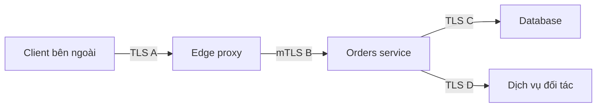

# TLS configuration

## 1. Mục tiêu của yêu cầu cấu hình TLS

Cấu hình TLS quyết định cách một kết nối được bảo vệ về tính bí mật, tính toàn vẹn và danh tính của bên tham gia. Trong thiết kế yêu cầu bảo mật, công việc không dừng ở câu “bật HTTPS”. Cần đặc tả rõ bên nào kết nối tới bên nào, danh tính nào được chấp nhận, bộ quy tắc mật mã nào được phép và điều gì xảy ra khi không thể xác minh kết nối.

Một yêu cầu có thể kiểm chứng cần trả lời:

- TLS bắt buộc trên những chặng truyền dữ liệu nào?
- Phiên bản giao thức và các thuật toán nào được phép thương lượng?
- Client xác minh danh tính server bằng cách nào?
- Tuyến nào yêu cầu xác thực client bằng chứng thư, tức mTLS?
- Ai được cấp, đọc, thay và thu hồi khóa hoặc chứng thư?
- Hệ thống xử lý ra sao khi chứng thư hết hạn, không tin cậy hoặc sai danh tính?
- Kiểm thử nào chứng minh cấu hình thực tế đáp ứng các điều kiện đó?

Bài học dùng dịch vụ xử lý đơn hàng làm ví dụ. Những tập thuật toán, thời hạn và ngưỡng vận hành được nêu là **chính sách minh họa của dịch vụ**, cần được lựa chọn theo mô hình đe dọa, khả năng nền tảng và yêu cầu tương thích của hệ thống thực tế.

TLS bảo vệ một kênh giữa hai đầu kết thúc TLS. Khi một proxy giải mã rồi tạo kết nối mới, cần đặc tả riêng từng kênh. Các yêu cầu phân quyền nghiệp vụ, bảo vệ dữ liệu lưu trữ và kiểm soát nội dung log vẫn cần điểm cưỡng chế riêng.

## 2. Chuyển mô hình đe dọa thành yêu cầu

| Đe dọa hoặc sai sót | Hậu quả | Yêu cầu cần rút ra |
| --- | --- | --- |
| Client bỏ qua lỗi chứng thư để kết nối thành công | Kết nối tới server giả mạo | Xác minh chuỗi tin cậy, thời hạn và danh tính đích; từ chối khi không đạt |
| Chỉ bật TLS từ người dùng tới proxy | Dữ liệu rõ xuất hiện ở chặng proxy–ứng dụng | Lập danh mục và áp chính sách cho từng chặng có dữ liệu cần bảo vệ |
| Listener còn chấp nhận giao thức hoặc thuật toán ngoài chính sách | Có đường thương lượng không đáp ứng mức bảo vệ đã chọn | Dùng danh sách cho phép và kiểm thử cả trường hợp bị cấm |
| Tin mọi chứng thư do một CA cấp như cùng một danh tính | Một workload khác truy cập tài nguyên không thuộc quyền | Ánh xạ danh tính đã xác minh sang quyền cụ thể |
| Lộ private key | Có thể giả mạo bên sở hữu khóa trong phạm vi hệ thống tin cậy | Bảo vệ khóa, giới hạn quyền dùng, xoay vòng và xử lý thu hồi |
| Cert mới chỉ được nạp trên một phần instance | Người dùng nhận hành vi khác nhau theo đường định tuyến | Kiểm tra phiên bản và chứng thư thực tế trên toàn bộ phạm vi phục vụ |
| Bật TLS 1.3 early data cho thao tác tạo đơn | Yêu cầu có thể bị phát lại | Có chính sách riêng cho 0-RTT và thao tác không an toàn khi lặp |
| Giữ session cũ sau khi danh tính bị thu hồi | Thu hồi không đạt thời hạn đã cam kết | Đặc tả cả kết nối đang mở, session resumption và trạng thái thu hồi |

Ví dụ yêu cầu còn mơ hồ:

> Dịch vụ phải sử dụng chứng thư an toàn.

Có thể chuyển thành:

> Trên chặng proxy–orders, proxy phải xác minh chứng thư server theo trust bundle được phê duyệt và tên DNS dự kiến của dịch vụ. Khi chuỗi tin cậy hoặc tên DNS không hợp lệ, proxy phải từ chối kết nối và không chuyển sang HTTP.

Đây là yêu cầu có hành vi, phạm vi và kết quả kiểm thử rõ ràng.

## 3. Xác định các chặng TLS và ranh giới tin cậy

Một kiến trúc tham khảo:



Với kiến trúc này, không thể dùng kết quả kiểm tra chặng A để kết luận rằng chặng B, C và D đã an toàn.

| Chặng | TLS client | TLS server | Danh tính cần xác minh |
| --- | --- | --- | --- |
| A | Client bên ngoài | Edge proxy | Client kiểm tra tên DNS công khai và chuỗi chứng thư của edge |
| B | Edge proxy | Orders service | Proxy kiểm tra orders; orders kiểm tra danh tính chứng thư của proxy |
| C | Orders service | Database | Orders kiểm tra danh tính endpoint database; cách xác thực client theo hợp đồng của database |
| D | Orders service | Đối tác | Orders kiểm tra danh tính endpoint đối tác và chính sách đích được phép |

Mỗi chặng nên có hồ sơ gồm:

1. Nguồn, đích, cổng, loại dữ liệu và người chịu trách nhiệm.
2. Vị trí kết thúc TLS.
3. Tên hoặc định danh đích mong đợi.
4. Trust bundle dùng để xác minh bên kia.
5. Chính sách giao thức, thuật toán và xác thực client.
6. Cách cấp, phân phối, đổi và thu hồi chứng thư.
7. Bộ kiểm thử và bằng chứng cho cấu hình đang hoạt động.

Mạng nội bộ vẫn là một ranh giới cần đánh giá. Nếu có chặng truyền rõ được chấp nhận như một ngoại lệ, hồ sơ phải nêu phạm vi, rủi ro còn lại, biện pháp bù và thời hạn xem xét. Một nhãn “internal” không tự chứng minh rằng mọi bên trên đường truyền đều đáng tin cậy.

### TLS termination, passthrough và danh tính gốc

- Với termination, proxy là đầu nhận TLS từ client. Backend chỉ quan sát được kết nối do proxy tạo tới nó.
- Với passthrough, dữ liệu TLS được chuyển tiếp để backend thực hiện handshake; khả năng quan sát và định tuyến của lớp trung gian khác với termination.
- Với termination rồi mã hóa lại, có hai phiên TLS độc lập. Danh tính của proxy trên chặng sau không tự trở thành danh tính của client ban đầu.

Nếu cần chuyển tiếp danh tính client đã được edge xác minh, phải có hợp đồng riêng cho thông tin được truyền. Backend chỉ tin thông tin đó từ proxy được xác thực, edge phải loại bỏ giá trị cùng tên do client tự gửi và đường đi trực tiếp vượt qua edge phải bị kiểm soát.

## 4. Đặc tả giao thức và mật mã

### 4.1. Phiên bản giao thức

Chính sách minh họa của dịch vụ:

- Cho phép TLS 1.3.
- Cho phép TLS 1.2 trên những chặng còn cần tương thích và đã vượt qua kiểm thử.
- Từ chối các phiên bản ngoài danh sách này.
- Không tự động thử lại qua kết nối không mã hóa khi handshake thất bại.

Cần nêu rõ tập phiên bản được phép thay vì chỉ viết “TLS mới”. Một thư viện có hỗ trợ một phiên bản không đồng nghĩa phiên bản đó đang được bật trên listener hoặc client thực tế.

Nếu dịch vụ chỉ cần TLS 1.3, có thể đặc tả một tập hẹp hơn. Nếu cần một ngoại lệ tương thích, ngoại lệ phải có chủ sở hữu, phạm vi endpoint, tập client và điều kiện kết thúc; tránh nới toàn bộ dịch vụ để hỗ trợ một tích hợp riêng.

### 4.2. Cipher suite và những tham số liên quan

Một tập suite minh họa cho hồ sơ này:

| Phiên bản | Suite được phép trong ví dụ | Điểm cần kiểm tra |
| --- | --- | --- |
| TLS 1.3 | `TLS_AES_128_GCM_SHA256`, `TLS_AES_256_GCM_SHA384` | Suite mô tả AEAD và hàm băm cho cơ chế dẫn xuất khóa; trao đổi khóa và chữ ký có tham số riêng |
| TLS 1.2 | `TLS_ECDHE_RSA_WITH_AES_128_GCM_SHA256`, `TLS_ECDHE_ECDSA_WITH_AES_128_GCM_SHA256` | Phải có chứng thư và khả năng chữ ký phù hợp; dùng trao đổi khóa tạm thời theo hồ sơ |

Danh sách trên là lựa chọn cho ví dụ, không phải danh sách mọi suite có thể đáp ứng các chính sách khác.

Cần kiểm tra thêm nhóm trao đổi khóa, thuật toán chữ ký, loại khóa và chứng thư mà nền tảng hỗ trợ. Chỉ hạn chế cipher suite không chứng minh rằng tất cả các tham số mật mã khác đã phù hợp.

Một chứng thư có khóa RSA có thể được dùng để xác thực một handshake với trao đổi khóa ECDHE phù hợp. Không nên đánh đồng “chứng thư RSA” với “trao đổi khóa RSA tĩnh”.

Nếu yêu cầu forward secrecy, cần đặc tả các chế độ trao đổi khóa đáp ứng mục tiêu đó, kể cả với kết nối tiếp tục phiên. Việc cho phép TLS 1.3 không có nghĩa mọi hình thức sử dụng PSK và mọi dữ liệu gửi sớm đều có cùng thuộc tính bảo mật.

### 4.3. Kiểm tra tập cấu hình và kết quả thương lượng

Tại thời điểm nạp cấu hình, cần kiểm tra:

- Không có phiên bản hoặc thuật toán ngoài chính sách được bật.
- Có ít nhất một tổ hợp được phép mà server và client mục tiêu cùng hỗ trợ.
- Chứng thư, private key, thuật toán chữ ký và thư viện tương thích với tổ hợp đó.
- Các tham số không được nền tảng hiểu phải gây lỗi rõ ràng.

Khi nghiệm thu, phải kiểm tra handshake thực tế. Một file chứa danh sách suite đúng chưa chứng minh rằng proxy đã nạp file đó, instance khác cũng dùng nó hoặc một listener phụ không còn cấu hình cũ.

## 5. Xác minh chứng thư, trust store và danh tính

### 5.1. Tính tin cậy của chuỗi chứng thư

Client cần xác minh chuỗi chứng thư theo các trust anchor được phê duyệt cho chặng kết nối. Kiểm tra cần tuân theo cơ chế xác minh chứng thư của nền tảng và chính sách liên quan, gồm thời hạn, ràng buộc CA, mục đích sử dụng khóa và các điều kiện cần thiết khác.

Server phải cung cấp chuỗi trung gian phù hợp để các client dự kiến xây dựng chuỗi tin cậy. Không nên mặc định yêu cầu server gửi root certificate; trust anchor thường đã được phân phối riêng cho client.

Trust bundle cần có chủ sở hữu và phạm vi. Với chặng workload nội bộ, tin một tập CA rộng hơn cần thiết có thể làm tăng phạm vi danh tính có khả năng được chấp nhận.

Không thay cơ chế xác minh bằng một trust manager chấp nhận mọi chứng thư. Nếu dùng CA riêng, hãy phân phối đúng trust anchor và xác minh đầy đủ theo chính sách.

Root CA tự ký là một mô hình trust anchor thông thường. Thuộc tính tự ký tự nó không quyết định rằng một kết nối có đáp ứng chính sách hay không; cần xác định rõ nguồn gốc tin cậy và phạm vi sử dụng.

### 5.2. Danh tính server dự kiến

Một chứng thư hợp lệ theo CA vẫn phải khớp danh tính đích mà client muốn kết nối.

- Với đích DNS, sử dụng cơ chế kiểm tra tên theo quy tắc của giao thức và nền tảng, dựa trên SAN phù hợp.
- Với đích là địa chỉ IP, cần cách kiểm tra và SAN kiểu địa chỉ IP tương ứng; không suy ra một tên tin cậy từ reverse DNS.
- Không tự xây bộ so khớp wildcard bằng phép kiểm tra chuỗi đơn giản.
- Không bỏ kiểm tra danh tính chỉ vì chứng thư chưa hết hạn hoặc do CA nội bộ cấp.

Ví dụ, kết nối dự kiến tới `orders.internal.example` phải từ chối chứng thư chỉ dành cho `billing.internal.example`, dù cả hai do cùng CA cấp.

### 5.3. SNI và tên được xác minh

SNI giúp server chọn cấu hình hoặc chứng thư theo tên mà client gửi trong handshake. Nó không thay thế kiểm tra danh tính chứng thư tại client.

Cần làm rõ:

- Tên đích dự kiến mà client dùng để xác minh.
- SNI được gửi và chính sách định tuyến liên quan.
- Hành vi khi SNI không được hỗ trợ hoặc không thuộc endpoint được phép.
- Cách xử lý listener mặc định để tránh vô tình phục vụ một ứng dụng khác.

Nếu có nhiều hostname cùng đi qua một load balancer, hãy kiểm tra từng hostname và đường định tuyến tương ứng. Một lần handshake thành công với hostname đầu tiên không bao phủ toàn bộ virtual host.

### 5.4. Thời hạn và thu hồi

Cần kiểm tra thời điểm bắt đầu, thời điểm hết hạn và điều kiện hiệu lực theo chính sách. Đồng hồ hệ thống phải được đồng bộ và có ngưỡng phát hiện sai lệch phù hợp.

Thu hồi cần được đặc tả riêng:

- Loại chứng thư nào bắt buộc kiểm tra trạng thái thu hồi?
- Nguồn trạng thái nào được tin cậy?
- Dữ liệu cache được phép cũ tới mức nào?
- Khi không lấy được trạng thái, trạng thái là “không rõ” hay “không bị thu hồi”?
- Trạng thái không rõ dẫn đến hành vi nào trong phạm vi rủi ro đã chấp nhận?

Không mặc định rằng thư viện đã bật kiểm tra thu hồi chỉ vì nó kiểm tra chuỗi chứng thư. Cần xác minh khả năng và cấu hình thực tế của nền tảng bằng kiểm thử.

Một cache trạng thái còn mới theo hợp đồng có thể giúp vận hành khi phụ thuộc gián đoạn. Cache quá hạn không được âm thầm coi là bằng chứng hiện hành.

## 6. mTLS: từ chứng thư client đến quyền truy cập

mTLS thêm xác thực client bằng chứng thư trên kênh TLS. Trong ví dụ, orders chỉ nhận kết nối ở listener nội bộ khi client trình chứng thư phù hợp.

Cần đặc tả ít nhất hai bước:

1. **Xác minh chứng thư client:** chuỗi tin cậy, thời hạn, mục đích sử dụng và các điều kiện chính sách.
2. **Ràng buộc danh tính với quyền:** trích xuất định danh từ trường đã quy định, ánh xạ sang workload hoặc principal và áp dụng quyền truy cập tương ứng.

Ví dụ, chứng thư có SAN URI `urn:service:edge-orders` có thể được ánh xạ tới proxy của orders. Một chứng thư hợp lệ khác mang định danh `urn:service:reporting` không tự được quyền truy cập chức năng của proxy.

Đặc tả phải chỉ rõ trường định danh và cách diễn giải. Không dùng một chuỗi hiển thị tùy ý làm căn cứ phân quyền nếu nguồn cấp chứng thư không bảo đảm ràng buộc cần thiết.

### Bắt buộc và tùy chọn là hai hợp đồng khác nhau

Một listener yêu cầu mTLS bắt buộc phải từ chối client không có chứng thư tại giai đoạn xác thực được thiết kế. Chế độ chỉ “yêu cầu nếu client có” không đáp ứng cùng hợp đồng.

Với chứng thư có chuỗi tin cậy hợp lệ nhưng danh tính không được phép, việc từ chối có thể nằm ở validator TLS hoặc lớp kiểm soát truy cập kế tiếp, tùy kiến trúc. Tiêu chí nghiệm thu cần xác định điểm cưỡng chế và chứng minh không có tài nguyên được bảo vệ nào bị truy cập trước đó.

mTLS không thay thế quyền nghiệp vụ của người dùng. Nếu proxy đại diện cho nhiều người dùng, cần đặc tả cách dịch vụ nhận và xác minh ngữ cảnh người dùng sau khi đã xác thực proxy.

### Bảo vệ thông tin danh tính chuyển tiếp

Nếu edge gửi một header mô tả chứng thư client ban đầu:

- Edge phải xóa hoặc thay giá trị do bên ngoài tự cung cấp.
- Backend chỉ tin header trên đường đi từ edge được xác thực và được phép.
- Backend phải kiểm soát đường truy cập trực tiếp không qua edge.
- Định dạng, tính toàn vẹn và phạm vi sử dụng thông tin chuyển tiếp phải có hợp đồng rõ.

Chỉ đặt tên header là “verified” không tạo ra một ranh giới tin cậy.

## 7. Vòng đời chứng thư, private key và cấu hình TLS

### 7.1. Cấp và lưu khóa

Yêu cầu cần chỉ rõ nơi tạo khóa, thành phần được quyền sử dụng, khả năng xuất khóa và hình thức lưu trữ phù hợp với phân loại dữ liệu.

Nguyên tắc triển khai gồm:

- Quyền đọc hoặc dùng private key nằm trong phạm vi tối thiểu cần thiết.
- Cấu hình ứng dụng dùng tham chiếu được quản lý thay cho nhúng khóa vào repository.
- Không ghi private key, mật khẩu kho khóa hoặc thông tin xác thực vào log.
- Quyền sửa trust bundle được quản lý chặt vì nó có thể thay đổi những bên được tin cậy.
- Trước kích hoạt phải kiểm tra chứng thư và private key tương ứng, cùng khả năng sử dụng chúng của tiến trình thực.

Tham chiếu khóa cũng có thể tiết lộ thông tin hạ tầng. Việc ghi định danh nào vào log cần được kiểm soát, dù đó không phải nội dung khóa.

### 7.2. Xoay vòng như một lần thay đổi cấu hình có kiểm tra

Một luồng thay đổi tham khảo:

```text
Nhận gói chứng thư/khóa đã được phép
  -> kiểm tra định dạng, cặp khóa và chuỗi
  -> kiểm tra danh tính, hiệu lực và chính sách mật mã
  -> kiểm tra trust bundle và các client mục tiêu
  -> dựng cấu hình TLS mới ở trạng thái chưa phục vụ
  -> kiểm tra handshake
  -> kích hoạt theo cơ chế nhất quán của nền tảng
  -> xác nhận phiên bản thực tế trên các instance
  -> xử lý kết nối/session cũ theo chính sách
```

Không sửa dần file chứng thư và file khóa đang được sử dụng theo cách có thể làm một tiến trình đọc cặp không khớp. Cần dùng cơ chế phân phối và kích hoạt mà nền tảng hỗ trợ, có khả năng xác nhận đúng gói được nạp.

Thay đổi trust anchor có thể cần giai đoạn chồng lấn có kiểm soát: phân phối trust mới, chuyển chứng thư, xác nhận client tương thích rồi gỡ trust cũ. Giai đoạn chồng lấn phải có phạm vi và thời hạn, tránh để trust cũ tồn tại vô hạn.

### 7.3. Mốc thời gian phải đo được

Một hợp đồng vận hành minh họa cho loại chứng thư có thời hạn ít nhất 30 ngày:

- Bắt đầu quy trình gia hạn khi thời gian còn lại không quá 14 ngày.
- Cảnh báo mức nghiêm trọng khi thời gian còn lại không quá 3 ngày mà chưa có bản thay thế hoạt động.
- Sau khi gói thay thế được phê duyệt và sẵn sàng, mọi instance trong phạm vi phải dùng gói mới cho handshake mới trong tối đa 15 phút.
- Giám sát endpoint mỗi 60 giây và phát cảnh báo trong tối đa 120 giây kể từ khi một lần kiểm tra phát hiện vi phạm.

Các giá trị này chỉ phù hợp nếu loại chứng thư, khả năng tự động hóa và thời gian xử lý sự cố hỗ trợ chúng. Chứng thư ngắn hạn cần ngưỡng phù hợp khác; không sao chép một mốc ngày cố định cho mọi loại.

### 7.4. Khôi phục và thu hồi khẩn cấp

Nếu gói mới không hợp lệ, có thể giữ bản đang chạy **khi bản đó vẫn còn hợp lệ và được phép sử dụng**. Không quay lại chứng thư đã thu hồi hoặc hết hạn chỉ vì nó từng hoạt động.

Kịch bản lộ khóa cần có yêu cầu riêng về:

- Chặn handshake mới dùng danh tính hoặc chứng thư bị ảnh hưởng.
- Thu hồi hoặc thay thế vật liệu xác thực và trust liên quan.
- Xử lý kết nối đang mở.
- Vô hiệu hóa hoặc giới hạn session tiếp tục nếu cần.
- Thời hạn áp dụng trên toàn bộ instance và cách chứng minh đã hoàn tất.

Xoay chứng thư không tự đóng mọi kết nối đang mở. Session resumption cũng có thể tiếp tục dựa trên trạng thái đã thiết lập trước đó. Thời hạn thu hồi danh tính phải tính cả các cơ chế này.

## 8. Session resumption và TLS 1.3 early data

Session resumption có thể giảm chi phí handshake, nhưng cần đánh giá việc ràng buộc session với danh tính và chính sách hiện tại.

Đặc tả cần nêu:

- Thời hạn session hoặc ticket.
- Phạm vi instance và môi trường được chấp nhận ticket.
- Cách bảo vệ, thay và vô hiệu hóa khóa ticket nếu nền tảng sử dụng chúng.
- Cách xử lý thay đổi trust, quyền, thu hồi chứng thư và danh tính client.
- Chế độ trao đổi khóa của phiên tiếp tục nếu có yêu cầu forward secrecy.

Không được giả định mỗi lần tiếp tục session đều thực hiện đầy đủ lại các bước kiểm tra chứng thư như một handshake ban đầu. Cần kiểm tra hành vi của stack được chọn và bổ sung kiểm soát nếu thời hạn thu hồi yêu cầu chặt hơn.

TLS 1.3 early data, thường gọi là 0-RTT, có rủi ro phát lại. Chính sách minh họa của dịch vụ đơn hàng là **tắt early data** cho các endpoint nghiệp vụ.

Nếu một hệ thống khác cho phép early data, phải xác định rõ thao tác nào an toàn trước phát lại và cơ chế chống phát lại có hiệu lực trong phạm vi nào. Phạm vi nhiều instance hoặc nhiều vùng triển khai cần được đánh giá riêng. Không coi việc sử dụng TLS 1.3 là bằng chứng rằng một yêu cầu tạo đơn chỉ được xử lý một lần.

## 9. Mô hình đặc tả cấu hình tham khảo

Đoạn YAML sau là **mô hình yêu cầu**, không phải cú pháp cấu hình của một proxy hay thư viện cụ thể. Khi triển khai, cần ánh xạ từng trường sang tùy chọn thật và kiểm tra trên nền tảng tương ứng.

```yaml
profileId: orders-production-tls-v1

link:
  id: edge-to-orders
  serverDnsName: orders.internal.example
  port: 8443

transport:
  allowedProtocolVersions:
    - TLSv1.3
    - TLSv1.2
  allowPlaintextFallback: false
  earlyData: disabled

  tls13CipherSuites:
    - TLS_AES_128_GCM_SHA256
    - TLS_AES_256_GCM_SHA384

  tls12CipherSuites:
    - TLS_ECDHE_RSA_WITH_AES_128_GCM_SHA256
    - TLS_ECDHE_ECDSA_WITH_AES_128_GCM_SHA256

serverPolicy:
  credentialRef: credentials/orders/production/server-v8
  clientAuthentication: required
  clientTrustBundleRef: trust/orders/production/client-ca-v3
  allowedClientIdentities:
    - urn:service:edge-orders

clientPolicy:
  expectedServerDnsName: orders.internal.example
  verifyServerIdentity: true
  serverTrustBundleRef: trust/orders/production/server-ca-v4
  credentialRef: credentials/edge/production/client-v6
```

Hồ sơ này cần được kiểm tra thêm:

- Các tham chiếu phải thuộc đúng dịch vụ, môi trường và phiên bản được phép.
- Issuer hoặc CA mới không được ứng viên tự thêm vào tập tin cậy nếu không có thẩm quyền.
- Danh sách suite có giao với khả năng thực của client/server và loại chứng thư.
- Không có nguồn ghi đè nào làm mất yêu cầu xác minh danh tính.
- Mọi thay đổi đều được kiểm tra trên cấu hình hiệu lực sau khi kết hợp nguồn.
- Gói đang chạy phải truy vết được về phiên bản hồ sơ và các tham chiếu cụ thể.

Nếu cho phép cấu hình chứng thư bằng tham chiếu “latest”, phải đặc tả cách bảo đảm tài nguyên được dùng đúng với tài nguyên đã kiểm tra. Một phiên bản bất biến hoặc cơ chế kích hoạt có bảo đảm tương đương giúp tránh việc nội dung đổi giữa kiểm tra và sử dụng.

## 10. Ví dụ Java: client xác minh server

Ví dụ dùng Java 17 trở lên và thư viện chuẩn để thực hiện một TLS handshake cho đích DNS. Nó minh họa việc đặt phiên bản giao thức, SNI và kiểm tra danh tính HTTPS.

`SSLContext` được truyền vào phải đã được khởi tạo với trust manager phù hợp chính sách. Nếu chặng kết nối yêu cầu chứng thư client, context còn phải có key manager tương ứng.

```java
import javax.net.ssl.SNIHostName;
import javax.net.ssl.SSLContext;
import javax.net.ssl.SSLParameters;
import javax.net.ssl.SSLSocket;
import java.io.IOException;
import java.net.InetSocketAddress;
import java.net.Socket;
import java.util.List;
import java.util.Objects;

public final class VerifiedTlsConnection {
    public static void verifyHandshake(
            SSLContext context,
            String expectedDnsName,
            int port) throws IOException {

        Objects.requireNonNull(context, "context");
        Objects.requireNonNull(expectedDnsName, "expectedDnsName");

        try (Socket tcp = new Socket()) {
            tcp.connect(
                    new InetSocketAddress(expectedDnsName, port),
                    2_000);

            try (SSLSocket tls = (SSLSocket) context
                    .getSocketFactory()
                    .createSocket(tcp, expectedDnsName, port, true)) {

                tls.setSoTimeout(3_000);

                SSLParameters parameters = tls.getSSLParameters();
                parameters.setProtocols(
                        new String[]{"TLSv1.3", "TLSv1.2"});
                parameters.setEndpointIdentificationAlgorithm("HTTPS");
                parameters.setServerNames(
                        List.of(new SNIHostName(expectedDnsName)));

                tls.setSSLParameters(parameters);
                tls.startHandshake();
            }
        }
    }
}
```

Những ràng buộc cần đọc cùng ví dụ:

1. `expectedDnsName` đến từ đích được phê duyệt. Việc TLS kiểm tra đúng chứng thư không thay thế allowlist đích hoặc kiểm soát SSRF.
2. `HTTPS` ở đây chọn cơ chế kiểm tra danh tính endpoint của socket; nó không tự gửi một yêu cầu HTTP.
3. SNI giúp server chọn chứng thư; endpoint identification kiểm tra chứng thư nhận được với tên đích dự kiến.
4. Context không được dùng trust manager bỏ qua xác minh. Đoạn mã không hiển thị nội dung kho khóa hay mật khẩu.
5. Danh sách cipher suite, nhóm khóa, thuật toán chữ ký và chính sách thu hồi chưa được cấu hình trong đoạn mã; cần hoàn thiện ở hồ sơ TLS thực.
6. Các timeout là ví dụ cho kết nối và thao tác đọc của socket. Chúng không tạo ra một deadline tổng cho DNS, toàn bộ handshake và mọi tầng xử lý.
7. Ví dụ dành cho hostname DNS; không sao chép cách tạo SNI hostname này để xử lý tùy tiện một địa chỉ IP.
8. Nếu nền tảng không hỗ trợ chính sách đã chọn, cần phát hiện khi khởi tạo hoặc kiểm tra trước phục vụ, thay vì âm thầm nới chính sách.

Chỉ thấy `startHandshake()` thành công chưa đủ để nghiệm thu toàn bộ hồ sơ TLS. Cần kiểm tra suite được thương lượng, trust thực tế, trạng thái chứng thư, yêu cầu mTLS và hành vi ứng dụng sau handshake.

## 11. Bộ yêu cầu và tiêu chí nghiệm thu minh họa

| Mã | Yêu cầu | Tiêu chí có thể kiểm chứng |
| --- | --- | --- |
| SEC-TLS-01 | Mọi chặng trong phạm vi phải áp dụng đúng hồ sơ TLS đã phê duyệt | Có danh mục chặng; kiểm thử kết nối thực tế theo từng chặng và listener |
| SEC-TLS-02 | Chỉ cho phép phiên bản và thuật toán trong hồ sơ | Probe ngoài tập bị từ chối; probe phù hợp thương lượng được tổ hợp được phép |
| SEC-TLS-03 | Client phải xác minh chuỗi chứng thư và danh tính server | Cert sai CA, hết hạn hoặc sai tên đều không tạo kết nối ứng dụng được chấp nhận |
| SEC-TLS-04 | Chặng B bắt buộc client authentication | Client không có cert hoặc có cert không tin cậy không truy cập được listener được bảo vệ |
| SEC-TLS-05 | Chỉ danh tính mTLS được phép mới có quyền tương ứng | Cert hợp lệ của workload khác vẫn bị từ chối trước truy cập tài nguyên |
| SEC-TLS-06 | Lỗi TLS không được dẫn đến fallback truyền rõ | Kiểm thử làm handshake thất bại và xác nhận không có lần thử HTTP thay thế |
| SEC-TLS-07 | Gói khóa/chứng thư phải được kiểm tra trước kích hoạt | Gói sai cặp khóa, sai danh tính hoặc không hợp lệ bị từ chối; bản hoạt động không bị cập nhật một phần |
| SEC-TLS-08 | Gói được duyệt phải áp dụng cho handshake mới trong 15 phút | Bằng chứng trên mọi instance trong phạm vi cho thấy phiên bản và chứng thư mới |
| SEC-TLS-09 | Early data bị tắt cho các endpoint đơn hàng | Thử gửi early data không khiến thao tác nghiệp vụ được thực thi qua đường này |
| SEC-TLS-10 | Trạng thái hết hạn và vi phạm TLS phải được giám sát | Có probe theo lịch, cảnh báo và kiểm thử đáp ứng các mốc thời gian đã chọn |
| SEC-TLS-11 | Thu hồi và tiếp tục session phải tuân theo thời hạn đã cam kết | Kiểm thử cả handshake mới, kết nối đang mở và session tiếp tục |
| SEC-TLS-12 | Log và bằng chứng không được lộ vật liệu bí mật | Kiểm tra đầu ra lỗi, log triển khai và artifact không chứa private key hoặc mật khẩu kho khóa |

SEC-TLS-11 cần thêm một con số theo mô hình rủi ro cụ thể. Ví dụ, một dịch vụ có thể cam kết ngăn truy cập mới của danh tính bị thu hồi trong 60 giây kể từ khi nhận sự kiện thu hồi đáng tin cậy. Khi đó thiết kế phải chỉ ra cách đạt thời hạn này trên các instance, connection pool và session cache. Nếu kiến trúc chưa đáp ứng, yêu cầu chưa được coi là hoàn thành.

### Tiêu chí Given/When/Then cho sai danh tính

```text
Given:
  Proxy dự kiến kết nối orders.internal.example.
  Trust bundle có CA đã được phê duyệt.
  Một server thử nghiệm trình cert hợp lệ do CA đó cấp,
  nhưng SAN chỉ chứa billing.internal.example.

When:
  Proxy thực hiện kết nối tới đích orders theo hồ sơ TLS.

Then:
  Kết nối bị từ chối vì danh tính không khớp.
  Không có yêu cầu nghiệp vụ gửi trên kênh đó.
  Không có lần thử lại qua HTTP hoặc chế độ bỏ xác minh.
  Sự kiện lỗi có mã và định danh chặng, không chứa bí mật.
```

Tiêu chí này phát hiện lỗi “tin đúng CA nhưng không kiểm tra đúng server”.

## 12. Ma trận kiểm thử TLS

| Tình huống | Kỳ vọng | Bằng chứng cần thu |
| --- | --- | --- |
| Hai đầu có tổ hợp được phép và chứng thư hợp lệ | Handshake thành công | Phiên bản, suite, danh tính đích và kết quả kiểm tra |
| Client chỉ hỗ trợ phiên bản bị cấm | Handshake bị từ chối | Kết quả probe có cưỡng chế phiên bản |
| Client chỉ đề nghị suite ngoài hồ sơ | Không thương lượng được suite bị cấm | Kết quả probe và tập suite thực tế |
| Cert do CA không được tin cậy cấp | Client từ chối | Lỗi xác minh; không có fallback |
| Cert đúng CA nhưng sai SAN | Client từ chối danh tính | Lỗi kiểm tra tên đích |
| Cert chưa có hiệu lực hoặc hết hạn | Kết nối không được chấp nhận | Test với thời gian kiểm soát được và đồng hồ phù hợp |
| Server thiếu intermediate cần thiết | Phát hiện lỗi trên tập client mục tiêu | Kết quả từ client không dựa vào cache hoặc nguồn bổ sung ngoài hợp đồng |
| Client không gửi cert trên chặng mTLS bắt buộc | Không truy cập được dịch vụ | Lỗi tại điểm xác thực đã đặc tả |
| Client có cert hợp lệ nhưng danh tính không được phép | Không có quyền tương ứng | Kết quả kiểm soát truy cập và audit |
| Client tự gửi header danh tính giống header của edge | Không được giả mạo principal | Giá trị bị loại bỏ hoặc không được backend tin |
| SNI khác endpoint được cấu hình | Áp đúng chính sách listener và kiểm tra danh tính | Kết quả handshake và kiểm tra ứng dụng được định tuyến |
| Cert và private key không khớp | Từ chối kích hoạt | Bản TLS hoạt động vẫn nhất quán |
| Trust bundle được đổi hoặc CA cũ bị gỡ | Áp dụng đúng giai đoạn chuyển tiếp | Test tương thích và test CA không còn được phép |
| Thu hồi danh tính sau khi có kết nối | Đạt thời hạn hạn chế truy cập đã cam kết | Test connection pool, kết nối mở và session tiếp tục |
| Đích trạng thái thu hồi gián đoạn | Áp đúng chính sách trạng thái không rõ/cache | Tuổi dữ liệu, quyết định chấp nhận hoặc từ chối |
| Gói mới triển khai trên nhiều instance | Không còn instance phục vụ gói ngoài thời hạn | Probe theo instance, tuyến mạng và SNI liên quan |
| Early data chứa thao tác tạo đơn | Không thực thi qua early data theo hồ sơ này | Quan sát handshake và không phát sinh tác động nghiệp vụ |
| Client gặp lỗi TLS | Không kết nối lại bằng HTTP | Quan sát mạng hoặc mock endpoint thử nghiệm |
| Cấu hình lỗi có chứa tham chiếu nhạy cảm | Không lộ dữ liệu ngoài chính sách | Kiểm tra log, thông báo và artifact |

Một probe kết nối thành công thường chỉ chứng minh một tổ hợp được thương lượng. Nó không chứng minh tất cả phiên bản hoặc suite ngoài chính sách đã bị tắt. Vì vậy cần phép thử âm được cưỡng chế tham số phù hợp.

Kiểm tra cả server lẫn client. Một listener có cấu hình chặt vẫn có thể được gọi bởi client bỏ xác minh chứng thư; một client đúng chính sách vẫn có thể gặp đường TLS khác do proxy hoặc service mesh quản lý.

Trước kiểm thử, cần định nghĩa kỳ vọng về cache intermediate, nguồn bổ sung để xây chuỗi và trust store được dùng. Nếu môi trường kiểm thử vô tình có thêm CA hoặc intermediate, kết quả có thể không đại diện cho client thật.

## 13. Bằng chứng, quan sát và phục hồi

### 13.1. Bằng chứng triển khai

Một bộ bằng chứng hữu ích liên kết:

- Bản ứng dụng và thư viện TLS trong phạm vi quản lý.
- Hồ sơ TLS và phiên bản cấu hình hiệu lực.
- Phiên bản trust bundle và gói chứng thư.
- Endpoint, listener, SNI và instance đã kiểm tra.
- Kết quả kiểm thử dương, âm, mTLS và xoay vòng.
- Ngoại lệ còn hiệu lực cùng chủ sở hữu.

Có thể dùng fingerprint chứng thư công khai để đối chiếu gói đang được phục vụ. Fingerprint chứng minh đang quan sát một chứng thư cụ thể; nó không tự chứng minh trust, danh tính, hiệu lực hoặc quyền truy cập.

### 13.2. Log và metric

Có thể ghi các dữ liệu được phép như mã lỗi phân loại, định danh chặng, phiên bản chính sách, phiên bản TLS và suite được thương lượng. Không ghi private key, mật khẩu kho khóa, token nghiệp vụ hoặc toàn bộ dữ liệu phiên.

Tên chủ thể, SAN và hostname nội bộ có thể là thông tin nhạy cảm của tổ chức. Cần chọn dữ liệu log theo quyền truy cập và nhu cầu điều tra, đồng thời kiểm soát độ lớn của tập nhãn metric.

Quan sát tối thiểu nên giúp trả lời:

- Có bao nhiêu handshake thất bại và thuộc nhóm nguyên nhân nào?
- Có endpoint hoặc instance nào phục vụ chứng thư sắp hết hạn?
- Có bản cấu hình TLS nào không đúng phiên bản đã duyệt?
- Xoay vòng có hoàn tất trong thời hạn không?
- Tỷ lệ lỗi có tập trung ở một phiên bản client hoặc một tuyến mạng không?

### 13.3. Hành vi khi thất bại

Khi khởi động mà vật liệu TLS bắt buộc không hợp lệ, không công bố listener được bảo vệ là sẵn sàng. Có thể dừng tiến trình hoặc chờ cấu hình hợp lệ theo thiết kế, nhưng không tự mở một listener truyền rõ.

Khi cập nhật lỗi, chỉ giữ cấu hình cũ nếu nó còn thỏa chính sách hiện tại. Với chứng thư hết hạn hoặc khóa bị thu hồi, quy trình phải ưu tiên hạn chế chức năng liên quan theo yêu cầu đã định.

Chuyển hướng HTTP sang HTTPS có thể hỗ trợ một luồng truy cập web, nhưng yêu cầu HTTP đầu tiên vẫn có thể đã đi trên kênh rõ. HSTS có tác dụng với client hỗ trợ và đáp ứng điều kiện áp dụng của cơ chế đó; các chặng service-to-service cần chính sách client TLS riêng.

## 14. Truy vết trong vòng đời phát triển

| Rủi ro | Yêu cầu | Thành phần cưỡng chế | Kiểm chứng |
| --- | --- | --- | --- |
| R-TLS-01: giả mạo server | SEC-TLS-03 | TLS client, trust bundle và kiểm tra danh tính | Cert sai CA và đúng CA nhưng sai SAN đều bị từ chối |
| R-TLS-02: giả mạo workload | SEC-TLS-04, SEC-TLS-05 | Listener mTLS và lớp ánh xạ principal | Thiếu cert và cert của workload khác không được truy cập |
| R-TLS-03: dữ liệu rõ trên chặng sau proxy | SEC-TLS-01, SEC-TLS-06 | Kết nối outbound của proxy và chính sách listener | Kiểm tra từng chặng, không có fallback HTTP |
| R-TLS-04: dùng tiếp danh tính bị thu hồi | SEC-TLS-11 | Trust/thu hồi, session và connection pool | Kiểm thử thu hồi đạt thời hạn trên các dạng kết nối |
| R-TLS-05: cấu hình đổi không đồng nhất | SEC-TLS-07, SEC-TLS-08 | Phân phối và kích hoạt gói TLS | Không cập nhật một phần; probe xác nhận mọi instance |

Khi thiết kế, xác định ranh giới tin cậy và hồ sơ TLS cho từng chặng. Khi hiện thực, ánh xạ các yêu cầu sang thư viện, proxy, mesh hoặc driver thực tế. Trước phát hành, thu bằng chứng cấu hình hiệu lực và kết quả handshake. Trong vận hành, theo dõi drift, thời hạn chứng thư, sự kiện thu hồi và khả năng phục hồi.

Khi thay phiên bản thư viện hoặc nền tảng, cần kiểm tra lại phần hành vi có thể thay đổi: giao thức mặc định, danh sách thuật toán, cách nạp trust, quy tắc xác minh danh tính và xử lý session. Không dựa vào một cấu hình từng hợp lệ để suy ra mọi bản nâng cấp đều giữ cùng hành vi.

Một đặc tả TLS đủ dùng phải giúp người triển khai biết chính xác cần cấu hình gì, người kiểm thử biết khi nào phải từ chối kết nối và người vận hành biết xử lý vòng đời khóa ra sao. Sự liên kết giữa rủi ro, yêu cầu, điểm cưỡng chế và bằng chứng làm cho mục tiêu bảo vệ đường truyền trở thành một phần có thể nghiệm thu của thiết kế bảo mật.
