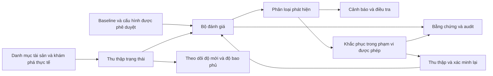

# Configuration drift — Đặc tả yêu cầu kiểm soát sai lệch cấu hình

## 1. Mục tiêu và phạm vi

Configuration drift là sự khác biệt giữa trạng thái cấu hình đang được quan sát và trạng thái mong muốn áp dụng cho đúng đối tượng, môi trường và thời điểm. Sai lệch có thể xuất hiện khi quản trị viên sửa trực tiếp, một công cụ tự động ghi đè, tiến trình giữ cache cũ, bản triển khai dùng sai profile hoặc tài nguyên mới không đi qua quy trình cấu hình chuẩn.

Không phải mọi sai lệch đều là sự cố bảo mật. Một đợt phát hành có thể cho phép hai phiên bản cấu hình cùng tồn tại trong thời gian giới hạn. Tuy nhiên, sai lệch làm tắt xác thực, mở cổng quản trị hoặc cấp thêm quyền có thể phá vỡ giả định an toàn dù mã nguồn không thay đổi.

Trong chương **Configuration security**, bài học này tập trung vào cách biến rủi ro sai lệch thành yêu cầu bảo mật cụ thể, đo được và có thể kiểm chứng. Kết quả cần liên kết được cấu hình, tài sản, mô hình đe dọa, kiến trúc thực thi, cảnh báo, phục hồi và bằng chứng kiểm thử trong vòng đời phát triển.

Sau bài học, người học có thể:

- Xác định baseline và trạng thái cấu hình có hiệu lực cho từng phạm vi.
- Phân biệt drift, thay đổi được phê duyệt, vi phạm chính sách và thiếu khả năng quan sát.
- Viết yêu cầu phát hiện, phân loại, cảnh báo và khắc phục sai lệch.
- Chọn cách so sánh cấu hình mà không làm lộ secret.
- Gắn yêu cầu với các phép thử về nguồn dữ liệu, độ trễ, quyền hạn và phục hồi.

Các thời hạn và ngưỡng trong ví dụ là giả định của một hệ thống minh họa. Dự án cần chọn giá trị theo mức rủi ro, năng lực hệ thống và tác động nghiệp vụ.

## 2. Phân biệt trạng thái mong muốn, trạng thái thực tế và chính sách

### 2.1. Bốn lớp cần theo dõi

| Lớp | Ý nghĩa | Ví dụ |
| --- | --- | --- |
| Baseline bảo mật | Ràng buộc tối thiểu phải được thỏa mãn | Webhook thay đổi trạng thái thanh toán phải được xác thực |
| Cấu hình mong muốn | Bản cấu hình đã được phê duyệt cho phạm vi và thời điểm cụ thể | Phiên bản cấu hình đã chọn cho production của dịch vụ thanh toán |
| Trạng thái quan sát | Dữ liệu thu được từ nền tảng, tài nguyên và ứng dụng | Biến môi trường, rule mạng, quyền IAM, revision đang chạy |
| Cấu hình có hiệu lực | Kết quả cuối cùng sau ghi đè, kế thừa, nạp động và cache | Ứng dụng thực sự có yêu cầu xác thực webhook hay không |

Bốn lớp có thể khác nhau. File cấu hình trong kho mã đặt xác thực là bắt buộc, nhưng biến môi trường của tiến trình ghi đè giá trị đó. Hoặc tài nguyên đã được cập nhật nhưng một instance vẫn dùng cache cũ.

Khi đánh giá, cần hai phép kiểm tra riêng:

1. Trạng thái thực tế có khớp cấu hình mong muốn hợp lệ không?
2. Trạng thái thực tế và cả cấu hình mong muốn có thỏa baseline bảo mật không?

Một thay đổi nguy hiểm đã được merge vào kho mã có thể làm mọi máy “khớp cấu hình”, nhưng hệ thống vẫn vi phạm yêu cầu bảo mật. Kiểm soát drift không thay thế đánh giá an toàn của chính baseline và quy trình phê duyệt.

### 2.2. Không mặc định nhánh mới nhất là cấu hình phải chạy

Nguồn cấu hình mong muốn cần gắn với bản phát hành hoặc quyết định triển khai đã được phê duyệt. Commit mới nhất có thể chưa được triển khai, đang thử nghiệm hoặc chưa qua kiểm tra.

Phạm vi nhận diện thường bao gồm:

- Dịch vụ hoặc loại tài nguyên.
- Môi trường, khu vực và cụm.
- Tenant hoặc nhóm tenant nếu cấu hình khác nhau.
- Phiên bản ứng dụng và schema cấu hình tương thích.
- Revision cấu hình cùng khoảng thời gian có hiệu lực.
- Ngoại lệ được duyệt hoặc giai đoạn chuyển đổi đang áp dụng.

Nếu không xác định được cấu hình mong muốn cho đúng phạm vi, không được kết luận đối tượng “đạt chuẩn” chỉ vì dữ liệu thu được có vẻ hợp lý.

### 2.3. Drift không đồng nghĩa với thay đổi trái phép

| Tình huống | Cách đánh giá phù hợp |
| --- | --- |
| Sửa trực tiếp ngoài quy trình làm mở quyền | Drift cần điều tra; có thể là vi phạm bảo mật nghiêm trọng |
| Hai revision được phép cùng chạy trong đợt phát hành | Sai khác được dự kiến trong phạm vi và thời hạn đã duyệt |
| Thay đổi khẩn cấp có quyền và ticket hợp lệ | Ghi nhận thay đổi; đánh giá điều kiện chấp nhận và thời hạn hợp thức hóa |
| Cấu hình khớp bản mong muốn nhưng vi phạm baseline | Vi phạm chính sách hoặc lỗi thiết kế baseline |
| Không lấy được dữ liệu hoặc dữ liệu đã cũ | Trạng thái chưa xác định, không phải bằng chứng tuân thủ |
| Khóa bí mật được xoay vòng đúng chính sách | Thay đổi hợp lệ nếu nằm trong quy tắc vòng đời đã phê duyệt |

Một ngoại lệ phải có phạm vi, người chịu trách nhiệm, lý do và hạn kết thúc. “Đã biết sự khác biệt” chưa đủ để xem sai lệch là được chấp nhận.

## 3. Mô hình đe dọa và ví dụ xuyên suốt

Giả sử nền tảng thanh toán có nhiều instance, một hệ thống cấp secret, cấu hình mạng và hệ thống thu thập log. Baseline yêu cầu:

- Xác thực và phân quyền nghiệp vụ luôn được thực thi.
- Webhook phải được xác minh trước khi tạo thay đổi trạng thái.
- Cổng quản trị không được truy cập từ Internet.
- Workload chỉ có quyền truy cập cần thiết.
- Secret không được ghi vào log.
- Thay đổi cấu hình nhạy cảm phải có danh tính và audit.

Trong một lần điều tra lỗi, người vận hành bật chế độ debug và sửa một biến môi trường. Sau đó một instance mới được tạo từ template cũ, trong khi các instance khác đã nhận cấu hình mới. Kho mã vẫn có cấu hình đúng nhưng trạng thái hiệu lực giữa các instance không giống nhau.

| Đe dọa | Tác động | Hướng yêu cầu |
| --- | --- | --- |
| Sửa trực tiếp ngoài pipeline | Bỏ qua kiểm tra và phê duyệt | Giới hạn đường ghi, phát hiện thay đổi và audit |
| Nguồn baseline bị sửa trái phép | Detector xem trạng thái nguy hiểm là đúng | Bảo vệ nguồn, phiên bản và phê duyệt baseline |
| Biến môi trường ghi đè file | Kiểm soát an toàn không có hiệu lực | Quan sát thứ tự ưu tiên và giá trị hiệu lực |
| Detector mất quyền hoặc ngừng chạy | Vi phạm tồn tại nhưng dashboard vẫn xanh | Giám sát độ mới, độ bao phủ và lỗi thu thập |
| Instance cũ hoặc tài nguyên ngoài danh mục | Một phần hệ thống không được kiểm tra | Khám phá tài sản và đối soát phạm vi độc lập |
| Tự khắc phục dùng quyền quá rộng | Tạo thay đổi sai hoặc khuếch đại sự cố | Tách quyền, giới hạn hành động và kiểm chứng sau sửa |
| Thu thập toàn bộ cấu hình chứa secret | Hệ thống giám sát trở thành nơi rò rỉ | Thu thập tối thiểu và so sánh metadata phù hợp |

Không chỉ theo dõi cấu hình ứng dụng. IAM, mạng, logging, storage, trust store và các chính sách của nền tảng đều có thể làm thay đổi mức bảo vệ thực tế.

## 4. Kiến trúc kiểm soát drift

Một vòng kiểm soát đầy đủ gồm xác định trạng thái mong muốn, thu thập, so sánh, phân loại, xử lý và xác minh.



### 4.1. Nguồn mong muốn phải được bảo vệ

> **DRIFT-BAS-01:** Mỗi đối tượng trong phạm vi phải được ánh xạ tới baseline và revision cấu hình mong muốn đã được phê duyệt. Thay đổi nguồn, phạm vi hoặc nội dung baseline nhạy cảm phải được xác thực, phân quyền, ghi audit và kiểm tra trước khi áp dụng.

Cần kiểm soát cả việc sửa policy, đổi nhánh nguồn, sửa ánh xạ môi trường và loại tài sản khỏi phạm vi. Người không sửa được giá trị cấu hình vẫn có thể che vi phạm nếu được tùy ý sửa bộ so sánh hoặc danh mục tài sản.

Chữ ký hoặc digest có thể giúp xác định nội dung và nguồn gốc artifact, nhưng không tự chứng minh nội dung đó an toàn hay đã được người phù hợp phê duyệt. Chuỗi bằng chứng cần liên kết artifact với quyết định phát hành.

### 4.2. Detector và remediator có quyền khác nhau

Detector thường chỉ cần quyền đọc và gửi bằng chứng. Thành phần khắc phục chỉ được cấp quyền ghi cho tài nguyên, trường cấu hình và hành động đã được cho phép.

> **DRIFT-PRIV-01:** Credential thu thập không được tự có quyền sửa cấu hình. Quyền khắc phục phải tách biệt, giới hạn theo phạm vi và có cơ chế thu hồi.

Nếu detector và remediator dùng chung quyền quản trị toàn hệ thống, một lỗi parsing hoặc credential bị lấy có thể biến công cụ kiểm soát thành đường tấn công.

Báo cáo có xác thực từ agent giúp chứng minh nguồn gửi, nhưng không bảo đảm dữ liệu đúng nếu agent hoặc host đã bị xâm nhập. Với tài sản quan trọng, cần kết hợp dữ liệu từ control plane, ứng dụng và phép thử độc lập phù hợp.

### 4.3. Theo dõi cả phần không quan sát được

Danh mục tài sản phải được đối soát với nguồn khám phá thực tế. Một instance không có trong danh sách quét sẽ không tự xuất hiện dưới dạng “không tuân thủ”.

Cần theo dõi:

- Tài sản đã được phát hiện nhưng chưa có baseline.
- Tài sản có baseline nhưng chưa thu thập được trạng thái.
- Nguồn thu thập hết quyền hoặc báo lỗi.
- Dữ liệu quá hạn.
- Phiên bản cấu hình chưa được bộ so sánh hỗ trợ.
- Tài sản không còn tồn tại nhưng chưa được loại khỏi danh mục.

Không gộp các trường hợp này thành “không có drift”. Với tài sản nhạy cảm, cần quy định việc chưa xác minh có làm trì hoãn cấp lưu lượng hoặc yêu cầu cách ly hay không.

## 5. So sánh đúng ý nghĩa và không thu thập quá mức

### 5.1. So sánh văn bản chỉ giải quyết một phần

Hai file khác thứ tự thuộc tính hoặc cách trình bày có thể mang cùng ý nghĩa. Ngược lại, hai file giống nhau không bảo đảm tiến trình đang dùng cùng cấu hình vì còn biến môi trường, tham số khởi động và giá trị được nạp từ xa.

Yêu cầu cần xác định:

1. Trường nào được so sánh.
2. Kiểu dữ liệu và schema nào áp dụng.
3. Thứ tự ưu tiên giữa các nguồn.
4. Quy tắc chuẩn hóa nào là an toàn.
5. Điều kiện nào được coi là khác biệt chấp nhận được.
6. Khi không hiểu được dữ liệu thì trả trạng thái gì.

Không sắp xếp mọi mảng một cách máy móc: thứ tự rule firewall hoặc chuỗi xử lý có thể mang ý nghĩa. Không chuyển mọi giá trị thành chuỗi: boolean, số và chuỗi có thể được ứng dụng diễn giải khác nhau.

> **DRIFT-CMP-01:** Bộ so sánh phải đánh giá theo schema và ngữ nghĩa đã được phê duyệt. Trường bảo mật chưa hỗ trợ, lỗi parsing hoặc thiếu dữ liệu phải tạo kết quả chưa xác định hoặc vi phạm theo chính sách, không được mặc nhiên coi là tương đương.

### 5.2. Kiểm tra trạng thái có hiệu lực

| Lớp | Điều cần đối chiếu | Hạn chế cần nhận biết |
| --- | --- | --- |
| Kho mã hoặc artifact | Bản đã duyệt, revision, nội dung | Chưa chứng minh tài nguyên đang chạy đã nhận bản đó |
| Control plane | Cấu hình tài nguyên và chính sách khai báo | Có thể chưa phản ánh tiến trình đang dùng cache |
| Runtime | Revision, profile, metadata nguồn và kết quả diễn giải | Endpoint quan sát cũng cần được bảo vệ và có thể báo sai khi host bị xâm nhập |
| Hành vi | Thao tác không có quyền bị từ chối, đường mạng bị chặn | Một phép thử không bao phủ toàn bộ không gian trạng thái |

Kết hợp các lớp giúp kiểm tra giả định. Ví dụ, rule mạng có vẻ đúng nhưng một đường proxy khác vẫn mở cổng quản trị; một phép thử từ vị trí không được phép sẽ cung cấp bằng chứng bổ sung.

Không expose toàn bộ môi trường tiến trình hoặc endpoint chẩn đoán nhạy cảm chỉ để phục vụ drift detection. Thiết kế giao diện quan sát tối thiểu: revision, trạng thái predicate bảo mật và metadata nguồn phù hợp.

### 5.3. Secret cần cách so sánh riêng

Không đưa giá trị secret vào kho bằng chứng, log, ticket hoặc dashboard.

Có thể đánh giá các thuộc tính phù hợp như:

- Tham chiếu tới đúng secret manager và đúng phạm vi.
- Phiên bản thuộc tập được cho phép trong quá trình xoay vòng.
- Quyền workload, thời hạn và trạng thái thu hồi.
- Thời điểm tiến trình đã nhận phiên bản mới.
- Bằng chứng credential cũ không còn dùng được theo chính sách.

Không coi mọi lần thay đổi secret là drift trái phép. Quá trình xoay vòng có thể cho phép hai phiên bản trong một cửa sổ rõ ràng.

Băm secret rồi lưu cũng không tự bảo đảm bí mật, đặc biệt nếu giá trị có không gian đoán nhỏ. Nếu cần fingerprint, phải đánh giá thiết kế mật mã, người được xem và khả năng suy đoán; ưu tiên metadata không tiết lộ giá trị khi metadata đủ đáp ứng yêu cầu.

### 5.4. Một đặc tả policy minh họa

```yaml
policyId: CFG-WEBHOOK-AUTH-01
scope:
  service: payment
  environment: production
  component: webhook-worker
desiredState:
  source: approved-release-manifest
checks:
  - field: effectiveSecurity.webhookSignatureRequired
    valueType: boolean
    operator: equals
    expected: true
observation:
  maximumIntervalSeconds: 60
  requiredSources:
    - workload-configuration
    - runtime-security-status
decision:
  onMissingOrUnsupported: UNKNOWN
  severityOnViolation: CRITICAL
remediation:
  mode: contain-then-approved-change
```

Đây là schema học tập, không phải cấu hình tương thích sẵn với một công cụ. Trường runtime phải phản ánh cấu hình có hiệu lực theo thiết kế; chỉ tự khai “đạt” mà không có nguồn bằng chứng phù hợp sẽ không đủ tin cậy.

## 6. Đặc tả phát hiện, phân loại và cảnh báo

### 6.1. Phát hiện phải có giới hạn thời gian

Yêu cầu “phát hiện sớm” cần được thay bằng thời hạn và điều kiện đo cụ thể. Phải tính cả thời gian chờ thu thập, xử lý, phân loại và gửi cảnh báo.

Ví dụ cho nhóm cấu hình bảo mật quan trọng:

| Đại lượng | Mục tiêu minh họa | Điều kiện cần nêu |
| --- | --- | --- |
| Khoảng cách giữa hai lần quan sát hợp lệ | Không quá 60 giây | Áp dụng cho từng tài sản đang trong phạm vi |
| Độ trễ đánh giá sau khi nhận quan sát | Không quá 30 giây | Hàng đợi và bộ so sánh hoạt động trong năng lực đã duyệt |
| Độ trễ đưa cảnh báo tới nơi nhận | Không quá 30 giây sau phát hiện | Kênh thông báo có xác nhận trạng thái gửi |
| Thời gian phát hiện và thông báo tổng | Không quá 120 giây | Bao gồm các bước trên, dưới điều kiện hoạt động đã quy định |

Giới hạn tổng chỉ có ý nghĩa nếu giới hạn thành phần thực sự được bảo đảm. Một cron job chạy mỗi phút nhưng có thể trễ nhiều phút không tự đáp ứng khoảng cách quan sát 60 giây.

Có thể kết hợp sự kiện thay đổi với quét đối soát định kỳ. Sự kiện giúp giảm độ trễ; đối soát giúp phát hiện sự kiện bị mất hoặc thay đổi không đi qua đường phát sự kiện.

> **DRIFT-DET-01:** Với các predicate bảo mật quan trọng trong phạm vi, hệ thống phải phát hiện và gửi cảnh báo trong thời hạn đã quy định. Mất sự kiện thay đổi không được làm vi phạm tồn tại vô thời hạn; vòng đối soát phải cung cấp đường phát hiện bổ sung.

Tiêu chí chấp nhận phải tạo sai lệch tại các thời điểm khác nhau trong chu kỳ, kể cả ngay sau lần quét, và đo thời gian cảnh báo đến nơi nhận.

### 6.2. Tách thời gian thay đổi, quan sát và phát hiện

Nên lưu các mốc:

- Lần gần nhất đã quan sát và xác nhận hợp lệ.
- Thời điểm thay đổi nếu có bằng chứng audit đáng tin cậy.
- Thời điểm trạng thái vi phạm được quan sát.
- Thời điểm bộ đánh giá tạo phát hiện.
- Thời điểm gửi cảnh báo, xác nhận tiếp nhận và hoàn tất xử lý.

Nếu chỉ có snapshot định kỳ, thường chỉ biết vi phạm xuất hiện trong khoảng giữa lần quan sát tốt và lần quan sát lỗi. Không gọi thời điểm phát hiện là thời điểm chính xác kẻ tấn công sửa cấu hình.

Nguồn thời gian và sai lệch đồng hồ phải phù hợp với độ chính xác cần đo. Dashboard cần thể hiện độ mới của bằng chứng, không chỉ thời điểm giao diện được mở.

### 6.3. Phân loại theo tác động, không chỉ số trường khác nhau

Một thay đổi một ký tự làm tắt xác thực có thể nghiêm trọng hơn hàng trăm khác biệt về nhãn triển khai.

Phân loại nên xét:

- Tài sản và dữ liệu bị ảnh hưởng.
- Khả năng truy cập từ nguồn không đáng tin cậy.
- Quyền mới được cấp hoặc kiểm soát đã bị mất.
- Số tenant, instance và khu vực liên quan.
- Có dấu hiệu thay đổi trái phép hoặc credential bị lộ không.
- Trạng thái có thuộc ngoại lệ hoặc cửa sổ phát hành hợp lệ không.

Không tự hạ mức độ chỉ vì thay đổi đến từ một tài khoản quản trị. Tài khoản đó có thể bị chiếm hoặc đã thao tác sai.

### 6.4. Phát hiện lặp, ngoại lệ và chống che giấu

Mỗi phát hiện cần định danh ổn định theo tài sản, predicate và phạm vi để liên kết các lần quan sát. Khi vi phạm vẫn tồn tại, không nên tạo vô hạn ticket độc lập; nhưng vẫn phải cập nhật thời gian và bằng chứng mới.

Ngoại lệ chỉ được áp dụng khi khớp đủ điều kiện, chưa hết hạn và có chủ sở hữu. Không dùng wildcard rộng để bỏ qua mọi sai lệch của một môi trường chỉ vì đang phát hành.

> **DRIFT-EXC-01:** Ngoại lệ phải có phạm vi và thời hạn bắt buộc. Sau khi hết hạn, sai lệch còn tồn tại phải được đánh giá lại và phát tín hiệu theo chính sách, không được tự gia hạn hoặc tự trở thành baseline.

Đóng ticket thủ công không đồng nghĩa tài nguyên đã được khắc phục. Cần phân biệt trạng thái công việc và trạng thái kỹ thuật đang quan sát.

## 7. Khắc phục và phục hồi có kiểm soát

### 7.1. Chọn phản ứng theo mức độ và khả năng đảo ngược

Có thể sử dụng ba hướng:

1. **Cảnh báo và điều tra:** phù hợp khi chưa đủ bằng chứng hoặc thay đổi có nhiều phụ thuộc.
2. **Cách ly hoặc giảm tác động:** chặn nguồn truy cập, dừng tác vụ mới hoặc loại instance khỏi nhận lưu lượng theo chính sách.
3. **Khôi phục cấu hình:** áp dụng trạng thái đã được phê duyệt khi điều kiện an toàn được đáp ứng.

Không mặc định mọi drift đều phải tự động sửa. Một thao tác reset có thể làm mất dữ liệu, khởi động lại hàng loạt instance hoặc phục hồi credential đã bị thu hồi.

Nếu bí mật cũ đã lộ, “quay về giá trị baseline cũ” có thể đưa hệ thống trở lại trạng thái nguy hiểm. Khi đó cần cập nhật cấu hình mong muốn qua quy trình được kiểm soát và cấp credential mới.

### 7.2. Điều kiện cho tự khắc phục

> **DRIFT-REM-01:** Tự khắc phục chỉ được thực hiện với loại sai lệch, tài nguyên và trường cấu hình nằm trong danh sách cho phép. Trước khi ghi, phải kiểm tra điều kiện hiện tại, phiên bản mong muốn và xung đột; sau khi ghi phải xác minh lại bằng trạng thái hiệu lực hoặc bằng chứng hành vi phù hợp.

Các điều kiện nên bao gồm:

- Có baseline hợp lệ và tương thích với phiên bản đang chạy.
- Không có ngoại lệ hoặc đợt chuyển đổi hợp lệ bị thao tác đó phá vỡ.
- Thay đổi có phạm vi giới hạn và kế hoạch xử lý nếu thất bại.
- Không yêu cầu phục hồi secret đã thu hồi hoặc bỏ qua kiểm soát bắt buộc.
- Không ghi đè một thay đổi mới hơn mà công cụ chưa đánh giá.
- Có giới hạn số lần thử và cơ chế dừng khi xuất hiện vòng lặp.

Có thể dùng cơ chế ghi có điều kiện dựa trên revision hoặc tương đương. Nếu trạng thái đã đổi từ lúc quan sát, phải đọc và đánh giá lại thay vì tiếp tục ghi theo dữ liệu cũ.

### 7.3. Tránh các bộ điều khiển liên tục ghi đè nhau

Ví dụ, một công cụ triển khai đặt cấu hình A, remediator đặt B, rồi công cụ triển khai lại đặt A. Vòng lặp này có thể tạo lỗi, tốn tài nguyên và làm audit khó đọc.

Cần chỉ rõ chủ sở hữu của từng trường, thứ tự điều phối và nguồn sự thật. Khi phát hiện xung đột lặp, phải dừng tự sửa theo chính sách, cảnh báo và giữ khả năng quan sát; không tăng vô hạn tần suất reconcile.

Việc thay đổi một nhóm cấu hình phụ thuộc nhau cần xét thứ tự hoặc tính nguyên tử. Cập nhật trust store trước hay sau khi đổi credential, chẳng hạn, có thể ảnh hưởng khả năng kết nối trong giai đoạn chuyển tiếp.

### 7.4. Xác minh sau sửa và đóng phát hiện

Lời gọi API cập nhật thành công chưa chứng minh ứng dụng đã áp dụng thay đổi. Tiến trình có thể cần reload, restart hoặc chưa hết cache.

> **DRIFT-VER-01:** Phát hiện chỉ được chuyển sang trạng thái đã khắc phục khi có quan sát mới đáp ứng yêu cầu của predicate. Nếu chỉ nhận xác nhận ghi thành công, trạng thái phải thể hiện đang chờ áp dụng hoặc chưa xác minh.

Với sự cố bảo mật, còn cần đánh giá tác động trong khoảng cấu hình sai có hiệu lực. Sửa rule mạng không xác nhận dữ liệu chưa từng bị đọc; thu hẹp quyền không xác nhận credential chưa từng bị sử dụng trái phép.

### 7.5. Thay đổi khẩn cấp không phải đường bỏ qua vĩnh viễn

Quy trình khẩn cấp cần chỉ rõ ai được thay đổi, phạm vi, lý do, audit và thời hạn đánh giá lại. Sau xử lý ban đầu, thay đổi phải được đưa về nguồn mong muốn qua phê duyệt hoặc được hoàn nguyên có kiểm chứng.

Không để detector tự lấy trạng thái hiện tại làm baseline chỉ vì sai lệch tồn tại lâu hoặc ticket đã được gắn nhãn “chấp nhận”. Việc sửa baseline là quyết định riêng có quyền và bằng chứng tương ứng.

## 8. Bằng chứng, logging và chỉ số vận hành

### 8.1. Một phát hiện cần đủ dữ liệu để giải thích

Hồ sơ phát hiện nên có:

- Tài sản, môi trường và phạm vi chính sách.
- ID predicate, phiên bản bộ so sánh và baseline.
- Revision mong muốn và revision quan sát nếu có.
- Kết quả: đạt, vi phạm, chưa xác định hoặc ngoại lệ hợp lệ.
- Nguồn bằng chứng, thời điểm, độ mới và giới hạn tin cậy.
- Khác biệt tối thiểu đã lọc dữ liệu nhạy cảm.
- Người tiếp nhận, hành động xử lý và kết quả xác minh.

Không lưu nguyên môi trường tiến trình hoặc toàn bộ secret để làm “bằng chứng đầy đủ”. Có thể dùng kết quả predicate, metadata nguồn và tham chiếu tới bằng chứng được kiểm soát.

Kho bằng chứng và audit cần quyền đọc, quyền ghi, thời hạn lưu và bảo vệ khỏi sửa trái phép phù hợp. Người có quyền thay cấu hình không nên mặc nhiên có khả năng xóa mọi bằng chứng về chính thao tác đó.

### 8.2. Độ bao phủ phải có mẫu số

Một tỷ lệ “100% không có drift” không có ý nghĩa nếu chỉ một phần tài sản được kiểm tra.

Nên báo cáo riêng:

- Số tài sản được phát hiện và số đã có baseline hợp lệ.
- Số tài sản có quan sát còn mới trong thời hạn.
- Số predicate quan trọng đã được đánh giá.
- Số trường hợp vi phạm, chưa xác định và ngoại lệ.
- Thời gian phát hiện, tiếp nhận, khắc phục và xác minh.
- Số lần tự khắc phục thất bại hoặc xung đột.
- Số ngoại lệ quá hạn.

Có thể định nghĩa tỷ lệ bao phủ quan sát là số tài sản trong phạm vi có dữ liệu hợp lệ còn mới chia cho tổng số tài sản trong phạm vi đã được đối soát. Phải công khai nguồn của mẫu số và phần chưa thể khám phá; tỷ lệ cao không chứng minh không có tài sản ngoài danh mục.

Không dùng nhãn metric có giá trị không giới hạn như toàn bộ nội dung diff hoặc secret reference đầy đủ. Chi tiết cần điều tra có thể nằm trong kho bằng chứng có kiểm soát.

### 8.3. Bảo vệ chính hệ thống kiểm soát drift

Cần giám sát thay đổi quyền của detector, thời gian không có quan sát, backlog xử lý, lỗi gửi cảnh báo và thay đổi danh mục. Tấn công có thể bắt đầu bằng việc vô hiệu hóa kiểm soát trước khi sửa cấu hình mục tiêu.

> **DRIFT-OBS-01:** Việc mất quan sát hoặc mất khả năng gửi cảnh báo cho tài sản quan trọng phải tạo tín hiệu độc lập trong thời hạn đã quy định. Kết quả cũ không được tiếp tục hiển thị như bằng chứng tuân thủ hiện tại sau khi hết thời hạn.

“Độc lập” cần được thiết kế cụ thể: nếu detector và bộ phát cảnh báo cùng chết thì một heartbeat được theo dõi từ hệ thống khác có thể hữu ích. Không chỉ để detector tự báo rằng nó vẫn chạy.

## 9. Ma trận truy vết yêu cầu và kiểm thử

| ID | Rủi ro được xử lý | Điểm thực thi | Tiêu chí chấp nhận tiêu biểu |
| --- | --- | --- | --- |
| DRIFT-BAS-01 | Baseline giả hoặc sai phạm vi | Nguồn policy, phê duyệt và ánh xạ triển khai | Thay nguồn không có quyền bị từ chối; commit chưa phát hành không tự thành trạng thái mong muốn |
| DRIFT-INV-01 | Tài sản bị bỏ ngoài phạm vi | Khám phá và đối soát inventory | Instance mới hoặc tài nguyên không có baseline xuất hiện với trạng thái cần xử lý |
| DRIFT-CMP-01 | So sánh sai ngữ nghĩa | Parser và bộ đánh giá | Thứ tự không mang nghĩa không gây nhiễu; thứ tự rule có nghĩa không bị xóa khác biệt |
| DRIFT-EFF-01 | File đúng nhưng runtime sai | Thu thập nhiều lớp và giao diện runtime tối thiểu | Biến môi trường hoặc cache cũ làm mất kiểm soát được phát hiện |
| DRIFT-DET-01 | Vi phạm tồn tại quá lâu | Sự kiện, quét đối soát và pipeline cảnh báo | Sai lệch sau lần quét và khi mất sự kiện vẫn được phát hiện trong thời hạn |
| DRIFT-EXC-01 | Ngoại lệ thành bỏ qua vĩnh viễn | Bộ đánh giá và quy trình ngoại lệ | Ngoại lệ sai phạm vi không khớp; ngoại lệ hết hạn không tiếp tục che vi phạm |
| DRIFT-PRIV-01 | Công cụ kiểm soát trở thành đường ghi trái phép | IAM và credential workload | Detector không sửa được tài nguyên; remediator chỉ sửa phạm vi được phép |
| DRIFT-REM-01 | Khắc phục sai hoặc ghi đè thay đổi mới | Bộ điều phối khắc phục | Xung đột revision làm dừng ghi và đánh giá lại; retry bị giới hạn |
| DRIFT-VER-01 | Đóng phát hiện khi chưa có hiệu lực | Thu thập lại và máy trạng thái xử lý | API báo thành công nhưng runtime chưa đổi vẫn chưa được coi là đã khắc phục |
| DRIFT-OBS-01 | Mất giám sát nhưng báo tuân thủ | Heartbeat, độ mới và dashboard | Thu hồi quyền đọc hoặc ngắt collector tạo trạng thái chưa xác định và cảnh báo |

Các ID bổ sung trong bảng cần được mở rộng thành yêu cầu đầy đủ trong đặc tả triển khai, với chủ sở hữu, thời hạn, mức ưu tiên và vị trí lưu bằng chứng.

Mỗi tiêu chí nên kiểm tra cả kết quả kỹ thuật lẫn tác động nghiệp vụ cần bảo vệ. Ví dụ, phát hiện cấu hình xác thực đã đổi là một bằng chứng; xác nhận request trái phép không còn tạo tác động sau khắc phục là bằng chứng khác.

## 10. Đưa kiểm soát drift vào vòng đời phát triển

### 10.1. Khi xác định yêu cầu và thiết kế

Bắt đầu từ các bất biến bảo mật: điều gì phải luôn đúng để bảo vệ dữ liệu, quyền và khả dụng. Ánh xạ từng bất biến tới cấu hình, nguồn dữ liệu và điểm thực thi.

Với mỗi predicate, cần trả lời:

- Có thể quan sát được bằng cách nào mà không lộ dữ liệu?
- Có thể phát hiện thiếu hoặc sai bằng chứng không?
- Khi sai thì chỉ cảnh báo hay cần hạn chế tác động?
- Khắc phục có thể gây gián đoạn hoặc mất dữ liệu không?
- Ai chịu trách nhiệm khi nguồn mong muốn và trạng thái khẩn cấp xung đột?

Nếu không có cách quan sát đáng tin cậy, cần ghi thành khoảng trống thiết kế thay vì đánh dấu “sẽ giám sát”.

### 10.2. Trong phát triển và triển khai

Kiểm tra cấu hình trước triển khai giúp chặn lỗi sớm, nhưng không thay thế quan sát sau triển khai. Ngược lại, khả năng tự sửa runtime không thay thế yêu cầu kiểm soát thay đổi ở pipeline.

Trong một đợt phát hành, tập revision được phép phải gắn với cohort và thời hạn. Sau khi kết thúc chuyển đổi, revision cũ không còn được chấp nhận chỉ vì từng hợp lệ trước đó.

Có thể yêu cầu tài sản mới đạt các kiểm tra bảo mật quan trọng trước khi nhận lưu lượng. Với phần không thể kiểm tra ngay, cần quy định trạng thái chờ, thời hạn và người chịu trách nhiệm.

### 10.3. Các phép thử cần ưu tiên

Các phép thử có ý nghĩa bao gồm:

1. File đúng nhưng biến môi trường ghi đè sang giá trị vi phạm.
2. Cấu hình control plane mới nhưng một instance giữ cache cũ.
3. Đổi role workload để cấp thêm quyền, sau đó kiểm tra quyền hiệu lực.
4. Thêm tài sản ngoài pipeline hoặc ngoài tập được quét ban đầu.
5. Làm mất sự kiện thay đổi và xác nhận quét đối soát vẫn phát hiện.
6. Thu hồi quyền đọc của detector hoặc ngắt nguồn runtime.
7. Đưa dữ liệu sai schema, thiếu trường hoặc phiên bản chưa hỗ trợ.
8. Xoay vòng secret hợp lệ mà không đưa giá trị secret vào log hoặc bằng chứng.
9. Cho ngoại lệ hết hạn trong khi vi phạm vẫn còn.
10. Tạo thay đổi đồng thời ngay trước lúc remediator ghi.
11. Cho API cập nhật thành công nhưng trì hoãn reload để kiểm tra trạng thái xác minh.
12. Mô phỏng vòng lặp giữa hai bộ điều khiển và kiểm tra cơ chế dừng.

Phép thử ảnh hưởng quyền, mạng hoặc kiểm soát xác thực phải dùng môi trường cô lập và dữ liệu thử nghiệm phù hợp. Bằng chứng cần đo được cả đường phát hiện, nơi nhận cảnh báo và hành vi sau phục hồi.

### 10.4. Khi vận hành và thay đổi hệ thống

Đánh giá lại predicate khi nâng cấp ứng dụng, đổi thứ tự ưu tiên cấu hình, thêm nền tảng, chuyển secret manager hoặc thay mô hình quyền. Một bộ so sánh đúng với schema cũ có thể bỏ sót khác biệt của schema mới.

Dọn các ngoại lệ và tài sản đã ngừng hoạt động theo quy trình có audit. Khi bỏ một nguồn thu thập, phải xác nhận các yêu cầu phụ thuộc vẫn có bằng chứng thay thế; không âm thầm giảm phạm vi để làm chỉ số đẹp hơn.

## 11. Bài tập áp dụng

Một dịch vụ tài liệu có ba khu vực triển khai. Nhóm vận hành cho biết file cấu hình trong kho mã luôn đúng, nhưng đôi khi một instance mở log chi tiết và một rule storage cho phép truy cập rộng hơn dự kiến.

Hãy xây dựng đặc tả gồm:

1. Baseline cho xác thực, quyền storage, logging và đường quản trị.
2. Ánh xạ cấu hình mong muốn theo môi trường, khu vực và phiên bản phát hành.
3. Nguồn quan sát control plane, runtime và hành vi cho từng yêu cầu.
4. Tám yêu cầu có ID, chủ sở hữu, thời hạn và tiêu chí chấp nhận.
5. Quy tắc phân biệt vi phạm, ngoại lệ, chuyển đổi hợp lệ và thiếu bằng chứng.
6. Chính sách tự khắc phục, xử lý xung đột và xác minh sau sửa.
7. Một kịch bản kiểm thử mất sự kiện, một kịch bản collector mất quyền và một kịch bản secret xoay vòng.
8. Báo cáo độ bao phủ với mẫu số rõ ràng và phần chưa quan sát được.

Đặc tả cần giải thích được vì sao kho mã đúng chưa đủ, vì sao dữ liệu cũ không chứng minh trạng thái hiện tại và bằng chứng nào cho phép đóng một phát hiện. Khi các câu trả lời gắn với rủi ro, điểm thực thi và hành vi đo được, kiểm soát configuration drift trở thành một phần có thể kiểm chứng của yêu cầu bảo mật trong suốt vòng đời hệ thống.
