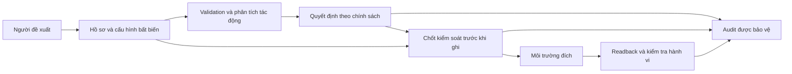

# Configuration change approval

## 1. Mục tiêu của phê duyệt thay đổi cấu hình

Một thay đổi cấu hình có thể mở cổng quản trị, giảm thời hạn lưu log, tắt kiểm tra chứng thư hoặc cấp thêm quyền cho một workload mà không cần sửa mã nghiệp vụ. Vì vậy, quyền sửa cấu hình có thể tác động trực tiếp tới tính bí mật, toàn vẹn và sẵn sàng của hệ thống.

Trong chương **Configuration security** của module **SECURITY_SECURITY_DESIGN_SECURITY_REQUIREMENTS**, phê duyệt thay đổi cấu hình cần được đặc tả thành yêu cầu đo được: ai được đề xuất, ai được quyết định, quyết định áp dụng cho nội dung nào, thành phần nào thực thi và bằng chứng nào xác nhận kết quả.

Mục tiêu không chỉ là có một nút Approve hoặc một ticket đã đóng. Hệ thống cần chứng minh rằng **đúng cấu hình đã được cho phép, bởi đúng thẩm quyền, được áp dụng vào đúng phạm vi, khi các điều kiện cho phép vẫn còn hiệu lực**.

Sau bài học, người học cần có khả năng:

- Liên kết rủi ro của từng loại thay đổi với hình thức phê duyệt tương xứng.
- Đặc tả danh tính, phân quyền và phân tách trách nhiệm trong luồng thay đổi.
- Gắn quyết định phê duyệt với phiên bản cấu hình và trạng thái nền đã được xem xét.
- Định nghĩa kiểm thử cho đường triển khai thông thường, đường sửa trực tiếp, thay đổi khẩn cấp và phục hồi.

Các mã yêu cầu, số người duyệt và thời hạn trong bài là ví dụ chính sách nội bộ để học cách đặc tả. Chúng không phải yêu cầu pháp lý hoặc một cấu hình bắt buộc cho mọi tổ chức. [NIST SP 800-128, bản có cập nhật năm 2019](https://csrc.nist.gov/pubs/sp/800/128/upd1/final) là tài liệu tham khảo về quản lý cấu hình gắn với an toàn thông tin; thiết kế dưới đây cần được điều chỉnh theo hệ thống cụ thể.

## 2. Xác định đối tượng được duyệt

### 2.1. Cấu hình rộng hơn file trong Git

| Bề mặt thay đổi | Ví dụ tác động bảo mật | Đường ghi cần nhận diện |
| --- | --- | --- |
| Cấu hình ứng dụng | Bật debug, thay thời hạn phiên, đổi cơ chế xác thực | File, biến môi trường, config service, API quản trị |
| Mạng và gateway | Mở đường vào, thay egress, sửa route hoặc TLS | IaC, console cloud, API nền tảng |
| Danh tính và quyền | Thay role, trust policy, quyền đọc secret | IAM, cấu hình CI/CD, secret store |
| Quan sát và dữ liệu | Tắt audit, giảm retention, đổi nơi xuất log | Control plane, dashboard, script vận hành |
| Feature flag | Bỏ qua bước xác minh hoặc mở tính năng nhạy cảm | Flag service, bảng dữ liệu, API nội bộ |
| Chính sách phê duyệt | Giảm số người duyệt, mở bypass, đổi nhóm có quyền | Thiết lập repository, environment, policy engine |

Nếu nhóm chỉ kiểm soát file trong Git nhưng operator vẫn sửa cùng cấu hình qua console, phạm vi bảo vệ chưa bao phủ trạng thái thực tế. Cần ghi rõ cấu hình nào thuộc quy trình và nơi có thể làm nó thay đổi.

### 2.2. Ba quyết định khác nhau

**Cho phép đề xuất** xác định ai được tạo change request. **Phê duyệt nội dung và rủi ro** xác định thay đổi nào được chấp nhận trong điều kiện nào. **Cho phép thực thi** xác định danh tính nào được ghi vào môi trường đích.

Một người có thể có một hoặc nhiều vai trò theo chính sách, nhưng hệ thống phải kiểm soát tổ hợp bị cấm. Với thay đổi rủi ro cao, người tự tạo đề xuất không được tính là người duyệt độc lập. Một service account chạy triển khai không tự trở thành người chấp nhận rủi ro chỉ vì nó có quyền ghi cấu hình.

Merge approval và deployment approval cũng có phạm vi khác nhau. Một PR được duyệt có thể chưa cho phép triển khai production; một job được mở cổng triển khai vẫn cần bảo đảm nội dung nó áp dụng chính là nội dung đã được xem xét.

## 3. Mô hình đe dọa và ranh giới tin cậy

Giả sử một dịch vụ thanh toán có config repository, pipeline triển khai và API quản trị nền tảng. Các chủ thể gồm người đề xuất, người duyệt, deployment identity, administrator của hệ thống approval và operator sử dụng đường khẩn cấp.



Ranh giới quan trọng nằm giữa hồ sơ được duyệt và artifact được triển khai, giữa pipeline với API đích, và giữa người có thể sửa approval policy với người sử dụng chính policy đó.

| Mã rủi ro | Tình huống | Hậu quả |
| --- | --- | --- |
| R-01 | Người đề xuất tự duyệt hoặc dùng tài khoản thứ hai để đủ số phiếu | Thay đổi nhạy cảm không được xem xét độc lập |
| R-02 | Duyệt phiên bản A nhưng triển khai B, hoặc áp dụng sang môi trường khác | Quyết định không còn tương ứng nội dung thực tế |
| R-03 | Approval cũ được dùng sau khi trạng thái nền hoặc rủi ro đã đổi | Cấu hình mới gây tác động chưa được đánh giá |
| R-04 | Sửa trực tiếp qua console, API, bot hoặc credential khác | Bỏ qua toàn bộ luồng phê duyệt |
| R-05 | Không có bằng chứng hoặc người thực hiện sửa được lịch sử audit | Không truy được quyết định và hành động |
| R-06 | Luồng khẩn cấp, rollback hoặc phục hồi mở quyền quá rộng | Ngoại lệ tạm thời trở thành đường vượt kiểm soát thường trực |
| R-07 | Chính sách duyệt bị hạ thấp hoặc hệ thống approval lỗi | Thay đổi tự được mở quyền hoặc dịch vụ mất khả năng phục hồi |

Phê duyệt độc lập không tự giải quyết thông đồng, chiếm đồng thời nhiều tài khoản hoặc policy thiếu kiểm tra kỹ thuật. Những rủi ro đó cần được giảm bằng quyền tối thiểu, xác thực phù hợp, giới hạn thay đổi và quan sát tại môi trường đích.

## 4. Phân tầng thay đổi theo rủi ro

### CC-01 — Chính sách phân loại rõ và không do người đề xuất tự quyết

**Yêu cầu:** Mỗi thay đổi phải được đánh giá theo loại cấu hình, môi trường, tài sản bị ảnh hưởng, mức mở rộng quyền và khả năng phục hồi. Người đề xuất được cung cấp thông tin nhưng không được tự hạ mức rủi ro để giảm điều kiện duyệt.

Ví dụ một chính sách nội bộ:

| Loại | Điều kiện minh họa | Hình thức cho phép |
| --- | --- | --- |
| Thay đổi chuẩn đã được chấp thuận trước | Mẫu được version, phạm vi nhỏ, giới hạn giá trị và kiểm thử đã định | Policy tự động xác nhận khi mọi điều kiện còn đúng |
| Thay đổi thông thường | Cấu hình production có tác động giới hạn và phục hồi được | Một người có thẩm quyền độc lập với người đề xuất |
| Thay đổi rủi ro cao | IAM, ranh giới mạng, xác thực, audit hoặc nhiều tài nguyên nhạy cảm | Hai người độc lập, gồm các vai trò chuyên môn theo policy |
| Thay đổi khẩn cấp | Cần hành động để hạn chế sự cố đang diễn ra | Đi theo luồng khẩn cấp với danh tính và phạm vi riêng |

“Chuẩn đã được chấp thuận trước” phải là một mẫu cụ thể có owner, phiên bản, giới hạn và điều kiện loại trừ. Một mẫu tăng tài nguyên không tự bao gồm quyền đổi role; đổi ngoài phạm vi phải quay về quy trình phù hợp. Khẩn cấp là đường xử lý đặc biệt, không phải nhãn cho phép bỏ mọi bất biến bảo mật.

**Tiêu chí nghiệm thu:** Khi người đề xuất đổi nhãn high thành low nhưng diff vẫn mở rộng quyền, hệ thống giữ điều kiện cho rủi ro cao hoặc từ chối hồ sơ thiếu thông tin. Thay đổi ngoài giới hạn mẫu không được đi qua luồng tự động.

## 5. Hồ sơ thay đổi phải đủ để quyết định

### CC-02 — Có diff, tác động, kiểm thử và phương án phục hồi

**Yêu cầu:** Change request phải chỉ rõ mục tiêu nghiệp vụ, tài nguyên đích, cấu hình trước/sau, phân tích tác động bảo mật, phụ thuộc, bằng chứng kiểm thử và cách dừng hoặc phục hồi. Thay đổi rủi ro cao không được duyệt chỉ từ một mô tả như “cập nhật cấu hình mạng”.

Ví dụ hồ sơ khái niệm:

```yaml
changeId: CFG-042
requestRevision: 3
target:
  service: payment-admin
  environment: production
  region: region-a
  resourceSet: admin-gateway
sourceRevision: SOURCE_REVISION_FIXED
configArtifactDigest: "sha256:<digest-cua-artifact-can-ap-dung>"
baseStateFingerprint: "<dinh-danh-trang-thai-nen>"
policyVersion: config-approval-policy-7
riskClass: high
impactAnalysisRef: evidence/impact-042
validationEvidenceRef: evidence/checks-042
recoveryPlanRef: evidence/recovery-042
requestedWindowRef: window-042
```

Các trường trên mô tả hợp đồng của một hệ thống giả định. Một URL ticket, tên branch hoặc nhãn `latest` có thể thay đổi, nên không đủ để định danh nội dung cần triển khai. Kho bằng chứng và artifact cũng cần kiểm soát quyền sửa; nếu tham chiếu trỏ tới dữ liệu có thể ghi đè, phải có phiên bản hoặc digest được bảo vệ.

Đối với cấu hình sinh từ template, reviewer cần biết đầu vào render và kết quả có hiệu lực dự kiến. Với secret, hồ sơ chỉ nêu tham chiếu, phiên bản hoặc hợp đồng lựa chọn phù hợp; không dán giá trị bí mật vào diff hay ticket. Nếu tham chiếu secret có thể tự chuyển sang giá trị khác, cần đặc tả riêng ai được thay nó và thay đổi đó được kiểm soát thế nào.

**Tiêu chí nghiệm thu:** Thiếu diff, thiếu phạm vi môi trường hoặc thiếu kế hoạch phục hồi bắt buộc phải chặn chuyển sang trạng thái chờ duyệt/được duyệt theo policy. Một thay đổi chỉ hợp lệ cú pháp nhưng làm yếu kiểm soát bảo mật phải được nhận diện trong phân tích tác động hoặc kiểm tra chính sách.

## 6. Danh tính, hiệu lực và nội dung của approval

### CC-03 — Người duyệt có thẩm quyền và độc lập theo policy

**Yêu cầu:** Hành động duyệt phải gắn với danh tính cá nhân được xác thực, quyền theo dịch vụ/môi trường và vai trò yêu cầu. Không dùng một tài khoản chung làm bằng chứng nhiều người đã xem xét. Thay đổi nhạy cảm cần mức xác thực phù hợp với rủi ro, chẳng hạn xác thực tăng cường theo chính sách tổ chức.

Nếu yêu cầu hai người duyệt, phải đếm hai danh tính con người khác nhau; một người thuộc hai nhóm không được tính hai lần. Nếu người đó có nhiều tài khoản liên kết, hệ thống hoặc quy trình kiểm soát danh tính cần ngăn việc dùng chúng để giả lập tính độc lập. Bot có thể xác nhận kiểm tra tự động nhưng không tự được tính là một người chấp nhận rủi ro.

**Tiêu chí nghiệm thu:** Tự duyệt, trùng danh tính và thiếu vai trò đều không đáp ứng quorum. Khi người duyệt bị thu hồi quyền trước lúc triển khai, policy phải xác định approval có bị mất hiệu lực hay không; trong ví dụ này, chốt thực thi kiểm tra lại quyền hiện hành.

### CC-04 — Approval gắn với đúng phiên bản và phạm vi

**Yêu cầu:** Quyết định duyệt phải gắn với change ID, revision, artifact bất biến, trạng thái nền có liên quan, dịch vụ, môi trường, tập tài nguyên, phiên bản policy và thời hạn cho phép. Approval staging không được tái sử dụng cho production; approval của một region không tự mở quyền cho mọi region.

Một digest giúp phát hiện nội dung khác nhau nhưng không tự chứng minh ai đã duyệt. Bản ghi quyết định cần được tạo và bảo vệ bởi thành phần tin cậy; deployer không được tự tạo một JSON có trường `approved: true` rồi coi đó là bằng chứng.

Không được render lại bằng dependency hoặc đầu vào có thể đổi sau khi duyệt rồi áp dụng kết quả mới mà không kiểm tra. Nếu hệ thống bắt buộc có biến đổi phía server, phải đặc tả những biến đổi được phép, cách kiểm tra chính sách sau biến đổi và cách đối chiếu trạng thái có hiệu lực.

**Tiêu chí nghiệm thu:** Đổi một giá trị cấu hình, environment, resource set hoặc artifact phải làm quyết định cũ không còn đáp ứng chốt thực thi. Sao chép approval record sang change khác cũng phải bị từ chối.

### CC-05 — Approval có thời hạn và bị đánh giá lại khi điều kiện đổi

**Yêu cầu:** Approval phải có điều kiện hết hạn, thu hồi và mất hiệu lực. Các sự kiện như nội dung mới, thay đổi phạm vi, trạng thái nền lệch, policy mới hoặc quyền người duyệt thay đổi phải được xử lý theo quy tắc rõ ràng. Không cho phép thời gian chờ vô hạn biến approval thành quyền triển khai vĩnh viễn.

Ví dụ policy có thể giới hạn approval thông thường trong bốn giờ và cửa sổ triển khai trong một giờ. Đây là ngưỡng minh họa, cần chọn theo rủi ro và nhịp vận hành. Nếu thời gian hết hạn khi job còn chờ, job phải kiểm tra lại khi thực sự bắt đầu ghi cấu hình.

**Tiêu chí nghiệm thu:** Job được duyệt trước đó nhưng chạy sau hạn, sau một thay đổi cấu hình nền hoặc sau khi approval bị thu hồi đều không được ghi vào đích theo luồng thông thường. Retry và rerun phải đi qua cùng bước đánh giá, không dùng một cờ PASS lưu từ lần chạy cũ.

## 7. Chốt kiểm soát tại nơi thay đổi được thực thi

### CC-06 — Bao phủ đường ghi và kiểm tra ngay trước khi áp dụng

**Yêu cầu:** Đường triển khai thông thường chỉ được ghi cấu hình khi quyết định cho phép còn hiệu lực và khớp nội dung thực thi. Cần giới hạn quyền ghi trực tiếp của người dùng, bot và runner; kiểm soát phải bao phủ console, API, GitOps, script và các đường ghi khác trong phạm vi.

Nếu một người vừa sửa được workflow, vừa lấy được credential ghi production từ một job không qua gate, approval trong giao diện không còn đủ ý nghĩa. Deployment identity phải có quyền tối thiểu, chỉ được sử dụng từ ngữ cảnh đã xác định và không cho người đề xuất tùy ý thay lệnh sẽ chạy sau approval.

Ví dụ về điểm kiểm soát kỹ thuật:

- Repository và workflow bảo vệ nội dung, bằng chứng và điều kiện tạo deployment.
- Cổng deployment kiểm tra approval trước khi cấp khả năng ghi vào môi trường.
- IAM/API đích hạn chế danh tính và phạm vi tài nguyên được thay đổi.
- Policy tại nền tảng kiểm tra các bất biến bắt buộc, kể cả request đã có approval.

Trong Kubernetes, [admission controller](https://kubernetes.io/docs/reference/access-authn-authz/admission-controllers/) là một ví dụ về vị trí kiểm tra hoặc biến đổi request tại API server sau bước xác thực và phân quyền. Admission không mặc nhiên biết hồ sơ approval của tổ chức; cần thiết kế bằng chứng đáng tin và chính sách tích hợp. Một annotation do client tự ghi không chứng minh được thay đổi đã được duyệt.

**Tiêu chí nghiệm thu:** Request trực tiếp từ developer, bot ngoài luồng và deployment thiếu quyết định hợp lệ đều bị chặn ở ranh giới được thiết kế. Nếu administrator còn khả năng vượt kiểm soát, phải ghi rõ đây là quyền đặc biệt, ai nắm giữ, giới hạn và cách phát hiện; không báo cáo rằng đường vượt đã bị loại bỏ hoàn toàn.

### 7.1. Kiểm soát khoảng trống giữa kiểm tra và sử dụng

Một gate đọc trạng thái nền, xác nhận đúng rồi gửi lệnh ghi sau đó có thể gặp thay đổi xen ngang. Đây là rủi ro time-of-check to time-of-use: diff đã duyệt dựa trên trạng thái cũ nhưng thao tác áp dụng diễn ra trên trạng thái khác.

Thiết kế nên dùng điều kiện phiên bản hoặc compare-and-set tại API đích khi có thể. [Kubernetes API Concepts](https://kubernetes.io/docs/reference/using-api/api-concepts/#resource-versions) mô tả `resourceVersion` và điều khiển đồng thời để tránh cập nhật đè dựa trên phiên bản đã cũ. Không nên coi việc đọc lại trước lệnh ghi là một transaction nguyên tử.

Nếu nền tảng không hỗ trợ cập nhật có điều kiện, cần cơ chế điều phối mọi writer trong phạm vi, giới hạn quyền sửa ngoài luồng và phát hiện lệch trạng thái. Giới hạn còn lại phải được ghi nhận. Thay đổi nhiều tài nguyên thường không có tính nguyên tử toàn bộ; kế hoạch cần xử lý triển khai một phần, retry và thứ tự phục hồi.

### 7.2. Mã giả cho quyết định triển khai

```text
executeConfigurationChange(changeId, executionContext):
    request = loadImmutableRequestRevision(changeId)
    policy = loadCurrentTrustedPolicy(request.target)
    artifact = loadArtifactByDigest(request.artifactDigest)

    require authenticateExecutor(executionContext)
    require authorizeExecutor(executionContext, request.target)
    require request is eligible for execution
    require artifact matches request.artifactDigest
    require validationEvidenceMatches(request, artifact, policy)

    approvals = loadTrustedApprovalDecisions(request.revision)
    require approvals satisfy current policy
    require distinctEligibleApprovers(approvals, request, policy)
    require approvals match artifact, target, baseState and policy
    require approvals are unexpired and not revoked

    execution = claimExecutionWithConcurrencyControl(request)
    result = applyWithTargetPreconditions(
        artifact,
        request.target,
        request.baseState,
        execution
    )

    recordProtectedExecutionEvidence(request, execution, result)
    verifyEffectiveConfigurationAndSecurityBehavior(result)
```

Đây là mã giả của hợp đồng yêu cầu. `applyWithTargetPreconditions` phải ánh xạ tới cơ chế thực sự của nền tảng, không chỉ gọi một hàm kiểm tra rồi ghi không điều kiện. `claimExecutionWithConcurrencyControl` cần ngăn hai lần chạy cùng thao tác không tương thích; retry phải phân biệt phần đã áp dụng và phần chưa áp dụng.

Approval bị thu hồi trong lúc rollout cũng cần hành vi xác định: ví dụ dừng trước batch tiếp theo, không bắt đầu tài nguyên mới và chuyển sang xử lý trạng thái một phần. Không thể giả định một nút revoke sẽ tự hoàn tác mọi lệnh đã thực hiện trước đó.

## 8. Triển khai, readback và phục hồi là phần của yêu cầu

### CC-07 — Xác minh cấu hình có hiệu lực và hành vi bảo mật

**Yêu cầu:** Thành công của lệnh ghi chưa đủ để đóng change. Hệ thống phải đọc lại cấu hình có hiệu lực, xác nhận đúng phạm vi và chạy các kiểm tra liên quan tới mục tiêu bảo mật. Với rollout nhiều instance, cần biết phiên bản nào đang áp dụng ở từng phần và tiêu chí hoàn tất.

Ví dụ, khi đổi danh sách nguồn được phép truy cập API quản trị, kiểm tra phải bao gồm nguồn được phép truy cập được và nguồn bị cấm vẫn bị từ chối. Chỉ gọi health endpoint không chứng minh danh sách mạng đã có hiệu lực.

Readback cần phân biệt trường người dùng quản lý, giá trị mặc định và trường do controller sinh. Digest của artifact đầu vào không nhất thiết bằng digest của trạng thái runtime; phương pháp đối chiếu phải được đặc tả để nhận ra thay đổi có ý nghĩa mà không báo sai vì timestamp hoặc metadata không liên quan.

**Phục hồi:** Hồ sơ phải nêu điều kiện dừng, phương án rollback hoặc sửa tiến và các phụ thuộc. Bản cấu hình từng an toàn có thể không còn tương thích với dữ liệu, phiên bản ứng dụng hoặc yêu cầu bảo mật hiện tại. Rollback cũng là một thay đổi cần được cho phép; có thể dùng kế hoạch phục hồi đã duyệt trước nếu đúng phiên bản, phạm vi và điều kiện kích hoạt.

**Tiêu chí nghiệm thu:** Khi API ghi thành công nhưng một instance chưa nhận cấu hình hoặc kiểm tra từ chối thất bại, change ở trạng thái chưa xác minh/lỗi và có hành động xử lý. Không tự đánh dấu hoàn tất chỉ vì pipeline kết thúc với exit code 0.

### CC-08 — Audit gắn được quyết định với trạng thái thực tế

**Yêu cầu:** Bằng chứng phải nối được change ID và revision với người đề xuất, người duyệt, quyết định, thời điểm, artifact, môi trường, executor, kết quả ghi và kết quả xác minh. Ghi cả từ chối, thu hồi, hết hạn, bypass, retry và thay đổi policy có ảnh hưởng.

Ví dụ sự kiện không chứa giá trị cấu hình nhạy cảm:

```json
{
  "event": "configuration_change_denied",
  "changeId": "CFG-042",
  "requestRevision": 3,
  "targetEnvironment": "production",
  "executionId": "exec-042-2",
  "policyVersion": "config-approval-policy-7",
  "reason": "approval_artifact_mismatch",
  "decision": "deny"
}
```

Audit phải được lưu với quyền sửa/xóa tách khỏi quyền thực hiện thay đổi theo mô hình rủi ro. Có thể cần lưu append-only, bảo vệ tính toàn vẹn hoặc chuyển tới hệ thống độc lập; chọn cơ chế cụ thể và kiểm tra được nó. Không đưa secret vào diff hoặc log. Khi trường cấu hình nhạy cảm không được hiện nguyên văn, vẫn cần tham chiếu phiên bản/bằng chứng đủ để điều tra.

**Tiêu chí nghiệm thu:** Từ một thay đổi đã áp dụng, người kiểm tra có thể xác định quyết định cho phép và kết quả readback tương ứng. Người chỉ có quyền triển khai không sửa hoặc xóa được audit theo mô hình đã chọn. Nếu hệ thống audit tạm lỗi, thay đổi thông thường phải dừng hoặc dùng kênh dự phòng bảo đảm bằng chứng theo policy; không mất dấu im lặng.

## 9. Luồng khẩn cấp và bảo vệ chính hệ thống approval

### CC-09 — Break-glass có mục đích, phạm vi và thời hạn

**Yêu cầu:** Đường khẩn cấp phải được định nghĩa trước cho các tình huống như cô lập truy cập trái phép hoặc khôi phục dịch vụ quan trọng. Nó cần danh tính có thể truy vết, xác thực phù hợp, lý do gắn với sự cố, phạm vi quyền nhỏ nhất và thời hạn tự hết hiệu lực.

Nếu không thể chờ đủ số người duyệt thông thường, policy có thể cho phép người trực được chỉ định hành động trong phạm vi đó, đồng thời tạo cảnh báo và yêu cầu review sau sự kiện. Review sau phải được ghi đúng bản chất là kiểm tra hồi cứu; nó không biến hành động chưa được duyệt trước thành một hành động đã có approval tại thời điểm thực hiện.

Ví dụ policy nội bộ có thể cấp phiên quyền khẩn cấp 30 phút và yêu cầu review trong 24 giờ sau khi sự cố ổn định. Cần xác định người chịu trách nhiệm, cơ chế hết hạn quyền và xử lý khi quá hạn review. Không tái sử dụng credential khẩn cấp dùng chung không có danh tính cá nhân.

**Tiêu chí nghiệm thu:** Hành động vượt phạm vi hoặc sau thời hạn bị chặn; kích hoạt quyền tạo được bằng chứng và cảnh báo theo thiết kế. Sau diễn tập, phiên quyền được thu hồi, trạng thái cấu hình được đối soát và review hồi cứu có owner. Không thể dùng nhãn emergency tự nhập để mở quyền vô hạn.

### CC-10 — Thay đổi policy phê duyệt cũng phải được kiểm soát

**Yêu cầu:** Danh sách reviewer, quorum, quy tắc tự duyệt, bypass, branch/environment protection và quyền cấp deployment identity là cấu hình nhạy cảm. Chúng cần owner và luồng thay đổi riêng, tránh việc người đang xin đổi cấu hình tự giảm điều kiện duyệt cho yêu cầu của mình.

Quyền quản trị nền tảng có thể mạnh hơn policy ứng dụng. Phải nhận diện các tài khoản đó, hạn chế sử dụng thường ngày và theo dõi hành động thay đổi kiểm soát. Cần có cơ chế bootstrap/khôi phục được quản trị riêng nếu hệ thống policy gặp sự cố; không thiết kế một vòng phụ thuộc khiến mọi phương án phục hồi đều đòi thành phần đang hỏng.

Một ví dụ cụ thể: [GitHub deployment environments](https://docs.github.com/en/actions/reference/workflows-and-actions/deployments-and-environments) có required reviewers và tùy chọn ngăn người khởi tạo tự duyệt. Danh sách nhiều reviewer trên cơ chế đó không có nghĩa phải đủ nhiều phiếu: tài liệu mô tả một reviewer phù hợp có thể cho job đi tiếp. Nếu yêu cầu nội bộ là hai người với hai vai trò, cần một cơ chế thực thi đúng quorum đó và kiểm thử thực tế.

[Tài liệu review deployment của GitHub](https://docs.github.com/en/actions/how-tos/deploy/configure-and-manage-deployments/review-deployments) còn mô tả khả năng bypass và tùy chọn hạn chế bypass của admin. Khi chọn nền tảng, phải xác minh chức năng thực tế, cấu hình và quyền đang có; tên tính năng không đủ chứng minh đáp ứng yêu cầu.

**Tiêu chí nghiệm thu:** Người đề xuất không thể tự sửa reviewer hoặc bypass để thực thi change đang chờ. Một thay đổi policy hợp lệ có audit, bằng chứng duyệt và tác động được đánh giá lại đối với các change đang tồn tại.

### CC-11 — Phát hiện drift và quy định hành vi khi thành phần kiểm soát lỗi

**Yêu cầu:** Trạng thái có hiệu lực phải được đối chiếu với trạng thái mong muốn đã được cho phép. Drift chưa giải thích được phải tạo tín hiệu điều tra hoặc hành động hạn chế theo rủi ro, thay vì tự ghi nhận mọi trạng thái hiện tại là baseline mới.

Không phải mọi drift đều do tấn công: controller, scaling hoặc giá trị mặc định có thể tạo thay đổi hợp lệ. Cần xác định trường nào thuộc quyền quản lý, chủ thể nào được biến đổi và dấu vết nào chứng minh lý do. Tự động reconcile cũng là thao tác ghi; nếu đang có thay đổi khẩn cấp hợp lệ, phải tránh việc hệ thống tự hoàn tác thiếu điều phối.

Khi không xác minh được approval, quyền người duyệt hoặc artifact, luồng thông thường phải fail-closed. Trạng thái hiện tại có thể tiếp tục phục vụ theo kiến trúc; điều đó không đồng nghĩa được cho phép thay đổi mới. Nếu cần khôi phục khi approval service hỏng, sử dụng đường khẩn cấp đã thiết kế cùng kênh bằng chứng dự phòng.

**Tiêu chí nghiệm thu:** Mô phỏng ghi ngoài luồng tạo được phát hiện theo mục tiêu thời gian. Mô phỏng approval service hoặc kho bằng chứng lỗi không khiến deployment mới tự được cho phép. Diễn tập phục hồi không mở quyền ghi rộng hơn policy hoặc xóa lịch sử quyết định.

## 10. Trạng thái của change request

Một vòng đời minh họa:

```text
DRAFT -> VALIDATED -> WAITING_APPROVAL -> APPROVED
APPROVED -> DEPLOYING -> VERIFYING -> CLOSED
WAITING_APPROVAL -> REJECTED
APPROVED -> EXPIRED hoặc REVOKED
DEPLOYING/VERIFYING -> FAILED hoặc PARTIALLY_APPLIED
FAILED/PARTIALLY_APPLIED -> RECOVERING -> RECOVERY_VERIFIED
```

Không phải trạng thái nào cũng chuyển được chỉ bằng quyền sửa ticket. `APPROVED` cần quyết định hợp lệ; `DEPLOYING` cần chốt thực thi; `CLOSED` cần bằng chứng trạng thái có hiệu lực. Một hồ sơ bị sửa nội dung cần revision mới và đánh giá lại những quyết định bị ảnh hưởng.

Trạng thái approval và trạng thái execution nên phân biệt được. Một change có thể đã được duyệt nhưng chưa triển khai, hoặc đã triển khai một phần rồi bị thu hồi quyền làm phần còn lại. Gộp tất cả vào cờ `approved=true` làm mất thông tin cần thiết để xử lý an toàn.

## 11. Ma trận truy vết từ rủi ro tới kiểm thử

| Yêu cầu | Rủi ro chính | Điểm thực thi | Bằng chứng nghiệm thu |
| --- | --- | --- | --- |
| CC-01 | R-01, R-07 | Policy phân loại, validation | Người đề xuất không hạ cấp điều kiện bằng nhãn tự nhập |
| CC-02 | R-02, R-03 | Hồ sơ và kho bằng chứng | Diff, đích, tác động, kiểm thử và phục hồi đủ theo loại thay đổi |
| CC-03 | R-01 | Identity, reviewer service | Tự duyệt, trùng người và thiếu vai trò không đạt quorum |
| CC-04 | R-02 | Approval record, artifact store, gate | Thay artifact hoặc môi trường làm quyết định không còn phù hợp |
| CC-05 | R-03 | Gate, scheduler, retry handler | Hết hạn, bị thu hồi hoặc trạng thái nền đổi đều được đánh giá lại |
| CC-06 | R-02, R-04 | Deployment identity, API đích, nền tảng | Đường ngoài luồng bị chặn và cập nhật có điều kiện được kiểm tra |
| CC-07 | R-03, R-06 | Rollout, runtime verification | Readback và kiểm tra hành vi trước đóng change; xử lý triển khai một phần |
| CC-08 | R-05 | Audit pipeline, quyền lưu trữ | Nối được quyết định với thao tác và kết quả; executor không sửa được dấu vết |
| CC-09 | R-06 | Quyền khẩn cấp và runbook | Phiên giới hạn, hết hạn quyền, cảnh báo và review hồi cứu |
| CC-10 | R-07 | Quản trị policy và IAM | Không tự hạ gate; thay policy có bằng chứng và đánh giá tác động |
| CC-11 | R-04, R-07 | Drift monitoring và cơ chế phục hồi | Phát hiện lệch trạng thái; kiểm soát lỗi không tự mở quyền |

Trong dự án thực tế, mỗi dòng cần owner triển khai và owner chấp nhận rủi ro. Chẳng hạn, nhóm ứng dụng kiểm soát config repository nhưng nhóm nền tảng kiểm soát IAM và console; cần bằng chứng cho cả hai để kết luận CC-06 đạt.

## 12. Thiết kế bộ kiểm thử nghiệm thu

Thực hiện trong môi trường thử nghiệm với tài nguyên và danh tính giả lập hoặc sandbox được kiểm soát. Ghi nhận cấu hình trước/sau ở đích, quyết định của gate và audit tương ứng; thông báo lỗi ở UI không tự chứng minh không có thao tác ghi đã xảy ra.

| Mã | Thiết lập | Điều kiện pass |
| --- | --- | --- |
| T-01 | Change hợp lệ, đủ bằng chứng và approval đúng policy | Áp dụng đúng phạm vi, readback và kiểm tra hành vi đạt |
| T-02 | Người đề xuất tự duyệt change rủi ro cao | Không đạt điều kiện độc lập, không ghi cấu hình |
| T-03 | Một người thuộc hai nhóm hoặc dùng danh tính liên kết | Không được tính thành hai người duyệt độc lập |
| T-04 | Có đủ số người nhưng thiếu vai trò bắt buộc | Gate từ chối vì chưa đáp ứng policy |
| T-05 | Sửa artifact, revision hoặc đầu vào render sau khi duyệt | Quyết định cũ không được dùng cho nội dung mới |
| T-06 | Dùng approval staging cho production hoặc thêm tài nguyên | Không có thao tác ghi ngoài phạm vi đã cho phép |
| T-07 | Approval hết hạn, bị thu hồi hoặc người duyệt mất quyền | Gate đánh giá lại và từ chối theo policy minh họa |
| T-08 | Trạng thái nền đổi trước hoặc xen giữa kiểm tra và ghi | Điều kiện phiên bản từ chối cập nhật cũ, hoặc cơ chế điều phối đã đặc tả xử lý |
| T-09 | Retry/rerun sau khi approval không còn hiệu lực | Không tái dùng kết quả PASS cũ để ghi mới |
| T-10 | Ghi trực tiếp qua console, API hoặc bot ngoài luồng | Bị chặn; quyền quản trị đặc biệt nếu còn phải có bằng chứng giám sát riêng |
| T-11 | Hai execution đồng thời cho thay đổi không tương thích | Không ghi đè mất kiểm soát; kết quả và trạng thái từng execution rõ ràng |
| T-12 | API ghi thành công nhưng kiểm tra bảo mật hoặc một instance thất bại | Change không được đóng thành công; chuyển trạng thái và xử lý theo kế hoạch |
| T-13 | Rollback về phiên bản cũ đã không còn đáp ứng policy | Không tự thực thi vì nhãn rollback; dùng phương án phục hồi hợp lệ |
| T-14 | Người đề xuất sửa quorum, reviewer hoặc bật bypass | Không tự mở đường cho change của chính mình; sự kiện có thể truy vết |
| T-15 | Approval service, identity lookup hoặc audit tạm lỗi | Luồng thông thường không mở quyền; cơ chế dự phòng đúng hợp đồng |
| T-16 | Kích hoạt quyền khẩn cấp rồi thử vượt phạm vi/hết hạn | Quyền bị giới hạn, có dấu vết, hết hạn và review sau sự kiện |
| T-17 | Tạo drift qua đường quản trị được phép trong sandbox | Phát hiện trong thời gian đã định, không tự coi drift là baseline được duyệt |
| T-18 | Executor thử sửa hoặc xóa bằng chứng audit | Bị từ chối theo mô hình quyền và cơ chế bảo vệ đã chọn |

Báo cáo nghiệm thu cần ghi phiên bản policy, cách định danh artifact, danh tính/vai trò thử nghiệm, đường ghi đã bao phủ, kết quả tại đích và giới hạn còn lại. Bằng chứng một PR có hai lượt Approve chưa đủ nếu nền tảng chỉ cần một người hoặc vẫn có đường ghi production ngoài gate.

## 13. Tình huống áp dụng: mở đường truy cập API quản trị

Một nhóm cần thêm đường truy cập cho đội hỗ trợ vào API quản trị production. Người đề xuất tạo diff cho một phạm vi mạng giới hạn, được hai người có vai trò phù hợp duyệt. Sau đó, script triển khai lại đọc file từ branch `main`, trong khi branch đã có commit khác mở rộng phạm vi truy cập.

Vấn đề nằm ở liên kết giữa quyết định và nội dung áp dụng. Hồ sơ có thể hợp lệ, số người duyệt có thể đủ nhưng CC-04 và CC-06 chưa đạt. Cách sửa yêu cầu là tạo artifact đã render có digest, gắn approval vào artifact và phạm vi đó, rồi buộc deployment dùng đúng nội dung cùng điều kiện trạng thái nền. Không tải lại cấu hình từ một tham chiếu có thể đổi mà không đánh giá lại.

Khi triển khai, cần thử một nguồn được phép và một nguồn phải bị chặn, quan sát toàn bộ gateway/instance trong phạm vi. Nếu một instance vẫn dùng cấu hình khác, change chưa đủ điều kiện đóng. Nếu đội vận hành sửa nóng qua console để xử lý sự cố, hành động phải đi theo luồng khẩn cấp và được đối soát với trạng thái mong muốn để tránh GitOps tự áp dụng lại cấu hình không phù hợp.

## 14. Câu hỏi tự kiểm tra

1. Một ticket ghi “đã được trưởng nhóm đồng ý” nhưng không có revision hoặc artifact cụ thể. Hãy viết lại yêu cầu để ngăn việc duyệt một nội dung rồi triển khai nội dung khác.
2. Hai reviewer thuộc hai nhóm nhưng thực tế là một người có hai tài khoản. Bằng chứng nào cần có để yêu cầu độc lập có ý nghĩa?
3. Approval còn hạn nhưng một thay đổi IAM khác vừa làm rộng quyền của workload. Điều kiện nào cần được đánh giá lại trước khi áp dụng cấu hình đang chờ?
4. Pipeline đã có gate nhưng developer còn credential sửa trực tiếp production. Cần bổ sung điểm thực thi và phép thử nào?
5. API cập nhật thành công nhưng cấu hình chỉ tới một phần instance. Tiêu chí nào phân biệt đã ghi, đã có hiệu lực và đã xác minh?
6. Khi approval service ngừng hoạt động trong sự cố, làm thế nào để phục hồi mà vẫn giữ được danh tính, phạm vi quyền, thời hạn và bằng chứng?

Mỗi câu trả lời cần nối được **rủi ro → yêu cầu → thẩm quyền → nội dung được duyệt → điểm thực thi → bằng chứng kiểm thử và phục hồi**. Đây là cơ sở để phê duyệt thay đổi cấu hình trở thành một kiểm soát thực sự trong vòng đời phát triển và vận hành.
