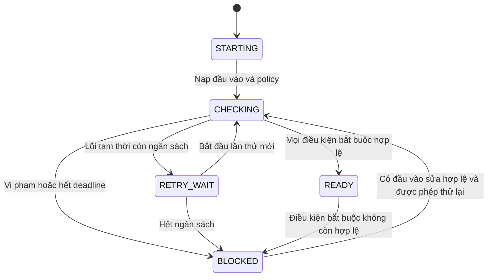

# Startup security check — Đặc tả kiểm tra bảo mật khi khởi động

## 1. Mục tiêu và phạm vi

Một ứng dụng có thể khởi động thành công về mặt kỹ thuật nhưng chưa an toàn để phục vụ. Tiến trình đã chạy, cổng HTTP đã mở và kết nối cơ sở dữ liệu đã tạo không chứng minh rằng xác thực được bật, credential đúng môi trường hay cấu hình phân quyền đã được nạp đầy đủ.

Startup security check là tập kiểm tra dùng để quyết định một instance có đáp ứng các điều kiện bảo mật bắt buộc trước khi được phép thực hiện công việc nghiệp vụ hay không. Kết quả phải điều khiển hành vi thực tế, thay vì chỉ ghi cảnh báo rồi tiếp tục.

Trong chương **Configuration security**, bài học này chuyển mục tiêu an toàn thông tin và mô hình đe dọa thành yêu cầu khởi động cụ thể, đo được và có thể kiểm chứng. Các yêu cầu cần liên kết với cấu hình, danh tính, phân quyền, dữ liệu, logging, phục hồi, kiến trúc và tiêu chí kiểm thử trong vòng đời phát triển.

Sau bài học, người học có thể:

- Xác định điều kiện bảo mật bắt buộc trước khi mở một khả năng nghiệp vụ.
- Phân biệt kiểm tra cấu hình, kiểm tra hiệu lực và bằng chứng thuộc môi trường triển khai.
- Thiết kế cổng chặn cho API, worker, scheduler và tác vụ khởi tạo.
- Đặc tả timeout, retry, trạng thái chưa xác định và phục hồi khi kiểm tra thất bại.
- Xây dựng ma trận truy vết giữa rủi ro, yêu cầu và phép kiểm chứng.

Các con số và tên thuộc tính trong ví dụ là giả định học tập. Dự án cần xác định lại theo mức độ rủi ro, kiến trúc và cơ chế thực thi thực tế.

## 2. Điều kiện khởi động an toàn khác với “ứng dụng đã chạy”

### 2.1. Bốn câu hỏi khác nhau

| Câu hỏi | Ví dụ bằng chứng | Điều chưa thể kết luận |
| --- | --- | --- |
| Tiến trình còn sống không? | Vòng lặp xử lý còn hoạt động | Tiến trình đã sẵn sàng hoặc an toàn để phục vụ |
| Thành phần kỹ thuật đã khởi tạo chưa? | HTTP server và pool kết nối đã tạo | Cấu hình có đúng môi trường, quyền có phù hợp không |
| Instance đủ điều kiện nhận công việc chưa? | Các điều kiện readiness đã đạt | Mọi bất biến bảo mật đều đã được kiểm chứng nếu readiness không bao phủ chúng |
| Các điều kiện bảo mật bắt buộc đã đạt chưa? | Kết quả kiểm tra có phạm vi, revision và thời hạn | Trạng thái sẽ tiếp tục đúng mãi sau khởi động |

Startup security check là một đầu vào cho quyết định sẵn sàng. Nó không thay thế toàn bộ readiness, kiểm thử triển khai hoặc giám sát bảo mật khi chạy.

### 2.2. Không đồng nhất “đã kiểm tra” với “đã chặn”

Đoạn logic dưới đây chỉ tạo tín hiệu, chưa thực thi yêu cầu:

```text
if authenticationConfigurationIsInvalid:
    logWarning("Invalid security configuration")
startBusinessProcessing()
```

Yêu cầu đúng cần nêu hành vi:

> **START-GATE-01:** Instance không được tiếp nhận hoặc thực hiện công việc nghiệp vụ trong phạm vi bảo vệ trước khi mọi kiểm tra bảo mật bắt buộc hoàn tất với kết quả hợp lệ. Kiểm tra thất bại, quá hạn hoặc không xác định không được tự mở cổng nghiệp vụ.

Phạm vi bảo vệ bao gồm API, consumer hàng đợi, scheduler, batch, công cụ nội bộ và tác vụ khởi tạo có tác động nghiệp vụ. Chỉ giữ readiness ở trạng thái chưa sẵn sàng chưa đủ nếu consumer vẫn nhận message.

### 2.3. Kiểm tra lúc khởi động có giới hạn thời gian hiệu lực

Credential có thể bị thu hồi, cấu hình có thể được nạp lại và rule mạng có thể thay đổi sau khi kiểm tra thành công. Vì vậy:

- Startup check quyết định khả năng phục vụ tại thời điểm khởi động.
- Kiểm soát tại từng request hoặc thao tác vẫn phải tồn tại.
- Cấu hình nạp động cần được xác minh trước khi áp dụng.
- Giám sát drift và credential phải tiếp tục trong vòng đời instance.

Không dùng kết quả “đã qua startup check” để bỏ xác thực hoặc phân quyền ở các bước xử lý về sau.

## 3. Mô hình đe dọa và tình huống xuyên suốt

Giả sử một dịch vụ thanh toán có REST API, worker xử lý webhook và job đối soát. Dịch vụ nạp cấu hình từ nhiều nguồn, lấy credential từ secret manager và kết nối tới cơ sở dữ liệu cùng nhà cung cấp thanh toán.

Các bất biến bảo mật gồm:

- Mọi thao tác nhạy cảm phải được xác thực và phân quyền.
- Webhook phải được xác minh trước khi tạo thay đổi trạng thái.
- Instance production không dùng credential sandbox hoặc ngược lại.
- Credential phải có phạm vi phù hợp và không xuất hiện trong log.
- Bề mặt quản trị phải tuân theo chính sách được phê duyệt.
- Tác động cần audit không được thực hiện khi thiếu khả năng ghi audit bắt buộc.

| Đe dọa hoặc lỗi | Tác động | Điều cần kiểm tra hoặc chặn |
| --- | --- | --- |
| Biến môi trường ghi đè giá trị xác thực | API hoặc webhook chạy với kiểm soát bị tắt | Cấu hình có hiệu lực và điểm thực thi thực tế |
| Dùng sai profile hoặc môi trường | Dữ liệu thật đi tới hệ thống thử nghiệm | Ràng buộc danh tính, endpoint và môi trường |
| Thiếu khóa nhưng mã dùng giá trị mặc định yếu | Chấp nhận thông điệp không hợp lệ hoặc không xác thực | Đủ cấu hình bắt buộc, kiểu dữ liệu và chính sách mật mã |
| Không tải được policy nên ứng dụng bỏ phân quyền | Cấp quyền ngoài dự định | Trạng thái chưa xác định phải chặn khả năng liên quan |
| Consumer chạy trước khi kiểm tra hoàn tất | Tác động nghiệp vụ xuất hiện trong cửa sổ khởi động | Gate cho mọi đường tạo tác động |
| Startup log in nguyên cấu hình | Lộ secret và dữ liệu nội bộ | Hợp đồng dữ liệu log đã lọc |
| Kiểm tra từ bên trong được hiểu là chứng minh mạng bên ngoài an toàn | Endpoint quản trị vẫn mở qua proxy | Bằng chứng triển khai và phép thử từ vị trí phù hợp |
| Retry đồng loạt khi dependency lỗi | Quá tải secret manager hoặc dịch vụ danh tính | Deadline, backoff, jitter và giới hạn đồng thời |

Một lỗi cấu hình có thể là vô ý hoặc do tấn công. Thiết kế không nên phụ thuộc vào việc biết ý định của người tạo ra trạng thái sai.

## 4. Đặc tả từng kiểm tra như một hợp đồng

Mỗi kiểm tra cần có mô tả đủ để nhóm phát triển, kiểm thử và vận hành cùng hiểu kết quả.

| Thuộc tính | Nội dung cần nêu |
| --- | --- |
| ID và mục tiêu | Điều kiện nào phải đúng, xử lý rủi ro nào |
| Phạm vi | Instance, môi trường, capability hoặc workload nào |
| Nguồn bằng chứng | Cấu hình hiệu lực, metadata danh tính, policy hoặc kiểm thử triển khai |
| Predicate | Điều kiện chính xác để đạt hoặc vi phạm |
| Mức bắt buộc | Chặn toàn bộ instance, chặn một capability hay chỉ tạo cảnh báo |
| Kết quả không xác định | Thiếu dữ liệu, timeout, sai schema hoặc nguồn không đáng tin được xử lý thế nào |
| Thời hạn | Deadline, retry và tuổi tối đa của bằng chứng |
| Tác động kiểm tra | Có ghi dữ liệu, gửi thao tác ra ngoài hoặc cần quyền đặc biệt không |
| Phản ứng | Đóng gate, dừng tiến trình, chờ phục hồi hoặc chạy chế độ hạn chế |
| Audit | Trường được ghi, người nhận cảnh báo và thời hạn lưu |
| Chủ sở hữu | Ai sửa cấu hình, xử lý sự cố và phê duyệt ngoại lệ |

Ví dụ một yêu cầu:

> **START-CFG-01:** Trước khi cho phép xử lý webhook ở production, instance phải xác minh cấu hình hiệu lực yêu cầu chữ ký, tham chiếu khóa thuộc nguồn được phê duyệt và chính sách xác minh tương thích với hợp đồng tích hợp. Thiếu trường, sai kiểu hoặc không xác định được cấu hình hiệu lực phải giữ capability xử lý webhook ở trạng thái bị chặn.

Tiêu chí chấp nhận cần cố ý đưa vào trường bị thiếu, chuỗi thay cho boolean, nguồn khóa sai môi trường và biến môi trường ghi đè. Trong mỗi trường hợp, kiểm tra cả kết quả báo cáo lẫn việc không có thay đổi trạng thái thanh toán.

Một kiểm tra chỉ đọc file mẫu không đủ nếu ứng dụng dùng giá trị đã được ghi đè từ nguồn khác.

### 4.1. Kết quả kiểm tra cần rõ nghĩa

Có thể dùng bốn trạng thái logic:

- **PASS:** có bằng chứng hợp lệ và predicate được thỏa mãn.
- **FAIL:** có bằng chứng cho thấy predicate bị vi phạm.
- **UNKNOWN:** không đủ bằng chứng, dữ liệu quá hạn hoặc không đánh giá được.
- **NOT_APPLICABLE:** kiểm tra không áp dụng theo phạm vi đã được xác định và phê duyệt.

Với kiểm tra bắt buộc, UNKNOWN không được tự đổi thành PASS. NOT_APPLICABLE cũng không phải lựa chọn tùy ý của instance để bỏ một kiểm soát khó thực hiện.

Một kết quả PASS cần gắn với phiên bản policy, revision cấu hình và ngữ cảnh môi trường. Khi những đầu vào đó thay đổi, phải đánh giá liệu kết quả còn hiệu lực hay không.

## 5. Các nhóm kiểm tra bảo mật cần xem xét

### 5.1. Cấu hình hiệu lực và nguồn tin cậy

Kiểm tra schema, kiểu dữ liệu, trường bắt buộc, quan hệ giữa các trường và thứ tự ưu tiên cấu hình. Ví dụ, môi trường production không được chấp nhận chế độ debug có thể bỏ qua kiểm soát hoặc ghi dữ liệu nhạy cảm.

> **START-CFG-02:** Instance phải xác định được cấu hình có hiệu lực từ các nguồn được cho phép, với revision và phạm vi môi trường phù hợp. Giá trị không hiểu được hoặc tổ hợp không hợp lệ phải được xử lý theo chính sách chặn đã định.

Nếu dùng cấu hình có chữ ký, cần kiểm tra nguồn khóa, nội dung được ký, môi trường, phiên bản và độ mới theo hợp đồng. Chữ ký đúng không tự chứng minh đây là cấu hình mới nhất hoặc an toàn nhất.

Bản cấu hình lưu cục bộ chỉ được dùng khi chính sách cho phép và vẫn đáp ứng điều kiện nguồn gốc, tương thích và thời hạn. Không kéo dài hiệu lực của cache bằng cách đặt lại thời điểm nhận khi đọc từ đĩa.

### 5.2. Danh tính workload, secret và credential

Cần xác minh workload lấy đúng danh tính, được cấp credential qua đường được phê duyệt và sử dụng cho đúng môi trường.

Một kết nối xác thực thành công chứng minh credential được phía đích chấp nhận, nhưng chưa chứng minh credential có quyền tối thiểu. Đánh giá least privilege cần bằng chứng từ policy hoặc nguồn quyền phù hợp.

> **START-ID-01:** Instance không được mở capability cần credential nếu không xác định được nguồn, môi trường và trạng thái hợp lệ của credential theo chính sách. Không được rơi về credential mặc định, credential nhúng hoặc chế độ bỏ xác thực.

Không ghi giá trị secret hoặc token để chứng minh kiểm tra đã chạy. Có thể ghi loại nguồn, kết quả và tham chiếu đã được xử lý phù hợp.

Kiểm tra kết nối không nên gọi một nghiệp vụ tài chính thật hoặc tạo dữ liệu khách hàng để thử quyền. Dùng thao tác không tạo tác động đã được phê duyệt, metadata quyền hoặc bằng chứng kiểm thử tích hợp thích hợp.

Nếu workload không có quyền đọc policy hiệu lực, không nên cấp quyền quản trị rộng chỉ để startup check thuận tiện. Có thể dùng bằng chứng triển khai được xác thực và kiểm tra độc lập; cần ghi rõ giới hạn của từng nguồn.

### 5.3. Xác thực, phân quyền và ràng buộc tenant

Ứng dụng cần biết các thành phần bắt buộc đã được khởi tạo: bộ xác minh token hoặc chữ ký, nguồn khóa tin cậy, policy phân quyền và ánh xạ tenant.

Kiểm tra không chỉ là “đã tạo một bean bảo mật”. Cần xác nhận đường xử lý thực sự sử dụng thành phần đó và không có nhánh fallback cho phép vượt kiểm soát.

Yêu cầu mẫu:

> **START-AUTHZ-01:** Capability xử lý nghiệp vụ chỉ được mở khi policy phân quyền bắt buộc đã được tải, kiểm tra phiên bản và gắn với đúng môi trường. Không tải được policy không được làm phát sinh chế độ cho phép tất cả.

Kiểm thử các request trái phép trên đường xử lý thật là bằng chứng quan trọng trong môi trường tích hợp hoặc kiểm chứng triển khai. Startup check không nên tự tạo các tác động trái phép trên production để kiểm tra chúng có bị từ chối hay không.

### 5.4. TLS, trust và đích kết nối

Tùy kiến trúc, cần kiểm tra:

- Đích giao tiếp thuộc tập được phê duyệt.
- Cấu hình client không bỏ xác minh chứng thư hoặc hostname.
- Trust store và danh tính được sử dụng đúng mục đích.
- Khóa và chứng thư còn đáp ứng điều kiện hiệu lực cần thiết.
- Chính sách thuật toán phù hợp với baseline.
- TLS kết thúc ở đâu và đoạn kết nối còn lại được bảo vệ thế nào.

Không mặc định mọi kết nối TLS tự ký đều không hợp lệ: hệ thống nội bộ có thể dùng nguồn tin cậy riêng được quản lý. Điều cần chứng minh là chuỗi tin cậy và danh tính peer phù hợp với chính sách.

Một lần handshake thành công không chứng minh mọi endpoint hoặc đường redirect đều được kiểm soát. Những yêu cầu đó vẫn cần cơ chế thực thi trong HTTP client, mạng và kiểm thử tương ứng.

### 5.5. Bề mặt quản trị và khả năng chẩn đoán

Cần xác minh cấu hình hiệu lực không mở endpoint, cổng hoặc chế độ chẩn đoán ngoài danh mục được phê duyệt. Những khả năng có thể làm lộ môi trường, cấu hình hoặc bộ nhớ cần đánh giá riêng.

Tuy nhiên, instance không thể chỉ tự nhìn cấu hình bind rồi kết luận Internet không truy cập được cổng quản trị. Service, ingress, reverse proxy và chính sách mạng thuộc bằng chứng triển khai.

> **START-SCOPE-01:** Mỗi kết luận kiểm tra phải nêu đúng phạm vi bằng chứng. Điều kiện cần bằng chứng ngoài instance không được đánh dấu đạt chỉ từ kiểm tra cục bộ.

Nếu một điều kiện mạng là bắt buộc trước khi phục vụ, quy trình triển khai cần cung cấp bước xác minh phù hợp và liên kết kết quả với đúng instance hoặc revision triển khai.

### 5.6. Logging, audit và bảo vệ dữ liệu

Kiểm tra cơ chế lọc log và khả năng ghi audit bắt buộc. Không cần phụ thuộc mọi khả năng quan sát nâng cao nếu điều đó làm mất khả dụng ngoài mức đã được chấp nhận.

Phải phân biệt:

- Dashboard tạm lỗi nhưng audit bắt buộc vẫn được lưu bền vững.
- Không thể ghi bằng chứng bắt buộc cho giao dịch nhạy cảm.
- Log chẩn đoán đang có nguy cơ chứa secret hoặc dữ liệu khách hàng.

Một chế độ suy giảm chỉ hợp lệ khi có giới hạn và bằng chứng đáp ứng yêu cầu còn lại. Ví dụ, lưu audit vào bộ đệm bền vững đã được phê duyệt có thể phù hợp trong thời hạn nhất định; bỏ audit mà vẫn xử lý giao dịch không tự trở thành chấp nhận được.

Startup cũng cần một đường báo lỗi tối thiểu đã lọc dữ liệu để chẩn đoán khi hệ thống log đầy đủ chưa sẵn sàng.

## 6. Thiết kế thứ tự khởi động và cổng chặn

### 6.1. Trạng thái mặc định phải chưa được phép xử lý

Một máy trạng thái minh họa:



Nhánh từ READY về BLOCKED thuộc cơ chế duy trì điều kiện an toàn khi chạy. Nó cần được thiết kế riêng, không tự xuất hiện chỉ vì có startup check.

Với hệ thống có nhiều capability, có thể duy trì gate riêng. Ví dụ, cho phép API tra cứu đã đủ điều kiện nhưng vẫn chặn worker hoàn tiền thiếu credential. Chế độ này chỉ hợp lệ nếu phân tách không làm mất một điều kiện bảo mật dùng chung hoặc tạo đường vòng sang nghiệp vụ bị chặn.

### 6.2. Các đường thực thi phải cùng tuân thủ gate

| Đường thực thi | Yêu cầu cần kiểm chứng |
| --- | --- |
| HTTP API | Không tạo tác động nghiệp vụ trước khi capability được mở |
| Queue consumer | Không bắt đầu xử lý tác động khi còn bị chặn; chính sách nhận hoặc giữ message phải rõ |
| Scheduler và batch | Không tự chạy sớm hơn gate chỉ vì thread đã được tạo |
| Tác vụ khởi tạo | Không thực hiện thay đổi nghiệp vụ trước điều kiện tương ứng |
| Công cụ hoặc API nội bộ | Không trở thành đường bỏ qua gate |
| Health tối thiểu | Chỉ cung cấp tín hiệu được phép, không tạo tác động nghiệp vụ |
| Quản trị khẩn cấp | Có xác thực, quyền và phạm vi riêng; không mặc nhiên mở vì instance đang lỗi |

Readiness thường điều khiển định tuyến nhưng không nhất thiết chặn kết nối trực tiếp hoặc tác vụ nội bộ. Bởi vậy, cần biện pháp chặn tại ứng dụng hoặc lớp thực thi phù hợp, cùng kiểm soát triển khai.

Nếu nền tảng khởi động HTTP server trước callback kiểm tra, phải bảo đảm gate đã đóng ngay từ đầu và không có cửa sổ request lọt vào. Không suy luận thứ tự an toàn từ tên như “startup runner” hoặc “application ready” mà chưa kiểm tra vòng đời thực tế.

Các thao tác migration hoặc chuẩn bị dữ liệu có quyền cao cần vòng đời và danh tính được thiết kế riêng. Không cấp tài khoản cơ sở dữ liệu toàn quyền cho ứng dụng chỉ để vừa migration vừa chạy kiểm tra.

### 6.3. Gắn quyết định với đúng snapshot

Kiểm tra cấu hình A rồi mở gate cho cấu hình B là một dạng sai lệch giữa kiểm tra và sử dụng.

> **START-ATOM-01:** Quyết định mở capability phải gắn với đúng snapshot cấu hình, policy và ngữ cảnh đã được kiểm tra. Nếu đầu vào thay đổi trước khi công bố trạng thái, kết quả cũ không được tự cấp phép cho đầu vào mới.

Có thể dùng snapshot bất biến, revision và cơ chế công bố trạng thái có điều kiện. Cấu hình được nạp động phải được kiểm tra theo quy trình tương ứng trước khi thay thế bản đang dùng.

Nguồn bên ngoài vẫn có thể đổi sau đó, như credential bị thu hồi. Snapshot không loại bỏ nhu cầu xác thực thực tế ở mỗi tương tác và giám sát vòng đời.

### 6.4. Mã giả cho bộ điều phối

```text
startup():
    businessGates.closeAll()
    epoch = beginNewStartupEpoch()
    deadline = createGlobalDeadline()

    snapshot = loadAndValidateInputSnapshot(deadline)
    policy = loadTrustedPolicyFor(snapshot.scope, deadline)

    results = runBoundedChecks(
        snapshot,
        policy,
        deadline,
        cancellationToken = epoch.token
    )

    if requiredChecksPassAndEvidenceIsFresh(results):
        committed = publishValidatedStateIfInputsUnchanged(
            epoch,
            snapshot.revision,
            policy.revision,
            permittedCapabilities(results)
        )
        if committed:
            openOnlyPublishedCapabilities(epoch)
            publishSafeReadinessState()
            return

    businessGates.closeAll()
    publishFilteredFailureSummary(results)
    followBlockedOrExitPolicy()
```

Đây là mô tả trách nhiệm, không phải API có sẵn của một framework. Việc kiểm tra và mở gate phải có cơ chế đồng bộ tương ứng; không triển khai thành các biến boolean rời rạc không được bảo vệ khỏi race condition.

Kết quả của một lần thử đã timeout hoặc bị hủy không được đến trễ rồi mở gate. Cần gắn callback với epoch hoặc cơ chế nhận diện vòng kiểm tra để từ chối kết quả cũ.

Bộ điều phối cũng không được chỉ dựa vào một trường PASS không có nguồn gốc. Kết quả phải thuộc đúng kiểm tra, phiên bản, snapshot và thời hạn yêu cầu.

## 7. Timeout, retry và chính sách khi không đạt

### 7.1. Phân loại lỗi để chọn phản ứng

| Loại kết quả | Ví dụ | Phản ứng minh họa |
| --- | --- | --- |
| Vi phạm xác định | Cấu hình cho phép bỏ xác thực ở production | Chặn capability và yêu cầu sửa cấu hình |
| Lỗi tạm thời có thể phục hồi | Dịch vụ cấp secret không đáp ứng | Retry có giới hạn, gate vẫn đóng |
| Chưa xác định | Không đọc được policy hoặc không hiểu schema | Không coi là đạt; báo đúng lý do |
| Cảnh báo được phép | Hệ thống dashboard lỗi nhưng audit bắt buộc vẫn hoạt động | Chạy chế độ đã được phê duyệt và phát cảnh báo |
| Không áp dụng hợp lệ | Capability tương ứng không được triển khai theo profile đã duyệt | Ghi rõ phạm vi và căn cứ |

Phân loại phải theo hợp đồng thực tế. Không coi mọi lỗi HTTP là tạm thời, và không tiếp tục retry vô hạn với cấu hình sai hoặc credential không phù hợp.

Lỗi TLS không được “khắc phục” bằng cách bỏ kiểm tra chứng thư. Không tải được khóa xác minh không được làm chuyển sang chấp nhận mọi chữ ký.

### 7.2. Ngân sách thời gian phải có tổng

Ví dụ cho một dịch vụ minh họa:

- Các kiểm tra cục bộ có ngân sách tổng 5 giây.
- Nhóm kiểm tra phụ thuộc từ xa dùng chung ngân sách tối đa 45 giây.
- Tổng quy trình, bao gồm điều phối và công bố trạng thái, không vượt 60 giây.
- Mỗi kiểm tra từ xa chỉ được thử lại tối đa 2 lần sau lần đầu nếu loại lỗi cho phép và còn ngân sách.
- Backoff và jitter phải nằm trong deadline, không cộng thêm sau deadline.

Các giá trị cần được điều chỉnh dựa trên thử nghiệm. Tăng timeout quá cao có thể làm rollout kéo dài; quá thấp có thể khiến nhiều instance bị chặn trong một dao động ngắn.

> **START-TIME-01:** Mọi kiểm tra phải có giới hạn thực thi và chịu deadline tổng. Hết thời hạn phải giữ gate đóng, tạo kết quả có thể chẩn đoán và ngăn callback muộn cấp phép xử lý.

Đặt timeout ở caller chưa chắc dừng được công việc bên dưới. Cần xem khả năng hủy của client, tài nguyên còn giữ và mức đồng thời. Kiểm tra nên tránh tạo tác động ngay từ đầu, để timeout không để lại giao dịch nghiệp vụ chưa rõ kết quả.

### 7.3. Tránh vòng lặp restart làm nặng sự cố

Nếu nhiều instance cùng lỗi vì một dependency dùng chung, restart liên tục có thể làm dependency nhận thêm tải.

Cần quy định:

- Khi nào tiến trình thoát và khi nào giữ trạng thái bị chặn để quan sát.
- Backoff của cơ chế restart và các lần thử lại.
- Giới hạn số instance đồng thời khởi tạo hoặc gọi dịch vụ cấp credential.
- Cách giảm tải, cảnh báo và xử lý thủ công khi vượt ngưỡng.
- Điều kiện cho phép thử lại sau khi cấu hình đã được sửa.

Startup probe, liveness và readiness của nền tảng cần phối hợp với thời hạn khởi tạo. Không dùng liveness để restart một instance chỉ vì dependency bên ngoài đang lỗi mà restart không thể giải quyết.

Việc kéo dài thời gian probe không được biến thành bỏ startup security check. Dù tiến trình tiếp tục tồn tại để chờ, khả năng nghiệp vụ vẫn bị chặn khi điều kiện bắt buộc chưa đạt.

## 8. Logging, cảnh báo và bằng chứng

### 8.1. Báo lỗi đủ để xử lý

Một kết quả kiểm tra nên ghi được:

- ID kiểm tra và phiên bản policy.
- Môi trường, dịch vụ, instance và lần khởi động.
- Revision cấu hình hoặc tham chiếu phù hợp.
- Kết quả, loại lỗi, thời điểm và thời gian thực hiện.
- Capability đang bị chặn.
- Hành động khắc phục hoặc tham chiếu runbook.
- Nguồn bằng chứng và giới hạn của kết luận.

Ví dụ bản ghi đã lọc:

```json
{
  "event": "startup_security_check",
  "checkId": "START-CFG-01",
  "environment": "production",
  "result": "FAIL",
  "reasonCode": "REQUIRED_WEBHOOK_VERIFICATION_NOT_ENABLED",
  "blockedCapability": "webhook-processing",
  "configRevision": "release-config-42"
}
```

Không ghi nguyên token, connection string có mật khẩu, khóa ký, nội dung secret hoặc toàn bộ cấu hình. Exception từ thư viện có thể chứa URL, header hoặc giá trị đầu vào; cần lọc cả đường log lỗi.

API health hoặc trang trạng thái không dành cho chẩn đoán chỉ nên trả thông tin tối thiểu. Chi tiết kiểm tra thuộc kênh có quyền đọc phù hợp.

### 8.2. Phân biệt audit với metric

Metric hữu ích cho tỷ lệ instance khởi động thất bại, thời gian từng nhóm kiểm tra và số capability bị chặn. Tránh dùng secret reference đầy đủ, user ID hoặc nội dung lỗi không giới hạn làm nhãn.

Audit cần liên kết được lần khởi động, policy, cấu hình và quyết định mở gate. Với quyền mở khẩn cấp hoặc ngoại lệ, phải xác định người thực hiện, phạm vi, lý do và thời hạn.

Nếu không thể ghi audit bắt buộc, chính sách cần xác định có được dùng cơ chế lưu bền vững thay thế hay phải tiếp tục chặn. Không đánh dấu “đã lưu bằng chứng” chỉ vì từng gọi hàm log.

### 8.3. Cảnh báo phải đến đúng nơi

Ví dụ yêu cầu dự án:

> **START-OBS-01:** Khi instance production bị chặn vì vi phạm bảo mật xác định, hệ thống phải gửi cảnh báo tới người trực trong thời hạn đã quy định, kèm ID kiểm tra và metadata đã lọc. Lỗi tạm thời kéo dài vượt ngưỡng cũng phải được cảnh báo theo chính sách riêng.

Thời hạn, ngưỡng và nơi nhận cần được điền cụ thể trong đặc tả. Có thể gom các instance cùng nguyên nhân để giảm nhiễu nhưng vẫn phải thấy phạm vi ảnh hưởng.

Nếu ứng dụng lỗi trước khi hệ thống log đầy đủ khởi tạo, đường báo lỗi tối thiểu và giám sát triển khai cần tạo tín hiệu thay thế. Không để kết quả kiểm tra biến mất cùng tiến trình.

## 9. Phục hồi và ngoại lệ

### 9.1. Sửa nguyên nhân rồi kiểm tra lại

Sau khi sửa cấu hình hoặc credential, cần chạy lại các kiểm tra có liên quan với đầu vào mới và bằng chứng còn hiệu lực. Một kết quả PASS cũ không được dùng lại nếu dependency hoặc policy đã đổi.

> **START-REC-01:** Capability chỉ được mở sau phục hồi khi kết quả hợp lệ gắn với cấu hình hiện tại. Việc xóa cảnh báo, đổi ticket sang trạng thái hoàn tất hoặc nhận xác nhận cập nhật từ control plane không tự mở gate.

Nếu tiến trình cần restart mới áp dụng cấu hình, runbook phải thể hiện điều đó. Không kết luận sửa thành công từ file trên đĩa khi tiến trình vẫn dùng cache cũ.

### 9.2. Ngoại lệ không được biến thành bỏ bảo mật

Một kiểm tra có thể có ngoại lệ được phê duyệt khi rủi ro và biện pháp thay thế đã rõ. Ngoại lệ cần gắn với ID kiểm tra, môi trường, phạm vi, người chịu trách nhiệm và thời hạn.

Các bất biến bắt buộc không được trở thành tùy chọn chỉ vì đang có sự cố. Nếu chưa thể đáp ứng, có thể cần giữ một capability bị chặn trong khi phục vụ các khả năng khác đã được tách biệt và đánh giá.

Không cung cấp tham số tổng quát kiểu “bỏ qua mọi kiểm tra production”. Nếu có đường khẩn cấp, cần giới hạn hành động, xác thực mạnh phù hợp, audit và điều kiện chấm dứt rõ ràng.

Hết hạn ngoại lệ phải dẫn tới đánh giá lại theo chính sách. Không tự gia hạn và không biến cấu hình đang chạy thành baseline mới mà thiếu phê duyệt.

### 9.3. Rollback phải xét dữ liệu và credential

Quay lại bản ứng dụng cũ có thể không tương thích với schema, policy hoặc credential mới. Không dùng rollback như phản xạ duy nhất.

Cần xác định:

- Bản cũ còn thỏa baseline hiện hành không.
- Dữ liệu đã ghi có tương thích không.
- Credential cũ có còn được phép dùng hay đã bị thu hồi.
- Tác vụ đang chờ sẽ được giữ hoặc xử lý thế nào.
- Cần đối soát tác động nào đã xảy ra trước khi instance bị chặn.

Startup check của bản cũ cũng phải được kiểm chứng. Việc từng chạy an toàn trong quá khứ không chứng minh nó an toàn với môi trường hiện tại.

## 10. Ma trận yêu cầu — rủi ro — kiểm chứng

| ID | Rủi ro chính | Điểm thực thi | Tiêu chí chấp nhận tiêu biểu |
| --- | --- | --- | --- |
| START-GATE-01 | Xử lý nghiệp vụ trước khi an toàn | API, worker, scheduler và tác vụ khởi tạo | Trong lúc kiểm tra chậm hoặc lỗi, mọi đường được bảo vệ không tạo tác động |
| START-CFG-01 | Mất xác minh webhook | Bộ nạp cấu hình và capability gate | Thiếu trường, sai kiểu và ghi đè nguy hiểm đều chặn xử lý |
| START-CFG-02 | Sai môi trường hoặc cấu hình không tin cậy | Snapshot và schema validator | Sai scope, revision không được chấp nhận hoặc cấu hình quá hạn không được dùng |
| START-ID-01 | Sai credential hoặc fallback yếu | Nguồn danh tính và integration adapter | Credential thiếu hoặc sai môi trường không mở capability; log không lộ secret |
| START-AUTHZ-01 | Bỏ phân quyền khi thiếu policy | Policy loader và lớp thực thi | Policy không tải được không làm request trái phép thành công |
| START-SCOPE-01 | Kết luận vượt quá bằng chứng | Quy trình triển khai và báo cáo kiểm tra | Điều kiện mạng có bằng chứng từ đúng vị trí; tự kiểm tra local không đủ để xác nhận Internet bị chặn |
| START-ATOM-01 | Kiểm tra A nhưng chạy B | Công bố snapshot và gate | Đổi cấu hình trước lúc mở gate làm kết quả cũ mất hiệu lực |
| START-TIME-01 | Treo khởi động hoặc callback muộn mở gate | Bộ điều phối và client phụ thuộc | Hết deadline vẫn bị chặn; kết quả từ lần thử cũ không mở khả năng nghiệp vụ |
| START-OBS-01 | Lỗi không được phát hiện hoặc làm lộ dữ liệu | Log tối thiểu, audit và cảnh báo | Cảnh báo tới đúng người; dữ liệu secret thử nghiệm không xuất hiện trong log |
| START-REC-01 | Mở lại khi chưa sửa có hiệu lực | Runbook và quy trình đánh giá lại | Xác nhận cập nhật nhưng runtime chưa đổi không được coi là phục hồi |

Trong đặc tả triển khai, mỗi dòng cần bổ sung chủ sở hữu, thời hạn cụ thể, mức ưu tiên và nơi lưu bằng chứng. Các nhóm kiểm tra như TLS, quản trị và audit cần được tách thành yêu cầu riêng khi áp dụng, thay vì chỉ để trong mô tả chung.

## 11. Kiểm chứng trong vòng đời phát triển

### 11.1. Trước khi triển khai

Từ mô hình đe dọa, xác định bất biến và capability cần bảo vệ. Với mỗi kiểm tra, làm rõ bằng chứng nào nằm trong instance và bằng chứng nào phải do pipeline hoặc nền tảng cung cấp.

Rà soát cấu hình trước triển khai giúp phát hiện sớm nhưng không thay thế kiểm tra cấu hình hiệu lực. Ngược lại, startup check không thay thế kiểm thử bảo mật của mã, kiểm soát dependency hoặc đánh giá toàn bộ hạ tầng.

Các chứng nhận hoặc kết quả pipeline phải gắn với đúng artifact, cấu hình và phạm vi. Một lần kiểm tra thành công của bản phát hành trước không tự được áp dụng cho bản mới.

### 11.2. Các tình huống kiểm thử có ý nghĩa

1. Trì hoãn kiểm tra và gửi request ngay khi cổng bắt đầu lắng nghe.
2. Cho consumer hoặc scheduler được khởi tạo trước kết quả kiểm tra.
3. Dùng biến môi trường ghi đè một thuộc tính bảo mật đã đúng trong file.
4. Cung cấp policy sai phiên bản, sai môi trường hoặc không đọc được.
5. Dùng credential sandbox trong cấu hình production.
6. Mô phỏng timeout, retry hết ngân sách và phản hồi đến muộn.
7. Thay snapshot trong khoảng giữa kiểm tra và mở gate.
8. Restart nhiều instance khi dịch vụ cấp secret đang lỗi.
9. Cho control plane báo cập nhật xong nhưng trì hoãn reload của tiến trình.
10. Kiểm tra một nguồn quan sát bị mất hoặc bằng chứng đã hết hạn.
11. Dùng secret thử nghiệm có thể nhận diện để xác nhận log và cảnh báo đã lọc.
12. Thử phục hồi rồi xác nhận chỉ capability đủ điều kiện mới được mở.

Các phép thử tạo tác động hoặc thay đổi quyền cần thực hiện trong môi trường cô lập phù hợp. Không tạo giao dịch thật hoặc làm lộ secret thật để chứng minh cơ chế chặn.

Kiểm thử một hàm validator chỉ xác nhận logic cục bộ. Muốn chứng minh không có cửa sổ xử lý sớm, cần kiểm thử tích hợp qua vòng đời thật của ứng dụng, listener, consumer và scheduler.

### 11.3. Khi thay đổi và vận hành

Đánh giá lại thiết kế khi thêm nguồn cấu hình, thay thứ tự khởi tạo, đổi framework, thêm consumer, chuyển secret manager hoặc đổi mô hình mạng. Những thay đổi này có thể làm gate không còn nằm trước mọi đường tạo tác động.

Theo dõi thời gian khởi động và tần suất lỗi để điều chỉnh năng lực, nhưng không tự giảm kiểm tra bắt buộc chỉ để đạt chỉ tiêu rollout. Nếu một kiểm tra gây phụ thuộc quá mạnh, cần xem lại kiến trúc bằng chứng hoặc tách capability theo yêu cầu nghiệp vụ.

Kiểm soát liên tục sau khởi động cần phát hiện cấu hình drift, credential hết hiệu lực và mất điều kiện bắt buộc. Startup check tạo điểm bắt đầu có kiểm chứng; việc duy trì trạng thái an toàn cần các kiểm soát khi chạy.

## 12. Bài tập áp dụng

Một dịch vụ xuất dữ liệu khách hàng có API tạo yêu cầu, worker ghi file vào storage và scheduler xóa file hết hạn. Khi khởi động, dịch vụ lấy policy tenant, credential storage và khóa mã hóa từ các nguồn khác nhau.

Hãy xây dựng đặc tả gồm:

1. Danh sách bất biến bảo mật và capability phải bị chặn khi chưa đủ điều kiện.
2. Sơ đồ thứ tự khởi động cho API, worker, scheduler và kênh health tối thiểu.
3. Sáu kiểm tra có ID, nguồn bằng chứng, predicate và cách xử lý UNKNOWN.
4. Chính sách timeout, retry và phản ứng khi dependency dùng chung lỗi.
5. Quy tắc gắn kết quả với snapshot cấu hình và lần khởi động.
6. Ma trận truy vết tới rủi ro, thành phần và bằng chứng kiểm thử.
7. Runbook phục hồi khi control plane đã cập nhật nhưng tiến trình vẫn giữ cấu hình cũ.
8. Hai phép thử chứng minh không có tác động nghiệp vụ trước khi gate mở.

Đặc tả cần giải thích được vì sao tiến trình còn sống chưa đủ để nhận công việc, vì sao thiếu bằng chứng không được coi là đạt và điều gì xác nhận mọi đường thực thi đều tuân theo quyết định khởi động. Những câu trả lời có hành vi đo được, điểm thực thi và bằng chứng rõ ràng sẽ biến startup security check thành yêu cầu bảo mật có thể sử dụng trong thiết kế, phát triển và vận hành.
