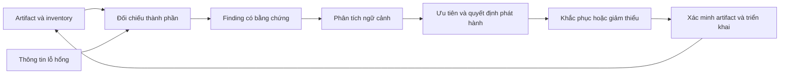

# Dependency vulnerability

## 1. Mục tiêu và phạm vi

Dependency vulnerability là lỗ hổng trong một thành phần phần mềm mà hệ thống sử dụng trực tiếp hoặc gián tiếp. Thành phần đó có thể là thư viện của ứng dụng, thư viện kéo theo, công cụ build, plugin, gói hệ điều hành hoặc một phần của image triển khai.

Trong chương Dependency và supply chain, yêu cầu bảo mật cần biến mục tiêu “không đưa thư viện nguy hiểm vào hệ thống” thành những điều có thể đo và kiểm chứng:

- Biết chính xác thành phần nào có mặt trong từng bản build và môi trường.
- Phát hiện thông tin lỗ hổng mới trong phạm vi thời gian đã cam kết.
- Xác định một phát hiện có thực sự áp dụng cho sản phẩm và ngữ cảnh đang dùng không.
- Ưu tiên xử lý theo rủi ro, thay vì chỉ đếm số cảnh báo.
- Kiểm soát phát hành, ngoại lệ, khắc phục và xác minh sau triển khai.
- Lưu bằng chứng nối được lỗ hổng với dependency, artifact, yêu cầu và người chịu trách nhiệm.

Một kết quả quét không có cảnh báo chỉ cho biết công cụ chưa tìm được lỗ hổng đã biết trong phạm vi dữ liệu và khả năng phân tích của lần quét đó. Nó không chứng minh phần mềm không còn lỗ hổng.

Các package, advisory, phiên bản và mốc thời gian trong bài là **dữ liệu hoặc chính sách minh họa**, không mô tả một lỗ hổng thực tế đang tồn tại.

## 2. Phân biệt các khái niệm trước khi viết yêu cầu

| Khái niệm | Ý nghĩa | Ảnh hưởng tới đặc tả |
| --- | --- | --- |
| Dependency trực tiếp | Thành phần được ứng dụng khai báo sử dụng | Phải theo dõi phiên bản được resolver chọn, không chỉ chuỗi trong file khai báo |
| Dependency bắc cầu | Thành phần được kéo vào thông qua thành phần khác | Phải biết đường đi trong dependency graph và các bản sao thực sự được đóng gói |
| Vulnerability advisory | Thông tin mô tả lỗ hổng, phạm vi ảnh hưởng và dữ liệu liên quan | Cần kiểm tra định danh package, phiên bản, nguồn và độ mới của thông tin |
| Finding | Một kết quả đối chiếu giữa thành phần của sản phẩm và thông tin lỗ hổng | Là đầu vào để phân tích, chưa mặc nhiên là kết luận sản phẩm có thể bị khai thác |
| False positive | Đối chiếu sai, ví dụ ghép nhầm package hoặc phiên bản | Cần bằng chứng sửa kết quả đối chiếu và điều kiện tái đánh giá |
| Không bị ảnh hưởng trong ngữ cảnh đã xét | Thành phần được đối chiếu đúng nhưng điều kiện ảnh hưởng được chứng minh không tồn tại | Cần ghi giả định, phạm vi artifact và bằng chứng có thể kiểm tra |
| Biện pháp giảm thiểu | Giảm khả năng hoặc hậu quả khai thác trong khi thành phần vẫn còn | Không được đồng nhất với việc đã sửa dependency |
| Khắc phục | Loại bỏ nguyên nhân áp dụng cho finding, chẳng hạn nâng cấp hoặc bỏ thành phần | Phải xác minh trong artifact và môi trường thực tế |
| SBOM | Danh mục thành phần của một sản phẩm tại một thời điểm | Cần ràng buộc với đúng artifact; tự nó không phải chứng nhận an toàn |

Dependency có lỗ hổng cũng khác với package bị cài mã độc hoặc tài khoản phát hành bị chiếm quyền. Các sự cố đó có thể chồng lấn, nhưng quét cơ sở dữ liệu lỗ hổng không bao phủ đầy đủ mọi rủi ro nguồn gốc và tính toàn vẹn của supply chain.

Do đó, yêu cầu về lỗ hổng cần liên kết với kiểm soát nguồn package, quyền thay dependency, độ tin cậy của pipeline và kiểm tra artifact.

## 3. Bắt đầu từ thành phần thực sự được dùng

### 3.1. Khai báo, kết quả resolve và nội dung artifact

Một ứng dụng Java có thể khai báo:

```text
orders-api
  -> com.example:reporting-starter:4.8.0
       -> org.example:expr-engine:2.3.4
```

Nhưng kết quả thực tế có thể thay đổi do quản lý phiên bản tập trung, ràng buộc dependency, lựa chọn biến thể, exclusion hoặc một thư viện khác đưa vào phiên bản khác.

Cần phân biệt:

1. Phiên bản được khai báo trong source.
2. Phiên bản mà resolver chọn cho cấu hình build cụ thể.
3. Thành phần thực sự nằm trong artifact.
4. Thành phần thực sự được nạp hoặc có thể được sử dụng ở môi trường triển khai.

Một file cấu hình build đã sửa không chứng minh artifact mới đã được tạo. Một artifact đã sửa cũng không chứng minh mọi instance sản xuất đã được thay thế.

### 3.2. Không bỏ sót thành phần được đóng gói theo cách khác

Yêu cầu kiểm kê cần xét các dạng liên quan:

- Dependency bắc cầu và nhiều đường đi tới cùng thành phần.
- JAR lồng trong executable JAR hoặc distribution.
- Thư viện được shade, đổi package hoặc sao chép mã nguồn vào repository.
- Thành phần do application server hoặc môi trường chạy cung cấp.
- Gói hệ điều hành và runtime trong image.
- Thư viện giao diện phía client nếu sản phẩm có phần frontend.
- Plugin, công cụ build và dependency chỉ dùng khi kiểm thử.

Không thể coi một thành phần là không có mặt chỉ vì không thấy nó trong danh sách dependency trực tiếp.

Một dependency không được đóng gói vào runtime có thể không tạo cùng rủi ro với API đang chạy, nhưng vẫn có thể ảnh hưởng môi trường CI. Cần phân tích riêng phạm vi build, test và runtime; không tự động loại toàn bộ dependency kiểm thử khỏi quản lý bảo mật.

### 3.3. Nhận diện đủ chính xác

Mỗi thành phần nên có thông tin phù hợp với hệ sinh thái:

- Tên, namespace hoặc tọa độ package.
- Phiên bản được resolve và biến thể liên quan.
- Nguồn phân phối và định danh artifact.
- Digest nếu có thể xác định.
- Đường đi trong dependency graph.
- Phạm vi build, test hoặc runtime.
- Artifact sản phẩm và môi trường có chứa nó.

Ví dụ định danh minh họa:

```text
pkg:maven/org.example/expr-engine@2.3.4
```

Không chỉ so tên ngắn như `expr-engine`. Hai package khác namespace hoặc hệ sinh thái có thể mang tên giống nhau.

Với bản do nhà cung cấp backport bản vá, phiên bản upstream không đủ để kết luận. Cần dữ liệu chứng minh cho đúng gói và bản build được cung cấp. Ngược lại, cũng không được tự gắn nhãn “đã backport” nếu chưa có bằng chứng đáng tin cậy.

## 4. Từ advisory tới kết luận ảnh hưởng

Một pipeline tham khảo:



### 4.1. Kiểm tra chất lượng đối chiếu

Trước khi quyết định mức độ ảnh hưởng, cần kiểm tra:

- Đúng package và hệ sinh thái chưa?
- Phiên bản thực tế có nằm trong phạm vi bị ảnh hưởng không?
- Advisory có điều kiện về nền tảng, tính năng hoặc cấu hình không?
- Có nhiều advisory identifier cùng mô tả một lỗ hổng không?
- Thông tin có được sửa, rút lại hoặc bổ sung không?
- Công cụ có nhận diện được thành phần đầy đủ không?

Các alias của cùng lỗ hổng cần được liên kết để tránh tạo nhiều công việc độc lập cho một vấn đề. Tuy vậy, không gộp các lỗ hổng khác nhau chỉ vì chúng nằm trong cùng package.

Việc so phiên bản phải dùng quy tắc của hệ sinh thái và dữ liệu advisory. Không so chuỗi từ điển hoặc tự giả định mọi hệ thống đều dùng cùng quy tắc semantic versioning.

### 4.2. Trạng thái phân tích phải rõ nghĩa

Có thể dùng một bộ trạng thái nội bộ như sau:

| Trạng thái minh họa | Điều kiện | Bằng chứng cần có |
| --- | --- | --- |
| UNDER_REVIEW | Chưa đủ dữ liệu để kết luận | Câu hỏi còn mở, chủ sở hữu và thời hạn phân tích |
| AFFECTED | Thành phần và điều kiện ảnh hưởng áp dụng | Đối chiếu phiên bản và phân tích ngữ cảnh |
| NOT_AFFECTED | Có bằng chứng điều kiện ảnh hưởng không tồn tại trong phạm vi xác định | Lý do kỹ thuật, giả định, artifact và điều kiện phải đánh giá lại |
| FALSE_POSITIVE | Kết quả nhận diện hoặc đối chiếu sai | Package, phiên bản hoặc ánh xạ đã được xác minh lại |
| FIXED | Biện pháp khắc phục đã được xác minh trong phạm vi cần đóng | Artifact thay thế, kết quả kiểm tra và tình trạng triển khai |

Đây là mô hình trạng thái minh họa, không phải bộ enum bắt buộc của một định dạng trao đổi cụ thể.

Một tài liệu đánh giá ảnh hưởng theo dạng VEX có thể giúp truyền kết luận giữa các bên. Cần kiểm tra người phát hành, phạm vi sản phẩm, phiên bản, thời điểm đánh giá, cơ sở kết luận và mức tin cậy được chấp nhận. Một phát biểu “không bị ảnh hưởng” từ nguồn bên ngoài không tự động thay thế việc đánh giá ngữ cảnh của sản phẩm đang vận hành.

### 4.3. Không rõ phải được giữ là không rõ

Nếu scanner không phân tích được JAR lồng, thiếu inventory hoặc không tải được dữ liệu, kết quả là thiếu bằng chứng. Không chuyển tình huống đó thành “không tìm thấy lỗ hổng”.

Cần phân biệt ít nhất:

- Lần quét hoàn tất theo phạm vi đã cam kết.
- Lần quét chỉ bao phủ một phần.
- Lần quét thất bại.
- Finding chưa được phân tích xong.

Tính hoàn tất của lần quét và kết luận về một finding là hai loại trạng thái khác nhau.

## 5. Đánh giá khả năng bị ảnh hưởng và mức ưu tiên

### 5.1. Severity là một đầu vào

Điểm mức độ nghiêm trọng như CVSS mô tả các đặc tính tác động và khai thác theo phương pháp chấm điểm tương ứng. Nó không trực tiếp cho biết xác suất một deployment cụ thể sẽ bị tấn công.

Khi sử dụng điểm, cần lưu cả phiên bản phương pháp, vector hoặc dữ liệu nguồn liên quan. Các điểm từ những phiên bản phương pháp khác nhau cần được diễn giải đúng ngữ cảnh.

Quyết định ưu tiên nên xét thêm:

| Yếu tố | Câu hỏi cần trả lời |
| --- | --- |
| Khả năng khai thác | Có bằng chứng đáng tin cậy về khai thác thực tế hoặc điều kiện khai thác không? |
| Độ phơi lộ | Dữ liệu không tin cậy có tới được thành phần không? Tuyến có công khai hoặc dành cho đối tác không? |
| Reachability | Đường thực thi liên quan có thể được sử dụng trong cấu hình hiện tại không? |
| Đặc quyền | Thành phần chạy với quyền nào và tiếp cận dữ liệu gì? |
| Phạm vi hậu quả | Có thể ảnh hưởng một tenant, nhiều tenant hoặc môi trường build không? |
| Biện pháp hiện có | Kiểm soát nào thực sự chặn điều kiện khai thác và đã được kiểm tra? |
| Khả năng khắc phục | Có bản sửa, cách loại bỏ tính năng hoặc phương án thay thế không? |
| Độ chắc chắn | Kết luận dựa trên bằng chứng trực tiếp hay giả định chưa xác minh? |

Một lỗ hổng có severity thấp hơn vẫn có thể cần xử lý khẩn nếu nó áp dụng trực tiếp cho đường truy cập nhạy cảm. Một finding severity cao bị ghép sai package cần được sửa kết quả đối chiếu thay vì buộc nâng cấp một thư viện không liên quan.

### 5.2. Reachability có giới hạn

Phân tích static call graph có thể hỗ trợ đánh giá, nhưng cần chú ý:

- Reflection, dependency injection và plugin có thể tạo đường gọi không thấy rõ.
- Một tính năng bị tắt trong cấu hình này có thể được bật ở môi trường khác.
- Deserialization, tải lớp hoặc xử lý dữ liệu có thể kích hoạt hành vi mà không có lời gọi trực tiếp dễ nhận diện.
- Một đường chưa xuất hiện trong trace quan sát không chứng minh nó không thể xảy ra.
- Kết quả phụ thuộc đúng artifact, cấu hình và giả định phân tích.

Vì vậy, `unknown` không được tự chuyển thành `not reachable`.

Nếu kết luận không bị ảnh hưởng dựa trên việc tính năng bị tắt, cần kiểm soát cấu hình đó và đánh giá lại khi thay đổi. Nếu chỉ dựa trên việc endpoint được xác thực, vẫn phải xét người dùng hợp lệ có quyền truy cập và khả năng chiếm tài khoản.

### 5.3. Biện pháp giảm thiểu phải kiểm chứng được

Ví dụ giảm thiểu gồm vô hiệu hóa tính năng liên quan, ngăn dữ liệu không tin cậy tới parser hoặc giới hạn quyền của tiến trình.

Một rule mạng hay rule lọc đầu vào chỉ được xem là kiểm soát bù trong phạm vi nó thực sự bao phủ. Cần kiểm tra các đường đi khác, khả năng bypass theo kiến trúc và thời hạn duy trì.

Tình trạng dependency vẫn cần được theo dõi cho đến khi khắc phục hoặc có quyết định rủi ro còn hiệu lực. Không đổi trạng thái sang FIXED chỉ vì đã thêm một bộ lọc bên ngoài.

## 6. Viết yêu cầu bảo mật có thể nghiệm thu

| Mã | Yêu cầu | Tiêu chí chấp nhận |
| --- | --- | --- |
| SEC-DEP-01 | Mọi artifact phát hành phải có inventory hoặc SBOM gắn với định danh artifact bất biến | Truy được thành phần, phiên bản và phạm vi; artifact không có bằng chứng đủ phạm vi không được coi là đã kiểm tra |
| SEC-DEP-02 | Đối chiếu lỗ hổng phải dùng thành phần đã resolve và nội dung artifact trong phạm vi đã định | Phát hiện được dependency bắc cầu của ví dụ; không chỉ kiểm tra file khai báo |
| SEC-DEP-03 | Kết quả quét phải ghi nguồn dữ liệu, độ mới, công cụ và phạm vi bao phủ | Dữ liệu quá hạn hoặc phân tích thiếu tạo trạng thái INCOMPLETE thay vì kết quả sạch |
| SEC-DEP-04 | Finding phải có định danh package, advisory, artifact, đường dependency và chủ sở hữu | Mỗi finding có thể được tái kiểm tra và chuyển đúng đội xử lý |
| SEC-DEP-05 | Phân tích ảnh hưởng phải ghi điều kiện, bằng chứng và độ chắc chắn | Không dùng reachability chưa xác định để kết luận không bị ảnh hưởng |
| SEC-DEP-06 | Cổng phát hành phải chặn rủi ro vượt chính sách hoặc bằng chứng bắt buộc chưa đầy đủ | Các đầu vào chặn tạo quyết định từ chối; không có fallback coi lỗi scanner là thành công |
| SEC-DEP-07 | Ngoại lệ phải có phạm vi, thẩm quyền, biện pháp bù và hạn hết hiệu lực | Ngoại lệ hết hạn, sai artifact hoặc sai finding không cho phép phát hành |
| SEC-DEP-08 | Khắc phục phải được xác minh trên artifact mới và phạm vi triển khai | Không đóng finding chỉ vì merge thay đổi phiên bản trong source |
| SEC-DEP-09 | Sản phẩm đang chạy phải được đánh giá lại khi có thông tin lỗ hổng mới | Advisory mới phù hợp inventory tạo công việc và quyết định trong thời hạn đã chọn |
| SEC-DEP-10 | Rollback phải xét lại thông tin lỗ hổng hiện tại | Artifact từng được phép phát hành có thể bị chặn nếu rủi ro mới vượt chính sách |
| SEC-DEP-11 | Chứng cứ phải được bảo vệ và truy vết được | Liên kết được bản build, artifact, inventory, kết quả phân tích, quyết định và người thực hiện |

Yêu cầu cần có phạm vi thực thi. SEC-DEP-06 áp dụng cho ứng viên phát hành; SEC-DEP-09 áp dụng cho sản phẩm đã triển khai. Một advisory mới không tự động đồng nghĩa phải dừng mọi instance ngay lập tức, nhưng phải kích hoạt quy trình xử lý rủi ro đã đặc tả.

### Mốc thời gian minh họa

Dịch vụ có thể chọn hợp đồng sau:

- Đối chiếu lại inventory đang hoạt động trong tối đa 24 giờ kể từ khi advisory có mặt trong nguồn dữ liệu được phê duyệt.
- Dữ liệu dùng để quyết định phát hành không cũ quá 24 giờ theo thời điểm nguồn được xác nhận cập nhật.
- Với finding khẩn, hoàn tất đánh giá ban đầu và áp dụng giảm thiểu cần thiết trong tối đa 4 giờ kể từ mốc T0.
- Với finding khẩn, đặt thời hạn khắc phục là 72 giờ kể từ T0; nếu chưa thể hoàn thành phải đi qua quy trình ngoại lệ hoặc ghi nhận vi phạm theo chính sách.
- Ngoại lệ khẩn chỉ có hiệu lực tối đa 7 ngày trong ví dụ này và phải được đánh giá lại ít nhất mỗi 24 giờ.

T0 là thời điểm tổ chức lần đầu nhận được bằng chứng đáng tin cậy cho thấy finding áp dụng hoặc có khả năng áp dụng cho một artifact thuộc phạm vi quản lý. Không đặt lại T0 bằng cách tạo lại ticket, gộp alias, đổi đội hoặc chạy lại scanner.

Các mốc 4 giờ và 72 giờ cùng tính từ T0, không cộng nối tiếp. Chính sách thực tế cần xác định lịch trực, nguồn thông báo và điều kiện nâng mức khẩn để các cam kết có thể thực hiện được.

## 7. Thiết kế cổng phát hành và dữ liệu quyết định

### 7.1. Tách trạng thái bằng chứng khỏi quyết định

Một mô hình hữu ích có ba lớp:

```text
scanStatus:
  COMPLETE | PARTIAL | FAILED

findingAssessment:
  UNDER_REVIEW | AFFECTED | NOT_AFFECTED | FALSE_POSITIVE | FIXED

releaseDecision:
  ALLOW | ALLOW_WITH_EXCEPTION | BLOCK | INCOMPLETE
```

Ví dụ, một lần quét COMPLETE vẫn có thể dẫn tới BLOCK. Một finding được chấp nhận rủi ro không biến thành FALSE_POSITIVE; quyết định có thể là ALLOW_WITH_EXCEPTION trong thời hạn được duyệt.

Một ứng viên chưa đủ bằng chứng không được nhận ALLOW chỉ vì số finding bằng 0.

### 7.2. Quy tắc minh họa

```text
Nếu inventory bắt buộc thiếu, lần quét lỗi hoặc dữ liệu quá hạn:
    INCOMPLETE

Nếu có finding áp dụng hoặc chưa xác định,
và có bằng chứng khai thác thực tế đáng tin cậy:
    BLOCK, trừ ngoại lệ hợp lệ theo đúng chính sách khẩn

Nếu có finding critical áp dụng hoặc chưa xác định:
    BLOCK, trừ ngoại lệ hợp lệ

Nếu các finding còn lại đã được phân loại,
có chủ sở hữu và thời hạn đáp ứng chính sách:
    ALLOW hoặc ALLOW_WITH_EXCEPTION theo trường hợp

Nếu còn bất định mà chính sách chưa cho phép:
    BLOCK hoặc INCOMPLETE theo nguyên nhân
```

Đây là quy tắc minh họa cho dịch vụ, không phải thuật toán xếp hạng chung cho mọi tổ chức. Nguy cơ phơi lộ, loại tài sản và điều kiện giảm thiểu có thể tạo các nhánh quyết định bổ sung, nhưng phải được đặc tả rõ để tránh xử lý tùy ý.

### 7.3. Gắn quyết định với đúng đầu vào

Quyết định cần ràng buộc với:

- Digest của artifact ứng viên.
- Phiên bản inventory hoặc SBOM.
- Thời điểm và định danh dữ liệu lỗ hổng.
- Phiên bản chính sách.
- Kết quả phân tích và ngoại lệ đang dùng.

Nếu rebuild tạo artifact khác, thay base image, đổi dependency hoặc điều kiện ảnh hưởng thay đổi, phải đánh giá lại phần bằng chứng liên quan.

Một chữ ký của báo cáo có thể bảo vệ nguồn gốc và tính toàn vẹn của báo cáo theo mô hình tin cậy đã chọn. Nó không tự chứng minh inventory đầy đủ hay kết luận vulnerability đúng.

## 8. Ví dụ finding có đủ ngữ cảnh

Dữ liệu sau dùng advisory giả định `ADV-DEMO-001`. Giả sử advisory mô tả lỗi trong tính năng xử lý biểu thức của `org.example:expr-engine`, ảnh hưởng các bản từ 2.0.0 tới trước 2.3.7.

```json
{
  "findingId": "F-DEMO-017",
  "advisoryIds": ["ADV-DEMO-001"],
  "component": {
    "purl": "pkg:maven/org.example/expr-engine@2.3.4",
    "resolvedVersion": "2.3.4",
    "scope": "runtime",
    "dependencyPath": [
      "com.example:orders-api:1.0.0",
      "com.example:reporting-starter:4.8.0",
      "org.example:expr-engine:2.3.4"
    ]
  },
  "productArtifactDigest": "<digest-artifact-A>",
  "inventoryId": "inventory-demo-A",
  "scanStatus": "COMPLETE",
  "assessment": {
    "status": "AFFECTED",
    "reachability": "confirmed",
    "reason": "Tinh nang xu ly bieu thuc nhan du lieu khong tin cay"
  },
  "owner": "orders-team",
  "policyVersion": "dependency-risk-demo-v1",
  "targetFixVersionForThisAdvisory": "2.3.7"
}
```

`<digest-artifact-A>` là placeholder cần được thay bằng định danh digest thực trong hệ thống triển khai. Một finding vận hành còn cần thời điểm phát hiện, nguồn advisory, thời hạn xử lý và liên kết bằng chứng chi tiết.

Không nên nhúng dữ liệu khách hàng, token hoặc nội dung bí mật dùng trong quá trình tái hiện vào báo cáo chung. Chứng cứ nhạy cảm cần kho riêng với quyền truy cập phù hợp.

### Diễn giải tình huống

1. Package bị ảnh hưởng là dependency bắc cầu, không có khai báo trực tiếp trong ứng dụng.
2. Bản được resolve và đóng gói là 2.3.4.
3. Tính năng liên quan đang bật và có đường nhận dữ liệu không tin cậy.
4. Finding được xác định áp dụng cho artifact A.
5. Bản 2.3.7 được giả định sửa advisory này, nhưng vẫn phải kiểm tra tương thích và các finding khác.

“Nâng lên 2.3.7” là hướng khắc phục finding giả định, không phải tuyên bố rằng phiên bản đó không có bất kỳ lỗ hổng nào.

## 9. Lựa chọn khắc phục và xác minh

### 9.1. Các phương án

| Phương án | Khi có thể dùng | Điều cần xác minh |
| --- | --- | --- |
| Nâng dependency trực tiếp | Thành phần có bản sửa tương thích | Resolver chọn đúng bản; chức năng và kiểm soát bảo mật vẫn đúng |
| Nâng thành phần cha | Bản starter hoặc framework mới kéo dependency đã sửa | Graph thực tế không còn bản bị ảnh hưởng ở đường khác |
| Ràng buộc phiên bản bắc cầu | Có thể thay riêng dependency và đã đánh giá tương thích | API, hành vi, cấu hình và hỗ trợ của thành phần cha |
| Loại bỏ dependency hoặc tính năng | Không cần sử dụng nữa | Không còn bản sao trong artifact và không còn đường sử dụng cần thiết |
| Dùng bản vá của nhà cung cấp | Có bằng chứng backport cho đúng gói | Nguồn gốc, định danh bản build và phạm vi bản vá |
| Giảm thiểu tạm thời | Chưa có bản sửa hoặc cần thời gian chuyển đổi | Hiệu lực kiểm soát bù, rủi ro còn lại và ngoại lệ có hạn |

Không nên ép mọi dependency bắc cầu lên một số phiên bản mới nhất mà bỏ qua tương thích. Một bản sửa bảo mật có thể thay đổi hành vi hoặc yêu cầu cấu hình, nên cần kế hoạch kiểm tra phù hợp.

Dependency locking giúp kiểm soát phiên bản đã chọn, nhưng không chứng minh phiên bản đó không có lỗ hổng. Kiểm tra digest giúp phát hiện thay đổi nội dung so với giá trị được tin cậy, nhưng không thay thế phân tích lỗ hổng và độ tin cậy của nguồn cung cấp.

### 9.2. Xác minh theo nhiều ranh giới

Với ví dụ ở trên:

1. Chọn bản starter tương thích hoặc ràng buộc dependency đã sửa.
2. Resolve lại graph và kiểm tra các đường đưa `expr-engine` vào.
3. Tạo artifact mới và xác nhận nội dung thực tế.
4. Quét lại với dữ liệu còn mới theo chính sách.
5. Chạy kiểm tra chức năng và bảo mật liên quan tới xử lý biểu thức.
6. Triển khai theo quy trình được phê duyệt.
7. Xác nhận các instance, job hoặc môi trường thuộc phạm vi không còn chạy artifact A.
8. Lưu bằng chứng và cập nhật trạng thái finding theo phạm vi đã hoàn tất.

Một kiểm thử hồi quy có ý nghĩa cần chứng minh hành vi bảo mật đã thay đổi ở ranh giới liên quan, không chỉ xác nhận một chuỗi phiên bản khác đi.

### 9.3. Đóng finding đúng phạm vi

Có thể ghi nhận “đã sửa trong bản build B” khi artifact B đã được xác minh. Chỉ đóng phạm vi sản xuất khi các đối tượng cần thay thế đã được xử lý theo yêu cầu.

Nếu một image cũ vẫn được dùng bởi scheduled job hoặc một môi trường phục hồi, inventory phải phản ánh điều đó. Việc deployment chính đã cập nhật không tự bao phủ mọi nơi có thể khởi chạy lại artifact cũ.

## 10. Ngoại lệ và chấp nhận rủi ro

Một ngoại lệ tối thiểu cần:

- Finding và thành phần cụ thể.
- Artifact hoặc tập artifact được nhận diện rõ.
- Môi trường, tính năng và thời hạn áp dụng.
- Lý do chưa khắc phục được.
- Rủi ro còn lại và biện pháp giảm thiểu có bằng chứng.
- Chủ sở hữu khắc phục và người có thẩm quyền chấp nhận rủi ro.
- Thời điểm hết hiệu lực và điều kiện phải đánh giá lại sớm.
- Kế hoạch sửa và cách xác nhận hoàn tất.

Điều kiện đánh giá lại có thể gồm có thông tin khai thác mới, thay đổi độ phơi lộ, bật tính năng liên quan, đổi artifact hoặc kiểm soát bù mất hiệu lực.

### Suppression không phải quyết định rủi ro

Một suppression chỉ ẩn hoặc thay cách hiển thị kết quả của công cụ. Nó không tự tạo bằng chứng false positive và cũng không thay thế ngoại lệ.

Nếu cần suppression để tránh nhiễu, nó phải tham chiếu tới kết luận đã được phê duyệt, có phạm vi và hạn sử dụng. Không dùng wildcard bao phủ toàn package hoặc mọi advisory nếu cơ sở đánh giá chỉ áp dụng cho một finding.

Ngoại lệ hết hạn phải trở lại trạng thái bị chặn hoặc cần đánh giá theo chính sách. Tự gia hạn vô hạn làm mất ý nghĩa của yêu cầu thời hạn.

### Phát hành khẩn khi công cụ gặp lỗi

Nếu cần đường phát hành khẩn, phải đặc tả sẵn thẩm quyền, bằng chứng thay thế, giới hạn artifact và thời hạn bổ sung kiểm tra. Không coi scanner lỗi là một kết quả quét sạch.

Quy trình khẩn cần hiển thị rõ rằng quyết định dựa trên ngoại lệ hoặc bằng chứng thay thế. Người xem báo cáo phải phân biệt được nó với một lần kiểm tra đầy đủ theo quy trình bình thường.

## 11. Theo dõi sau phát hành và rollback

Một dependency có thể chưa có advisory khi phát hành nhưng được công bố lỗ hổng sau đó. Vì vậy, cần đối chiếu lại inventory của sản phẩm đang chạy khi nguồn dữ liệu có thay đổi.

Hệ thống quản lý cần trả lời được:

- Artifact nào chứa thành phần bị ảnh hưởng?
- Artifact đó ở môi trường, instance, job hoặc nhóm khách hàng nào?
- Phiên bản nào đã được thay thế và phiên bản nào còn tồn tại?
- Ngoại lệ nào đang cho phép tiếp tục sử dụng?
- Thông tin mới có làm mất hiệu lực kết luận không bị ảnh hưởng trước đây không?

Theo dõi sau phát hành có thể dùng đối chiếu lại inventory đã lưu. Khi dữ liệu inventory thiếu hoặc nghi ngờ sai, cần tái kiểm kê hoặc quét artifact, không chỉ chạy lại phép đối chiếu trên danh sách chưa đầy đủ.

Rollback là một quyết định phát hành có rủi ro riêng. Artifact cũ có thể đã được chấp thuận trước khi advisory mới xuất hiện. Cần đánh giá với thông tin hiện tại thay vì dùng lại vô điều kiện quyết định cũ.

Trong sự cố, biện pháp có thể là rollback tới một bản còn đáp ứng chính sách, tắt một tính năng, hạn chế đường truy cập hoặc triển khai bản vá. Việc lựa chọn phải dựa vào cả rủi ro bảo mật và khả năng phục hồi được đặc tả cho dịch vụ.

## 12. Thiết kế kiểm thử từ yêu cầu

| Tình huống | Kết quả mong đợi | Yêu cầu liên quan |
| --- | --- | --- |
| Dependency trực tiếp không có finding trong phạm vi dữ liệu thử | Kết quả đúng phạm vi, không tuyên bố an toàn tuyệt đối | SEC-DEP-03 |
| Dependency bắc cầu thuộc khoảng ảnh hưởng | Tạo finding với đúng đường dependency | SEC-DEP-02, SEC-DEP-04 |
| File khai báo và bản resolve khác nhau | Đánh giá bản resolve và artifact thực | SEC-DEP-02 |
| Hai package cùng tên ngắn nhưng khác namespace | Không ghép nhầm advisory | SEC-DEP-04, SEC-DEP-05 |
| Hai advisory ID là alias của cùng lỗ hổng | Liên kết đúng, tránh nhân đôi công việc | SEC-DEP-04 |
| Có hai bản sao thư viện trong artifact | Nhận diện cả bản còn bị ảnh hưởng | SEC-DEP-01, SEC-DEP-02 |
| Scanner không đọc được một JAR trong phạm vi bắt buộc | PARTIAL hoặc INCOMPLETE, không ALLOW do số finding bằng 0 | SEC-DEP-03, SEC-DEP-06 |
| Dữ liệu advisory quá tuổi cho phép | Không quyết định như với dữ liệu còn mới | SEC-DEP-03, SEC-DEP-06 |
| Reachability không xác định | Giữ trạng thái bất định và áp chính sách tương ứng | SEC-DEP-05 |
| Bằng chứng NOT_AFFECTED chỉ áp dụng artifact A | Không tự áp cho artifact B hoặc cấu hình khác | SEC-DEP-05, SEC-DEP-07 |
| Dependency chỉ dùng trong build | Đánh giá rủi ro CI, không coi là không thuộc quản lý | SEC-DEP-01 |
| Ngoại lệ hết hạn hoặc sai digest | Không bỏ qua cổng phát hành | SEC-DEP-07 |
| Cấu hình suppression rộng hơn kết luận phê duyệt | Phát hiện và từ chối suppression không hợp lệ | SEC-DEP-07 |
| PR đã merge nhưng artifact vẫn chứa bản cũ | Finding chưa được coi là khắc phục ở artifact | SEC-DEP-08 |
| Artifact mới sạch finding nhưng một job vẫn chạy bản cũ | Chưa đóng phạm vi triển khai còn bị ảnh hưởng | SEC-DEP-08, SEC-DEP-09 |
| Advisory mới xuất hiện sau phát hành | Tạo đánh giá lại và công việc trong thời hạn | SEC-DEP-09 |
| Rollback tới artifact có rủi ro mới vượt chính sách | Chặn hoặc yêu cầu ngoại lệ hợp lệ | SEC-DEP-10 |
| Báo cáo chứa nội dung thử nghiệm nhạy cảm | Chỉ lưu chứng cứ ở phạm vi và quyền phù hợp | SEC-DEP-11 |

### Ví dụ Given/When/Then cho cổng phát hành

```text
Given:
  Artifact A chứa org.example:expr-engine:2.3.4.
  Advisory giả định ADV-DEMO-001 áp dụng cho phiên bản này.
  Finding thuộc nhóm bị chặn theo chính sách.
  Không có ngoại lệ còn hiệu lực.

When:
  Pipeline yêu cầu phát hành artifact A.

Then:
  Quyết định là BLOCK.
  Artifact A không được triển khai qua cổng phát hành đó.
  Kết quả ghi đúng digest, advisory, package và phiên bản chính sách.
  Việc đổi tên ticket hoặc chạy lại cùng scan không làm mất finding.
```

Một phép thử khác cần làm scanner lỗi hoặc dữ liệu quá hạn và xác nhận kết quả INCOMPLETE. Hai trường hợp “có rủi ro bị chặn” và “chưa đủ bằng chứng” cần được phân biệt trong báo cáo, dù cả hai có thể ngăn phát hành.

## 13. Liên kết rủi ro, kiến trúc và bằng chứng

| Rủi ro | Yêu cầu | Điểm cưỡng chế | Bằng chứng |
| --- | --- | --- | --- |
| R-DEP-01: bỏ sót thư viện bắc cầu có lỗ hổng | SEC-DEP-01, SEC-DEP-02 | Resolver, kiểm kê artifact và bộ đối chiếu | Inventory và test có dependency bắc cầu bị ảnh hưởng |
| R-DEP-02: phát hành khi scanner thất bại | SEC-DEP-03, SEC-DEP-06 | Cổng phát hành | Test lỗi scanner và quyết định INCOMPLETE |
| R-DEP-03: đánh giá sai là không bị ảnh hưởng | SEC-DEP-05 | Quy trình triage và quản lý bằng chứng | Kết luận có phạm vi, giả định và điều kiện tái đánh giá |
| R-DEP-04: ngoại lệ tồn tại vô hạn | SEC-DEP-07 | Kho ngoại lệ và kiểm tra tại thời điểm phát hành | Test hết hạn, sai artifact và kiểm soát gia hạn |
| R-DEP-05: source đã sửa nhưng sản xuất còn bản cũ | SEC-DEP-08, SEC-DEP-09 | Kiểm chứng artifact và inventory triển khai | Đối chiếu digest trên phạm vi cần xử lý |
| R-DEP-06: phục hồi bằng artifact không còn đáp ứng chính sách | SEC-DEP-10 | Quy trình rollback | Đánh giá lại với dữ liệu advisory hiện tại |

Thiết kế cần phân công rõ đội nền tảng sở hữu công cụ và dữ liệu, đội sản phẩm sở hữu ngữ cảnh sử dụng và khắc phục, người có thẩm quyền chịu trách nhiệm quyết định rủi ro. Quyền chấp nhận ngoại lệ không nên được suy ra chỉ từ quyền sửa file build.

Khi thay công cụ quét, nguồn advisory, cách đóng gói hoặc phiên bản framework, cần xem xét lại độ bao phủ và cách diễn giải kết quả. Một bộ kiểm thử đối chiếu với dữ liệu giả định đã biết giúp phát hiện việc pipeline đột nhiên bỏ sót phạm vi mà không bị nhận ra.

## 14. Lỗi thường gặp và cách hoàn thiện đặc tả

| Lỗi | Cách hoàn thiện |
| --- | --- |
| Chỉ kiểm tra dependency khai báo trực tiếp | Kiểm kê bản resolve, dependency bắc cầu và nội dung artifact |
| Lấy số lượng CVE làm thước đo duy nhất | Đánh giá ảnh hưởng, phơi lộ, khai thác và rủi ro còn lại |
| Coi không có call trong trace là không thể bị ảnh hưởng | Ghi giới hạn phân tích và giữ unknown khi thiếu bằng chứng |
| Đổi scanner lỗi thành kết quả không có finding | Tách trạng thái quét, kết luận finding và quyết định phát hành |
| Gắn suppression để vượt gate mà không có hồ sơ | Ràng buộc suppression với kết luận hoặc ngoại lệ có hạn |
| Chỉ cập nhật số phiên bản trong source | Xác minh graph, artifact, hành vi và triển khai |
| Dùng bản mới hơn rồi gọi là không còn lỗ hổng | Đánh giá lại finding và dữ liệu hiện có trên artifact mới |
| Cho rằng SBOM hoặc chữ ký là chứng nhận không có lỗ hổng | Kiểm tra riêng độ đầy đủ, nguồn gốc và thông tin vulnerability |
| Tự khởi động lại thời hạn xử lý khi đổi ticket | Giữ T0 theo quy tắc, lưu lịch sử và lý do thay đổi |
| Dùng lại quyết định an toàn cũ khi rollback | Đánh giá theo advisory, chính sách và ngữ cảnh hiện tại |

Một đặc tả đầy đủ giúp đội phát triển biết cần thay đổi thành phần nào, đội kiểm thử biết điều kiện nào phải chặn và đội vận hành biết artifact nào còn bị ảnh hưởng. Khi finding được gắn với đúng thành phần, ngữ cảnh, thời hạn và bằng chứng, quản lý dependency vulnerability trở thành một phần có thể kiểm chứng của vòng đời phát triển an toàn.
