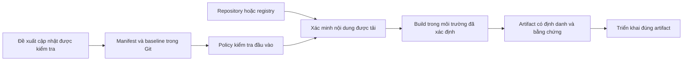

# Version pinning

## 1. Mục tiêu: kiểm soát đầu vào của bản build

Trong chương **Dependency và supply chain**, version pinning là việc ràng buộc dependency vào một định danh cụ thể thay vì để lần build tiếp theo tự chọn một phiên bản khác. Mục tiêu bảo mật là kiểm soát sự thay đổi của đầu vào, có thể truy vết thành phần đã sử dụng và đưa việc nâng cấp qua quy trình đánh giá phù hợp.

Trong module **SECURITY_SECURITY_DESIGN_SECURITY_REQUIREMENTS**, yêu cầu cần vượt khỏi câu “mọi dependency phải ghi version”. Người thiết kế phải xác định thành phần nào được chốt, dependency gián tiếp có được bao phủ không, byte tải về có được xác minh không, CI phải xử lý sai lệch thế nào và khi nào phải cập nhật bản đã chốt.

Sau bài học, người học cần có khả năng:

- Phân biệt chốt phiên bản, chốt đồ thị dependency và chốt nội dung artifact.
- Đặc tả phạm vi kiểm soát cho thư viện, plugin, công cụ build, image và thành phần CI/CD.
- Liên kết rủi ro supply chain với yêu cầu có thể kiểm thử ở bước resolve, tải về, build và phát hành.
- Xây dựng quy trình nâng cấp, ngoại lệ và phục hồi để pinning không trở thành việc giữ mã lỗi vô thời hạn.

Các tên package, phiên bản, digest dạng placeholder và thời hạn trong bài là ví dụ thiết kế. Chúng không phải danh sách phiên bản được xác nhận an toàn hoặc chỉ dẫn nâng cấp cho một sản phẩm cụ thể.

## 2. Ba lớp thường bị gọi chung là “pin”

### 2.1. Chốt lựa chọn phiên bản

Khai báo `com.example:payment-client:1.4.2` giới hạn lựa chọn rõ hơn `1.+`, một version range hoặc `latest`. Tuy vậy, cần xem quy tắc resolver có thể chọn phiên bản khác vì xung đột, constraint hoặc cơ chế override hay không. Giá trị trong manifest và phiên bản cuối cùng được resolve không phải lúc nào cũng giống nhau.

Một version string cũng không nhất thiết định danh nội dung bất biến. Artifact kiểu `SNAPSHOT`, dependency được đánh dấu changing hoặc repository cho phép ghi đè có thể cung cấp byte khác nhau dưới cùng tọa độ.

### 2.2. Chốt đồ thị đã resolve

Một ứng dụng có thể khai báo A ở phiên bản chính xác nhưng A phụ thuộc B qua một range. Nếu chỉ chốt A, lần resolve sau vẫn có thể chọn B khác.

```text
Manifest ứng dụng:
    A = 1.4.2

Metadata của A:
    B = một tập phiên bản được chấp nhận

Lần resolve thứ nhất: A 1.4.2 -> B 2.1.0
Lần resolve thứ hai:  A 1.4.2 -> B 2.2.0
```

Lockfile hoặc cơ chế tương đương ghi nhận kết quả lựa chọn cho cả dependency trực tiếp và gián tiếp trong phạm vi công cụ hỗ trợ. Nhưng chỉ có file lock trong Git chưa đủ: lệnh CI phải thực sự tôn trọng nó và từ chối những sai lệch theo policy.

### 2.3. Chốt byte bằng digest và xác minh nguồn tin cậy

Checksum hoặc content digest ràng buộc một artifact vào nội dung cụ thể. Nếu byte tải về khác giá trị được tin cậy, hệ thống phải phát hiện trước khi sử dụng theo phạm vi cơ chế kiểm tra.

| Lớp kiểm soát | Câu hỏi được trả lời | Điều chưa được chứng minh |
| --- | --- | --- |
| Version chính xác | Dự định chọn phiên bản nào? | Byte có bị thay đổi hoặc resolver có chọn khác không? |
| Lock trạng thái resolve | Đồ thị đã chọn gồm những thành phần nào? | Mọi công cụ, nền tảng và tải xuống ngoài resolver đã được bao phủ chưa? |
| Digest/checksum tin cậy | Nội dung này có khớp byte đã được chấp nhận không? | Nội dung ban đầu có an toàn và đến từ nhà phát hành đúng không? |
| Chữ ký hoặc provenance theo policy | Có bằng chứng nào về bên ký hoặc quá trình tạo artifact? | Mã không có lỗ hổng, bên ký không bị chiếm quyền hoặc policy tin cậy đúng chưa? |

Tải một file và checksum đi kèm từ cùng nguồn đang bị chiếm quyền rồi tự động tin cả hai chỉ tạo một baseline cho dữ liệu vừa nhận. Thiết kế phải chỉ rõ cách thiết lập niềm tin ban đầu và ai được thay đổi các giá trị được tin cậy.

## 3. Phạm vi cần bao phủ

Một bản build phụ thuộc nhiều hơn danh sách thư viện chạy trong production:

| Nhóm đầu vào | Ví dụ | Rủi ro khi bỏ sót |
| --- | --- | --- |
| Dependency ứng dụng | Runtime library và dependency gián tiếp | Thành phần được đóng gói thay đổi không được xem xét |
| Công cụ chạy trong build | Plugin, annotation processor, code generator, compiler extension | Mã bên ngoài thực thi trên runner có quyền truy cập mã nguồn hoặc credential |
| Môi trường build | Build tool, JDK, package manager, container builder | Cùng manifest nhưng cách resolve hoặc tạo đầu ra khác nhau |
| Container và hệ điều hành | Base image, package được cài trong image | Chốt thư viện nhưng hệ điều hành hoặc image vẫn thay đổi |
| Workflow CI/CD | Action, reusable workflow, script tải từ mạng | Pipeline chạy mã mới dù source ứng dụng không đổi |
| Dependency theo biến thể | OS/CPU, profile, feature, configuration | Lock chỉ có hiệu lực ở một nhánh môi trường được thử |

Ứng dụng và thư viện được phát hành có phạm vi khác nhau. Một ứng dụng có thể quản lý baseline của đồ thị dùng để build và chạy. Một thư viện công bố constraint cho người dùng thì lock của chính thư viện không tự buộc mọi consumer dùng đúng đồ thị đó. Hồ sơ phải nêu mình đang bảo vệ bản build nào và không tuyên bố bao phủ hệ thống downstream ngoài quyền kiểm soát.

Pinning cũng không đồng nghĩa bản build có thể tái tạo từng byte. Timestamp, đường dẫn, toolchain, nguồn sinh mã và môi trường có thể làm đầu ra khác dù cùng đồ thị dependency. [Hướng dẫn reproducible builds của Maven](https://maven.apache.org/guides/mini/guide-reproducible-builds.html) là nguồn tham khảo khi cần đặc tả mục tiêu tái tạo đầu ra riêng biệt.

## 4. Mô hình đe dọa và tài sản cần bảo vệ

Giả sử một dịch vụ thanh toán được build từ Git, lấy dependency qua repository được quản lý, tạo image rồi triển khai production. Các tài sản gồm mã nguồn, credential của runner, tính toàn vẹn artifact và dữ liệu mà ứng dụng xử lý.



| Mã rủi ro | Đường phát sinh | Tác động |
| --- | --- | --- |
| R-01 | Range, tag hoặc branch tự trỏ tới bản mới | Build nhận mã chưa được xem xét |
| R-02 | Chỉ chốt dependency trực tiếp | Dependency gián tiếp hoặc biến thể thay đổi âm thầm |
| R-03 | Cùng version nhưng byte khác, cache hoặc metadata bị sửa | Sử dụng artifact không khớp baseline |
| R-04 | Build plugin, action hoặc script ngoài phạm vi pinning | Thực thi mã bên ngoài kiểm soát trên runner |
| R-05 | Pin lâu nhưng không theo dõi lỗ hổng hoặc EOL | Tiếp tục sử dụng thành phần không còn được chấp nhận |
| R-06 | CI tự sửa lock/checksum để build thành công | Đầu vào chưa được duyệt trở thành baseline mới |
| R-07 | Artifact cũ không còn tải được hoặc phục hồi bằng tag mới | Không build lại được hoặc rollback sang nội dung khác |

Kẻ tấn công có thể chiếm quyền phát hành dependency, thay tag, tác động repository/cache hoặc thay đổi workflow. Pinning làm hẹp một số đường thay đổi, nhưng không tự ngăn một phiên bản đã được pin chứa mã độc hay lỗ hổng. Cần phối hợp lựa chọn nguồn, đánh giá thành phần, quyền tối thiểu và kiểm soát thực thi build.

## 5. Chuyển nguyên tắc thành yêu cầu có thể nghiệm thu

Yêu cầu còn mơ hồ:

> Không dùng latest và mọi dependency phải có version.

Yêu cầu cụ thể hơn:

> Với release build, mọi dependency thuộc phạm vi đã công bố phải được resolve theo baseline được quản lý phiên bản. CI không được tự cập nhật baseline. Phiên bản, biến thể hoặc nội dung không khớp phải làm bước kiểm tra thất bại trước khi tạo một release được chấp nhận. Ngoại lệ phải có owner, phạm vi, kiểm soát bù và thời hạn.

### VP-01 — Công bố đầy đủ phạm vi và owner

**Yêu cầu:** Dự án phải liệt kê loại dependency, build configuration, nền tảng và pipeline thuộc phạm vi pinning. Mỗi nhóm có owner và cơ chế chứng minh lựa chọn thực tế. Không dùng số lượng dòng version trong manifest làm thước đo duy nhất.

**Tiêu chí nghiệm thu:** Có danh mục cho runtime, test/build tool, image, workflow và các biến thể cần phát hành. Một công cụ tải binary trong task riêng hoặc install script phải được nhận diện, kể cả khi nó không xuất hiện trong dependency tree của công cụ chính.

### VP-02 — Lựa chọn production phải có kết quả xác định

**Yêu cầu:** Release build không được phụ thuộc vào tên `latest`, branch di động hoặc range chưa được ràng buộc bởi baseline có hiệu lực. Khi dùng range ở manifest vì mục đích quản lý tương thích, hệ thống vẫn phải chứng minh đồ thị release cuối cùng đã được chốt theo cơ chế được chọn.

Không dùng `SNAPSHOT` hoặc changing artifact như một định danh nội dung ổn định cho release theo policy minh họa này. Nhánh thử nghiệm có thể cần chúng, nhưng phải được tách khỏi quyền phát hành production hoặc có ngoại lệ được quản lý rõ ràng.

**Tiêu chí nghiệm thu:** Công bố một phiên bản mới trong repository thử nghiệm hoặc đổi tag/branch không làm release build âm thầm dùng thành phần mới. Kết quả phải giữ baseline cũ hoặc từ chối sai lệch, thay vì tự cập nhật.

### VP-03 — Chốt dependency gián tiếp và thực thi ở CI

**Yêu cầu:** Cơ chế khóa phải bao phủ đồ thị và configuration thuộc phạm vi. Baseline/lockfile phải được version cùng thay đổi liên quan; CI chạy chế độ không tự ghi lại kết quả resolve. Thiếu lock state hoặc manifest không khớp phải được xử lý như lỗi theo hợp đồng, không tự chuyển sang chế độ linh hoạt.

Với nền tảng hoặc profile khác nhau, baseline có thể là một tập trạng thái được xác định theo từng biến thể. Không bắt buộc các OS có đồ thị hoàn toàn giống nhau; yêu cầu là mỗi kết quả đều thuộc tập được chấp nhận và không có biến thể bị bỏ qua không rõ lý do.

**Tiêu chí nghiệm thu:** Thay dependency gián tiếp trong môi trường thử nghiệm, xóa lock state cần thiết và chạy từng biến thể phát hành. Hệ thống không nhận thay đổi ngoài baseline; các file kiểm soát không bị CI tự viết lại để tạo trạng thái PASS.

### VP-04 — Xác minh nội dung và bảo vệ niềm tin ban đầu

**Yêu cầu:** Artifact thuộc phạm vi cần được kiểm tra bằng checksum/digest hoặc cơ chế xác minh phù hợp với rủi ro. Khi có metadata ảnh hưởng lựa chọn dependency, phải xác định nó có được kiểm tra không. Giá trị tin cậy mới phải đi qua quy trình đánh giá; mismatch không được giải quyết bằng cách tự chấp nhận hash vừa tải về.

Chữ ký chỉ có giá trị trong một policy tin cậy xác định: khóa hoặc danh tính nào được chấp nhận, cho package nào, cách xử lý thu hồi và thay khóa. Pin một digest không xác minh được người phát hành; xác minh một chữ ký cũng không đồng nghĩa artifact không có mã độc.

**Tiêu chí nghiệm thu:** Giữ nguyên version nhưng thay byte artifact hoặc metadata thuộc phạm vi ở nguồn thử nghiệm. Bước xác minh phải từ chối. Trường hợp thiếu checksum/khóa tin cậy phải có kết quả theo policy, không trở thành một lần bootstrap âm thầm trong release pipeline.

## 6. Ví dụ các cơ chế pinning

### 6.1. Gradle: khóa lựa chọn và xác minh nội dung là hai việc

Ví dụ Groovy DSL bật locking cho các configuration của project và yêu cầu lock state:

```groovy
dependencyLocking {
    lockAllConfigurations()
    lockMode = LockMode.STRICT
}
```

[Tài liệu dependency locking của Gradle](https://docs.gradle.org/current/userguide/dependency_locking.html) mô tả strict mode và phạm vi configuration. Cấu hình trên không tự khóa `buildscript` classpath; các đường plugin/build logic cần được xét riêng. Lock state chỉ được tạo cho configuration thực sự được resolve.

Một lệnh cập nhật minh họa:

```text
./gradlew dependencies --write-locks
```

Đây là lệnh ghi baseline trong luồng cập nhật được kiểm soát, không phải lệnh mặc định cho release CI. Phải bảo đảm các task/configuration của bản phát hành được bao phủ; một lần chạy không tự chứng minh mọi đường resolve đã được chạm tới.

Để kiểm tra byte, Gradle có [dependency verification](https://docs.gradle.org/current/userguide/securing_dependencies.html) với metadata như `gradle/verification-metadata.xml`. Việc sinh metadata chỉ thu thập dữ liệu; người quản lý vẫn phải kiểm tra nguồn tin cậy và diff trước khi chấp nhận. Không tự sinh lại checksum mỗi khi verification thất bại.

Build tool cũng thuộc phạm vi. [Gradle Wrapper](https://docs.gradle.org/current/userguide/gradle_wrapper.html) có cơ chế xác minh checksum distribution và kiểm tra tính toàn vẹn Wrapper JAR. Khóa thư viện ứng dụng không tự bảo vệ file wrapper hoặc công cụ thực thi build.

### 6.2. npm: lệnh CI phải tôn trọng lockfile

Trong hệ sinh thái npm, ví dụ một luồng dùng `package-lock.json` đã được quản lý phiên bản và chạy:

```text
npm ci
```

[Tài liệu `npm ci`](https://docs.npmjs.com/cli/v11/commands/npm-ci/) nêu rằng lệnh cần lockfile phù hợp, thất bại khi manifest không khớp và không tự cập nhật manifest/lock. Các tùy chọn ảnh hưởng đồ thị phải nhất quán với lúc tạo lock.

Tuy nhiên, một install script có thể chạy mã hoặc tải thêm binary bên ngoài lockfile. Vì vậy, yêu cầu vẫn phải bao phủ script, quyền runner và nội dung tải bổ sung; lựa chọn lệnh cài đặt không tự biến dependency thành mã an toàn.

### 6.3. Container: tag và digest có vai trò khác nhau

Mẫu tham chiếu dưới đây chỉ minh họa cú pháp; placeholder phải được thay bằng định danh đã xác minh trong dự án thật:

```text
FROM registry.example/team/runtime:release-id@sha256:<digest-da-xac-minh>
```

[Docker mô tả image tag có thể thay đổi](https://docs.docker.com/build/building/best-practices/#pin-base-image-versions); digest ràng buộc nội dung được chọn. Với multi-platform image, cần ghi rõ digest trỏ tới index hay manifest cho nền tảng cụ thể, đồng thời định danh platform cần build/chạy. Không tuyên bố mọi CPU dùng cùng một tập byte chỉ vì cùng tham chiếu index.

Base image đã pin không chốt các package tải thêm bằng package manager trong lệnh build. Nếu cần baseline ổn định cho chúng, phải có cơ chế lựa chọn và lưu giữ repository/package phù hợp. Digest cố định cũng không tự nhận bản vá mới: quy trình cập nhật phải thay digest và kiểm tra lại.

### 6.4. Workflow: mã chạy trên runner cũng là dependency

Một action tham chiếu bằng tag có thể đổi đích khi tag thay đổi. Khi hệ thống dùng commit pin, cần đầy đủ commit SHA và kiểm tra commit thuộc nguồn dự kiến. Nhưng action đã pin vẫn có thể gọi thành phần khác bằng tag hoặc tải script từ mạng.

[Hướng dẫn bảo mật GitHub Actions](https://docs.github.com/en/actions/reference/security/secure-use) mô tả cả pin theo commit và cơ chế workflow dependency lockfile. Nếu nền tảng đang dùng hỗ trợ lockfile cho workflow, phải xác minh phạm vi và bật thực thi đúng; nếu dùng pin ở cấp tham chiếu, cần đánh giá dependency gián tiếp và các bước tải bổ sung. Không mặc định một SHA ở dòng `uses` đã khóa toàn bộ mã có thể chạy.

## 7. Yêu cầu đối với công cụ, nguồn tải và cache

### VP-05 — Bao phủ công cụ có khả năng thực thi mã

**Yêu cầu:** Plugin, processor, generator, action, reusable workflow và binary tải trong script phải có cơ chế định danh nội dung và thay đổi được kiểm soát. Build tool, package manager, toolchain và platform phải được khai báo đủ để hiểu kết quả resolve/build.

Mức định danh có thể khác theo loại thành phần: version kèm verification cho distribution, commit cho source reference hoặc digest cho image. Không dùng một nhãn như “JDK 21” để khẳng định đã chốt vendor, patch và nền tảng nếu các yếu tố đó vẫn thay đổi.

**Tiêu chí nghiệm thu:** Giữ nguyên dependency runtime nhưng đổi một plugin, tool distribution hoặc script tải ngoài baseline. Release gate phải phát hiện sai lệch thuộc phạm vi. Thành phần bị bỏ sót phải được ghi như giới hạn hoặc ngoại lệ có owner.

### VP-06 — Nguồn tải và cache không tạo đường đi vòng

**Yêu cầu:** Dự án phải xác định repository/registry được phép và cách ánh xạ package vào nguồn. Không tự fallback sang nguồn chưa được chấp nhận khi nguồn chính lỗi. Tên package và version giống nhau ở một registry khác không tự có cùng danh tính nhà phát hành.

Cache là nơi lưu dữ liệu, không phải một bảo chứng tin cậy. Quyền ghi cache, phạm vi chia sẻ giữa job không tin cậy và job release, cùng cách kiểm tra artifact khôi phục từ cache phải được thiết kế. Nếu công cụ tái sử dụng kết quả verification, phải chứng minh cache và trạng thái xác minh được bảo vệ theo mô hình đó.

TLS bảo vệ kênh truyền nhưng không thay thế việc xác định artifact được phép. Repository nội bộ cũng có thể chứa nội dung chưa được đánh giá; mirror cần giữ định danh, provenance hoặc bằng chứng phê duyệt cần thiết, không chỉ đổi hostname tải về.

**Tiêu chí nghiệm thu:** Đổi nguồn resolve, làm nguồn chính không sẵn sàng và đưa artifact sai vào cache thử nghiệm. Hệ thống không nhận nội dung ngoài policy và không tắt verification để tiếp tục. Mọi ngoại lệ có phạm vi, thời hạn và dấu vết quyết định.

## 8. Pinning phải đi cùng cập nhật và quản trị thay đổi

### VP-07 — Có owner và thời hạn xử lý bản vá

**Yêu cầu:** Mỗi nhóm dependency có owner theo dõi lỗ hổng, thông báo bị xâm nhập, trạng thái hỗ trợ và nhu cầu nâng cấp. Mức ưu tiên dựa trên khả năng khai thác, mức tiếp cận của thành phần, quyền nó có và tài sản bị ảnh hưởng; không chỉ dựa trên số version hoặc việc đang dùng bản mới nhất.

Một policy nội bộ minh họa có thể yêu cầu phân loại cảnh báo nghiêm trọng trong một ngày làm việc và đưa ra biện pháp xử lý trong 72 giờ khi xác nhận có đường khai thác liên quan. Các con số phải được tổ chức lựa chọn cùng điểm bắt đầu, owner và cơ chế ngoại lệ; chúng không phải thời hạn chung cho mọi lỗ hổng.

Biện pháp xử lý có thể gồm nâng cấp, loại bỏ dependency, vô hiệu hóa tính năng hoặc kiểm soát bù được đánh giá. “Đã pin” không phải lý do tự động chấp nhận một thành phần đã biết không phù hợp policy.

**Tiêu chí nghiệm thu:** Diễn tập advisory cho một dependency gián tiếp và một build plugin. Từ artifact hoặc inventory hiện có, nhóm xác định được bản phát hành bị ảnh hưởng, owner và kế hoạch trong thời hạn đã định. Một ngoại lệ quá hạn không được âm thầm chuyển thành hợp lệ.

### VP-08 — Thay baseline bằng một thay đổi có thể xem xét

**Yêu cầu:** Luồng cập nhật phải trình bày phiên bản trước/sau, toàn bộ diff đồ thị liên quan, thay đổi checksum/digest, nguồn tin cậy, đánh giá bảo mật và kết quả kiểm thử. Manifest, lock state và verification metadata phải nhất quán trong cùng thay đổi được chấp nhận.

Bot có thể mở đề xuất và tự động hợp nhất những loại thay đổi được policy cho phép. Quyền của bot phải giới hạn; không để một lỗi verification tự tạo PR chấp nhận mọi hash mới rồi đi qua một rule auto-merge quá rộng. Mức review có thể khác theo rủi ro, nhưng policy không được bỏ qua các tín hiệu bắt buộc.

Nâng một dependency trực tiếp có thể làm nhiều dependency gián tiếp thay đổi. Reviewer cần xem kết quả resolve thực tế, không chỉ một dòng version. SemVer hoặc nhãn patch là thông tin tương thích do hệ sinh thái/nhà phát hành cung cấp, không chứng nhận rằng thay đổi không có tác động bảo mật.

**Tiêu chí nghiệm thu:** Thay lock state, digest hoặc ruleset verification phải đi qua chốt tương ứng. Một PR chỉ cập nhật manifest mà để baseline không khớp phải thất bại. PR nâng cấp không được dùng credential production chỉ để chạy mã dependency mới trong bài kiểm tra.

## 9. Cổng kiểm soát release và bằng chứng

### VP-09 — Release dùng đúng baseline và không tự sửa nó

**Yêu cầu:** Release CI phải lấy manifest, lock, metadata và policy từ revision được xác định; xác minh các đầu vào thuộc phạm vi rồi ghi nhận kết quả sử dụng thực tế. Không dùng kết quả PASS của revision khác hoặc tạo lại lock/checksum trong cùng job để che sai lệch.

Một luồng khái niệm:

```text
releaseBuild(sourceRevision, targetPlatform):
    baseline = loadReviewedBaseline(sourceRevision, targetPlatform)
    require baseline is complete for this release scope
    require executor and resolver configuration satisfy policy

    graph = resolveUsingBaselineWithoutUpdatingIt(baseline)
    require graph matches permitted selections and variants

    artifacts = obtainFromApprovedSourcesOrTrustedCache(graph)
    require verifyArtifactBytesAndRequiredMetadata(artifacts, baseline)
    require evaluateCurrentSecurityPolicy(graph, artifacts)

    output = buildWithControlledTools(artifacts, baseline.tools)
    require baselineFilesUnchangedDuringBuild()
    recordEvidence(sourceRevision, baseline, graph, artifacts, output)
    publishOnlyIfAllRequiredChecksPassed(output)
```

Đây là mã giả của yêu cầu, không phải cam kết rằng mọi package manager tách các bước giống nhau. Một plugin có thể cần được nạp trong giai đoạn cấu hình; vì vậy cần ràng buộc công cụ và xác minh tại điểm công cụ đó chuẩn bị sử dụng mã bên ngoài, không đợi đến khi toàn bộ build kết thúc.

**Tiêu chí nghiệm thu:** Khi thiếu baseline, lock không khớp, checksum sai hoặc thành phần bị policy cấm, không có release nào được chấp nhận từ đường đó. Việc một file đầu ra tạm thời đã được tạo không đồng nghĩa được phép phát hành; gate phải kiểm soát nơi công bố và thăng hạng artifact.

### VP-10 — Truy vết từ bản phát hành tới thành phần thực tế

**Yêu cầu:** Bằng chứng release phải nối được source revision, phiên bản policy, baseline, platform, kết quả resolve, định danh artifact đầu vào cần thiết và digest đầu ra. Inventory hoặc SBOM nếu được sử dụng phải phản ánh thành phần thực tế của bản phát hành, không chỉ danh sách khai báo trực tiếp.

Dependency của build có thể không nằm trong gói runtime nhưng vẫn có khả năng ảnh hưởng artifact. Cần phân biệt inventory runtime với bằng chứng công cụ build; không coi việc một plugin vắng trong SBOM runtime là bằng chứng nó chưa tham gia quá trình tạo bản phát hành.

Ví dụ sự kiện từ chối:

```json
{
  "event": "dependency_baseline_rejected",
  "requirementId": "VP-04",
  "buildId": "build-lab-042",
  "baselineRevision": "baseline-7",
  "component": "com.example:payment-client:1.4.2",
  "reason": "artifact_digest_mismatch",
  "decision": "deny"
}
```

Log và báo cáo không được chứa token repository, URL có credential hoặc secret của runner. Quyền sửa bằng chứng cần được kiểm soát để người thay artifact không tự xóa dấu vết verification thất bại.

**Tiêu chí nghiệm thu:** Từ digest một bản phát hành thử nghiệm, người điều tra xác định được dependency gián tiếp và công cụ thuộc phạm vi đã dùng. Báo cáo từ chối đủ để định vị thành phần nhưng không tiết lộ credential mồi trong URL hoặc cấu hình repository.

## 10. Phục hồi, lưu giữ và ngoại lệ

### VP-11 — Phục hồi đúng artifact và không tự mở rộng nguồn

**Yêu cầu:** Với thành phần cần cho phục hồi, phải có chiến lược lưu giữ artifact, metadata và bằng chứng tương ứng thời gian hỗ trợ của bản phát hành. Một hash trong Git không bảo đảm registry còn giữ byte cần tải.

Nếu artifact đã pin bị xóa hoặc bị policy thu hồi, release build phải báo lỗi có thể xử lý; không tự thay bằng bản gần nhất, tag hiện tại hoặc tải ở một mirror chưa được chấp thuận. Nhóm có thể dùng kho lưu giữ được quản lý hoặc tạo baseline mới qua luồng đánh giá.

Rollback cần triển khai artifact đã xác định, không build lại từ tag di động rồi coi là cùng bản cũ. Tuy vậy, artifact cũ có thể chứa lỗ hổng hoặc thành phần đã bị nghi xâm nhập. Quyết định phục hồi phải xét rủi ro hiện tại, tương thích dữ liệu và kiểm soát bù; việc từng được duyệt không tạo quyền dùng vô thời hạn.

**Ngoại lệ:** Ghi thành phần, lý do, phạm vi môi trường, owner, thời hạn và biện pháp giảm thiểu. Một nhánh tích hợp cần changing dependency không tự cấp quyền cho release production sử dụng cùng ngoại lệ. Thu hẹp ngoại lệ thay vì bỏ toàn bộ verification hoặc chấp nhận mọi digest cho một package.

**Tiêu chí nghiệm thu:** Diễn tập nguồn ngoài không sẵn sàng và một artifact bị thu hồi. Hệ thống hoặc dùng đúng bản lưu giữ còn được policy chấp nhận, hoặc dừng và tạo hành động xử lý. Không có lựa chọn thay thế âm thầm; rollback phải chứng minh đúng digest và quyết định rủi ro liên quan.

## 11. Ma trận truy vết yêu cầu

| Yêu cầu | Rủi ro | Điểm thực thi chính | Bằng chứng nghiệm thu |
| --- | --- | --- | --- |
| VP-01 | R-02, R-04 | Inventory, build design | Danh mục đường resolve, configuration, công cụ và platform có owner |
| VP-02 | R-01, R-03 | Manifest policy, resolver | Version/tag thay đổi không tự làm release nhận thành phần mới |
| VP-03 | R-02, R-06 | Lock state, lệnh CI | Đồ thị gián tiếp được chốt; thiếu/mismatch không tự ghi baseline |
| VP-04 | R-03, R-06 | Verification và trusted metadata | Byte/metadata sai bị từ chối; dữ liệu tin cậy mới có đánh giá |
| VP-05 | R-04 | Wrapper, plugin, workflow, toolchain | Công cụ ngoài baseline bị phát hiện trước khi dùng theo cơ chế đã định |
| VP-06 | R-03, R-04 | Repository mapping, registry, cache | Không fallback nguồn lạ; cache không vô hiệu hóa kiểm soát nội dung |
| VP-07 | R-05 | Advisory triage và owner | Xác định release bị ảnh hưởng và xử lý/ngoại lệ đúng hạn |
| VP-08 | R-05, R-06 | PR, policy bot, kiểm thử nâng cấp | Diff manifest/lock/verification nhất quán và được chấp nhận đúng thẩm quyền |
| VP-09 | R-01, R-06 | Release gate, quyền publish | Sai lệch không trở thành release được chấp nhận |
| VP-10 | R-02, R-04 | Build evidence, inventory/SBOM | Truy được thành phần thực tế từ digest đầu ra, không lộ credential |
| VP-11 | R-05, R-07 | Retention, phục hồi, ngoại lệ | Khôi phục đúng artifact còn hợp lệ hoặc dừng có kiểm soát |

Trong dự án thực tế, mỗi dòng cần owner triển khai và owner chấp nhận rủi ro. Ví dụ, nhóm ứng dụng quản lý lockfile nhưng nhóm nền tảng quản lý registry, runner và cache; cần bằng chứng của cả hai để kết luận đầu vào release được kiểm soát.

## 12. Bộ kiểm thử nghiệm thu

Thực hiện trong sandbox với package, registry và cache thử nghiệm. Không thay artifact của một repository đang phục vụ người dùng để kiểm tra mismatch. Phải quan sát cả kết quả resolve, trạng thái verification, thay đổi file baseline và nơi artifact có thể được phát hành.

| Mã | Thiết lập | Điều kiện pass |
| --- | --- | --- |
| T-01 | Build hợp lệ từ revision và baseline đã chấp nhận | Dùng đúng đồ thị, nội dung, công cụ và tạo bằng chứng tương ứng |
| T-02 | Registry thử nghiệm có phiên bản mới phù hợp range | Release không tự chuyển sang bản mới ngoài baseline |
| T-03 | Chỉ dependency gián tiếp có lựa chọn mới | Lock/gate giữ kết quả được phép hoặc từ chối sai lệch |
| T-04 | Xóa lockfile hoặc lock state của configuration bắt buộc | Không tự tạo baseline để tiếp tục phát hành |
| T-05 | Manifest thay đổi nhưng lock/verification chưa cập nhật | Build hoặc release gate thất bại theo hợp đồng |
| T-06 | Cùng version nhưng artifact hoặc metadata được kiểm tra đổi byte | Verification từ chối trước khi sử dụng theo cơ chế đã định |
| T-07 | Artifact mới chưa có giá trị tin cậy bắt buộc | Release không tự ghi hash mới và báo PASS |
| T-08 | Plugin/action/tool tải binary ngoài baseline | Đường tải được nhận diện và chặn hoặc xử lý bằng ngoại lệ cụ thể |
| T-09 | Tag image đổi nhưng digest trong baseline giữ nguyên | Nội dung vẫn theo digest đã chấp nhận, hoặc lỗi nếu không còn khả dụng |
| T-10 | Chạy biến thể OS/CPU/profile khác thuộc phạm vi | Mỗi biến thể dùng đúng baseline; không bỏ qua nhánh chưa khóa |
| T-11 | Artifact sai được đặt vào cache dùng cho release | Không sử dụng chỉ vì cache hit; kiểm soát cache/nội dung phát hiện được |
| T-12 | Repository chính lỗi và nguồn khác có package cùng tên/version | Không tự nhận nguồn ngoài policy |
| T-13 | PR cập nhật thêm checksum/digest hoặc tắt verification | Bị kiểm soát bởi rule review/policy phù hợp, không auto-merge vô điều kiện |
| T-14 | Advisory giả lập ảnh hưởng dependency gián tiếp hoặc build plugin | Truy được release, owner và biện pháp xử lý trong mục tiêu nội bộ |
| T-15 | Artifact đã pin không còn ở nguồn tải | Dùng bản lưu giữ hợp lệ hoặc dừng; không đổi phiên bản âm thầm |
| T-16 | Rollback artifact cũ có digest xác định nhưng bị policy thu hồi | Không tự coi là an toàn; yêu cầu quyết định/biện pháp phục hồi hợp lệ |
| T-17 | URL repository có credential mồi và xảy ra verification lỗi | Báo cáo đủ định vị nhưng không in credential |

Báo cáo cần ghi tool/version thực tế, source revision, baseline, platform, policy, nguồn/cache được thử, kết quả và giới hạn. Chỉ chạy lại trên máy có cache cũ không chứng minh khả năng resolve từ nguồn sạch; chỉ chạy một nền tảng không chứng minh mọi biến thể đã được bao phủ.

## 13. Tình huống áp dụng: thư viện chính xác nhưng build vẫn thay đổi

Một nhóm khai báo payment client phiên bản chính xác và tin rằng dependency đã được pin. Bản build sau nhận một thư viện gián tiếp mới; đồng thời base image dùng tag di động và một action chạy trên runner cũng tham chiếu tag. Mã nghiệp vụ không đổi nhưng ba nhóm đầu vào đã có thể thay đổi.

Phân tích yêu cầu dẫn tới các việc cụ thể: lập danh mục phạm vi theo VP-01; chốt đồ thị release và lệnh CI theo VP-03; xác minh artifact theo VP-04; định danh image, workflow và công cụ theo VP-05; tạo bằng chứng đầu vào thực tế theo VP-10. Không giải quyết bằng cách chỉ sửa thêm một dòng version trực tiếp.

Khi có bản vá cho thư viện gián tiếp, nhóm tạo thay đổi baseline có đầy đủ diff, đánh giá nguồn và kiểm thử. Release thông thường tiếp tục dùng baseline đã chấp nhận, còn luồng cập nhật chủ động thay nó. Nếu xác nhận bản hiện tại có nguy cơ không được chấp nhận, gate và quy trình ứng phó có thể dừng phát hành hoặc yêu cầu biện pháp xử lý; pinning không phải quyền tiếp tục dùng bản đó vô thời hạn.

## 14. Câu hỏi tự kiểm tra

1. Manifest có version trực tiếp chính xác nhưng không có baseline đồ thị. Hãy mô tả một đường dependency gián tiếp thay đổi và viết yêu cầu kiểm thử tương ứng.
2. Một artifact giữ nguyên version nhưng có hash mới. Khi nào cần điều tra hoặc đánh giá nguồn, và vì sao tự sinh lại checksum trong CI không đủ?
3. Lockfile được commit nhưng job build luôn chạy lệnh cập nhật lock trước khi test. Điều kiện nào trong yêu cầu release đã bị vi phạm?
4. Base image đã dùng digest nhưng lệnh build cài package từ repository di động. Phạm vi pinning còn thiếu gì?
5. Một action được pin bằng commit vẫn tải script theo branch. Cần định nghĩa và nghiệm thu ranh giới nào?
6. Phiên bản được pin có advisory nghiêm trọng hoặc không còn hỗ trợ. Hãy đặc tả owner, thời hạn xử lý, ngoại lệ và phương án phục hồi phù hợp.

Mỗi câu trả lời cần nối được **rủi ro → đầu vào cần kiểm soát → định danh và niềm tin → điểm thực thi → bằng chứng kiểm thử → cập nhật và phục hồi**. Chuỗi đó giúp version pinning trở thành yêu cầu bảo mật có thể vận hành trong vòng đời phát triển.
