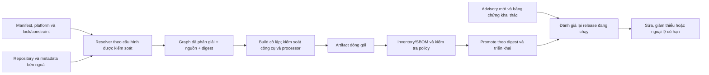

# Transitive dependency

## 1. Dependency gián tiếp là gì và vì sao cần yêu cầu bảo mật riêng?

**Transitive dependency** là thành phần mà một hệ thống sử dụng thông qua quan hệ phụ thuộc của thành phần khác. Nếu ứng dụng A khai báo thư viện B, còn B phụ thuộc C, thì C là dependency gián tiếp của A trong ngữ cảnh phân giải đang xét. B là dependency trực tiếp vì A khai báo quan hệ đó.

Quan hệ trực tiếp hay gián tiếp phụ thuộc điểm gốc, không phải thuộc tính cố định của package. C có thể là gián tiếp đối với A nhưng trực tiếp đối với B. Nếu A bổ sung khai báo trực tiếp C, vai trò của C trong đồ thị cũng thay đổi; trách nhiệm bảo vệ không giảm vì trước đó C nằm sâu nhiều tầng.

Trong chương **Dependency và supply chain** của module yêu cầu bảo mật, bài toán là biến rủi ro từ các thành phần được kéo theo thành yêu cầu cụ thể, đo được và có bằng chứng. Danh sách dependency trong file khai báo gốc chưa đủ để kết luận ứng dụng dùng thành phần nào, thành phần đó đến từ đâu hoặc đã được sửa lỗ hổng hay chưa.

Một thư viện gián tiếp có thể phân tích dữ liệu không tin cậy, xử lý xác thực, nạp mã native hoặc chạy ngay trong quá trình build. Đối phương không cần sửa dependency mà nhóm đã tự khai báo nếu có thể chiếm một mắt xích sâu hơn và khiến pipeline chấp nhận artifact của nó.

### Mục tiêu học tập

Sau bài này, người học có thể:

1. Phân biệt khai báo, kết quả phân giải và thành phần thực sự được đóng gói hoặc thực thi.
2. Xác định mọi đường đưa một thành phần gián tiếp vào runtime hoặc môi trường build.
3. Viết yêu cầu inventory, nguồn artifact, đánh giá lỗ hổng và kiểm soát pipeline.
4. Chọn nâng dependency cha, quản lý version, thay thế hoặc loại trừ theo rủi ro và khả năng tương thích.
5. Gắn quyết định xử lý với đồ thị, release artifact, bằng chứng kiểm thử và thời hạn ngoại lệ.

## 2. Từ danh sách khai báo đến đồ thị thực tế

### 2.1. Ba biểu diễn cần phân biệt

| Biểu diễn | Trả lời câu hỏi nào? | Chưa tự chứng minh điều gì? |
|---|---|---|
| Dependency được khai báo | Thành phần hoặc constraint nào được tác giả yêu cầu? | Version cuối, artifact được tải và nội dung release |
| Đồ thị đã phân giải | Resolver đã chọn thành phần/version nào cho cấu hình cụ thể? | Tất cả mã được đóng gói, nạp động hoặc tải ở bước khác |
| Inventory của artifact và môi trường thực thi | Release hoặc build thực dùng những thành phần nào? | Thành phần không có lỗ hổng hoặc chắc chắn không thể bị khai thác |

Một dự án có thể có kết quả khác nhau cho runtime, test, công cụ build, annotation processor, hệ điều hành hoặc profile. Inventory phải gắn với cấu hình, nền tảng và release cụ thể. Không lấy graph của một lệnh kiểm thử trên máy phát triển làm bằng chứng duy nhất cho artifact production.

Đồ thị thường được biểu diễn thành cây để dễ đọc, nhưng một thành phần có thể có nhiều cha và nhiều đường từ root. Các dòng lặp hoặc dòng được rút gọn trong báo cáo không có nghĩa chỉ còn một quan hệ. Nếu metadata có chu trình hoặc không thể phân giải đầy đủ, công cụ phải xử lý có giới hạn và báo trạng thái chưa xác định, không bỏ cạnh rồi đánh dấu inventory hoàn tất.

### 2.2. Ví dụ có nhiều đường tới cùng một dependency

Các tên package, version và mã advisory trong bài đều là dữ liệu giả định để học thiết kế; chúng không mô tả lỗ hổng thật của một sản phẩm đang tồn tại.

```text
report-service
├── http-adapter:3.2                  [direct, runtime]
│   └── token-parser:2.4              [transitive, runtime]
│       └── codec-core:1.6            [transitive, runtime]
├── export-engine:5.0                 [direct, runtime]
│   └── codec-core:1.6                [transitive, runtime]
└── test-fixture:2.0                  [direct, test]
    └── fixture-server:1.3            [transitive, test]
```

`codec-core:1.6` xuất hiện qua hai đường runtime. Nếu chỉ loại cạnh `token-parser → codec-core`, đường qua `export-engine` vẫn còn. Với một classloader chung và kết quả phân giải chọn một bản codec, một artifact có thể phục vụ nhiều caller; với cơ chế cách ly hoặc đóng gói riêng, nhiều bản có thể cùng tồn tại. Cần đọc kết quả thực thay vì đoán từ sơ đồ khai báo.

`fixture-server:1.3` thuộc graph test trong ví dụ và không được đóng gói vào runtime. Tuy nhiên, nếu nó thực thi trong CI có quyền đọc secret hoặc ghi artifact release, rủi ro supply chain vẫn cần xử lý. “Không có trong production JAR” không đồng nghĩa “không ảnh hưởng production”.

### 2.3. Version được yêu cầu khác version được chọn

Giả sử nâng `token-parser` làm nó yêu cầu `codec-core:1.8`, còn `export-engine` vẫn yêu cầu `1.6`. Không thể kết luận toàn ứng dụng đã dùng `1.8` chỉ từ thay đổi này. Resolver còn có quy tắc chọn version, constraint của platform/BOM, override, lockfile, profile và các đường đóng gói khác.

Một resolver có thể ưu tiên một nhánh, một constraint hoặc một version theo quy tắc của hệ sinh thái. Không mặc định công cụ luôn chọn bản mới nhất hoặc luôn chọn bản an toàn. Bằng chứng cần chỉ rõ version đã chọn và lý do chọn cho đúng cấu hình.

Thậm chí version hiển thị là `1.8` cũng chưa xác định đủ artifact nếu nguồn có thể thay nội dung cùng version. Cần gắn thành phần với nguồn được phép, định danh artifact và digest của bytes đã dùng. Một digest chỉ giúp xác định nội dung; nó không tự chứng minh tác giả đáng tin hoặc nội dung không độc hại.

## 3. Mô hình đe dọa cho dependency gián tiếp

### 3.1. Tài sản và ranh giới tin cậy

Tài sản cần bảo vệ gồm mã và dữ liệu ứng dụng, quyền của tiến trình runtime, secret trong CI, artifact release, chữ ký/provenance và khả năng phục hồi sau cập nhật. Đồ thị dependency là một phần của chuỗi đưa mã từ nhà cung cấp vào các miền quyền đó.



Nhóm kiểm soát manifest gốc nhưng thường không kiểm soát toàn bộ metadata, maintainer, repository hoặc code của dependency sâu hơn. Pipeline phải quyết định thông tin nào được chấp nhận, dưới danh tính nào và trước khi mã bên ngoài được thực thi.

### 3.2. Các kịch bản rủi ro

| Mã | Kịch bản | Điều cần chứng minh |
|---|---|---|
| R1 | Một thành phần gián tiếp có lỗ hổng và xử lý đầu vào không tin cậy | Release nào bị ảnh hưởng, đường phụ thuộc và điều kiện khai thác |
| R2 | Dependency công cụ build hoặc processor thực thi mã với quyền CI lớn | Kiểm soát trước thực thi, cách ly và quyền tối thiểu |
| R3 | Resolver lấy artifact từ nguồn sai hoặc nội dung bị thay thế | Chính sách nguồn, định danh, digest và chuỗi tin cậy |
| R4 | Mã bị shade/repack/vendor hoặc tải động nên inventory bỏ sót | Đối chiếu graph với artifact và hành vi thực thi |
| R5 | Override/exclusion xử lý cảnh báo nhưng gây lỗi hoặc vẫn còn đường khác | Mọi đường đã xử lý và kiểm thử tương thích/chức năng |
| R6 | Ngoại lệ, kết quả reachability hoặc dữ liệu đánh giá đã lỗi thời | Phạm vi, bằng chứng, chủ sở hữu và thời hạn đánh giá lại |
| R7 | Gate dùng graph, advisory hoặc kết quả scan của release khác | Liên kết digest, cấu hình và độ mới của bằng chứng |

### 3.3. Lỗ hổng đã biết và mã độc là hai bài toán khác nhau

Một scanner không có cảnh báo có thể chỉ có nghĩa dữ liệu hiện có chưa nhận diện một lỗ hổng áp dụng. Nó không chứng minh package không độc hại, không chứng minh nguồn tải đúng và không chứng minh publisher chưa bị chiếm quyền.

Dependency confusion, chiếm tài khoản maintainer, thay artifact hoặc lợi dụng registry có thể ảnh hưởng cả thành phần trực tiếp và gián tiếp. Tự động chọn version mới nhất không giải quyết được những kịch bản đó. Chính sách nguồn, review thay đổi graph, kiểm soát quyền build và bằng chứng nguồn gốc cần phối hợp với quản lý lỗ hổng.

## 4. Đặc tả inventory cho toàn bộ closure cần bảo vệ

### 4.1. Xác định closure theo mục đích

**Dependency closure** là tập thành phần có thể đi tới theo các quan hệ phụ thuộc từ một root trong phạm vi đã định. Trong yêu cầu bảo mật, cần nêu root, loại quan hệ, configuration, platform và thời điểm thu thập; không chỉ nói “scan toàn bộ dependency”.

Hồ sơ tham chiếu của `report-service` yêu cầu:

- Graph runtime của release và inventory các thư viện thực sự nằm trong artifact hoặc môi trường runtime nằm trong phạm vi phát hành.
- Graph test và graph công cụ build/processor/plugin có thể chạy trong pipeline, được ghi nhận riêng để đánh giá quyền thực thi.
- Nhận diện mã nhúng/shaded, thư viện native, mã vendor và các bước tải thêm được cho phép; phần chưa nhận diện phải được ghi là chưa xác định.
- Nếu release là container image, liên kết thêm inventory của runtime/base image theo phạm vi triển khai; một graph Java không đại diện cho các package hệ điều hành.

Không buộc mọi công cụ build phải nằm trong SBOM runtime. Cần giữ đúng vai trò và có inventory/bằng chứng build riêng, thay vì trộn tất cả thành một danh sách rồi đánh giá như có cùng đường khai thác.

### 4.2. Dữ liệu tối thiểu cho một thành phần

| Trường | Mục đích |
|---|---|
| Component identity | Hệ sinh thái, namespace/tên và version, tránh trùng tên giữa các hệ |
| Artifact identity | Variant/classifier/platform hoặc thuộc tính cần thiết để biết đúng binary |
| Digest và nguồn | Liên kết bytes đã sử dụng với repository/proxy được phép |
| Quan hệ và đường từ root | Xác định ai kéo theo, còn đường nào và ai cần sửa |
| Scope/phase | Runtime, test, build, processor hoặc thành phần tải thêm |
| Vị trí trong release | Archive/layer/path hoặc trạng thái không đóng gói vào runtime |
| Resolution context | Commit, cấu hình, platform, lock/constraint và công cụ/bản cấu hình phân giải |
| Assessment reference | Advisory, bằng chứng ngữ cảnh, quyết định policy và ngoại lệ nếu có |

Không dùng tên file JAR làm định danh duy nhất. Một archive có thể bị đổi tên, chứa nhiều thành phần hoặc có tên/version không phản ánh đúng nội dung. Bằng chứng từ resolver và phân tích artifact cần bổ sung cho nhau.

### 4.3. SBOM, lockfile và provenance có vai trò riêng

SBOM mô tả thành phần và quan hệ theo dữ liệu được tạo; chất lượng phụ thuộc công cụ, phạm vi và khả năng nhận diện. Lockfile hoặc cơ chế khóa giải quyết việc giữ kết quả phân giải trong ngữ cảnh mà công cụ hỗ trợ. Provenance liên kết artifact với quá trình tạo nó và các thuộc tính được chứng thực.

Không có loại bằng chứng nào tự khẳng định “không có lỗ hổng”. Một graph đã khóa có thể khóa đúng một bản dễ bị tấn công; một SBOM được ký có thể ký một danh sách thiếu; provenance hợp lệ vẫn cần được đối chiếu với builder và policy được tin cậy.

Yêu cầu cần ghi rõ nơi tạo, nơi kiểm tra, digest của artifact được mô tả và cách xử lý thành phần chưa phân loại. Với hồ sơ production trong bài, chưa xác định được thành phần ngoài hợp đồng hoặc thiếu inventory bắt buộc là điều kiện chặn promote, không được coi là kết quả sạch.

## 5. Kiểm soát nguồn và kết quả phân giải

### 5.1. Repository được phép và quyền xuất bản

Resolver phải dùng tập nguồn được phê duyệt, có quy tắc ánh xạ namespace nội bộ và bên ngoài. Không để package nội bộ tự động rơi sang registry công khai chỉ vì nguồn riêng lỗi hoặc không có version cần tìm. Proxy/cache cũng phải giữ được nguồn và tính toàn vẹn của artifact, không chỉ tăng tốc tải.

Credential của repository cần quyền tối thiểu và đúng mục đích. Job chỉ đọc dependency không nên có quyền ghi đè artifact release hoặc công bố package vào namespace nội bộ. Không đưa token repository vào log khi resolver báo lỗi.

Checksum hoặc chữ ký phải được đánh giá theo nguồn tin cậy. Nếu artifact và checksum đều lấy từ cùng một nguồn đã bị kiểm soát, sự khớp nhau không tự chứng minh nội dung là bản được tổ chức chấp nhận. Chính sách cần quản lý nguồn metadata, người phát hành hoặc bản digest đã được phê duyệt phù hợp mô hình đe dọa.

### 5.2. Giảm thay đổi không được review

Hồ sơ release cần kết quả phân giải xác định được, có version/constraint và cơ chế khóa hoặc kiểm soát tương đương. Selector động, version range hoặc artifact có thể thay nội dung phải có chính sách riêng; không cho chúng âm thầm làm đổi graph giữa lần kiểm tra và lần build release.

Khi dependency thay đổi, review cần xem cả phần graph được thêm/bớt, nguồn mới, công cụ có thể thực thi và thay đổi quyền. Một diff chỉ tăng version của dependency trực tiếp có thể kéo theo hàng chục thành phần khác.

Cache không được trở thành đường bỏ qua kiểm tra nguồn/digest. Cần phát hiện bytes khác cho một định danh đã được chấp nhận, giữ bằng chứng và từ chối theo policy. Lockfile của một cấu hình cũng không tự khóa plugin, toolchain hoặc thành phần tải ngoài nếu chúng không thuộc cơ chế đó.

## 6. Từ advisory tới kết luận ảnh hưởng

### 6.1. Không đồng nhất severity với rủi ro của release

Một đánh giá cần xác định đúng component/version, độ tin cậy của advisory, điều kiện kích hoạt, vai trò runtime/build và quyền mà mã có thể sử dụng. Tính năng bị ảnh hưởng có bật không? Có xử lý dữ liệu không tin cậy không? Có đường thực thi qua reflection, plugin, serialization hoặc native code mà công cụ tĩnh không thấy không?

Đối với một lỗ hổng runtime, thư viện hiện diện chưa tự chứng minh điều kiện khai thác đã đạt. Ngược lại, không thấy lời gọi trong một báo cáo tĩnh không đủ để kết luận an toàn. Đối với công cụ build, việc nó không có trong runtime không loại bỏ rủi ro đánh cắp secret hoặc sửa artifact khi build.

### 6.2. Kết luận không bị ảnh hưởng cần bằng chứng và thời hạn

Một bản ghi đánh giá có thể nêu: component và artifact digest, advisory, điều kiện bị loại trừ, cấu hình/feature liên quan, phương pháp kiểm tra, người sở hữu và sự kiện bắt buộc đánh giá lại. Nếu dùng tài liệu hoặc bản ghi dạng VEX, cần kiểm tra nguồn và phạm vi áp dụng, không tự tin chỉ vì có trường “not affected”.

Kết luận reachability hoặc “không bật tính năng” phải bị xem xét lại khi mã, cấu hình, dependency graph hoặc cách triển khai thay đổi. Không tạo suppression toàn cục theo tên package để làm mọi release tương lai mất cảnh báo.

Trong ví dụ, `ADV-DEMO-01` giả định ảnh hưởng `codec-core:1.6` khi xử lý một kiểu đầu vào báo cáo và có bản sửa minh họa `1.8`. Đây là dữ liệu phòng thử. Khi xử lý hệ thống thật, phạm vi bị ảnh hưởng và bản sửa phải lấy từ nguồn bằng chứng đã được quy trình của tổ chức chấp nhận, không suy từ số version lớn hơn.

## 7. Xử lý dependency gián tiếp mà không che mất rủi ro

### 7.1. Các lựa chọn và điều cần kiểm chứng

| Lựa chọn | Khi có thể phù hợp | Điều cần xác minh |
|---|---|---|
| Nâng dependency cha | Nhà cung cấp đã cập nhật dependency và hỗ trợ tổ hợp mới | Các đường cha khác, version cuối và thay đổi chức năng |
| Quản lý/constraint version gián tiếp | Cần chọn bản đã sửa và các caller tương thích | Constraint có hiệu lực thật; không phá ABI/API hoặc hành vi |
| Thay dependency cha hoặc tính năng | Thành phần không còn được duy trì hoặc quyền quá rộng | Mã còn lại, dữ liệu chuyển đổi và khoảng trống chức năng |
| Loại trừ dependency | Chứng minh chức năng không cần nó hoặc có thay thế hợp lệ | Không còn đường khác và runtime không lỗi khi gọi tính năng |
| Giảm thiểu tạm thời | Chưa thể cập nhật nhưng có kiểm soát chặn điều kiện khai thác | Hiệu lực đầu cuối, thời hạn, giám sát và chủ sở hữu rủi ro |

Không lựa chọn nào được coi là thành công chỉ vì công cụ hết báo một dòng cảnh báo. Phải xây lại graph, đối chiếu artifact và kiểm thử đường chức năng bị ảnh hưởng. Cần xét test, processor và công cụ build theo phạm vi riêng, không chỉ runtime.

### 7.2. Ví dụ nâng cha và kiểm tra mọi đường

Giả sử `http-adapter:3.3` kéo theo `token-parser:2.5` và bản này yêu cầu `codec-core:1.8`. Sau nâng cấp, đường qua `export-engine:5.0` vẫn yêu cầu `1.6`. Có thể cần nâng `export-engine`, áp constraint được hỗ trợ hoặc thay chức năng; kết quả tùy resolver và cách đóng gói.

Kết quả mong muốn của hồ sơ ví dụ là không còn binary `codec-core:1.6` trong phạm vi release bị ảnh hưởng, component đã sửa được dùng đúng và mọi caller cần thiết vẫn hoạt động. Nếu một bản `1.6` đã được shade bên trong archive của cha, override ở graph bên ngoài có thể không thay đổi nó. Khi đó cần bản cha đã thay mã nhúng hoặc giải pháp xử lý chính archive đó.

### 7.3. Ví dụ quản lý version trong dự án Maven

Đây là đoạn XML minh họa cho các tọa độ giả định trong bài, không phải dependency cần cài vào dự án thật:

```xml
<dependencyManagement>
    <dependencies>
        <dependency>
            <groupId>example.learning</groupId>
            <artifactId>codec-core</artifactId>
            <version>1.8</version>
        </dependency>
    </dependencies>
</dependencyManagement>
```

`dependencyManagement` quản lý version/cấu hình khi dependency thuộc graph tương ứng; nó không tự thêm một thư viện vào ứng dụng chỉ vì có một mục trong danh sách quản lý. Một BOM/platform cũng là dữ liệu quản lý, không phải bằng chứng rằng mọi artifact đóng gói đã đổi hoặc bản được chọn chắc chắn an toàn.

Sau thay đổi phải đọc kết quả phân giải hiệu lực cho đúng module/profile và kiểm tra artifact release. Nếu bổ sung C thành dependency trực tiếp để kiểm soát version, cần hiểu rằng đã thay đổi graph khai báo và tiếp nhận trách nhiệm quản lý nó; không chỉ thêm một dòng để “ép scanner”.

Kiểm thử cần chạm các đường gọi từ cả `token-parser` và `export-engine`, bao gồm dữ liệu biên và hành vi lỗi. Compile thành công không chứng minh tương thích hành vi, phản xạ, serialization, native interface hoặc thứ tự nạp class ở runtime.

### 7.4. Ví dụ exclusion chỉ xử lý một đường

```xml
<dependency>
    <groupId>example.learning</groupId>
    <artifactId>http-adapter</artifactId>
    <version>3.2</version>
    <exclusions>
        <exclusion>
            <groupId>example.learning</groupId>
            <artifactId>codec-core</artifactId>
        </exclusion>
    </exclusions>
</dependency>
```

Exclusion trong ví dụ chỉ loại thành phần khỏi đường phụ thuộc được cấu hình qua `http-adapter`; `export-engine → codec-core` vẫn có thể đưa nó vào. Không coi việc một nhánh trong báo cáo biến mất là đã loại toàn bộ component.

Nếu sau khi loại mọi đường mà code của cha vẫn cần codec, ứng dụng có thể lỗi nạp class hoặc xử lý sai. Vô hiệu toàn bộ dependency transitively cũng có thể làm thiếu nhiều thành phần cần thiết. Chỉ dùng exclusion khi chứng minh chức năng không cần nó hoặc cơ chế thay thế đáp ứng hợp đồng.

Scope, optional dependency, exclusion và constraint có quy tắc theo hệ sinh thái/cấu hình. Yêu cầu bảo mật nên ghi hành vi đầu cuối cần đạt và bằng chứng thực tế, thay vì giả định một từ khóa có cùng hiệu lực ở mọi công cụ.

## 8. Đưa yêu cầu vào pipeline và vận hành

### 8.1. Kiểm soát trước khi mã dependency được chạy

Build plugin, processor, generator hoặc script cài đặt có thể chạy trước khi có artifact để scan. Cần xác định chúng như các consumer thực thi mã, kiểm soát nguồn và version, giới hạn mạng/quyền ghi, không cấp secret production cho bước không cần và tách quyền build với ký/phát hành.

Khi có bước resolve/review trước thực thi, bản thân công cụ xử lý metadata cũng phải nằm trong miền build được giới hạn. Không để kiểm tra dependency kích hoạt hook không đáng tin bằng quyền release. Cơ chế scan cuối pipeline không đảo ngược được một secret đã bị lấy hoặc một hệ thống bên ngoài đã bị tác động ở bước build.

### 8.2. Gate phải gắn với artifact phát hành

Một luồng tham chiếu:

```text
controlled_release_build(source, approved_config):
    context = identify_commit_platform_and_config(source, approved_config)
    graph = resolve_with_approved_sources_and_version_policy(context)
    record_graph_sources_and_artifact_digests(graph)
    enforce_build_tool_policy_before_execution(graph.build_tools)

    artifact = build_in_isolated_environment(context, graph)
    artifact_digest = digest(artifact)
    inventory = inspect_packaged_components_and_permitted_runtime_inputs(artifact)
    reconcile(graph.runtime, inventory)
    require no unexplained_component_or_missing_required_inventory

    assessment = assess_components(
        graph, inventory, trusted_advisory_snapshot, approved_policy
    )
    require assessment.permits_promotion
    evidence = bind_evidence(
        artifact_digest, context, graph, inventory, assessment,
        policy_version, advisory_snapshot_id, exceptions_with_expiry
    )
    authorize_promotion_for_exact_digest(artifact_digest, evidence)
```

Các hàm mô tả trách nhiệm, không phải API đã tự có các bảo đảm. `reconcile` phải giải thích khác biệt hợp lệ như dependency test không đóng gói và ghi nhận khác biệt chưa giải thích, kể cả mã nhúng. Nếu có thành phần tải lúc chạy, cần inventory và policy cho đường đó; nếu không quản lý được thì tắt khả năng tương ứng trong hồ sơ release.

Không scan artifact A rồi ký hoặc deploy artifact B vì cùng tên/version. Bằng chứng phải liên kết commit, graph/configuration, SBOM/inventory, kết quả đánh giá, ngoại lệ và digest đúng artifact được promote. Tài liệu được ký chỉ hữu ích khi bên nhận xác minh chữ ký, chủ thể ký, phạm vi và policy liên quan.

### 8.3. Đánh giá lại những gì đang chạy

Advisory mới có thể xuất hiện sau khi release đã được chấp nhận. Cần liên kết inventory với deployment hiện tại để tìm release/instance bị ảnh hưởng, thay vì chỉ scan các pull request mới.

Khi có dependency độc hại hoặc builder đáng ngờ, cần chặn đường phát hành liên quan, cách ly artifact và đánh giá secret/quyền đã được dùng. Một rebuild từ cùng cache không đáng tin hoặc chỉ thay metadata version chưa đủ để phục hồi chuỗi tin cậy. Phải xác minh nguồn, builder và đầu vào được phép trước khi phát hành lại.

Rollback chỉ được chọn artifact còn được policy hiện hành chấp nhận. Nếu release cũ chứa thành phần vừa xác nhận nguy hiểm, không tự mở lại ngoại lệ hết hạn để rollback. Có thể cần tắt tính năng, giới hạn traffic hoặc một phương án phục hồi khác theo rủi ro đã xác định.

## 9. Đặc tả thời gian, ngoại lệ và audit

### 9.1. Hồ sơ tham chiếu đo được

Các mốc sau chỉ là ví dụ cho `report-service`; tổ chức cần chọn theo rủi ro và khả năng đáp ứng:

| Điều kiện | Yêu cầu ví dụ |
|---|---|
| Inventory/graph | Tạo và liên kết cho mỗi artifact release trước promote; không dùng graph của release khác |
| Advisory snapshot tại gate | Làm mới thành công trong 24 giờ gần nhất; advisory liên quan mới đã tiếp nhận phải được xử lý dù snapshot trước còn trong hạn |
| Triage cảnh báo liên quan | Hoàn tất trong 24 giờ từ lúc hệ thống quản lý tiếp nhận tín hiệu |
| Critical có điều kiện khai thác áp dụng và chưa có biện pháp đạt yêu cầu | Chặn promote mới; với production hiện hữu, sửa hoặc áp dụng kiểm soát được xác minh trong 72 giờ từ xác nhận ảnh hưởng |
| Ngoại lệ của hồ sơ | Tối đa 7 ngày từ lúc cấp, gắn component/release/phạm vi cụ thể, không tự gia hạn |
| Kiểm tra artifact và bytes | Mọi component trong phạm vi phải được nhận diện hoặc ghi chưa xác định; phần chưa xác định bắt buộc không được đánh dấu sạch |

Không đợi hết 72 giờ nếu đã có dấu hiệu khai thác hoặc mã độc; khi đó kích hoạt quy trình sự cố và kiểm soát tức thời phù hợp. Một SLO sửa lỗi là hạn xử lý tối đa của hồ sơ, không phải sự cho phép tiếp tục vận hành bất chấp tác động đang xảy ra.

Nếu nguồn advisory hoặc scanner lỗi, trạng thái là không đánh giá được theo mức độ và hạn bằng chứng, không phải “0 lỗ hổng”. Khi quá hạn 24 giờ hoặc thiếu bằng chứng bắt buộc, gate không được promote release mới. Việc xử lý các deployment đang chạy cần quy trình vận hành riêng; không tự tắt toàn hệ thống chỉ vì một dịch vụ scan tạm lỗi.

### 9.2. Ngoại lệ phải giới hạn đúng phạm vi

Bản ghi ngoại lệ cần component/version/digest, advisory hoặc rủi ro, artifact/deployment, điều kiện áp dụng, lý do, biện pháp giảm thiểu, người chịu trách nhiệm, người có thẩm quyền chấp nhận và ngày hết hạn. Kế hoạch sửa phải gắn với đường dependency và dependency cha cần thay đổi.

Ngoại lệ không được áp dụng cho mọi version tương lai theo một tên package. Thay artifact, graph, cấu hình hoặc điều kiện khai thác phải làm hệ thống đánh giá lại. Hết hạn thì gate từ chối dùng ngoại lệ; gia hạn cần một quyết định mới có bằng chứng cập nhật, không phải script đổi ngày tự động.

### 9.3. Audit và chỉ số phản ánh đúng vấn đề

Ghi các sự kiện resolve, thay đổi graph, tải artifact, quyết định policy, cấp/hết hạn ngoại lệ và promote theo digest. Trường dữ liệu cần có commit, cấu hình/platform, component/path, nguồn đã che dữ liệu nhạy cảm, digest, advisory snapshot, policy version, quyết định, thời điểm và chủ thể.

Không ghi token repository, URL chứa credential, biến môi trường bí mật hoặc toàn bộ nội dung cấu hình vào log. Báo cáo scanner/SBOM có thể lộ kiến trúc nội bộ; cần quyền truy cập và chính sách lưu phù hợp.

Chỉ số hữu ích gồm số release thiếu inventory bắt buộc, thành phần chưa xác định, ngoại lệ sắp hết hạn, thời gian triage/sửa và số deployment còn bị ảnh hưởng. Đếm tổng cảnh báo hoặc số dependency trực tiếp không đủ phản ánh rủi ro từ toàn bộ graph. Một tỷ lệ “coverage 100%” phải nêu mẫu số và phạm vi; không suy thành bằng chứng mọi mã nhúng đều đã được phát hiện.

## 10. Ma trận rủi ro, yêu cầu và bằng chứng nghiệm thu

Từ “phải” dưới đây mô tả nghĩa vụ của hồ sơ tham chiếu, không tuyên bố các mốc ví dụ là chuẩn chung. Chủ sở hữu tính năng chịu trách nhiệm sử dụng component; nền tảng build/release chịu trách nhiệm cưỡng chế tương ứng; nhóm an toàn hỗ trợ policy và đánh giá rủi ro.

| ID / rủi ro | Yêu cầu kiểm chứng được | Điểm cưỡng chế / chủ sở hữu | Ca và bằng chứng |
|---|---|---|---|
| TD-01 / R4, R7 | Mỗi release phải có graph theo cấu hình và inventory runtime; build/test/tooling được nhận diện trong phạm vi riêng. | Resolver, phân tích artifact; build và nhóm tính năng | AC-01: component sâu, test-only, build-only và mã nhúng có trạng thái đúng, phần chưa biết không bị bỏ qua. |
| TD-02 / R1, R5 | Với component cần xử lý, phải xác định mọi đường từ root trong phạm vi; xóa một cạnh không được coi là đã loại toàn bộ. | Phân tích graph; nhóm tính năng | AC-02: còn đường qua export-engine thì codec vẫn bị đánh giá. |
| TD-03 / R3 | Artifact phải đến từ nguồn được phép, gắn định danh và digest; nguồn sai hoặc bytes không khớp bị từ chối. | Repository/proxy và resolver; nền tảng supply chain | AC-03: thử nguồn fallback và thay bytes; không được build/promote bằng artifact đó. |
| TD-04 / R3, R7 | Release phải có version/constraint và cơ chế khóa/kiểm soát kết quả; drift giữa kiểm tra và build phải được phát hiện. | Resolver, cache và gate; build/release | AC-04: đổi metadata/selector/cache làm đổi graph thì bằng chứng cũ không được tái sử dụng. |
| TD-05 / R2 | Tool/plugin/processor bên ngoài phải qua policy trước thực thi và chạy với quyền tối thiểu, tách khỏi quyền ký/phát hành không cần thiết. | Builder và danh tính CI; nền tảng build | AC-05: fixture build không lấy được secret production hoặc ghi artifact được promote ngoài luồng. |
| TD-06 / R1, R6 | Đánh giá phải xác định component, advisory, điều kiện áp dụng, phase và bằng chứng; kết luận không ảnh hưởng phải có phạm vi và trigger đánh giá lại. | Bộ đánh giá và chủ ứng dụng | AC-06: thay feature/config/graph làm kết luận cũ phải được xem xét lại. |
| TD-07 / R1, R5 | Nâng/override/exclusion chỉ được chấp nhận sau khi kiểm tra graph, artifact và tương thích của các caller liên quan. | Build, test và review thay đổi; nhóm tính năng | AC-07: bản cũ không còn ngoài ngoại lệ hợp lệ và các đường parse/export vẫn đáp ứng hợp đồng. |
| TD-08 / R4, R7 | Bằng chứng graph/SBOM/đánh giá/ngoại lệ phải gắn đúng digest artifact và context; chỉ promote digest đã được cho phép. | Gate và deploy; nhóm release | AC-08: thay artifact hoặc dùng SBOM release khác bị từ chối. |
| TD-09 / R1, R7 | Gate phải xử lý bằng chứng thiếu/lỗi/quá hạn; snapshot advisory quá 24 giờ hoặc thiếu kiểm tra bắt buộc không được thành kết quả sạch. | Gate, dữ liệu đánh giá; nền tảng và nhóm an toàn | AC-09: scanner lỗi, feed cũ và thành phần chưa nhận diện chặn promote theo policy. |
| TD-10 / R1, R6 | Triage trong 24 giờ, xử lý critical áp dụng trong 72 giờ từ xác nhận; ngoại lệ tối đa 7 ngày, không tự gia hạn. | Quản lý rủi ro và inventory deployment; chủ tính năng | AC-10: đồng hồ kiểm soát chứng minh deadline, hết hạn và phạm vi ngoại lệ được cưỡng chế. |
| TD-11 / R3, R7 | Audit phải truy vết quyết định tới nguồn/component/digest/context/policy và che credential trên mọi đầu ra trong phạm vi. | CI, proxy, gate và audit; vận hành | AC-11: đối chiếu đủ sự kiện, không thấy marker secret fixture trong log/báo cáo lỗi. |
| TD-12 / R2, R6 | Advisory mới và sự cố chuỗi cung ứng phải xác định được deployment bị ảnh hưởng; phục hồi/rollback không bỏ policy hiện hành. | Inventory, incident và deploy; vận hành/release | AC-12: tìm đúng release đang chạy, chặn rollback nguy hiểm và phát hành lại từ đầu vào được chấp nhận. |

## 11. Ví dụ test và acceptance criteria

### 11.1. Môi trường kiểm thử có kiểm soát

Dùng package/repository fixture với đồ thị ở mục 2, các artifact vô hại có digest xác định và advisory `ADV-DEMO-01` giả định. Bộ fixture có thể thêm bản shade, component test-only và một plugin chỉ thử truy cập marker trong sandbox; không dùng mã độc hoặc credential production thật.

Mỗi ca cần bằng chứng tại resolver, artifact và nơi gate/deploy quyết định. Đường hợp lệ phải chạy được: nếu tất cả tải dependency đều lỗi vì registry thử hỏng, việc không promote chưa chứng minh policy phân biệt đúng.

### 11.2. Các ca nghiệm thu

**AC-01 — Inventory theo ngữ cảnh, truy vết TD-01.**

Given graph mẫu và release có runtime component, fixture test-only, tool build-only cùng một archive nhúng codec; when tạo graph/inventory cho release; then phân biệt được các phase và phát hiện hoặc ghi rõ thành phần nhúng chưa nhận diện. Một component bắt buộc chưa xác định phải chặn trạng thái inventory hoàn tất, không tự biến thành không tồn tại. SBOM runtime không bị yêu cầu liệt kê tool không đóng gói như thể nó nằm trong runtime.

**AC-02 — Nhiều đường tới cùng component, truy vết TD-02.**

Given codec đi qua `token-parser` và `export-engine`; when chỉ exclude nhánh `http-adapter`; then graph/artifact vẫn cho thấy đường còn lại và đánh giá `ADV-DEMO-01` không biến mất. Khi xử lý đủ đường, phải chứng minh không còn binary cũ trong phạm vi, kể cả bản đóng gói riêng nếu có.

**AC-03 — Nguồn và digest, truy vết TD-03.**

Thử cho repository riêng không tìm thấy package rồi cung cấp package cùng tên ở một nguồn ngoài policy; resolver không được tự chấp nhận fallback. Tiếp theo thay bytes của một version fixture nhưng giữ định danh; kiểm tra digest phải phát hiện và chặn sử dụng theo policy. Đối chứng là artifact đúng nguồn/digest được phép tải và xử lý. Không chỉ kiểm tra checksum do cùng nguồn bị thay bytes tự cung cấp.

**AC-04 — Drift trong phân giải, truy vết TD-04.**

Sau khi tạo bằng chứng kiểm tra, thay metadata selector động, constraint hoặc nội dung cache fixture trước build. Hệ thống phải giữ đúng kết quả đã được phê duyệt hoặc phát hiện drift và buộc phân giải/đánh giá lại. Chạy riêng cấu hình runtime và test để xác nhận lock hoặc bằng chứng của cấu hình này không mặc nhiên thay cho cấu hình kia.

**AC-05 — Dependency chạy trong build, truy vết TD-05.**

Cho plugin/processor fixture thực hiện thao tác thử vô hại: đọc một đường secret giả định không được cấp, truy cập mạng ngoài allowlist hoặc ghi vào vùng ký/phát hành. Policy trước thực thi và sandbox phải từ chối các khả năng ngoài quyền, có audit và không để artifact chưa được gate đi vào release. Việc plugin không xuất hiện trong runtime SBOM không được làm ca này bị bỏ qua.

**AC-06 — Đánh giá điều kiện ảnh hưởng, truy vết TD-06.**

Với advisory giả định, tạo một cấu hình không bật đường xử lý bị ảnh hưởng và ghi bằng chứng/phạm vi cho kết luận tương ứng. Sau đó bật feature hoặc đổi caller/graph để điều kiện có thể áp dụng; kết luận cũ không còn được dùng tự động. Thử trường hợp công cụ reachability không quan sát được một đường reflection; trạng thái không xác định không được dùng làm bằng chứng chắc chắn không ảnh hưởng.

**AC-07 — Sửa đúng và giữ tương thích, truy vết TD-07.**

Áp dụng từng phương án nâng cha, quản lý version và exclusion trên fixture. Sau thay đổi, kiểm tra version/digest thực tế và các bản nhúng; chạy các luồng parse/export bình thường, dữ liệu biên và lỗi. Một override làm hết cảnh báo nhưng gây lỗi nạp class hoặc sai nội dung báo cáo phải bị từ chối. Một bản sửa hợp lệ phải đáp ứng cả policy và hợp đồng chức năng.

**AC-08 — Liên kết bằng chứng với release, truy vết TD-08.**

Đánh giá artifact A rồi thử promote B có cùng tên/version nhưng digest khác; gate phải từ chối. Thử đính SBOM, graph hoặc ngoại lệ của release khác, cấu hình khác hoặc platform không phù hợp; hệ thống phải phát hiện không khớp. Đối chứng là promote chính xác digest đã được cho phép cùng evidence hợp lệ.

**AC-09 — Lỗi và độ mới của dữ liệu, truy vết TD-09.**

Cho scanner lỗi, trả báo cáo thiếu phần bắt buộc hoặc làm lần cập nhật advisory thành công gần nhất quá 24 giờ. Gate không được diễn giải các tình huống đó thành không có rủi ro. Tiếp nhận một advisory liên quan mới trong khi snapshot cũ còn dưới 24 giờ; release liên quan phải được đánh giá lại theo tín hiệu mới, không đợi hết hạn snapshot để xử lý.

**AC-10 — Deadline và ngoại lệ, truy vết TD-10.**

Dùng đồng hồ kiểm soát để đo từ lúc tiếp nhận tín hiệu đến triage trong 24 giờ và từ xác nhận critical áp dụng đến xử lý trong 72 giờ. Tạo ngoại lệ fixture có hạn tối đa 7 ngày, rồi thử dùng với version/digest khác hoặc sau thời điểm hết hạn; gate phải từ chối. Thay đổi graph/config ảnh hưởng giả định của ngoại lệ phải kích hoạt đánh giá lại. Không đánh dấu đạt chỉ vì đã tạo một ticket có hạn nhưng quá hạn không được phát hiện hoặc xử lý.

**AC-11 — Audit và dữ liệu nhạy cảm, truy vết TD-11.**

Thực hiện resolve, từ chối nguồn, đổi graph, cấp ngoại lệ và promote fixture. Đối chiếu actor, component/path, digest, context, advisory snapshot và policy version. Dùng token repository fixture có marker để kiểm tra log CI, lỗi resolver, report và artifact diagnostic; marker không được lộ. Báo cáo cần giữ đủ định danh để điều tra dù URL nhạy cảm đã được che.

**AC-12 — Advisory sau phát hành và phục hồi, truy vết TD-12.**

Triển khai hai release fixture có graph khác nhau rồi tiếp nhận `ADV-DEMO-01`; inventory phải tìm đúng release/deployment bị ảnh hưởng và mở việc xử lý có chủ sở hữu. Thử rollback về một digest đang bị policy chặn; deploy không được bỏ gate chỉ vì đây là release từng thành công. Với tín hiệu builder hoặc cache bị can thiệp, quy trình phải cách ly đầu vào liên quan và chỉ phát hành lại khi bằng chứng nguồn/build hiện hành đạt yêu cầu.

### 11.3. Điều kiện chấp nhận của hồ sơ

Hồ sơ nghiệm thu phải liên kết TD-01–TD-12 với chủ sở hữu, cấu hình cưỡng chế, artifact digest và kết quả AC-01–AC-12 trên kiến trúc thực. Các ca trên là đặc tả kiểm thử cần thực hiện, không phải tuyên bố rằng một hệ thống cụ thể đã chạy và đạt.

Các bằng chứng phải giải thích phần không áp dụng hoặc chưa xác định; không dùng một báo cáo sạch để che phần chưa thu thập. Khi đổi resolver, repository, công cụ đóng gói, classifier/platform, processor hoặc policy, cần chạy lại các ca bị ảnh hưởng và cập nhật kết luận.

## 12. Những nhầm lẫn cần tránh khi viết yêu cầu

| Cách diễn đạt chưa đủ | Cách đặc tả rõ hơn |
|---|---|
| “Chỉ review thư viện do đội tự thêm.” | Xác định closure runtime/build và nguồn mã của từng release, gồm mọi mức gián tiếp trong phạm vi. |
| “Có lockfile là an toàn.” | Kiểm tra graph/bytes được kiểm soát và đánh giá rủi ro của đúng thành phần đã khóa. |
| “Thêm exclusion để hết cảnh báo.” | Chứng minh xử lý mọi đường và mọi bản nhúng, giữ đúng chức năng và quyền. |
| “Severity thấp hoặc không reachable nên bỏ qua vĩnh viễn.” | Ghi ngữ cảnh, bằng chứng, thời hạn và sự kiện đánh giá lại; phân biệt thiếu dữ liệu với không ảnh hưởng. |
| “Có SBOM hoặc chữ ký là đã đạt supply chain security.” | Xác minh phạm vi, nguồn tin cậy, liên kết digest và policy quyết định sử dụng artifact. |
| “Scan ở cuối pipeline là đủ.” | Kiểm soát mã chạy trong build trước thực thi và đánh giá artifact trước promote, rồi theo dõi advisory sau phát hành. |

Một yêu cầu tốt về transitive dependency trả lời được thành phần nào đã vào hệ thống, qua đường nào, từ nguồn nào, có thể chạy ở đâu và dựa vào bằng chứng nào để được chấp nhận. Đồ thị làm rõ quan hệ; inventory xác nhận phạm vi thực; policy và kiểm thử biến các quan sát đó thành quyết định phát hành có thể kiểm chứng.
